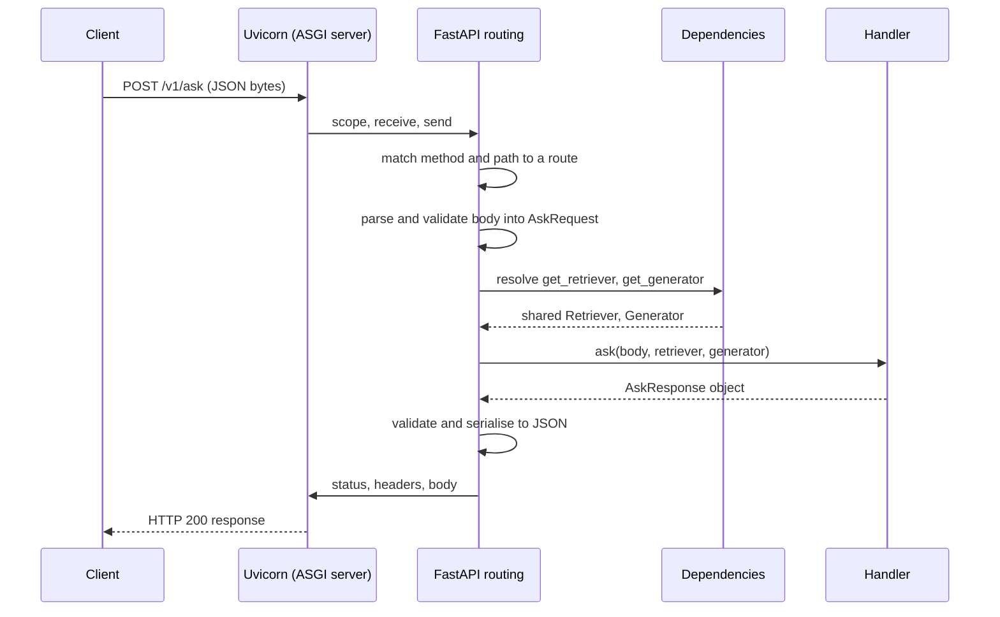
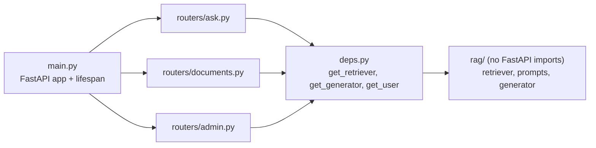

Until now your RAG pipeline has been a Python program you run yourself: a script, a notebook, a function you call from a test. Nobody else can use it. To put it in front of staff, a chat interface, a Slack bot or another team's service, it has to become a **web service**: a long-running process that listens on a network port, accepts requests in a standard format, runs the pipeline and sends back a response. This lesson builds that service with **FastAPI**, the Python web framework most RAG teams reach for, and explains what the framework is actually doing on your behalf.

The goal is a clear mental model of the moving parts: the server and the framework, routes and handlers, how request data becomes Python arguments, how a returned object becomes JSON, how expensive resources such as an index or a model are created once and shared, and how dependency injection lets you swap a real language model for a fake one in tests. The rest of this module then deepens each part: [REST API design](/learn/backend-engineering/rest-apis), [request validation](/learn/backend-engineering/request-validation), [authentication](/learn/backend-engineering/authentication), [async endpoints](/learn/backend-engineering/async-endpoints), [streaming](/learn/backend-engineering/streaming-apis), [error handling](/learn/backend-engineering/error-handling) and [API documentation](/learn/backend-engineering/api-documentation).

## Learning objectives

- Explain the roles of an ASGI server (Uvicorn) and an ASGI framework (FastAPI), and trace one request through both.
- Write path operations whose path parameters, query parameters and JSON bodies FastAPI fills in from type annotations.
- Load an index or model once at start-up with a `lifespan` function and share it with handlers through dependencies.
- Use `Depends` and `app.dependency_overrides` to replace a real component (such as a language model) with a test double.
- Test a FastAPI application in-process with `TestClient`, without starting a server.

## Prerequisites

- [Type hints](/learn/python-for-rag-engineering/type-hints): FastAPI reads your annotations at run time.
- [Dataclasses and Pydantic](/learn/python-for-rag-engineering/dataclasses-and-pydantic): request and response bodies are Pydantic models.
- [Working with APIs](/learn/python-for-rag-engineering/working-with-apis): the client side of HTTP (methods, status codes, headers). This lesson is the server side.
- [Offline and online processing](/learn/rag-architecture-fundamentals/offline-and-online-processing): the query-time path is what the service exposes.

## Why this matters

A RAG pipeline that works in a notebook is not yet a product. Several things change the moment it becomes a service.

**Many callers, one process.** A notebook runs one question at a time for one person. A service receives requests from many users at once, and every request shares the same memory, the same loaded models and the same connections. Code that rebuilt the index on every call, or kept per-user state in a global variable, was harmless in a notebook and is a bug in a service.

**Untrusted input.** In a notebook you type the question. In a service, the question arrives as bytes from the network, and it may be malformed, enormous or malicious. Something has to turn those bytes into well-typed Python values, or reject them clearly.

**A contract.** Other teams will write code against your endpoint. They need to know what to send, what they get back, and what each error means, and that contract must not change silently.

**Testability.** A pipeline that calls a paid language model on every request cannot be tested in CI without cost, flakiness and an API key. The service needs a seam where the model can be replaced.

Writing all of this by hand on top of raw HTTP is a lot of fiddly, security-sensitive code. A web framework provides it once. FastAPI in particular derives parsing, validation, serialisation and documentation from the same type annotations you already write, which is why it has become a common default for Python ML and RAG services.

## The intuition

Think of a restaurant. The **server** (the person at the door and the waiting staff) deals with the outside world: they accept customers, take orders in whatever words people use, and carry plates back. They know nothing about cooking. The **kitchen** knows how to cook but never talks to customers directly; it works from order tickets written in a fixed format.

The head chef also does not buy a new oven for each order. The ovens, the stock and the knives are set up before service starts and shared by every order. When a dish needs a particular sauce, the cook asks for it and someone hands it over, already prepared; the cook does not care whether it was made this morning or bought in.

Map this onto a RAG service:

- The **ASGI server** (Uvicorn) is the front of house: it owns the network socket, speaks HTTP and hands each request to the application in a standard form.
- **FastAPI** is the pass between front of house and kitchen: it turns the request into a typed order ticket (your function's arguments) and turns the finished dish (your return value) into an HTTP response.
- Your **handler functions** are the cooks.
- The **lifespan** is setting up the kitchen before opening: loading the index, the embedding model, the HTTP clients.
- **Dependencies** are the runner who hands the cook the sauce: the handler declares "I need a retriever" and receives one, without knowing where it came from. In a test, the runner can hand over a fake.

## How it works

### Server and framework: ASGI

Python web applications are split into two layers joined by a standard interface. **ASGI** (Asynchronous Server Gateway Interface) is that interface: a specification saying that an application is an `async` callable taking three arguments, `scope` (a dictionary describing the request: method, path, headers), `receive` (an awaitable that yields incoming body chunks) and `send` (an awaitable that emits the response start and body chunks). ASGI is the asynchronous successor to WSGI, which is what Flask and classic Django use.

- **Uvicorn** is an ASGI *server*. It opens the port, parses HTTP off the wire, and calls the application for each request. You can swap it for another ASGI server (Hypercorn, Granian) without touching your code.
- **Starlette** is a lightweight ASGI *toolkit*: routing, request and response classes, middleware, a test client.
- **FastAPI** is built on Starlette and adds the parts that read your type annotations: parameter parsing, validation with Pydantic, response serialisation, dependency injection and automatic OpenAPI documentation.

So `FastAPI()` gives you an object that *is* an ASGI application. `uvicorn app:app` imports it and serves it.

### The life of one request



Step by step, for a `POST /v1/ask` request:

1. Uvicorn reads the request line, headers and body from the socket and builds the ASGI `scope`.
2. Middleware (if any) runs, wrapping everything that follows. It can read or change the request and response, for example to add a request ID.
3. The router finds the **path operation** whose method and path template match: `POST` and `/v1/ask`. If the path matches but the method does not, the response is `405 Method Not Allowed`; if nothing matches, `404 Not Found`.
4. FastAPI looks at the handler's signature and gathers each parameter from the right place: the URL path, the query string, headers, or the JSON body. It validates each against its annotation. Any failure produces a `422 Unprocessable Content` response listing every problem, and your handler never runs.
5. FastAPI resolves the handler's **dependencies**, calling each dependency function (and *its* dependencies) and caching results within the request.
6. The handler runs. An `async def` handler runs on the event loop; a plain `def` handler is sent to a worker thread so that it cannot block the loop. Why this matters, and how to choose, is the subject of [Async endpoints](/learn/backend-engineering/async-endpoints).
7. The return value is validated against the declared return type (or `response_model`) and serialised to JSON. Fields not in the model are dropped, which is a useful guard against leaking internal data.
8. The response travels back out through the middleware to Uvicorn and onto the socket.

### Path operations and where parameters come from

A **path operation** is FastAPI's name for "an HTTP method on a path, plus the function that handles it". You declare one with a decorator:

```python
@app.get("/v1/documents/{doc_id}")
def read_document(doc_id: str, include_text: bool = True): ...
```

FastAPI decides where each parameter comes from using simple rules:

- A name that appears in the path template (`{doc_id}`) is a **path parameter**.
- A parameter of a simple type (`str`, `int`, `bool`, `float`, an enum) that is not in the path is a **query parameter**: `?include_text=false`. A default value makes it optional.
- A parameter annotated with a Pydantic model is the **JSON request body**.
- Anything can be made explicit with `Path()`, `Query()`, `Header()`, `Body()` and friends, usually inside `Annotated[...]`, which is also where constraints go. [Request validation](/learn/backend-engineering/request-validation) covers those in depth.

Conversion is automatic and strict enough to be useful: `?include_text=false` becomes Python `False`, and `top_k: int` given the string `"two"` is rejected with a 422 rather than reaching your code.

### Responses

Whatever the handler returns, FastAPI turns into a response. If you annotate the return type (`-> AskResponse`) or pass `response_model=`, FastAPI validates the returned data against that model and serialises *only* the declared fields. Otherwise it converts the value with its JSON encoder. The default status code is 200; set another with `status_code=201` on the decorator, or raise `HTTPException(status_code=404, detail=...)` to stop and return an error. Returning a `Response` object (or a subclass like `StreamingResponse`) bypasses serialisation entirely, which is how [streaming](/learn/backend-engineering/streaming-apis) works.

### Lifespan: create expensive things once

A RAG service holds objects that are expensive to create and safe to share: an embedding model (hundreds of megabytes, seconds to load), an index or a vector-database client, an HTTP client with a connection pool, a language-model SDK client. Creating them per request would add seconds of latency and exhaust memory and connections.

FastAPI's answer is the **lifespan** function, an async context manager passed to `FastAPI(lifespan=...)`. Code before its `yield` runs once when the server starts, before any request is accepted; code after `yield` runs once at shutdown. Objects are attached to `app.state`, which every request can reach through `request.app.state`. (Older tutorials use `@app.on_event("startup")`; that style is deprecated in favour of lifespan.)

Two rules keep this safe. First, only share objects that are safe to use from many requests at once: read-only indexes, thread-safe clients, connection pools. Second, never store per-request or per-user data on `app.state`; it is visible to every request.

### Dependency injection

A **dependency** is a function whose result a handler needs. You declare it with `Depends`:

```python
def get_retriever(request: Request) -> Retriever:
    return request.app.state.retriever

RetrieverDep = Annotated[Retriever, Depends(get_retriever)]

@app.post("/v1/ask")
def ask(body: AskRequest, retriever: RetrieverDep): ...
```

For each request FastAPI calls `get_retriever`, passes the result in as `retriever`, and the handler never knows how it was obtained. Dependencies can themselves have parameters (query parameters, headers, other dependencies), forming a small graph that FastAPI resolves; a dependency used twice in one request is called once by default. A dependency written as a generator (`yield` instead of `return`) can run clean-up code after the response, which is how per-request database sessions are opened and closed.

Dependency injection buys three things in a RAG service:

- **Reuse.** Authentication, tenant lookup and rate limiting are written once as dependencies and attached to every route that needs them.
- **Separation.** Handlers contain the pipeline logic only; where objects come from is decided elsewhere.
- **Test seams.** `app.dependency_overrides[get_generator] = make_fake` makes every handler that depends on `get_generator` receive the fake instead. No monkey-patching, no API key, no network.

### Organising a larger application

A single file is fine for a few endpoints. As the service grows, group related path operations into `APIRouter` objects (`routers/ask.py`, `routers/documents.py`, `routers/admin.py`), each with its own prefix, tags and shared dependencies, and include them in the app with `app.include_router(router, prefix="/v1")`. Keep the pipeline itself (retrieval, prompting, generation) in plain modules with no FastAPI imports, so it can be tested and reused by batch jobs without a web server. The web layer should be thin: parse, call the pipeline, shape the response.



## In code

The example builds a minimal AskMeridian service: a health check, a document lookup and an `ask` endpoint backed by a TF-IDF retriever. To keep it runnable without an API key, the "generator" simply returns the best passage; the point is the service structure, and the test shows how a real model plugs in through the same seam.

Install the dependencies (`httpx` is needed by FastAPI's test client):

```bash
pip install fastapi uvicorn httpx scikit-learn
```

Save this as `app.py`:

```python
from contextlib import asynccontextmanager
from typing import Annotated, Protocol

from fastapi import Depends, FastAPI, HTTPException, Request
from pydantic import BaseModel
from sklearn.feature_extraction.text import TfidfVectorizer

DOCS = {
    "leave": "Annual leave is 25 days; up to 5 unused days carry over and must be used by 31 March.",
    "remote": "Staff may work remotely up to 3 days a week; the home-office equipment budget is £400.",
    "expenses": "Expenses must be submitted within 30 days; anything over £75 needs a receipt.",
    "passwords": "Passwords rotate every 90 days, and the VPN is required on public Wi-Fi.",
    "laptops": "Laptops are refreshed every 3 years; report a lost laptop to the support desk at once.",
    "support": "The support desk is open 08:00 to 18:00 UK time.",
}


class Retriever:
    """A tiny TF-IDF retriever, built once and shared by every request."""

    def __init__(self, docs: dict[str, str]):
        self.ids = list(docs)
        self.texts = list(docs.values())
        self.vectoriser = TfidfVectorizer()
        self.matrix = self.vectoriser.fit_transform(self.texts)

    def search(self, query: str, k: int) -> list[tuple[str, str, float]]:
        scores = (self.matrix @ self.vectoriser.transform([query]).T).toarray().ravel()
        best = scores.argsort()[::-1][:k]
        return [(self.ids[i], self.texts[i], round(float(scores[i]), 3)) for i in best]


class Generator(Protocol):
    def answer(self, question: str, context: list[str]) -> str: ...


class EchoGenerator:
    """Stands in for the language model: returns the top passage verbatim."""

    def answer(self, question: str, context: list[str]) -> str:
        return context[0] if context else "I don't know."


@asynccontextmanager
async def lifespan(app: FastAPI):
    print("startup: building the index")
    app.state.retriever = Retriever(DOCS)
    app.state.generator = EchoGenerator()
    yield
    print("shutdown: releasing resources")


app = FastAPI(title="AskMeridian API", version="0.1.0", lifespan=lifespan)


def get_retriever(request: Request) -> Retriever:
    return request.app.state.retriever


def get_generator(request: Request) -> Generator:
    return request.app.state.generator


RetrieverDep = Annotated[Retriever, Depends(get_retriever)]
GeneratorDep = Annotated[Generator, Depends(get_generator)]


class AskRequest(BaseModel):
    question: str
    top_k: int = 3


class Source(BaseModel):
    id: str
    score: float


class AskResponse(BaseModel):
    answer: str
    sources: list[Source]


@app.get("/health")
def health() -> dict[str, str]:
    return {"status": "ok"}


@app.get("/v1/documents/{doc_id}")
def read_document(doc_id: str, retriever: RetrieverDep) -> dict[str, str]:
    if doc_id not in retriever.ids:
        raise HTTPException(status_code=404, detail=f"No document {doc_id!r}")
    i = retriever.ids.index(doc_id)
    return {"id": doc_id, "text": retriever.texts[i]}


@app.post("/v1/ask")
def ask(body: AskRequest, retriever: RetrieverDep, generator: GeneratorDep) -> AskResponse:
    hits = retriever.search(body.question, body.top_k)
    answer = generator.answer(body.question, [text for _, text, _ in hits])
    return AskResponse(answer=answer, sources=[Source(id=i, score=s) for i, _, s in hits])
```

And this as `run.py`, which exercises the app in-process:

```python
from fastapi.testclient import TestClient

from app import app, get_generator


with TestClient(app) as client:  # entering the block runs the lifespan startup
    print(client.get("/health").json())
    print(client.get("/v1/documents/leave").json())
    r = client.get("/v1/documents/holiday")
    print(r.status_code, r.json())

    r = client.post("/v1/ask", json={"question": "Do I need a receipt for expenses?", "top_k": 2})
    print(r.status_code, r.json())

    r = client.post("/v1/ask", json={"question": "How many days of leave?", "top_k": "two"})
    print(r.status_code, r.json()["detail"][0]["msg"])

    class CannedGenerator:
        def answer(self, question, context):
            return "canned answer"

    app.dependency_overrides[get_generator] = lambda: CannedGenerator()
    print(client.post("/v1/ask", json={"question": "VPN on public Wi-Fi?"}).json()["answer"])
    app.dependency_overrides.clear()

print([route.path for route in app.routes])
```

```output
startup: building the index
{'status': 'ok'}
{'id': 'leave', 'text': 'Annual leave is 25 days; up to 5 unused days carry over and must be used by 31 March.'}
404 {'detail': "No document 'holiday'"}
200 {'answer': 'Expenses must be submitted within 30 days; anything over £75 needs a receipt.', 'sources': [{'id': 'expenses', 'score': 0.439}, {'id': 'support', 'score': 0.0}]}
422 Input should be a valid integer, unable to parse string as an integer
canned answer
shutdown: releasing resources
['/openapi.json', '/docs', '/docs/oauth2-redirect', '/redoc', '/health', '/v1/documents/{doc_id}', '/v1/ask']
```

### What the important lines do

- **`lifespan`** builds the retriever once. The output shows "startup" printed a single time even though five requests followed. In a real service this is where you would load the [embedding model](/learn/embedding-models), open the Qdrant client and create the Anthropic client.
- **`FastAPI(..., lifespan=lifespan)`** registers it. `TestClient` used as a context manager (`with TestClient(app) as client`) runs startup on entry and shutdown on exit. Used without `with`, the lifespan does not run and `app.state.retriever` would not exist, which is a common source of confusing test failures.
- **`get_retriever` and `get_generator`** are dependencies that fetch shared objects from `app.state`. The `Annotated` aliases (`RetrieverDep`) keep handler signatures short and make the dependency reusable.
- **`read_document(doc_id: str, ...)`**: `doc_id` appears in the path template, so it is a path parameter. An unknown ID raises `HTTPException(404)`, which FastAPI turns into the `{"detail": ...}` body shown. Without that check, `list.index` would raise `ValueError` and the client would get a bare 500.
- **`ask(body: AskRequest, ...)`**: `AskRequest` is a Pydantic model, so it is read from the JSON body. `top_k` has a default, so clients may omit it. Sending `"two"` fails validation and returns 422 before the handler runs.
- **`-> AskResponse`** declares the response model. FastAPI validates the returned object and serialises it, and that model also appears in the generated documentation.
- **`app.dependency_overrides`** swaps the generator for a canned one. This is exactly how you will test the real service: override the dependency that wraps the Anthropic client, and every test runs offline in milliseconds.
- The route list shows `/openapi.json`, `/docs` and `/redoc`, which FastAPI adds automatically. [API documentation](/learn/backend-engineering/api-documentation) covers what they contain and how to control them.

Notice that the `support` source has a score of exactly 0.0. The retriever always returns `top_k` results whether or not they are relevant, a behaviour discussed in [Query-document matching](/learn/rag-architecture-fundamentals/query-document-matching). A real service would apply a relevance floor before returning sources.

### Running it for real

To serve the same app over the network:

```bash
uvicorn app:app --host 127.0.0.1 --port 8000 --reload
```

`app:app` means "module `app`, attribute `app`". `--reload` restarts the server when files change and is for development only. Then, from another terminal:

```bash
curl -s -X POST http://127.0.0.1:8000/v1/ask \
  -H "Content-Type: application/json" \
  -d '{"question": "How long do I have to submit expenses?"}'
```

and open `http://127.0.0.1:8000/docs` in a browser for interactive documentation. (FastAPI also ships a `fastapi` command-line tool, installed with `pip install "fastapi[standard]"`, whose `fastapi dev` and `fastapi run` wrap Uvicorn with sensible defaults.)

### Plugging in a real model

Replacing `EchoGenerator` with Claude means writing a class with the same `answer` method and creating it in the lifespan. This was not executed here, because it needs an API key:

```python
import anthropic


class ClaudeGenerator:
    def __init__(self):
        self.client = anthropic.Anthropic()  # reads ANTHROPIC_API_KEY from the environment

    def answer(self, question: str, context: list[str]) -> str:
        prompt = "Context:\n" + "\n\n".join(context) + f"\n\nQuestion: {question}"
        response = self.client.messages.create(
            model="claude-opus-5-5",
            max_tokens=1024,
            system="Answer only from the provided context. If the answer is not there, say you don't know.",
            messages=[{"role": "user", "content": prompt}],
        )
        return "".join(block.text for block in response.content if block.type == "text")
```

In the lifespan, `app.state.generator = ClaudeGenerator()`. Nothing else changes: the handler still depends on `get_generator`, and tests still override it. Because `ask` is a plain `def` and this client is synchronous, FastAPI runs the call in a worker thread, so a slow model response does not freeze the server. [Async endpoints](/learn/backend-engineering/async-endpoints) explains when to switch to the asynchronous client instead.

### Common errors

- **`AttributeError: 'State' object has no attribute 'retriever'`** in tests: the `TestClient` was not used as a context manager, so the lifespan never ran.
- **Every field reported as missing (422)** when calling from `requests` or `curl`: the body was sent as form data, not JSON. Use `json=` in Python clients, or `-H "Content-Type: application/json"` with `curl`.
- **A parameter you meant as a body appears as a query parameter**: it is a plain `str`, not a model. Wrap it in a model or use `Body()`.
- **`Address already in use`**: another Uvicorn is still running on that port.

### Extending it

Add a `GET /v1/search?q=...&k=...` endpoint that returns sources without an answer, put the routes in an `APIRouter`, and replace the TF-IDF retriever with the MiniLM embedder from [Dense retrieval](/learn/dense-retrieval), loaded in the lifespan.

## A real-world example

Meridian's Platform team first exposed AskMeridian through a quick Flask wrapper written during a hack day. The handler built the TF-IDF index and loaded the embedding model inside the request function, because that was how the notebook had worked. With one tester it felt fine: each question took a few seconds. When the Slack bot went live to a pilot group of fifty staff, the service fell over within an hour. Every request loaded its own copy of the model, memory climbed with each concurrent request until the container was killed, and requests queued behind one another.

Tomás, who picked up the incident, rewrote the service in FastAPI with three structural changes. The model, the Qdrant client and the Anthropic client moved into a lifespan function, so they were created once per process. Handlers received them through dependencies rather than reaching for globals. And the language-model client was wrapped in a `get_generator` dependency, so the team's test suite could override it with a canned generator.

That last change mattered more than they expected. Before it, nobody ran the end-to-end tests because they cost money and needed a key; afterwards, forty tests ran in CI on every pull request in a couple of seconds, and a later refactor of the prompt-assembly code was caught breaking source citations before it shipped. The performance fix was the visible win; the test seam was the lasting one.

## Common mistakes

- **Loading models or building indexes inside a handler.** Every request pays the load time and memory; concurrent requests multiply it. Load once in the lifespan.
- **Keeping per-user state in globals or `app.state`.** Every request in the process shares it, so one user's conversation can leak into another's answer. Per-request data belongs in the request; per-user data belongs in a store keyed by the authenticated user.
- **Putting the whole pipeline in the handler.** Retrieval and prompting become untestable without HTTP and unusable from batch jobs. Keep handlers thin.
- **Using `TestClient` without `with`.** The lifespan does not run and shared objects are missing.
- **Running with `--reload` or a debugger in production.** Reload watches the file system and restarts on change; it is a development convenience, not a deployment mode.
- **Returning raw internal objects.** Without a response model, every attribute you return is serialised, including fields you did not mean to expose.

## Best practices

- Declare a response model for every endpoint, so the output is validated, filtered and documented.
- Create shared clients (HTTP, vector database, language model) in the lifespan and close them after its `yield`.
- Wrap every external component (retriever, generator, reranker, clock) in a dependency, so tests can override it.
- Version the API in the path (`/v1/...`) from the first release; see [REST APIs](/learn/backend-engineering/rest-apis).
- Keep the RAG pipeline in modules with no web-framework imports; the FastAPI layer only translates between HTTP and Python.
- Add a cheap `/health` endpoint that does not call the model, for load balancers and container orchestrators to probe.

## Performance considerations

FastAPI's own overhead per request (routing, validation, serialisation) is small next to the work a RAG request does. Embedding a query takes milliseconds to tens of milliseconds, a vector search a few milliseconds to tens of milliseconds, and a language-model answer seconds. Optimising the framework is rarely the first job; not doing expensive things per request is.

Memory is where the architecture shows. Uvicorn can run several **worker processes** (`--workers 4`), each a separate Python process with its own copy of everything the lifespan loads. If the embedding model and its runtime take about 500 MB in memory (an assumption; measure yours), four workers need about 2 GB for the model alone. That is a reason to consider calling a separate embedding service, or running fewer, more concurrent workers, rather than adding processes blindly. How many processes and machines to run is covered in [Horizontal scaling](/learn/production-architecture/horizontal-scaling).

Concurrency within a process depends on whether handlers are `async def` or `def`. Synchronous handlers run in a thread pool whose default size is 40 threads (set by AnyIO, the concurrency library Starlette uses), so a process can be blocked in at most 40 synchronous calls at once; the 41st request waits. That limit, and when it bites, is the core of [Async endpoints](/learn/backend-engineering/async-endpoints).

## Security considerations

A service is reachable by anything that can reach its port. Bind to `127.0.0.1` during development; in production, put it behind a reverse proxy or load balancer that terminates TLS. Until [authentication](/learn/backend-engineering/authentication) is in place, every endpoint is public, including `/docs`, which lists every route and schema for anyone who looks. Never echo exceptions or stack traces to clients; FastAPI returns a generic 500 for unhandled errors by default, and [Error handling](/learn/backend-engineering/error-handling) shows how to keep it that way while still logging the detail. Secrets such as `ANTHROPIC_API_KEY` come from the environment, not from source code.

## Summary

- A Python web service has two layers: an ASGI server (Uvicorn) that speaks HTTP, and an ASGI application (FastAPI, built on Starlette) that maps requests to your functions.
- FastAPI reads type annotations to decide where each parameter comes from (path, query, body), validates it, and rejects bad input with a 422 before your code runs.
- A declared response model validates, filters and documents what each endpoint returns.
- The lifespan function creates expensive, shareable objects once per process; dependencies hand them to handlers.
- `Depends` and `app.dependency_overrides` give every external component a test seam, so the service can be tested offline with `TestClient`.

## Exercises

**1.** For the handler `def search(collection: str, q: str, k: int = 5)` registered as `@app.get("/v1/collections/{collection}/search")`, say where each parameter is read from, and what response `GET /v1/collections/handbook/search?k=3` produces.

<details><summary>Show solution</summary>

`collection` appears in the path template, so it is a path parameter. `q` and `k` are simple types not in the path, so they are query parameters; `k` has a default and is optional, `q` has none and is required.

The request omits `q`, so validation fails and FastAPI returns `422` with a `detail` list containing an entry whose `loc` is `["query", "q"]` and whose `type` is `"missing"`. The handler does not run.

</details>

**2.** A colleague writes a dependency `def get_history(): return app.state.history` where `app.state.history` is a list that every `ask` request appends the user's question to, "so the model has conversation context". Explain what goes wrong with two users, and propose a design.

<details><summary>Show solution</summary>

`app.state` is shared by every request in the process. Both users' questions go into the same list, so user A's prompt includes user B's questions (a privacy leak as well as a quality bug). With several worker processes, each has its own list, so a user's history also depends on which worker they hit. And the list grows without bound.

Keep conversation history outside the process, keyed by an authenticated user and a conversation ID: a database table or a cache such as Redis with an expiry. The dependency reads the current user (from [authentication](/learn/backend-engineering/authentication)) and the conversation ID (from the path), loads that history, and returns it. Nothing per-user lives on `app.state`.

</details>

**3.** Write a pytest test for the example app that checks `/v1/ask` returns the canned generator's answer and that the first source for "receipt for expenses" is `expenses`, without calling a real model.

<details><summary>Show solution</summary>

```python
from fastapi.testclient import TestClient

from app import app, get_generator


class CannedGenerator:
    def answer(self, question, context):
        return "canned"


def test_ask_uses_generator_and_ranks_sources():
    app.dependency_overrides[get_generator] = lambda: CannedGenerator()
    try:
        with TestClient(app) as client:
            r = client.post("/v1/ask", json={"question": "receipt for expenses"})
        assert r.status_code == 200
        body = r.json()
        assert body["answer"] == "canned"
        assert body["sources"][0]["id"] == "expenses"
    finally:
        app.dependency_overrides.clear()
```

Clearing the overrides in `finally` stops one test's fake from leaking into the next. A pytest fixture that yields the client and clears overrides afterwards is the tidier version once there are several tests.

</details>

**4.** Design decision. AskMeridian must serve a 500 MB embedding model, and the team proposes `uvicorn --workers 8` on a machine with 4 GB of RAM "for throughput". Assess the proposal and suggest an alternative.

<details><summary>Show solution</summary>

Each worker is a separate process that runs the lifespan and loads its own copy of the model: 8 × 500 MB = 4 GB for the model alone, before Python, the index client and request buffers. The machine will run out of memory or swap heavily.

More processes also do not help much for the dominant cost: most request time is spent waiting on the language model, which concurrency within a process handles well (async handlers, or the thread pool for sync ones). Alternatives: run two or three workers and make the model-calling path asynchronous; or move embedding into a separate service (or a hosted embedding API) so web workers are small and can scale independently; or scale out across machines behind a load balancer. Measure memory per worker before choosing the count.

</details>

## Check your understanding

```quiz
[
  {
    "q": "What is the division of labour between Uvicorn and FastAPI?",
    "options": [
      "Uvicorn validates request bodies; FastAPI opens the network socket",
      "Uvicorn speaks HTTP on the socket and calls the ASGI application; FastAPI routes, validates and serialises",
      "They are two names for the same component",
      "FastAPI is the server and Uvicorn generates the documentation"
    ],
    "answer": 1,
    "why": "Uvicorn is an ASGI server. FastAPI (on Starlette) is an ASGI application framework that maps requests to handlers."
  },
  {
    "q": "In `@app.post(\"/v1/ask\")` with handler `def ask(body: AskRequest, verbose: bool = False)`, where does `verbose` come from?",
    "options": [
      "The JSON body",
      "A header",
      "The query string",
      "The path"
    ],
    "answer": 2,
    "why": "A simple-typed parameter that is not in the path template is a query parameter. Only the Pydantic model is read from the body."
  },
  {
    "q": "Where should an AskMeridian service load its embedding model?",
    "options": [
      "In the lifespan function, once per process, shared through a dependency",
      "Inside each handler, so every request has a fresh copy",
      "In a dependency that creates it on every call",
      "In the client, which sends the model with each request"
    ],
    "answer": 0,
    "why": "Loading is slow and memory-heavy; the model is read-only and safe to share, so it belongs in the lifespan."
  },
  {
    "q": "A test sets `app.dependency_overrides[get_generator] = lambda: Fake()`. What changes?",
    "options": [
      "Only the first request uses Fake",
      "The real generator is deleted from app.state",
      "Nothing, unless the handler is async",
      "Every handler that depends on get_generator receives a Fake instead"
    ],
    "answer": 3,
    "why": "FastAPI consults dependency_overrides when resolving dependencies, so every route using get_generator gets the override until it is cleared."
  },
  {
    "q": "A client sends `{\"question\": \"leave?\", \"top_k\": \"many\"}` to an endpoint whose model declares `top_k: int`. What happens?",
    "options": [
      "The handler runs with top_k set to 0",
      "FastAPI returns 422 and the handler never runs",
      "FastAPI returns 500 because of a ValueError",
      "The field is silently dropped and the default is used"
    ],
    "answer": 1,
    "why": "Validation happens before the handler. A value that cannot be converted to int produces a 422 response listing the error."
  }
]
```

## Further reading

- FastAPI documentation, [fastapi.tiangolo.com](https://fastapi.tiangolo.com/): the tutorial sections on path operations, dependencies, lifespan events and testing.
- Starlette documentation: routing, requests and responses, middleware and the test client underneath FastAPI.
- Uvicorn documentation: server options, workers and deployment.
- The ASGI specification, [asgi.readthedocs.io](https://asgi.readthedocs.io/): the interface between server and application.
- Pydantic documentation, [docs.pydantic.dev](https://docs.pydantic.dev/): the models FastAPI uses for validation and serialisation.
