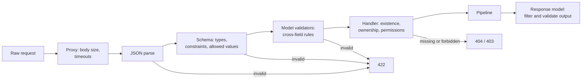

Every request your RAG service receives is a claim made by a stranger: "here is a question, here are the filters I want, here is how many results I need". **Request validation** is the discipline of checking those claims at the door, so that by the time a value reaches your retriever or your prompt it is known to have the right type, the right size and a permitted value. In FastAPI most of that checking is declared rather than written: you describe what a valid request looks like with type annotations and Pydantic models, and the framework rejects everything else with a precise `422` response.

This lesson assumes you know Pydantic itself from [Dataclasses and Pydantic](/learn/python-for-rag-engineering/dataclasses-and-pydantic). It focuses on what changes at an HTTP boundary: constraining path, query and header parameters; designing request models that refuse unknown fields; the limits a RAG service specifically needs (question length, `top_k`, metadata filters); how validation errors are reported; and what validation cannot do for you.

## Learning objectives

- Constrain path, query, header and body inputs in FastAPI with `Annotated`, `Path`, `Query`, `Field` and `StringConstraints`.
- Design request models for a search endpoint that forbid unknown fields, bound sizes and restrict metadata filters to an allow-list.
- Read FastAPI's `422` error format and predict which errors a given request produces, including when model validators do not run.
- Use response models to stop internal fields (permissions, embeddings, internal IDs) from leaking to clients.
- Explain which checks belong in schema validation and which belong in the handler, the proxy or the authorisation layer.

## Prerequisites

- [Dataclasses and Pydantic](/learn/python-for-rag-engineering/dataclasses-and-pydantic): models, constraints, validators, lax and strict modes.
- [FastAPI](/learn/backend-engineering/fastapi): where parameters come from, response models.
- [REST APIs](/learn/backend-engineering/rest-apis): status codes, in particular `400`, `413` and `422`.
- [Metadata filtering](/learn/advanced-vector-database-engineering/metadata-filtering): what vector-database filters do.

## Why this matters

A RAG service turns request fields into actions with real costs and real permissions. Each unvalidated field is a lever someone can pull.

- **`top_k`** controls how many chunks are fetched and stuffed into the prompt. A client that sends `top_k: 10000` makes the vector database do heavy work and, if you pass the results to the model, builds a prompt that is enormous, slow and expensive, or that exceeds the [context window](/learn/understanding-large-language-models/context-windows) and fails.
- **The question** becomes part of a prompt and is embedded. A 2 MB "question" costs embedding time, model tokens and log storage, and is almost certainly not a question.
- **Metadata filters** are the most dangerous. If a client can send an arbitrary filter dictionary and the service passes it to the vector database, the client can filter on fields you never meant to expose, such as an access-control list, or remove a filter the server meant to impose. That turns a convenience feature into a way around document permissions.
- **Typos fail silently.** By default Pydantic ignores fields it does not know. A client that sends `"filter"` instead of `"filters"` gets unfiltered results and no error, and may never notice.

Validation at the boundary means each of these is stopped once, at the door, with an error that tells the caller exactly what to fix, rather than being handled (or not) deep inside the pipeline.

## The intuition

Picture the post room of a secure building. Before any parcel reaches a desk, the post room checks it: is it addressed to someone who works here, is it within the size limit, is the label legible, does it contain anything on the prohibited list? Parcels that fail are returned to the sender with a note saying exactly which check failed. People at their desks never have to wonder whether a parcel is safe to open; anything that reaches them has passed.

Two things the post room does *not* do are just as important. It does not decide whether the recipient is allowed to receive a particular item; that is a security decision made with knowledge of who the recipient is. And it does not read the letters to see whether they are sensible; that is the recipient's job. Validation checks the *shape* of a request. Authorisation and business logic come after.

## How it works

### Layers of checking

A request passes through several checks, each catching what the previous one cannot:

1. **Transport limits**, at the reverse proxy or server: maximum body size, maximum header size, request timeouts. These stop a 1 GB upload before Python reads it into memory.
2. **Syntax**: is the body valid JSON? FastAPI reports a `json_invalid` error with a `422` if not.
3. **Schema**: does each field have the right type, and does each value satisfy its declared constraints (length, range, pattern, allowed values)? This is Pydantic's job, driven by your annotations.
4. **Cross-field rules**: constraints that involve several fields, such as "the start date is not after the end date". These are model validators.
5. **State-dependent checks**, in the handler: does this collection exist? Does this conversation belong to this user? These need a database or the caller's identity, so they are not schema validation, and they return `404` or `403` rather than `422`.
6. **Output validation**: the response is checked against its response model on the way out, and fields not in the model are dropped.



### Constraining parameters

Path, query and header parameters are constrained with `Annotated` and the parameter functions:

```python
collection: Annotated[str, Path(pattern=r"^[a-z][a-z0-9-]{1,40}$")]
limit: Annotated[int, Query(ge=1, le=100)] = 20
request_id: Annotated[str | None, Header(max_length=64)] = None
```

`Path`, `Query` and `Header` accept the same constraint arguments as Pydantic's `Field`: `ge`, `gt`, `le`, `lt` for numbers, `min_length`, `max_length` and `pattern` for strings, and documentation fields such as `description`. The constraints are enforced *and* written into the OpenAPI schema, so clients can see them.

Restricting identifiers with a pattern is cheap insurance. Collection names often end up in log lines, metric labels, file paths or queries to other systems; a pattern of lower-case letters, digits and hyphens rules out path traversal (`../`), whitespace, and characters with special meaning elsewhere.

### Designing the request model

For a search or ask endpoint, the body model is where most decisions live. The main choices:

- **`extra="forbid"`** in the model configuration rejects unknown fields instead of ignoring them. For a public API this is usually right: it turns typos into errors and stops clients smuggling in fields you did not design for. (It is a trade-off: if you later add a field and a client sends it to an old server, the old server rejects it. For request models that you control the rollout of, strictness wins.)
- **Bounds on every size.** Strings get `max_length`, lists get `max_length`, numbers get `ge` and `le`. There should be no field whose size the client controls without limit.
- **Closed sets as `Literal` or `Enum`.** If only three sources exist, the type should say so, and the error message will list them.
- **Normalisation that is safe to do.** `str_strip_whitespace=True` strips leading and trailing spaces. Unicode normalisation (NFKC) folds look-alike forms, such as full-width letters, into their ordinary equivalents, so that "ｌｅａｖｅ" and "leave" embed and match the same way.
- **Explicit defaults with `default_factory`** for mutable values such as lists or nested models, so no two requests share an object.

### Lax and strict

Pydantic by default runs in **lax mode**, converting values where the conversion is unambiguous: the JSON string `"7"` becomes the integer 7, but `7.5` is rejected because converting it would lose information. For most API fields lax mode is fine and friendlier to clients written in loosely typed languages. Where a coercion could hide a client bug, mark the field or model strict (`Field(strict=True)` or `ConfigDict(strict=True)`), and the string `"7"` is rejected.

### Validators and their order

Field validators (`@field_validator`) check or transform a single field; model validators (`@model_validator(mode="after")`) see the whole, already-validated model and are where cross-field rules live. One consequence of the order catches people out: **an "after" model validator runs only if every field validated successfully.** If a request has a bad source *and* an inverted date range, the client sees only the source error; after fixing it, the date error appears. That is usually acceptable, but it is worth knowing when you write tests that expect a particular error list.

### Metadata filters: an allow-list, never a pass-through

Retrieval APIs commonly let clients narrow results by metadata: only the handbook, only documents updated this year. The tempting design is to accept a filter object in the vector database's own format and pass it straight through. Do not. The client then controls the full filter language of your database, including fields it should never touch.

The safe design has three parts:

1. Define a **filter model** with one field per permitted filter, each typed and bounded, and `extra="forbid"`.
2. **Translate** the validated model into the database's filter format in server code. The client never writes database syntax.
3. **Add** the server's own mandatory conditions (tenant, access-control groups derived from the authenticated user) in server code *after* translation, combined with `must` so the client's filters can only narrow the results, never widen them. That last step belongs to authorisation, covered in [Document-level permissions](/learn/access-control-and-privacy/document-level-permissions).

### The error format

When validation fails, FastAPI responds with `422` and a body like this (taken from the example below):

```json
{"detail": [{"type": "less_than_equal", "loc": ["body", "top_k"],
             "msg": "Input should be less than or equal to 20", "input": 500, "ctx": {"le": 20}}]}
```

- `type` is a stable, machine-readable error code; clients should branch on it rather than on `msg`.
- `loc` is the path to the offending value: where it came from (`body`, `query`, `path`, `header`) followed by field names and list indexes.
- `msg` is a human-readable explanation.
- `input` echoes the value that failed.
- `ctx` carries the constraint's parameters.

All errors found in one pass are reported together, so a client can fix everything at once. The `input` echo deserves a thought: if a client puts a secret in the wrong field, it comes back in the error response and possibly in your logs. [Error handling](/learn/backend-engineering/error-handling) shows how to reshape this response into the service's standard error format.

### Validating what goes out

Validation is not only for input. A response model (the return annotation, or `response_model=`) validates the handler's output and **serialises only the declared fields**. In a RAG service, the records coming back from the retriever often carry fields that must never reach a client: access-control lists, raw embeddings, internal storage paths, the identity of the model that produced them. Declaring a response model that lists only the public fields is a structural guarantee that they are dropped, however the pipeline changes underneath. If the handler returns data that does not fit the response model, FastAPI raises a server error rather than sending malformed output, which is the right failure: it is your bug, not the client's.

### What validation cannot do

- **It cannot limit body size before parsing.** Pydantic validates a body that has already been read. Enforce a maximum request size at the reverse proxy (most proxies and load balancers have a setting for it) or in middleware, and reject with `413`.
- **It cannot decide permissions.** Whether *this* user may search *this* collection depends on who they are. That is [authentication](/learn/backend-engineering/authentication) and authorisation.
- **It cannot make a question safe to put in a prompt.** A well-formed, 200-character question can still be a prompt-injection attempt. Validation bounds the input; defending the prompt is the subject of [Prompt injection](/learn/rag-security-fundamentals/prompt-injection).

## In code

The example implements AskMeridian's search endpoint with a constrained path parameter, a strict request model, an allow-listed filter model translated into a Qdrant filter, and a response model that strips internal fields. It sends six requests, one valid and five broken in different ways, and prints what comes back.

```bash
pip install fastapi httpx qdrant-client
```

`qdrant-client` is used only for its filter model classes (`qdrant_client.models`), to show the translation step; no Qdrant server is needed. Save as `app.py`:

```python
import unicodedata
from datetime import date
from typing import Annotated, Literal

from fastapi import FastAPI, Path
from pydantic import BaseModel, ConfigDict, Field, StringConstraints, field_validator, model_validator
from qdrant_client import models

app = FastAPI()

Source = Literal["handbook", "it-runbooks", "product-docs"]


class Filters(BaseModel):
    model_config = ConfigDict(extra="forbid")

    sources: Annotated[list[Source], Field(max_length=3)] = []
    updated_after: date | None = None
    updated_before: date | None = None

    @model_validator(mode="after")
    def check_range(self) -> "Filters":
        if self.updated_after and self.updated_before and self.updated_after > self.updated_before:
            raise ValueError("updated_after must not be later than updated_before")
        return self


class SearchRequest(BaseModel):
    model_config = ConfigDict(extra="forbid", str_strip_whitespace=True)

    query: Annotated[str, StringConstraints(min_length=1, max_length=1000)]
    top_k: Annotated[int, Field(ge=1, le=20)] = 5
    filters: Filters = Field(default_factory=Filters)

    @field_validator("query")
    @classmethod
    def clean_query(cls, v: str) -> str:
        v = unicodedata.normalize("NFKC", v)
        if any(unicodedata.category(ch) == "Cc" and ch not in "\n\t" for ch in v):
            raise ValueError("query contains control characters")
        return v


class Hit(BaseModel):
    doc_id: str
    text: str
    score: float


class SearchResponse(BaseModel):
    query: str
    hits: list[Hit]


def to_qdrant_filter(f: Filters) -> models.Filter | None:
    must: list[models.Condition] = []
    if f.sources:
        must.append(models.FieldCondition(key="source", match=models.MatchAny(any=list(f.sources))))
    if f.updated_after or f.updated_before:
        must.append(models.FieldCondition(
            key="updated", range=models.DatetimeRange(gte=f.updated_after, lte=f.updated_before)))
    return models.Filter(must=must) if must else None


@app.post("/v1/collections/{collection}/search")
def search(
    collection: Annotated[str, Path(pattern=r"^[a-z][a-z0-9-]{1,40}$")],
    body: SearchRequest,
) -> SearchResponse:
    qfilter = to_qdrant_filter(body.filters)
    print("  qdrant filter:", qfilter.model_dump(mode="json", exclude_none=True) if qfilter else None)
    # The retriever's raw record carries internal fields the client must never see.
    raw = {"doc_id": "leave", "text": "Annual leave is 25 days.", "score": 0.82,
           "acl": ["group:all-staff"], "embedding_model": "all-MiniLM-L6-v2"}
    return SearchResponse(query=body.query, hits=[raw])
```

The client script `run.py`:

```python
from fastapi.testclient import TestClient

from app import app

client = TestClient(app)


def show(label, collection, body):
    r = client.post(f"/v1/collections/{collection}/search", json=body)
    print(f"{label}: {r.status_code}")
    if r.status_code == 200:
        print("  response:", r.json())
    else:
        for e in r.json()["detail"]:
            print(f"  {e['loc']} {e['type']}: {e['msg']}")


show("valid", "handbook", {
    "query": "  how much ｌｅａｖｅ do I get?  ",
    "top_k": 3,
    "filters": {"sources": ["handbook"], "updated_after": "2025-01-01"},
})
show("several problems", "handbook", {"query": "", "top_k": 500, "filter": {"source": "hr"}})
show("unknown source and bad date range", "handbook", {
    "query": "VPN", "filters": {"sources": ["payroll"], "updated_after": "2025-06-01",
                                 "updated_before": "2025-01-01"}})
show("filter injection attempt", "handbook", {
    "query": "salaries", "filters": {"sources": ["handbook"], "acl": ["group:hr-only"]}})
show("control character", "handbook", {"query": "leave\u0000 policy"})
show("bad collection name", "Handbook;DROP", {"query": "leave"})
```

```output
  qdrant filter: {'must': [{'key': 'source', 'match': {'any': ['handbook']}}, {'key': 'updated', 'range': {'gte': '2025-01-01'}}]}
valid: 200
  response: {'query': 'how much leave do I get?', 'hits': [{'doc_id': 'leave', 'text': 'Annual leave is 25 days.', 'score': 0.82}]}
several problems: 422
  ['body', 'query'] string_too_short: String should have at least 1 character
  ['body', 'top_k'] less_than_equal: Input should be less than or equal to 20
  ['body', 'filter'] extra_forbidden: Extra inputs are not permitted
unknown source and bad date range: 422
  ['body', 'filters', 'sources', 0] literal_error: Input should be 'handbook', 'it-runbooks' or 'product-docs'
filter injection attempt: 422
  ['body', 'filters', 'acl'] extra_forbidden: Extra inputs are not permitted
control character: 422
  ['body', 'query'] value_error: Value error, query contains control characters
bad collection name: 422
  ['path', 'collection'] string_pattern_mismatch: String should match pattern '^[a-z][a-z0-9-]{1,40}$'
```

### What the output shows

- **Valid request.** The query arrived with surrounding spaces and full-width letters; it reached the handler as `how much leave do I get?`. The filter was translated into a Qdrant `Filter` with two `must` conditions, and the date string became a `date`. The response contains `doc_id`, `text` and `score` only: the `acl` and `embedding_model` fields in the raw record were dropped by the response model.
- **Several problems** produces three errors in one response: the empty query, the oversized `top_k`, and the misspelled `filter`. Without `extra="forbid"` the typo would have been silently ignored and the request would have succeeded, unfiltered.
- **Unknown source and bad date range** reports only the source error. The date check lives in an "after" model validator, which does not run because a field failed. Fix the source and resubmit, and the date error appears.
- **Filter injection attempt.** The client tried to add an `acl` condition. The filter model has no such field, so the request is refused. More importantly, even if it had been accepted, the client could never write raw Qdrant syntax, because the server builds the filter itself.
- **Control character.** A NUL byte in the query is rejected by the field validator. Control characters cause trouble in logs, terminals and some downstream systems, and no genuine question needs them.
- **Bad collection name** fails the path pattern before the body is even considered relevant.

### Important lines

- `Annotated[str, StringConstraints(min_length=1, max_length=1000)]` bounds the question. The limit is a product decision: long enough for any genuine question, short enough to cap cost.
- `Field(ge=1, le=20)` bounds `top_k`. Twenty is an assumption tied to how many chunks the prompt can hold; derive yours from your context budget.
- `Field(default_factory=Filters)` gives each request its own empty filter model.
- `to_qdrant_filter` is the translation step. `MatchAny` and `DatetimeRange` are Qdrant's documented filter conditions. In a real service, the server's permission conditions would be appended to `must` here.
- `-> SearchResponse` makes the response model the gatekeeper for output, so the raw dictionary with internal fields can be returned safely.

### Common errors and extensions

A frequent surprise is that `"top_k": "7"` (a string) is accepted, because lax mode converts it; add `strict=True` if that matters to you. Another is writing the filter model without `extra="forbid"`, which brings back silent typos. To extend the example, add a `language` filter restricted to a `Literal` of supported language codes, and make the server append a mandatory `tenant` condition to `must`.

## A real-world example

The first version of AskMeridian's search API, written by Meridian's Platform team, accepted `filters` as a free-form dictionary and passed it to Qdrant's filter parser, because "the Slack bot needs flexible filtering". It worked well until a security review by Wen, who joined from the security team, noticed that every chunk's payload included an `acl` field listing the groups allowed to read it, and that the server's own permission condition was merged into the client's filter by dictionary update.

Wen sent a request whose filter contained its own `acl` key. The dictionary merge let the client's value overwrite the server's, and results included chunks from the HR-only salary-bands document. No exotic attack was needed, just knowledge of a field name, which the API's own error messages had revealed.

The fix was the design in this lesson. The filter became a closed Pydantic model with three permitted fields and `extra="forbid"`; the server translated it into Qdrant's format itself; and the permission condition was appended as a separate `must` clause after translation, so client filters could only narrow results. The team added a regression test that sends an `acl` filter and asserts a `422`. The broader lesson they wrote up: anything a client can say to your database, it will eventually say.

## Common mistakes

- **Passing client-supplied filter dictionaries to the vector database.** Clients can filter on internal fields or override server-imposed conditions, bypassing document permissions.
- **Leaving `top_k`, list lengths or string lengths unbounded.** One request can make retrieval slow, the prompt huge, and the bill large.
- **Allowing unknown fields on public request models.** Typos are silently ignored and clients believe a filter is applied when it is not.
- **Returning raw retriever records without a response model.** Access-control lists, embeddings and internal paths leak to clients.
- **Relying on Pydantic for body-size limits.** By the time the model sees the body, it has already been read into memory.
- **Treating validation as authorisation.** A perfectly valid request for another user's conversation is still forbidden; that check needs the caller's identity.
- **Branching on error messages instead of error types.** Messages change between library versions; `type` values are designed to be stable.

## Best practices

- Give every client-controlled size a bound: string lengths, list lengths, numeric ranges, and an overall body size at the proxy.
- Use `extra="forbid"` on request models of public endpoints.
- Model filters as a closed set of typed fields, translate them on the server, and append server-side conditions so client filters can only narrow results.
- Express closed sets as `Literal` or `Enum`, so both validation and documentation list the allowed values.
- Declare a response model containing only public fields for every endpoint.
- Write tests that send invalid requests and assert the error `type` and `loc`, so loosening a constraint is a deliberate, visible change.

## Performance considerations

Validation is cheap relative to everything else a RAG request does. Pydantic's core is implemented in Rust, and validating a small request model typically takes microseconds; even at thousands of requests per second this is a negligible fraction of a request whose embedding call alone takes milliseconds. Do not remove validation for speed.

What validation does affect is the cost of the *rest* of the request, because the limits you set bound the work. Suppose the question is limited to 1,000 characters (roughly 250 tokens for English text, using the rough rule of four characters per token) and `top_k` to 20 chunks of up to 400 tokens each. The worst-case prompt is then about $250 + 20 \times 400 = 8{,}250$ tokens plus the system prompt, a figure you can check against your model's context window and price per token. Without the limits, there is no worst case.

Body-size limits protect memory: a server holding 40 concurrent requests that may each be 100 MB could need 4 GB just for request bodies. A 1 MB limit at the proxy caps that at 40 MB.

## Security considerations

Validation is the first layer of defence for a RAG service, and it is cheap, so use it fully. Allow-list rather than deny-list: define what is permitted (known sources, a pattern for identifiers, a closed set of filter fields) rather than trying to enumerate what is dangerous. Forbid unknown fields, so that internal field names cannot be smuggled in. Normalise text before checking it, so that look-alike characters cannot slip past a check performed on a different form. Remember that `422` responses echo the rejected `input`; if clients might put secrets in the wrong place, consider removing `input` from error bodies in your [error handler](/learn/backend-engineering/error-handling), and never log full request bodies by default. And keep the limits of validation in mind: it constrains shape, not intent. Permissions and prompt-injection defences are separate layers.

## Summary

- Validate at the boundary, in layers: proxy limits, JSON syntax, schema, cross-field rules, then state-dependent checks in the handler.
- FastAPI enforces constraints declared with `Annotated`, `Path`, `Query`, `Header`, `Field` and `StringConstraints`, and reports every failure in a `422` response with `type`, `loc`, `msg` and `input`.
- Bound every client-controlled size, forbid unknown fields, and use `Literal` or `Enum` for closed sets.
- Metadata filters must be an allow-listed model translated on the server, with server-side permission conditions added separately.
- Response models validate output and drop internal fields, a structural defence against leaking permissions or embeddings.
- Validation constrains shape; it does not limit body size before parsing, decide permissions, or neutralise prompt injection.

## Exercises

**1.** For `SearchRequest` in the example, list every error FastAPI reports for this body, with `loc` and `type`: `{"query": "   ", "top_k": 0, "filters": {"sources": ["handbook", "handbook", "it-runbooks", "product-docs"]}}`.

<details><summary>Show solution</summary>

- `["body", "query"]`, `string_too_short`: the whitespace is stripped first (`str_strip_whitespace=True`), leaving an empty string.
- `["body", "top_k"]`, `greater_than_equal`: 0 is below `ge=1`.
- `["body", "filters", "sources"]`, `too_long`: four items exceed `max_length=3`. Each item is a valid literal, and duplicates are not checked by a plain list; use `set[Source]` or a validator if duplicates matter.

The model validator for dates does not run, because fields failed.

</details>

**2.** A teammate proposes accepting `filters: dict[str, Any]` "for flexibility" and validating it by checking that no key equals `"acl"`. Give two ways this deny-list can fail, and describe the allow-list alternative.

<details><summary>Show solution</summary>

Failures: (1) the database's filter language usually allows nesting (`should`, `must_not`, nested conditions), so `acl` can appear at a deeper level the check does not inspect; (2) new internal fields added later (`tenant`, `classification`) are unprotected until someone remembers to extend the list; also, `must_not` clauses can invert the meaning of server conditions, and variant spellings such as a key path (`payload.acl`) may reach the same field.

The alternative: a `Filters` model with only the permitted fields, each typed, and `extra="forbid"`; a server function that translates it into the database format; and server-side permission conditions appended as separate `must` clauses after translation.

</details>

**3.** Add a `language` filter to `Filters` that accepts only `"en"`, `"fr"` or `"de"`, translate it in `to_qdrant_filter` as a match on the `language` payload key, and write the request that would produce a `literal_error` for it.

<details><summary>Show solution</summary>

```python
class Filters(BaseModel):
    model_config = ConfigDict(extra="forbid")

    sources: Annotated[list[Source], Field(max_length=3)] = []
    language: Literal["en", "fr", "de"] | None = None
    updated_after: date | None = None
    updated_before: date | None = None
    # check_range as before


# in to_qdrant_filter:
    if f.language:
        must.append(models.FieldCondition(key="language", match=models.MatchValue(value=f.language)))
```

The request `{"query": "congés", "filters": {"language": "es"}}` produces an error at `["body", "filters", "language"]` with type `literal_error`.

</details>

**4.** Design decision. AskMeridian's product owner wants `top_k` to accept up to 200 "for power users". Using the arithmetic from Performance considerations (400-token chunks), explain the consequences and propose an alternative design that serves the underlying need.

<details><summary>Show solution</summary>

At 200 chunks of up to 400 tokens, the context alone could reach 80,000 tokens per question. That is far more expensive per request, much slower (input tokens take time to process), may exceed the model's context window, and tends to *reduce* answer quality, because relevant passages get lost among many irrelevant ones (see [Lost in the middle](/learn/context-engineering/lost-in-the-middle-problem)).

What power users usually want is to *see* more candidate sources, not to make the model read them all. Separate the two: keep the generation `top_k` small (say 5 to 10), and offer a search endpoint returning up to 100 ranked sources, without generation, paginated with a cursor. Retrieval of 100 IDs and snippets is cheap; generation over 100 chunks is not.

</details>

## Check your understanding

```quiz
[
  {
    "q": "A request model has `model_config = ConfigDict(extra=\"forbid\")`. A client sends `{\"query\": \"VPN\", \"topk\": 3}`. What happens?",
    "options": [
      "The request succeeds and top_k uses its default",
      "422 with an extra_forbidden error for `topk`",
      "FastAPI renames `topk` to `top_k` automatically",
      "500, because the handler receives an unexpected argument"
    ],
    "answer": 1,
    "why": "With extra forbidden, unknown fields are validation errors. Without it, the typo would be silently ignored."
  },
  {
    "q": "A request has an invalid source in `filters` and a date range where the start is after the end. The date check is an \"after\" model validator. What does the 422 contain?",
    "options": [
      "Only the date-range error",
      "Both errors",
      "Only the source error, because after-validators run only when all fields are valid",
      "No errors; the request is accepted with the source removed"
    ],
    "answer": 2,
    "why": "Model validators in after mode receive a fully validated model, so they do not run when any field fails."
  },
  {
    "q": "Why should the server, not the client, build the vector-database filter?",
    "options": [
      "So the client cannot use fields or operators that bypass server-imposed conditions such as permissions",
      "Because vector databases reject filters written by clients",
      "Because filters built on the server are faster to execute",
      "Because Pydantic cannot validate dictionaries"
    ],
    "answer": 0,
    "why": "Translating an allow-listed model on the server limits clients to permitted narrowing filters, and lets the server append mandatory conditions they cannot override."
  },
  {
    "q": "Which check cannot be done by a Pydantic request model?",
    "options": [
      "Ensuring `top_k` is between 1 and 20",
      "Rejecting an unknown filter field",
      "Normalising Unicode in the question",
      "Rejecting a 500 MB body before it is read into memory"
    ],
    "answer": 3,
    "why": "Pydantic validates a body that has already been read. Size limits belong at the proxy or in middleware."
  },
  {
    "q": "The retriever returns records containing `acl` and `embedding` fields. The handler returns them, and its response model declares only `doc_id`, `text` and `score`. What does the client receive?",
    "options": [
      "All five fields",
      "An error, because the extra fields fail validation",
      "Only doc_id, text and score",
      "Only acl and embedding"
    ],
    "answer": 2,
    "why": "The response model serialises only its declared fields, so internal fields are dropped."
  }
]
```

## Further reading

- FastAPI documentation, [fastapi.tiangolo.com](https://fastapi.tiangolo.com/): the tutorial sections on query, path and header parameters with validations, body models, and response models.
- Pydantic documentation, [docs.pydantic.dev](https://docs.pydantic.dev/): fields and constraints, validators, strict mode, and the list of validation error types.
- OWASP API Security Top 10, [owasp.org/API-Security](https://owasp.org/API-Security/): in particular unrestricted resource consumption and broken object property level authorisation.
- Qdrant documentation, [qdrant.tech/documentation](https://qdrant.tech/documentation/): filtering conditions (`must`, `should`, `must_not`, match and range conditions).
- Unicode Standard Annex #15, *Unicode Normalization Forms*: what NFC, NFKC and the other forms do.
