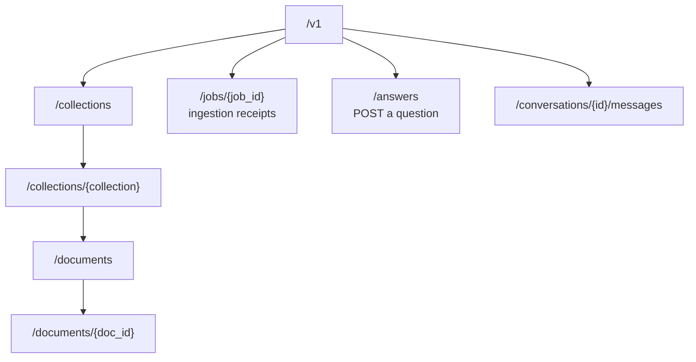
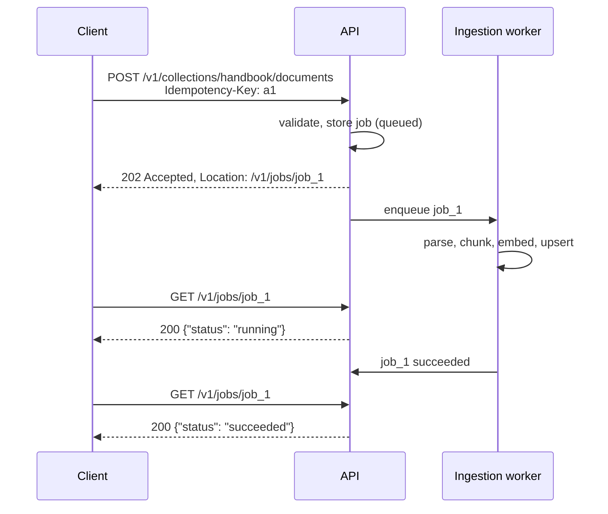

[FastAPI](/learn/backend-engineering/fastapi) gave you the machinery for turning Python functions into HTTP endpoints. It says nothing about *which* endpoints to build: what the URLs should be, which HTTP method each operation uses, what status code comes back, how a client pages through ten thousand documents, or what happens when a client sends the same upload twice because its connection dropped. Those are design decisions, and **REST** is the set of conventions most HTTP APIs use to make them consistently.

This lesson designs the public API of AskMeridian from the server's side: its resources and URLs, the guarantees each method makes, status codes for the situations a RAG service actually meets, long-running ingestion with `202 Accepted` and job resources, idempotency keys that make retries safe, cursor pagination and versioning. You met HTTP from the client's side in [Working with APIs](/learn/python-for-rag-engineering/working-with-apis); here you are the one who has to keep the promises that lesson relied on.

## Learning objectives

- Model a RAG service as resources and collections, and choose URLs and HTTP methods for its operations.
- Choose status codes for success, long-running work and failure, and return the headers that go with them (`Location`, `Retry-After`).
- Implement an `Idempotency-Key` on a `POST` endpoint so that client retries do not duplicate work.
- Implement cursor-based pagination and explain why offset pagination misbehaves while ingestion is running.
- Decide which API changes are backwards compatible and how to version the ones that are not.

## Prerequisites

- [FastAPI](/learn/backend-engineering/fastapi): path operations, path and query parameters, response models.
- [Working with APIs](/learn/python-for-rag-engineering/working-with-apis): requests and responses, status-code classes, idempotency and pagination from the client's point of view.
- [Indexing pipeline](/learn/rag-architecture-fundamentals/indexing-pipeline): what ingesting a document involves.

## Why this matters

An API is a promise made to people you will never meet. The Slack bot team, the intranet team and a script someone in Finance wrote will all depend on AskMeridian's endpoints. Every inconsistency becomes their bug.

Three failures show up again and again in RAG services whose APIs were not designed:

- **Duplicated ingestion.** A client uploads a 200-page PDF, the request takes longer than its timeout, and it retries. The server, which was still working, now indexes the document twice. Retrieval then returns two copies of every chunk, filling the context window with duplicates and pushing out other sources. Nothing errors; quality just drops.
- **Pages that skip or repeat.** An admin tool lists documents with `?offset=200&limit=100` while ingestion adds documents. Items shift between pages; some are listed twice and some never. An audit built on that list is wrong.
- **Silent breaking changes.** Someone renames `sources` to `citations` in the response. Every client that read `sources` breaks at once, in production, with no warning.

None of these needs clever code to prevent. They need conventions decided before the first client is written.

## The intuition

Think of the API as a library's front desk, organised around *things* rather than *actions*. The library has collections, the collections contain books, and every book has a shelf mark. You can ask for the list of books in a collection, ask for one book by its shelf mark, hand in a new book, or ask for one to be withdrawn. The desk uses the same handful of verbs for everything; what changes is the thing you point at.

Some requests cannot be answered on the spot. If you donate a box of books, the desk does not make you wait while each one is catalogued. It gives you a receipt with a reference number and says "check back with this". The receipt is itself a thing you can look up.

And if you are not sure your donation was received, because the clerk was interrupted, you hand the box over again *with the same receipt number*. A sensible clerk checks the number, sees the box was already logged, and does not catalogue it twice.

That is most of REST in practice: resources with stable addresses, a small set of uniform verbs, receipts for slow work, and reference numbers that make repetition harmless.

## How it works

### Resources and URLs

**REST** (Representational State Transfer) was described by Roy Fielding in his 2000 doctoral dissertation as an architectural style for the web. Most "REST APIs" today follow a pragmatic subset of it: the API exposes **resources** (things with identity), each addressed by a **URL**, manipulated through the standard HTTP methods, and represented as JSON.

Two shapes cover most resources:

- A **collection**, such as `/v1/collections/handbook/documents`: a set you can list and add to.
- An **item** inside it, such as `/v1/collections/handbook/documents/leave`: one thing you can read, replace, update or delete.

Conventions that keep URLs predictable: plural nouns for collections; identifiers as path segments; nesting only where the child genuinely belongs to the parent (a document belongs to a collection; do not nest more than two or three levels); and no verbs in paths when a method already says it. `POST /v1/documents/delete` is a red flag; `DELETE /v1/documents/{id}` is the convention.

For AskMeridian the resources might be:



### Methods and the promises they carry

The methods you use carry two properties defined by the HTTP specification (RFC 9110), and your implementation must honour them, because clients, proxies and retry libraries rely on them:

- **Safe**: the request does not change server state. `GET` and `HEAD` are safe. A crawler, a link previewer or a cache may issue them freely, so a `GET` that deletes or re-indexes something is a bug waiting for a crawler.
- **Idempotent**: sending the request several times has the same *effect on the server* as sending it once. `GET`, `PUT` and `DELETE` are idempotent; `POST` and `PATCH` are not guaranteed to be.

| Method | Typical use in AskMeridian | Safe | Idempotent |
| --- | --- | --- | --- |
| `GET` | List documents; read a job's status | Yes | Yes |
| `PUT` | Create or fully replace the document with a known ID | No | Yes |
| `PATCH` | Change a document's metadata (for example its owner) | No | Not guaranteed |
| `DELETE` | Remove a document and its chunks from the index | No | Yes |
| `POST` | Submit a document whose ID the server assigns; ask a question | No | No |

Idempotency is about effect, not response. Deleting the same document twice leaves the server in the same state, so `DELETE` is idempotent even though the second call returns `404` instead of `204`.

### Where does "ask a question" fit?

Asking a question is an action, not a thing, which sits awkwardly with resource-oriented design. There are three common answers, all defensible:

1. **Treat the answer as a resource that the request creates**: `POST /v1/answers` with the question in the body, returning `201 Created` and the answer, which can later be fetched at `/v1/answers/{id}` for feedback or audit. This fits well when answers are stored.
2. **Use a conversation**: `POST /v1/conversations/{id}/messages` appends the user's message and returns the assistant's reply. This fits multi-turn chat.
3. **Accept an RPC-style endpoint**: `POST /v1/ask`. Plenty of good APIs do this for operations that are genuinely actions. The important thing is to be consistent and document it.

Use `POST`, not `GET`, for asking even though asking does not change your index. Questions can be long, they may contain personal information that should not land in URL logs and browser history, and generation costs money, so you do not want caches and crawlers replaying it.

### Status codes a RAG service needs

The client lesson mapped status-code classes to client actions. As the server, you choose the exact code, so choose precisely:

- **`200 OK`**: a read or an action that completed and returns a body.
- **`201 Created`**: a new resource exists; include a `Location` header with its URL.
- **`202 Accepted`**: the request is valid and queued, but the work is not done. Return a job resource and its `Location`.
- **`204 No Content`**: success with nothing to return, typically for `DELETE`.
- **`400 Bad Request`**: the request is malformed in a way that is not a schema error (a cursor you did not issue).
- **`401 Unauthorized`** and **`403 Forbidden`**: not authenticated, or authenticated but not allowed. Covered in [Authentication](/learn/backend-engineering/authentication).
- **`404 Not Found`**: no such resource (or one the caller may not know exists).
- **`409 Conflict`**: the request clashes with current state, such as creating a document whose ID already exists.
- **`413 Content Too Large`**: an upload above your size limit.
- **`422 Unprocessable Content`**: well-formed JSON that fails validation. FastAPI produces this automatically; see [Request validation](/learn/backend-engineering/request-validation).
- **`429 Too Many Requests`**: the caller exceeded a rate limit; include `Retry-After`.
- **`503 Service Unavailable`** and **`504 Gateway Timeout`**: an upstream dependency (the language model, the vector database) is down or too slow. [Error handling](/learn/backend-engineering/error-handling) covers mapping upstream failures to these.

### Long-running work: 202 and job resources

Ingesting a document means parsing, chunking, embedding and upserting, which can take seconds to minutes. Holding an HTTP request open that long is fragile: proxies and load balancers have idle timeouts, and the client cannot tell "still working" from "dead". The standard pattern is to accept and hand back a receipt:



The steps:

1. Validate the request synchronously, so that obvious errors (unknown collection, empty text) fail immediately with a 4xx rather than becoming a failed job later.
2. Create a **job resource** with a status (`queued`, `running`, `succeeded`, `failed`), store it durably, and enqueue the work.
3. Return `202 Accepted` with the job in the body and its URL in `Location`.
4. The client polls `GET /v1/jobs/{id}` (respecting any `Retry-After` hint) or, if you offer them, receives a webhook when the job finishes.
5. A failed job records a machine-readable reason, so the client can decide whether to resubmit.

In the example below, FastAPI's `BackgroundTasks` runs the work after the response is sent. That is fine for short tasks and for teaching, but it runs inside the web process: if the process restarts, queued work is lost. Production ingestion uses a durable queue and separate workers, the subject of [Queue-based pipelines](/learn/production-architecture/queue-based-pipelines).

### Idempotency keys

`POST` is not idempotent, so a client that retries a timed-out `POST` risks doing the work twice. The widely used fix, popularised by payment APIs such as Stripe and being standardised in an IETF draft ("The Idempotency-Key HTTP Header Field"), is an **idempotency key**: the client generates a unique value (typically a UUID) per logical operation and sends it in an `Idempotency-Key` header, reusing it on every retry of that operation.

The server's side of the bargain:

1. Look the key up. If unseen, record it together with a **fingerprint** of the request (a hash of the method, path and body), do the work, and store the response against the key.
2. If seen with the *same* fingerprint, do not repeat the work; return the stored result (or the current state of the job it created).
3. If seen with a *different* fingerprint, the client has a bug: it reused a key for a different operation. Reject with an error (the draft suggests `422`) rather than guessing.
4. If the original request is still being processed, reject the concurrent duplicate (the draft suggests `409`) rather than starting a second copy.
5. Expire keys after a retention window (24 hours is a common choice) so the store does not grow forever.

The store must enforce uniqueness atomically, for example a database table with a unique constraint on the key, or two retries arriving at once will both pass the "unseen" check. The in-memory dictionary below is single-process and is for illustration only.

### Pagination: cursors, not offsets

Any list endpoint must be paginated; a collection of 50,000 documents in one JSON response is slow to build, slow to send and liable to exhaust memory. There are two common schemes:

- **Offset pagination**: `?offset=200&limit=100` means "skip 200, return 100". It is simple and allows jumping to page 7. But the database still has to walk past the skipped rows, and if items are inserted or deleted between requests, everything shifts: an insertion before the current position makes the next page repeat an item; a deletion makes it skip one.
- **Cursor (keyset) pagination**: each page ends with an opaque **cursor** encoding the sort key of its last item, and the next request asks for items *after* that key. Insertions and deletions elsewhere do not shift positions, and with an index on the sort key the database seeks straight to the right place.

Make cursors opaque (base64-encoded JSON is enough) so clients do not construct or parse them and you can change their contents later. Sort by a unique, stable key (an ID, or a timestamp plus ID as a tie-breaker). Cap `limit` with a maximum. Return `next_cursor: null` on the last page.

### Versioning and evolution

Clients cannot all upgrade at once, so the API must evolve without breaking them. Distinguish:

- **Backwards-compatible changes**: adding an endpoint; adding an optional request field; adding a field to a response; adding a new value to a field whose consumers were told to expect new values. Existing clients are unaffected, provided they ignore fields they do not know.
- **Breaking changes**: removing or renaming a field or endpoint; changing a field's type or meaning; making an optional field required; changing an error code clients branch on; tightening validation.

Put a major version in the path (`/v1/...`) from day one. Breaking changes go into `/v2`, which runs alongside `/v1` while clients migrate; announce a deprecation date for `/v1` and signal it in responses (there is a standard `Sunset` header, RFC 8594, for announcing when a resource will stop working).

## In code

The example implements AskMeridian's ingestion API: submitting a document returns `202` and a job, an idempotency key makes retries safe, documents are listed with cursor pagination, and deletion returns `204`. The ingestion step itself is a stub; [Indexing pipeline](/learn/rag-architecture-fundamentals/indexing-pipeline) covers what would really happen there.

```bash
pip install fastapi httpx
```

Save as `api.py`:

```python
import base64
import hashlib
import itertools
import json
from typing import Annotated, Literal

from fastapi import BackgroundTasks, FastAPI, Header, HTTPException, Query, Response, status
from pydantic import BaseModel

app = FastAPI(title="AskMeridian ingestion API")

DOCUMENTS: dict[str, dict[str, dict]] = {"handbook": {}}  # collection -> doc_id -> document
JOBS: dict[str, dict] = {}
IDEMPOTENCY: dict[str, tuple[str, str]] = {}  # key -> (request fingerprint, job_id)
job_ids = itertools.count(1)


class DocumentIn(BaseModel):
    id: str
    text: str


class Job(BaseModel):
    id: str
    status: Literal["queued", "running", "succeeded", "failed"]
    document_id: str


class DocumentPage(BaseModel):
    items: list[DocumentIn]
    next_cursor: str | None


def index_document(collection: str, doc: DocumentIn, job_id: str) -> None:
    JOBS[job_id]["status"] = "running"
    DOCUMENTS[collection][doc.id] = doc.model_dump()  # chunk, embed and upsert would happen here
    JOBS[job_id]["status"] = "succeeded"


@app.post("/v1/collections/{collection}/documents", status_code=status.HTTP_202_ACCEPTED)
def submit_document(
    collection: str,
    doc: DocumentIn,
    response: Response,
    background: BackgroundTasks,
    idempotency_key: Annotated[str, Header()],
) -> Job:
    if collection not in DOCUMENTS:
        raise HTTPException(404, f"No collection {collection!r}")
    fingerprint = hashlib.sha256(f"{collection}|{doc.model_dump_json()}".encode()).hexdigest()
    if idempotency_key in IDEMPOTENCY:
        seen_fingerprint, job_id = IDEMPOTENCY[idempotency_key]
        if seen_fingerprint != fingerprint:
            raise HTTPException(422, "Idempotency-Key reused with a different request body")
        response.headers["Location"] = f"/v1/jobs/{job_id}"
        return Job(**JOBS[job_id])  # replay: same job, no second ingestion
    job_id = f"job_{next(job_ids)}"
    JOBS[job_id] = {"id": job_id, "status": "queued", "document_id": doc.id}
    IDEMPOTENCY[idempotency_key] = (fingerprint, job_id)
    background.add_task(index_document, collection, doc, job_id)
    response.headers["Location"] = f"/v1/jobs/{job_id}"
    return Job(**JOBS[job_id])


@app.get("/v1/jobs/{job_id}")
def get_job(job_id: str) -> Job:
    if job_id not in JOBS:
        raise HTTPException(404, f"No job {job_id!r}")
    return Job(**JOBS[job_id])


def encode_cursor(last_id: str) -> str:
    return base64.urlsafe_b64encode(json.dumps({"after": last_id}).encode()).decode()


def decode_cursor(cursor: str) -> str:
    try:
        return json.loads(base64.urlsafe_b64decode(cursor.encode()))["after"]
    except Exception:
        raise HTTPException(400, "Malformed cursor")


@app.get("/v1/collections/{collection}/documents")
def list_documents(
    collection: str,
    limit: Annotated[int, Query(ge=1, le=100)] = 20,
    cursor: str | None = None,
) -> DocumentPage:
    if collection not in DOCUMENTS:
        raise HTTPException(404, f"No collection {collection!r}")
    ordered = sorted(DOCUMENTS[collection])  # stable order by id
    if cursor is not None:
        after = decode_cursor(cursor)
        ordered = [d for d in ordered if d > after]
    page = ordered[:limit]
    more = len(ordered) > limit
    return DocumentPage(
        items=[DOCUMENTS[collection][d] for d in page],
        next_cursor=encode_cursor(page[-1]) if more else None,
    )


@app.delete("/v1/collections/{collection}/documents/{doc_id}", status_code=status.HTTP_204_NO_CONTENT)
def delete_document(collection: str, doc_id: str) -> None:
    if DOCUMENTS.get(collection, {}).pop(doc_id, None) is None:
        raise HTTPException(404, f"No document {doc_id!r}")
```

And `run.py`, which plays the part of a client:

```python
from fastapi.testclient import TestClient

from api import app

client = TestClient(app)
base = "/v1/collections/handbook/documents"

r = client.post(base, json={"id": "leave", "text": "Annual leave is 25 days."},
                headers={"Idempotency-Key": "a1"})
print(r.status_code, r.headers["location"], r.json())

# The client times out and retries with the same key: no second job is created.
r = client.post(base, json={"id": "leave", "text": "Annual leave is 25 days."},
                headers={"Idempotency-Key": "a1"})
print(r.status_code, r.headers["location"], r.json())

r = client.post(base, json={"id": "leave", "text": "Annual leave is 30 days."},
                headers={"Idempotency-Key": "a1"})
print(r.status_code, r.json())

print(client.get("/v1/jobs/job_1").json())

for i, (doc_id, text) in enumerate([
    ("remote", "Up to 3 remote days a week."),
    ("expenses", "Submit expenses within 30 days."),
    ("laptops", "Laptops are refreshed every 3 years."),
    ("support", "The support desk is open 08:00 to 18:00."),
]):
    client.post(base, json={"id": doc_id, "text": text}, headers={"Idempotency-Key": f"b{i}"})

cursor, page_no = None, 1
while True:
    params = {"limit": 2} | ({"cursor": cursor} if cursor else {})
    page = client.get(base, params=params).json()
    print(f"page {page_no}:", [d["id"] for d in page["items"]], "next:", page["next_cursor"])
    cursor, page_no = page["next_cursor"], page_no + 1
    if cursor is None:
        break

r = client.delete(f"{base}/remote")
print(r.status_code, repr(r.text))
r = client.delete(f"{base}/remote")
print(r.status_code, r.json())
print(client.get(base, params={"limit": 500}).status_code)
```

```output
202 /v1/jobs/job_1 {'id': 'job_1', 'status': 'queued', 'document_id': 'leave'}
202 /v1/jobs/job_1 {'id': 'job_1', 'status': 'succeeded', 'document_id': 'leave'}
422 {'detail': 'Idempotency-Key reused with a different request body'}
{'id': 'job_1', 'status': 'succeeded', 'document_id': 'leave'}
page 1: ['expenses', 'laptops'] next: eyJhZnRlciI6ICJsYXB0b3BzIn0=
page 2: ['leave', 'remote'] next: eyJhZnRlciI6ICJyZW1vdGUifQ==
page 3: ['support'] next: None
204 ''
404 {'detail': "No document 'remote'"}
422
```

### Reading the output

- **First submission**: `202`, a `Location` pointing at the job, and status `queued`. The response was sent *before* the background task ran, which is exactly what `202` means.
- **The retry with the same key and body** returns the *same* job, `job_1`, now `succeeded`. No second job was created and the document was ingested once. This is the scenario from "Why this matters", defused.
- **Same key, different body** (30 days instead of 25) is rejected with `422`. Silently returning the first job would tell the client its new text was accepted when it was not.
- **Pagination** walks five documents two at a time, in stable ID order, and stops when `next_cursor` is `null`. The cursor is just base64 of `{"after": "laptops"}`; clients are told to treat it as opaque.
- **Deletion** returns `204` with an empty body; repeating it returns `404`, but the server's state is the same either way, which is what idempotent means.
- **`limit=500`** exceeds the `le=100` cap and is rejected with `422`, protecting the server from a client asking for everything.

### Important lines

- `idempotency_key: Annotated[str, Header()]` reads the `Idempotency-Key` header (FastAPI converts the underscore to a hyphen) and makes it required, so a client that forgets it gets a 422 rather than an unprotected request. Whether to require it or merely honour it is a policy choice.
- The fingerprint hashes the collection and the body. Hashing rather than storing the body keeps the idempotency store small.
- `response.headers["Location"]` sets a header while still returning a model; FastAPI injects the `Response` parameter for exactly this.
- `sorted(...)` then `d > after` is keyset pagination in miniature. In a database it becomes `WHERE id > :after ORDER BY id LIMIT :limit + 1`; fetching one extra row tells you whether there is a next page without a separate count.

### Common errors and extensions

The most common error is returning `200` for a `POST` that creates something, which deprives clients of the `Location` of the new resource; the second is forgetting that `BackgroundTasks` loses work on restart. To extend the example, add `PUT /v1/collections/{c}/documents/{id}` (naturally idempotent, because the client chooses the ID), record a `failed` status with an error code when ingestion raises, and expire idempotency keys after 24 hours.

## A real-world example

Meridian's intranet team built a nightly sync that pushed every changed handbook page to AskMeridian with `POST /documents`. One night the vector database was slow, the sync's requests timed out after 30 seconds, and its HTTP library retried each one twice. The server had not failed; it had been slow. By morning many handbook pages were indexed three times.

The symptoms reached the Platform team as a quality complaint, not an error: answers about the leave policy cited the same paragraph three times and missed the carry-over rule, which had been pushed out of the top five by duplicates. Ines, investigating, found triplicate chunks with identical text and different internal IDs.

The fix had three parts. Ingestion moved to `202 Accepted` plus job resources, so the request returned in milliseconds and the sync polled for completion instead of holding a connection open. The endpoint began requiring an `Idempotency-Key`, which the sync derived from the page ID and its content hash, so a retry of the same version could never create a second job. And the index switched to deterministic chunk IDs derived from document ID and chunk position, so that even a genuine re-submission overwrote rather than duplicated. The API change prevented the problem; the deterministic IDs made the system tolerant of the next mistake.

## Common mistakes

- **Using `GET` for operations that change state** (`GET /reindex?collection=handbook`). Crawlers, link previews and prefetching will trigger it.
- **Retrying non-idempotent `POST` requests without an idempotency key.** Every timeout becomes a potential duplicate ingestion or duplicate charge.
- **Returning `200` with `{"error": ...}` in the body.** Clients, proxies and monitoring all read the status code; an error hidden in a 200 is invisible to them.
- **Offset pagination over data that changes.** Items repeat or vanish between pages, and deep offsets get slower as the database skips rows.
- **Exposing internal identifiers or sort keys in cursors.** Clients start constructing cursors, and you can never change the format.
- **Renaming a response field "because the new name is better".** Every client breaks. Add the new field, deprecate the old one, remove it only in the next major version.

## Best practices

- Name resources with plural nouns, keep nesting shallow, and let the method carry the verb.
- Return `201` with `Location` for creation, `202` with a job resource for slow work, and `204` for deletions.
- Accept an `Idempotency-Key` on every `POST` that creates something, store it with a request fingerprint and a unique constraint, and expire it after a fixed window.
- Paginate every list with opaque cursors and a capped `limit`.
- Version in the path from the first release; make only additive changes within a version, and tell clients to ignore unknown fields.
- Write the API's conventions (naming, errors, pagination, versioning) down once and apply them to every endpoint.

## Performance considerations

Asynchronous ingestion changes what the API costs to run. A synchronous ingestion request ties up a connection, and a worker thread or event-loop slot, for the whole duration of parsing and embedding. If a document takes 20 seconds (an assumption) and the server can hold 40 such requests at once, it can ingest at most 40 / 20 = 2 documents per second, and every other request queues behind them. With `202` and a queue, the API spends a few milliseconds per submission and the ingestion rate is set by the worker pool, which you scale independently.

Pagination cost is arithmetic too. With offset pagination, page $p$ of size $n$ makes the database skip roughly $p \times n$ rows, so reading all $N$ items costs on the order of $N^2 / (2n)$ row visits in total. For 50,000 documents in pages of 100 that is about 12.5 million row visits, against 50,000 for keyset pagination, where each page seeks directly to its starting key.

Polling has a cost as well: a client polling every second for a two-minute job makes 120 requests. Send `Retry-After` on job responses to suggest a sensible interval, or offer webhooks for long jobs.

## Security considerations

Resource-oriented URLs make identifiers guessable: if `/v1/jobs/job_41` exists, so probably does `job_42`. Every lookup must check that the caller is allowed to see that resource, not merely that it exists; this class of bug is called **broken object-level authorisation** and is consistently near the top of the OWASP API Security Top 10. Using random, unguessable IDs (UUIDs) reduces casual enumeration but is not a substitute for the check; [Authentication](/learn/backend-engineering/authentication) and [Document-level permissions](/learn/access-control-and-privacy/document-level-permissions) cover the checks themselves. Consider returning `404` rather than `403` for resources the caller may not see, so that the API does not confirm their existence. Cap list sizes and upload sizes so that a single request cannot exhaust memory, and keep personal data out of URLs.

## Summary

- REST organises an API around resources with stable URLs and a small set of uniform methods; the method carries the verb.
- `GET` must be safe; `GET`, `PUT` and `DELETE` must be idempotent. Idempotency concerns the effect on the server, not the response.
- Slow work such as ingestion returns `202 Accepted` and a job resource the client can poll, instead of holding the request open.
- Idempotency keys, stored with a request fingerprint and enforced atomically, make `POST` retries safe.
- Cursor pagination is stable under concurrent changes and efficient at depth; offset pagination is neither.
- Additive changes are safe within a version; renames, removals and type changes need a new major version.

## Exercises

**1.** Choose a method, URL and success status code for each AskMeridian operation: (a) list the conversations of the current user; (b) rename a conversation; (c) re-index an entire collection after changing the embedding model; (d) remove a document from the handbook collection.

<details><summary>Show solution</summary>

(a) `GET /v1/conversations` returning `200` with a cursor-paginated list (the user comes from the credentials, not the URL).

(b) `PATCH /v1/conversations/{id}` with `{"title": "..."}`, returning `200` and the updated conversation.

(c) Re-indexing is slow, so it creates a job: `POST /v1/collections/{collection}/reindex-jobs` (or `POST /v1/jobs` with a type) returning `202 Accepted`, a job body and `Location`. Accept an `Idempotency-Key` so a retry does not start two re-indexes.

(d) `DELETE /v1/collections/handbook/documents/{doc_id}` returning `204`. If deleting chunks from the vector store is slow, returning `202` with a job is also reasonable.

</details>

**2.** A client lists documents with `?offset=0&limit=2`, then a new document with ID `annual-leave-2025` is ingested, then the client requests `?offset=2&limit=2`. Using the five IDs from the example (sorted: expenses, laptops, leave, remote, support), what does the client see on each page, and what goes wrong? What does the cursor version return instead?

<details><summary>Show solution</summary>

Page 1 (offset 0): `expenses`, `laptops`. Then `annual-leave-2025` is inserted, and it sorts first. The ordered list becomes `annual-leave-2025, expenses, laptops, leave, remote, support`. Page 2 (offset 2): `laptops`, `leave`. The client sees `laptops` twice, and `annual-leave-2025` never (it sits before the offset).

With cursors, page 1 ends with a cursor for "after `laptops`". Page 2 returns `leave`, `remote`: no repeat. The new document is still not seen in this pass, because it sorts before the cursor, but nothing is duplicated or skipped among the items that existed throughout. If clients must see new items, sort by creation time plus ID, so that new items appear at the end.

</details>

**3.** Classify each change to the `/v1/answers` response as compatible or breaking, and explain: (a) adding `"latency_ms": 812`; (b) changing `score` from a float to a string such as `"0.82"`; (c) adding a new value `"partial"` to `status`, which was documented as `"complete"` or `"refused"`; (d) removing `sources` when `include_sources=false` is passed, a parameter that is new.

<details><summary>Show solution</summary>

(a) **Compatible**, provided clients ignore unknown fields (which you should document).

(b) **Breaking.** Any client doing arithmetic or comparisons on `score` fails or misbehaves.

(c) **Breaking in practice**, because the value set was documented as closed: a client with a two-branch `if/else` will treat `"partial"` as one of the two. It would have been compatible if the documentation had said "more values may be added".

(d) **Compatible.** Existing clients never send the new parameter, so they still receive `sources`. Behaviour only changes for clients that opt in.

</details>

**4.** Extend `submit_document` so that two *concurrent* requests with the same idempotency key cannot both create a job, and a second request arriving while the first is still `queued` or `running` gets `409 Conflict`. Describe how you would do this with a relational database.

<details><summary>Show solution</summary>

Make claiming the key a single atomic operation. In a relational database, create a table `idempotency_keys(key TEXT PRIMARY KEY, fingerprint TEXT, job_id TEXT, created_at TIMESTAMP)`. The handler first runs `INSERT ... ON CONFLICT (key) DO NOTHING RETURNING key` (PostgreSQL syntax). If a row comes back, this request claimed the key: create the job and update the row with the `job_id`, ideally in the same transaction. If nothing comes back, another request owns the key: read its row, compare fingerprints (mismatch gives `422`), then look at the job's status. If it is `queued` or `running`, return `409` with `Retry-After`; if it is `succeeded` or `failed`, replay it.

The primary-key constraint makes the database, not the application, decide which of two simultaneous requests wins, which is what a check-then-insert in Python cannot do. A scheduled job deletes rows older than the retention window.

</details>

## Check your understanding

```quiz
[
  {
    "q": "A client calls `DELETE /v1/collections/handbook/documents/leave` twice. The first returns 204 and the second 404. Is DELETE behaving idempotently?",
    "options": [
      "No, because the two responses differ",
      "Only if the second call also returns 204",
      "Yes, because the server's state after two calls is the same as after one",
      "No, DELETE is never idempotent"
    ],
    "answer": 2,
    "why": "Idempotency concerns the effect on server state. The document is gone after one call or two; the response code may differ."
  },
  {
    "q": "Ingesting a document takes about a minute. What should `POST .../documents` return?",
    "options": [
      "202 Accepted with a job resource and a Location header to poll",
      "200 OK after waiting for the full minute",
      "201 Created immediately, before ingestion has started",
      "204 No Content, with the result sent by email"
    ],
    "answer": 0,
    "why": "202 says the request was accepted for processing but is not complete; the job resource lets the client follow its progress."
  },
  {
    "q": "A client retries a timed-out POST with the same Idempotency-Key but a different body. What should the server do?",
    "options": [
      "Process the new body as a separate request",
      "Reject it with an error, because the key was reused for a different request",
      "Overwrite the original request with the new body",
      "Return the original result as if nothing were different"
    ],
    "answer": 1,
    "why": "A matching key with a different fingerprint is a client bug. Rejecting it (the IETF draft suggests 422) avoids silently ignoring or misapplying the new data."
  },
  {
    "q": "Why is cursor pagination preferred over offset pagination for a document list that changes during ingestion?",
    "options": [
      "Cursors let clients jump straight to any page number",
      "Cursors compress the response",
      "Offsets cannot be validated by Pydantic",
      "Cursors continue from the last item seen, so insertions and deletions elsewhere do not make items repeat or disappear"
    ],
    "answer": 3,
    "why": "Offsets count positions, which shift when items are added or removed; a cursor anchors on a sort key, which does not shift."
  },
  {
    "q": "Which change to a v1 response is safe to make without a new major version?",
    "options": [
      "Adding a new optional field to the response",
      "Renaming `sources` to `citations`",
      "Changing `score` from a number to a string",
      "Making a previously optional request field required"
    ],
    "answer": 0,
    "why": "Adding a field is backwards compatible for clients that ignore unknown fields. The others break existing clients."
  }
]
```

## Further reading

- Fielding, R. T. (2000), *Architectural Styles and the Design of Network-based Software Architectures*, doctoral dissertation, University of California, Irvine, chapter 5 (the definition of REST).
- RFC 9110, *HTTP Semantics* (Fielding, Nottingham and Reschke, 2022): methods, safety, idempotency and status codes. [rfc-editor.org/rfc/rfc9110](https://www.rfc-editor.org/rfc/rfc9110).
- IETF HTTPAPI working group, "The Idempotency-Key HTTP Header Field", Internet-Draft (work in progress; check the current revision).
- RFC 8594, *The Sunset HTTP Header Field* (Wilde, 2019).
- OWASP API Security Top 10, [owasp.org/API-Security](https://owasp.org/API-Security/).
- FastAPI documentation, [fastapi.tiangolo.com](https://fastapi.tiangolo.com/): background tasks, response headers and status codes.
