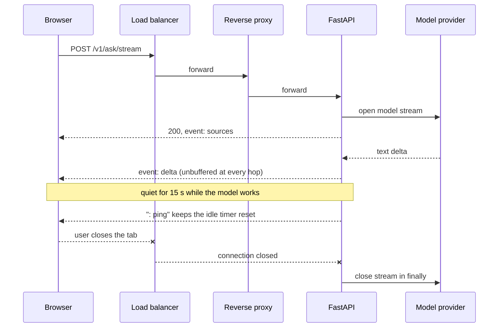

A streaming endpoint sends its response in pieces as they become available, instead of building the whole response and sending it at the end. For a RAG service this is how answers appear word by word, and it is the single biggest improvement to how fast the service *feels*. [Streaming responses](/learn/generation-strategies/streaming-responses) treated streaming as a generation strategy: the provider's event model, the application's event protocol (sources, deltas, completion), holding back partial citations and stopping the model when the user leaves. This lesson is about the API underneath: the transports you can choose from, the exact Server-Sent Events wire format, FastAPI's built-in support for it, and the infrastructure problems that make streams break in production even when they work on a laptop.

By the end you will have served a streamed AskMeridian answer from a real Uvicorn server, read it from a Python client with arrival timestamps, watched the server notice a client that hung up, and know what to configure in proxies and load balancers so the same behaviour survives deployment.

## Learning objectives

- Compare chunked JSON Lines, Server-Sent Events and WebSockets, and choose one for a given RAG client.
- Write and parse the Server-Sent Events wire format, including `event`, `data`, `id`, `retry` and comment lines.
- Implement a streaming endpoint with FastAPI's `EventSourceResponse` and `ServerSentEvent`, with clean-up that runs when the client disconnects.
- Diagnose buffering, compression and idle-timeout problems introduced by proxies and load balancers.
- Estimate how many concurrent connections a streaming service must hold, and limit them.

## Prerequisites

- [Streaming responses](/learn/generation-strategies/streaming-responses): the application event protocol and cancellation of the model stream.
- [Async endpoints](/learn/backend-engineering/async-endpoints): why streaming handlers must be asynchronous.
- [REST APIs](/learn/backend-engineering/rest-apis): status codes and why they are sent first.

## Why this matters

Streaming is easy to demonstrate and surprisingly easy to break. A typical sequence of events in a team shipping it for the first time:

- On a laptop, the answer streams beautifully.
- In staging, behind the company's reverse proxy, the answer appears all at once after eight seconds. The proxy was **buffering** the response until it was complete, defeating the point.
- After that is fixed, long answers in production are occasionally cut off mid-sentence. The load balancer's **idle timeout** closed connections that went quiet while the model was thinking.
- Under load, the service runs out of capacity at a fraction of its expected throughput, because each stream **holds a connection** for its whole duration, and nobody budgeted for that.
- Users who close the tab still cost money, because nothing noticed the **disconnect** and stopped the model.

Each of these is a property of HTTP and of the machines between server and client, not of the model. Knowing them turns streaming from a demo into a feature you can operate.

## The intuition

Compare a letter with a phone call. A normal HTTP response is a letter: written in full, sealed, posted, opened. A streaming response is a phone call: the line is opened once and you speak as you think, and the listener hears each sentence as you say it.

Phone calls have problems letters do not. Someone in the middle might insist on recording the whole call and passing it on only when you hang up (buffering). If you go quiet for too long, the line drops (idle timeout), which is why people on long calls say "still there?" now and then (keep-alive pings). Each call occupies a line for its whole length, so a switchboard with 100 lines can host 100 calls, however briefly anyone talks (connection capacity). And if the listener hangs up, you should notice and stop talking, rather than reading the rest of your notes into a dead line (disconnect handling).

## How it works

### Three ways to stream over HTTP

All three keep one connection open and send data as it is produced; they differ in format and direction.

| Transport | Format | Direction | Browser support | Typical RAG use |
| --- | --- | --- | --- | --- |
| Chunked JSON Lines | One JSON object per line (`application/jsonl`, also called NDJSON) | Server to client | Read with `fetch` and a stream reader | Service-to-service streaming, batch results |
| Server-Sent Events (SSE) | Text events (`text/event-stream`) | Server to client | `EventSource` built in, or `fetch` | Streaming answers to chat front ends |
| WebSockets | Arbitrary messages over an upgraded connection | Both ways | `WebSocket` built in | Voice, collaborative sessions, mid-answer interruptions |

Most RAG answer streaming is one-directional (question in, answer out), which is why SSE is the common choice: it is plain HTTP, so it passes through proxies, works with ordinary authentication headers when read with `fetch`, and has a standard format with event names, IDs and reconnection built in. Major model providers, including Anthropic's Messages API, use SSE for their own streaming. WebSockets are worth their extra complexity (a separate protocol, its own authentication handshake, no automatic HTTP semantics) only when the client must also send messages while the answer is streaming.

Both JSON Lines and SSE use HTTP/1.1 **chunked transfer encoding** (or HTTP/2 data frames): the response has no `Content-Length`, and the body arrives as a sequence of chunks until the server ends it.

### The SSE wire format

An SSE stream is UTF-8 text made of **events**, each a group of `field: value` lines ended by a **blank line**. The fields, defined in the HTML Living Standard:

- `event:` names the event type (`sources`, `delta`, `done`). Without it, the event is called `message`.
- `data:` carries the payload. Several `data:` lines in one event are joined with newlines, which is how multi-line payloads are sent. In practice, put JSON on a single `data:` line.
- `id:` sets the event ID. A browser remembers the last one and, if it reconnects, sends it back in a `Last-Event-ID` header.
- `retry:` tells the client how many milliseconds to wait before reconnecting.
- Lines starting with `:` are **comments**, ignored by clients. A comment such as `: ping` is the standard keep-alive.

A streamed AskMeridian answer looks like this on the wire (taken from the example below):

```text
event: sources
data: [{"id": "leave", "title": "Annual leave policy"}]
id: 0
retry: 3000

event: delta
data: {"text": "Annual "}
id: 1

```

Because the blank line ends an event, the payload must not itself contain a bare newline on a `data:` line; JSON encoding escapes newlines inside strings, which is one reason to send JSON rather than raw text.

### Status first, errors as events

An HTTP response sends its status code and headers *before* the body. Once the first event of a stream has gone out with `200 OK`, the status cannot change. So:

1. Do everything that can fail cheaply (validation, authentication, permission checks, perhaps retrieval) **before** the first byte is sent, so those failures become ordinary `4xx` or `5xx` responses.
2. Failures after that point (the model provider drops the connection, a timeout expires) must be reported **inside** the stream as an `error` event, followed by closing the stream. The client must treat a stream that ends without a `done` event as incomplete.

[Error handling](/learn/backend-engineering/error-handling) covers the error event's format alongside the service's other errors.

### FastAPI's built-in SSE support

Recent FastAPI releases support SSE directly: declare `response_class=EventSourceResponse` on a path operation and write the handler as a generator that `yield`s events. Each yielded `ServerSentEvent(event=..., data=..., id=..., retry=...)` is encoded into the wire format; `data` is JSON-encoded (a `raw_data` field sends a string unencoded). FastAPI also sets `Cache-Control: no-cache` and `X-Accel-Buffering: no`, and sends a `: ping` comment if the generator is idle for 15 seconds. These are recent additions: on older FastAPI versions, return a `StreamingResponse(generator, media_type="text/event-stream")` and format the frames yourself, as [Streaming responses](/learn/generation-strategies/streaming-responses) does. (In the same releases, a generator path operation *without* a response class streams JSON Lines.)

The handler should be an `async` generator. A synchronous generator is iterated in the thread pool, and a stream lasting many seconds would hold one of its 40 threads for the whole time; see [Async endpoints](/learn/backend-engineering/async-endpoints).

### When the client goes away

Users close tabs, lose signal and press "stop". When the connection closes, the ASGI server reports a disconnect, Starlette stops the response, and the generator is closed: execution does not continue past the current `yield`, and any `finally` block (and `async with` exit) runs. That is your hook for clean-up: closing the upstream model stream so it stops generating tokens you pay for, releasing a concurrency slot, and recording that the answer was abandoned. Put clean-up in `finally`, never only after the loop, or it will not run on disconnect.

### Reconnection and resumption

The browser's `EventSource` reconnects automatically after a dropped connection, waiting the `retry` interval, and sends `Last-Event-ID`. Whether your server can honour that is a design choice:

- **No resumption** (the common choice for RAG answers): on reconnect the server starts a new answer or returns an error event. Simple, but a dropped connection re-runs generation. For `POST` streams read with `fetch`, there is no automatic reconnection at all, and the client decides.
- **Resumption**: the server writes every event of an answer to a short-lived store (for example a Redis stream keyed by answer ID, expiring after a few minutes), and generation runs independently of the HTTP connection. A reconnecting client sends `Last-Event-ID` and receives the events after it, then continues live. This survives flaky mobile networks and server-side load-balancer changes, at the cost of decoupling generation from requests.

### The infrastructure between you and the client

Most streaming failures in production come from intermediaries, each of which treats the response as a letter unless told otherwise:

1. **Reverse-proxy buffering.** Proxies such as nginx buffer upstream responses by default. The `X-Accel-Buffering: no` response header disables it per response in nginx; other proxies and API gateways have their own settings, and some managed gateways do not support streaming at all. Check yours.
2. **Compression.** Gzip middleware often waits to fill a compression block before emitting anything. Exclude `text/event-stream` from compression.
3. **Idle timeouts.** Load balancers close connections with no traffic for a configured period (often around a minute by default; check your provider's documentation). A model that pauses for a long tool call or a slow first token can trip it. Keep-alive comments every 15 seconds keep the connection active.
4. **Maximum request durations.** Some platforms cap total request time. A long answer can exceed it even with traffic flowing.
5. **HTTP/1.1 connection limits in browsers.** Browsers allow only a small number of concurrent HTTP/1.1 connections per origin (six in common browsers), and each open stream uses one. A user with several tabs open can exhaust them. HTTP/2 multiplexes many streams over one connection and removes the problem, so serve streaming endpoints over HTTP/2 where possible.



## In code

The example serves a streamed answer over SSE from a real Uvicorn process and reads it with an asynchronous `httpx` client three times: once printing the raw bytes, once parsing events with arrival times, and once hanging up after three deltas. A fake model yields one word every 100 ms, so the example runs without an API key; the real model call follows.

```bash
pip install fastapi uvicorn httpx
```

The server, `stream_app.py`:

```python
import asyncio
import logging
from collections.abc import AsyncIterator

from fastapi import FastAPI
from fastapi.sse import EventSourceResponse, ServerSentEvent
from pydantic import BaseModel

log = logging.getLogger("stream")
logging.basicConfig(level=logging.INFO, format="server: %(message)s")

app = FastAPI()
MAX_STREAMS = asyncio.Semaphore(100)  # per-process cap on open streams


class AskRequest(BaseModel):
    question: str


async def fake_llm(question: str) -> AsyncIterator[str]:
    """Stands in for client.messages.stream(...).text_stream."""
    for word in "Annual leave is 25 days, and up to 5 unused days carry over to 31 March.".split():
        await asyncio.sleep(0.1)
        yield word + " "


@app.post("/v1/ask/stream", response_class=EventSourceResponse)
async def ask_stream(body: AskRequest) -> AsyncIterator[ServerSentEvent]:
    sent, finished = 0, False
    async with MAX_STREAMS:
        try:
            yield ServerSentEvent(event="sources", id="0", retry=3000,
                                  data=[{"id": "leave", "title": "Annual leave policy"}])
            async for text in fake_llm(body.question):
                sent += 1
                yield ServerSentEvent(event="delta", id=str(sent), data={"text": text})
            yield ServerSentEvent(event="done", id=str(sent + 1), data={"deltas": sent})
            finished = True
        finally:
            # Runs on normal completion and when the client disconnects (the generator is closed).
            log.info("stream closed: deltas=%d finished=%s", sent, finished)
```

The client, `client.py`, includes a minimal SSE parser so you can see exactly what parsing involves:

```python
import asyncio
import json
import time

import httpx

URL = "http://127.0.0.1:8001/v1/ask/stream"


async def read_events(response: httpx.Response):
    """A minimal SSE parser: fields accumulate until a blank line ends the event."""
    event = {}
    async for line in response.aiter_lines():
        if line == "":
            if event:
                yield event
            event = {}
        elif line.startswith(":"):
            continue  # a comment, such as a keep-alive ping
        else:
            field, _, value = line.partition(":")
            value = value.removeprefix(" ")
            if field == "data" and "data" in event:
                event["data"] += "\n" + value  # multi-line data
            else:
                event[field] = value


async def main() -> None:
    async with httpx.AsyncClient(timeout=30) as client:
        print("--- raw bytes of the first two events")
        async with client.stream("POST", URL, json={"question": "How much leave?"}) as r:
            print(r.status_code, r.headers["content-type"], "| cache-control:", r.headers["cache-control"],
                  "| x-accel-buffering:", r.headers["x-accel-buffering"])
            raw = b""
            async for chunk in r.aiter_bytes():
                raw += chunk
                if raw.count(b"\n\n") >= 2:
                    break
            print(raw.decode())

        print("--- full stream with arrival times")
        start = time.perf_counter()
        async with client.stream("POST", URL, json={"question": "How much leave?"}) as r:
            answer = ""
            async for ev in read_events(r):
                t = time.perf_counter() - start
                data = json.loads(ev["data"])
                if ev["event"] == "delta":
                    answer += data["text"]
                    if int(ev["id"]) in (1, 2, 16):
                        print(f"{t:5.2f}s  delta id={ev['id']:<3} {data['text']!r}")
                else:
                    print(f"{t:5.2f}s  {ev['event']:<5} id={ev['id']:<3} {data}")
            print("answer:", answer.strip())

        print("--- client gives up after 3 deltas")
        async with client.stream("POST", URL, json={"question": "How much leave?"}) as r:
            async for ev in read_events(r):
                if ev.get("event") == "delta" and ev["id"] == "3":
                    break
        await asyncio.sleep(0.5)  # give the server a moment to notice the disconnect


asyncio.run(main())
```

Run the server with `uvicorn stream_app:app --port 8001 --log-level warning`, then `python client.py` in another terminal. The client prints:

```output
--- raw bytes of the first two events
200 text/event-stream; charset=utf-8 | cache-control: no-cache | x-accel-buffering: no
event: sources
data: [{"id": "leave", "title": "Annual leave policy"}]
id: 0
retry: 3000

event: delta
data: {"text": "Annual "}
id: 1


--- full stream with arrival times
 0.00s  sources id=0   [{'id': 'leave', 'title': 'Annual leave policy'}]
 0.10s  delta id=1   'Annual '
 0.21s  delta id=2   'leave '
 1.62s  delta id=16  'March. '
 1.62s  done  id=17  {'deltas': 16}
answer: Annual leave is 25 days, and up to 5 unused days carry over to 31 March.
--- client gives up after 3 deltas
```

and the server's log shows:

```output
server: stream closed: deltas=1 finished=False
server: stream closed: deltas=16 finished=True
server: stream closed: deltas=3 finished=False
```

### Reading the output

- **Headers**: `text/event-stream`, plus `Cache-Control: no-cache` and `X-Accel-Buffering: no`, which FastAPI added. You did not have to remember them.
- **Raw bytes**: each event is a block of `field: value` lines ended by a blank line, exactly the format described above. `data` holds JSON produced from the Python list and dictionary.
- **Arrival times**: the `sources` event arrived immediately, the first word at 0.10 s, and the last at 1.62 s. A non-streaming endpoint would have shown nothing until 1.62 s. On a real model, the gap before the first delta is the time to first token, and the rest is generation speed.
- **Server log**: three streams, three clean-ups. The first client closed after two events (`deltas=1`), the second completed (`finished=True`), and the third hung up after three deltas, and the `finally` block ran with `deltas=3`, proving that the generator stopped rather than producing the rest of the answer into a closed connection. With a real model stream, closing it in that `finally` is what stops the tokens, and the bill.

### Important lines

- `response_class=EventSourceResponse` plus an `async` generator is what makes the path operation stream.
- `ServerSentEvent(event=..., id=..., data=...)`: `data` is JSON-encoded for you; `retry=3000` on the first event tells browsers to wait three seconds before reconnecting.
- `async with MAX_STREAMS:` caps concurrent streams in this process. Note that a request waiting on the semaphore has already been accepted; for a real service, reject with `503` when no slot is free rather than queueing invisibly.
- The `try`/`finally` around the whole stream is the clean-up hook. Without it, the disconnect would be invisible to your code.

### With a real model

The production version replaces `fake_llm` with the Anthropic SDK's asynchronous stream. This was not executed (it needs an API key); the client is created once in the lifespan:

```python
import anthropic

llm = anthropic.AsyncAnthropic()  # in practice, created in the lifespan and stored on app.state


async def model_text(prompt: str) -> AsyncIterator[str]:
    async with llm.messages.stream(
        model="claude-opus-5-5",
        max_tokens=1024,
        system="Answer only from the provided context. If the answer is not there, say you don't know.",
        messages=[{"role": "user", "content": prompt}],
    ) as stream:
        async for text in stream.text_stream:
            yield text
```

Because `model_text` uses `async with`, closing it (which happens when the handler's generator is closed on disconnect) exits the context manager and closes the connection to the provider.

### Common errors

- **The whole answer arrives at once** in deployment but not locally: buffering at a proxy, or compression middleware. Test through the real ingress.
- **`EventSource` cannot send a POST body or an `Authorization` header.** Use `fetch` with a stream reader for authenticated `POST` streams, or a library that wraps it.
- **Stream ends without `done`**: the client must treat that as a failure, not as a short answer.
- **Testing with an in-process client shows no incremental arrival.** Test streaming timing against a real server, as here.

## A real-world example

AskMeridian's web chat launched with streaming, and for two weeks it worked. Then the Platform team moved the service behind a new company-wide API gateway, and complaints arrived from two directions: some staff said answers "appeared all at once after a long pause", and others said long answers about multi-step IT procedures "stopped halfway".

Mateusz reproduced both with `curl -N` through the gateway. The first was buffering: the gateway's default was to collect upstream responses before forwarding, and it ignored `X-Accel-Buffering`, which is an nginx convention. Its documentation described a per-route setting to disable response buffering, and enabling it for `/v1/ask/stream` fixed the delay. The second was an idle timeout of 30 seconds. Answers that required the model to produce a long, carefully reasoned procedure sometimes went quiet for longer than that before the first text, and the gateway closed the connection. FastAPI's 15-second keep-alive pings were present on the newer service version, but this route still used an older hand-written `StreamingResponse` without them.

The fixes were to migrate the route to `EventSourceResponse` so pings were automatic, raise the route's idle timeout, and add a deployment smoke test that requested a streamed answer *through the gateway* and asserted that the first `delta` arrived well before `done`, and that a 40-second artificially slow stream completed. The team's note afterwards: a streaming endpoint is only as streaming as the least cooperative box between server and user.

## Common mistakes

- **Testing streaming only locally.** Proxies, gateways, compression and load balancers are where it breaks; test through them.
- **Clean-up after the loop instead of in `finally`.** On disconnect the code after the loop never runs, so upstream model streams keep generating.
- **Synchronous streaming generators.** Each open stream occupies a thread-pool slot for its full duration; forty slow streams exhaust the pool.
- **Sending errors as HTTP status after streaming has begun.** It is impossible; the status was already sent. Use an `error` event and let clients detect a missing `done`.
- **Putting raw text with newlines in `data:`.** A newline followed by a blank line ends the event early. Send JSON.
- **No limit on concurrent streams.** A burst of users, or one misbehaving client, holds every connection and starves other traffic.
- **Relying on `EventSource` for authenticated requests.** It cannot set headers, which pushes teams towards tokens in URLs, which leak into logs.

## Best practices

- Use SSE for one-way answer streaming; reserve WebSockets for genuinely two-way interaction.
- Validate, authenticate and do cheap checks before the first event, so early failures are proper HTTP errors.
- Use `EventSourceResponse` (or set `Cache-Control: no-cache` and disable proxy buffering yourself), and send keep-alive comments.
- Give events names and IDs, end every successful stream with a `done` event, and report late failures with an `error` event.
- Release resources and close upstream streams in `finally`, and log whether each stream finished or was abandoned.
- Cap concurrent streams per process and per user, and serve streaming endpoints over HTTP/2 where possible.

## Performance considerations

Streaming does not make generation faster; it changes when the first bytes arrive and how long connections stay open. The capacity cost follows from Little's law: the number of streams open at once equals the arrival rate times the stream duration. If AskMeridian receives 20 questions per second at peak and each answer streams for 8 seconds (both assumptions for the example), the service holds about $20 \times 8 = 160$ open connections at any moment. A non-streaming endpoint with the same timings holds the same number of requests in flight, but streaming connections additionally pass through every proxy and load balancer as long-lived connections, and each hop must be sized for them.

Per stream, the server's cost is small when the handler is asynchronous: a coroutine, a socket and buffers of a few kilobytes. 160 or even several thousand concurrent streams are feasible per process for I/O alone. CPU per event matters at scale: JSON-encoding and sending one event per token means hundreds of small writes per answer. Sending deltas of a few tokens at a time, or flushing every 50 ms, cuts the number of writes with no visible difference to a reader.

Keep-alive traffic is negligible: a `: ping` every 15 seconds is 8 bytes. Bandwidth for the answer itself is the same as without streaming, plus a few dozen bytes of framing per event.

## Security considerations

A stream is an ordinary HTTP request and needs the same [authentication](/learn/backend-engineering/authentication); do it before the first event. Avoid passing tokens in query strings to make `EventSource` work; use `fetch` with an `Authorization` header, or a short-lived, single-use stream ticket if you must put something in a URL. Long-lived connections are a denial-of-service surface: cap concurrent streams per user, set a maximum stream duration, and use a server-side `max_tokens` so a stream cannot run forever. Escape streamed text before rendering it in a page, because retrieved documents can steer the model into emitting markup, and incremental rendering makes it easy to insert fragments unescaped. If you implement resumption with stored events, they contain answer text derived from permissioned documents: store them briefly, key them by an unguessable ID, and check that the reconnecting user is the one who started the stream.

## Summary

- Streaming sends a response in pieces over one open connection; SSE is the usual choice for RAG answers, JSON Lines for service-to-service, WebSockets only for two-way interaction.
- SSE events are `field: value` lines (`event`, `data`, `id`, `retry`, comments) ended by a blank line; send JSON in `data`.
- The status code goes first, so early failures must happen before the first event and late failures become `error` events.
- FastAPI's `EventSourceResponse` with an `async` generator yielding `ServerSentEvent` handles encoding, anti-buffering headers and keep-alive pings; clean-up belongs in `finally`, which runs on disconnect.
- Proxies, compression, idle timeouts and browser connection limits break streams in deployment; test through the real infrastructure and budget for long-lived connections.

## Exercises

**1.** Write out the exact SSE bytes for an event named `error` with ID `42` whose data is the JSON object `{"code": "upstream_timeout"}`, followed by a keep-alive comment. How does a browser `EventSource` client receive each?

<details><summary>Show solution</summary>

```text
event: error
data: {"code": "upstream_timeout"}
id: 42

: ping

```

The event is delivered to listeners registered with `addEventListener("error", ...)`, which is a poor name in a browser because `EventSource` also fires its own `error` event for connection failures; naming the application event `app_error` or `failed` avoids the confusion. The comment is ignored entirely by the client; it exists only to keep intermediaries from timing out the connection.

</details>

**2.** A colleague's handler logs token usage after the loop:

```python
async def ask_stream(body):
    async for text in model_text(prompt):
        yield ServerSentEvent(event="delta", data={"text": text})
    log_usage(body.user, tokens_used())
```

Users often close the tab early. What does the usage log miss, and how do you fix it?

<details><summary>Show solution</summary>

When the client disconnects, the generator is closed at the current `yield`; the code after the loop never runs, so abandoned answers, which still consumed input tokens and some output tokens, are never logged. Usage is systematically under-reported, and so is cost.

Fix: wrap the loop in `try`/`finally` and log in `finally`, recording whether the stream finished. Also make sure the model stream itself is closed on exit (an `async with` around it, as in `model_text`), so generation stops.

</details>

**3.** Extend `client.py` so that it detects an incomplete stream: if the response ends without a `done` event, it prints `incomplete answer after N deltas`. Test it by stopping the server mid-stream.

<details><summary>Show solution</summary>

```python
async def read_answer(client: httpx.AsyncClient) -> None:
    deltas, done = 0, False
    try:
        async with client.stream("POST", URL, json={"question": "How much leave?"}) as r:
            async for ev in read_events(r):
                if ev.get("event") == "delta":
                    deltas += 1
                elif ev.get("event") == "done":
                    done = True
    except httpx.HTTPError as exc:  # connection dropped mid-body
        print("transport error:", type(exc).__name__)
    if not done:
        print(f"incomplete answer after {deltas} deltas")
```

Stopping the server mid-stream either ends the body early or raises a transport error such as `RemoteProtocolError`, depending on how the connection closes; both paths lead to the "incomplete" message. A user interface would show the partial answer marked as incomplete and offer a retry.

</details>

**4.** Design decision. AskMeridian's mobile app streams answers over flaky train Wi-Fi, and connections drop mid-answer several times per journey. Re-running generation on each reconnect is costly and produces a *different* answer each time. Design a resumable stream and list the components it needs.

<details><summary>Show solution</summary>

Decouple generation from the HTTP connection:

1. `POST /v1/answers` creates an answer resource and returns `202` with its ID; a background task (or worker) runs retrieval and generation.
2. The worker appends every event to a short-lived, ordered store keyed by answer ID, such as a Redis stream with an expiry of a few minutes, assigning increasing event IDs.
3. `GET /v1/answers/{id}/events` streams SSE: it replays stored events after the `Last-Event-ID` header (or from the start), then follows new events live until `done` or `error`.
4. Authorisation checks that the reconnecting user owns the answer.
5. Generation continues while the client is disconnected; if nobody reconnects before the expiry, the events are discarded (and you may decide to stop generation after a grace period to save cost).

Because the `GET` endpoint is resumable and uses the standard `Last-Event-ID` mechanism, even a plain `EventSource` client reconnects correctly, and the user sees one coherent answer instead of a restart. The costs are a store, a worker and more moving parts; for desktop users on stable connections, the simple non-resumable design may remain the default.

</details>

## Check your understanding

```quiz
[
  {
    "q": "What ends one Server-Sent Event in the `text/event-stream` format?",
    "options": [
      "A closing brace in the JSON data",
      "The `id:` field",
      "A blank line",
      "Closing the connection"
    ],
    "answer": 2,
    "why": "Fields accumulate until an empty line, which dispatches the event. The connection stays open for further events."
  },
  {
    "q": "A streamed answer has sent 40 delta events when the model provider times out. How should the service report it?",
    "options": [
      "Change the HTTP status to 504",
      "Send an error event and close the stream; the client treats the missing done event as incomplete",
      "Silently close the connection",
      "Restart the answer from the beginning on the same connection"
    ],
    "answer": 1,
    "why": "The 200 status and headers were sent before the first event and cannot be changed; late failures must be signalled within the stream."
  },
  {
    "q": "Streaming works locally, but behind the company proxy the whole answer appears at once at the end. What is the most likely cause?",
    "options": [
      "The model is not streaming",
      "The browser does not support SSE",
      "The client is using HTTP/2",
      "The proxy, or compression middleware, is buffering the response"
    ],
    "answer": 3,
    "why": "Intermediaries that buffer or compress responses hold the bytes until the end; disable buffering and compression for event streams."
  },
  {
    "q": "Where should a streaming handler close the upstream model stream so that it stops when the user disconnects?",
    "options": [
      "In a finally block (or async with exit) around the streaming loop",
      "After the loop finishes",
      "In a separate endpoint the client calls when leaving",
      "Nowhere; the provider stops automatically when the user closes the tab"
    ],
    "answer": 0,
    "why": "On disconnect the generator is closed at its current yield; only finally blocks and context-manager exits run after that."
  },
  {
    "q": "At peak, 30 questions per second arrive and each answer streams for 6 seconds. About how many streams are open at once?",
    "options": [
      "5",
      "36",
      "180",
      "30"
    ],
    "answer": 2,
    "why": "By Little's law, concurrent streams equal arrival rate times duration: 30 x 6 = 180."
  }
]
```

## Further reading

- WHATWG, *HTML Living Standard*, section "Server-sent events": the `text/event-stream` format, `EventSource` and reconnection. [html.spec.whatwg.org](https://html.spec.whatwg.org/multipage/server-sent-events.html)
- FastAPI documentation, [fastapi.tiangolo.com](https://fastapi.tiangolo.com/): Server-Sent Events, streaming JSON Lines and `StreamingResponse`.
- Anthropic documentation, [docs.anthropic.com](https://docs.anthropic.com/): streaming messages and the event types of a streamed response.
- RFC 6455, *The WebSocket Protocol* (Fette and Melnikov, 2011).
- RFC 9113, *HTTP/2* (Thomson and Benfield, 2022): stream multiplexing over one connection.
