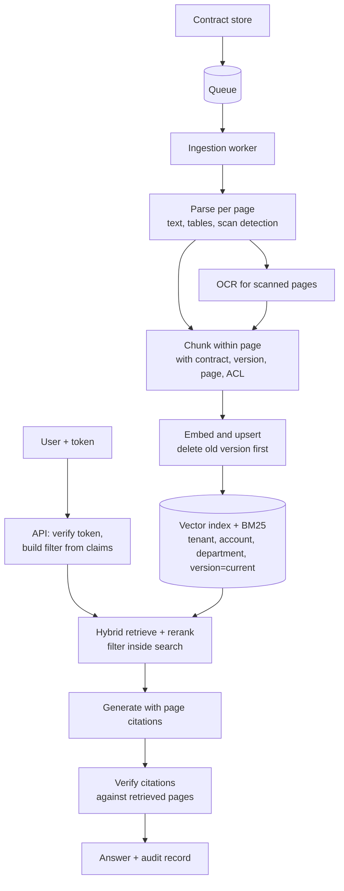

This assessment covers the eight capstone briefs: the personal document assistant, the PDF question-answering system, the enterprise knowledge base, the hybrid search engine, the multimodal document assistant, the Graph RAG knowledge assistant, the agentic research assistant and the production-grade platform. It tests whether you can specify, evaluate and reason about these systems, not whether you remember their code. The pass mark is 70 percent on the quiz, and you should attempt every open question and exercise before opening the hidden answers.

## Quiz

```quiz
[
  {
    "q": "What is the defining property of a good acceptance criterion?",
    "options": [
      "It describes the feature in friendly language",
      "It matches the marketing description",
      "It names a scenario and a pass condition that code can check",
      "It is written after the system is finished"
    ],
    "answer": 2,
    "why": "An acceptance criterion is a test written first. If it cannot fail in an observable way, it is a wish."
  },
  {
    "q": "A note shrinks from five sections to three and is re-indexed by upserting three new chunks. What is left behind?",
    "options": [
      "Nothing",
      "Two orphaned chunks from the old version",
      "The whole old note",
      "A duplicate of the new chunks"
    ],
    "answer": 1,
    "why": "Upsert replaces only the ids it writes. The old note's chunks must be deleted before the new ones are added."
  },
  {
    "q": "Why does a page-citing PDF system chunk within pages rather than across them?",
    "options": [
      "Pages are always the right size",
      "It reduces the number of chunks",
      "Embedding models reject long text",
      "A chunk spanning two pages has no single honest page to cite"
    ],
    "answer": 3,
    "why": "Citations are only useful if they point to one checkable page; a cross-page chunk makes the citation ambiguous."
  },
  {
    "q": "What does this print?\n\n```python\ncited = {1, 4}\nretrieved = {4, 2}\nprint(sorted(cited - retrieved))\n```",
    "options": [
      "[4]",
      "[1, 2, 4]",
      "[1]",
      "[2]"
    ],
    "answer": 2,
    "why": "The set difference keeps cited pages that were not retrieved: page 1. This is the citation verifier's core operation."
  },
  {
    "q": "Why must the access filter run inside the vector search rather than on its results?",
    "options": [
      "Forbidden documents can fill the top k and leave too few or no permitted results, and they were still read",
      "Filtering results is slower",
      "Vector databases forbid post-filtering",
      "Filters change embeddings"
    ],
    "answer": 0,
    "why": "Post-filtering lets forbidden documents crowd out permitted ones and means retrieval touched documents the caller may not see."
  },
  {
    "q": "A request body includes a tenant_id that differs from the one in the caller's verified token. What should the service do?",
    "options": [
      "Trust the body, since it is more specific",
      "Ignore the body silently and carry on",
      "Use the larger tenant",
      "Reject the request and write an audit record"
    ],
    "answer": 3,
    "why": "Identity comes only from the verified token. An explicit rejection is a clear contract and an audit event."
  },
  {
    "q": "Why does Reciprocal Rank Fusion combine ranks rather than scores?",
    "options": [
      "Ranks are more precise",
      "Scores from different retrievers are not on comparable scales",
      "Scores cannot be sorted",
      "Ranks use less memory"
    ],
    "answer": 1,
    "why": "Cosine similarity and BM25 scores mean different things and have different ranges; ranks can be combined directly."
  },
  {
    "q": "What does this print?\n\n```python\ndef rrf(lists, k=60):\n    s = {}\n    for l in lists:\n        for r, d in enumerate(l, 1):\n            s[d] = s.get(d, 0) + 1 / (k + r)\n    return sorted(s, key=lambda d: (-s[d], d))\n\nprint(rrf([['a', 'b'], ['b', 'c']]))\n```",
    "options": [
      "['a', 'b', 'c']",
      "['b', 'c', 'a']",
      "['b', 'a', 'c']",
      "['c', 'b', 'a']"
    ],
    "answer": 2,
    "why": "b appears in both lists (1/62 + 1/61), a only first in one (1/61) and c second in one (1/62), so the order is b, a, c."
  },
  {
    "q": "In the multimodal design, why is each question embedded twice?",
    "options": [
      "The text and image collections use different models and vector spaces",
      "To average the results",
      "Because queries are short",
      "To improve cosine similarity"
    ],
    "answer": 0,
    "why": "A vector from one model is meaningless in another model's space, so each collection needs the query encoded by its own model."
  },
  {
    "q": "An assistant scores 0.80 hit@2 overall, with text 2 of 2, tables 2 of 2 and charts 0 of 1. What is the main lesson?",
    "options": [
      "The system is good enough",
      "Tables should be removed",
      "Charts cannot be retrieved",
      "An average can hide a failing modality; report per modality and grow the weak set"
    ],
    "answer": 3,
    "why": "The strong text and table results mask a failure on charts, and a single chart question is far too few to judge the rate."
  },
  {
    "q": "Why is evidence completeness a better metric than recall for multi-hop questions?",
    "options": [
      "It is easier to compute",
      "A chain needs every fact; partial evidence cannot produce the answer",
      "Recall is always 1",
      "Completeness ignores ranking"
    ],
    "answer": 1,
    "why": "Finding two of three needed documents yields recall of about 0.67 but an unanswerable question; completeness requires all of them."
  },
  {
    "q": "In Graph RAG, which is the most damaging extraction error for chain-following?",
    "options": [
      "An edge with a source sentence",
      "A correctly typed relation",
      "A duplicate entity under two names that splits the chain",
      "A validated schema"
    ],
    "answer": 2,
    "why": "Two nodes for one thing mean the edge arriving at one never connects to the edge leaving the other."
  },
  {
    "q": "Why are an agent's limits checked before each action?",
    "options": [
      "Otherwise each run overspends by one action before a limit is noticed",
      "To make the agent faster",
      "Models require it",
      "Limits cannot be checked after"
    ],
    "answer": 0,
    "why": "A check after the action reports a limit already exceeded; a check before prevents the over-budget action."
  },
  {
    "q": "Peak arrival is 2 requests per second and each request spends 3 seconds in the system. How many requests are in flight on average at peak?",
    "options": [
      "0.67",
      "5",
      "1.5",
      "6"
    ],
    "answer": 3,
    "why": "Little's law: L = lambda x W = 2 x 3 = 6."
  },
  {
    "q": "An availability target of 99.9 percent over 30 days gives an error budget of about how many minutes?",
    "options": [
      "4.3",
      "43",
      "432",
      "4,320"
    ],
    "answer": 1,
    "why": "(1 - 0.999) x 30 x 24 x 60 = 43.2 minutes."
  },
  {
    "q": "A candidate raises recall by 0.01 but lowers faithfulness by 0.03 against a 0.02 tolerance. What should a correct release gate do?",
    "options": [
      "Release, since recall improved",
      "Release if latency improved",
      "Block, because every rule must pass",
      "Average the metrics and release"
    ],
    "answer": 2,
    "why": "A gate requires each metric to stay within its own tolerance. The faithfulness drop exceeds it."
  },
  {
    "q": "What does this print?\n\n```python\nindexed = {'a': 'h1', 'c': 'h3'}\non_disk = {'a': 'h1', 'b': 'h2'}\nprint(sorted(set(on_disk) - set(indexed)), sorted(set(indexed) - set(on_disk)))\n```",
    "options": [
      "['b'] ['c']",
      "['c'] ['b']",
      "['a'] ['b']",
      "[] []"
    ],
    "answer": 0,
    "why": "The first set is files on disk not yet indexed (added: b); the second is indexed entries no longer on disk (deleted: c)."
  },
  {
    "q": "A test suite for image retrieval uses a stand-in embedder that hashes extracted text and ignores pixels. What can you conclude if it passes?",
    "options": [
      "That image retrieval is accurate",
      "That the surrounding code works, but nothing about real image retrieval quality",
      "That CLIP is unnecessary",
      "That page images are not needed"
    ],
    "answer": 1,
    "why": "The stand-in never sees an image, so a pass verifies plumbing only."
  },
  {
    "q": "The assistant answers 'I don't know' about a section that is plainly in a PDF, and retriever tuning does not help. What should you check first?",
    "options": [
      "The API key",
      "The vector dimension",
      "The prompt wording",
      "Whether those pages produced any extracted text"
    ],
    "answer": 3,
    "why": "Scanned pages yield no text, so there is nothing to retrieve. Measuring characters per page separates extraction failures from retrieval ones."
  }
]
```

## Conceptual questions

1. **Why write a brief before building?** Give three concrete things a brief with acceptance criteria prevents, using examples from the capstones.

<details><summary>Show model answer</summary>

It prevents scope growth (the personal assistant's out-of-scope list keeps PDFs, a web interface and device sync from swallowing the weekend). It prevents invisible lifecycle bugs: "after an edit, the old text is not retrievable" fails on the first run of a naive indexer, whereas without it stale chunks surface weeks later as bad answers. It prevents unfalsifiable success: without a golden set and metrics stated in advance, you judge the system by the three questions that worked in the demo. A fourth is that it makes trade-offs explicit and reviewable (for example, hybrid retrieval raising the floor while lowering the ceiling), so a decision is recorded with its evidence instead of being remembered as a feeling.

</details>

2. **Explain pre-filtering.** Describe the failure of filtering after retrieval in an enterprise knowledge base, and why it is both a quality and a security problem.

<details><summary>Show model answer</summary>

If you take the top *k* chunks from the whole index and then remove those the user may not see, forbidden documents occupy slots that permitted documents should have filled, so the user receives too few results or none. That is the quality problem: the system says "nothing found" on a question it could answer. The security problem is that retrieval has already processed and ranked restricted documents on behalf of the user, so any bug in the removal step discloses them, and even correct removal leaks through the pattern (no results for a topic reveals that restricted material on it exists). Filtering inside the search ranks only permitted documents, so results are full and the restricted documents are never considered.

</details>

3. **State machine or tool loop?** For an auditable compliance assistant and for a general internal helper, say which agent style you would choose and what guards both need.

<details><summary>Show model answer</summary>

For the compliance assistant, a state machine: the path is a graph you drew, every transition is testable, and an auditor can read the trace against the design. For the general helper, a tool-use loop is reasonable, because questions vary and the model's flexibility outweighs predictability. Both need the same guards in code: maximum steps, searches and spend checked before each action, repeat detection on normalised queries, validated decisions with a defined outcome for malformed output, a recorded stop reason, a minimal read-only tool surface, and, for the tool loop, a result returned for every tool call. The model supplies judgement; the code supplies the guarantee that the run ends.

</details>

4. **Justify per-modality evaluation.** A multimodal assistant scores 0.91 hit@3 overall. Explain why that number is insufficient and what you would report instead.

<details><summary>Show model answer</summary>

The overall score is a weighted average dominated by whichever modality has the most questions, usually prose, so a failing table or chart modality barely moves it. It also says nothing about modalities with no questions. Report hit@3 per modality (text, table, chart, scanned page), the number of questions behind each rate, and an explicit "untested" entry for any supported modality without questions. Add which collection supplied each hit, so you can see the queries only the image collection answers, and run an ablation that disables the image collection to prove the chart tests depend on it. Be explicit about stand-ins: if the image embedder in the test run was a stub, say image quality was not measured.

</details>

5. **Baseline first.** A colleague proposes building a knowledge graph to improve answers. What do you ask them to measure first, and what result would persuade you to proceed?

<details><summary>Show model answer</summary>

Measure the vector-only baseline on real multi-hop questions: what fraction of questions need more than one document, and on those, how often does vector retrieval deliver *all* the needed documents (evidence completeness)? The headroom is the number of failing multi-hop questions as a share of traffic. Proceed if that share is meaningful or those questions are high-value, and if cheaper fixes (query decomposition, a larger k) have been tried and measured. If vector search already completes most multi-hop questions, or they are 1 percent of traffic, the graph's extraction cost, maintenance and second retrieval path are hard to justify. Also ask about maintenance: how an edited document updates its edges.

</details>

## Coding exercises

1. **Per-group metrics.** Write `evaluate(cases, k)` where each case is `(group, gold_id, ranked_ids)` and the result gives, for each group and for `ALL`, hit@k, MRR and the count. Use the cases in the solution to confirm the numbers.

<details><summary>Show solution</summary>

```python
from collections import defaultdict

def evaluate(cases, k=3):
    acc = defaultdict(list)
    for group, gold, ranked in cases:
        hit = gold in ranked[:k]
        rr = 1 / (ranked.index(gold) + 1) if gold in ranked else 0.0
        acc[group].append((hit, rr))
        acc["ALL"].append((hit, rr))
    return {g: (sum(h for h, _ in v) / len(v), sum(r for _, r in v) / len(v), len(v)) for g, v in acc.items()}

cases = [
    ("keyword", "e4021", ["e4021", "e4012", "vpn"]),
    ("keyword", "e4012", ["e4021", "vpn", "leave"]),
    ("paraphrase", "leave", ["remote", "leave", "it"]),
    ("paraphrase", "laptop", ["it", "remote", "leave", "laptop"]),
]
for g, (hit, mrr, n) in sorted(evaluate(cases).items()):
    print(f"{g:11s} n={n} hit@3={hit:.2f} MRR={mrr:.3f}")
```

```output
ALL         n=4 hit@3=0.50 MRR=0.438
keyword     n=2 hit@3=0.50 MRR=0.500
paraphrase  n=2 hit@3=0.50 MRR=0.375
```

Check by hand: keyword reciprocal ranks are 1 and 0 (the second gold is absent), giving MRR 0.5; paraphrase gives 0.5 and 0.25, giving 0.375, with `laptop` at rank 4 missing hit@3. The `if gold in ranked` guard is what lets an absent gold score zero instead of raising.

</details>

2. **Context under a budget.** Write `assemble(passages, budget)` that takes `(id, score, text)` tuples, sorts by score, drops exact duplicates (ignoring case and whitespace), and never exceeds a word budget, skipping a passage that does not fit but continuing with shorter ones. Count words with `len(text.split())`.

<details><summary>Show solution</summary>

```python
def assemble(passages, budget, count=lambda t: len(t.split())):
    chosen, used, seen = [], 0, set()
    for pid, score, text in sorted(passages, key=lambda p: (-p[1], p[0])):
        key = " ".join(text.lower().split())
        if key in seen:
            continue
        n = count(text)
        if used + n > budget:
            continue
        chosen.append(pid); used += n; seen.add(key)
    return chosen, used

P = [
    ("a", 0.9, "Annual leave is 25 days a year for all full-time staff."),
    ("b", 0.8, "annual leave is 25 days a year for all full-time staff."),
    ("c", 0.7, "Up to 5 unused days carry over and must be used by 31 March."),
    ("d", 0.6, "Remote work is allowed up to 3 days a week with manager agreement and a signed home-office checklist."),
    ("e", 0.5, "Expenses within 30 days."),
]
for budget in (12, 25, 100):
    print(budget, assemble(P, budget))
```

```output
12 (['a'], 11)
25 (['a', 'c'], 25)
100 (['a', 'c', 'd', 'e'], 47)
```

Passage `b` is dropped as a duplicate of `a` at every budget. At budget 12 only `a` fits; at 25, `a` and `c` use the whole budget; at 100 everything unique fits. The sort key includes the id so ties break deterministically. A word count stands in for tokens here; in production use the tokeniser of the model whose limit you are respecting.

</details>

3. **A stricter citation verifier.** Write `verify(answer, passages)` that splits an answer into sentences and reports, for each, a missing citation, a citation to an unknown id, or a number in the sentence that does not appear in the cited passage.

<details><summary>Show solution</summary>

```python
import re

def verify(answer: str, passages: dict):
    problems = []
    for sentence in [s.strip() for s in re.split(r"(?<=[.!?])\s+", answer) if s.strip()]:
        ids = re.findall(r"\[([a-z0-9-]+)\]", sentence)
        if not ids:
            problems.append(("no_citation", sentence)); continue
        for pid in ids:
            if pid not in passages:
                problems.append(("unknown_id", pid)); continue
            nums = set(re.findall(r"\d+", re.sub(r"\[[^\]]*\]", "", sentence)))
            if nums and not nums <= set(re.findall(r"\d+", passages[pid])):
                problems.append(("number_not_in_source", sentence))
    return problems

passages = {"leave": "Annual leave is 25 days. Up to 5 days carry over.", "exp": "Submit expenses within 30 days."}
answers = [
    "You get 25 days of annual leave [leave]. Up to 5 days carry over [leave].",
    "You get 28 days of annual leave [leave].",
    "Submit expenses within 30 days [exp]. Receipts are optional.",
    "Remote work is 3 days [policy].",
]
for a in answers:
    print(verify(a, passages) or "OK", "<-", a)
```

```output
OK <- You get 25 days of annual leave [leave]. Up to 5 days carry over [leave].
[('number_not_in_source', 'You get 28 days of annual leave [leave].')] <- You get 28 days of annual leave [leave].
[('no_citation', 'Receipts are optional.')] <- Submit expenses within 30 days [exp]. Receipts are optional.
[('unknown_id', 'policy')] <- Remote work is 3 days [policy].
```

The number check is crude quote verification: it catches the invented "28" that a retrieval-membership check would pass. It does not prove that the passage *supports* the sentence, only that the figures are consistent with it, so it complements rather than replaces a human sample or a model-based faithfulness check.

</details>

## Architecture design challenge

Northwind Logistics, a Meridian customer, wants an assistant over 30,000 contract PDFs. Some are scanned, many contain pricing tables, and access is by department: legal sees all contracts, sales sees only those for its own accounts, and finance sees pricing sections. 1,200 staff will use it; answers must cite contract and page; contracts change by amendment, and a superseded clause must never be quoted as current. Design the system: ingestion, retrieval, access control, evaluation, and operation. State your assumptions and trade-offs.

<details><summary>Show reference design</summary>

**Assumptions (to be validated).** 30,000 contracts averaging 25 pages, so about 750,000 pages; amendments arrive a few hundred a week; peak load low (a few queries per second); answers within a few seconds; legal-grade citation correctness matters more than speed.



**Ingestion.** A queue and idempotent worker keyed by content hash. Per-page parsing reports characters per page; pages with no text go to OCR, and OCR confidence is stored. Tables are extracted as Markdown with caption and header repeated. Chunks never cross pages and carry contract id, amendment version, page number, account, department and a "current" flag. When an amendment arrives, the superseded clauses' chunks are either deleted or flagged non-current, and retrieval filters on `current = true` by default, with an explicit "as of date" mode for legal.

**Access control.** Identity and groups come only from a verified token. Department and account restrictions are payload fields indexed in the vector store and applied inside both the dense and the BM25 search. Finance's "pricing sections only" is a section-type field set at ingestion, enforced as a filter, not by the prompt. Missing ACL fields mean invisible. The audit log records every request, including denied ones, with the chunk ids retrieved.

**Retrieval.** Hybrid dense plus BM25 (contract numbers, clause identifiers and party names are exact-match heavy), fused by RRF, then a cross-encoder rerank of about 20 candidates. Table chunks are indexed as text; scanned pages rely on OCR text, with the page image available to a vision-capable model for verification if OCR confidence is low.

**Generation and citations.** Context assembled under a token budget with contract and page labels. The model must cite `[contract, page]`; code verifies every cited page was retrieved, and checks numbers in the answer against the cited chunks (a crude quote check). On low retrieval confidence or an unverified citation the system returns the passages and says it could not verify an answer.

**Evaluation.** A golden set of at least 100 questions stratified by type (clause lookup, pricing table, comparison across amendments, "as of" questions, unanswerable) and by principal (legal, sales, finance), including superseded-clause traps and access attacks. Metrics: recall@k and MRR per type, citation validity, faithfulness on a reviewed sample, OCR-page accuracy separately, and a leakage property test across all principals. A release gate runs the set on every change.

**Operation.** Index versioning with the previous index retained for rollback; traces carrying contract id, version and page for every cited passage; dashboards for p95 latency, degraded responses and cost per query; a retrieval-only degraded mode if the model fails.

**Trade-offs.** OCR is slow and imperfect, so scanned pages are the largest quality risk; the design reports OCR confidence rather than hiding it. Deleting superseded chunks is simple but loses history; flagging keeps history at the price of a mandatory filter everywhere. A single shared index with payload filters is cheapest and adequate for one customer, but a customer with stricter isolation requirements would justify a separate collection. Cross-encoder reranking adds hundreds of milliseconds, justified here because first-place precision matters for legal citations, and the golden set must confirm that. Section-level access (finance) multiplies metadata and ingestion complexity; the alternative, separate pricing documents, is simpler if the contracts can be split at source.

</details>

## Troubleshooting scenarios

1. **Deleted notes still appear.** A personal assistant keeps quoting a paragraph the user deleted from a note three weeks ago. Sync reports the note as "changed" each time it is edited. What is wrong, how do you confirm it, and how do you fix it?

<details><summary>Show diagnosis</summary>

Likely orphaned chunks: the sync re-indexes a changed note by upserting its new chunks without first deleting its old ones, so a chunk whose id no longer appears in the new version survives. Confirm by querying the store for chunks with that note's path and comparing their ids and texts with a fresh chunking of the file; stale ones will exist that the new chunking does not produce. Fix: on `changed` or `deleted`, delete every chunk with that note's path before upserting, and add the acceptance test "after editing a section out of a note, its text cannot be retrieved". Then run a one-off cleanup that compares each indexed note's chunk ids with the expected ones and removes the strays.

</details>

2. **The agent's bill doubled.** After a prompt change, the mean number of searches per agent question rose from 2.1 to 4.8 and the gave-up rate rose, while answer quality on the golden set is unchanged. What do you check, and what do you change?

<details><summary>Show diagnosis</summary>

Look at traces for the high-search runs and read the grader's verdicts and the queries. Likely causes: the new prompt makes the grader stricter or vaguer ("is this enough?" now says no more often), or the planner rephrases queries so the repeat guard (if it compares raw strings) does not fire, so the agent burns its budget on near-duplicates. Check the repeat guard's normalisation and the grader's calibration set: measure over-caution on questions whose evidence does contain the answer. Fixes: tighten the grader to require a quoted sentence and to prefer "sufficient" when the quote is present; normalise queries for repeat detection; lower the search limit to a value the golden set shows is enough; and add the searches-per-question metric to the release gate, since quality alone did not move and so did not warn.

</details>

3. **The gate passed, users complained.** A change passes the release gate (recall@3 and faithfulness within tolerance) but within days support reports answers quoting the superseded 2023 handbook (a £250 equipment budget instead of £400, a 4-year laptop cycle instead of 3). What went wrong, and what do you change?

<details><summary>Show diagnosis</summary>

The golden set did not measure the failure: it probably has no questions where the superseded and current documents compete, so the gate had nothing to fail on. The change (for example a new chunk size, a different fusion constant or removal of a metadata filter) may also have stopped preferring current documents, such as a lost `current = true` filter or version metadata. Confirm by running the user-reported questions through both the old and new versions and printing the retrieved chunks with their document versions. Fix: add superseded-document questions to the golden set (each with the current answer as gold and the old figure as a known-bad), add a metric for "cited a non-current document", make version and current-flag part of the trace and the filter, and make the gate fail on it. Roll back using the previous index and image while this is done. The general lesson is that a gate is only as good as its golden set, so every reported failure becomes a permanent test.

</details>
