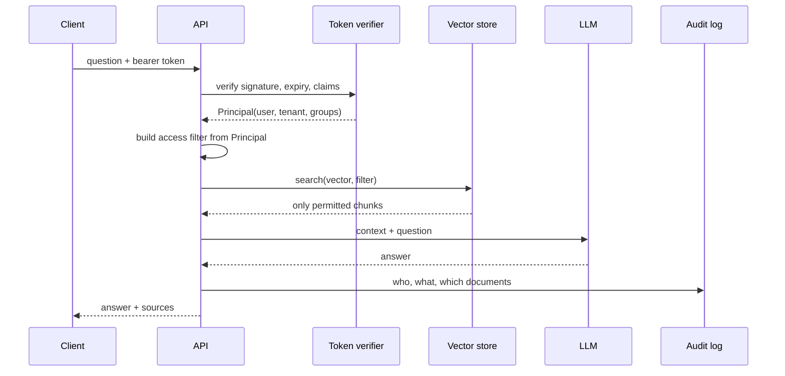

A knowledge base for one person fails by giving a wrong answer. A knowledge base for a company can fail in a worse way: by giving a right answer built from a document the asker was never allowed to see. The salary bands, the disciplinary notes, another customer's contract: all of them are in the same index as the leave policy, and all of them are semantically close to some question someone will ask. The defining engineering problem of an enterprise knowledge base is therefore not retrieval quality. It is **who may see what**, enforced in a place that a bug in the rest of the system cannot bypass.

This capstone brief specifies a multi-tenant, permission-aware knowledge base: several organisations share one service, and within each organisation some documents are open to everyone and some to named groups. The finished reference build is the [multi-tenant enterprise RAG project](/projects/multi-tenant-enterprise-rag); its sibling, the [multi-document research assistant](/projects/multi-document-research-assistant), covers the other half of an enterprise knowledge base, answering questions that need several documents. Treat both as answer keys to consult after you have designed your own.

## Learning objectives

- Write requirements for an enterprise knowledge base in which security properties are first-class and testable.
- Design identity, tenant and group handling so that access control cannot be influenced by the request body.
- Explain why access filtering must happen inside the search, and demonstrate the failure of filtering afterwards.
- Plan an evaluation that includes attack tests, audit coverage and retrieval quality together.
- Implement and run a leakage test that would fail if isolation were broken.

## Prerequisites

- [Authentication](/learn/access-control-and-privacy/authentication) and [authorisation](/learn/access-control-and-privacy/authorisation): proving who you are versus deciding what you may do.
- [Document-level permissions](/learn/access-control-and-privacy/document-level-permissions) and [tenant isolation](/learn/access-control-and-privacy/tenant-isolation).
- [Metadata filtering](/learn/advanced-vector-database-engineering/metadata-filtering) and [multi-tenancy in vector databases](/learn/advanced-vector-database-engineering/multi-tenancy).
- [Audit logs](/learn/enterprise-rag-governance/audit-logs): recording who retrieved what.
- [Query decomposition](/learn/advanced-retrieval/query-decomposition): the basis of multi-document questions.

## Why this matters

Consider what a typical retrieval system does when it is given a question: it finds the chunks most similar to the question, from the whole index, and hands them to a language model. There is no concept of "the asker". That is fine for a public help centre. Put an enterprise's documents in the same index and the same code now has a consequence: the most similar chunk to "what is the pay range for a senior engineer?" is the salary-band document, and it is returned to whoever asked.

Three properties make this hard to get right by accident. First, **relevance is the enemy of confidentiality**: the better your retrieval, the more reliably it finds the sensitive document that answers the question. Second, the leak is **invisible to ordinary testing**: your golden set passes, your latency is fine, and the system returns confidential text to the wrong person only when the wrong person asks, which no functional test thinks to do. Third, a language model **cannot be trusted as the guard**. A prompt that says "do not reveal HR documents to non-HR staff" is a request, not a control; a document that has been retrieved into the context has already been disclosed to the model and can be paraphrased out of it.

So the control must sit *before* generation, in the retrieval layer, and it must derive from facts the caller cannot forge. That is the whole of this capstone's design principle, and the rest of the brief follows from it.

## The intuition

Think of a records office with a clerk and a locked room of files. A visitor arrives and says "I'm from HR, give me the salary files." A careless clerk takes the visitor's word. A careful clerk asks for a badge, reads who the badge says the visitor is, and goes to fetch files only from the drawers that badge opens. The visitor's *statement* is irrelevant; the badge is what counts, and the badge was issued by someone else.

Now vary the clerk's method. One clerk collects the 10 most relevant files from the whole room, then walks back and removes those the visitor may not see. Suppose the visitor may see none of the 10: they are told "no results", and learn that the room contains ten files on that subject. Even if nothing is handed over, the count and the pattern of what is withheld are information. A better clerk opens only the permitted drawers and picks the 10 most relevant *there*. That is pre-filtering, and the difference between these two clerks is the difference between a leak and no leak.

In system terms: the badge is a signed token, the drawers are metadata fields on each document, and "opens only the permitted drawers" is a filter applied as part of the vector search itself. The visitor's statement is the request body, which must never decide anything about access.

## How it works

### The product

Meridian now offers its assistant, AskMeridian, to other companies. Meridian is one **tenant**, a customer organisation whose data must be completely separate; Northwind Logistics is another. Within a tenant, some documents are visible to all staff, and some only to groups such as `hr` or `finance`. A user submits a question with a signed token; the service returns an answer and its sources, and writes an audit record.

### Requirements

**Functional:**

1. Accept a question and a bearer token. Verify the token's signature, expiry and required claims.
2. Derive the caller's identity, tenant and groups from the verified token alone.
3. Retrieve only documents in the caller's tenant whose allowed groups intersect the caller's groups, with that restriction applied inside the search.
4. Generate an answer from the permitted chunks only and list the sources.
5. Reject any request field that tries to carry identity, tenant or filter information.
6. Write an audit record for every request, including denied and failed ones: who, when, the question, and the document ids retrieved.
7. Ingest documents with mandatory tenant and access-control metadata; refuse a document without them.

**Non-functional:**

- *Security*: a user must never retrieve, see, or infer the existence of a document outside their tenant or groups.
- *Fail closed*: a document with missing or malformed access metadata is visible to no one.
- *Auditability*: an administrator can answer "who retrieved document X last week?".
- *Quality*: within the permitted set, retrieval quality is not noticeably worse than an unrestricted system.
- *Testability*: the isolation tests run with no model, no network and no key.

**Out of scope:** a login screen, a user directory, per-sentence redaction, and key management. The brief assumes an identity provider issues the tokens and states that assumption.

### Architecture

The request path, with the trust boundary marked by the position of the filter:



Look at what the sequence guarantees. The only inputs to the filter are fields of `Principal`, and `Principal` is produced only by the verifier. The search method of the index takes a `Principal` as a *required* argument, so there is no code path that searches without one. This is **defence by construction**: security does not depend on every caller remembering to add a filter; the type of the function makes forgetting impossible.

### Decisions the brief must force

| Decision | Choice | Reason and test |
| --- | --- | --- |
| Where identity comes from | Verified token claims only | Test: a request that sends `tenant_id` in the body is rejected, not ignored |
| Where the filter runs | Inside the vector search (pre-filter) | Test: when the top matches are forbidden, you still get *k* permitted results |
| Isolation strength | One collection, tenant in payload, indexed | Larger or stricter tenants may need their own collection or cluster; state the trigger |
| Missing ACL | Visible to nobody | Test: ingest a document with no groups, assert no query returns it |
| Group changes | Short token lifetime, or server-side lookup | Test: after removal from a group, access ends within the stated window |
| Caching | Key includes tenant and groups | Test: two users, same question, different results, no cross-hit |

The first row hides a subtle point. Rejecting the field outright, instead of ignoring it, matters because silent ignoring teaches an attacker that the field is harmless to probe, while an explicit rejection is both a clear contract and an event worth auditing.

### Multi-document questions

An enterprise knowledge base also answers questions that no single document holds: "What are the rules for working remotely, covering how often, security and paying for equipment?" touches four documents. A single search for the whole sentence returns whichever topic dominates its embedding. The extension in this brief is a **research step**: decompose the question into sub-questions, retrieve per sub-question restricted to the right documents, tabulate the evidence with labels, and have the generator cite the labels. The [multi-document research assistant project](/projects/multi-document-research-assistant) builds this with a validated plan and a deterministic check of the report's citations. The important integration constraint is that every sub-question search passes through the *same* access-filtered index. A research step that bypasses the filter is a leak with extra steps.

### The evaluation plan

An enterprise knowledge base has three kinds of test, and the middle kind is the one people omit.

1. **Retrieval quality.** A golden set of 25 or more questions with gold documents, scored with hit@k and MRR, run *as a specific user*. Quality is a function of the user: the set should be run as at least two principals with different groups.
2. **Security tests (attacks).** Each is a request that must fail or return nothing: a token with a bad signature; an expired token; a token with the algorithm field changed; a body field naming another tenant; a filter in the body; a question that quotes the title of a confidential document. Aim for more attack tests than quality tests. Each should be able to fail if the control were removed; verify that by temporarily removing it.
3. **Leakage property tests.** Over a corpus with several tenants and groups, for every principal and a bank of queries, assert that every returned id satisfies the access predicate. Run this over *all* principals, not a sample.
4. **Audit coverage.** After a scripted scenario, the audit log contains one row per request, including denied ones, and an administrator query can list who retrieved a given document.
5. **Fail-closed checks.** Documents with missing, empty or malformed ACLs are invisible to every principal.

### Milestones

1. **Corpus and metadata.** Documents for two tenants with groups; ingestion refuses missing ACLs. Acceptance: a malformed document is rejected with a readable error.
2. **Token verification.** Verify signature, expiry and required claims; produce a `Principal`. Acceptance: the six token attack cases fail correctly.
3. **Filtered retrieval.** An index whose search requires a `Principal`. Acceptance: the leakage property test passes for all principals.
4. **API and audit.** The endpoints, the rejected-field behaviour and the audit log. Acceptance: every request in a scripted run produces a row; denied attempts included.
5. **Research step and quality.** Decomposition, evidence table and quality metrics for two principals. Acceptance: every sub-question search goes through the filtered index, shown by a test.

### Acceptance criteria

- No test in the suite can return a document outside the caller's tenant and groups; the leakage property test covers every principal.
- A request carrying `tenant_id`, `groups` or a filter in its body is rejected with a client error and an audit row.
- With forbidden documents ranking above permitted ones, a user still receives *k* permitted results (so the filter is demonstrably inside the search).
- A document with no access metadata is returned to no one.
- The audit log contains a row for every request, including those that failed verification.
- Removing the filter from the index makes at least one test fail; this is demonstrated, not assumed.

> [!WARNING]
> Never rely on the prompt to enforce access. Once a restricted chunk is in the model's context, it has been disclosed. Access control belongs before generation, in the retrieval layer.

## In code

The executable part of this brief is the **leakage test**, in miniature: a corpus with two tenants and several groups, three retrieval functions (none, post-filter and pre-filter), and the property assertion. It uses only the standard library. The scores are fixed numbers standing in for similarity to one query, so the demonstration is deterministic and the mechanism is visible; in the real system the scores come from the vector store.

The problem it solves: show concretely why filtering after the search is wrong, and give you a test shape you can reuse. No dependencies.

```python
from dataclasses import dataclass

@dataclass(frozen=True)
class Doc:
    id: str
    tenant: str
    groups: frozenset
    score: float  # similarity to the test query, fixed for the demo

DOCS = [
    Doc("hr-salary-bands", "meridian", frozenset({"hr"}), 0.91),
    Doc("hr-disciplinary", "meridian", frozenset({"hr"}), 0.88),
    Doc("nw-leave", "northwind", frozenset({"everyone"}), 0.87),
    Doc("handbook-leave", "meridian", frozenset({"everyone"}), 0.80),
    Doc("handbook-remote", "meridian", frozenset({"everyone"}), 0.70),
    Doc("fin-expenses", "meridian", frozenset({"finance", "everyone"}), 0.60),
]

def allowed(d: Doc, tenant: str, groups: set) -> bool:
    return d.tenant == tenant and bool(d.groups & (groups | {"everyone"}))

def search_no_filter(tenant, groups, k):            # WORST: no access control at all
    return [d.id for d in sorted(DOCS, key=lambda d: -d.score)[:k]]

def search_post_filter(tenant, groups, k):          # WRONG: rank first, filter later
    top = sorted(DOCS, key=lambda d: -d.score)[:k]
    return [d.id for d in top if allowed(d, tenant, groups)]

def search_pre_filter(tenant, groups, k):           # RIGHT: filter is part of the search
    pool = [d for d in DOCS if allowed(d, tenant, groups)]
    return [d.id for d in sorted(pool, key=lambda d: -d.score)[:k]]

caller = ("meridian", {"staff"})
for fn in (search_no_filter, search_post_filter, search_pre_filter):
    got = fn(*caller, k=3)
    leaked = [i for i in got if not allowed(next(d for d in DOCS if d.id == i), *caller)]
    print(f"{fn.__name__:20s} -> {got}  leaked={leaked}  returned={len(got)}/3")
    if fn is search_pre_filter:
        assert not leaked and len(got) == 3   # the acceptance test
```


```output
search_no_filter     -> ['hr-salary-bands', 'hr-disciplinary', 'nw-leave']  leaked=['hr-salary-bands', 'hr-disciplinary', 'nw-leave']  returned=3/3
search_post_filter   -> []  leaked=[]  returned=0/3
search_pre_filter    -> ['handbook-leave', 'handbook-remote', 'fin-expenses']  leaked=[]  returned=3/3
```

**What the important lines do.** `allowed` is the single access predicate: same tenant, and the document's groups intersect the caller's groups plus the implicit `everyone`. Every retrieval variant is judged against this one function, which is how a property test should work: one definition of "permitted", many implementations checked against it. `search_pre_filter` shrinks the candidate pool first and ranks within it; `search_post_filter` ranks the whole corpus and filters the top *k*. The final `assert` is the acceptance test: no leaks, and a full set of three results.

**What the output means.** With no filter, a Meridian staff member receives two HR documents and a Northwind document: a cross-tenant leak and an in-tenant leak in one result. Post-filtering stops the leak, so it looks safe, but it returns *nothing*, because the three highest-scoring documents are all forbidden. The user gets "no results" on a question the system could have answered from three permitted documents, and the empty result also tells an observer that confidential material on this topic exists. Only pre-filtering returns three permitted documents. In a real system, post-filtering usually fails less dramatically (you get five of ten results rather than zero) but the mechanism is identical.

**Errors people commonly hit.** A vector database's approximate index can return fewer than *k* results when a very selective filter is applied, if the filtering is done carelessly by the index; check how your database applies filters and test with a highly selective principal. A second is forgetting the payload index on `tenant_id` in a server deployment, which does not change correctness but can make every filtered search slow (see [payload indexes](/learn/advanced-vector-database-engineering/payload-indexes)). A third is an ACL field that defaults to `everyone` when absent, which fails open; make the field mandatory.

**How to extend it.** Generate every combination of tenant and group set, run a bank of queries through the real index for each, and assert `allowed` for every returned id. Add a mutation test: deliberately break the filter and confirm the suite goes red.

## A real-world example

Meridian's Platform team launches the multi-tenant service for Northwind Logistics. The first version stores tenant and groups as metadata and filters in the API handler: take the top 10 chunks, then drop the ones the user may not see. In testing everything passes, because the test user is a Meridian administrator who can see nearly everything.

Two weeks into the pilot, a Northwind support agent asks a question about leave and receives a reply that says "I could not find relevant information," although the Northwind handbook covers it. The cause is exactly the post-filter failure above: Meridian's HR documents on leave scored highest, filled the top 10, and were removed, leaving nothing. An engineer, Mei Tan, investigating the "missing answers", notices something worse in the logs: the retrieval stage had been *reading* Meridian documents on behalf of a Northwind user. No document was returned, but the pattern was a design defect, and a bug in the removal step would have been a disclosure.

The redesign followed this brief. Identity moved into a verified token; the index method required a `Principal`; the filter went inside the search; and a leakage property test ran over every principal in CI. The fix for the missing answers and the fix for the security defect were the same change, which is often true: the structure that makes a system secure also makes it correct. The team also added an audit row for every request, so a later question, "has anyone at Northwind ever retrieved a Meridian document?", could be answered from a query with the expected answer of none.

## Common mistakes

- **Taking tenant or groups from the request body.** Anyone can claim anything; the access decision becomes whatever the caller says. Derive identity only from a verified token.
- **Filtering after retrieval.** Forbidden documents crowd out permitted ones, so users get too few or no results, and the retrieval stage has already processed documents it should not have. Filter inside the search.
- **Relying on the prompt for access control.** A restricted chunk in the context has already been disclosed to the model. Keep it out of the context.
- **Failing open on missing metadata.** A document ingested without an ACL becomes visible to everyone. Make the field mandatory and treat absence as "no one".
- **Skipping attack tests.** Functional tests pass while isolation is broken, because no functional test asks as the wrong user. Write tests that must fail.
- **Caching by question only.** A cached answer for one user is served to another. Key every cache on tenant and groups.
- **Not logging denied requests.** The most informative rows in an audit log are the failures; without them an attack is invisible.
- **Letting a research or agent step bypass the filter.** Sub-question searches that call the store directly skip the access control. Route every retrieval through the same method.

## Best practices

- Make the secure path the only path: a search function that requires a `Principal` cannot be called without one.
- Use short-lived tokens and verify the algorithm explicitly, signature, expiry and required claims. In production prefer asymmetric signing so the API holds no signing secret.
- Index tenant and access fields in the vector store, and measure filtered-search latency with your most selective principal.
- Write one access predicate and test every implementation against it, over all principals.
- Treat retrieved text as untrusted input too; access control complements, and does not replace, [prompt-injection defences](/learn/rag-security-fundamentals/indirect-prompt-injection).
- Keep ACLs in step with the source system: when permissions change upstream, update the stored fields without re-embedding.
- Record the audit trail in an append-only form and define who may read it.
- State the isolation level in the design document: shared collection, collection per tenant, or cluster per tenant, with the trigger for moving up.

## Performance considerations

Pre-filtering has a cost that depends on how the vector index handles it. An exact (brute-force) search simply skips excluded vectors. An approximate graph index must navigate while ignoring excluded nodes, and if the filter is very selective the traversal can degrade; vector databases handle this in different ways, so test the most restrictive principal you have, not the average one. Payload indexes on the filter fields are what keep a filtered search from inspecting every point.

For capacity, reason with assumptions you state. If a tenant holds 50,000 chunks and 100 tenants share the cluster, the collection holds 5 million vectors. At 384 dimensions and 4 bytes each, the raw vectors are about 7.7 GB (5,000,000 x 384 x 4 bytes), before index overhead and payloads; a quantised or smaller-dimension model changes that arithmetic. Isolation by collection per tenant multiplies the number of indexes and their fixed overhead, which is why it is reserved for tenants that need stronger separation or very different scale. The audit write is a small, synchronous cost per request; keep it a single insert and move heavy analysis offline.

A research step multiplies retrieval calls: a question decomposed into four sub-questions costs four searches and one extra model call for planning, plus a longer synthesis prompt. Budget for it, and show the user a progress indication rather than silence.

## Security considerations

This section is the heart of the project, so only the points not already covered above. **Token handling**: verify with a constant-time comparison where you implement signature checks yourself, always pass the allowed algorithms explicitly to the verification library, and reject tokens whose header names a different algorithm. **Error messages**: return the same generic error for a bad signature and an expired token to the client, while recording the precise reason in the audit log. **Inference attacks**: even permitted results can leak, for example through result counts, timing differences between tenants, or error text that names a document; keep responses uniform. **Data lifecycle**: when a tenant leaves, you must be able to delete its vectors, payloads, audit rows and caches; see [secure deletion](/learn/enterprise-rag-governance/secure-deletion). **Personal data**: documents may contain personal data subject to regulation; see [GDPR concepts](/learn/enterprise-rag-governance/gdpr-concepts) and [PII detection](/learn/access-control-and-privacy/pii-detection). Seek qualified legal advice for compliance obligations; the course explains the engineering, not the law.

## Summary

- In an enterprise knowledge base the central risk is returning a correct answer built from a document the asker may not see, and relevance makes that risk worse, not better.
- Identity must come from a verified token, never from the request body, and the access filter must run inside the vector search so that forbidden documents cannot crowd out permitted ones.
- Make the secure path the only path: a search method that requires a `Principal` removes the possibility of forgetting the filter.
- Test security by attack and by property: tokens that must fail, bodies that must be rejected, and a leakage test across every principal, plus a demonstration that removing the control breaks a test.
- Multi-document questions add a research step, and that step must pass through the same filtered index; the references are the [multi-tenant project](/projects/multi-tenant-enterprise-rag) and the [multi-document research assistant](/projects/multi-document-research-assistant).

## Exercises

1. **Why fail closed.** A document is ingested with an empty `allowed_groups` list. Argue whether it should be visible to everyone, to no one, or to administrators only, and write the acceptance test.

<details><summary>Show solution</summary>

Visible to no one by default, because an empty list most plausibly means "an ACL was never assigned", and the safe response to an unknown is denial. If administrators need to see such documents to repair them, give them an explicit, audited path. Test: ingest a document with `groups=[]`, then for every principal in the fixture (including an administrator-like one) assert that no search returns its id.

</details>

2. **Predict the output.** For `search_post_filter` with `k = 5` and the caller from the lesson (tenant `meridian`, groups `{"staff"}`), what does it return? Compare with `search_pre_filter` at `k = 5`.

<details><summary>Show solution</summary>

The top five by score are `hr-salary-bands`, `hr-disciplinary`, `nw-leave`, `handbook-leave`, `handbook-remote`. After filtering, only `handbook-leave` and `handbook-remote` survive: two results. Pre-filtering first reduces the corpus to the permitted pool, which is `handbook-leave`, `handbook-remote` and `fin-expenses` (permitted through `everyone`), and returns all three, because fewer than five exist. So pre-filter returns 3 (the entire permitted pool) and post-filter returns 2, even though a third permitted document existed.

</details>

3. **Write the property test.** Using the lesson's `DOCS` and `allowed`, write a loop that checks, for every combination of tenant in `{"meridian", "northwind"}` and group set in `[set(), {"hr"}, {"finance"}, {"hr", "finance"}]`, that `search_pre_filter` returns only permitted ids.

<details><summary>Show solution</summary>

```python
from itertools import product
by_id = {d.id: d for d in DOCS}
for tenant, groups in product(["meridian", "northwind"], [set(), {"hr"}, {"finance"}, {"hr", "finance"}]):
    for i in search_pre_filter(tenant, groups, k=10):
        assert allowed(by_id[i], tenant, groups), (tenant, groups, i)
print("no leaks across all principals")
```

The key properties are that it covers every principal rather than a sample, and that `allowed` is the only definition of "permitted".

</details>

4. **Design a cache.** AskMeridian caches answers by question to save cost. Describe how a cache hit could leak, and design a key and an invalidation rule that do not.

<details><summary>Show solution</summary>

If the key is the question text, then user A (HR) asks "pay bands for engineers" and the answer built from HR documents is cached; user B (not HR) asks the same question and is served A's answer. Key on `(tenant, sorted groups, normalised question, index version)`. Invalidate on index changes (the version component does this automatically) and on ACL changes for the affected documents. Consider not caching answers for any query that touched a restricted document at all.

</details>

## Check your understanding

```quiz
[
  {
    "q": "Why is post-retrieval filtering a poor way to enforce access control?",
    "options": [
      "It is slower than any other method",
      "Vector databases do not support it",
      "Forbidden documents can crowd out permitted ones, and the retrieval already processed them",
      "It changes the embedding of the query"
    ],
    "answer": 2,
    "why": "If the top results are forbidden, filtering them out leaves too few or none, and the system read documents the caller should never touch. Filtering inside the search ranks only permitted documents."
  },
  {
    "q": "A request body contains {\"question\": \"...\", \"tenant_id\": \"northwind\"} from a Meridian user's token. What should the service do?",
    "options": [
      "Reject the request and record an audit row",
      "Silently ignore the field",
      "Use the body value because it is more specific",
      "Use whichever tenant has more documents"
    ],
    "answer": 0,
    "why": "Identity comes only from the verified token. Rejecting explicitly gives a clear contract and an audit event; silently ignoring the field hides an attempted attack."
  },
  {
    "q": "What does 'fail closed' mean for a document missing its access metadata?",
    "options": [
      "It is visible to everyone until fixed",
      "It is visible to no one until fixed",
      "It is deleted at ingestion",
      "It is visible to its uploader only"
    ],
    "answer": 1,
    "why": "When the permission is unknown, deny. Defaulting to open turns a data-entry error into a disclosure."
  },
  {
    "q": "Why can a system prompt like 'never reveal HR documents to non-HR staff' not serve as access control?",
    "options": [
      "Prompts are too long",
      "Models always ignore system prompts",
      "Prompts are not logged",
      "The restricted text is already in the model's context, and a prompt is a request, not a control"
    ],
    "answer": 3,
    "why": "Once the chunk is in the context it has been disclosed to the model and can be paraphrased or leaked through injection. Enforcement has to happen before generation."
  },
  {
    "q": "Which test best demonstrates that the access filter really is part of the security?",
    "options": [
      "A test that fails when the filter is deliberately removed",
      "A golden-set accuracy score",
      "A latency benchmark",
      "A test that counts the documents indexed"
    ],
    "answer": 0,
    "why": "A security test must be able to fail. Removing the control and watching the suite go red proves the tests actually depend on it."
  }
]
```

## Further reading

- [Qdrant documentation](https://qdrant.tech/documentation/): payload filtering and payload indexes, including multitenancy guidance.
- [OWASP Top 10 for Large Language Model Applications](https://owasp.org/www-project-top-10-for-large-language-model-applications/): prompt injection and sensitive information disclosure.
- RFC 7519 (2015), "JSON Web Token (JWT)", Jones, Bradley and Sakimura, and RFC 8725 (2020), "JSON Web Token Best Current Practices".
- [PyJWT documentation](https://pyjwt.readthedocs.io/): verifying tokens with explicit algorithms.
- Saltzer, J. and Schroeder, M. (1975), "The Protection of Information in Computer Systems": the principles of fail-safe defaults and complete mediation.
