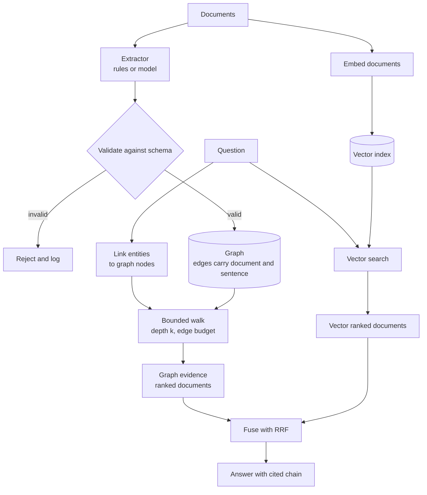

Vector search answers the question "which passages sound like this question?". Some questions cannot be answered that way, because the passage holding the answer shares no words and no meaning with the question. It is connected to the question only through a chain of other facts. "Who leads the team that owns the VPN gateway?" needs one page that says who owns the gateway and a second page that says who leads that team, and the second page never mentions the VPN. Questions that join facts end to end are called **multi-hop questions**, and they are the reason Graph RAG exists.

This capstone brief specifies a knowledge assistant that extracts entities and relationships from documents into a graph, links a question to that graph, collects evidence by walking a bounded number of steps, and merges the result with ordinary vector search. As with the other capstones, the real skill is deciding how you will *measure* it: Graph RAG is expensive and complicated, and the honest question is whether it beats the baseline on the questions you care about. The reference build is the [Graph RAG application project](/projects/graph-rag-application). Design your own against this brief first.

## Learning objectives

- Specify a Graph RAG system whose requirements include provenance, bounded traversal and a comparison against a vector baseline.
- Design an extraction schema and explain what each extractor failure does to the graph.
- Define an evaluation metric, evidence completeness, that tests whether retrieval collected every fact a multi-hop answer needs.
- Reason about the cost of traversal depth and fan-out, and choose a budget with evidence.
- Run a completeness check on a small graph and read the effect of an evidence budget.

## Prerequisites

- [Knowledge graphs](/learn/graph-rag/knowledge-graphs), [entity extraction](/learn/graph-rag/entity-extraction) and [relationship extraction](/learn/graph-rag/relationship-extraction).
- [Graph construction](/learn/graph-rag/graph-construction), [graph traversal](/learn/graph-rag/graph-traversal) and [graph retrieval](/learn/graph-rag/graph-retrieval).
- [Hybrid graph-vector retrieval](/learn/graph-rag/hybrid-graph-vector-retrieval).
- [Reciprocal Rank Fusion](/learn/hybrid-search/reciprocal-rank-fusion).
- [Structured outputs](/learn/generation-strategies/structured-outputs): validating what an extractor returns.

## Why this matters

Ordinary RAG treats a corpus as a bag of independent passages. That works when each question is answered by one passage, which is true of most questions. It fails when the answer requires joining facts that live in different passages, because the retriever scores each passage against the *question*, and the bridging passage is not similar to the question. In the Meridian example, the question mentions the VPN gateway; the passage naming the team's lead mentions the team and a person. The embedding of the question is not near it. Nothing in the question names "Network Operations", because that name is only known after reading the first passage.

Graph RAG converts text into explicit structure. It extracts facts as edges (the VPN gateway is *owned by* Network Operations; Network Operations is *led by* Priya Nair) so that a question can be answered by following edges. The explicit structure also enables something vectors cannot: **provenance**. Every edge records the document and sentence it came from, so an answer can cite its chain.

The price is real. Extraction takes a model call per document (or a rule set per domain), the graph must be kept in step with the documents, and a walk through a graph can fan out explosively. A graph retriever also fails completely when a question mentions no entity that is a node. Graph RAG is not a better RAG; it is a tool for a particular class of question, and a capstone on it must therefore be an exercise in measuring whether that class exists in your workload and whether the tool helps. Without a baseline comparison you will build an impressive structure and have no idea whether it was worth it.

## The intuition

Imagine looking up the manager of the person who owns a piece of equipment, using only a pile of index cards. One card says "VPN gateway: owned by Network Operations". Another says "Network Operations: led by Priya Nair". A third says "Priya Nair: based in Leeds". A keyword search on "VPN gateway" finds the first card only. To get the answer, you read "Network Operations" off the first card, search for *that*, find the second card, and read the name. Two lookups, each using what the previous one revealed.

That is a graph walk. The cards are edges; the names on them are nodes; each step uses the node you just reached as the next search term. A similarity search cannot do this because it makes one lookup using the original question, and the second card is not similar to the original question.

Now notice the hazard. Suppose "Network Operations" appears on thirty cards (owns this system, runs that service, attends this review). Walking out from it brings back all thirty. Each additional step multiplies the cards. Without a budget, you drown. Also notice that if your question is "what is the remote-work policy?", there is no entity card to start from, and the walk cannot begin. The graph complements the card index; it does not replace it.

## How it works

### The product

A knowledge assistant over about twenty Meridian documents (system catalogue entries, team pages, people pages and policy text). Given a question, it identifies the entities mentioned, walks the graph outward up to a depth limit collecting edges and their source documents, retrieves by vector similarity in parallel, merges the two, and sends the top documents to a model. A comparison command reports, per question, whether each retriever collected all the documents needed.

### Requirements

**Functional:**

1. Define a typed schema for extracted entities and relations, and validate every extraction against it before it reaches the graph.
2. Provide two extractors behind one interface: a deterministic rule-based one for offline use and tests, and a model-based one for real documents.
3. Build a graph in which every edge records its source document and the sentence it came from.
4. Link a question to graph nodes (entity linking), tolerating case and simple variants.
5. Walk outward from the linked nodes to a configurable depth, collecting edges and documents, with a configurable evidence budget.
6. Retrieve in parallel by vector similarity and merge the two rankings by Reciprocal Rank Fusion.
7. Produce an answer citing the documents, ideally the edge chain used.
8. Provide a comparison command: vector only, graph only and hybrid, with evidence completeness for each.

**Non-functional:**

- *Provenance*: no edge exists without a source document and sentence.
- *Boundedness*: a query's traversal has a hard upper bound on edges and documents collected.
- *Determinism*: the offline extractor and the retrieval produce identical results across runs.
- *Honest failure*: if no entity in the question is a node, the system says so and falls back to vector search.
- *Testability*: the offline path needs no network and no key.

**Out of scope:** graph databases and query languages (an in-memory graph is enough), community detection and global summarisation (see [local and global search](/learn/graph-rag/local-and-global-search) for those ideas), entity resolution at scale, and a user interface.

### Architecture



The two branches are independent: if linking finds no entity, the graph branch contributes nothing and the vector branch carries the question alone. That independence is the design's safety net.

### The schema and the failure modes of extraction

The schema is the contract between the extractor and the graph: a set of allowed entity types (for example Person, Team, System) and relation types (`owned_by`, `led_by`, `depends_on`), with each fact carrying its head, relation, tail and a source reference. Validating against it rejects malformed output (a relation type you did not define, an empty entity name) before it can corrupt the graph. See [graph construction](/learn/graph-rag/graph-construction) for the broader picture.

Extraction errors are the quiet killers of a graph, and each has a characteristic effect:

| Extractor error | Effect on the graph | Effect on answers |
| --- | --- | --- |
| Missed relation | A missing edge | A multi-hop chain is broken; the answer is incomplete |
| Wrong relation direction | `A owned_by B` stored as `B owned_by A` | A walk that respects direction finds the wrong person |
| Duplicate entity ("Network Ops", "Network Operations") | Two nodes for one thing | The chain splits across two nodes and is never joined |
| Hallucinated relation | An edge with no support in the text | A confident wrong chain; provenance reveals it only if you check |
| Over-merged entities | Two different people with one name become one node | The walk crosses between unrelated facts |

The provenance requirement is what makes these debuggable: when an answer is wrong, you can print the chain of edges with their source sentences and read where it went wrong.

### Traversal, depth and the budget

A **k-hop walk** from a seed node follows edges outward for up to $k$ steps. The set of edges reachable grows with each step, roughly as the average number of neighbours raised to the power $k$ for an unstructured graph, so depth is a dial you must limit. A walk that ignores edge direction and relation type collects everything nearby, including branches the question does not care about. Two controls matter. A **depth limit** stops the walk (two or three hops suffice for most corporate questions). An **evidence budget** caps the number of documents or edges collected, so that a hub node cannot flood the context. When the budget is smaller than the number of branches, the order in which branches are explored decides what is cut, and that is where Graph RAG's characteristic failure lives: the needed branch is cut because a sibling branch used the budget first.

### The evaluation plan

1. **A multi-hop question set with gold chains.** For each question, record the seed entity, the answer, and the *set of documents* that together contain the chain. Include two-hop and three-hop questions, a question that needs only one document, and one question that mentions no graph entity at all.
2. **Evidence completeness.** For each question and each retriever, was *every* gold document in the top $n$ context documents? This is stricter than recall: a retriever that finds two of three needed documents has failed the question, because the answer cannot be built. Report completeness at a stated $n$.
3. **Three retrievers.** Vector only, graph only, hybrid. Report per question and per hop count. The comparison is the point; a graph that does not beat the baseline on multi-hop questions is not earning its cost.
4. **Failure attribution.** For each failure: extraction (the edge is missing or wrong), linking (the entity was not found), traversal (cut by the budget or the depth), or fusion.
5. **Budget sensitivity.** Rerun with the evidence budget at several values. A completeness figure that depends strongly on the budget is a finding about fan-out, not a number to quote.
6. **Extraction audit.** Spot-check a sample of edges against their source sentences, and measure duplicates and direction errors.
7. **Scope statement.** State the number of documents and questions. A few dozen documents demonstrate the method; they do not benchmark Graph RAG.

### Milestones

1. **Schema and rule-based extractor.** Pydantic-style models; rules extract facts from the corpus's regular sentences. Acceptance: invalid extractions are rejected; every edge has provenance.
2. **Graph and linking.** Build the graph; link question entities. Acceptance: printing the chain for a known two-hop question shows both edges with source sentences.
3. **Bounded traversal.** Depth and budget. Acceptance: a hub node does not exceed the budget; the order of cutting is documented.
4. **Vector baseline and fusion.** Vector search and RRF. Acceptance: the baseline completeness is measured before the graph is added to it.
5. **Comparison and model extractor.** The comparison command; the model-based extractor behind the same interface. Acceptance: a table of completeness for the three retrievers, with each failure attributed.

### Acceptance criteria

- Every edge in the graph has a source document and a sentence; the build fails otherwise.
- Invalid extractions (unknown relation, empty name) are rejected and counted, not silently dropped.
- For every golden question, the report shows completeness for vector, graph and hybrid at the stated budget, and each failure has an attributed cause.
- A question with no linkable entity falls back to vector search and is flagged as such.
- The traversal never collects more than the configured budget, demonstrated on a node with many edges.
- The baseline vector completeness was measured and recorded before any graph feature was added.

The reference [Graph RAG application project](/projects/graph-rag-application) reports, on its 19 documents and 7 questions, that vector search was complete on 4 of 7, graph-only on 5 to 6, and hybrid on 6 to 7 depending on the budget; those figures describe that toy corpus only, and it also showed that vector search handled the two-hop questions better than one might expect while missing all three-hop ones. Measure; do not assume.

## In code

The executable part of this brief is the **completeness check**: a small graph built from triples that each carry a source document, a bounded breadth-first walk, and a per-question test of whether the walk's evidence includes every gold document, run at two budgets. It uses NetworkX, which the course environment provides; install with the command below.

The problem it solves: turn "does the graph find the whole chain?" into a pass or fail you can run, and show how the evidence budget changes the answer.

```bash
pip install networkx
```

```python
import networkx as nx

triples = [  # (head, relation, tail, source doc)
    ("VPN gateway", "owned_by", "Network Operations", "d1"),
    ("Network Operations", "led_by", "Priya Nair", "d2"),
    ("Priya Nair", "based_in", "Leeds", "d3"),
    ("AskMeridian", "owned_by", "Platform", "d4"),
    ("AskMeridian", "depends_on", "Identity service", "d5"),
    ("Identity service", "owned_by", "Security", "d6"),
    ("Security", "led_by", "Omar Reyes", "d7"),
    ("Platform", "led_by", "Mei Tan", "d8"),
]
G = nx.MultiGraph()
for h, r, t, d in triples:
    G.add_edge(h, t, rel=r, doc=d)

def walk(seed, hops, budget):
    seen, frontier, docs = {seed}, [seed], []
    for _ in range(hops):
        nxt = []
        for n in frontier:
            for _, m, data in G.edges(n, data=True):
                if data["doc"] not in docs:
                    docs.append(data["doc"])
                if m not in seen:
                    seen.add(m); nxt.append(m)
        frontier = nxt
    return docs[:budget]

gold = {
    "Who leads the team that owns the VPN gateway?": ("VPN gateway", {"d1", "d2"}),
    "Who leads the team owning the service AskMeridian depends on?": ("AskMeridian", {"d5", "d6", "d7"}),
}
for budget in (4, 6):
    for q, (seed, need) in gold.items():
        got = set(walk(seed, 3, budget))
        print(f"budget={budget} complete={need <= got!s:5} missing={sorted(need - got)}  {q}")
```

```output
budget=4 complete=True  missing=[]  Who leads the team that owns the VPN gateway?
budget=4 complete=False missing=['d7']  Who leads the team owning the service AskMeridian depends on?
budget=6 complete=True  missing=[]  Who leads the team that owns the VPN gateway?
budget=6 complete=True  missing=[]  Who leads the team owning the service AskMeridian depends on?
```

**What the important lines do.** `MultiGraph` is undirected and allows several edges between the same pair of nodes, and each edge stores its relation and source document, which is the provenance. `walk` is a breadth-first search: each pass over `frontier` follows every edge from the nodes reached so far, records each edge's document the first time it is seen, and queues unseen neighbours for the next hop. `docs[:budget]` is the evidence budget: the walk may find more documents than fit, and the *order* of discovery decides which are kept. The test `need <= got` is set containment, the definition of completeness.

**What the output means.** The two-hop VPN question is complete at both budgets: the chain is two edges, found in the first two hops. The AskMeridian question has a fan-out problem. From `AskMeridian` the first hop collects `d4` (its owner) and `d5` (its dependency); the second hop collects `d8` (who leads Platform, a branch the question does not care about) and `d6`; the third hop finally reaches `d7`, the document naming the lead of Security. With a budget of 4 the documents are `d4, d5, d8, d6` and `d7` is cut, so the question fails. The walk is undirected and ignores relation types, so the irrelevant Platform branch consumed a slot. At budget 6 everything fits. This is the characteristic cost of graph retrieval, shown in eight edges: depth and fan-out compete for a fixed budget.

**Errors people commonly hit.** If a question's entity is spelled differently from the node name ("VPN Gateway" against "VPN gateway"), linking finds nothing and the walk never starts; normalise case and test common variants. If the graph has a very high-degree hub node, one hop from it floods the budget; consider excluding generic hub nodes or capping neighbours per node. Treating the graph as directed when the text states a relation in one direction only can break chains that must be traversed backwards; decide direction handling deliberately.

**How to extend it.** Respect relation types and direction, following `owned_by` then `led_by` for ownership-leadership questions, which would skip the `Platform` branch entirely. Score documents by distance from the seed so nearer evidence survives the budget. Fuse the result with vector search by RRF, as in the reference project.

## A real-world example

Meridian's Platform team builds a Graph RAG layer over its engineering wiki after a stream of complaints that the assistant "can never tell me who to ask". Questions of the form "who owns the service that X depends on?" fail under vector search: the wiki pages are short, each about one service or team, and the question's words appear on none of the pages that hold the second fact.

An engineer, Mei Tan, resists building the graph before measuring. She collects 40 real questions from the support channel, hand-labels the documents each needs, and finds that 11 need more than one document. The vector baseline is complete on 7 of those 11. That is a useful number: it says graph retrieval is worth at most four additional questions out of 40 on this workload, about 10 percent. She decides this is worth a bounded experiment, not a rewrite.

The experiment builds the graph from the wiki's regular "Owned by" and "Depends on" sections using rules, not a model, because the pages are templated. Hybrid retrieval completes 10 of the 11 multi-hop questions. The failure is a fan-out case like the one in the code above, and the team fixes it by following only ownership and dependency relations instead of every edge. Just as important, Mei records what the graph does *not* fix: questions that mention no known entity fall back to vectors, and the maintenance cost of keeping the graph in step with a wiki that changes weekly becomes a standing job. The team ships it with the number (4 of 40, then 3 of those recovered) attached to the decision, which is the standard a Graph RAG project should meet.

## Common mistakes

- **Building the graph before measuring the baseline.** You cannot say what the graph bought if you never measured what vectors alone achieved on multi-hop questions.
- **Skipping provenance.** Without a source sentence on each edge, a wrong chain cannot be debugged and an answer cannot cite its evidence.
- **Accepting unvalidated extractions.** An unknown relation type or an empty name enters the graph and corrupts walks. Validate against the schema and count rejections.
- **Ignoring duplicate entities.** "Network Ops" and "Network Operations" become two nodes and the chain splits. Normalise names and audit for duplicates.
- **Unbounded traversal.** A hub node or an extra hop multiplies the evidence and floods the context. Limit depth and budget.
- **Walking blindly.** Following every relation in every direction collects branches the question does not need, and they use up the budget. Restrict by relation type where you can.
- **Expecting the graph to replace text retrieval.** A question with no linkable entity gives the walk nowhere to start. Keep a vector path and fuse.
- **Trusting model extraction without sampling it.** A model can hallucinate an edge confidently. Spot-check edges against their sentences.

## Best practices

- Measure vector-only completeness on multi-hop questions first and record it; justify the graph by the gap.
- Define the schema first, validate everything against it and keep a rejection log.
- Store the source document and sentence on every edge, and print the edge chain with each answer.
- Start with a rule-based extractor on regular text; add a model-based extractor only where the text is irregular, and compare the two on a sample.
- Bound every traversal: depth, evidence budget and, if needed, a per-node neighbour cap.
- Prefer typed, directed traversal over a blind undirected walk when the question's shape tells you which relations matter.
- Keep the vector path and the graph path independent so either can carry a question alone.
- Plan graph maintenance: how an edited or deleted document updates or removes its edges, using the document id on each edge.

## Performance considerations

Graph retrieval cost has two parts. **Build cost** is extraction: with a model-based extractor it is roughly one model call per document (or per chunk), so for 10,000 documents of 1,000 tokens each you are processing about 10 million input tokens plus the output, a cost you can compute from the provider's current price list. A rule-based extractor is effectively free. This is a one-time cost per document, repeated whenever the document changes, so incremental updates by document id matter; see [incremental ingestion](/learn/understanding-document-ingestion/incremental-ingestion).

**Query cost** is the walk. If the average node has $d$ neighbours, then the number of nodes reachable in $k$ hops grows roughly as $d^k$ until the graph's size caps it: with $d = 5$, 1 hop gives about 5, 2 hops about 25 and 3 hops about 125 nodes. Real graphs are not uniform, and hub nodes make it worse, which is exactly why the budget exists. An in-memory graph walk of a few hundred edges takes microseconds to milliseconds; the dominating costs are the entity linking (if it uses a model or an embedding lookup), the vector search and, as always, generation. The larger indirect cost is context: every extra document the walk contributes is tokens you pay for and noise the model must ignore, so a larger budget is not free even when it raises completeness.

Memory for a graph is modest: millions of edges fit in memory on a single machine in a library such as NetworkX only up to a point, since a Python graph object has substantial per-edge overhead. When the graph outgrows memory, move to a graph database; the interfaces in this brief (link, walk, budget) transfer unchanged.

## Security considerations

Extraction turns untrusted text into structure, which opens a distinct attack: a document can state false relationships ("Security is led by Mallory") and the extractor will faithfully record them, creating an edge that later answers "who leads Security?" with the attacker's text. This is [data poisoning](/learn/rag-security-fundamentals/data-poisoning) with extra authority, since a graph edge looks like a fact rather than a passage. Mitigate with provenance (so poisoned edges are traceable), source trust levels (do not let an untrusted wiki page overwrite an authoritative directory), and review of high-impact relations such as ownership and leadership. Model-based extraction can also be steered by instructions embedded in the document; validate its output against the schema and treat the document as data. Access control applies to the graph as much as to the passages: an edge derived from a restricted document must carry that document's permissions, and a walk must filter edges by the caller's access, or the graph becomes a side channel that reveals restricted relationships; see [document-level permissions](/learn/access-control-and-privacy/document-level-permissions).

## Summary

- Graph RAG answers multi-hop questions by turning text into edges and following them, which vector search cannot do when the bridging passage is not similar to the question.
- Provenance on every edge makes chains debuggable and citable; schema validation and a rejection log keep extraction errors out of the graph.
- Traversal must be bounded in depth and in evidence budget, because fan-out grows quickly and a hub can consume the context.
- The metric is evidence completeness against gold document sets, compared across vector, graph and hybrid, with each failure attributed to extraction, linking, traversal or fusion.
- Measure the vector baseline before building the graph; the reference is the [Graph RAG application project](/projects/graph-rag-application), and small corpora demonstrate the method, not Graph RAG's general value.

## Exercises

1. **Trace the budget.** In the lesson's graph, list the documents in the order `walk("AskMeridian", 3, 10)` discovers them, and explain why budget 4 fails and budget 5 succeeds.

<details><summary>Show solution</summary>

Hop 1 from `AskMeridian` collects `d4` and `d5`. Hop 2 expands `Platform` (collecting `d8`, since `d4` is already seen) and `Identity service` (`d6`). Hop 3 expands the nodes first reached in hop 2: `Security`, collecting `d7`, plus `Mei Tan`, which has no new edges. The order is `d4, d5, d8, d6, d7`. The needed set is `d5, d6, d7`, and `d7` is fifth, so a budget of 4 cuts it and a budget of 5 includes it. The irrelevant `d4` and `d8` (the Platform branch) are what use the budget.

</details>

2. **Define completeness.** A retriever returns five documents and finds two of the three gold documents. Is that recall 0.67 or a failure? Explain why the evaluation uses completeness rather than recall for multi-hop questions.

<details><summary>Show solution</summary>

Recall is 2/3, about 0.67, but for the question it is a failure: an answer that needs a chain of three facts cannot be built from two, and the model will either say it does not know or fill the gap by guessing. Completeness, which requires every gold document, reflects whether the question is answerable from the context. Recall averages credit for partial chains that do not produce answers.

</details>

3. **Restrict the walk.** Explain how you would change `walk` so that it skips the Platform branch for the AskMeridian question, and what information you used.

<details><summary>Show solution</summary>

Filtering by a set of allowed relations is not enough, because `owned_by` and `led_by` are both needed and the Platform branch uses them too. What is needed is a relation *path* applied hop by hop: the question says "the service it depends on", so hop 1 must follow `depends_on`, hop 2 `owned_by`, hop 3 `led_by`. Change `walk` to take `path = ["depends_on", "owned_by", "led_by"]`, and at hop `i` follow only edges whose `rel` equals `path[i]` (and, since this graph is undirected, only from the correct end). That collects exactly `d5, d6, d7`, so even a budget of 3 is complete. The information used is the question's shape; deriving the path automatically from the question is query planning, a harder problem.

</details>

4. **Decide whether to build it.** A workload analysis shows that 3 percent of questions need more than one document, and vector search already completes two thirds of those. Argue for or against building a graph, with numbers.

<details><summary>Show solution</summary>

Of 1,000 questions, 30 are multi-document, vector search completes 20 and misses 10. The graph can improve at most 10 questions, or 1 percent of all traffic, at the cost of extraction, maintenance and a second retrieval path. That is unlikely to justify the cost unless those ten questions are disproportionately valuable (for example, high-stakes compliance questions) or unless cheaper fixes (query decomposition, a larger *k*) fail to recover them. Recommend measuring the cheaper fixes first, and revisiting if the multi-hop share of traffic grows.

</details>

## Check your understanding

```quiz
[
  {
    "q": "Why does vector search often fail on 'Who leads the team that owns the VPN gateway?'",
    "options": [
      "The passage naming the leader is not similar to the question, since the team's name is learned only from another passage",
      "Vector search cannot handle names",
      "The embedding model is too small",
      "Questions longer than five words always fail"
    ],
    "answer": 0,
    "why": "The bridging fact lives in a passage about the team and its leader, which does not mention the VPN. The question's embedding is not close to it."
  },
  {
    "q": "In the lesson's graph, why does a budget of 4 fail for the AskMeridian question?",
    "options": [
      "The graph has only four nodes",
      "The walk is limited to two hops",
      "An irrelevant branch used budget slots before the needed document was reached",
      "Documents are cut alphabetically"
    ],
    "answer": 2,
    "why": "The walk collects d4, d5, d8, d6 before d7. The Platform branch (d4, d8) is irrelevant to the question but consumes two of the four slots."
  },
  {
    "q": "What is the main purpose of storing the source sentence on every edge?",
    "options": [
      "To make the graph smaller",
      "To make chains debuggable and citable",
      "To speed up traversal",
      "To avoid needing a vector index"
    ],
    "answer": 1,
    "why": "With provenance you can print each edge's source and see where a wrong chain went wrong, and the answer can cite the evidence."
  },
  {
    "q": "Which extraction error splits a chain so a walk never joins it?",
    "options": [
      "A hallucinated relation",
      "Validation of the schema",
      "A relation stored with the correct direction",
      "A duplicate entity under two names"
    ],
    "answer": 3,
    "why": "If 'Network Ops' and 'Network Operations' are two nodes, the edge reaching one never connects to the edge leaving the other."
  },
  {
    "q": "A graph-only retriever fails on 'What is the remote-work policy?'. What is the likely cause?",
    "options": [
      "The graph is too large",
      "The depth limit is too high",
      "No entity in the question is a node, so the walk has nowhere to start",
      "RRF was applied twice"
    ],
    "answer": 2,
    "why": "Graph retrieval starts from entities the question mentions. A policy question may name none, so the vector path must carry it."
  }
]
```

## Further reading

- Edge, D. et al. (2024), "From Local to Global: A Graph RAG Approach to Query-Focused Summarization" (Microsoft Research).
- [NetworkX documentation](https://networkx.org/documentation/stable/): graph classes and traversal.
- Hogan, A. et al. (2021), "Knowledge Graphs", *ACM Computing Surveys*.
- [Pydantic documentation](https://docs.pydantic.dev/): validating extraction schemas.
- Yang, Z. et al. (2018), "HotpotQA: A Dataset for Diverse, Explainable Multi-hop Question Answering".
