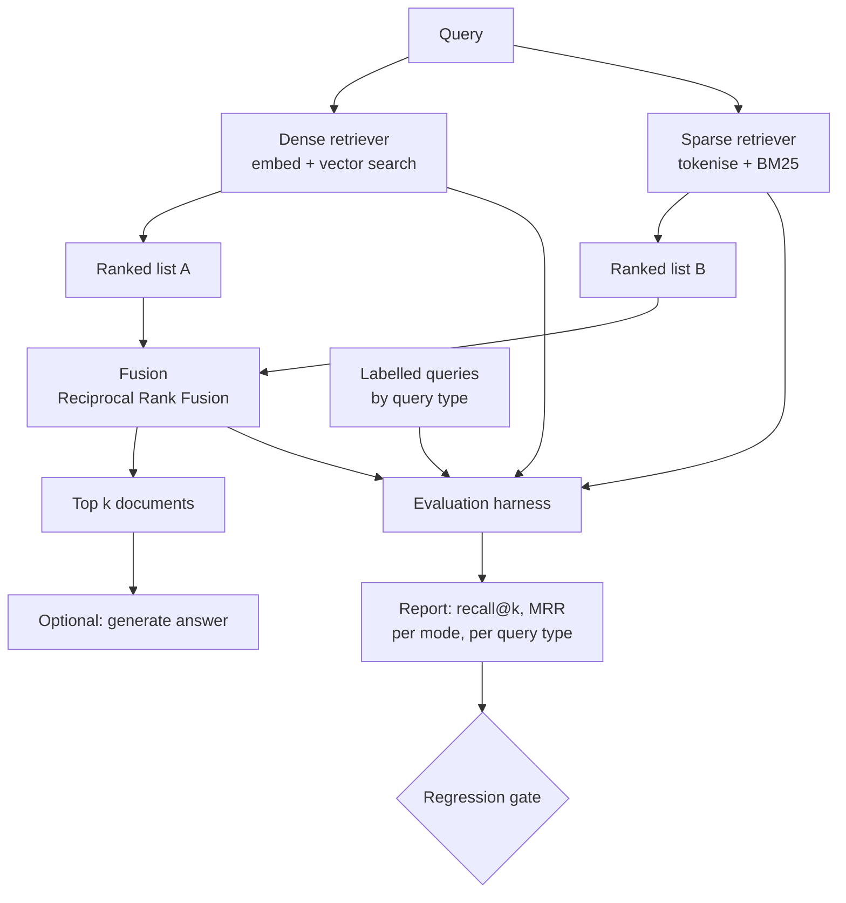

Every serious retrieval system eventually discovers that no single ranking method is good at everything. Embeddings find "holiday" when the handbook says "annual leave", but they can mix up two error codes that differ by one digit. Keyword search finds the exact code in an instant, and finds nothing at all for the paraphrase. A **hybrid search engine** runs both and merges their answers, and the engineering question that matters is not "how do I merge?" (that takes a dozen lines) but "how do I know the merge helped, and on which kinds of query?"

This capstone brief specifies a hybrid retrieval engine for Meridian's assistant, with the measurement apparatus that makes it defensible. It is deliberately retrieval-only: the language model is an optional last step, because the interesting work happens before it. The finished reference build is the [hybrid search RAG project](/projects/hybrid-search-rag). Write your own design against this brief first, then compare.

## Learning objectives

- Specify a hybrid retriever with requirements expressed as measurable retrieval behaviour on named query types.
- Design a labelled evaluation set stratified by query type, and choose metrics that expose each retriever's weakness.
- Compute Reciprocal Rank Fusion, recall@k and MRR by hand and in code, including the handling of ties and missing documents.
- Write a regression gate that fails when fusion makes a query type worse.
- Explain why hybrid retrieval raises the floor and can lower the ceiling.

## Prerequisites

- [Dense versus sparse retrieval](/learn/hybrid-search/dense-versus-sparse-retrieval) and [BM25](/learn/sparse-retrieval/bm25).
- [Reciprocal Rank Fusion](/learn/hybrid-search/reciprocal-rank-fusion) and [hybrid retrieval architecture](/learn/hybrid-search/hybrid-retrieval-architecture).
- [Dense vector search](/learn/dense-retrieval/dense-vector-search) and [Qdrant](/learn/vector-database-ecosystem/qdrant).
- [Recall@K](/learn/retrieval-evaluation/recall-k) and [MRR](/learn/retrieval-evaluation/mrr).
- [Golden datasets](/learn/testing-and-benchmarking/golden-datasets).

## Why this matters

If you build only a dense retriever, you will pass every demo that uses natural-language questions and fail on the first query that contains an identifier. Meridian's Atlas platform has an error-code catalogue: `E-4021` means the VPN client is out of date, while `E-4012` means the VPN certificate expired. To an embedding model these strings are nearly the same, and a question about one can retrieve the other. The user then updates their VPN client when their certificate had expired, which is a worse outcome than a search that returned nothing.

If you build only a keyword retriever you fail the other way. A user asks "how much holiday do I get?"; the handbook says "annual leave"; there is no word in common, and BM25 has nothing to rank. Real traffic contains both kinds of query in proportions you do not know in advance. A hybrid retriever is insurance against both failures.

Insurance has a premium, and measurement is how you decide whether it is worth paying. Fusion can only help if the two retrievers fail on *different* queries; and when one retriever is simply bad on a query type, merging it in can drag a good ranking down. The brief therefore treats evaluation as part of the system, not an afterthought: the engine is incomplete without the harness that reports, per query type, how dense, sparse and hybrid compare. Without it you are choosing an architecture by intuition.

## The intuition

Two librarians. The first, Dara, knows the catalogue by heart and matches exact titles and codes instantly, but if you describe a book by what it is about, she is lost. The second, Elif, has read widely and understands what you mean, but if you ask for "shelf mark ATL-409" she may hand you ATL-403 because they feel alike.

You ask each of them for their top five, then combine the lists. A simple and surprisingly robust way is to give each book points for how *high* each librarian ranked it, with a steep drop-off so that a first place counts for much more than a fifth. A book that both librarians list near the top has strong agreement and wins. A book only one of them lists can still make it if that one ranked it first.

Notice what you did not do: you did not compare the librarians' confidence scores. Dara says "certain", Elif says "0.62", and those numbers are not on the same scale and cannot be added meaningfully. Ranks, however, are comparable. That is the central idea behind Reciprocal Rank Fusion: fuse **positions**, not **scores**.

And notice the cost. If Dara is useless for a particular question (the paraphrase), her list is noise, and any book she ranks high that Elif did not gets points it does not deserve. Fusion with a weak partner lowers the ceiling.

## How it works

### The product

An internal search service over 38 short Meridian documents (HR policies, finance rules, IT runbooks and the Atlas error catalogue) with three retrieval modes selectable per request: dense, sparse and hybrid. An evaluation command runs a labelled query set through all three and prints a comparison. An optional `/ask` endpoint passes the hybrid results to a language model.

### Requirements

**Functional:**

1. Maintain two indexes over the same documents: a dense vector index and a BM25 index.
2. Tokenise for BM25 in a way that keeps identifiers such as `E-4021` and `ATL-409` intact, and removes stopwords that would otherwise match unrelated documents.
3. Return ranked document ids with scores from each mode, and a fused ranking by Reciprocal Rank Fusion.
4. Expose the three modes through an API with request validation.
5. Provide an evaluation command that reports recall@1, recall@3 and MRR per mode and per query type.
6. Keep the language model behind one replaceable interface, so retrieval is testable without it.

**Non-functional:**

- *Determinism*: for fixed data and model, every metric is exactly reproducible; ties break by a documented rule.
- *Explainability*: for any result, you can show its rank in each retriever and its fused score.
- *Latency*: both retrievals and the fusion complete well within a few hundred milliseconds at this corpus size.
- *Testability*: fusion and metrics are pure functions tested against hand-computed values.

**Out of scope:** reranking with a cross-encoder (the [reranking-powered RAG project](/projects/reranking-powered-rag) covers it), learned fusion weights, query expansion, and a multi-node deployment.

### Architecture



The two retrievers run independently and could run in parallel; the fusion step sees only ranked lists of ids, which is what makes it independent of the scoring scales. The evaluation harness taps all three outputs, so it can attribute any difference in the fused result to the component that produced it.

### Design decisions

| Decision | Choice | What to check |
| --- | --- | --- |
| Fusion method | Reciprocal Rank Fusion, constant 60 | Is the result sensitive to the constant? Try 10 and 100 |
| Candidate depth | Each retriever returns more than the final *k* | If depth equals *k*, fusion has little to merge |
| Tokeniser | Keep hyphenated identifiers whole; drop stopwords | Do question words ("what", "do") match irrelevant documents? |
| Tie-breaking | Deterministic, documented | Do two runs give identical rankings? |
| Weighting | Equal, at first | Does one retriever dominate a query type enough to justify weights? |
| Index of record | One id space for both indexes | Do both retrievers return the same ids for the same document? |

Candidate depth is the decision most often overlooked. If each retriever returns only the top 3 and you fuse to a top 3, a relevant document ranked fourth by both is lost before fusion sees it. Typically each retriever contributes a deeper list (tens of candidates) and fusion cuts to the final *k*.

### The mathematics

Reciprocal Rank Fusion scores a document by summing, over every ranked list that contains it, a reciprocal of its rank plus a constant:

$$\text{RRF}(d) = \sum_{r \in R} \frac{1}{c + \text{rank}_r(d)}$$

Here $R$ is the set of ranked lists (two for hybrid), $\text{rank}_r(d)$ is the one-based position of document $d$ in list $r$, and $c$ is a constant, commonly 60. A document absent from a list contributes nothing from that list. The constant matters because it flattens the curve: with $c = 60$, rank 1 contributes $1/61 \approx 0.0164$ and rank 2 contributes $1/62 \approx 0.0161$, a tiny difference, so being first is only slightly better than being second, and *agreement between lists* dominates the result. With a small $c$, such as 1, rank 1 gives 0.5 and rank 2 gives 0.333, and a single list's top choice counts for far more.

Worked by hand on the query "how much holiday do I get?", gold document `leave`. The dense list is `[leave, remote, it]` and the BM25 list is `[it, remote, leave]` (the paraphrase gives BM25 nothing useful, so its order is arbitrary):

- `leave`: dense rank 1, sparse rank 3: $1/61 + 1/63 = 0.016393 + 0.015873 = 0.032266$.
- `remote`: ranks 2 and 2: $1/62 + 1/62 = 0.032258$.
- `it`: ranks 3 and 1: $1/63 + 1/61 = 0.032266$.

`leave` and `it` tie exactly, and `remote` is just behind. Dense alone had `leave` first. The fused list, with ties broken alphabetically, is `it`, `leave`, `remote`: `leave` fell to rank 2. This is the "lowers the ceiling" effect in miniature: a worthless sparse list injected a wrong document into first place, and the tie-break decided it.

The metrics. **Recall@k** here is the fraction of queries whose gold document appears in the top $k$ (with one gold document per query this equals hit rate):

$$\text{Recall@}k = \frac{1}{|Q|}\sum_{q \in Q} \mathbb{1}\left[\text{gold}(q) \in \text{top}_k(q)\right]$$

where $Q$ is the set of queries and $\mathbb{1}[\cdot]$ is 1 if the condition holds and 0 otherwise. **Mean Reciprocal Rank** rewards ranking the gold document high:

$$\text{MRR} = \frac{1}{|Q|}\sum_{q \in Q} \frac{1}{\text{rank}_q}$$

where $\text{rank}_q$ is the position of the gold document for query $q$, and the term is 0 if it is absent. For the two paraphrase queries above (`leave` fused to rank 2, `laptop` to rank 3, as computed in the code below) the reciprocal ranks are 0.5 and 0.333, so MRR is $(0.5 + 0.333)/2 = 0.417$. Recall@1 is 0 for both, since neither gold document is first.

The code in the next section computes all of this, including the case where the gold document is absent from a retriever's list.

### The evaluation plan

1. **A stratified labelled set.** Write at least 25 queries, in at least three types: *keyword* (identifiers, codes, exact names), *paraphrase* (no shared vocabulary with the answer), and *mixed* (natural language containing an identifier, such as "ATL-503 when sending data"). Aim for roughly equal numbers, because an unbalanced set lets the majority type decide the headline number.
2. **Three modes, same queries.** Report recall@1, recall@3 and MRR for dense, sparse and hybrid, overall and per type.
3. **Failure listing.** For each query on which hybrid is wrong, list the rank in each retriever and say which component's error it inherited.
4. **Sensitivity.** Rerun with the RRF constant at 10 and 100, and with candidate depth 5, 10 and 20. A conclusion that flips with the constant is not a conclusion.
5. **Regression gate.** Fail the build if hybrid is worse than the better single retriever by more than a tolerance on any query type, or if overall recall@3 drops against a recorded baseline.
6. **Honest scope.** State the sample size. A few dozen queries over a few dozen documents demonstrate a method; they do not benchmark anything.

### Milestones

1. **Corpus and labels.** The documents and a first 15 labelled queries, stratified. Acceptance: every gold id exists in the corpus.
2. **Dense retriever.** Embed and search in the vector store. Acceptance: recall@3 measured and recorded.
3. **Sparse retriever.** A tokeniser that preserves identifiers; BM25 search. Acceptance: tokenising `E-4021` yields one token; recall@3 recorded.
4. **Fusion and metrics.** RRF as a pure function, tested against the hand example; metrics tested on tiny cases. Acceptance: the tests pass and match the calculation above.
5. **Harness, gate and API.** Per-type report, regression gate, a validated endpoint. Acceptance: the gate fails when you deliberately break the tokeniser.

### Acceptance criteria

- RRF of the worked example returns exactly the scores computed by hand, including the tie.
- Tokenising "E-4021" gives a single token, and common question words do not appear in the BM25 vocabulary.
- The report shows recall@1, recall@3 and MRR for each of the three modes, overall and per query type.
- Every query on which hybrid fails has a recorded diagnosis.
- The regression gate fails when a retriever is disabled or deliberately damaged, and passes on the recorded baseline.
- Two runs produce byte-identical reports.

For orientation, the reference tutorial reports on its own 28 queries over 38 documents that hybrid reaches recall@1 of 0.946 against 0.875 for dense and 0.554 for sparse, and that on paraphrase queries hybrid is slightly *below* dense. Those figures belong to that dataset; yours will differ, and the pattern (hybrid raises the floor, may lower the ceiling) is what should replicate. See the [project's expected results](/projects/hybrid-search-rag).

## In code

The executable part is the **scorecard**: RRF, per-type recall@1 and MRR, and the regression gate, over a hand-made miniature set whose rankings are written out so you can verify every number. It uses only the standard library; the real harness replaces the hard-coded rankings with live retriever output.

The problem it solves: make the "hybrid helps or hurts" question mechanical, per query type, with a pass or fail. No dependencies.

```python
def rrf(lists, k=60):
    s = {}
    for lst in lists:
        for r, d in enumerate(lst, 1):
            s[d] = s.get(d, 0) + 1 / (k + r)
    return sorted(s, key=lambda d: (-s[d], d))

# (query type, gold doc, dense ranking, sparse ranking)
Q = [
    ("keyword",   "E-4021", ["E-4012", "E-4021", "vpn"],   ["E-4021", "vpn", "E-4012"]),
    ("keyword",   "E-4012", ["E-4021", "E-4012", "vpn"],   ["E-4012", "E-4021", "vpn"]),
    ("paraphrase", "leave", ["leave", "remote", "it"],     ["it", "remote", "leave"]),
    ("paraphrase", "laptop", ["laptop", "it", "leave"],    ["remote", "it", "leave"]),
]
def metrics(rank_fn):
    out = {}
    for typ, gold, dense, sparse in Q:
        ranked = rank_fn(dense, sparse)
        rr = 1 / (ranked.index(gold) + 1) if gold in ranked else 0.0
        out.setdefault(typ, []).append((ranked[0] == gold, rr))
    return {t: (sum(h for h, _ in v) / len(v), sum(r for _, r in v) / len(v)) for t, v in out.items()}

modes = {"dense": lambda d, s: d, "sparse": lambda d, s: s, "hybrid": lambda d, s: rrf([d, s])}
res = {m: metrics(f) for m, f in modes.items()}
print(f"{'mode':8s}{'type':12s}{'recall@1':>9s}{'MRR':>7s}")
for m, r in res.items():
    for t, (h, rr) in sorted(r.items()):
        print(f"{m:8s}{t:12s}{h:9.2f}{rr:7.3f}")

# Gate: hybrid must not be worse than the better single retriever by more than 0.25 on any type.
for t in ("keyword", "paraphrase"):
    best = max(res["dense"][t][0], res["sparse"][t][0])
    ok = res["hybrid"][t][0] >= best - 0.25
    print(f"gate[{t}]: hybrid {res['hybrid'][t][0]:.2f} vs best single {best:.2f} -> {'PASS' if ok else 'FAIL'}")
```

```output
mode    type         recall@1  MRR
dense   keyword          0.00  0.500
dense   paraphrase       1.00  1.000
sparse  keyword          1.00  1.000
sparse  paraphrase       0.00  0.167
hybrid  keyword          1.00  1.000
hybrid  paraphrase       0.00  0.417
gate[keyword]: hybrid 1.00 vs best single 1.00 -> PASS
gate[paraphrase]: hybrid 0.00 vs best single 1.00 -> FAIL
```

**What the important lines do.** `rrf` accumulates `1 / (k + rank)` for each list a document appears in, then sorts by descending score with the document id as a deterministic tiebreak; without that tiebreak, tied documents would come out in whatever order the dictionary happened to hold them, and your metrics would not be reproducible. `metrics` returns, per query type, the fraction of queries with the gold document first and the mean reciprocal rank; a gold document missing from a list scores 0, which is why the `if gold in ranked` guard matters (a sparse retriever may simply not return a document). The gate compares hybrid against the *better* single retriever for the type, not the average.

**What the output means.** On keyword queries dense is wrong both times (it put the neighbouring error code first on each query, giving recall@1 of 0.00 and MRR 0.500), BM25 is perfect, and hybrid inherits the perfect score: this is the rescue fusion exists for. On paraphrases the situation reverses: dense is perfect, BM25 is nearly useless (MRR 0.167), and hybrid, at recall@1 of 0.00 and MRR 0.417, is *worse than dense*. The gate catches exactly this and fails. The result is not a bug to hide: it says that with equal weights and this sparse retriever, the paraphrase queries lose. The honest responses are to weight dense higher, to route queries by type, to improve the sparse side, or to accept the loss in exchange for the keyword gain, and the point of the gate is that the choice is made knowingly.

**Errors people commonly hit.** Fusing *scores* instead of *ranks* (for instance adding cosine similarity to a raw BM25 score) lets whichever scale is larger dominate. Another is a dense and sparse index that use different ids for the same document, so nothing ever matches across lists and fusion degenerates into interleaving. A third is evaluating on a set dominated by one query type, so the overall number hides the other type's collapse.

**How to extend it.** Add a third list (a title-only BM25, say) and confirm RRF extends naturally. Try weights: multiply each list's contribution by a weight and search the weight on a *validation* half of your queries, reporting on the other half so you do not overfit a few dozen queries.

## A real-world example

The Platform team ships AskMeridian's first retriever as dense-only. It performs well in review: reviewers ask natural questions and get relevant answers. A month later the support desk reports a pattern: users pasting error codes get the wrong runbook roughly one time in five. An engineer, Omar Reyes, pulls the logs and finds that for `E-4012` queries, the dense retriever's top result is usually the runbook for `E-4021`.

Omar adds BM25 and RRF, and checks the effect not on a feeling but on a stratified set he writes in an afternoon: 16 keyword queries and 12 paraphrases. The keyword failures disappear. The paraphrase score slips by a little, because the BM25 side contributes spurious matches on common words. He reads the failures and finds that question words ("what", "do", "how") were matching unrelated runbooks; adding stopword removal to the tokeniser recovers most of the loss. The remaining gap is small enough that the team accepts it, because the two failure modes are not equally costly: a confidently wrong runbook for an error code does more damage than a paraphrase that ranks second instead of first.

The decision was recorded with its evidence: query-type table, sensitivity to the fusion constant, sample size, and the explicit statement that 28 queries cannot separate small differences. When the query log grows, they add real queries to the set and rerun. That is what a defensible retrieval decision looks like: a number, a breakdown, a stated limit and a plan to extend.

## Common mistakes

- **Fusing raw scores.** Cosine similarities and BM25 scores sit on different scales; adding them lets one dominate. Fuse ranks, or normalise carefully and justify it.
- **Evaluating on one query type.** An overall average hides a collapse on the minority type. Stratify and report per type.
- **Shallow candidate lists.** If each retriever returns only the final *k*, fusion cannot recover a document both ranked just below the cut. Retrieve deeper, then fuse and cut.
- **Non-deterministic tie-breaking.** Tied fused scores come out in arbitrary order and metrics change between runs. Break ties by a stable key.
- **A tokeniser that splits identifiers.** `E-4021` becomes `e` and `4021`, matching everything. Keep identifiers whole.
- **Not removing stopwords from the sparse side.** Question words match unrelated documents and add noise to the fusion.
- **Declaring victory from a small sample.** Twenty-eight queries support a method, not a benchmark. State the sample size.
- **Assuming hybrid always wins.** It raises the floor and can lower the ceiling. Measure on your query mix.

## Best practices

- Build the labelled, stratified query set before tuning anything, and keep it versioned beside the code.
- Make fusion and metrics pure functions and test them against hand-computed values, including ties and missing documents.
- Report per-type metrics and the rank each retriever gave the gold document for every failure; that attribution is the debugging tool.
- Retrieve more candidates than you will return, and fuse before cutting.
- Run a sensitivity check on the fusion constant and the candidate depth before trusting a conclusion.
- Add a regression gate to CI that compares against a recorded baseline and against the best single retriever.
- Keep the language model behind an interface so retrieval can be evaluated and tested without it.
- Re-measure when the corpus or the query mix changes; a decision made on 38 documents does not automatically hold at 38,000.

## Performance considerations

The two retrievers are independent, so run them concurrently: hybrid latency is then roughly the slower of the two plus a negligible fusion cost, not their sum. At this scale (tens of documents) both are effectively instant; at larger scale the dense search is typically the dominant cost, with an approximate index keeping it fast (see [HNSW](/learn/vector-indexing-algorithms/hnsw)) while BM25 over an inverted index remains cheap.

Memory is the other axis. Dense vectors cost dimensions times bytes per document: 384 floats at 4 bytes is 1,536 bytes per document, so a million documents need about 1.5 GB for the raw vectors before index overhead. The sparse index cost grows with total tokens and vocabulary rather than with a fixed per-document size. Candidate depth also has a direct cost: fusing 50 candidates per list rather than 10 costs a few more microseconds of fusion but more time in each retriever, and, if you then rerank, five times as many cross-encoder calls. Choose the smallest depth at which your sensitivity test stops improving.

Evaluation itself is cheap compared with the model call: a few dozen queries through both retrievers takes seconds, which is why there is no excuse not to run it on every change.

## Security considerations

Hybrid search adds a parser (the BM25 tokeniser) that handles untrusted query text; keep it simple, bound the query length and the number of tokens, and never evaluate query text as a pattern or expression. If documents have access restrictions, **both** retrievers must apply the same filter inside the search, since a keyword index that ignores permissions is a leak that the dense index's filter does not cover; see [metadata-aware retrieval](/learn/advanced-retrieval/metadata-aware-retrieval). Identifiers in queries can also be sensitive (ticket numbers, account ids), so decide what the query log retains. Finally, the sparse index makes exact-phrase injection easier: a document stuffed with a popular query's words will rank by BM25 regardless of meaning, so treat ranking manipulation as a [retrieval manipulation](/learn/rag-security-fundamentals/retrieval-manipulation) risk where authors of documents are not all trusted.

## Summary

- Dense retrieval handles paraphrase and fails on near-identical identifiers; BM25 does the opposite, and a hybrid engine is insurance against both.
- Reciprocal Rank Fusion merges ranks rather than scores, so it needs no normalisation; the constant makes agreement between lists dominate.
- Fusion raises the floor and can lower the ceiling: a weak retriever on a query type can pull down a strong one, so measure per query type.
- A stratified labelled set, per-type recall@k and MRR, deterministic tie-breaking and a regression gate turn "hybrid feels better" into evidence.
- The finished reference is the [hybrid search RAG project](/projects/hybrid-search-rag); small samples demonstrate the method, not a benchmark.

## Exercises

1. **Compute by hand.** Dense list `[a, b, c]`, sparse list `[c, a, d]`, constant 60. Compute the RRF score of each document and give the fused ranking.

<details><summary>Show solution</summary>

`a`: 1/61 + 1/62 = 0.016393 + 0.016129 = 0.032522. `b`: 1/62 = 0.016129. `c`: 1/63 + 1/61 = 0.015873 + 0.016393 = 0.032266. `d`: 1/63 = 0.015873. Fused order: `a`, `c`, `b`, `d`. Document `a` wins because it is near the top of both lists, even though `c` was first in one.

</details>

2. **Choose the constant.** With constant 1 instead of 60, would the first-place document of a single list matter more or less? Show the numbers for rank 1 and rank 2.

<details><summary>Show solution</summary>

More. With constant 1, rank 1 gives 1/2 = 0.5 and rank 2 gives 1/3 = 0.333, a 50 percent gap; with constant 60 the gap is 1/61 against 1/62, about 1.6 percent. A small constant makes the top of each list decisive; a large one makes agreement across lists matter more than any single position.

</details>

3. **Fix the paraphrase loss.** Using the lesson's script, add a weight per list in `rrf` and find, by trying 1.0, 1.5 and 2.0 for the dense weight, how paraphrase recall@1 changes. State what you must not do when choosing the weight.

<details><summary>Show solution</summary>

Change the accumulation to `s[d] = s.get(d, 0) + w / (k + r)` with a per-list weight `w`. With dense weight 2.0 the dense-first document (`leave`: 2/61 + 1/63 = 0.04865 against `it`: 2/63 + 1/61 = 0.04814) now wins the first paraphrase query, so paraphrase recall@1 rises from 0.00 to 0.50. The `laptop` query does not recover: `it` is ranked second by both lists and scores 2/62 + 1/62 = 0.0484 against 2/61 = 0.0328 for `laptop`, and a dense weight would have to exceed about 61 to overturn that. The lesson is that weighting repairs some failures and not others, and it risks keyword queries where dense is the weaker side. What you must not do is choose the weight on the same few queries you then report on: split the labelled set, tune on one half and report on the other, or the improvement is partly fitted noise.

</details>

4. **Design a router.** Propose a cheap rule that decides, per query, whether to weight sparse higher, and describe how you would evaluate it against the unrouted hybrid.

<details><summary>Show solution</summary>

A rule: if the query contains a token matching an identifier pattern (letters, a hyphen and digits, such as `E-4021` or `ATL-409`), weight sparse higher; otherwise weight dense higher. Evaluate by running the stratified set through both unrouted hybrid and routed hybrid and comparing per-type recall@1 and MRR, on held-out queries not used to design the pattern. Check the router's own error: a mixed query ("ATL-503 when sending data") is routed by the rule, so measure the mixed type specifically, and watch for identifier-like text that is not an identifier.

</details>

## Check your understanding

```quiz
[
  {
    "q": "Why does Reciprocal Rank Fusion use ranks instead of raw scores?",
    "options": [
      "Ranks are more accurate than scores",
      "Scores from different retrievers are on incomparable scales",
      "Scores cannot be stored",
      "Ranks are faster to sort"
    ],
    "answer": 1,
    "why": "Cosine similarity and BM25 scores have different ranges and meanings, so adding them lets one dominate. Ranks are comparable across retrievers."
  },
  {
    "q": "In the lesson's scorecard, hybrid has paraphrase recall@1 of 0.00 while dense has 1.00. What does this show?",
    "options": [
      "RRF is implemented incorrectly",
      "Dense retrieval cannot handle keywords",
      "Fusing in a weak retriever for a query type can lower the ceiling",
      "The gate threshold is too strict"
    ],
    "answer": 2,
    "why": "On paraphrases BM25 has nothing to match, so its list is noise; equal-weight fusion lets that noise displace the correct dense result."
  },
  {
    "q": "Dense list [a, b], sparse list [b, a], constant 60. What is the fused order if ties are broken alphabetically?",
    "options": [
      "a, b",
      "b, a",
      "The order is undefined",
      "Only a is returned"
    ],
    "answer": 0,
    "why": "Both documents score 1/61 + 1/62, an exact tie, so the alphabetical tiebreak puts a first. Deterministic tie-breaking is what makes the result reproducible."
  },
  {
    "q": "Why should each retriever return more candidates than the final k?",
    "options": [
      "To make fusion slower",
      "To reduce memory",
      "Because RRF requires at least 100 candidates",
      "So a document both rank just below the cut can still be fused into the top k"
    ],
    "answer": 3,
    "why": "If each list is already cut to k, a relevant document ranked k+1 by both retrievers is gone before fusion can promote it."
  },
  {
    "q": "A team reports hybrid recall@3 of 1.000 on 28 queries. What is the most defensible statement?",
    "options": [
      "Hybrid is perfect",
      "The result demonstrates the method on this small set but cannot rank close alternatives or generalise",
      "Dense retrieval is obsolete",
      "The corpus is too easy and should be deleted"
    ],
    "answer": 1,
    "why": "A few dozen queries cannot separate small differences or support claims about other corpora. State the sample size and extend the set with real queries."
  }
]
```

## Further reading

- Cormack, G., Clarke, C. and Büttcher, S. (2009), "Reciprocal Rank Fusion outperforms Condorcet and individual rank learning methods", SIGIR.
- Robertson, S. and Zaragoza, H. (2009), "The Probabilistic Relevance Framework: BM25 and Beyond", *Foundations and Trends in Information Retrieval*.
- [Qdrant documentation](https://qdrant.tech/documentation/): the `query_points` API and hybrid query concepts.
- [rank-bm25 on PyPI](https://pypi.org/project/rank-bm25/): the small BM25 implementation used in the reference build.
- Manning, C., Raghavan, P. and Schütze, H. (2008), *Introduction to Information Retrieval*, chapters 6 and 8.
