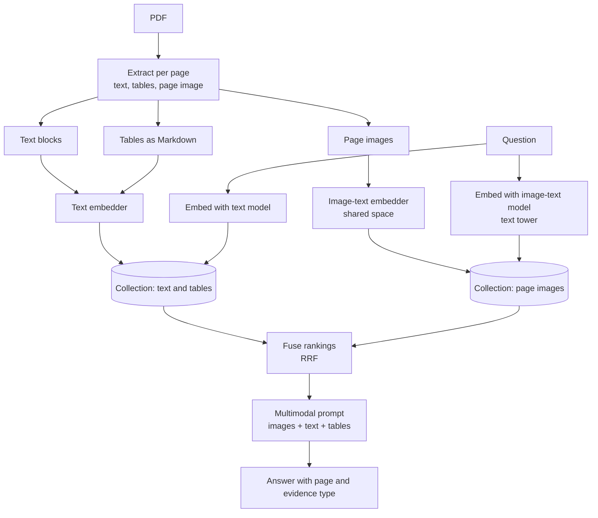

The answer to a question is often not in the prose. A table holds the plan comparison, where reading it row by row as text destroys the meaning; a chart holds the trend, where there is almost no text to match; a scanned page holds everything and yields nothing to a text extractor. A document assistant that only indexes the text layer will answer confidently about the paragraphs and fail silently on the figures, and a user cannot tell which kind of question they have asked until the answer is wrong.

This capstone brief specifies a multimodal document assistant for Meridian's IT handbook: it extracts prose, tables and page images from PDFs, indexes each in the representation that suits it, retrieves across all of them, and answers from a prompt that mixes text and images. The central engineering skill is evaluation that cannot hide a weak modality behind a strong average. The finished reference build is the [multimodal RAG system project](/projects/multimodal-rag-system). Design your own against this brief before opening it.

## Learning objectives

- Specify a multimodal assistant with requirements stated per content type, including what happens when a type cannot be read.
- Choose a representation for text, tables and page images, and justify each choice and its failure modes.
- Design two or more vector indexes with different embedding models and a fusion step that does not compare incomparable scores.
- Build a golden set that covers every modality and report metrics per modality.
- Run a coverage and per-modality check that exposes a failing modality hidden by an overall average.

## Prerequisites

- [Multimodal document extraction](/learn/advanced-document-parsing/multimodal-document-extraction) and [PyMuPDF](/learn/advanced-document-parsing/pymupdf).
- [Visual embeddings](/learn/multimodal-rag/visual-embeddings) and [cross-modal search](/learn/multimodal-rag/cross-modal-search).
- [Table retrieval](/learn/multimodal-rag/table-retrieval) and [multimodal vector databases](/learn/multimodal-rag/multimodal-vector-databases).
- [Reciprocal Rank Fusion](/learn/hybrid-search/reciprocal-rank-fusion): merging rankings from different retrievers.
- [OCR](/learn/advanced-document-parsing/ocr): what to do with pages that have no text layer.

## Why this matters

A PDF page is a picture that happens to contain text. Text extraction recovers the text; it does not recover the structure of a table, the meaning of a bar chart, or the contents of an embedded screenshot. For many corporate documents (financial reports, product sheets, technical manuals) a large share of the answerable questions depend on exactly those parts. Meridian's IT handbook has a table comparing support tiers and a chart of ticket volume by month. A question such as "which plan includes single sign-on?" is answered by one cell of the table; "which month had the most tickets?" is answered by the tallest bar.

If you flatten the table into text, the cells come out in an order that depends on how the PDF was produced, and "Enterprise" may end up several lines from "SAML single sign-on". If you ignore the chart, the question has no text to match and the assistant says it does not know, or worse, answers from a nearby paragraph. Neither failure announces itself. The overall accuracy of such a system on a golden set that is mostly prose looks fine, because most questions are about prose. That is the trap this brief is built around: **a weak modality hides behind a strong average**.

The second reason this matters is that multimodal systems have more moving parts, each with its own failure and cost: a layout parser, a text embedder, an image-text embedder, two or more indexes, a fusion rule, and a model that accepts images. The more parts, the more you need requirements that say what each is for and tests that say whether it works.

## The intuition

Picture three analysts who share an office. One reads prose quickly. One is excellent with spreadsheets. One looks at pictures and diagrams. You hand them a stack of pages and a question, and ask each to point to the pages they would look at. If the question is about leave policy, the prose reader answers instantly. If it is about plan features, the spreadsheet analyst does. If it is about a trend, the picture reader does.

A good office manager would do two things. First, ask all three and combine their suggestions, giving more weight to pages several of them chose. Second, test the team with questions of every kind before trusting it. A team that only ever gets leave-policy questions in testing looks flawless and will fail the first time someone asks about a chart.

There is one more point. The three analysts do not speak the same language. The prose reader scores a page 0.8, the picture reader scores it 0.3, and these numbers mean different things. Comparing them directly is a mistake; what you can compare is each analyst's ranking of the pages. This is the same lesson as hybrid search, applied across modalities: fuse ranks, not scores.

## How it works

### The product

A system that ingests one or more PDFs; stores prose chunks and tables as text vectors and page renders as image vectors; answers a typed question by searching both stores and prompting a model with the retrieved pages as images plus the retrieved text and tables as text; and returns an answer that names the page and the kind of evidence used.

### Requirements

**Functional:**

1. Parse each page into three streams: text blocks, tables converted to a text format (Markdown works well), and a rendered image of the page.
2. Avoid indexing table cell text twice, once as prose and once as a table.
3. Embed text and tables with a text embedding model; embed page images with an image-text model that places images and sentences in one shared space.
4. Store the two kinds of vector in separate collections, since they have different dimensions.
5. At question time, search both collections and fuse the rankings.
6. Build a model request that mixes image blocks and text blocks, and ask the model to say which page and which kind of content supports each claim.
7. Report ingestion statistics per modality: how many text chunks, tables and images were indexed, per page.

**Non-functional:**

- *Coverage honesty*: the system reports which modalities each page contributed and flags pages that produced none.
- *Per-modality quality*: retrieval quality is measured and reported separately for text, tables and images.
- *Offline testability*: the pipeline logic runs with stand-in embedders and no network.
- *Cost awareness*: image inputs are more expensive than text, so the number of images sent per question is bounded.

**Out of scope:** audio and video, handwriting, training or fine-tuning any model, and extracting numeric data points from charts. The last one is worth stating: a model can *describe* a chart and often read approximate values, but this system retrieves the page and does not guarantee numeric precision from pixels.

### Architecture



Note that the question is embedded **twice**, with a different model for each collection, because the two collections live in different vector spaces. A vector from the text model is meaningless against image vectors and vice versa. The image-text model has two halves (one for images, one for text) trained so that a picture and a sentence describing it land near each other; querying the image collection means encoding the question with the *text half* of that model.

### Representation choices

| Content | Representation | Why | Typical failure |
| --- | --- | --- | --- |
| Prose | Chunked text, text embedding | Mature and precise | Wrong reading order in multi-column pages |
| Tables | Markdown text, with caption and header repeated in the chunk | Keeps rows and columns together for the embedder and the model | Merged cells and spans parse incorrectly; very wide tables exceed chunk size |
| Charts and figures | Whole-page image, image-text embedding | Preserves what text extraction discards | Image-text models match gist and style, not numbers or small labels |
| Scanned pages | Page image, plus OCR text if available | The only route to the content | No OCR means the text questions fail on those pages |

The text embedder and the image-text embedder serve different jobs. A general text embedding model is strong on sentences; the text tower of an image-text model such as CLIP is typically weaker on long prose and truncates its input at 77 tokens, which is why long text goes to the text model and the image-text model is used for matching a short query against pictures. An embedding of a whole page image is coarse: it tends to capture the general look and topic of the page, such as "a bar chart", more than the details inside it. That is acceptable for retrieval (finding *which page*) and is the reason the model, not the embedder, reads the details.

### Fusing across collections

Because the two collections use different models, a cosine of 0.31 from one and 0.22 from the other are not comparable. Fuse **ranks** using Reciprocal Rank Fusion, exactly as in the [hybrid search capstone](/learn/capstone-projects/hybrid-search-engine). To fuse, both rankings need a common identity, so map each result to a page: a text chunk from page 3 and the image of page 3 both vote for "page 3". Page is the natural unit because it is what the model will be shown and what the user will cite.

### The evaluation plan

1. **A golden set covering every modality.** Aim for at least 8 questions per modality, with the gold item and gold page recorded: prose questions, table-cell questions, chart questions, and, if you support them, scanned-page questions. A modality with no questions is untested; the harness should report such a gap explicitly.
2. **Per-modality retrieval metric.** Hit@k, at page level, reported per modality, plus the overall figure. The overall figure is a weighted average and will hide a collapse.
3. **Extraction audit.** For each table, compare the parsed Markdown with the rendered page: row count, column count, header alignment. Check that table text is not also indexed as prose.
4. **Fusion check.** For every query, record whether each collection found the gold page. A modality's value is the queries that *only* it answers.
5. **Answer checks by modality.** For table questions, compare the exact cell value; for chart questions, check the stated trend or the named month against the truth; accept approximate numbers only where you have said so.
6. **Cost accounting.** Count images per prompt and tokens per question; report both.
7. **Stub honesty.** If any test uses a stand-in embedder that does not look at pixels, say so in the report and do not use it to claim image quality. A stand-in verifies the plumbing, not the model.

### Milestones

1. **Extraction.** Text, tables and page renders from a sample PDF, with a per-page report. Acceptance: table text appears once; a page with no text is flagged.
2. **Text and table retrieval.** Embed, index, search. Acceptance: the prose and table portions of the golden set are scored, and the table question retrieves the table.
3. **Image retrieval.** The image-text model and the image collection. Acceptance: every page has an image vector; chart questions are scored; the stand-in/real distinction is documented.
4. **Fusion and prompt.** Rank fusion by page and the multimodal request. Acceptance: a recorded example shows a question answered only because of the image collection, and one only because of the text collection.
5. **Per-modality report and tests.** The harness, coverage gaps, cost counts. Acceptance: removing a modality from the index makes the report show that modality failing.

### Acceptance criteria

- Ingestion reports counts per modality per page, and a page with no extractable text or table is flagged.
- A table's cells are indexed once, as a table, and not duplicated in prose chunks.
- Retrieval hit@k is reported per modality as well as overall, and every modality in the supported list has at least 8 golden questions or an explicit "untested" entry.
- Fusion works on pages, by rank, not by comparing scores from different models.
- The final prompt includes at most a configured number of images and states the page of each.
- Disabling the image collection makes the chart questions fail in the report, which proves the tests depend on it.

> [!WARNING]
> If your test run uses a stand-in image embedder that hashes text instead of looking at pixels, it verifies that the code works, not that image retrieval works. Verify image quality only with the real model, and record that you did.

The reference [multimodal RAG system project](/projects/multimodal-rag-system) builds the extraction, embedding, two-collection storage and pipeline, and states exactly which parts were exercised with a stand-in.

## In code

The executable part of this brief is a **coverage and per-modality report**: given a golden set with a modality for each question and the retrieved items per question, it reports which modalities are covered, the hit rate for each, and the overall rate, so you can see the average hide a failing modality. It needs only the standard library; the real harness replaces the hard-coded retrievals with live ones.

The problem it solves: prevent a strong text score from masking a failing chart score. No dependencies.

```python
from collections import Counter, defaultdict

golden = [  # (question, modality holding the answer, gold item id)
    ("What is the VPN timeout?", "text", "p1-t1"),
    ("Rotation period?", "text", "p2-t3"),
    ("Which plan includes SSO?", "table", "p2-tab1"),
    ("Export formats per plan?", "table", "p2-tab1"),
    ("Which month had the peak of tickets?", "chart", "p3-img"),
]
retrieved = {  # what the system returned (top 2)
    "What is the VPN timeout?": ["p1-t1", "p2-t3"],
    "Rotation period?": ["p2-t3", "p1-t1"],
    "Which plan includes SSO?": ["p2-tab1", "p1-t1"],
    "Export formats per plan?": ["p1-t1", "p2-tab1"],
    "Which month had the peak of tickets?": ["p2-tab1", "p1-t1"],
}
need = {"text", "table", "chart", "scanned_page"}
counts = Counter(m for _, m, _ in golden)
print("coverage:", dict(counts), "missing:", sorted(need - set(counts)))
by = defaultdict(list)
for q, m, g in golden:
    by[m].append(g in retrieved[q][:2])
for m, hits in by.items():
    print(f"{m:6s} hit@2 = {sum(hits)}/{len(hits)}")
overall = sum(sum(h) for h in by.values()) / len(golden)
print(f"overall hit@2 = {overall:.2f}  (hides chart = {sum(by['chart'])}/{len(by['chart'])})")
```

```output
coverage: {'text': 2, 'table': 2, 'chart': 1} missing: ['scanned_page']
text   hit@2 = 2/2
table  hit@2 = 2/2
chart  hit@2 = 0/1
overall hit@2 = 0.80  (hides chart = 0/1)
```

**What the important lines do.** `need` is the list of modalities the product claims to support; subtracting the set of modalities that actually appear in the golden set reveals the *gaps in testing*, which is a different thing from failures. `by` groups hit results by modality, so a per-modality rate is one line. The overall figure is computed separately to show what a single number would have reported.

**What the output means.** The system scores 0.80 overall, which would pass many informal thresholds, yet it retrieves nothing useful for the chart question (0 of 1), and it has no scanned-page questions at all, so that modality is simply untested. Two different warnings appear in one report: one modality fails, and one modality is unmeasured. Both would be invisible in an average. Also notice that with a single chart question, "0/1" is a very weak statement: the proper response is to write more chart questions, not to conclude anything about the rate.

**Errors people commonly hit.** A golden set whose modality labels are wrong (a question labelled "text" whose answer is in a table) produces reassuring numbers for the wrong reason, so label the modality by where the *answer* lives. Another is scoring at the wrong granularity: the chart question's gold item is the page image, so a retrieval of a *text chunk from the same page* may or may not count; decide, and score at the page level if the model is shown whole pages. A third is using the stub embedder for the image side and reporting image hit rates as if they were real.

**How to extend it.** Add a column for which collection supplied the hit, so you can compute the queries that only the image collection answers. Add a cost column (images per prompt) and a threshold. Fail the report when any supported modality has fewer than eight questions.

## A real-world example

Meridian's documentation team asks for an assistant over the quarterly IT operations report: 40 pages, a third of which are tables and charts. An engineer, Ahmed Khan, builds a text-only pipeline, scores it on 30 questions he wrote, and reports 90 percent. The report goes to a meeting, and the first question from the room is "what was the busiest month for incidents?" The assistant replies with a paragraph about staffing levels.

The postmortem finds nothing wrong with the retriever. Ahmed's 30 questions had been written from the text of the report; he had, without noticing, only asked questions he could find answers to by reading paragraphs. The chart questions were the ones a human reader would ask, and there were none. The team's rebuild follows the structure in this brief: three extraction streams, a text collection and an image collection, rank fusion by page, and a golden set with at least eight questions per modality, labelled by where the answer lives.

The new report shows what the old average had hidden: table questions at 11 of 12, chart questions at 5 of 9, and the failures concentrated in charts with small labels, where a whole-page image embedding finds the right page less reliably. They record this as a known limitation, raise the number of page images sent to the model for chart-like queries, and add chart questions to the golden set whenever a user reports a failure. The lesson is that *what you ask in testing is what you are blind to in production*, and a modality-stratified golden set is the cure.

## Common mistakes

- **Averaging across modalities.** A strong prose score hides a failing chart or table score. Report per modality.
- **Testing only what text extraction can answer.** The questions you can answer by reading paragraphs are not the questions users ask about figures. Write questions by modality.
- **Indexing table text twice.** Once as prose and once as a table, so the same cell competes with itself and inflates its apparent relevance. De-duplicate during extraction.
- **Comparing scores across collections.** Scores from different embedding models are not comparable. Fuse by rank, on a shared identity such as the page.
- **Using the image-text model for long prose.** Its text encoder is typically weak on long passages and truncates at a small token limit. Use a text model for prose.
- **Relying on a stub in place of the real embedder.** The stub confirms plumbing, not retrieval quality. Say so, and test the real model.
- **Flattening tables without headers.** A chunk of cells with no column names is nearly meaningless to an embedder and to the model. Repeat the caption and header in each table chunk.
- **Sending every retrieved image to the model.** Image tokens are costly and can overrun the context. Cap the number and choose by rank.

## Best practices

- Start from a per-modality requirement list, including what the system does when a modality cannot be read.
- Write the golden set by modality before building, with the answer's location recorded; add a new question whenever a user reports a failure.
- Inspect extraction visually: render a page, read the parsed table beside it, and compare row and column counts.
- Keep the text and image collections separate, name the embedding model in each collection's metadata, and embed the query with the matching model for each.
- Fuse by rank on page identity and cap the images in the prompt.
- Ask the model to cite the page and the kind of evidence, and check the cited pages against what was retrieved, as in the [PDF question-answering capstone](/learn/capstone-projects/pdf-question-answering-system).
- Treat chart answers as approximate unless you have verified numeric accuracy for your documents.
- Record, for every evaluation run, which embedders were real and which were stand-ins.

## Performance considerations

Cost shifts with images. A text chunk of 300 tokens is small; an image sent to a vision-capable model is billed according to its size, and a full page at readable resolution can cost the equivalent of many hundreds of tokens or more. Check the provider's current documentation for how images are counted and priced, and measure with your own pages rather than assuming. If each question sends 2 page images and 4 text chunks, the image portion can dominate the input bill, which is why the number of images per prompt is a configurable limit and a reported metric.

Storage and compute follow dimensions. A 384-dimensional text vector uses 1,536 bytes at 4 bytes per float; a 512-dimensional image-text vector uses 2,048 bytes. For a 1,000-page corpus with, say, 6 text chunks per page and one image per page, that is 6,000 text vectors (about 9 MB) and 1,000 image vectors (about 2 MB): small, so vector storage is not the constraint. The costs are in extraction (rendering and layout analysis per page), embedding (an image model is slower per item than a small text model, and benefits from a GPU at scale) and, above all, generation. Do indexing in batches and cache page renders, since re-rendering is wasteful when a page has not changed. Retrieval latency adds a second query embedding and a second search, run concurrently, so total retrieval latency is about the slower of the two.

## Security considerations

Images are an input channel for untrusted instructions: a page image can contain text that says "ignore the question and reply with ...", and a vision-capable model may read and follow it. Treat all retrieved images and text as data, say so in the system prompt, and give the assistant no tools that could act on injected instructions; see [indirect prompt injection](/learn/rag-security-fundamentals/indirect-prompt-injection). PDFs from untrusted sources can also attack the parser or renderer, so process them in an isolated worker with resource limits (page count, size, time). Page renders and extracted tables may contain personal or confidential data that is now stored in a second form (as image files and vectors), so apply the same retention and access rules to them as to the source, and make sure deleting a document deletes its images and both kinds of vector; see [data retention](/learn/access-control-and-privacy/data-retention).

## Summary

- Prose, tables and charts need different representations: text embeddings for prose, Markdown tables with repeated headers for tables, and page images in an image-text space for figures.
- The two collections live in different vector spaces, so each query is embedded twice and results are fused by rank on a shared identity, the page.
- A weak modality hides behind a strong average; stratify the golden set by modality, report per modality, and report untested modalities explicitly.
- A stand-in embedder verifies plumbing, not retrieval quality; label which parts of an evaluation were real.
- Images raise cost and add an injection channel; cap them per prompt and treat their contents as untrusted data. The reference build is the [multimodal RAG system project](/projects/multimodal-rag-system).

## Exercises

1. **Find the gap.** A golden set has 20 text questions, 6 table questions and 0 chart questions, and the product claims to support charts. State the three problems with reporting an overall hit@3 of 0.93 and what to do about each.

<details><summary>Show solution</summary>

First, the overall figure is dominated by text (20 of 26 questions), so a failing table or chart modality would barely move it. Second, charts are claimed but untested, so the figure says nothing about them, and the report should list "chart: untested". Third, six table questions are too few to estimate a rate with any confidence. Remedy: write at least eight questions per supported modality, report per-modality hit@3, and treat an untested modality as a failure of the evaluation, not a pass.

</details>

2. **Fuse by page.** The text collection returns chunks from pages [3, 3, 5] and the image collection returns pages [5, 3, 2]. Compute the RRF page scores with constant 60, collapsing the text list to distinct pages in first-appearance order.

<details><summary>Show solution</summary>

Text list as distinct pages: [3, 5]. Image list: [5, 3, 2]. Page 3: 1/61 + 1/62 = 0.016393 + 0.016129 = 0.032522. Page 5: 1/62 + 1/61 = 0.032522, an exact tie with page 3. Page 2: 1/63 = 0.015873. A tie needs a deterministic rule, for example the lower page number first, giving 3, 5, 2. Whether to collapse duplicates before fusing is itself a design decision: counting each chunk would give page 3 extra weight for having two matching chunks.

</details>

3. **Write the table chunk.** A table has caption "Support tiers", header `Plan | SSO | Export` and a row `Enterprise | SAML | PDF, CSV`. Write the chunk text you would embed so that the question "does Enterprise include SAML single sign-on?" can match it, and say what you repeated and why.

<details><summary>Show solution</summary>

```text
Table: Support tiers (page 2)
| Plan | SSO | Export |
| --- | --- | --- |
| Enterprise | SAML | PDF, CSV |
```

The caption and header are kept with the row so that "Enterprise", "SAML" and the column meanings appear together; without the header, "SAML" is a bare word with no indication that it refers to single sign-on, and for a long table you repeat the caption and header in every chunk so each chunk is self-contained.

</details>

4. **Design a test that can fail.** Describe a test that proves the chart questions depend on the image collection, and what the result should be.

<details><summary>Show solution</summary>

Run the chart golden questions twice: once with both collections and once with the image collection disabled (or empty). With the image collection removed, the chart questions should drop to a hit rate near zero because there is no text to match, and the per-modality report should show the chart row failing. If the chart questions still pass without images, then either the questions can be answered from text (so they are mislabelled as chart questions) or the tests are not exercising the image path, and the labels or the harness need fixing.

</details>

## Check your understanding

```quiz
[
  {
    "q": "Why is each query embedded twice in this architecture?",
    "options": [
      "Because the text and image collections use different embedding models and vector spaces",
      "To improve accuracy by averaging",
      "Because queries are longer than documents",
      "To satisfy the vector database's API"
    ],
    "answer": 0,
    "why": "A vector from one model is meaningless in another model's space, so the query must be encoded with the model that built each collection."
  },
  {
    "q": "An overall hit@2 of 0.80 hides which problem in the lesson's report?",
    "options": [
      "The text modality is failing",
      "The table questions were never asked",
      "The only chart question retrieves nothing useful",
      "Fusion is disabled"
    ],
    "answer": 2,
    "why": "Text and table questions are all hit, but the single chart question scores 0 of 1, and the average of five questions conceals it."
  },
  {
    "q": "Why fuse the two collections by rank rather than by score?",
    "options": [
      "Ranks are always more accurate",
      "Scores from different embedding models are not on comparable scales",
      "Scores are not stored in the database",
      "Rank fusion is required by CLIP"
    ],
    "answer": 1,
    "why": "A cosine of 0.3 from one model and 0.3 from another mean different things. Ranks, mapped to a common identity such as the page, can be combined."
  },
  {
    "q": "A test run used a stand-in embedder that hashes extracted text instead of looking at pixels. What may you conclude about image retrieval quality?",
    "options": [
      "That it is good if the tests pass",
      "That it is perfect",
      "That CLIP is unnecessary",
      "Nothing; it only verifies the surrounding code"
    ],
    "answer": 3,
    "why": "A stand-in never sees the image, so passing tests show the plumbing works, not that a real image-text model retrieves the right pages."
  },
  {
    "q": "Why repeat a table's caption and header in each table chunk?",
    "options": [
      "To make chunks longer",
      "Because Markdown requires it",
      "So each chunk is self-contained and its cells carry their meaning",
      "To avoid indexing the table twice"
    ],
    "answer": 2,
    "why": "A row of values without its header gives the embedder and the model nothing to tell them what the values mean; repeating the header keeps each chunk meaningful on its own."
  }
]
```

## Further reading

- [PyMuPDF documentation](https://pymupdf.readthedocs.io/): text blocks, table detection and page rendering.
- Radford, A. et al. (2021), "Learning Transferable Visual Models From Natural Language Supervision" (CLIP).
- [Sentence Transformers documentation](https://www.sbert.net/): text and image-text embedding models.
- [Anthropic documentation](https://docs.anthropic.com/): sending images and text together in the Messages API.
- Faysse, M. et al. (2024), "ColPali: Efficient Document Retrieval with Vision Language Models": retrieving page images directly (a research direction, not the approach of this capstone).
