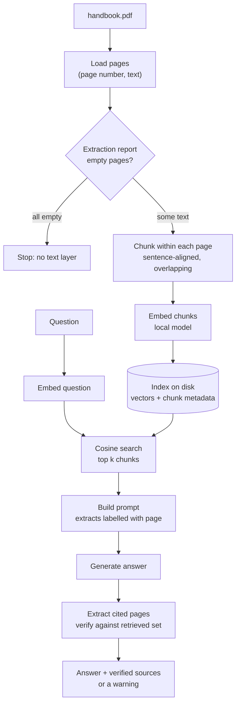

A PDF is the most common thing people want to ask questions of, and the most deceptive. It looks like a document, but the file format describes where glyphs sit on a page, not what the text means. Paragraphs are not stored as paragraphs, tables are not stored as tables, and a scanned report may contain no text at all. A PDF question-answering system therefore starts with an engineering problem that has nothing to do with language models: getting trustworthy text, tied to trustworthy page numbers, out of the file.

This capstone brief specifies a command-line system that indexes a PDF, retrieves the passages relevant to a question, and answers with page citations that the program verifies. It is a step up from the [personal document assistant](/learn/capstone-projects/personal-document-assistant): the source is a single fixed file, but the extraction is harder and the citation standard is stricter. The finished reference implementation is the [PDF question-answering project](/projects/pdf-question-answering). Attempt your own design against this brief first; the project is the comparison, not the starting point.

## Learning objectives

- Specify a PDF question-answering system with requirements that cover extraction quality, citation correctness and failure behaviour.
- Design a chunking and metadata scheme that keeps page numbers attached to every passage.
- Plan an evaluation that separates extraction, retrieval and generation failures.
- Implement a deterministic citation verifier and a page-hit metric, and run them on labelled cases.
- Decide, with reasons, what the system should do for scanned, multi-column and table-heavy documents.

## Prerequisites

- [PDF extraction](/learn/data-processing/pdf-extraction): reading text from a PDF page by page.
- [Sentence-based chunking](/learn/chunking-fundamentals/sentence-based-chunking) and [chunk overlap](/learn/chunking-fundamentals/chunk-overlap): sizing passages.
- [Cosine similarity](/learn/embedding-mathematics/cosine-similarity): how chunks are ranked.
- [Citation-based generation](/learn/generation-strategies/citation-based-generation): prompting a model to cite.
- [Citation accuracy](/learn/generation-evaluation/citation-accuracy): what it means for a citation to be correct.

## Why this matters

When a user asks a question about a contract, a manual or a report, the answer is only useful if they can check it. "The notice period is 60 days" is an assertion; "The notice period is 60 days (page 12)" is an assertion the user can verify in ten seconds. The page citation is the product. Without it the system is a confident narrator whose claims are unauditable, and in any setting with consequences (legal, financial, medical, compliance) unauditable answers are not used.

Page citations are also where PDF systems quietly go wrong. If extraction merges two pages, or the chunker joins the end of page 3 to the start of page 4, then a chunk has no single honest page number. If a model is told to cite pages and is not checked, it will sometimes cite a page it was never shown, or a real page that does not support the claim. Each of these failures produces an answer that looks perfectly cited and is wrong, which is worse than an answer with no citation, because it earns trust it has not earned.

The third reason is that extraction failures masquerade as retrieval failures. If a scanned page yields zero characters, no embedding model can retrieve it, and the system answers "I don't know" about a page that is plainly in the file. Teams then spend days tuning the retriever. A system that reports how many pages produced text, and how much, finds this in seconds. Good PDF engineering begins with measuring the input.

## The intuition

Imagine you are handed a 200-page binder and told to answer questions from it, and you may only look at it by reading page-sized photocopies someone else selects for you. A good selector would hand you the two or three pages most likely to contain the answer, each stamped with its page number. You would read them, answer, and say "see page 12 and page 14".

Three things could go wrong, and each is a distinct engineering problem. The photocopies might be unreadable (extraction). The selector might hand you the wrong pages (retrieval). You might misread or invent (generation). If you do not know which of the three failed, you cannot fix the right one. That is why this system is built as separate stages with observable outputs between them, and why the evaluation plan below scores each stage separately.

The stamp matters more than it looks. A photocopy stamped with its page number lets you cite honestly. A photocopy of "the bottom of page 3 stapled to the top of page 4" cannot be cited honestly, which is why this design chunks within a page rather than across pages, accepting a small loss (a sentence that straddles a page break is split) for a guaranteed gain (every chunk has exactly one page).

## How it works

### The product

The system is a command-line tool with three commands. `index` reads a PDF, chunks it, embeds the chunks and saves them. `search` shows the chunks that would be retrieved for a question, with scores, and needs no API key; it is the tool you debug with. `ask` retrieves, calls the language model and prints the answer with page citations that have been checked against what was retrieved.

### Requirements

**Functional:**

1. Extract text page by page, preserving each page's number (one-based, as printed in a viewer).
2. Report extraction statistics: pages read, characters per page, and pages with no text.
3. Split each page into overlapping, sentence-aligned chunks that never cross a page boundary.
4. Embed chunks with a local model and persist the vectors and chunk metadata to disk.
5. Retrieve the top *k* chunks for a question by cosine similarity.
6. Generate an answer from only those chunks, in a prompt that labels each with its page and instructs the model to cite pages.
7. Verify every cited page against the set of pages actually retrieved, and flag any that were not.
8. Say plainly when the document does not contain the answer.

**Non-functional:**

- *Auditability*: every claim in an answer carries a page, and the page is checkable by the program.
- *Honest failure*: a PDF with no text layer produces a clear message, not an empty index and a confusing "I don't know".
- *Offline testability*: all stages except the model call run without a network connection.
- *Latency*: after indexing, a retrieval takes milliseconds; a question is dominated by the model call.

**Out of scope:** OCR for scanned documents (specify the behaviour, do not build it), table understanding, multiple documents at once, and a web interface. Naming OCR as out of scope but specifying "detect and report" for it is the right way to handle a known limitation: you cannot fix everything, but the system must not hide what it cannot read.

### Architecture

There are two pipelines. Indexing runs once per document; answering runs once per question and reuses the saved index.



Two design choices in the diagram are worth defending in the brief. The extraction report sits *before* chunking, because everything downstream is meaningless if extraction failed. And only the generation box needs the network: the embedder and the generator are passed to the rest of the program as plain functions, so the tests can substitute a deterministic fake embedder and a scripted fake generator.

### Chunking for citation

Chunk size is the main trade-off. Small chunks (a few sentences) match questions precisely and cite narrowly, but may separate a rule from its exception, which usually sits in the next sentence. Large chunks keep context together but dilute the embedding with unrelated material and cite more loosely. A reasonable starting point is a few hundred characters to a thousand, aligned to sentence boundaries, with an overlap of a sentence or two so that a fact on a chunk edge appears whole in at least one chunk. See [chunk size](/learn/chunking-fundamentals/chunk-size) for the trade-offs in depth. Treat your first setting as a hypothesis and test it on the golden set rather than defending it.

Sentence-aligned means you split on sentence boundaries instead of at a fixed character count, so no chunk begins mid-word or ends mid-number. A figure such as "75 pounds" cut in half is a retrieval failure waiting to happen.

### The evaluation plan

The point of the plan is to localise failure to one of three stages.

1. **Extraction check.** On your documents, compute characters per page. Flag pages below a threshold (for example under 20 characters) as probably image-only. Manually compare the extracted text of three pages with the rendered pages; look for glued words, missing columns and reversed reading order.
2. **Golden set.** Write 15 to 25 questions, each with the gold page. Include questions answered by a single sentence, questions that need two facts on one page, a question that needs a comparison ("is 90 pounds over the receipt limit?"), paraphrases, and at least four the document cannot answer.
3. **Retrieval metric: page-hit@k.** For each answerable question, is the gold page among the pages of the top *k* chunks? Report page-hit@1 and page-hit@3. This is retrieval quality at page granularity, which is what a page-citing system needs.
4. **Citation verification.** For every generated answer, parse the cited pages. Report the count of citations not among the retrieved pages (must be zero) and answers with no citation at all (should be zero for answered questions).
5. **Refusal behaviour.** Unanswerable questions must produce a refusal and no citations.
6. **Answer faithfulness**, checked by hand on a sample: does the cited page actually support the sentence? The program can verify that a page was retrieved; it cannot verify that the page supports the claim. That limit is stated openly in the brief, and addressed in the [RAG with citations project](/projects/rag-with-citations), which verifies quotations.

### Milestones

1. **Extraction with a report.** Load pages and print characters per page. Acceptance: a deliberately blank page is flagged, and the page count matches the viewer.
2. **Chunking.** Sentence-aligned chunks within pages. Acceptance: no chunk spans two pages, no chunk starts mid-word, and the chunk count is plausible for the text length.
3. **Search.** Embed, index, persist; implement `search`. Acceptance: page-hit@1 and @3 are measured on the golden set and recorded.
4. **Ask with citations.** Prompt, generation, citation verifier, refusal. Acceptance: zero unverified citations on the golden set; refusals on every unanswerable question or each failure documented.
5. **Testing and polish.** Fake embedder, fake generator, tests for each stage, readable error messages. Acceptance: the suite runs offline in seconds.

### Acceptance criteria

- `index` on a PDF with no text layer exits with a message that names the cause, and does not write an empty index.
- No chunk crosses a page boundary, and every chunk stores exactly one page number.
- page-hit@3 on the golden set is recorded; every miss has a diagnosis (extraction, chunk size, vocabulary, or missing content).
- For every answered golden question, all cited pages are among the retrieved pages, and the program prints a warning if not.
- Unanswerable golden questions are refused with no citations, or each exception is documented in the evaluation notes.
- The test suite needs no network and no model download.

> [!NOTE]
> The retrieval score for a correct chunk depends on how the question is phrased relative to the text. A paraphrased question can retrieve the right chunk at a cosine of 0.3 while a near-verbatim one scores 0.7. Never treat scores as comparable between questions; use rank, not absolute value, to judge retrieval.

The finished reference is the [PDF question-answering project](/projects/pdf-question-answering), including its test suite and its common-problems list.

## In code

The verifier is the one component whose absence turns a RAG system into a fluent liar, and it is small enough to specify exactly. The executable part of this brief is the **citation verifier** plus the **page-hit metric**, both pure functions that run with only the standard library.

The problem they solve: given an answer and the set of pages that were actually shown to the model, decide whether the citations are honest; and given labelled questions, measure whether retrieval surfaces the right page. No dependencies are needed.

```python
import re

def extract_citations(answer: str) -> list[int]:
    pages = []
    for group in re.findall(r"\[p\.\s*([0-9,\s]+)\]", answer):
        pages += [int(x) for x in re.findall(r"\d+", group)]
    return pages

def check_answer(answer: str, retrieved_pages: set[int]) -> dict:
    cited = extract_citations(answer)
    return {
        "cited": sorted(set(cited)),
        "unsupported": sorted(set(cited) - retrieved_pages),
        "uncited": len(cited) == 0,
    }

cases = [
    ("Receipts are needed above 75 pounds [p. 3].", {3, 2}),
    ("The desk opens at 08:00 [p. 4] and closes at 18:00 [p. 4, 1].", {4, 2}),
    ("Parental leave is 26 weeks.", {1, 2}),
]
for ans, got in cases:
    print(check_answer(ans, got))

# page-hit@k on a labelled set: did the gold page appear in the top-k?
gold = {"receipt": 3, "desk hours": 4, "carry over": 1, "equipment": 2}
ranked = {"receipt": [3, 2, 3], "desk hours": [4, 4, 1], "carry over": [2, 1, 3], "equipment": [2, 2, 1]}
for k in (1, 2):
    hits = sum(gold[q] in ranked[q][:k] for q in gold)
    print(f"page-hit@{k} = {hits}/{len(gold)} = {hits/len(gold):.2f}")
```

```output
{'cited': [3], 'unsupported': [], 'uncited': False}
{'cited': [1, 4], 'unsupported': [1], 'uncited': False}
{'cited': [], 'unsupported': [], 'uncited': True}
page-hit@1 = 3/4 = 0.75
page-hit@2 = 4/4 = 1.00
```

**What the important lines do.** The regular expression finds bracketed citations of the form `[p. 3]` or `[p. 4, 1]` and collects every number inside, so a single bracket can cite several pages. `check_answer` is a set difference: whatever was cited but not retrieved is `unsupported`. The `ranked` dictionary holds, for each question, the page of each of the top three chunks in rank order, which is exactly what `search` produces. Note that a page can appear twice in that list (two chunks from the same page); `gold[q] in ranked[q][:k]` handles that naturally.

**What the output means.** The first answer is clean. The second cites page 1, which was never retrieved: the model attributed something to a page it was not shown, and the program has caught it. The third has no citation at all, which for an answered question is itself a failure, and for a refusal is correct, so the caller must combine this flag with whether the answer was a refusal. Page-hit@1 of 0.75 rising to 1.00 at k = 2 says retrieval usually ranks the right page first and always includes it by second place, which tells you that a larger *k* would repair the miss at the cost of more context.

**Errors people commonly hit.** The most common is a citation format the model does not follow, such as "(page 3)" instead of "[p. 3]": the regular expression finds nothing and every answer looks uncited. Give the model the exact format in the prompt, with an example, and make the parser slightly forgiving. A second is off-by-one page numbers, where the code uses zero-based indices and the user sees a viewer's one-based numbers; store one-based numbers from the first line.

**How to extend it.** Add a check that each cited page's chunk *contains* a number or key phrase that appears in the sentence making the claim; this is crude quote verification and catches many wrong citations. Add the refusal flag so that "no citation" is only a failure when the answer is not a refusal.

## A real-world example

Meridian's finance team wants to ask questions of the 180-page procurement policy, a PDF exported from a word processor by a contractor in 2019. An engineer, Ahmed Khan, builds the system and tests it on the first twenty pages, where it works well. Then the finance lead asks about approval limits for software purchases, and the assistant answers "I don't know."

Ahmed spends a day on the retriever: a larger model, a lower threshold, query rewriting. Nothing helps. Then he runs the extraction statistics he had not built, and finds that pages 41 to 58, the whole purchasing section, have zero characters. They are scanned images inserted into the document. The retriever was never at fault; there was nothing to retrieve.

The fix was a requirement, not a model: the `index` command now prints "18 of 180 pages contain no extractable text (pages 41-58)" and refuses to claim completeness. The team then decides, as a business choice, to run OCR on those pages in a separate step. The evaluation plan changed too: the golden set now includes at least one question per major section, so a section that is silently missing makes its question fail the first time the set is run. The general lesson is to measure the input of a pipeline before tuning its middle.

## Common mistakes

- **Assuming extraction worked.** A scanned or oddly encoded page yields no text, and the system answers "I don't know" about content that is visibly in the file. Report characters per page at index time.
- **Chunking across page boundaries.** A chunk made of two pages has no honest citation, so the system either cites one page wrongly or invents a range. Chunk within a page.
- **Trusting the model's page citations.** Models sometimes cite pages they were not shown. Verify citations in code against the retrieved set.
- **Confusing "cited" with "supported".** A retrieved, cited page may still not support the claim. State this limit and spot-check a sample by hand.
- **Using one score threshold for all questions.** Cosine scores vary with phrasing, so a fixed cut-off wrongly refuses good retrievals and accepts bad ones. Calibrate on a labelled set and use rank as the main signal.
- **Zero-based page numbers shown to humans.** The citation says page 3 and the user finds the answer on what their viewer calls page 4. Decide the convention once, and store printed or viewer page numbers.
- **Tuning the retriever before checking extraction.** Time is spent on the wrong stage. Inspect extracted text for a few pages first.
- **Ignoring tables and columns.** Reading order in multi-column pages and cell order in tables are scrambled by simple extraction; a layout-aware parser such as [PyMuPDF](/learn/advanced-document-parsing/pymupdf) usually does better, and [tables and structured content](/learn/advanced-document-parsing/tables-and-structured-content) covers the deeper problem.

## Best practices

- Log extraction statistics every time you index: pages, characters per page, empty pages, and the extraction library's name and version.
- Keep a manual spot-check habit: render a page, read the extracted text next to it, and look for glued words and lost columns.
- Make every chunk carry its page number from the moment it is created; never try to recover pages afterwards by searching for text.
- Keep `search` as a first-class command with no API key requirement; most debugging is looking at what was retrieved.
- Put the exact citation format in the prompt, with an example, and parse it strictly in code.
- Separate the failure modes in your evaluation: extraction, retrieval, generation, citation. A single end-to-end accuracy figure hides which stage to fix.
- Keep the golden set in the repository and rerun it after every change to chunking, the embedding model or the prompt.
- Write down what the system cannot do (scans, tables, multi-document questions) in the README, so a user is not misled by silence.

## Performance considerations

Indexing cost is dominated by embedding. For a 200-page document with about 3,000 characters per page, there are 600,000 characters. At a chunk size of roughly 800 characters with overlap, that is on the order of 900 to 1,000 chunks. If a laptop CPU embeds around 50 chunks per second (an assumption: measure your own), indexing takes about 20 seconds, once. It is paid again only if you change the chunking or the model, which is a reason to store the chunk parameters and model name with the index.

Search cost is negligible at this scale. A thousand 384-dimensional vectors fit in about 1.5 MB as 32-bit floats (1,000 x 384 x 4 bytes), and ranking them is a single matrix-vector product. A vector database is unnecessary below very roughly tens or hundreds of thousands of chunks; choosing one early adds a moving part without removing a problem. The first bottleneck you meet is the language model call, in latency and money. Prompt size is *k* times the chunk length plus instructions; with *k* = 4 chunks of about 200 tokens, you send roughly 1,000 tokens of context. Doubling *k* doubles that and, past a point, buries the relevant chunk among irrelevant ones.

## Security considerations

A PDF is untrusted input twice over. First, the *file*: PDFs can be crafted to exploit parser bugs, so parse files from unknown sources in a sandboxed process, keep the library up to date, and cap file size and page count. Second, the *text*: a document can contain instructions aimed at the model, sometimes in white text or tiny type that a human never sees but extraction reads. Treat retrieved text as data: say so in the system prompt, and never give a document-reading assistant tools that could act on injected instructions. See [malicious documents](/learn/rag-security-fundamentals/malicious-documents). If the PDF contains personal or confidential data, remember that the question and retrieved extracts are sent to the model provider; check your obligations before indexing a document that cannot leave your environment, or use a model you host yourself.

## Summary

- A PDF system lives or dies on extraction; measure characters per page before tuning anything else, and refuse to pretend a scanned page has been read.
- Chunk within pages so that every chunk has exactly one honest page number, and put that number in the prompt and the index.
- Separate failures into extraction, retrieval, generation and citation, and give each its own metric: characters per page, page-hit@k, refusal behaviour and verified citations.
- A citation verifier is a set difference, costs a few lines, and catches the most damaging failure: a confident answer citing a page the model never saw.
- The runnable reference is the [PDF question-answering project](/projects/pdf-question-answering); the brief here is what you compare your own design to.

## Exercises

1. **Spot the stage.** A user reports "the assistant says it does not know the approval limit, but it is on page 41." List the three stages that could be at fault and the one check that distinguishes each.

<details><summary>Show solution</summary>

Extraction: print the characters extracted from page 41; if it is near zero the page is an image. Retrieval: run `search` for the question and see whether any chunk from page 41 is in the top *k*; if text exists but is not retrieved, it is a chunking, vocabulary or *k* problem. Generation: if page 41's chunk was retrieved and shown to the model but the answer is still "I don't know", inspect the prompt for a too-strict refusal instruction or a chunk that cut the sentence in half.

</details>

2. **Extend the verifier.** Modify `check_answer` to accept a boolean `is_refusal` and return a `status` of `"ok"`, `"unsupported_citation"`, `"missing_citation"` or `"ok_refusal"`. Write the four-line logic.

<details><summary>Show solution</summary>

```python
def status(answer, retrieved, is_refusal):
    r = check_answer(answer, retrieved)
    if is_refusal:
        return "ok_refusal" if r["uncited"] else "unsupported_citation"
    if r["uncited"]:
        return "missing_citation"
    return "unsupported_citation" if r["unsupported"] else "ok"
```

A refusal must carry no citations; an answer must carry at least one, all of them retrieved.

</details>

3. **Choose a chunk size.** You have a page with a rule in one sentence and its exception in the next. Argue for or against a chunk size of one sentence, and describe the experiment that would settle it on your golden set.

<details><summary>Show solution</summary>

One-sentence chunks may separate rule and exception, so the model sees the rule alone and answers incompletely. An overlap of one sentence mitigates this, since the rule-plus-exception pair appears together in some chunk. The experiment: build two indexes (one-sentence with overlap, and three-sentence), run the golden set, and compare page-hit@3 and, for questions needing the exception, the faithfulness of answers. Choose on the measured result, and record it so a later change can be compared.

</details>

4. **Design for scans.** The brief says OCR is out of scope but requires "detect and report". Write the acceptance test for that requirement and the user-facing message.

<details><summary>Show solution</summary>

Test: index a PDF in which pages 2 and 3 are images; assert that the report lists exactly pages 2 and 3 as empty, that the exit status is non-zero if every page is empty and zero (with a warning) otherwise, and that no chunk carries a page number of an empty page. Message: "2 of 5 pages contain no extractable text (pages 2-3). Questions about them cannot be answered. See the OCR notes in the README." The message names the pages, the consequence and where to go next.

</details>

## Check your understanding

```quiz
[
  {
    "q": "Why should chunks never span two pages in a page-citing system?",
    "options": [
      "A chunk from two pages has no single honest page number to cite",
      "Embedding models cannot handle text from two pages",
      "It makes the index file larger",
      "Cosine similarity is undefined across pages"
    ],
    "answer": 0,
    "why": "Citations are only useful if they point to one page the reader can check. Chunking within a page guarantees each chunk has exactly one page."
  },
  {
    "q": "The assistant says it does not know something that is clearly in the PDF, and nothing in the retriever helps. What should you check first?",
    "options": [
      "Whether the API key is valid",
      "Whether the language model is too small",
      "Whether the page produced any extracted text",
      "Whether the embedding dimension is 384"
    ],
    "answer": 2,
    "why": "A scanned page yields no text, so there is nothing to retrieve. Checking characters per page distinguishes an extraction failure from a retrieval one in seconds."
  },
  {
    "q": "In the verifier output {'cited': [1, 4], 'unsupported': [1]}, what happened?",
    "options": [
      "Page 1 was retrieved but ignored",
      "The answer cited page 1, which was not among the retrieved pages",
      "Page 4 was missing from the index",
      "The regular expression failed"
    ],
    "answer": 1,
    "why": "`unsupported` is the set of cited pages minus retrieved pages. Citing a page the model was never shown is the failure the verifier exists to catch."
  },
  {
    "q": "What does a passing citation check NOT prove?",
    "options": [
      "That the cited page was retrieved",
      "That page numbers are within the document",
      "That the answer contains a citation",
      "That the cited page supports the claim made"
    ],
    "answer": 3,
    "why": "The check is about retrieval membership. Whether the text on the cited page actually backs the sentence needs quote-level verification or human review."
  },
  {
    "q": "A paraphrased question retrieves the correct chunk with cosine 0.31, while another correct retrieval scores 0.68. What is the sound conclusion?",
    "options": [
      "The first retrieval is probably wrong",
      "The embedding model is broken",
      "Scores are not comparable across questions; judge by rank",
      "The threshold should be set to 0.7"
    ],
    "answer": 2,
    "why": "Cosine scores depend on how the question is phrased relative to the text, so absolute values differ between questions even when both retrievals are right."
  }
]
```

## Further reading

- [pypdf documentation](https://pypdf.readthedocs.io/): reading PDF pages and text, and the limits of text extraction.
- [PyMuPDF documentation](https://pymupdf.readthedocs.io/): layout-aware text, tables and page rendering.
- [Sentence Transformers documentation](https://www.sbert.net/): the local embedding model used for retrieval.
- Lewis, P. et al. (2020), "Retrieval-Augmented Generation for Knowledge-Intensive NLP Tasks".
- Manning, C., Raghavan, P. and Schütze, H. (2008), *Introduction to Information Retrieval*, on evaluating ranked retrieval.
