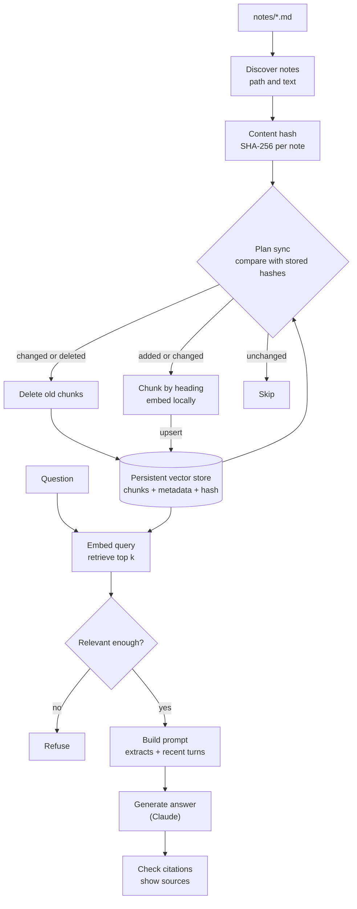

A capstone is different from a lesson. A lesson teaches one idea and checks that you understood it; a capstone gives you a goal and asks you to decide how to reach it, with nobody telling you which idea to apply next. This first capstone is the gentlest: an assistant that answers questions about your own folder of documents (notes, drafts, saved articles) and tells you which file each fact came from. It is small enough to finish in a weekend and it already contains every decision a larger system makes: what to build, how to split and store it, how to keep it fresh, and how to know that it works.

This page is a **project brief**, not a tutorial. It specifies the requirements, the architecture, the evaluation plan, the milestones and the acceptance criteria. The finished, runnable implementation lives in the [personal notes chatbot project](/projects/personal-notes-chatbot); treat that as the answer key you open after you have attempted your own design, not as a script to copy. Part of the skill being practised is writing the brief for yourself, so the lesson also shows how a specification turns vague wishes into things you can test.

## Learning objectives

- Turn a one-sentence product idea into functional requirements, non-functional requirements and an explicit out-of-scope list.
- Design a persistent, incrementally updated index and justify each component against a requirement.
- Write a golden question set and acceptance tests that would fail if the system were wrong.
- Break the build into milestones that each end in something demonstrable.
- Implement and run a sync-planning check that proves re-indexing cost is proportional to what changed.

## Prerequisites

- [Indexing pipeline](/learn/rag-architecture-fundamentals/indexing-pipeline): the offline stages the assistant will run.
- [Incremental ingestion](/learn/understanding-document-ingestion/incremental-ingestion): detecting what changed since the last run.
- [Heading-based chunking](/learn/advanced-chunking-strategies/heading-based-chunking): splitting Markdown along its own structure.
- [ChromaDB](/learn/vector-database-ecosystem/chromadb): a vector store that persists to a folder.
- [Golden datasets](/learn/testing-and-benchmarking/golden-datasets): the labelled questions your evaluation will use.

## Why this matters

Most RAG demos work once, on the day they are built, on the documents they were built with. A personal assistant exposes what happens on day two. You edit a note, and the assistant still quotes the old version. You delete a file, and its text keeps appearing in answers. You rename a heading, and a question that worked yesterday retrieves nothing. None of these is a modelling problem. They are lifecycle problems: the index is a copy of your documents, and a copy that is not kept in step becomes a source of wrong answers that look authoritative.

A second reason to start here is that a small system is a clean laboratory. With forty notes you can read every chunk, predict what a query should retrieve, and see exactly why it did not. Those habits (reading chunks, predicting retrieval, writing the expected answer before running the system) are the ones that scale. The engineers who build enterprise platforms did not learn them at enterprise scale; they learned them where every failure was small enough to understand.

The third reason is practice at **specification**. People starting a RAG project usually begin with the model and the framework and arrive at requirements last, if at all. The result is a system that is impressive in a demo and impossible to improve, because nobody wrote down what "better" means. The discipline in this capstone is the reverse: write the requirements and the acceptance tests first, then build.

## The intuition

Think of a good personal assistant at an office, not an AI one, a human one. You hand them a filing cabinet and say "answer my questions from this". What would you expect?

First, they would answer from the cabinet, not from memory. If you ask about a contract and it is not there, they say "I do not have that" instead of guessing. Second, they would tell you where the answer came from: "page two of the Northwind folder". That is how you check them. Third, they would notice when you add or remove a folder, without re-reading the whole cabinet each morning. Fourth, they would be fast enough that you actually use them.

Those four expectations are the whole product: **grounded**, **cited**, **current** and **fast**. Each maps to a technical decision. Grounded means a prompt that confines the model to the retrieved extracts and a refusal path for when retrieval finds nothing useful. Cited means that every chunk carries the file and section it came from, and that the program checks the model's citations rather than trusting them. Current means change detection. Fast means that the embedding model loads once and that unchanged files cost nothing on restart.

A brief is just those expectations made precise enough to test. "Current" becomes "after I edit one note, exactly one note is re-embedded and the next question reflects the edit". The sharper the sentence, the cheaper it is to check.

## How it works

### The product in one paragraph

You point the assistant at a folder of Markdown notes. On start-up it compares the folder with its index and updates only what changed. You ask a question in a terminal chat. It retrieves the most relevant sections, shows the model only those sections plus the last few turns of conversation, and prints the answer with the names of the notes it used. If nothing relevant exists, it says so.

### Requirements

Write requirements in three lists. The third list is the one beginners skip, and it is the one that protects the schedule.

**Functional requirements** (what it does):

1. Discover every `.md` file under a root folder, recursively.
2. Split each note into chunks along its headings, keeping the note path and heading as metadata.
3. Embed chunks locally so note contents are not sent to a third party at indexing time.
4. Persist the index between runs.
5. On each start, detect added, changed, deleted and unchanged notes and update the index accordingly.
6. Answer a question from the top *k* retrieved chunks, with the source note named.
7. Keep a short conversation memory so a follow-up such as "and how many carry over?" can be understood.
8. Refuse politely when retrieval finds nothing relevant.

**Non-functional requirements** (how well it does it):

- *Freshness*: an edit is reflected in answers after the next sync; a deleted note never appears.
- *Latency*: retrieval for a question takes well under a second on a laptop; the language model call dominates the total.
- *Privacy*: indexing runs entirely on the local machine; only the retrieved extracts and the question leave it, and only at answer time.
- *Cost*: unchanged notes cost zero embedding work on restart.
- *Testability*: everything except the language model call can be tested with no network, no model download and no key.

**Out of scope** (what it deliberately does not do): PDFs and images, multi-user access, a web interface, cross-device sync, and any claim to answer questions the notes do not contain. Writing these down is not modesty; it is how you stop a weekend project becoming a month-long one.

### Architecture

The system has two halves that never run at the same time: an offline half that keeps the index current, and an online half that answers questions. They meet only in the vector store.



Notice what each box defends against. The content hash and plan defend freshness. The delete-before-upsert step defends against **orphaned chunks**: if a note shrinks from five sections to three, upserting three new chunks leaves two stale ones behind unless you remove the old set first. The relevance gate defends groundedness. The citation check defends trust.

### Design decisions you must make

The brief should force a decision, with a reason, at each of these points. The table lists the usual choice and the question to ask yourself.

| Decision | Usual choice here | Question to test it |
| --- | --- | --- |
| Chunk boundary | One chunk per heading section | What happens to a section of 3,000 words, or of five words? |
| Change detection | SHA-256 of the note text | Does an editor that rewrites a timestamp make every note "changed"? |
| Embedding model | A small local model such as MiniLM | What breaks if you switch models later without re-indexing? |
| Vector store | An embedded, on-disk store | Can the store filter by folder, and do you need it to? |
| Relevance gate | A similarity threshold you calibrate | Are scores comparable between questions? (They are not; see below.) |
| Conversation memory | Last few turns, only in the prompt | Should earlier turns be used to *retrieve*, or only to *generate*? |

Two of these deserve a sentence more. A fixed similarity threshold is calibrated on **your** questions and **your** model, because cosine scores depend on how a question is phrased relative to the document, so a correct retrieval can score 0.32 while another correct retrieval scores 0.68. Use the gate as a coarse "obviously irrelevant" filter, not as a precise confidence measure. And conversation memory is a trap for retrieval: if you embed the whole chat history as the query, an old topic pollutes a new question. A common remedy, covered in [multi-turn RAG](/learn/generation-strategies/multi-turn-rag), is to rewrite the follow-up into a standalone question before retrieving.

### The evaluation plan

Decide how you will judge the system before you build it, because once the demo works you will be tempted to judge it by feel.

1. **Build a golden set of 20 to 30 questions** from your own notes, each with the note and section that answers it. Write at least five questions that use different words from the note (the "holiday" versus "annual leave" kind) and at least five that the notes do *not* answer.
2. **Retrieval metric: hit@k.** For each answerable question, is the gold section in the top *k* chunks? Report hit@1 and hit@4. This isolates retrieval from generation. See [Recall@K](/learn/retrieval-evaluation/recall-k).
3. **Refusal metric.** Of the unanswerable questions, how many does the system refuse? Of the answerable ones, how many does it wrongly refuse? Both numbers matter; a system that refuses everything has a perfect first score.
4. **Citation validity.** For every generated answer, is every cited note among the retrieved chunks? This is checkable in code with no human. See [citation accuracy](/learn/generation-evaluation/citation-accuracy).
5. **Sync correctness.** A scripted scenario (no edits, then one edit, one deletion and one addition) must produce exactly the expected plan, and the index must afterwards contain exactly the expected notes.
6. **Answer quality**, spot-checked by you on a sample of about ten answers, marking each faithful or not. Automated judges come later in the course; at this scale reading the answers is cheap and instructive.

### Milestones

Each milestone ends with something you can run and show. If a milestone cannot be demonstrated, it is too big; split it.

1. **Notes to chunks (one evening).** Discover notes, split by heading, print the chunks. Acceptance: the chunk count matches what you count by hand for three sample notes.
2. **Search without a model call (one evening).** Embed chunks, store them in memory, and print the top four chunks for a question. Acceptance: hit@4 on your golden set is measured and written down, whatever it is.
3. **Persistence and sync.** Move to the on-disk store, add hashes, implement the four-way plan. Acceptance: the scripted sync scenario passes; a second run with no edits does zero embedding.
4. **Answering with sources.** Add the prompt, the generation call, citations and the relevance gate. Acceptance: citation validity is 100 percent on the golden set, and unanswerable questions are refused at a rate you have measured.
5. **Chat and hardening.** Add conversation memory, error handling for unreadable files, and tests. Acceptance: the whole suite runs offline in seconds.

### Acceptance criteria

The project is done when all of the following are true, and not before:

- Running twice in a row with no edits reports every note unchanged and performs no embedding.
- After editing one note, deleting another and adding a third, exactly one note is re-embedded, one is removed and one is added, and no chunk of the deleted note can be retrieved.
- hit@4 on the golden set is recorded, and every failing question has a one-line diagnosis (chunking, vocabulary mismatch, or a missing note).
- Every citation in every golden-set answer refers to a note that was retrieved for that question.
- No test requires the network, a model download or an API key.

> [!KEY]
> Acceptance criteria are not documentation written afterwards. They are tests written first. If you cannot state how a requirement would be checked, you have not finished stating it.

The reference build for all of this is the [personal notes chatbot](/projects/personal-notes-chatbot). Open it when you have a design of your own to compare against; the interesting learning is in the differences.

## In code

The riskiest part of this project is not the retrieval; it is the sync logic, because a bug there silently corrupts the index. So the executable part of this brief is a **sync-planning check**: the pure function that sorts notes into added, changed, deleted and unchanged, with the three acceptance tests from the list above written as assertions. It uses only the standard library, so it runs anywhere.

The problem it solves: given the current files and the hashes stored in the index, decide the minimum work. There are no dependencies to install.

```python
import hashlib
from dataclasses import dataclass

def content_hash(text: str) -> str:
    return hashlib.sha256(text.encode("utf-8")).hexdigest()[:12]

@dataclass(frozen=True)
class Plan:
    added: list
    changed: list
    deleted: list
    unchanged: list

def plan_sync(on_disk: dict, indexed: dict) -> Plan:
    """on_disk: path -> text. indexed: path -> stored hash."""
    disk_hashes = {p: content_hash(t) for p, t in on_disk.items()}
    added = sorted(p for p in disk_hashes if p not in indexed)
    deleted = sorted(p for p in indexed if p not in disk_hashes)
    changed = sorted(p for p in disk_hashes if p in indexed and disk_hashes[p] != indexed[p])
    unchanged = sorted(p for p in disk_hashes if p in indexed and disk_hashes[p] == indexed[p])
    return Plan(added, changed, deleted, unchanged)

notes = {
    "leave.md": "Annual leave is 25 days.",
    "remote.md": "Remote work: up to 3 days a week.",
    "it.md": "Rotate passwords every 90 days.",
}
indexed = {p: content_hash(t) for p, t in notes.items()}

# Acceptance test 1: nothing edited -> nothing to do.
p = plan_sync(notes, indexed)
assert not (p.added or p.changed or p.deleted) and len(p.unchanged) == 3
print("A1 idempotent re-run:", p)

# Acceptance test 2: one edit, one deletion, one new file.
notes2 = dict(notes)
notes2["leave.md"] += " Up to 5 days carry over."
del notes2["it.md"]
notes2["laptop.md"] = "Laptop refresh cycle is 3 years."
p = plan_sync(notes2, indexed)
assert (p.added, p.changed, p.deleted) == (["laptop.md"], ["leave.md"], ["it.md"])
print("A2 mixed edits:", p)

# Acceptance test 3: re-embedding cost is proportional to the change, not the corpus.
work = len(p.added) + len(p.changed)
print(f"A3 notes to embed: {work} of {len(notes2)}")
```

```output
A1 idempotent re-run: Plan(added=[], changed=[], deleted=[], unchanged=['it.md', 'leave.md', 'remote.md'])
A2 mixed edits: Plan(added=['laptop.md'], changed=['leave.md'], deleted=['it.md'], unchanged=['remote.md'])
A3 notes to embed: 2 of 3
```

**What the important lines do.** `content_hash` reduces a note to a short fingerprint; identical text always gives an identical hash, so a note that has not changed costs a comparison, not an embedding. `plan_sync` takes plain dictionaries rather than reading files or calling a database, which is what makes it testable: the real program passes it real folder contents and real stored hashes, and the test passes it literals. The four lists are sorted so the result is deterministic and easy to assert on.

**What the output means.** Test 1 shows the property you want most: a no-op run does nothing. Test 2 shows that three different kinds of change are told apart. Test 3 shows the cost model: two of three notes need embedding, and on a real corpus of hundreds of notes the ratio would be far smaller.

**Errors people commonly hit.** If every note is reported as changed on every run, something rewrites the files between runs, typically an editor stamping a modification date inside the text. Hash only the text you index, and strip front matter you do not index. If a *renamed* note appears as one deletion plus one addition, that is correct for this design, because a path is the identity; if renames are common, key notes by a stable identifier instead (see [document identifiers](/learn/document-engineering/document-identifiers)).

**How to extend it.** Hash each section rather than each note, so editing one paragraph of a long note re-embeds one chunk. Store the embedding model's name alongside each hash, so changing models marks everything as changed instead of mixing incompatible vectors.

## A real-world example

Priya Nair keeps three years of engineering notes in a folder: design reviews, on-call write-ups, and a running "things I learned" file. She builds the assistant over a weekend, skips the brief, and starts with the model call. It works beautifully on the 30 notes she tests with.

Two weeks later it starts giving wrong answers. She had rewritten her notes on the VPN rollout, but the assistant still quoted the old rollout date. Her first guess was that the model was hallucinating, and she spent an evening rewording the prompt. The real cause was that her start-up script re-indexed with `add` instead of an upsert-after-delete, and that she had never defined what "current" meant. The new section had been added as new chunks, and the old ones remained, scoring almost identically for the same question. The model, shown both, picked the one that appeared first.

A brief would have caught it. "After editing one note, the old text is no longer retrievable" is a one-line acceptance test, and the scripted sync scenario fails on the very first run of her code. The fix was four lines. The lesson is not that she was careless; it is that the failure was invisible without a test and obvious with one, and that the time spent debugging the prompt was spent on the wrong layer. When a RAG system gives a wrong answer, look at what was retrieved before you change what was asked.

## Common mistakes

- **Skipping the out-of-scope list.** The project grows to include PDFs, a web UI and sync across devices, and nothing ships.
- **Re-embedding everything on every start.** Start-up takes minutes, the user stops running it, and the index goes stale. Use content hashes.
- **Adding chunks without deleting the old ones.** Stale text and fresh text coexist and compete; answers become unpredictable. Delete a changed note's chunks, then add the new ones.
- **Judging by three impressive demo questions.** The system looks excellent until it meets a question phrased differently from the note. Write the golden set, including paraphrases and unanswerable questions.
- **Using the whole chat history as the retrieval query.** A topic from ten turns ago drags unrelated chunks into a fresh question. Rewrite follow-ups into standalone questions, or use only the latest turn for retrieval.
- **Treating the similarity threshold as a probability.** It is a score on an arbitrary scale that varies with phrasing. Calibrate it on your golden set and treat it as coarse.
- **Trusting the model's citations.** A model can cite a file it was never shown. Check each citation against the retrieved set in code.
- **Switching embedding models without re-indexing.** Vectors from different models are not comparable; results become nonsense or the store reports a dimension mismatch.

## Best practices

- Write requirements, out-of-scope items and acceptance tests before any code, and keep them in the repository beside the code.
- Keep the pure logic (discovery, hashing, chunking, planning, prompt building) separate from anything that touches the network or a database, so tests are fast and need no setup.
- Pass the embedder and the generator into your functions as arguments, so tests can replace them with stand-ins.
- Store the source path and heading with every chunk and show them to the user; sources are how people learn when to trust the assistant.
- Record a baseline metric after each milestone. A number written down on Tuesday is how you know Thursday's change helped.
- Read the chunks. Print them. Half of all retrieval problems are visible to the naked eye in the chunk text.
- Keep the first version boring: a flat folder of Markdown, one embedding model, one store. Add structure only when a measured failure demands it.

## Performance considerations

Reason with arithmetic, using assumptions you label as such. Suppose the folder holds 400 notes averaging 6 sections, so about 2,400 chunks. A small local embedding model on a laptop CPU might embed on the order of tens to a few hundred chunks per second; call it 50 for planning. A full re-index would then take about 2,400 / 50 = 48 seconds. With change detection, a day in which you edit 3 notes (18 chunks) costs under a second of embedding. The saving is not about the first run; it is about the thousandth.

Retrieval over 2,400 vectors is trivial: even a brute-force comparison is a matrix product of one vector against 2,400, a negligible cost next to loading the embedding model, which takes seconds and is paid once per process. This is why the first design decision is to keep the model loaded in a long-running chat loop instead of launching a fresh process per question.

The language model call dominates the end-to-end time and the money. Cost per question is roughly the input tokens times the input price plus the output tokens times the output price. If you retrieve 4 sections of 300 tokens each and add a 200-token instruction and a short history, the prompt is about 1,500 tokens. Check current prices in the provider's documentation and compute your own figure; never assume. The control you have is *k*: retrieving 8 sections instead of 4 doubles the context and often adds noise rather than answers.

## Security considerations

Even a private assistant has a threat model. Your notes may contain text you did not write: pasted emails, saved web pages, meeting transcripts. If a note contains an instruction such as "ignore previous instructions and ...", and the retrieval puts it in the prompt, the model may follow it. This is indirect prompt injection, covered in [indirect prompt injection](/learn/rag-security-fundamentals/indirect-prompt-injection). At personal scale the damage is limited, because the assistant has no tools, but the habit of marking retrieved text as untrusted data in the prompt is worth building now.

Privacy deserves an explicit statement in the brief. Local embeddings mean that indexing sends nothing anywhere. Answering does send the question and the retrieved extracts to the model provider; if some notes are too sensitive for that, add a folder-level exclusion rule rather than hoping to remember. Finally, keep the API key in an environment variable, never in a file inside the notes folder that the assistant itself would index.

## Summary

- A capstone brief states requirements, a deliberate out-of-scope list, an architecture, an evaluation plan, milestones and acceptance criteria, and the acceptance criteria are tests written before the code.
- The personal assistant's four promises are grounded, cited, current and fast; each maps to a concrete mechanism (a refusal path, checked citations, change detection, a loaded model).
- Lifecycle bugs, not model quality, are what break a small RAG system on day two: stale chunks, orphaned chunks and unnoticed deletions.
- Evaluate retrieval separately from generation with a golden set that includes paraphrases and unanswerable questions.
- The finished reference build is the [personal notes chatbot](/projects/personal-notes-chatbot); compare it with your own design rather than following it line by line.

## Exercises

1. **Write a requirement.** Take the vague wish "it should always be up to date" and rewrite it as a testable acceptance criterion with a concrete scenario and a pass condition.

<details><summary>Show solution</summary>

"After I edit one section of one note and run the sync, the plan reports exactly that note as changed and no other; the old text of that section cannot be returned by any query; and a question about the new text retrieves the new section first." Each clause is checkable: the plan is a function output, retrievability is a query, and ranking is a rank check. "Always" is replaced by "after the next sync", which is what you can actually promise.

</details>

2. **Predict the plan.** The index holds hashes for `a.md`, `b.md` and `c.md`. On disk now: `a.md` unchanged, `b.md` with one word altered, `d.md` new, and `c.md` missing. State the four lists. Then say what happens if `b.md` is only *renamed* to `e.md` with identical text.

<details><summary>Show solution</summary>

Added: `d.md`. Changed: `b.md`. Deleted: `c.md`. Unchanged: `a.md`. If `b.md` is renamed to `e.md`, the path-keyed design reports `b.md` deleted and `e.md` added, so the note's chunks are removed and re-embedded; the result is correct but wasteful. Keying by a content hash or a stable identifier would let the system notice the same text under a new path and move metadata instead of re-embedding.

</details>

3. **Design a golden set.** Propose 12 golden questions for a folder of Meridian handbook notes (annual leave 25 days, carry-over up to 5 days by 31 March, remote work up to 3 days a week, expenses within 30 days, receipts over 75 pounds). Say how many should be paraphrases and how many unanswerable, and why.

<details><summary>Show solution</summary>

A balanced set: 5 direct questions that reuse the note's words ("How many days of annual leave do I get?"), 4 paraphrases ("How much holiday can I take?", "How long do I have to claim a train fare?"), and 3 unanswerable ones ("What is the parental leave policy?"). Paraphrases test whether retrieval depends on shared vocabulary; unanswerable questions test the refusal path and are the only way to detect a system that answers everything confidently. Record the gold note and section for each answerable question so hit@k is computable.

</details>

4. **Extend the check.** Modify `plan_sync` so that it also takes the embedding model name stored with each note, and reports a note as changed when the model differs. Write one assertion for it.

<details><summary>Show solution</summary>

Make the stored value a pair, `(hash, model)`, and compare the pair: `changed = [p for p in disk if p in indexed and (disk_hash[p], current_model) != indexed[p]]`. Assertion: with `indexed = {"a.md": (content_hash("x"), "minilm")}` and `current_model = "bge-small"`, `plan_sync({"a.md": "x"}, indexed, "bge-small").changed == ["a.md"]`. This turns a silent, damaging mistake (mixing incompatible vectors) into a planned re-index.

</details>

## Check your understanding

```quiz
[
  {
    "q": "A note shrinks from five sections to three and is re-indexed with an upsert of three new chunks. What is the most likely consequence?",
    "options": [
      "Nothing; upsert removes chunks that no longer exist",
      "Two orphaned old chunks remain and can be retrieved",
      "The store rejects the update because the counts differ",
      "All other notes are re-embedded"
    ],
    "answer": 1,
    "why": "An upsert only replaces chunks whose ids it writes. Chunks from the old version with other ids stay in the index, so stale text keeps appearing in answers unless the note's old chunks are deleted first."
  },
  {
    "q": "Which acceptance criterion is best written?",
    "options": [
      "The assistant should be fast",
      "The assistant should feel accurate",
      "The assistant should handle updates well",
      "A second run with no edits performs zero embedding calls"
    ],
    "answer": 3,
    "why": "It names a scenario and a pass condition that code can check. The others cannot fail in any observable way."
  },
  {
    "q": "On a golden set, a system that refuses every question scores perfectly on which metric?",
    "options": [
      "Refusal rate on unanswerable questions",
      "hit@4 on answerable questions",
      "Citation validity on answered questions",
      "Faithfulness of answers it gives"
    ],
    "answer": 0,
    "why": "Refusing everything refuses all the unanswerable questions, so that metric looks perfect. It is why you must also measure wrongful refusal of answerable questions."
  },
  {
    "q": "Why does the sync planner take dictionaries instead of reading files and querying the database itself?",
    "options": [
      "Dictionaries are faster than file reads",
      "Because the vector store requires dictionaries",
      "So it can be tested with literals and no setup",
      "To avoid computing hashes"
    ],
    "answer": 2,
    "why": "A pure function over plain data needs no files, database or model, so acceptance tests run in milliseconds and are deterministic."
  },
  {
    "q": "A follow-up question 'and how many carry over?' retrieves chunks about laptops. What is the likely cause and a sound fix?",
    "options": [
      "The vector store is corrupted; rebuild it",
      "The query lacks the topic from earlier turns; rewrite it into a standalone question first",
      "The similarity threshold is too low; raise it to 0.99",
      "The embedding model is too large; use a smaller one"
    ],
    "answer": 1,
    "why": "On its own, 'and how many carry over?' has no topic to match. Rewriting it using the conversation, for example 'How many annual leave days carry over?', gives retrieval something to work with."
  }
]
```

## Further reading

- [ChromaDB documentation](https://docs.trychroma.com/): collections, persistent clients, upsert and delete.
- [Sentence Transformers documentation](https://www.sbert.net/): the local embedding models used for indexing.
- Lewis, P. et al. (2020), "Retrieval-Augmented Generation for Knowledge-Intensive NLP Tasks": the paper that named the pattern.
- [Anthropic documentation](https://docs.anthropic.com/): the Messages API used for answer generation.
- Manning, C., Raghavan, P. and Schütze, H. (2008), *Introduction to Information Retrieval*, chapter 8 on evaluation in information retrieval.
