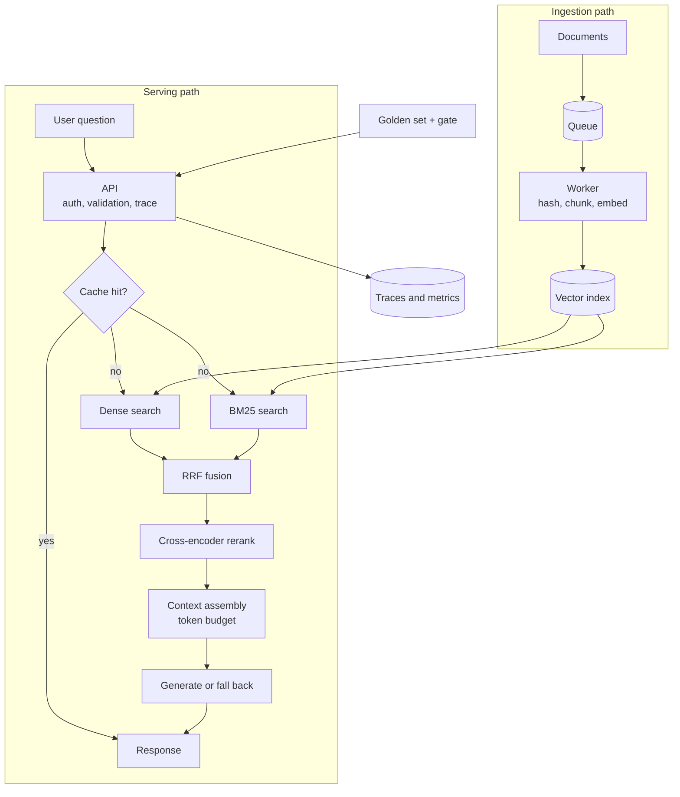

The earlier capstones each build one capability: citations, sync, access control, fusion, images, graphs, agents. A production platform builds none of them in isolation. It is the discipline of making all of them work together, keep working after the people who built them leave, and stay inside a latency, cost and reliability promise that somebody outside engineering is counting on. The new problems are not retrieval problems. They are questions like: what happens when the embedding service is slow, how do we ship a change to the retriever without making answers worse, what does one question cost, how do we know it is broken before a user tells us, and how do we roll it back.

This capstone brief specifies a production RAG platform for Meridian's AskMeridian assistant: asynchronous ingestion, hybrid retrieval with reranking, budgeted context assembly, an API with streaming, per-request traces, a golden-set release gate and a deployable package. It is the largest of the eight, and the one that most rewards writing the brief first. The finished reference build is the [production RAG platform project](/projects/production-rag-platform). Design yours against this brief and compare afterwards.

## Learning objectives

- Specify a production RAG platform in terms of service-level objectives, capacity, cost per query and release criteria, not only features.
- Design a system in which ingestion and serving are decoupled, and each dependency sits behind an interface that can be replaced.
- Compute an error budget, a concurrency requirement and a per-query cost from stated assumptions.
- Define a release gate that blocks a candidate change on measured regression against a baseline.
- Plan observability so that every request can be explained after the fact.

## Prerequisites

- [Scalable RAG systems](/learn/production-architecture/scalable-rag-systems), [queue-based pipelines](/learn/production-architecture/queue-based-pipelines) and [high availability](/learn/production-architecture/high-availability).
- [Two-stage retrieval](/learn/advanced-retrieval-optimisation/two-stage-retrieval) and [hybrid retrieval architecture](/learn/hybrid-search/hybrid-retrieval-architecture).
- [Tracing](/learn/rag-observability/tracing), [token tracking](/learn/rag-observability/token-tracking) and [cost tracking](/learn/rag-observability/cost-tracking).
- [Regression testing](/learn/testing-and-benchmarking/regression-testing), [index versioning](/learn/ci-cd-and-mlops/index-versioning) and [rollbacks](/learn/ci-cd-and-mlops/rollbacks).
- [Requirements gathering](/learn/enterprise-rag-system-design/requirements-gathering), [capacity planning](/learn/enterprise-rag-system-design/capacity-planning) and [reliability engineering](/learn/enterprise-rag-system-design/reliability-engineering).

## Why this matters

A prototype is judged by whether it works. A platform is judged by whether it keeps working, and by whether you can *prove* that after every change. The difference shows up in four places.

**Change is the main source of failure.** RAG systems have many tunable parts (chunking, the embedding model, the fusion constant, the reranker, the prompt) and every one of them can silently degrade answer quality while all the health checks stay green. A service can return 200 OK in 800 milliseconds and be answering worse than last week. Without a golden set and a release gate, you discover this from users.

**Dependencies fail.** The vector database restarts, the language model API returns errors or slows down, the queue backs up. A prototype propagates the failure to the user. A platform decides in advance what degraded service looks like: a cached answer, retrieval-only results, or an honest error, each chosen deliberately.

**Cost is a feature.** Cost per query is a product of retrieved context, model choice and traffic. If nobody computed it, the first invoice is the first estimate. A platform has a number, a ceiling and a trace that attributes spend per request.

**Operators are not the authors.** The person debugging at 3 a.m. did not write the code. They need health and readiness endpoints, structured logs, traces that show stage timings, and a runbook. Observability is how the system explains itself to someone who has never seen it.

This brief therefore leads with promises (service-level objectives and cost), and treats features as the means to keep them.

## The intuition

A restaurant kitchen is a good model. A home cook can produce an excellent dish once. A restaurant must produce hundreds of dishes a night, of consistent quality, with staff who rotate, ingredients that sometimes run out, a stove that sometimes fails, and a bill that must be covered. So it has: a prep station separate from the line (ingestion separate from serving, with a queue between them), standard recipes tested before they reach the menu (a golden set and release gate), a tasting before each service (a smoke test), tickets that record what each order contained and how long each stage took (traces), and a plan for when the oven breaks (degraded modes). It also knows what a plate costs.

Nothing here makes the food better in any single dish. It makes quality *reproducible* and failures *survivable*. That is what separates a platform from a prototype, and it is why this capstone is mostly about structure and measurement, and why its acceptance criteria read more like an operations checklist than a feature list.

## How it works

### The product

AskMeridian as a service. Documents arrive through a queue; a worker indexes them incrementally. Questions arrive over HTTP, as a single JSON response or as a stream of events. Each question passes through hybrid retrieval, reranking and context assembly under a token budget, then generation. Every request produces a trace with stage timings, token usage and cost. A golden-set evaluation gates every change. The whole service runs in a single process for development and as separate API and worker containers in production.

### Requirements

Requirements for a platform start with the promises, because the features are chosen to keep them. The numbers below are *assumptions for the design*, to be replaced by Meridian's real ones; they illustrate the form.

**Service-level objectives (assumptions):**

- *Availability*: 99.5 percent of questions answered without a server error, measured monthly.
- *Latency*: 95th-percentile time to first streamed token under 2 seconds; 95th-percentile full response under 6 seconds.
- *Quality*: recall@3 on the golden set not below the recorded baseline minus a stated tolerance; faithfulness not below a stated floor.
- *Freshness*: a changed document is searchable within 5 minutes of its arrival.
- *Cost*: mean cost per question not above a stated ceiling.

**Functional:**

1. Ingest through a queue; a worker chunks, embeds and upserts incrementally, using content hashes so unchanged documents cost nothing.
2. Delete a changed or removed document's old chunks before indexing the new ones.
3. Retrieve by dense search and BM25 in parallel, fuse by Reciprocal Rank Fusion, rerank the candidates with a cross-encoder, and assemble context within a token budget.
4. Generate with the language model behind an interface; provide a retrieval-only fallback when the model is unavailable.
5. Serve a JSON endpoint and a streaming (Server-Sent Events) endpoint from the same pipeline.
6. Emit a trace for every request: stage timings, passages used, token counts and cost.
7. Provide liveness and readiness endpoints; readiness reflects dependencies.
8. Provide an evaluation command that reports recall@k and MRR per retrieval mode against a golden set, and exits non-zero on regression.
9. Package with a container build, a Compose file for the distributed shape and a CI workflow that runs the tests.

**Non-functional:** configuration through environment variables; no secrets in code or images; every external dependency behind an interface, so the system runs offline with fakes; and structured, correlated logs.

**Out of scope:** multi-region deployment, autoscaling policies, and a custom model. State them, and state what would trigger each.

### Architecture



The decoupling is the point. Ingestion and serving share only the index, so a burst of uploads cannot slow questions, and a restart of the worker does not affect serving. Every box that touches the outside world (queue, cache, embedder, reranker, model) is behind a small interface, which is what allows the same code to run as one process with in-memory fakes for tests and as separate containers against real services.

### The mathematics

Three calculations turn "scalable" from an adjective into numbers. All inputs are assumptions you must replace with measurements.

**Error budget.** An availability target $A$ over a period of $T$ minutes permits

$$\text{budget} = (1 - A)\times T$$

minutes of unavailability, where $A$ is the fraction of time (or of requests) that must succeed and $T$ is the period length. For $A = 0.995$ and 30 days ($T = 43{,}200$ minutes) the budget is $0.005 \times 43{,}200 = 216$ minutes. That figure is the currency for risk: a deployment that is likely to cost ten minutes is affordable; a risky migration that might cost four hours is not, without a plan.

**Concurrency, by Little's law.** The average number of requests in flight $L$ equals the arrival rate $\lambda$ times the average time each spends in the system $W$:

$$L = \lambda \, W$$

where $\lambda$ is in requests per second and $W$ in seconds. It tells you how many concurrent workers you need. Suppose 400 users each ask 5 questions a day, concentrated in an 8-hour working day, so the average rate is $400 \times 5 / (8 \times 3600) = 0.069$ requests per second. With a peak four times the average, $\lambda \approx 0.278$. At $W = 2.5$ seconds per request, $L = 0.278 \times 2.5 = 0.69$ requests in flight: less than one. Four concurrent workers is therefore generous headroom here; the lesson is that for an internal tool of this size, *capacity is not the constraint*, while latency, dependency failure and cost are.

**Cost per query.** With input tokens $n_{in}$ and output tokens $n_{out}$, and prices $p_{in}$ and $p_{out}$ per million tokens,

$$\text{cost} = \frac{n_{in}}{10^6}\,p_{in} + \frac{n_{out}}{10^6}\,p_{out}$$

For $n_{in} = 3000$, $n_{out} = 300$, $p_{in} = 3$ and $p_{out} = 15$ (assumed prices in USD per million tokens; check the provider's current pricing), the cost is $0.009 + 0.0045 = 0.0135$ USD per query, or about 135 USD per 10,000 queries. The levers are visible in the formula: fewer or shorter retrieved passages reduce $n_{in}$, a cheaper model reduces both prices, and a cache reduces the number of queries that pay at all.

The code below computes all three, and then a release gate.

### Decisions the brief must force

| Decision | Choice | Check |
| --- | --- | --- |
| Ingestion coupling | Queue between producers and a worker | Does a 10,000-document upload slow answering? |
| Idempotence | Content hash per document; delete before upsert | Does reprocessing the same message change anything? |
| Reranking | Cross-encoder over a fused candidate list | Does it improve MRR on the golden set, and at what latency? |
| Context assembly | Fixed token budget; stop adding passages when full | What is dropped when the budget is exceeded? |
| Degraded modes | Retrieval-only if the model fails; cached answer if allowed | Is each tested by injecting the failure? |
| Release gate | Candidate vs baseline on golden set, with tolerances | Does a deliberate regression block the release? |
| Rollback | Previous index version and image remain available | Can you revert in minutes, and has anyone done it? |

### The evaluation plan

1. **Golden set.** At least 50 questions (more as real traffic arrives), stratified: paraphrase, identifier, multi-part and unanswerable. Each has gold documents and, where possible, a reference answer. Version it with the code.
2. **Retrieval comparison.** Dense, BM25, hybrid and hybrid with reranking, with recall@k and MRR, overall and per query type. Reranking must justify its latency in MRR.
3. **Generation checks.** Faithfulness (is each claim supported by the context?) and citation validity, using a mix of automated checks and a human-reviewed sample; see [faithfulness](/learn/generation-evaluation/faithfulness).
4. **Release gate.** A candidate configuration runs the golden set, and the build fails if recall@3 drops by more than a tolerance, faithfulness falls below its floor, or p95 latency rises beyond a tolerance. The gate itself is tested by deliberately damaging the candidate.
5. **Load and failure tests.** Drive the API at a multiple of expected peak; inject failures (kill the worker, make the model return errors, slow the vector index) and verify the documented degraded behaviour.
6. **Freshness test.** Post a changed document and measure time to searchability against the SLO.
7. **Cost audit.** Aggregate trace costs over a day of the golden set and compare with the formula's estimate; investigate a gap larger than a stated percentage.
8. **Honest scope.** A golden set of dozens of questions over dozens of chunks demonstrates the method; it cannot support claims about production quality. Say so, and grow the set from real queries.

### Milestones

1. **Skeleton with interfaces.** Configuration, interfaces for queue, cache, embedder, reranker and model, and in-memory implementations. Acceptance: the whole pipeline runs in one process with no network.
2. **Ingestion.** Queue, worker, hashing, delete-then-upsert, idempotence. Acceptance: re-posting a document changes nothing; editing one re-indexes only it.
3. **Retrieval.** Hybrid, rerank, context budget. Acceptance: the golden-set comparison table exists and the reranker's effect on MRR and latency is recorded.
4. **API and observability.** JSON and streaming endpoints, health and readiness, traces with timings and cost. Acceptance: any request can be explained from its trace.
5. **Gate and packaging.** Release gate, container build, Compose file, CI. Acceptance: a deliberate regression fails CI; the distributed shape starts with one command.
6. **Resilience.** Failure injection and degraded modes. Acceptance: each documented failure produces the documented behaviour, and a rollback is rehearsed once.

### Acceptance criteria

- The same code runs single-process with fakes and distributed with real services, switched by configuration only.
- Re-processing an ingestion message is idempotent, and an edited document leaves no stale chunks.
- The golden-set report compares the four retrieval modes and a gate fails on a deliberate regression.
- Every response carries a trace id; the trace shows stage timings, passages, tokens and estimated cost.
- Readiness fails when the index is unreachable, and liveness does not.
- With the model forced to fail, the service returns retrieval-only results with a clear indication, not a 500.
- An error budget, a capacity estimate and a cost-per-query estimate are written down with their assumptions.
- A rollback to the previous index and image has been performed once and timed.

The reference [production RAG platform project](/projects/production-rag-platform) builds this as the `ragplat` package, with single-process and Docker Compose shapes, an 18-question golden set and an evaluation that reports four retrieval modes. It states which parts (the Redis implementations and the container packaging) were not executed. Read its results as a demonstration of how to *read* an evaluation, not as a benchmark.

## In code

The executable part of this brief is the **numbers and the gate**: the error budget, the capacity and cost arithmetic from the mathematics section, and a release gate comparing a candidate against a baseline with per-metric tolerances. It uses only the standard library. All inputs are assumptions and are labelled in the code.

The problem it solves: make the platform's promises computable and the release decision mechanical. No dependencies.

```python
slo = 0.995; days = 30
budget_min = (1 - slo) * days * 24 * 60
print(f"error budget at {slo:.1%}: {budget_min:.0f} minutes per {days} days")

# capacity (all inputs are assumptions)
users, q_per_user_day, peak_factor, busy_hours = 400, 5, 4, 8
avg_qps = users * q_per_user_day / (busy_hours * 3600)
peak_qps = avg_qps * peak_factor
latency_s, workers = 2.5, 4
in_flight = peak_qps * latency_s            # Little's law: L = lambda * W
print(f"avg {avg_qps:.3f} qps, peak {peak_qps:.3f} qps, in flight {in_flight:.2f}, capacity {workers} concurrent")

# cost per query (assumed token prices per million tokens, USD)
in_tok, out_tok, p_in, p_out = 3000, 300, 3.0, 15.0
cost_q = in_tok / 1e6 * p_in + out_tok / 1e6 * p_out
print(f"cost per query USD {cost_q:.4f}; monthly at 10,000 queries USD {cost_q*10000:.0f}")

# release gate: candidate vs baseline on the golden set
baseline = {"recall@3": 0.94, "faithfulness": 0.90, "p95_s": 3.1}
candidate = {"recall@3": 0.95, "faithfulness": 0.87, "p95_s": 2.9}
rules = {"recall@3": (">=", -0.01), "faithfulness": (">=", -0.02), "p95_s": ("<=", 0.20)}
ok = True
for m, (op, tol) in rules.items():
    d = candidate[m] - baseline[m]
    passed = d >= tol if op == ">=" else d <= tol
    ok &= passed
    print(f"{m:13s} delta {d:+.2f} tolerance {tol:+.2f} -> {'PASS' if passed else 'FAIL'}")
print("RELEASE" if ok else "BLOCK")
```

```output
error budget at 99.5%: 216 minutes per 30 days
avg 0.069 qps, peak 0.278 qps, in flight 0.69, capacity 4 concurrent
cost per query USD 0.0135; monthly at 10,000 queries USD 135
recall@3      delta +0.01 tolerance -0.01 -> PASS
faithfulness  delta -0.03 tolerance -0.02 -> FAIL
p95_s         delta -0.20 tolerance +0.20 -> PASS
BLOCK
```

**What the important lines do.** The first block turns an availability target into a budget in minutes. The second applies Little's law: arrival rate times time in system gives requests in flight, compared with the number of workers. The third is the cost formula. The gate is the interesting part: each metric has a *direction* (higher is better for quality, lower is better for latency) and a *tolerance* in the same units as the metric, and `ok &= passed` makes the release conditional on *every* rule passing, so a single regression blocks it.

**What the output means.** The budget of 216 minutes says what risk the team can spend. The capacity estimate of 0.69 requests in flight against four workers says this workload is not capacity-bound. The cost of about 1.4 US cents per question gives 135 USD per 10,000 questions at these assumed prices. The gate blocks the release: the candidate improved recall by one point and cut p95 latency by 0.20 seconds, but dropped faithfulness by three points, more than the two-point tolerance. This is exactly the case a gate exists for. A change that *looks* like an improvement on the headline metric (recall) quietly made the answers less faithful, and without the gate the team would have shipped it.

**Errors people commonly hit.** Floating-point comparison at the edge: the p95 delta is exactly at its tolerance and could flip with rounding; compare with a small epsilon or round deliberately. A gate whose baseline is stale (recorded months ago) either blocks everything or lets slow drift through; record the baseline from the currently deployed version. Applying Little's law with average rather than peak arrival rate understates concurrency; use the peak. And a tolerance wider than the metric's measurement noise (on 50 questions, one question moves recall by 0.02) makes the gate meaningless, so set tolerances with the sample size in mind.

**How to extend it.** Read the candidate metrics from the evaluation command's JSON output and the baseline from a file in the repository; exit with a non-zero status when blocked so CI fails; and report the per-query-type deltas, not just the overall ones.

## A real-world example

Meridian's Platform team has run AskMeridian for six months. A well-meaning improvement lands on a Friday: a new chunk size, tested on ten questions the author tried by hand, all good. By Monday the support desk has noticed that answers about the equipment budget sometimes cite the superseded 2023 handbook, which gave £250 rather than the current £400. Nothing has errored. Latency is fine. The health endpoints are green.

The team's retrospective is a list of missing pieces, and it reads like this brief. There was no golden set with questions about superseded documents, so no test could fail. There was no release gate, so the change went out on the strength of ten hand-picked questions. There was no index version, so rolling back meant re-indexing from scratch, which took most of Monday. And traces did not record which document version each cited passage came from, so finding the pattern took a day of reading logs.

The rebuild adds each piece. A 60-question golden set with a section on superseded documents. A gate in CI with per-metric tolerances. Index versions, with the previous one kept for two weeks, so rollback is a configuration change. Traces that carry document id, version and rank for every passage in the context. And a short runbook: how to read a trace, how to roll back, who to call. The next regression, three months later, is caught in CI by the superseded-document questions, costing a minute rather than a Monday. The platform is not smarter than before; it is *accountable*, which is what the work was for.

## Common mistakes

- **Shipping on hand-picked examples.** A handful of questions the author tried proves little. Gate releases on a versioned golden set.
- **Health checks that only check the process.** A service can be up and answering badly. Add readiness that reflects dependencies, and quality checks that run on a schedule.
- **Coupling ingestion to serving.** An upload burst slows questions. Put a queue between them.
- **Non-idempotent ingestion.** A redelivered message creates duplicate chunks. Hash content, delete before upsert, and make reprocessing a no-op.
- **No degraded mode.** When the model or index fails, users get errors. Decide in advance what degraded service is and test it.
- **Averaging latency.** Averages hide the tail users actually feel. Track the 95th and 99th percentiles.
- **No cost number.** The first invoice becomes the first estimate. Compute cost per query and put it in the trace.
- **A rollback nobody has rehearsed.** An untested rollback fails when needed. Keep the previous index and image and practise reverting.
- **Tolerances narrower than the noise.** On a small golden set one question moves a metric by several points; a tight gate then blocks random changes. Set tolerances with the sample size in mind.

## Best practices

- Write the service-level objectives, the cost ceiling and the release criteria before the architecture, and revisit them with real data.
- Put every external dependency behind an interface, and make the offline, in-memory implementation a first-class citizen used by the test suite.
- Make ingestion idempotent: content hashes, delete-then-upsert, and queue messages that are safe to redeliver.
- Version the index, the golden set and the configuration together, and keep the previous index for rollback.
- Gate releases on a golden-set comparison with directional per-metric tolerances, and test the gate by breaking something on purpose.
- Trace every request with stage timings, passage ids and versions, tokens and cost; correlate logs by trace id.
- Use readiness for dependencies and liveness for the process, and let your orchestrator act on each differently.
- Run failure-injection drills, and write a runbook that someone who did not build the system could follow.
- Grow the golden set from real queries and reported failures; a set that never changes slowly stops measuring anything.

## Performance considerations

Reason about latency as a budget across stages. Suppose the target is a 6-second 95th-percentile response. A plausible allocation (an assumption to be replaced by measurement): query embedding 30 ms, dense and BM25 searches in parallel 60 ms, fusion 5 ms, cross-encoder reranking of 20 candidates 300 to 600 ms depending on hardware, context assembly 10 ms, and the model call 1.5 to 4 seconds, which dominates. The sum of the retrieval stages is well under a second, so almost every optimisation worth making is either in the model call (shorter context, a smaller model, streaming so the user sees text early) or in avoiding the call (caching). Streaming changes the metric that matters: time to first token, not total time. Reranking is the stage to audit: its cost scales with the number of candidates, so reranking 40 instead of 20 doubles its time, and the golden set tells you whether the extra candidates improved MRR.

Throughput planning follows Little's law as above, but for production-scale workloads the model provider's rate limits, not your own CPU, are often the first ceiling; check current limits in the provider's documentation and design a queue or back-pressure for bursts. Ingestion throughput is bounded by embedding: if a worker embeds 50 chunks a second (an assumption), a 100,000-chunk re-index takes 2,000 seconds on one worker, or about 33 minutes, and parallelises across workers until the vector database's write rate or the embedding service becomes the limit. This arithmetic is why incremental indexing by content hash matters: it turns a 33-minute job into a few seconds on a typical day. Caching has two forms with different risks: an exact-match cache is safe, while a semantic cache returns a stored answer for a *similar* question and needs its own accuracy test, plus tenant-aware keys.

## Security considerations

A platform inherits every threat from the earlier capstones and adds operational ones. **Identity and access**: authenticate every request, derive tenant and groups from a verified token, filter inside the search, and key caches and traces by tenant, as in the [enterprise knowledge base capstone](/learn/capstone-projects/enterprise-knowledge-base). **Secrets**: configuration through environment variables or a secrets manager, never in code, images or the repository, and rotate them; keep secrets out of logs and traces. **Untrusted content**: documents entering the queue are untrusted; parse them in an isolated worker with size and time limits, and treat retrieved text as data in every prompt (see [malicious documents](/learn/rag-security-fundamentals/malicious-documents)). **Logs and traces** contain questions and passages, which may be sensitive: define retention, access and redaction, and do not send them to a third party without a decision. **Supply chain**: pin dependencies, scan container images and run the build in CI with minimal privileges. **Abuse and cost**: rate-limit per user and per tenant, cap request size and output length, and alert on spend, since a stolen key or a runaway client is a financial as well as a security event. **Compliance**: audit logs, retention and deletion obligations are engineering requirements; see [compliance](/learn/enterprise-rag-governance/compliance) and [secure deletion](/learn/enterprise-rag-governance/secure-deletion).

## Summary

- A production platform is judged by whether it keeps working and whether you can prove it after each change; the brief therefore starts from service-level objectives, capacity, cost and release criteria.
- Decouple ingestion from serving with a queue, make ingestion idempotent, and put every external dependency behind an interface so the same code runs offline and distributed.
- Compute the error budget, the concurrency requirement (Little's law) and the cost per query from labelled assumptions, and expect latency, failure handling and cost, not raw capacity, to be the real constraints.
- Gate releases on a versioned golden set with directional tolerances, test the gate by breaking something, and trace every request so any answer can be explained.
- The reference is the [production RAG platform project](/projects/production-rag-platform); its small golden set teaches how to read an evaluation, not what production quality looks like.

## Exercises

1. **Compute a budget.** An internal assistant promises 99.9 percent availability over 30 days. Compute the error budget in minutes, and say whether a planned 45-minute index migration with a risk of 30 minutes of downtime is affordable.

<details><summary>Show solution</summary>

Budget = 0.001 x 43,200 = 43.2 minutes. A 30-minute risk consumes about 70 percent of the monthly budget, leaving 13 minutes for everything else that month, so it is affordable only if nothing else is likely to fail and the migration is scheduled early with a rollback ready; a stricter team would insist on a zero-downtime approach (build the new index alongside and switch) because it removes the risk rather than spending the budget on it.

</details>

2. **Size the workers.** 2,000 users each ask 3 questions a day in an 8-hour window, peak is 5 times the average, and the mean time per request is 4 seconds. How many concurrent requests at peak? How many workers would you provision, and why?

<details><summary>Show solution</summary>

Average rate = 2,000 x 3 / (8 x 3,600) = 6,000 / 28,800 = 0.208 requests per second; peak = 1.04. In flight = 1.04 x 4 = 4.2 requests. Provision more than 4.2: say 8 workers (or the equivalent concurrency limit), because Little's law gives the *average* number in flight at that rate, and real arrivals are bursty, so you need headroom for queueing; then confirm with a load test.

</details>

3. **Extend the gate.** Add a cost rule to the lesson's gate (candidate cost per query must be at most 10 percent above baseline) and say how it differs structurally from the other rules.

<details><summary>Show solution</summary>

Add `baseline["cost"] = 0.0135` and `candidate["cost"] = 0.0149`. The other rules compare an *absolute* difference with a tolerance; this one is *relative*: `candidate["cost"] <= baseline["cost"] * 1.10`. Here 0.0149 is 10.4 percent above, so it fails. Relative tolerances suit quantities that scale (cost, latency), absolute ones suit bounded rates (recall in 0 to 1). Mixing them in one table of rules is fine as long as each rule states which it is.

</details>

4. **Design the degraded mode.** The language model API is returning errors. Specify what the platform returns, what it logs, what readiness reports, and the acceptance test.

<details><summary>Show solution</summary>

The platform returns HTTP 200 with the top reranked passages, their sources, and a field such as `mode: "retrieval_only"` with a message that no generated answer is available, rather than a 500. It logs and traces the model error with the trace id, increments a metric for degraded responses, and alerts when the rate exceeds a threshold. Readiness stays healthy (the service can still serve) but a separate `/health/dependencies` or metric shows the model as degraded. Acceptance test: replace the model with a fake that raises, post a question, and assert a 200 with `mode == "retrieval_only"`, non-empty sources, and a trace that records the failure.

</details>

## Check your understanding

```quiz
[
  {
    "q": "A service returns 200 in 800 ms but is answering worse than last week. Which missing control is most to blame?",
    "options": [
      "A liveness probe",
      "A golden-set release gate",
      "A larger server",
      "A faster vector index"
    ],
    "answer": 1,
    "why": "Health and latency say nothing about answer quality. Only a versioned golden set with a gate on quality metrics detects silent degradation."
  },
  {
    "q": "With 0.28 requests per second at peak and 2.5 seconds per request, how many requests are in flight on average?",
    "options": [
      "About 0.11",
      "About 2.8",
      "About 0.69",
      "About 7"
    ],
    "answer": 2,
    "why": "Little's law: L = arrival rate x time in system = 0.278 x 2.5, about 0.69."
  },
  {
    "q": "Why is ingestion placed behind a queue with a separate worker?",
    "options": [
      "A burst of uploads cannot slow answering, and worker restarts do not affect serving",
      "Queues make embeddings more accurate",
      "Queues remove the need for hashing",
      "The vector database requires it"
    ],
    "answer": 0,
    "why": "Decoupling means the two paths share only the index. Load or failure in one does not directly degrade the other."
  },
  {
    "q": "The gate blocks a candidate that improved recall by 0.01 and cut latency but lowered faithfulness by 0.03 (tolerance 0.02). Is the gate right?",
    "options": [
      "No; recall is the only metric that matters",
      "Yes, but only because recall improved",
      "No; latency improvements outweigh quality",
      "Yes; every rule must pass, and the faithfulness drop exceeds its tolerance"
    ],
    "answer": 3,
    "why": "A gate requires all rules to pass. A candidate that looks better on one headline metric but breaks another is exactly what it is meant to stop."
  },
  {
    "q": "The model API fails. Which behaviour best matches a deliberate degraded mode?",
    "options": [
      "Return a 500 error",
      "Return retrieved passages with a clear retrieval-only indicator",
      "Retry forever",
      "Answer from the model's memory"
    ],
    "answer": 1,
    "why": "A designed degraded mode keeps the service useful and honest: sources are returned and the response says no generated answer is available."
  }
]
```

## Further reading

- Beyer, B. et al. (eds.) (2016), *Site Reliability Engineering*, O'Reilly: service-level objectives, error budgets and incident response.
- Little, J. (1961), "A Proof for the Queuing Formula: L = λW", *Operations Research*.
- [FastAPI documentation](https://fastapi.tiangolo.com/): the web framework used for the API.
- [Docker documentation](https://docs.docker.com/): images, Compose and health checks.
- Kleppmann, M. (2017), *Designing Data-Intensive Applications*, O'Reilly: queues, idempotence and reliability.
