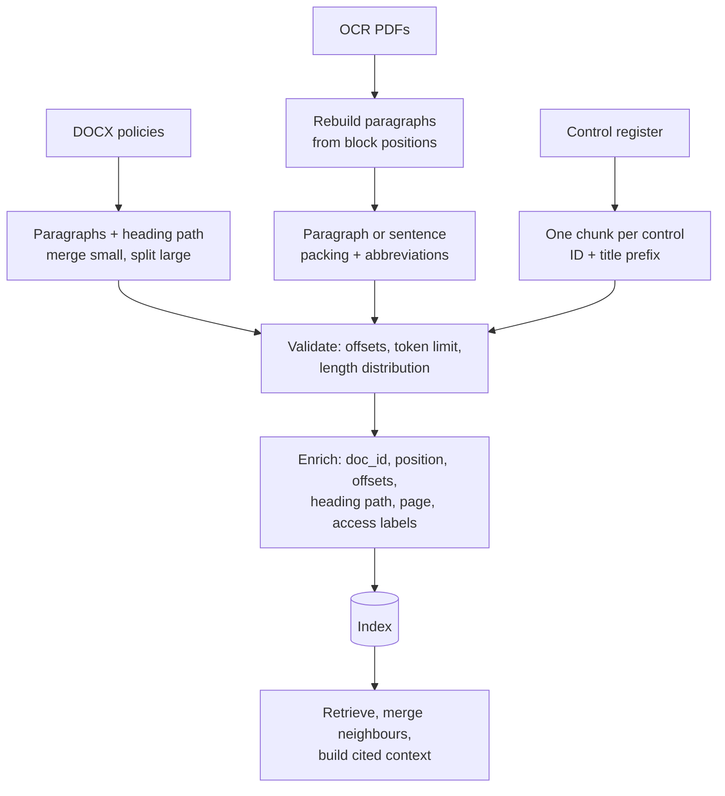

This assessment covers all seven lessons of **Chunking Fundamentals**: why chunking matters, chunk size, chunk overlap, and token-, character-, sentence- and paragraph-based chunking. Answer the 18 multiple-choice questions first; the pass mark is 70% (13 of 18). Then work through the conceptual questions, the coding exercises, the design challenge and the troubleshooting scenarios, writing your own answer to each before opening the model answer. The written parts are not scored, but they are where you find out whether you can apply the ideas rather than recognise them.

```quiz
[
  {
    "q": "What does it mean to say that the chunk is the unit of retrieval?",
    "options": ["Chunks are the unit in which the vector database bills storage", "The retriever can only find, score and return whole chunks, so every later stage inherits their boundaries", "Each chunk must be exactly one sentence", "Chunks are retrieved one at a time"],
    "answer": 1,
    "why": "Retrieval ranks and returns whole chunks; it cannot return part of one, so what a chunk contains determines what can be found and what the model sees."
  },
  {
    "q": "A 900-token runbook is embedded whole by a model with a 512-token limit. What happens to a fact in its last paragraph?",
    "options": ["It is represented with lower weight", "The model raises an error and the runbook is skipped", "It is never read: the input is truncated at the limit and the vector describes only the beginning", "It is moved to the start automatically"],
    "answer": 2,
    "why": "Embedding models truncate input beyond their maximum sequence length, usually silently, so content past the limit has no influence on the vector."
  },
  {
    "q": "In the idealised dilution model, a query perfectly matches one of 16 unrelated topics in a document. What is its cosine with the document's mean vector?",
    "options": ["0.0625", "0.5", "0.125", "0.25"],
    "answer": 3,
    "why": "The cosine is 1 over the square root of the number of topics: 1 / sqrt(16) = 0.25."
  },
  {
    "q": "The context budget leaves 7,000 tokens for retrieved chunks. How many 448-token chunks fit?",
    "options": ["15", "16", "14", "17"],
    "answer": 0,
    "why": "7,000 / 448 = 15.6, which rounds down to 15."
  },
  {
    "q": "A size experiment on a 400-token test corpus finds that 200-token chunks have the best hit rate. What is the main reason to distrust this result?",
    "options": ["200 is too small for any embedding model", "With two chunks in the index, containing the answer is nearly automatic and there is no competition from near misses", "Hit rate cannot be measured on small corpora", "Larger chunks always have higher cosine similarity"],
    "answer": 1,
    "why": "Tiny test corpora reward large chunks: each covers a big share of the corpus. Dilution only costs ranking positions when there are many competitors."
  },
  {
    "q": "Fixed-size chunks with s = 120 and o = 20. A 30-token answer starts at a random position. Using P(split) = max(0, L - o - 1)/(s - o), what is the probability it is split?",
    "options": ["0.29", "0.09", "0.25", "0"],
    "answer": 1,
    "why": "L - o - 1 = 30 - 20 - 1 = 9 and s - o = 100, so the probability is 9/100 = 0.09."
  },
  {
    "q": "What overlap guarantees that every answer of at most 16 tokens lies wholly inside some fixed-size chunk?",
    "options": ["15", "16", "8", "32"],
    "answer": 0,
    "why": "Any span of at most o + 1 tokens is guaranteed whole, so o = 15 suffices."
  },
  {
    "q": "Chunks of 400 tokens with an overlap of 100. By what factor do the number of vectors and embedding tokens grow compared with no overlap?",
    "options": ["1.25", "4.00", "1.33", "1.10"],
    "answer": 2,
    "why": "Inflation is s / (s - o) = 400 / 300, about 1.33."
  },
  {
    "q": "The top-4 results for a query are four overlapping windows of the same paragraph. Which fix belongs at context construction?",
    "options": ["Raise the overlap", "Embed the paragraph twice", "Increase k to 8 and send everything", "Merge spans from the same document that overlap or touch, and fill the freed slots with other results"],
    "answer": 3,
    "why": "Merging removes the repeated text and frees prompt space and top-k positions for other relevant chunks."
  },
  {
    "q": "What does this print?\n```python\nstep = 32 - 8\nprint([s for s in range(0, max(70 - 8, 1), step)])\n```",
    "options": ["[0, 24, 48]", "[0, 32, 64]", "[0, 24, 48, 72]", "[0, 24]"],
    "answer": 0,
    "why": "The stride is 24 and the loop stops before 62, so chunk starts are 0, 24 and 48: three chunks, matching ceil((70 - 8)/(32 - 8)) = 3."
  },
  {
    "q": "Which tokeniser should enforce the size limit of chunks for an index built with a particular embedding model?",
    "options": ["Whichever tokeniser is fastest", "That embedding model's own tokeniser", "The generator's tokeniser", "A whitespace tokeniser, multiplied by 1.3"],
    "answer": 1,
    "why": "Truncation happens inside the embedding model according to its own token count; other tokenisers can disagree by a quarter or more."
  },
  {
    "q": "A token splitter decodes windows of ids from an uncased WordPiece tokeniser. What happens to the stored text \"Error E-4021 at the café\"?",
    "options": ["It is stored unchanged", "It gains replacement characters", "It becomes roughly \"error e - 4021 at the cafe\": lowercased, accent-stripped and re-spaced", "It is translated into token ids"],
    "answer": 2,
    "why": "Uncased tokenisers normalise before splitting and decode cannot undo it, so the stored chunk text no longer matches the source."
  },
  {
    "q": "Why does LangChain's `TokenTextSplitter` with `cl100k_base` sometimes produce `�` in Japanese text?",
    "options": ["A window boundary falls between byte-level tokens that together encode one multi-byte character", "Japanese is not supported by tiktoken", "The chunk overlap was negative", "The text was normalised to NFD"],
    "answer": 0,
    "why": "Byte-level BPE can split a character's UTF-8 bytes across tokens; decoding an incomplete byte sequence yields the replacement character."
  },
  {
    "q": "Prose in a corpus averages 4.5 characters per token and log text 2.0. With a 254-token limit and a 10% margin, which single character size is safe for both?",
    "options": ["1,028", "1,143", "254", "457"],
    "answer": 3,
    "why": "Size from the densest content: floor(254 x 2.0 x 0.9) = floor(457.2) = 457 characters."
  },
  {
    "q": "A Python pipeline stores citation offsets in code points; a JavaScript front end highlights text with them. Where do highlights go wrong?",
    "options": ["After any non-ASCII character", "After characters outside the Basic Multilingual Plane, such as most emoji, which are two UTF-16 units but one code point", "Only in right-to-left scripts", "Never; both count characters the same way"],
    "answer": 1,
    "why": "JavaScript indexes UTF-16 code units; astral characters take two units, so each one shifts JavaScript offsets by one relative to Python's."
  },
  {
    "q": "Pre-trained Punkt splits \"Claims go to finance, i.e. Dr. Okafor's team.\" after \"i.e.\". What is the most direct fix?",
    "options": ["Switch to fixed token windows", "Add \"i.e\" to the segmenter's abbreviation types and keep a regression test", "Lowercase the text", "Remove all full stops before segmenting"],
    "answer": 1,
    "why": "Punkt treats a full stop as a boundary unless the preceding token is a known abbreviation; teaching it the corpus's abbreviations fixes the split."
  },
  {
    "q": "A 61-sentence document, sentences of about 30 tokens, budget 256 tokens, overlap of 1 sentence. Using C = ceil((S - j)/(q - j)), how many chunks?",
    "options": ["9", "8", "10", "7"],
    "answer": 0,
    "why": "q = floor(256/30) = 8, so C = ceil(60/7) = ceil(8.57) = 9."
  },
  {
    "q": "A paragraph chunker receives two short paragraphs, the last of the Leave section and the first of the Expenses section, which together fit the budget. What should it do?",
    "options": ["Merge them, because both are short", "Drop the shorter one", "Keep them in separate chunks, because a heading lies between them and merging would mix two topics", "Merge them and label the chunk with both headings"],
    "answer": 2,
    "why": "Paragraph chunking never merges across a heading; doing so recreates a topic-straddling chunk whose vector matches neither topic well."
  }
]
```

## Conceptual questions

**1.** Explain the tension between a chunk being *findable* and being *understandable*, and show how each of the four splitter decisions (unit, size, overlap, boundaries) moves a chunk along that tension.

<details><summary>Show model answer</summary>

A chunk is read in isolation twice: by the embedding model, which turns it into one vector, and by the generator, which may not see its neighbours. To be **findable**, its vector must be close to the questions it answers, which favours small chunks about one thing (less dilution). To be **understandable**, it must carry the context its statements depend on, which favours larger chunks and boundaries at natural breaks.

- **Unit** (tokens or characters) does not move the balance directly, but decides whether the size is a guarantee or an estimate. A character size that overflows the embedding limit silently loses the end of the chunk, harming both properties.
- **Size**: smaller is sharper but more fragmentary; larger is more complete but more diluted and costlier in the prompt.
- **Overlap** improves understandability at boundaries (a fact cut by one chunk survives whole in its neighbour) at the cost of index size and redundant results; it does not make vectors sharper.
- **Boundaries** are the most powerful lever: cutting at sentence or paragraph ends, and never across headings, makes chunks both more focused (one topic) and more complete (no fragments) at the same size. Carrying the heading adds context without adding unrelated content.

</details>

**2.** A colleague says: "We use 1,000-token chunks because the embedding model accepts 8,192 tokens, so we have plenty of room." What is right and what is missing in this reasoning?

<details><summary>Show model answer</summary>

Right: 1,000 tokens is well within the hard ceiling, so nothing will be truncated (assuming the count uses the embedding model's tokeniser).

Missing: the input limit is only the hard ceiling. A model may represent long inputs less well than short ones, and one vector for 1,000 tokens of mixed content is diluted relative to the specific paragraph a question is about. The generator's budget matters too: with $k = 5$, every request carries about 5,000 tokens of context, which costs money and latency on every query and may bury the relevant sentences among irrelevant ones. Finally, the choice should depend on the documents' natural units and the question types (short policy facts versus long procedures), and should be confirmed by an experiment on representative questions, not inferred from the model's limit.

</details>

**3.** Why does overlap guarantee protection only for spans no longer than $o + 1$ tokens, and why is boundary-aware splitting usually a better remedy than a larger overlap?

<details><summary>Show model answer</summary>

Chunks start every $t = s - o$ tokens. A span is safe if it fits inside the latest chunk that starts at or before it. In the worst case it starts at the last position before the next chunk begins, $t - 1$ tokens into the current one, leaving $s - t + 1 = o + 1$ tokens of room. Any span up to $o + 1$ tokens fits even then; longer spans fit only if they happen to start early enough, which gives the split probability $\max(0, L - o - 1)/(s - o)$.

Boundary-aware splitting attacks the cause rather than the symptom. If cuts only fall at sentence or paragraph ends, sentences and paragraphs are never split, whatever their length, and the overlap needed to protect statements drops to about one sentence. A larger overlap, by contrast, inflates the index by $s/(s - o)$, makes neighbours near-duplicates that crowd the top-k, and still fails for spans longer than itself.

</details>

**4.** Compare token-based and character-based measurement on three criteria: guarantee of fitting the embedding limit, stability when the embedding model changes, and fidelity of stored text. When would you choose each?

<details><summary>Show model answer</summary>

- **Guarantee**: token-based counting with the embedding model's tokeniser guarantees chunks fit; character counts only estimate tokens, and the ratio ranges from about 4.5 characters per token for English prose to 2 or less for logs and identifiers, so a character size must be derived conservatively from the densest content and validated.
- **Stability**: character boundaries do not depend on any tokeniser, so changing the embedding model requires re-embedding but not re-chunking, keeping chunk IDs and evaluation labels valid. Token boundaries move when the tokeniser changes.
- **Fidelity**: both can store exact source text if implemented by slicing the source by offsets. Token splitters that decode ids can corrupt text (lowercasing, accent stripping, broken multi-byte characters), which character splitters never do.

Choose token measurement when content is dense or varied and the limit must be guaranteed; choose character measurement when stability across model changes matters and content is homogeneous enough that a safe size does not waste much capacity. In both cases cut at natural boundaries and validate token counts.

</details>

## Coding exercises

**1. Windows and the chunk-count formula.** Write `windows(n, size, overlap)` returning `(start, end)` token-index pairs that cover `n` tokens with fixed-size chunks and the given overlap, stopping once the end is reached. Raise `ValueError` for an overlap that is negative or not smaller than the size. Then verify, for every `n` from 1 to 299, sizes 8, 32 and 100 and every legal overlap, that the number of windows equals $\max(1, \lceil (n - o)/(s - o) \rceil)$ and that the windows cover every token.

<details><summary>Show solution</summary>

```python
import math

def windows(n, size, overlap):
    """(start, end) token index pairs covering n tokens."""
    if not 0 <= overlap < size:
        raise ValueError("need 0 <= overlap < size")
    step = size - overlap
    return [(s, min(s + size, n)) for s in range(0, max(n - overlap, 1), step)]

def expected_count(n, size, overlap):
    return max(1, math.ceil((n - overlap) / (size - overlap)))

def covers(spans, n):
    covered = set()
    for a, b in spans:
        covered.update(range(a, b))
    return covered == set(range(n))

bad = [(n, s, o) for n in range(1, 300) for s in (8, 32, 100) for o in range(0, s)
       if len(windows(n, s, o)) != expected_count(n, s, o) or not covers(windows(n, s, o), n)]
print("mismatches:", len(bad))
print(windows(83, 30, 5))
try:
    windows(10, 5, 5)
except ValueError as e:
    print("ValueError:", e)
```

```output
mismatches: 0
[(0, 30), (25, 55), (50, 80), (75, 83)]
ValueError: need 0 <= overlap < size
```

The loop bound `max(n - overlap, 1)` is the key line: it stops before a window would consist only of the previous window's overlap, and the `max(..., 1)` produces one window even for a document shorter than the overlap. `windows(83, 30, 5)` reproduces the four chunks of the example in [Tokens and tokenisation](/learn/understanding-large-language-models/tokens-and-tokenisation). The guard turns a zero or negative stride, which would loop forever or produce nothing, into an explicit error.

</details>

**2. A chunk auditor.** Write `audit(source, chunks, limit, min_tokens)` that takes a document and a list of chunk records `{"start", "end", "text"}` and reports, per chunk: text that does not equal `source[start:end]`; more than `limit` embedding-model tokens; fewer than `min_tokens`; and text starting with a lower-case letter (a cheap signal of a mid-sentence start). Run it on a small set of chunks containing each defect.

<details><summary>Show solution</summary>

```python
from sentence_transformers import SentenceTransformer

tok = SentenceTransformer("sentence-transformers/all-MiniLM-L6-v2").tokenizer

def audit(source, chunks, limit=254, min_tokens=8):
    """Return (position, problem) pairs for a list of {"start", "end", "text"} chunks."""
    problems = []
    for i, c in enumerate(chunks):
        n = len(tok(c["text"], add_special_tokens=False)["input_ids"])
        if source[c["start"]:c["end"]] != c["text"]:
            problems.append((i, "text does not match source offsets"))
        if n > limit:
            problems.append((i, f"{n} tokens, over the limit of {limit}"))
        if n < min_tokens:
            problems.append((i, f"only {n} tokens"))
        if c["text"][:1].islower():
            problems.append((i, "starts mid-sentence"))
    return problems

source = ("Annual leave is 25 days. Up to 5 unused days carry over and must be used by 31 March. "
          "Error E-4021 means the VPN client is out of date; update it from the IT portal.")
chunks = [
    {"start": 0, "end": 24, "text": "Annual leave is 25 days."},
    {"start": 25, "end": 85, "text": source[25:85]},
    {"start": 87, "end": 137, "text": "error e - 4021 means the vpn client is out of date ; update it from the it portal."},
    {"start": 70, "end": 86, "text": source[70:86]},
]
for position, problem in audit(source, chunks):
    print(position, problem)
```

```output
0 only 6 tokens
2 text does not match source offsets
2 starts mid-sentence
3 only 5 tokens
3 starts mid-sentence
```

Chunk 0 is a complete sentence but below the minimum, a candidate for merging. Chunk 1 is clean. Chunk 2 is what a decoding token splitter produces: lowercased, re-spaced text, with offsets that do not even point at the sentence (the real span is 86 to 165). Chunk 3, `'ed by 31 March. '`, is a fixed-window fragment that starts inside a word. In production, run the audit on a sample of every ingestion run and fail the run on any offset mismatch or over-limit chunk; treat short and lower-case starts as metrics to watch rather than hard failures, since headings, list items and some languages trigger them legitimately.

</details>

## Architecture design challenge

Meridian's legal and compliance team wants AskMeridian to answer questions over its **policy library**: about 2,000 documents, made up of (a) policies authored in DOCX with heading styles, between 2 and 40 pages each; (b) scanned, OCR-processed PDFs of older signed agreements, with unreliable line breaks; and (c) a register of 6,000 short compliance controls (one or two sentences each, with an ID such as `CTRL-0412`). The embedding model accepts 512 tokens. Users ask questions such as "what is our data-retention period for customer invoices?", "which control covers laptop encryption?" and "what does CTRL-0412 require?". Answers must cite the exact passage. Design the chunking stage: per-source strategy, unit, size, overlap, boundaries, metadata, validation, and how it connects to retrieval and context construction.

<details><summary>Show reference design</summary>

**Principles.** Measure in the embedding model's tokens; slice exact source text by offsets so citations can highlight the passage; choose boundaries from each source's structure; validate every run.

**(a) DOCX policies.** Paragraph-based chunking from the DOCX paragraph objects, with heading styles giving a heading path ("Data protection policy > Retention > Customer records"). Merge paragraphs under a minimum (say 60 tokens) within a section; split paragraphs over the budget into sentence runs with one sentence of overlap. Budget: 512 minus 2 special tokens minus the heading-path prefix, with chunks targeted at a few hundred tokens so a retention clause is not diluted by a whole section. No overlap between paragraphs.

**(b) OCR PDFs.** Reconstruct paragraphs first (block positions and vertical gaps, rejoining hard-wrapped lines); if reconstruction confidence is low, fall back to sentence packing with a domain abbreviation list (legal text is full of "cl.", "s.", "No.", "e.g."). Keep page numbers as metadata for citation. Token-split fallback for long run-on clauses.

**(c) Control register.** One chunk per control, never merged: each is a natural, self-contained unit, and merging would put several IDs into one vector. Prefix the control ID and title to the embedded text and store the ID as metadata so exact-ID questions can also be answered by a keyword or metadata filter.

**Validation.** On every run: assert chunk text equals `source[start:end]`; tokenise all chunks and fail on any over the limit; track the share of chunks starting lower-case, the length distribution per source and the fallback rate.

**Retrieval and context.** Store `doc_id`, `position`, `start`, `end`, heading path, page and access labels with each chunk. At query time, merge neighbouring chunks from the same document before building the prompt; optionally expand a small matching chunk to its whole section, which [Parent-child chunking](/learn/chunking-optimisation/parent-child-chunking) develops.



**Trade-offs.**

- Per-source strategies give better chunks but more configuration to evaluate; evaluate each source with its own questions.
- Paragraph chunks are variable in size, so the index has more vectors than fixed windows would give; in exchange they are focused and cite cleanly.
- Not merging controls creates many very short chunks, which match exact questions sharply but compete with each other on vague ones ("what covers laptops?"); hybrid keyword search and metadata filters help here.
- OCR reconstruction may fail on some scans; the fallback keeps the system working, at lower chunk quality, and the fallback rate shows where to invest.

</details>

## Troubleshooting scenarios

**1. Error codes cannot be found.** After Atlas incident reports were added to AskMeridian, searching for error codes such as "E-4021" finds the right report only when the code appears early in a log excerpt. Policy questions are unaffected. The splitter uses `chunk_size=1000` with the default character length function. What is happening, and how do you fix it?

<details><summary>Show diagnosis and fix</summary>

**Diagnosis.** Log text is token-dense: timestamps, hex IDs and `key=value` pairs tokenise at around 2 characters per token versus about 4.5 for prose. A 1,000-character chunk of logs can be about 500 tokens, and an embedding model with a 256-token limit reads only the first half. Codes in the second half never reach the vector. Confirm by tokenising a sample of incident chunks with the embedding model's tokeniser and counting how many exceed the limit.

**Fix.** Either measure in the embedding model's tokens (a token `length_function` on the existing splitter), or keep characters but derive a per-source size from the measured ratio with a margin (about 450 characters for logs at a 254-token limit). Add an ingestion check that fails on any chunk over the limit. Consider a keyword index alongside vector search for exact identifiers.

</details>

**2. Answers quote half-sentences and miss deadlines.** Users report that AskMeridian often answers "unused leave days may be carried over" without the deadline, and that citations begin and end mid-sentence. The index uses 200-token windows with no overlap. A colleague proposes an overlap of 100 tokens. Evaluate the proposal and suggest a better fix.

<details><summary>Show diagnosis and fix</summary>

**Diagnosis.** Fixed windows cut wherever the count runs out. With no overlap, an $L$-token statement is split with probability about $(L - 1)/s$, so a 30-token sentence is cut about 15% of the time at $s = 200$; the carry-over sentence's deadline lands in the next chunk, which is not retrieved.

**Evaluating the proposal.** An overlap of 100 would guarantee all statements up to 101 tokens, but doubles the index ($200/100 = 2$), the embedding cost and re-index time, and makes neighbouring chunks near-duplicates that crowd the top-k, hurting multi-fact questions. Citations would still start mid-sentence, because the windows themselves still cut anywhere.

**Better fix.** Switch to sentence-based (or paragraph-based) chunking with a 200-token budget and one sentence of overlap, with the corpus's abbreviations added to the segmenter. Statements are never cut, citations start and end cleanly, and the inflation is about $200/(200 - \ell)$, roughly 12% for 22-token sentences. Merge neighbouring chunks at context construction.

</details>

**3. Citations no longer highlight anything.** After an upgrade, the citation feature shows the right document but highlights nothing, and the quoted text reads "the vpn is required whenever you connect from public wi - fi". The upgrade replaced a character splitter with a splitter "that counts tokens using the embedding model". What went wrong?

<details><summary>Show diagnosis and fix</summary>

**Diagnosis.** The new splitter decodes token windows (as `SentenceTransformersTokenTextSplitter` does), and the embedding model's tokeniser is uncased WordPiece. Decoding lowercases, strips accents and inserts spaces around punctuation, so the stored chunk text is no longer a substring of the source. The highlighter searches for the quoted text, or uses offsets that no longer correspond to it, and finds nothing. Retrieval itself is probably fine, since the model would normalise the text the same way.

**Fix.** Keep counting with the embedding model's tokeniser, but use the tokens only to choose cut points: tokenise with offset mappings, snap cuts to word or sentence boundaries, and slice the original string. Store `(start, end)` offsets with each chunk, and add an ingestion test asserting `source[start:end] == chunk_text`. Re-chunk and re-index the affected sources.

</details>
