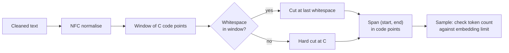

**Character-based chunking** measures chunk length by counting characters: in Python, `len(text)`. It is the oldest and simplest way to split text, it needs no tokeniser and no model, and it is the default unit of the most widely used splitters, including LangChain's. It is also an *estimate*: model limits are counted in tokens, and the number of tokens in a thousand characters depends heavily on what those characters are.

[Token-based chunking](/learn/chunking-fundamentals/token-based-chunking) made the case for counting in tokens. This lesson makes the case for when characters are the better choice, shows how to choose a character size that safely respects a token limit, and deals with the question that sounds trivial and is not: what exactly is a character?

## Learning objectives

- Describe how fixed-width and separator-based character splitters work, and when each exceeds its configured size.
- Measure a corpus's characters-per-token ratio and derive a character size that respects a token limit with a stated margin.
- Explain the differences between code points, grapheme clusters, UTF-8 bytes and UTF-16 code units, and the bugs each causes in chunking and citation.
- Implement a character chunker that cuts at whitespace and returns offsets.
- Decide between character-based and token-based measurement for a given pipeline.

## Prerequisites

- [Chunk size](/learn/chunking-fundamentals/chunk-size): limits on size and the characters-versus-tokens distinction.
- [Token-based chunking](/learn/chunking-fundamentals/token-based-chunking): counting with the embedding model's tokeniser.
- [Encoding and Unicode](/learn/data-processing/encoding-and-unicode): code points, encodings and normalisation forms.
- [Text processing](/learn/data-processing/text-processing): string slicing and offsets in Python.

## Why this matters

Character counts are attractive for good reasons. They are instant, they need no dependency, and they do not change when you change embedding model: a chunk of 1,000 characters is the same chunk under every tokeniser, so swapping models does not move every boundary in the index. Many teams also find characters easier to reason about when reading chunks.

The risk is that a character size is converted to tokens with a rule of thumb ("about four characters per token") that holds for ordinary English prose and fails badly for log lines, identifiers, code, numbers and many other languages. A size that is safe for the employee handbook can produce chunks twice the embedding model's limit when applied to an error log, and the excess is truncated without warning. A second, quieter risk is the word "character" itself: Python, JavaScript, databases and the Unicode standard count it differently, so offsets computed in one place can point at the wrong text in another.

## The intuition

Imagine posting parcels where the courier charges by weight but you can only measure size. For parcels of books, size predicts weight well, and a rule like "a box this big weighs about 10 kilograms" works. Then someone sends a box of the same size full of lead fishing weights. Same size, four times the weight, and the courier rejects it.

Characters are the size; tokens are the weight. Prose is books: the ratio is steady. Logs, hashes and code are fishing weights: the same number of characters packs many more tokens. A character-based splitter is safe if you measure the densest material you will ever pack, and set the box size from that.

## How it works

### Two kinds of character splitter

**Fixed-width windows** cut every $C$ characters, optionally with an overlap. They are exact and blind: they cut inside words, numbers and sentences. Their only virtue is predictability.

**Separator-based splitters** first split the text on a separator (a blank line, a newline, a space), then **merge** the pieces greedily into chunks up to $C$ characters. Cuts fall only where separators are, so words or paragraphs stay whole. LangChain's `CharacterTextSplitter` works this way, with `separator="\n\n"` (a blank line) by default, and it has one behaviour to know: if a single piece is longer than `chunk_size`, it is emitted whole, larger than the limit, with a logged warning rather than an error.

```python
from langchain_text_splitters import CharacterTextSplitter

splitter = CharacterTextSplitter(separator="\n\n", chunk_size=60, chunk_overlap=0)
text = ("Annual leave is 25 days.\n\n"
        "Up to 5 unused days carry over and must be used by 31 March, or they are lost.\n\n"
        "Remote work: up to 3 days a week.")
for c in splitter.split_text(text):
    print(len(c), repr(c))
```

```output
Created a chunk of size 78, which is longer than the specified 60
24 'Annual leave is 25 days.'
78 'Up to 5 unused days carry over and must be used by 31 March, or they are lost.'
33 'Remote work: up to 3 days a week.'
```

The second paragraph has no blank line inside it, so there is nowhere to cut, and the splitter returns a 78-character chunk for a 60-character limit. With a single separator that is the price of never cutting inside a piece. [Recursive character splitting](/learn/advanced-chunking-strategies/recursive-character-splitting) removes it by falling back to finer separators (newline, then space, then nothing) for pieces that are too long.

A middle ground, used in the code below, is a fixed-width window that **snaps back to the last whitespace** inside it: sizes never exceed $C$, and words are never cut unless a single "word" is longer than $C$.

### The mechanism

A character chunker with whitespace snapping:

1. **Normalise first.** Apply Unicode NFC normalisation (and the rest of [normalisation](/learn/document-preprocessing/normalisation)) before chunking, so that the same visible text always has the same length and the offsets you store refer to the normalised text.
2. **Propose a window** of $C$ characters from the current start.
3. **Snap the end back** to the last whitespace in the window. If there is none, cut at $C$ (a single unbroken string longer than the window).
4. **Emit** the span `(start, end)` and its text.
5. **Advance** to `end - overlap`, moved forward to the start of a word, skipping whitespace, and always past the previous start.
6. **Validate** the token count of each chunk against the embedding limit, at least on a sample, because the character size is only an estimate of tokens.

### Choosing a character size from a token limit

The safe way to set $C$ is to measure the **characters-per-token ratio** $\rho$ of your own corpus with the embedding model's tokeniser, separately for each kind of content, and size from the lowest ratio you will encounter. The mathematics section gives the formula. The essential point is that "about four characters per token" describes common English prose under common tokenisers. It is not a property of text in general:

| Content | Typical behaviour of the ratio |
| --- | --- |
| English prose | Highest; roughly four to five characters per token with common tokenisers |
| Numbers, dates, identifiers, hashes, log lines | Low; digits and punctuation often become separate tokens |
| Source code | Low to moderate; symbols and indentation consume tokens |
| Many non-English languages | Lower than English with English-centred vocabularies; much lower for some scripts |

Measure; do not assume. The code below finds about 4.5 for Meridian's handbook prose and about 2.0 for Atlas logs with the MiniLM tokeniser.

### What is a character?

`len()` in Python counts **code points**: the numbered entries of the Unicode standard. That is not the only possible count, and several layers of a RAG system count differently:

- **Grapheme clusters** are what a reader sees as one character. "é" can be one code point (U+00E9, *composed*) or two ("e" followed by the combining acute accent U+0301, *decomposed*). Many emoji are several code points: a thumbs-up with a skin-tone modifier is two. A fixed-width cut can fall between the parts of a grapheme, separating an accent from its letter. NFC normalisation composes what can be composed, but emoji sequences remain multi-code-point.
- **UTF-8 bytes** are what files, network payloads and many databases store. A code point is one to four bytes. Byte limits (for example on metadata fields in a vector store) must be checked in bytes, not with `len()`.
- **UTF-16 code units** are what JavaScript's `string.length` and its string indices count. Code points outside the Basic Multilingual Plane, which includes most emoji, are two units. If Python computes a chunk's citation offsets in code points and a JavaScript front end uses them to highlight text, every highlight after the first emoji is shifted.

The code below prints all four counts for three short strings. The practical rules: normalise to NFC before chunking; store offsets in one declared unit (code points in a Python pipeline); convert at the boundary to any system that counts differently; and never assume byte length equals `len()`.



> [!KEY]
> Character-based chunking is fast, model-independent and easy to read, but a character size is only an estimate of tokens. Derive it from the measured characters-per-token ratio of your densest content, keep a margin, and validate token counts on samples.

## The mathematics

### A character size that respects a token limit

**Intuition.** If every token is at least $\rho$ characters on average in the densest text you index, then $C$ characters are at most about $C/\rho$ tokens. Choose $C$ so that this is under the limit, with some room for local variation.

$$
C_{\text{safe}} = \left\lfloor T \cdot \rho_{\min} \cdot (1 - m) \right\rfloor
$$

- $T$ is the token limit for chunk content: the embedding model's maximum minus special tokens minus any prepended text.
- $\rho_{\min}$ is the lowest characters-per-token ratio among the content types you index, measured with the embedding model's tokeniser.
- $m$ is a safety margin, for example $0.1$, because the ratio varies from chunk to chunk around its average.
- $\lfloor \cdot \rfloor$ rounds down.

**By hand.** MiniLM's limit is 256, so $T = 254$. Handbook prose measures $\rho = 4.45$; Atlas logs measure $\rho = 2.02$. With $m = 0.1$:

- Prose only: $\lfloor 254 \times 4.45 \times 0.9 \rfloor = \lfloor 1017.3 \rfloor = 1{,}017$ characters.
- Logs only: $\lfloor 254 \times 2.02 \times 0.9 \rfloor = \lfloor 461.8 \rfloor = 461$ characters.
- One setting for both: the logs' 461 characters, which makes prose chunks less than half as large as they could be. That is the case for per-type sizes, or for counting tokens directly.

The code computes the ratio without rounding it to two decimals first, so its prose size comes out one higher (1,018) and its log size one lower (460).

## In code

**The problem.** Chunk two kinds of Meridian content by characters, measure how many tokens the chunks really contain, and show a single 1,000-character setting that is safe for one and unsafe for the other. Then derive per-type safe sizes and show the four different "lengths" of a string.

**Dependencies.**

```bash
pip install sentence-transformers
```

**The source.**

```python
import unicodedata
from sentence_transformers import SentenceTransformer

tok = SentenceTransformer("sentence-transformers/all-MiniLM-L6-v2").tokenizer
LIMIT = 254                                    # 256 minus [CLS] and [SEP]

def char_chunks(text, size, overlap=0):
    """Spans of at most `size` characters, cut at whitespace where possible."""
    spans, start, n = [], 0, len(text)
    while start < n:
        end = min(start + size, n)
        if end < n:
            cut = text.rfind(" ", start + 1, end + 1)    # last space inside the window
            if cut > start:
                end = cut
        spans.append((start, end))
        if end >= n:
            break
        nxt = max(end - overlap, start + 1)
        if overlap:
            sp = text.find(" ", nxt, end)                # begin the overlap on a word
            nxt = sp + 1 if sp != -1 else nxt
        while nxt < n and text[nxt] == " ":
            nxt += 1
        start = nxt
    return spans

def n_tokens(s):
    return len(tok(s, add_special_tokens=False)["input_ids"])

prose = ("Every employee receives 25 days of annual leave per year. Up to 5 unused days may be "
         "carried over and must be used by 31 March. Staff may work remotely for up to 3 days a "
         "week, and each employee may claim a home-office equipment budget of £400. ") * 6
logs = ("2025-03-14T09:21:07Z ERR atlas-sync[4412]: E-4021 vpn client outdated sess=7f3a9c2e "
        "host=lon-app-03 retry=3/5 backoff=1200ms ") * 12

for name, text in [("handbook prose", prose), ("Atlas logs", logs)]:
    ratio = len(text) / n_tokens(text)
    print(f"{name}: {len(text)} chars, {ratio:.2f} chars per token")
    safe = int(LIMIT * ratio * 0.9)                    # measured ratio, 10% margin
    for size in (1000, safe):
        counts = [n_tokens(text[a:b]) for a, b in char_chunks(text, size)]
        over = sum(c > LIMIT for c in counts)
        print(f"  size {size:>4} chars -> tokens per chunk {min(counts)}..{max(counts)}, "
              f"{over} of {len(counts)} over the {LIMIT}-token limit")

# What len() counts
for label, s in [("composed é", "café"), ("decomposed é", "café"), ("emoji", "ok 👍🏽")]:
    nfc = unicodedata.normalize("NFC", s)
    print(f"{label:<13} len={len(s)}  len(NFC)={len(nfc)}  utf-8 bytes={len(s.encode())}  "
          f"utf-16 units={len(s.encode('utf-16-le')) // 2}")
```

```output
handbook prose: 1470 chars, 4.45 chars per token
  size 1000 chars -> tokens per chunk 108..222, 0 of 2 over the 254-token limit
  size 1018 chars -> tokens per chunk 104..226, 0 of 2 over the 254-token limit
Atlas logs: 1500 chars, 2.02 chars per token
  size 1000 chars -> tokens per chunk 248..496, 1 of 2 over the 254-token limit
  size  460 chars -> tokens per chunk 62..229, 0 of 4 over the 254-token limit
composed é    len=4  len(NFC)=4  utf-8 bytes=5  utf-16 units=4
decomposed é  len=5  len(NFC)=4  utf-8 bytes=6  utf-16 units=5
emoji         len=5  len(NFC)=5  utf-8 bytes=11  utf-16 units=7
```

**The important lines.**

- `text.rfind(" ", start + 1, end + 1)` finds the last space at or before the window's end. Searching from `start + 1` ensures a cut always makes progress; the `+ 1` on the end lets a space immediately after the window count, so a word that ends exactly at the limit is kept whole.
- `if cut > start` falls through to a hard cut at `size` when the window contains no space at all, as a long hash or URL would.
- The overlap branch moves the next start to the beginning of a word inside the overlap, so overlaps do not begin mid-word.
- `ratio = len(text) / n_tokens(text)` measures characters per token with the embedding model's tokeniser. Measuring per content type is the point.
- `len(s.encode())` is UTF-8 bytes; `len(s.encode('utf-16-le')) // 2` is the UTF-16 code-unit count that JavaScript's `.length` would report.

**What the output means.**

- For prose, 1,000 characters is safe: the largest chunk is 222 tokens. For logs, the same 1,000 characters produces a 496-token chunk, nearly twice the limit. Embedded with MiniLM, half of that chunk would be silently dropped.
- The logs' ratio, 2.02, is less than half the prose ratio, 4.45. Timestamps, hex identifiers, `key=value` pairs and error codes split into many short tokens.
- Sizes derived from each type's own ratio with a 10% margin (1,018 for prose, 460 for logs) keep every chunk under the limit.
- The token range within one setting is wide (104 to 226 for prose at 1,018 characters) because the last chunk of each text is a short remainder. Character sizes control the maximum, not the typical, chunk.
- The last three lines show that "length" depends on who is counting. The decomposed "café" is 5 code points until NFC makes it 4. The thumbs-up with a skin tone is 2 code points, 8 UTF-8 bytes and 4 UTF-16 units. A citation offset computed in Python and applied in JavaScript would be off by 2 after that emoji.

**Errors people commonly hit.**

- Treating the "4 characters per token" rule as a constant; it is a property of English prose with particular tokenisers.
- Chunking before normalisation, then normalising chunk text, so stored offsets no longer match the stored text.
- Assuming a separator-based splitter never exceeds `chunk_size`; with a coarse separator it emits oversize pieces with only a log warning, which is easy to miss in a batch job.
- Enforcing a byte limit on a metadata field with `len()`; non-ASCII text exceeds it.

**How to extend it.** Run the ratio measurement over a random sample of a few hundred documents per source, and record the 5th percentile of per-chunk ratios rather than the mean; size from that. Add an ingestion check that tokenises one chunk in fifty and alerts if any exceeds the limit, so a new, denser source is caught before it reaches the index.

## A real-world example

The Meridian Platform team's AskMeridian index used LangChain's default unit, characters, with `chunk_size=1000`, chosen when it held only the employee handbook. Retrieval for HR questions was good. Six months later the team added Atlas's incident write-ups, which quote large blocks of service logs, and support engineers started to complain that searching for an error code found the right incident only when the code appeared near the top of a log excerpt.

Ravi measured. On handbook text, MiniLM averaged about 4.5 characters per token; on incident write-ups with log blocks, about 2. Chunks of 1,000 characters of log text were up to 500 tokens, and the embedding model read only the first 254. Error codes that appeared in the second half of a log block were invisible to vector search.

The team considered switching everything to token-based chunking and decided against it for now: chunk boundaries in the HR content would move, forcing a full re-evaluation of answers the HR team had already signed off. Instead, Ravi made the character size a per-source setting derived from measured ratios: 1,000 characters for the handbook, 450 for incident write-ups. He also added a validation step that tokenises a sample of every new source's chunks and fails the ingestion run if any exceeds the limit. When a later source of Japanese product documentation arrived, the validation failed on the first run, before a single chunk was indexed, which was exactly the point.

## Common mistakes

- **Using one character size for every content type.** Logs, code and some languages pack two or more times as many tokens per character as English prose, so chunks exceed the embedding limit and are truncated.
- **Trusting a rule-of-thumb ratio.** Measure characters per token on your own corpus with your embedding model's tokeniser.
- **Fixed-width cuts without snapping.** Cutting every $C$ characters splits words, numbers and identifiers such as "E-4021".
- **Ignoring oversize warnings.** Separator-based splitters log rather than fail when a piece exceeds the limit; nobody reads batch logs.
- **Mixing units of offset.** Python code points, UTF-8 bytes and JavaScript UTF-16 units differ for non-ASCII text; citations highlight the wrong span.
- **Chunking unnormalised text.** Composed and decomposed forms of the same word have different lengths and do not match each other in keyword search.

## Best practices

- Normalise to NFC (and apply the rest of your normalisation) before chunking, and compute offsets on the normalised text.
- Measure the characters-per-token ratio per content type and derive the character size from the lowest one you index, with a margin.
- Snap cuts to whitespace or use a separator hierarchy, and keep a hard-cut fallback for unbroken strings.
- Validate token counts on a sample of chunks in every ingestion run, and fail loudly on any chunk over the limit.
- Declare the unit of stored offsets (code points) and convert explicitly when passing offsets to systems that count UTF-16 units or bytes.
- Prefer character measurement when boundary stability across embedding models matters, and token measurement when content is dense or varied and the limit must be guaranteed.

## Performance considerations

- **Speed.** `len()` on a Python string is constant time, and scanning for whitespace is linear. Character chunking of a 2-million-token corpus (roughly 8 to 9 million characters of prose) takes well under a second of pure Python string work. Token counting is also fast with Rust tokenisers, but it is an extra pass over every chunk.
- **Validation sampling.** Tokenising one chunk in fifty costs 2% of a full tokenisation pass and catches systematic problems such as a new dense source; tokenise all chunks of any source whose measured ratio is low.
- **Wasted capacity.** A single conservative size for mixed content shrinks prose chunks needlessly. In the example, prose chunks at 460 characters would hold about 100 tokens instead of about 230, more than doubling the number of prose vectors and their storage.
- **Stability.** Because character boundaries do not depend on the tokeniser, changing the embedding model requires re-embedding but not re-chunking, which keeps chunk IDs stable and makes before-and-after comparisons cleaner.

## Summary

- Character-based chunking counts code points with `len()`: fast, dependency-free and stable across embedding models.
- Separator-based character splitters keep pieces whole but can exceed the configured size; fixed-width windows with whitespace snapping never do.
- Characters only estimate tokens; the ratio ranges from about 4.5 for English prose to about 2 or less for logs and identifiers, so size from the densest content you index, with a margin.
- "Character" is ambiguous: code points, grapheme clusters, UTF-8 bytes and UTF-16 units differ for non-ASCII text, and mismatched units corrupt offsets and limits.
- Normalise before chunking, store offsets in one declared unit, and validate token counts on samples.

## Exercises

**1.** Your embedding model accepts 512 tokens including 2 special tokens, and you prepend nothing. Measured ratios are 4.2 characters per token for policy documents and 2.6 for source code. With a 10% margin, what character size is safe for each, and for a single shared setting?

<details><summary>Show solution</summary>

$T = 510$. Policy: $\lfloor 510 \times 4.2 \times 0.9 \rfloor = \lfloor 1927.8 \rfloor = 1{,}927$ characters. Code: $\lfloor 510 \times 2.6 \times 0.9 \rfloor = \lfloor 1193.4 \rfloor = 1{,}193$. A shared setting must use the lower, 1,193 characters.

</details>

**2.** A citation feature highlights the span `[start, end)` computed by the Python ingestion pipeline. Users report that highlights are correct in most documents but shifted by one or two characters in some. What is the likely cause, and how do you fix it?

<details><summary>Show solution</summary>

The front end is probably JavaScript, which indexes strings in UTF-16 code units, while Python offsets are in code points. Any character outside the Basic Multilingual Plane (most emoji, some rare scripts and symbols) before the span counts as one in Python and two in JavaScript, shifting the highlight right by one per such character. A second possible cause is normalisation: offsets computed on NFC text but applied to the un-normalised original, or the reverse. Fix: store offsets in code points on the normalised text, serve that normalised text to the front end, and convert offsets to UTF-16 units at the API boundary (or convert in the front end by iterating code points, for example with `Array.from(text)`).

</details>

**3.** Modify `char_chunks` so that it never ends a chunk in the middle of a grapheme made of a base letter followed by combining marks (Unicode category starting with "M"). Test it on `"café " * 3` with `size=4`.

<details><summary>Show solution</summary>

When a hard cut is needed, move the end back while the character at `end` is a combining mark:

```python
import unicodedata

def safe_end(text, start, end):
    while end > start + 1 and end < len(text) and unicodedata.category(text[end]).startswith("M"):
        end -= 1
    return end

def char_chunks_graphemes(text, size):
    spans, start, n = [], 0, len(text)
    while start < n:
        end = min(start + size, n)
        if end < n:
            cut = text.rfind(" ", start + 1, end + 1)
            end = cut if cut > start else safe_end(text, start, end)
        spans.append((start, end))
        start = end
        while start < n and text[start] == " ":
            start += 1
    return spans

text = "café " * 3
print([text[a:b] for a, b in char_chunks_graphemes(text, 4)])
```

```output
['caf', 'é', 'caf', 'é', 'caf', 'é ']
```

(The last chunk keeps the trailing space because it runs to the end of the text; strip chunk text if that matters.) Each decomposed "é" is five code points as a word (c, a, f, e, combining accent), longer than the window of 4, so a hard cut is needed. Without `safe_end` the cut would fall between "e" and its accent, leaving a chunk that begins with a bare combining mark. With it, the cut moves back one so the "e" and its accent stay together. Better still is to normalise to NFC first, which turns each word into four code points and avoids the cut entirely.

</details>

**4.** Design: Meridian wants the AskMeridian index to support a planned switch of embedding model next year without re-evaluating every chunk boundary, and the corpus mixes prose, logs and code. Argue for or against character-based chunking, and specify how you would make it safe.

<details><summary>Show solution</summary>

For: character boundaries do not depend on the tokeniser, so switching model means re-embedding but not re-chunking, which keeps chunk IDs, citations and evaluation labels (which often reference chunk IDs) valid across the switch. That is a real operational advantage.

Making it safe: use per-content-type character sizes derived from measured characters-per-token ratios (5th percentile per type) for the *more restrictive* of the current and the candidate model's tokenisers, with a margin; cut at separators or whitespace with a hard-cut fallback; validate token counts for both models on a sample of every ingestion run. Against: if content is very heterogeneous, the conservative sizes waste capacity on prose; a token-based scheme would use space better at the cost of re-chunking on model change. A reasonable compromise is character-based chunking with per-type sizes and a validation gate, revisited if the new model's limit is very different.

</details>

## Check your understanding

```quiz
[
  {
    "q": "LangChain's `CharacterTextSplitter(separator=\"\\n\\n\", chunk_size=500)` receives a 900-character paragraph with no blank lines in it. What happens?",
    "options": ["It raises a ValueError", "It cuts the paragraph at character 500", "It emits the 900-character paragraph as one chunk and logs a warning", "It drops the paragraph"],
    "answer": 2,
    "why": "A separator-based splitter only cuts at its separator; a piece longer than the limit is emitted whole, with a warning such as 'Created a chunk of size 900, which is longer than the specified 500'."
  },
  {
    "q": "Prose in your corpus averages 4.4 characters per token; log excerpts average 2.2. A 1,000-character chunk of logs is roughly how many tokens?",
    "options": ["About 220", "About 2,200", "About 1,000", "About 455"],
    "answer": 3,
    "why": "1,000 characters divided by 2.2 characters per token is about 455 tokens, roughly twice what the same size gives for prose."
  },
  {
    "q": "In Python, `len(\"cafe\\u0301\")` is 5. What does `len(unicodedata.normalize(\"NFC\", \"cafe\\u0301\"))` return?",
    "options": ["4", "5", "6", "3"],
    "answer": 0,
    "why": "NFC composes 'e' and the combining acute accent into the single code point U+00E9, so the string becomes four code points."
  },
  {
    "q": "Which is a genuine advantage of character-based over token-based chunking?",
    "options": ["It guarantees chunks fit the embedding model's limit", "Chunk boundaries do not change when you switch embedding model, because no tokeniser is involved", "It handles log files better", "It produces fewer chunks for code"],
    "answer": 1,
    "why": "Character counts are tokeniser-independent, so the same chunks can be re-embedded with a new model; the other options are false or are advantages of token counting."
  },
  {
    "q": "A JavaScript front end highlights citations using offsets from a Python pipeline. Highlights drift after emoji. Why?",
    "options": ["Python counts bytes", "JavaScript counts grapheme clusters", "Python counts code points, while JavaScript string indices count UTF-16 code units, and most emoji are two units", "Emoji are removed by NFC normalisation"],
    "answer": 2,
    "why": "Characters outside the Basic Multilingual Plane are one code point but two UTF-16 units, so each one shifts JavaScript offsets by one relative to Python's."
  }
]
```

## Further reading

- The Unicode Consortium, Unicode Standard Annex #29, "Unicode Text Segmentation", [unicode.org/reports/tr29](https://www.unicode.org/reports/tr29/). Defines grapheme clusters, word and sentence boundaries.
- The Unicode Consortium, Unicode Standard Annex #15, "Unicode Normalization Forms", [unicode.org/reports/tr15](https://www.unicode.org/reports/tr15/). NFC, NFD, NFKC and NFKD.
- Python documentation, [`unicodedata`](https://docs.python.org/3/library/unicodedata.html) and the Unicode HOWTO.
- LangChain documentation on text splitters, [python.langchain.com](https://python.langchain.com/), for `CharacterTextSplitter`, `chunk_size` and `length_function`.
