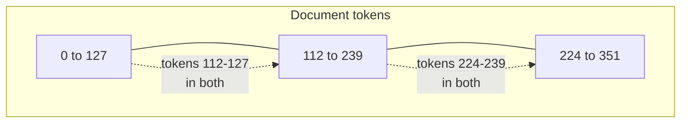

Every chunk boundary is a cut through the document, and some cuts land in the middle of the thing a user will ask about. **Chunk overlap** is the standard insurance: each chunk repeats the last few tokens of the one before, so that a fact cut at a boundary still appears whole in one of the two neighbours. This lesson works out exactly how much protection a given overlap buys, what it costs in index size and in duplicated retrieval results, and when it is the wrong tool altogether.

[Chunk size](/learn/chunking-fundamentals/chunk-size) treated chunks as disjoint. Here they are allowed to share text, and you will derive a short formula for the probability that an answer is split, check it by simulation, and then see the same effect on Meridian's handbook along with the less-discussed side effect: overlapping neighbours tend to be retrieved together.

## Learning objectives

- Explain what chunk overlap is and the specific failure it protects against.
- Derive and apply the probability that an answer span of a given length is split by fixed-size chunking with overlap, and the overlap that guarantees it is not.
- Calculate the index-size and embedding-cost inflation caused by a given overlap.
- Describe how overlapping chunks crowd a top-k result and merge them at context-construction time.
- Decide when boundary-aware splitting is a better answer than more overlap.

## Prerequisites

- [Chunk size](/learn/chunking-fundamentals/chunk-size): size limits, the generation budget and the size experiment.
- [Tokens and tokenisation](/learn/understanding-large-language-models/tokens-and-tokenisation): the chunk-count formula $\lceil (N - o)/(s - o) \rceil$ and a token chunker with overlap.
- [Context construction](/learn/rag-architecture-fundamentals/context-construction): assembling retrieved chunks into the prompt.

## Why this matters

A fixed-size splitter cuts wherever the count runs out. If "Carried-over days must be used by 31 March" begins near the end of one chunk, its first half sits in chunk 2 and "31 March" in chunk 3. A question about the deadline now has no chunk that answers it: chunk 2 has the subject without the date, chunk 3 has the date without the subject. Each half is also a worse match than the whole sentence would have been, so neither may even be retrieved.

Overlap is the cheapest defence and nearly every splitter supports it, usually with a default chosen by the library author. Configured blindly, it either does too little (an overlap shorter than the facts it should protect), or costs more than it needs to (an overlap of half the chunk, doubling the index), or does something harmful: it fills the top-k with near-copies of the same passage, so the model sees one fact three times and two other relevant facts not at all.

## The intuition

Think of photographing a long mural with a camera that cannot see it all at once. If you step sideways exactly one frame-width between shots, every painted figure that happens to straddle the edge of a frame is cut in two, and no single photograph shows it whole. Photographers stitching panoramas solve this by overlapping their shots: each frame repeats a strip of the previous one. A figure narrower than that strip is guaranteed to appear whole in some photograph, wherever it stands. A figure wider than the strip may still be cut, depending on where it falls.

That is all overlap is. The overlap is the strip; the facts in your document are the figures. The cost is also visible: overlapping shots mean more photographs of the same wall, and two neighbouring photographs look very much alike.

## How it works

### The mechanism

With a chunk size of $s$ tokens and an overlap of $o$ tokens, a fixed-size splitter does the following:

1. Tokenise the document into a sequence of $N$ tokens.
2. Set the **stride** (the step between chunk starts) to $t = s - o$. The overlap must be smaller than the size, or the window never moves; most libraries raise an error if it is not.
3. Emit a chunk of $s$ tokens starting at position 0, then at $t$, $2t$, $3t$, and so on.
4. Stop once a chunk reaches the end of the document, so the last chunk is not just a repeat of the previous one's tail. That gives $\lceil (N - o)/(s - o) \rceil$ chunks.
5. Record each chunk's start and end offsets, which you will need later to recognise and merge overlapping neighbours.



With $s = 128$ and $o = 16$, each chunk starts 112 tokens after the previous one, and each pair of neighbours shares 16 tokens.

### What overlap protects, and what it does not

Overlap protects **short spans that straddle a boundary**: a sentence, a clause, a value with its label. Any span no longer than the overlap plus one token is guaranteed to be wholly inside some chunk, as the mathematics below shows.

It does not protect:

- **Spans longer than the overlap.** A 60-token procedure step is not saved by a 16-token overlap if the boundary falls in its middle.
- **Long-range references.** A chunk that starts "These apply only to contractors" refers to something several sentences back. A short overlap does not bring back the antecedent.
- **Structure.** Overlap repeats raw tokens; it does not know where a sentence or table row starts, so the repeated strip itself often begins mid-sentence.

For these, the better tool is to stop boundaries landing in the wrong places at all, by cutting at sentence or paragraph ends ([Sentence-based chunking](/learn/chunking-fundamentals/sentence-based-chunking), [Paragraph-based chunking](/learn/chunking-fundamentals/paragraph-based-chunking)) or at headings ([structure-aware chunking](/learn/advanced-chunking-strategies/structure-aware-chunking)). Boundary-aware splitters still use overlap, but measured in whole sentences rather than raw tokens.

### How libraries interpret overlap

The meaning of `chunk_overlap` depends on the splitter. A pure token-window splitter repeats exactly $o$ tokens. Splitters that first break text into pieces (words, sentences, paragraphs) and then pack pieces into chunks usually treat the overlap as a **maximum**, carrying over as many whole trailing pieces as fit. LangChain's `CharacterTextSplitter` behaves this way:

```python
from langchain_text_splitters import CharacterTextSplitter

splitter = CharacterTextSplitter(separator=" ", chunk_size=40, chunk_overlap=12)
for c in splitter.split_text("Up to 5 unused days may be carried over into the next year. "
                             "Carried-over days must be used by 31 March or they are lost."):
    print(repr(c))
```

```output
'Up to 5 unused days may be carried over'
'carried over into the next year.'
'next year. Carried-over days must be'
'days must be used by 31 March or they'
'or they are lost.'
```

Sizes here are in characters. Each chunk begins with whole words carried over from the end of the previous one, up to 12 characters ("carried over" is exactly 12). Asking for `chunk_overlap=20` with `chunk_size=10` raises `ValueError: Got a larger chunk overlap (20) than chunk size (10), should be smaller.`

### Overlap at retrieval time

Overlap has a consequence that is easy to miss: **neighbouring chunks are similar by construction**. They share text, so their vectors are close, and a query that matches one tends to match its neighbours. A top-5 result can contain three overlapping windows of the same paragraph, using most of the context budget on one fact and pushing out other relevant chunks.

There are three standard responses:

- **Merge at context construction.** Sort the retrieved chunks of each document by position and merge spans that overlap or touch into one passage. The model receives each piece of text once.
- **Deduplicate at retrieval.** Keep only the best-scoring chunk from each run of neighbours, then fill the top-k from further down the ranking. Diversity-aware selection such as [maximal marginal relevance](/learn/advanced-retrieval-optimisation/mmr) generalises this.
- **Keep the overlap small**, so that neighbours are less alike.

> [!KEY]
> Overlap trades index size and result diversity for protection against boundary cuts. It guarantees whole only the spans no longer than itself. Use a modest overlap for that, and fix bad boundaries with boundary-aware splitting rather than ever-larger overlaps.

## The mathematics

### The probability that an answer is split

**Intuition.** An answer span starts at some position. Look at the last chunk that starts at or before it. The answer is safe if it ends before that chunk does. Where the answer starts within the stride is effectively random, so the risk is the fraction of starting positions that leave too little room.

Chunks start every $t = s - o$ tokens. Let the answer occupy $L$ tokens, starting $r$ tokens after the start of the latest chunk that begins at or before it, so $0 \le r \le t - 1$. That chunk contains the answer when $r + L \le s$. Earlier chunks end even sooner, so if this one fails, all do. The positions that fail are $r = s - L + 1, \dots, t - 1$, and there are $(t - 1) - (s - L + 1) + 1 = L - o - 1$ of them. With $r$ equally likely to take each of its $t$ values:

$$
P(\text{split}) = \frac{\max(0,\; L - o - 1)}{s - o}, \qquad \text{for } L \le s
$$

- $s$ is the chunk size and $o$ the overlap, both in tokens, with $o < s$.
- $t = s - o$ is the stride.
- $L$ is the length of the answer span in tokens.
- $r$ is the answer's offset from the start of the latest chunk that begins at or before it.

Two consequences:

- **The guarantee.** If $o \ge L - 1$, the probability is zero: any span of at most $o + 1$ tokens is always wholly inside some chunk.
- **No overlap.** With $o = 0$ the formula becomes $(L - 1)/s$: longer answers and smaller chunks are split more often.

**By hand.** Take $s = 128$ and an answer of $L = 20$ tokens (a typical one-sentence policy fact).

- $o = 0$: $19 / 128 = 0.148$. About one answer in seven is split.
- $o = 8$: $(20 - 8 - 1)/120 = 11/120 = 0.092$.
- $o = 16$: $3/112 = 0.027$.
- $o = 19$: $0 / 109 = 0$. Guaranteed.

### What overlap costs

**Intuition.** Every token in an overlap is embedded and stored twice.

With stride $t = s - o$, each chunk contributes only $t$ new tokens, so the corpus is embedded in about $N/t$ chunks instead of $N/s$:

$$
\text{inflation} \approx \frac{s}{s - o}
$$

- The ratio applies to the number of chunks, the number of vectors stored, and the tokens embedded.

**By hand.** $s = 128$, $o = 16$: $128/112 = 1.143$, so 14% more chunks, vectors and embedding tokens. With $o = 64$ (half the chunk), $128/64 = 2$: the index doubles. Going from $o = 16$ to $o = 19$ to reach the guarantee for 20-token facts costs $128/109 = 1.174$, three more percentage points.

### Checking the formula by simulation

The simulation below places 20,000 answers at random positions in a 50,000-token document, builds the chunk windows explicitly, and checks containment by brute force, without using the formula.

```python
import numpy as np

def p_split(L, s, o):
    """Probability that an L-token span at a random position lies inside no chunk."""
    return max(0, L - o - 1) / (s - o)

def chunk_starts(n, s, o):
    return np.arange(0, max(n - o, 1), s - o)

rng = np.random.default_rng(42)
n, s, L = 50_000, 128, 20
answers = rng.integers(0, n - L, size=20_000)          # random answer start positions

for o in (0, 8, 16, 19):
    starts = chunk_starts(n, s, o)
    # Brute force: is [a, a+L) inside some chunk [c, c+s)?
    inside = [np.any((starts <= a) & (a + L <= starts + s)) for a in answers]
    print(f"overlap {o:>2}: simulated {1 - np.mean(inside):.4f}   formula {p_split(L, s, o):.4f}"
          f"   chunks {len(starts):>4}")
```

```output
overlap  0: simulated 0.1474   formula 0.1484   chunks  391
overlap  8: simulated 0.0927   formula 0.0917   chunks  417
overlap 16: simulated 0.0282   formula 0.0268   chunks  447
overlap 19: simulated 0.0000   formula 0.0000   chunks  459
```

The simulated rates agree with the formula to within sampling noise, and the chunk counts match $\lceil (N - o)/(s - o) \rceil$: for example $\lceil 49{,}984 / 112 \rceil = 447$. The ratio $459 / 391 = 1.17$ is the inflation predicted for $o = 19$.

Real answers do not start at uniformly random positions (they tend to start at sentence beginnings), and real answers vary in length, so treat the formula as a model of the risk rather than an exact prediction for a corpus.

## In code

**The problem.** On a real Meridian document, measure how many facts are split at various size and overlap settings and what each setting costs. Then show the retrieval-time side effect, and fix it by merging overlapping chunks before they reach the prompt.

**Dependencies.**

```bash
pip install sentence-transformers numpy
```

**The source.** Eleven facts, each written as the clause a generator would need to answer from. A fact counts as "cut" if no chunk contains it whole.

```python
import numpy as np
from sentence_transformers import SentenceTransformer

model = SentenceTransformer("sentence-transformers/all-MiniLM-L6-v2")
tok = model.tokenizer

doc = (
    "Annual leave. Every employee receives 25 days of annual leave per year. Leave requests "
    "go through your line manager at least two weeks in advance. Up to 5 unused days may be "
    "carried over into the next year. Carried-over days must be used by 31 March or they are lost. "
    "Remote work. Staff may work remotely for up to 3 days a week, agreed with their manager. "
    "Each employee may claim a one-off home-office equipment budget of £400 for a desk, chair "
    "or monitor. Contractors are not eligible for the equipment budget. "
    "Expenses. Expense claims are submitted through the finance portal within 30 days of the "
    "purchase. Any single item over £75 needs an itemised receipt. "
    "Passwords. Passwords must be rotated every 90 days. The VPN is required whenever you "
    "connect from public Wi-Fi. Laptops are refreshed on a 3-year cycle. The IT support desk "
    "is staffed from 08:00 to 18:00 UK time."
)
facts = [  # each answer is a whole clause, as the generator would need it
    "Every employee receives 25 days of annual leave per year",
    "Carried-over days must be used by 31 March",
    "Staff may work remotely for up to 3 days a week",
    "home-office equipment budget of £400",
    "Contractors are not eligible for the equipment budget",
    "submitted through the finance portal within 30 days",
    "Any single item over £75 needs an itemised receipt",
    "Passwords must be rotated every 90 days",
    "The VPN is required whenever you connect from public Wi-Fi",
    "Laptops are refreshed on a 3-year cycle",
    "staffed from 08:00 to 18:00 UK time",
]

offsets = tok(doc, add_special_tokens=False, return_offsets_mapping=True)["offset_mapping"]

def windows(size, overlap):
    """Token windows over `doc`; each chunk is (start_char, end_char)."""
    step = size - overlap
    spans = []
    for start in range(0, max(len(offsets) - overlap, 1), step):
        w = offsets[start:start + size]
        spans.append((w[0][0], w[-1][1]))
    return spans

print(f"document: {len(offsets)} tokens\n")
print(f"{'size':>4} {'overlap':>7} {'chunks':>6} {'tokens embedded':>15} {'answers cut':>11}")
for size, overlap in [(32, 0), (32, 4), (32, 8), (32, 16), (64, 0), (64, 16)]:
    spans = windows(size, overlap)
    embedded = sum(len(tok(doc[a:b], add_special_tokens=False)["input_ids"]) for a, b in spans)
    cut = [x for x in facts if not any(x in doc[a:b] for a, b in spans)]
    print(f"{size:>4} {overlap:>7} {len(spans):>6} {embedded:>15} {len(cut):>5}")

# Overlap makes neighbours look alike: retrieve, then merge overlapping spans.
spans = windows(32, 16)
vecs = model.encode([doc[a:b] for a, b in spans], normalize_embeddings=True)
q = model.encode(["When do carried-over leave days expire?"], normalize_embeddings=True)[0]
top = np.argsort(-(vecs @ q))[:3]
print("\ntop-3 chunks (index, score, text):")
for i in top:
    print(f"  #{i} {vecs[i] @ q:.3f} {doc[spans[i][0]:spans[i][1]]!r}")

def merge(selected):
    """Merge character spans that overlap or touch into contiguous passages."""
    merged = []
    for a, b in sorted(selected):
        if merged and a <= merged[-1][1]:
            merged[-1] = (merged[-1][0], max(merged[-1][1], b))
        else:
            merged.append((a, b))
    return merged

passages = merge([spans[i] for i in top])
sent = sum(len(tok(doc[a:b], add_special_tokens=False)["input_ids"]) for a, b in passages)
raw = sum(len(tok(doc[spans[i][0]:spans[i][1]], add_special_tokens=False)["input_ids"]) for i in top)
print(f"\nmerged into {len(passages)} passage(s), {sent} tokens instead of {raw}:")
for a, b in passages:
    print(f"  {doc[a:b]!r}")
```

```output
document: 195 tokens

size overlap chunks tokens embedded answers cut
  32       0      7             195     4
  32       4      7             219     1
  32       8      8             251     1
  32      16     12             371     0
  64       0      4             195     3
  64      16      4             243     0

top-3 chunks (index, score, text):
  #2 0.710 'days may be carried over into the next year. Carried-over days must be used by 31 March or they are lost. Remote work. Staff may work remotely'
  #1 0.604 'go through your line manager at least two weeks in advance. Up to 5 unused days may be carried over into the next year. Carried-over days must be'
  #0 0.525 'Annual leave. Every employee receives 25 days of annual leave per year. Leave requests go through your line manager at least two weeks in advance. Up to 5 unused'

merged into 1 passage(s), 64 tokens instead of 96:
  'Annual leave. Every employee receives 25 days of annual leave per year. Leave requests go through your line manager at least two weeks in advance. Up to 5 unused days may be carried over into the next year. Carried-over days must be used by 31 March or they are lost. Remote work. Staff may work remotely'
```

**The important lines.**

- `windows(size, overlap)` is the five-step mechanism above. The loop bound `len(offsets) - overlap` implements step 4, so the last window is never just the previous window's tail.
- Chunks are stored as `(start_char, end_char)` spans, not as strings. Spans make two things trivial: checking whether a fact is wholly inside a chunk, and merging neighbours.
- `merge` sorts spans and joins any that overlap or touch. It is the context-construction fix for redundant neighbours; in a multi-document index you would group by document ID first.

**What the output means.**

- At size 32 with no overlap, 4 of the 11 facts are cut. An overlap of 4 tokens saves three of them; the fourth is still cut at an overlap of 8 and survives at 16. The facts are 8 to 13 tokens long, so by the formula an overlap of 12 would already guarantee all of them.
- The cost is in the "tokens embedded" column: 195 with no overlap, 371 with an overlap of 16, an inflation of 1.9, close to the predicted $32/16 = 2$. Overlap of half the chunk size is expensive.
- Larger chunks reduce, but do not remove, cuts: size 64 without overlap still cuts 3 facts, because every boundary is somewhere.
- The retrieval demonstration shows the side effect. With an overlap of half the chunk, the top three results for the carry-over question are three consecutive, overlapping windows of the same paragraph. Sent as-is they are 96 tokens of mostly repeated text. Merged, they are one 64-token passage, the same information at two-thirds of the cost, and the two slots they wasted could have gone to other documents.

**Errors people commonly hit.**

- Setting overlap greater than or equal to size, which is an error in most libraries and an infinite loop in a hand-written one whose stride becomes zero or negative.
- Comparing overlap in characters with chunk size in tokens, or vice versa, when the two settings use different length functions.
- Merging chunks from different documents because their character offsets happen to overlap. Always merge within one document ID.

**How to extend it.** Compute, for each fact, its length $L$ in tokens and the predicted guaranteeing overlap $L - 1$. Then replace the raw token windows with a splitter that cuts only at sentence ends and overlaps by one sentence, and compare the "answers cut" column: you should find that boundary-aware cutting removes most cuts with far less inflation.

## A real-world example

The Meridian Reports documentation team asked the Platform team why AskMeridian kept answering "which export formats are supported?" with "Meridian Reports can export dashboards as a PDF" and nothing about CSV. The chunk it retrieved ended "…exports any dashboard as a PDF or"; the next chunk began "CSV file. Single sign-on through SAML…". The system used fixed 200-token windows with no overlap.

The first proposal was an overlap of 100 tokens, "to be safe". Leila, who owned the index, did the arithmetic before agreeing. An overlap of 100 on 200-token chunks doubles the index and the embedding bill for every re-index, and her own tests showed a second problem: with half-chunk overlap, the top five results for most questions were three or four windows of the same passage. Answers to multi-part questions ("which formats, and does it support single sign-on?") got worse, because the second fact no longer made it into the top five.

She settled on two changes. The splitter now cuts only at sentence ends and overlaps by one sentence, which removes almost all mid-sentence cuts at a small cost, since most sentences in the documentation are 15 to 30 tokens. And the context builder merges retrieved chunks that are neighbours in the same document before sending them, so that the overlap never reaches the prompt twice. The export question now retrieves "Meridian Reports exports any dashboard as a PDF or CSV file." whole.

## Common mistakes

- **No overlap with fixed-size windows.** Facts that straddle a boundary are cut, and a corpus-wide fraction of roughly $(L-1)/s$ of them become unretrievable as whole statements.
- **Huge overlap "to be safe".** At $o = s/2$ the index, the embedding cost and re-index time double, and neighbours flood the top-k.
- **Sending overlapping neighbours to the model unmerged.** The prompt repeats text, costs more, and other relevant chunks are pushed out.
- **Expecting overlap to fix references.** A chunk that begins "These rules apply only to…" still lacks its antecedent if the antecedent is further back than the overlap.
- **Mixing units.** An overlap configured in characters with a size counted in tokens (or the reverse) produces a different overlap from the one intended.
- **Measuring benefit without measuring redundancy.** An evaluation that counts only whether the answer appears somewhere in the top-k can reward large overlaps whose duplicates hurt multi-fact questions.

## Best practices

- Size the overlap to the facts you need to protect: about one sentence, which the formula says guarantees spans up to $o + 1$ tokens.
- Prefer boundary-aware splitting with an overlap of whole sentences over raw token windows with large token overlaps.
- Store chunk start and end offsets so that neighbours can be identified and merged.
- Merge or deduplicate adjacent chunks from the same document before building the prompt.
- Report the inflation factor $s/(s - o)$ alongside any proposed overlap so that its cost is explicit.
- Tune overlap with an evaluation that includes multi-fact questions; [Overlap optimisation](/learn/chunking-optimisation/overlap-optimisation) covers this in depth.

## Performance considerations

- **Index size and embedding cost** grow by the factor $s/(s - o)$. For a 2-million-token corpus at $s = 256$: $o = 0$ gives about 7,800 chunks; $o = 32$ gives about 8,900 (12.5% more); $o = 128$ gives about 15,600 (double). Embedding tokens and stored vectors scale the same way.
- **Re-indexing time** scales with embedded tokens, so a large overlap slows every full rebuild proportionally.
- **Query latency** is barely affected by a modest increase in vector count for approximate indexes, but it is affected by what you do afterwards: merging spans is linear in $k$ and negligible.
- **Prompt cost** can *rise* with overlap if duplicates are not merged, because the same text is billed several times. With $k = 5$ and $s = 256$, three overlapping neighbours at $o = 128$ carry up to 256 repeated tokens per request.

## Summary

- Overlap makes neighbouring chunks share their boundary text so that facts cut at a boundary survive whole in one chunk.
- For fixed-size chunks with stride $s - o$, an $L$-token answer is split with probability $\max(0, L - o - 1)/(s - o)$; any span of at most $o + 1$ tokens is guaranteed whole.
- Overlap costs a factor of $s/(s - o)$ in chunks, vectors and embedding tokens, and makes neighbours similar enough to crowd the top-k.
- Merge overlapping or touching neighbours from the same document before building the prompt.
- Overlap cannot protect long spans or long-range references; boundary-aware splitting with a sentence of overlap is usually the better design.

## Exercises

**1.** With $s = 256$ and $o = 0$, what fraction of 30-token answers are split? What overlap guarantees that none are, and what does it cost in extra chunks?

<details><summary>Show solution</summary>

With no overlap, $(30 - 1)/256 = 29/256 \approx 0.113$, about 11%. An overlap of $o = L - 1 = 29$ guarantees no 30-token answer is split. The inflation is $256 / (256 - 29) = 256/227 \approx 1.128$, about 13% more chunks.

</details>

**2.** A colleague sets `chunk_size=500, chunk_overlap=250` "because more overlap is always safer". Give two concrete costs of this choice and one thing it still does not protect.

<details><summary>Show solution</summary>

Costs: the inflation is $500/250 = 2$, doubling the number of vectors, the embedding bill and re-index time; and neighbouring chunks share half their text, so they score similarly and crowd the top-k with near-duplicates, reducing the diversity of what reaches the model. It still does not protect spans longer than 251 tokens, and it does not restore references to text further back than the overlap.

</details>

**3.** Modify `merge` so that it merges only spans from the same document, given chunks as `(doc_id, start, end)` tuples, and test it on `[("hr", 0, 50), ("it", 40, 90), ("hr", 45, 120), ("hr", 200, 260)]`.

<details><summary>Show solution</summary>

```python
def merge(selected):
    merged = []
    for doc_id, a, b in sorted(selected):
        if merged and merged[-1][0] == doc_id and a <= merged[-1][2]:
            merged[-1] = (doc_id, merged[-1][1], max(merged[-1][2], b))
        else:
            merged.append((doc_id, a, b))
    return merged

print(merge([("hr", 0, 50), ("it", 40, 90), ("hr", 45, 120), ("hr", 200, 260)]))
```

```output
[('hr', 0, 120), ('hr', 200, 260), ('it', 40, 90)]
```

Sorting by `(doc_id, start)` puts each document's spans together in order, so the comparison with the previous span is only ever between neighbours in the same document. The `it` span overlaps `hr` offsets numerically but is not merged.

</details>

**4.** Design: Meridian's IT runbooks contain numbered steps of 20 to 90 tokens each. The current splitter uses 256-token windows with a 64-token overlap. Propose a better design and estimate its effect on index size.

<details><summary>Show solution</summary>

Cut only between steps (and between paragraphs outside step lists), packing whole steps into chunks of up to 256 tokens, with an overlap of one whole step, or of the procedure title and the step before, so that each chunk says which procedure it belongs to. Attach the runbook title and procedure heading as metadata. A step can then never be cut, which the 64-token overlap could not guarantee for 90-token steps.

Index size: the current inflation is $256/192 \approx 1.33$. With a one-step overlap averaging about 55 tokens, packed chunks average somewhat under 256 tokens (whole steps rarely fill the window exactly), so inflation is of a similar order, roughly $1.2$ to $1.4$; the gain is not size but that no step is ever split. Measure the actual chunk count after the change rather than relying on the estimate.

</details>

## Check your understanding

```quiz
[
  {
    "q": "With chunk size 100 and overlap 10, what is the stride between chunk starts?",
    "options": ["110", "10", "100", "90"],
    "answer": 3,
    "why": "The stride is size minus overlap, 100 - 10 = 90 tokens."
  },
  {
    "q": "Using P(split) = max(0, L - o - 1) / (s - o), what is the probability that a 25-token answer is split when s = 200 and o = 10?",
    "options": ["14 / 190, about 0.074", "25 / 200, about 0.125", "0", "24 / 200, about 0.12"],
    "answer": 0,
    "why": "L - o - 1 = 25 - 10 - 1 = 14 and s - o = 190, so the probability is 14/190, about 0.074."
  },
  {
    "q": "What is the smallest overlap that guarantees every 12-token span lies wholly inside some chunk?",
    "options": ["12", "11", "6", "24"],
    "answer": 1,
    "why": "Any span of at most o + 1 tokens is guaranteed whole, so o = L - 1 = 11 suffices."
  },
  {
    "q": "A top-5 result contains three overlapping windows of the same paragraph. What is the best fix at context-construction time?",
    "options": ["Increase the overlap so the windows match more strongly", "Merge overlapping spans from the same document into one passage and use the freed slots for other results", "Send all three unchanged so the model sees the fact emphasised", "Delete the overlap from the index"],
    "answer": 1,
    "why": "Merging removes repeated text, saving prompt tokens, and lets other relevant chunks take the freed positions in the top-k."
  },
  {
    "q": "Chunks of 300 tokens with an overlap of 60. By roughly what factor does the number of vectors grow compared with no overlap?",
    "options": ["1.20", "1.25", "1.60", "5.00"],
    "answer": 1,
    "why": "Inflation is s / (s - o) = 300 / 240 = 1.25."
  }
]
```

## Further reading

- LangChain documentation on text splitters, [python.langchain.com](https://python.langchain.com/), for how `chunk_overlap` is applied by piece-packing splitters.
- LlamaIndex documentation on node parsers, [docs.llamaindex.ai](https://docs.llamaindex.ai/), for `chunk_overlap` in `SentenceSplitter` and `TokenTextSplitter`.
- Carbonell and Goldstein (1998), "The Use of MMR, Diversity-Based Reranking for Reordering Documents and Producing Summaries", SIGIR. The standard method for removing redundant results from a ranking.
- Manning, Raghavan and Schütze (2008), *Introduction to Information Retrieval*, Cambridge University Press, free online at [nlp.stanford.edu/IR-book](https://nlp.stanford.edu/IR-book/), for passage retrieval and result diversity in classical search.
