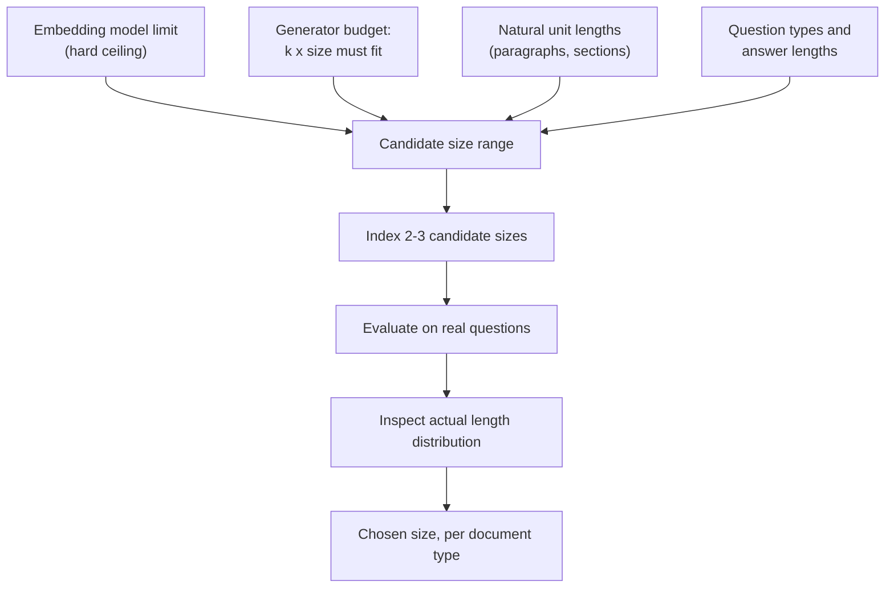

[Why chunking matters](/learn/chunking-fundamentals/why-chunking-matters) established that documents must be cut into chunks, and that a good chunk is both focused enough to be found and complete enough to be understood. This lesson turns that tension into a number: the **chunk size**. It explains what limits the size from above and from below, how size interacts with the number of chunks you retrieve and the cost of every request, and how to reason about a starting value for your own corpus instead of copying a default.

You will also run a small experiment on Meridian's handbook that varies only the size and watches three things move at once: how often the top chunk contains the answer, how sharply it matches, and how much text it sends to the model. The experiment is deliberately small. Running a proper size study on your own data is the subject of [Chunk size experiments](/learn/chunking-optimisation/chunk-size-experiments) in a later module; here the goal is to understand the forces so that you know what such a study is measuring.

## Learning objectives

- State the hard and soft upper limits on chunk size and where each comes from.
- Explain why very small chunks fail even when they contain the answer.
- Calculate how many chunks fit a generation budget, and how many vectors a corpus produces at a given size.
- Interpret an experiment that varies chunk size, including the ways a small experiment can mislead.
- Choose a defensible starting size for a corpus from its document types and expected questions.

## Prerequisites

- [Why chunking matters](/learn/chunking-fundamentals/why-chunking-matters): truncation, dilution and the findable-versus-understandable tension.
- [Context windows](/learn/understanding-large-language-models/context-windows): budgeting the tokens of a generation request.
- [Tokens and tokenisation](/learn/understanding-large-language-models/tokens-and-tokenisation): counting tokens, and the chunk-count formula with overlap.

## Why this matters

Chunk size is the single setting that most changes what a RAG system retrieves, and it is usually chosen by accident: the library's default, a number from a blog post, or "about a paragraph". Defaults vary wildly between libraries. LangChain's base `TextSplitter` defaults to 4,000 *characters*; LlamaIndex's `SentenceSplitter` defaults to 1,024 *tokens*; the Dense Passage Retrieval paper used 100-*word* passages. None of these was chosen for your documents, your questions or your embedding model.

A size that is too large produces vague vectors and expensive prompts full of irrelevant text. A size that is too small produces sharp vectors attached to fragments the model cannot use, and splits multi-step answers across chunks that may not all be retrieved. Both errors are silent: the system returns *something* for every question, and the damage shows up only as a lower rate of correct answers, which nobody notices without an evaluation set.

## The intuition

Think of photographing a large map so that people can later find places by looking at the photographs.

If you take one photograph of the whole map, every place is in it, but each is a few pixels across: when someone asks "where is the station?", the photograph does not stand out from photographs of other maps. If you take a thousand close-ups, each is beautifully sharp, but a close-up of half a street name tells nobody where they are, and a route that crosses three close-ups needs all three. The useful photograph shows a neighbourhood: large enough to recognise and use on its own, small enough that what it shows is clearly *this* place.

Chunk size is the zoom level. There is no zoom that is right for every map. A city centre with dense detail wants closer shots; a rural map where a single road runs for miles wants wider ones. Documents are the same: a policy full of short independent facts and a runbook made of ten-step procedures want different sizes.

## How it works

### What "size" means

A chunk's size is its length in some unit, almost always **tokens** or **characters**. Three distinctions trip people up:

- **The unit.** 1,000 characters and 1,000 tokens are very different amounts of text: in English prose, a token is on average roughly four characters for common LLM tokenisers, so 1,000 characters is closer to 250 tokens. The ratio changes with language and content, which [Character-based chunking](/learn/chunking-fundamentals/character-based-chunking) measures. When people quote a chunk size, ask which unit.
- **Which tokeniser.** Different models tokenise the same text into different numbers of tokens. The size that matters for the embedding limit is counted by the *embedding model's* tokeniser; the size that matters for prompt cost is counted by the *generator's*. [Token-based chunking](/learn/chunking-fundamentals/token-based-chunking) deals with this.
- **Target versus actual.** Most splitters treat the size as a maximum and fill chunks up to it, but chunks that respect sentence or paragraph boundaries come out shorter and uneven, and the last chunk of every document is a remainder. Some splitters can even exceed the target when a single unbroken piece of text is longer than it. What you configure is a target; what you get is a **distribution**, and the distribution is what to inspect.

### The upper limits

Three things cap how large a chunk can usefully be.

1. **The embedding model's input limit (hard).** Anything beyond it is truncated, silently. A chunk must fit, including the special tokens the model adds. For `all-MiniLM-L6-v2` that is 256 tokens; hosted models commonly accept thousands, but check the documentation for yours.
2. **What the model represents well (soft).** Fitting is not the same as being represented well. A model may accept long inputs yet have been trained mostly on short ones; the model card for `all-MiniLM-L6-v2`, for example, says it was trained with inputs limited to 128 tokens even though it accepts 256. More generally, one vector is a fixed-size summary, and the more distinct content a chunk holds, the more the dilution described in the previous lesson blunts its similarity to any single question.
3. **The generator's budget (economic).** If you retrieve $k$ chunks of size $s$, the prompt carries about $k \times s$ tokens of context. That must fit the budget left after the system prompt, question and answer reserve, and every token is paid for on every request.

### The lower limits

Two things stop you making chunks arbitrarily small.

1. **Self-containment.** A chunk must make sense alone. Sentences that start with "This", "They" or "In that case" depend on what came before. The smaller the chunk, the more often its meaning lives partly outside it, and the more often the answer is split across two chunks with only one retrieved.
2. **Competition.** Small chunks are more numerous, and many of them are generic: "Leave requests go through your line manager" resembles dozens of other sentences in an HR corpus. With more, smaller, similar-looking candidates, the chance that a near-miss outranks the right chunk rises. Small chunks also make the top-k list carry less total information, so a question that needs two facts may need a larger $k$.

### Size and the type of question

The right size depends on what people ask:

- **Fact lookup** ("how many days of leave?"): the answer is one sentence. Small to moderate chunks match sharply and waste little prompt.
- **Explanations and procedures** ("how do I set up the VPN on a new laptop?"): the answer is a sequence of steps or a paragraph of reasoning. Chunks must be large enough to hold the whole unit, or the model receives steps 1 to 3 of 7.
- **Summaries and comparisons** ("what changed between the 2023 and 2025 handbook?"): no single chunk holds the answer. Size matters less here than retrieval breadth, and larger chunks or a different architecture (for example retrieving whole sections) work better.

A corpus with mixed document types often deserves **different sizes per type**. Nothing requires one global setting, though each extra setting is one more thing to evaluate.

### The mechanism of choosing a size

A practical procedure, which [Chunk size experiments](/learn/chunking-optimisation/chunk-size-experiments) turns into a rigorous one:

1. **Find the hard ceiling**: the embedding model's input limit in its own tokens, minus special tokens and any metadata you plan to prepend to the chunk text.
2. **Look at the natural units** of your documents. Measure the length distribution of paragraphs and sections. If most paragraphs are 60 to 150 tokens, a size of a few hundred tokens lets a chunk hold one to three whole paragraphs.
3. **Write down the question types** you expect and the size of their typical answer.
4. **Check the budget**: with your intended $k$, does $k \times s$ fit comfortably in the context budget, at a cost you accept?
5. **Pick two or three candidate sizes** within these bounds, build an index for each, and compare them on a set of real questions with known answers.
6. **Inspect the distribution** of actual chunk lengths for the chosen setting, looking especially for tiny remainder chunks and for chunks over the ceiling.



> [!WARNING]
> A widely quoted size is not a validated size. Ranges such as "256 to 1,024 tokens" are common starting points in practice, not findings that transfer to your corpus. Published comparisons of chunk sizes disagree with each other because the best size depends on the documents, the questions, the embedding model and the evaluation measure.

## The mathematics

### How many chunks fit the generation budget

**Intuition.** Whatever space the prompt has left after the fixed parts, divide it by the chunk size.

$$
k_{\max} = \left\lfloor \frac{W - P - Q - A}{s} \right\rfloor
$$

- $W$ is the context budget you allow for the request, in generator tokens.
- $P$ is the system prompt and instructions, $Q$ the question, $A$ the reserve for the answer.
- $s$ is the chunk size measured in generator tokens.
- $\lfloor \cdot \rfloor$ rounds down.

**By hand.** Suppose Meridian caps each request at $W = 8{,}000$ tokens to control cost, with $P = 600$, $Q = 100$ and $A = 1{,}000$. That leaves $6{,}300$ tokens. With $s = 512$: $\lfloor 6300 / 512 \rfloor = \lfloor 12.3 \rfloor = 12$ chunks. With $s = 1{,}024$: $\lfloor 6.15 \rfloor = 6$ chunks. With $s = 256$: $\lfloor 24.6 \rfloor = 24$.

The same budget buys either many narrow chunks or a few broad ones. Twelve chunks of 512 tokens can cover up to twelve different places in the corpus; six chunks of 1,024 cover six places more deeply.

### How many vectors a corpus produces

Without overlap, a document of $N$ tokens cut into chunks of $s$ tokens produces $\lceil N/s \rceil$ chunks. Summed over a corpus of total length $T$ with $D$ documents, the count is about

$$
C \approx \frac{T}{s} + \frac{D}{2}
$$

- $T$ is the total corpus length in tokens.
- $D$ is the number of documents.
- The $D/2$ term accounts for each document's last, partial chunk, which on average is half full.

**By hand.** Meridian's handbook and runbooks total about $T = 2{,}000{,}000$ tokens across $D = 1{,}500$ documents. At $s = 256$: $C \approx 7{,}813 + 750 = 8{,}563$ chunks. At $s = 128$: $15{,}625 + 750 = 16{,}375$. Halving the size nearly doubles the vectors, and the extra partial chunks matter more when documents are short relative to $s$. (The chunk-count formula with overlap is in [Tokens and tokenisation](/learn/understanding-large-language-models/tokens-and-tokenisation); [Chunk overlap](/learn/chunking-fundamentals/chunk-overlap) uses it.)

**In Python:**

```python
W, P, Q, A = 8000, 600, 100, 1000
for s in (256, 512, 1024):
    print(f"s={s:>4}: k_max = {(W - P - Q - A) // s}")

T, D = 2_000_000, 1_500
for s in (128, 256, 512):
    print(f"s={s:>4}: about {T / s + D / 2:,.0f} chunks")
```

```output
s= 256: k_max = 24
s= 512: k_max = 12
s=1024: k_max = 6
s= 128: about 16,375 chunks
s= 256: about 8,562 chunks
s= 512: about 4,656 chunks
```

The 8,562 differs from the hand figure only because Python formats $8{,}562.5$ by rounding half to even.

## In code

**The problem.** Vary the chunk size on a single corpus, holding everything else fixed, and watch the trade-off: does the top-ranked chunk contain the answer, how strongly does it match, and how much text does it send to the generator?

**Dependencies.**

```bash
pip install sentence-transformers numpy
```

**The source.** A 337-token Meridian corpus covering policy, IT and product facts, with twelve questions and, for each, a short string that a correct chunk must contain. The splitter is the simplest possible: fixed windows of `size` tokens, measured with the embedding model's own tokeniser, with no overlap and no attention to boundaries. That keeps size as the only variable.

```python
import numpy as np
from sentence_transformers import SentenceTransformer

model = SentenceTransformer("sentence-transformers/all-MiniLM-L6-v2")
tok = model.tokenizer

corpus = (
    "Annual leave. Every employee receives 25 days of annual leave per year. Leave requests "
    "go through your line manager at least two weeks in advance. Up to 5 unused days may be "
    "carried over into the next year. Carried-over days must be used by 31 March or they are lost. "
    "Remote work. Staff may work remotely for up to 3 days a week, agreed with their manager. "
    "Each employee may claim a one-off home-office equipment budget of £400 for a desk, chair "
    "or monitor. Contractors are not eligible for the equipment budget. "
    "Expenses. Expense claims are submitted through the finance portal within 30 days of the "
    "purchase. Any single item over £75 needs an itemised receipt. The finance department "
    "returns claims that arrive without one. "
    "Passwords. Passwords must be rotated every 90 days, and the last ten passwords cannot be "
    "reused. The VPN is required whenever you connect from public Wi-Fi, for example in a café "
    "or an airport. "
    "Laptops. Laptops are refreshed on a 3-year cycle. Report a lost or stolen laptop to the "
    "support desk at once so that it can be locked remotely. "
    "Support desk. The IT support desk is staffed from 08:00 to 18:00 UK time, Monday to Friday. "
    "Urgent security incidents outside those hours go to the on-call engineer. "
    "Meridian Reports. Meridian Reports exports any dashboard as a PDF or CSV file. Single "
    "sign-on through SAML is available on the Enterprise plan only. "
    "Atlas errors. Error E-4021 means the VPN client is out of date; update it from the IT "
    "portal. Error E-4012 means the VPN certificate has expired."
)

questions = {
    "How many days of annual leave do I get?": "25 days",
    "By when must carried-over leave be used?": "31 March",
    "How much can I spend on home-office equipment?": "£400",
    "Are contractors entitled to the equipment budget?": "Contractors are not eligible",
    "Which expenses need a receipt?": "over £75",
    "How often do I have to change my password?": "90 days",
    "When do I need the VPN?": "public Wi-Fi",
    "How often are laptops replaced?": "3-year cycle",
    "What are the support desk hours?": "08:00 to 18:00",
    "Can I export a dashboard to CSV?": "PDF or CSV",
    "Which plan includes SAML single sign-on?": "Enterprise plan",
    "What does error E-4021 mean?": "VPN client is out of date",
}

enc = tok(corpus, add_special_tokens=False, return_offsets_mapping=True)
offsets = enc["offset_mapping"]
print(f"corpus: {len(offsets)} tokens, {len(questions)} questions\n")

def fixed_chunks(size):
    """Cut the corpus into windows of `size` tokens, returned as exact source substrings."""
    chunks = []
    for start in range(0, len(offsets), size):
        window = offsets[start:start + size]
        chunks.append(corpus[window[0][0]:window[-1][1]])
    return chunks

q_texts = list(questions)
q_vecs = model.encode(q_texts, normalize_embeddings=True)

print(f"{'size':>5} {'chunks':>6} {'answers cut':>11} {'hit@1':>6} {'top-1 cosine':>12} {'tokens sent @1':>14}")
for size in [16, 32, 64, 128]:
    chunks = fixed_chunks(size)
    cut = sum(not any(a in c for c in chunks) for a in questions.values())
    c_vecs = model.encode(chunks, normalize_embeddings=True)
    sims = q_vecs @ c_vecs.T
    top = sims.argmax(axis=1)
    hit1 = sum(questions[q] in chunks[t] for q, t in zip(q_texts, top))
    top_cos = sims.max(axis=1).mean()
    sent = np.mean([len(tok(chunks[t], add_special_tokens=False)["input_ids"]) for t in top])
    print(f"{size:>5} {len(chunks):>6} {cut:>11} {hit1:>4}/{len(q_texts)} {top_cos:>12.3f} {sent:>14.0f}")
```

```output
corpus: 337 tokens, 12 questions

 size chunks answers cut  hit@1 top-1 cosine tokens sent @1
   16     22           1    8/12        0.606             16
   32     11           0    9/12        0.565             31
   64      6           0   10/12        0.508             60
  128      3           0   11/12        0.426            116
```

**The important lines.**

- `return_offsets_mapping=True` returns, for every token, the `(start, end)` character positions it came from. Slicing `corpus[window[0][0]:window[-1][1]]` gives each chunk as an exact substring of the source, so the check `answer in chunk` is reliable.
- `cut` counts answers that are not wholly inside *any* chunk: a boundary fell through the middle of the answer string, so no retrieval could return it intact.
- `hit1` asks whether the single best-scoring chunk contains the answer string. It measures retrieval, not generation.
- `top_cos` is the mean similarity of the best chunk per question: how sharply the winner matches.
- `sent` is the number of tokens that top-1 retrieval would put in the prompt.

**What the output means.** The three measures move in different directions as size grows:

- **Containment rises** (hit@1 from 8 to 11 of 12). Larger chunks are more likely to hold the whole answer, and fewer answers are cut: at 16 tokens one answer string ("3-year cycle") straddles a boundary and can never be retrieved whole.
- **Match sharpness falls** (mean top-1 cosine from 0.606 to 0.426). The winning chunk shares its vector with more unrelated content: dilution, measured.
- **Prompt cost rises** roughly in proportion to size (16 to 116 tokens for a single chunk).

Do not read "128 is best" from this table. The corpus is tiny: at size 128 there are only three chunks, each a third of the corpus, so containing the answer is easy and a random choice would already be right about a third of the time. On a real corpus of millions of tokens, a 128-token chunk competes with tens of thousands of others, and the falling cosine matters far more, because the right chunk must beat many near misses. This is the most common way size experiments mislead: **a small or easy test set rewards large chunks**. A fair experiment needs a corpus and question set representative of production, which is why it has its own lesson.

The failures at small sizes are instructive too. At 16 tokens the top chunk for "By when must carried-over leave be used?" is `'days may be carried over into the next year. Carried-over days must be'`: the right place, but cut one word before "31 March".

**Errors people commonly hit.**

- Measuring `size` with one tokeniser and enforcing the embedding limit with another. Use the embedding model's tokeniser for the limit.
- Counting only `hit@1` and concluding that bigger is always better, as discussed above.
- Forgetting the remainder: the last chunk of the corpus is shorter than `size` (here, the 128-token setting gives 128, 128 and 81 tokens), and very short remainders make weak chunks.

**How to extend it.** Add a column for hit@3 and the tokens sent at $k = 3$. Duplicate the corpus with variations (a 2023 handbook with different numbers) so that near misses exist, and watch which sizes cope. Then change the splitter to the sentence-packing one in [Sentence-based chunking](/learn/chunking-fundamentals/sentence-based-chunking) and see how many of the small-size failures were caused by bad boundaries rather than by size.

## A real-world example

Meridian's Platform team re-chunked AskMeridian after its first, whole-document version failed. Wanting sharp matches, Tomás set a single size of 128 tokens for everything: the employee handbook, the IT runbooks and the Meridian Reports product documentation.

The HR team was delighted. Questions about leave, expenses and equipment budgets now retrieved one or two short, precise chunks, and answers improved. The IT support desk was not. Runbooks are procedures: "Re-enrolling a laptop in device management" has eleven steps, roughly 600 tokens. At 128 tokens, the procedure became five chunks. A question such as "how do I re-enrol my laptop?" retrieved the chunk with the procedure's title and first two steps, plus two chunks from other runbooks that mentioned enrolment. The generator, told to answer only from context, faithfully gave staff the first two steps.

Tomás did not pick a new global number. He measured the documents: handbook paragraphs were mostly 40 to 120 tokens, while runbook procedures ran from 200 to 700. He split the corpus by document type: 192-token chunks for the handbook and product FAQs, and for runbooks, chunks that keep a procedure whole up to the embedding model's limit, with longer procedures split at step boundaries and every piece carrying the procedure title. Before rolling it out he ran the team's 150 logged questions against both configurations and checked, question by question, whether the retrieved chunks contained a complete answer. The runbook questions improved; the HR questions stayed as good as before. The configuration, including the sizes per type, went into the index's metadata so that the next change could be compared against it.

## Common mistakes

- **Copying a default.** Library defaults range from a few hundred tokens to thousands of characters, and none was chosen for your corpus; the result may exceed your embedding limit or bury short facts.
- **Confusing characters with tokens.** A "512" size in characters is roughly a quarter of the text of 512 tokens in English, and the ratio is worse for code, numbers and many other languages.
- **One size for every document type.** Fact-dense policies and step-by-step procedures have different natural units; a single size serves one of them badly.
- **Evaluating on a tiny or easy question set.** Large chunks look best when there is little to compete with, so the chosen size is too large for production.
- **Ignoring the answer budget.** Raising the chunk size without lowering $k$ grows every prompt, raising cost and latency and possibly crowding out the answer reserve.
- **Not looking at the distribution.** A target of 512 can produce many 30-token remainders and a few chunks over the limit; averages hide both.

## Best practices

- Derive the ceiling from the embedding model's input limit, counted in its own tokens, minus special tokens and any prepended metadata.
- Measure your documents' paragraph and section lengths before picking candidates, and prefer sizes that hold whole natural units.
- Choose $k$ and $s$ together, from a stated context budget, rather than tuning each in isolation.
- Compare two or three candidate sizes on representative questions with known answers before indexing at scale.
- Allow different sizes for different document types when their natural units differ, and record the configuration with the index.
- Log the actual chunk-length distribution (minimum, median, 95th percentile, maximum) on every ingestion run and alert on outliers.

## Performance considerations

- **Vector storage** scales with the number of chunks, which is inversely proportional to size. Using the formula above, 2 million tokens at 128 tokens per chunk is about 16,400 vectors; at 384 dimensions in float32 (1,536 bytes each) that is about 25 MB of vectors, against about 7 MB at 512 tokens per chunk. Index structures such as HNSW add overhead per vector, so the ratio carries over.
- **Search latency** grows slowly with the number of vectors for approximate indexes, so size rarely dominates query latency, but it does affect memory and build time.
- **Embedding time** depends mostly on total tokens, but transformer attention costs grow faster than linearly with sequence length, so one 512-token input costs more than two 256-token inputs. Very long chunks embed more slowly per token.
- **Generation cost** is the largest effect: prompt tokens per request are about $k \times s$. At an assumed price of 3 dollars per million input tokens (illustrative; check current pricing), moving from $k=5, s=256$ (1,280 tokens) to $k=5, s=1{,}024$ (5,120 tokens) adds about 3,840 tokens per request, roughly 1,150 dollars per 100,000 requests.
- **Re-indexing** for a new size means re-embedding everything; size experiments on a sample first are cheap insurance.

## Summary

- Chunk size is a target length in a unit (tokens or characters) counted by a specific tokeniser; what you get is a distribution, which you should inspect.
- The embedding model's input limit is a hard ceiling; what the model represents well and the generator's budget are softer ceilings.
- Self-containment and competition among many small, similar chunks set the floor.
- Larger chunks contain answers more often but match less sharply and cost more per request; small test sets exaggerate the benefit of large chunks.
- Choose size from the documents' natural units, the question types and the $k \times s$ budget, then confirm with an experiment, possibly with different sizes per document type.

## Exercises

**1.** A request budget is 12,000 tokens. The system prompt takes 800, the question 150, and you reserve 1,500 for the answer. How many 384-token chunks can you retrieve? How many 768-token chunks?

<details><summary>Show solution</summary>

The space for context is $12{,}000 - 800 - 150 - 1{,}500 = 9{,}550$ tokens. With 384-token chunks, $\lfloor 9550 / 384 \rfloor = \lfloor 24.9 \rfloor = 24$. With 768-token chunks, $\lfloor 12.4 \rfloor = 12$.

</details>

**2.** Your embedding model accepts 512 tokens including two special tokens, and your pipeline prepends "Document title: … Section: …" (about 30 tokens) to each chunk before embedding. What is the largest chunk size you can safely configure, and why might you choose something smaller?

<details><summary>Show solution</summary>

$512 - 2 - 30 = 480$ tokens, measured with the embedding model's tokeniser. Leave some margin for titles that are longer than average (or compute the prefix per chunk and check it). You might choose smaller because fitting is not the same as being represented well: shorter chunks are more focused, they leave more room in the generator's budget for a larger $k$, and the model may have been trained mostly on shorter inputs.

</details>

**3.** Extend the code example: add hit@3 and the mean tokens sent at $k = 3$ for each size. What happens to hit@3 at the larger sizes, and why is that result not informative?

<details><summary>Show solution</summary>

Inside the loop, rank with `ranks = np.argsort(-sims, axis=1)` and compute `hit3 = sum(any(questions[q] in chunks[i] for i in r[:3]) for q, r in zip(q_texts, ranks))` and `ctx3 = np.mean([sum(len(tok(chunks[i], add_special_tokens=False)["input_ids"]) for i in r[:3]) for r in ranks])`.

Run on this corpus, hit@3 is 9 of 12 at size 16 and 12 of 12 for sizes 32, 64 and 128. At 128 there are only three chunks, so the top 3 are the whole corpus (337 tokens): every answer is "retrieved" because everything is. The measure saturates whenever $k$ chunks cover a large share of the corpus, which says nothing about how the size would behave with real competition.

</details>

**4.** Design: Meridian's Atlas product documentation consists of an error-code catalogue (about 900 entries, each 30 to 80 tokens: code, meaning, fix) and twenty architecture guides (each 4,000 to 8,000 tokens of explanatory prose with headings). Users ask both "what does E-4021 mean?" and "how does Atlas handle sync conflicts?". Propose chunk sizes and justify them.

<details><summary>Show solution</summary>

**Error catalogue:** one chunk per entry, whatever its length. Each entry is a natural, self-contained unit far below any embedding limit; merging entries would put several error codes into one vector, and near-identical codes (E-4021, E-4012) would then share chunks and confuse retrieval. Short chunks also make the prompt cheap.

**Architecture guides:** larger chunks, a few hundred tokens up to the embedding ceiling, cut at paragraph or heading boundaries, because explanatory answers span several sentences and a fragment of reasoning is not useful. Each chunk should carry its guide and section title as metadata.

Then evaluate each with questions of its own type, since the error-code questions would otherwise dominate a combined score.

</details>

## Check your understanding

```quiz
[
  {
    "q": "Which of these is a hard upper limit on chunk size, as opposed to a soft one?",
    "options": ["The length of the longest paragraph in the corpus", "The embedding model's maximum input length, beyond which text is truncated", "The number of chunks retrieved per query", "The average length of user questions"],
    "answer": 1,
    "why": "Text beyond the embedding model's input limit is dropped before embedding, so a chunk over the limit can never be fully represented; the other factors only make some sizes better than others."
  },
  {
    "q": "In an experiment on a 300-token corpus, 128-token chunks give the best hit@1. Why should you be cautious about using 128 tokens in production?",
    "options": ["Because hit@1 can only be measured with character-based chunks", "Because with only a few chunks in the index, containing the answer is easy and there is little competition from near misses", "Because 128 is not a power of two", "Because larger chunks always have higher cosine similarity"],
    "answer": 1,
    "why": "Small test corpora reward large chunks: each chunk covers a large share of the corpus, so containment is nearly automatic, and the cost of dilution against many competitors is not tested."
  },
  {
    "q": "A request budget leaves 5,000 tokens for context. How many 640-token chunks fit?",
    "options": ["8", "6", "7", "5"],
    "answer": 2,
    "why": "5,000 divided by 640 is 7.8, which rounds down to 7."
  },
  {
    "q": "Why do very small chunks fail even when one of them contains the answer?",
    "options": ["They often depend on neighbouring text for their meaning, and many similar small chunks compete for the top ranks", "Embedding models cannot embed fewer than 64 tokens", "Small chunks always exceed the embedding model's limit", "Vector databases reject short texts"],
    "answer": 0,
    "why": "Fragments lose the context that makes them understandable and matchable, and a larger number of short, generic chunks raises the chance that a near miss outranks the right one."
  },
  {
    "q": "A team configures a size of 1,000 and assumes it is in tokens, but their splitter measures characters. For English prose, roughly how many tokens are their chunks?",
    "options": ["About 4,000", "About 1,000", "About 250", "About 25"],
    "answer": 2,
    "why": "English prose averages roughly four characters per token for common tokenisers, so 1,000 characters is about 250 tokens; the exact ratio depends on the tokeniser and the text."
  }
]
```

## Further reading

- Karpukhin et al. (2020), "Dense Passage Retrieval for Open-Domain Question Answering", [arXiv:2004.04906](https://arxiv.org/abs/2004.04906). A well-documented choice of fixed 100-word passages.
- Reimers and Gurevych (2019), "Sentence-BERT: Sentence Embeddings using Siamese BERT-Networks", [arXiv:1908.10084](https://arxiv.org/abs/1908.10084).
- The `all-MiniLM-L6-v2` model card on the Hugging Face Hub, for its input limit and training sequence length.
- LangChain documentation on text splitters, [python.langchain.com](https://python.langchain.com/), for `chunk_size`, `chunk_overlap` and `length_function`.
- LlamaIndex documentation on node parsers, [docs.llamaindex.ai](https://docs.llamaindex.ai/), for `SentenceSplitter` and its token-based `chunk_size`.
