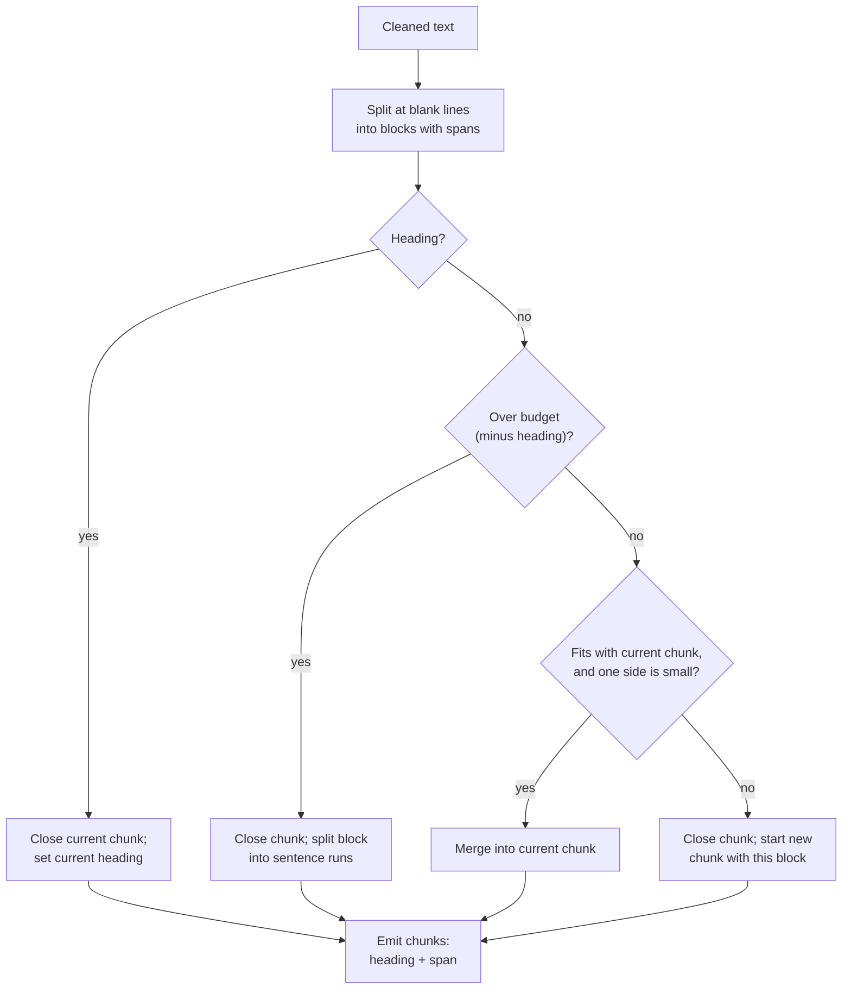

A paragraph is the unit in which authors organise their own thinking: one topic, developed over a few sentences, then a break. **Paragraph-based chunking** uses those breaks as chunk boundaries. Where [sentence-based chunking](/learn/chunking-fundamentals/sentence-based-chunking) guaranteed that no chunk splits a sentence, paragraph-based chunking aims higher: chunks that follow the document's own division into topics, so that each one is about a single thing because the author made it so.

Paragraphs do not cooperate with size limits, though. Some are one line; some run for half a page. So a paragraph chunker is really three operations: find the paragraphs, **merge** the small ones, and **split** the large ones. This lesson builds all three, adds the step that makes paragraph chunks far more useful in practice (carrying the section heading with each chunk), and closes the module by showing how the unit, size, overlap and boundary decisions from the previous six lessons come together in one splitter.

## Learning objectives

- Explain why paragraph boundaries tend to produce focused, self-contained chunks, and when they do not.
- Detect paragraph boundaries in plain text, Markdown, HTML and PDF-extracted text, and recognise when extraction has destroyed them.
- Implement a paragraph chunker that merges small paragraphs, splits large ones into sentence runs, and never merges across a heading.
- Attach section headings to chunks within the token budget, and explain why that improves retrieval.
- Choose between paragraph-, sentence-, token- and character-based chunking for a given corpus.

## Prerequisites

- [Sentence-based chunking](/learn/chunking-fundamentals/sentence-based-chunking): segmentation and sentence packing, used here to split long paragraphs.
- [Token-based chunking](/learn/chunking-fundamentals/token-based-chunking): measuring with the embedding model's tokeniser and slicing by offsets.
- [Cleaning](/learn/document-preprocessing/cleaning): how hard-wrapped lines and lost blank lines damage paragraph structure.

## Why this matters

Fixed-size and even sentence-based chunkers ignore topic. A 200-token window over a handbook frequently holds the end of the leave policy and the start of the remote-work policy, and its vector sits between the two. When a chunk follows a paragraph, its content is usually about one thing, which is exactly the "focused" property from [Why chunking matters](/learn/chunking-fundamentals/why-chunking-matters).

Paragraph chunking also has a practical advantage that is easy to overlook: the chunks match what people see. When AskMeridian cites a source, a whole paragraph is a natural thing to highlight and quote, and a reviewer can check it against the original document at a glance.

The risks are on the other side. Paragraph detection depends entirely on the structure surviving extraction and cleaning; PDFs in particular often arrive with every line broken or every break removed. And paragraph lengths vary by two orders of magnitude, so without merging and splitting you get one-line chunks with no context and page-long chunks over the embedding limit.

## The intuition

A paragraph chunker is like an editor laying out a magazine. The author's paragraphs are the material. Most fit on the page as they are. A one-line paragraph ("Requests go through your line manager.") is not given a page to itself: the editor runs it on with its neighbours from the same article. A very long paragraph is broken over pages, but only at the end of a sentence. And the editor never runs one article's text into another's, which is why a heading always starts a new page, and why every page carries the article title at the top so a reader who opens it at random knows what they are reading.

Merge small, split large, respect headings, label every page: that is the whole algorithm.

## How it works

### Finding paragraphs

How a paragraph boundary is marked depends on where the text came from:

- **Plain text and Markdown**: a blank line, meaning two or more line breaks with only whitespace between. A single line break inside a paragraph is usually just wrapping (Markdown renders it as a space), but in plain text it may separate list items or lines of an address.
- **HTML**: block elements such as `<p>`, `<li>`, `<h1>`…`<h6>`, `<pre>` and `<table>`. Convert to text with block boundaries preserved as blank lines, as [HTML parsing](/learn/advanced-document-parsing/html-parsing) recommends, rather than flattening everything into one string.
- **DOCX**: each paragraph object in the document model is a paragraph, with its style (heading, list, body) available, as in [DOCX extraction](/learn/data-processing/docx-extraction).
- **PDF**: there are no paragraphs in a PDF, only positioned lines. Extractors infer them from vertical gaps, indentation and line lengths, with mixed success. Two failures are common: every line becomes its own "paragraph" (hard wrapping preserved as breaks), or all breaks vanish and a page becomes one block. [Cleaning](/learn/document-preprocessing/cleaning) covers rejoining hard-wrapped lines; [layout-aware parsing](/learn/advanced-document-parsing/layout-aware-parsing) recovers blocks from position.

Whatever the source, the chunker should receive text in which **a blank line means a paragraph break and nothing else does**. That is a contract between cleaning and chunking, and it is worth a test.

### Headings, lists and other non-paragraphs

Blocks between blank lines are not all paragraphs:

- **Headings** are short, usually lack terminal punctuation, and (in Markdown) start with `#`. They should not be chunks on their own (an "orphan heading" chunk contains no information), and they should never be merged with the text of the *previous* section.
- **Lists** often arrive as one block of lines starting with `-`, `*` or a number. Keep a short list together with the sentence that introduces it ("Claims must be submitted within 30 days of purchase:"); a list without its lead-in loses its meaning.
- **Tables and code** have their own structure and their own splitters: [Table chunking](/learn/advanced-chunking-strategies/table-chunking) and [Code chunking](/learn/advanced-chunking-strategies/code-chunking).

The heading test used below is deliberately simple: a single line, under 60 characters, not ending in `.`, `:` or `;`. In Markdown or DOCX you would use the explicit markup or style instead, which is more reliable and is the approach of [heading-based chunking](/learn/advanced-chunking-strategies/heading-based-chunking).

### Merge small, split large

Paragraph lengths in a real handbook range from a few tokens to several hundred. Two rules bring them into a usable band:

- **Merge** a paragraph into the current chunk if either of them is below a minimum size and the result still fits the budget. Small paragraphs are often follow-ons ("Requests go through your line manager.") that make little sense alone.
- **Split** a paragraph that exceeds the budget into runs of whole sentences, using the sentence packing from the previous lesson (which itself falls back to token splitting for any sentence over the budget).

Merging stops at headings: two short paragraphs from different sections are about different things, and merging them recreates the topic-straddling chunks that paragraph chunking was meant to avoid.

### Carrying the heading

A paragraph that says "Up to 5 unused days may be carried over" is clear. One that says "Equipment bought with the budget remains Meridian property" is clear only if you know it is in the remote-work section. Prefixing each chunk's embedded text with its section heading (and often the document title) gives the vector the context the paragraph assumed. Two details matter:

- **The heading counts against the budget** if it is embedded with the chunk. Subtract its token count before deciding what fits.
- **Store the heading as metadata as well**, separately from the chunk text, so that it can be shown in citations and used in filters, and so that the chunk's offsets still point at the paragraph in the source.

### The mechanism

1. **Receive cleaned text** in which blank lines mark paragraph breaks.
2. **Split into blocks** at blank lines, keeping each block's character span.
3. **Classify each block** as heading or body (paragraph, list).
4. **On a heading**: close the current chunk and remember the heading as the current section.
5. **On a body block**: compute the budget as `max_tokens` minus the tokens of the heading prefix. If the block is over budget, close the current chunk and split the block into sentence runs. Otherwise, if the current chunk and the block together fit and either is below `min_tokens`, merge them. Otherwise close the current chunk and start a new one with the block.
6. **Close the final chunk** and emit chunks as `(heading, start, end)`.
7. **Build the embedded text** as heading plus chunk text; store heading, offsets and text separately.



### Overlap for paragraph chunks

Paragraph chunks usually need **little or no overlap** between paragraphs: the boundary is a topic break, so there is little straddling content to protect. The heading prefix does much of the work that overlap would otherwise do, by supplying context. Inside a paragraph that had to be split, the sentence-level overlap from the previous lesson still applies.

### How the module fits together

This splitter uses every decision from the module:

| Decision | Choice here | Lesson |
| --- | --- | --- |
| Unit of measurement | Tokens of the embedding model | [Token-based chunking](/learn/chunking-fundamentals/token-based-chunking) |
| Size | A budget minus the heading prefix, with a minimum for merging | [Chunk size](/learn/chunking-fundamentals/chunk-size) |
| Overlap | None between paragraphs; sentence overlap inside split paragraphs | [Chunk overlap](/learn/chunking-fundamentals/chunk-overlap) |
| Boundaries | Paragraphs first, then sentences, then words | [Sentence-based chunking](/learn/chunking-fundamentals/sentence-based-chunking) |
| Text and offsets | Slices of the source, never decoded tokens | [Character-based chunking](/learn/chunking-fundamentals/character-based-chunking) |

The hierarchy "paragraph, then sentence, then word, then hard cut" is a specific case of a general idea: try the coarsest boundary first, and fall back to finer ones only for pieces that do not fit. [Recursive character splitting](/learn/advanced-chunking-strategies/recursive-character-splitting) generalises it to an arbitrary list of separators, and is the most common production splitter for that reason.

> [!KEY]
> Paragraph-based chunking follows the author's own topic breaks: split at blank lines, merge small paragraphs within a section, split large ones at sentence ends, never merge across a heading, and carry the heading with every chunk inside the token budget.

## In code

**The problem.** Chunk a section of Meridian's handbook containing headings, short and long paragraphs and a list, into chunks of at most 64 tokens including the heading prefix, merging paragraphs under 24 tokens.

**Dependencies.**

```bash
pip install nltk sentence-transformers
python -c "import nltk; nltk.download('punkt_tab')"
```

**The source.** The budget is small so that the output is readable; real budgets are a few hundred tokens.

```python
import re
from nltk.tokenize.punkt import PunktTokenizer
from sentence_transformers import SentenceTransformer

tok = SentenceTransformer("sentence-transformers/all-MiniLM-L6-v2").tokenizer
punkt = PunktTokenizer("english")

handbook = """Annual leave

Every employee receives 25 days of annual leave per year, in addition to public holidays.

Up to 5 unused days may be carried over into the next year. Carried-over days must be used by 31 March or they are lost.

Requests go through your line manager.

Remote work

Staff may work remotely for up to 3 days a week. Remote days are agreed with your manager and recorded in the HR portal so that team calendars stay accurate. A one-off home-office equipment budget of £400 covers a desk, a chair or a monitor; contractors are not eligible for the budget. Equipment bought with the budget remains Meridian property and must be returned if you leave within two years. Staff working remotely must follow the same security rules as in the office, including locking the screen when away from the desk and never letting family members use a company laptop.

Expenses

Claims must be submitted within 30 days of purchase:
- anything over £75 needs an itemised receipt;
- claims go to the finance department through the finance portal."""

def n_tokens(text):
    return len(tok(text, add_special_tokens=False)["input_ids"])

def blocks(text):
    """Split on blank lines; return (start, end, kind) for each non-empty block."""
    out, pos = [], 0
    for m in re.finditer(r"\n\s*\n", text + "\n\n"):
        start, end = pos, m.start()
        pos = m.end()
        block = text[start:end]
        if not block.strip():
            continue
        is_heading = "\n" not in block and len(block) < 60 and not block.rstrip().endswith((".", ":", ";"))
        out.append((start, end, "heading" if is_heading else "para"))
    return out

def sentence_pieces(start, end, budget):
    """Split one over-long paragraph into runs of whole sentences under the budget."""
    spans = [(start + a, start + b) for a, b in punkt.span_tokenize(handbook[start:end])]
    pieces, cur = [], None
    for a, b in spans:
        if cur and n_tokens(handbook[cur[0]:b]) <= budget:
            cur = (cur[0], b)
        else:
            if cur:
                pieces.append(cur)
            cur = (a, b)
    pieces.append(cur)
    return pieces

def paragraph_chunks(text, max_tokens, min_tokens):
    chunks, heading, cur = [], "", None

    def flush():
        nonlocal cur
        if cur:
            chunks.append({"heading": heading, "start": cur[0], "end": cur[1]})
        cur = None

    for start, end, kind in blocks(text):
        if kind == "heading":
            flush()                                   # never merge across a heading
            heading = text[start:end].strip()
            continue
        prefix = f"{heading}\n"                       # embedded with the chunk, so it counts
        budget = max_tokens - n_tokens(prefix)
        if n_tokens(text[start:end]) > budget:        # too big: split into sentence runs
            flush()
            for a, b in sentence_pieces(start, end, budget):
                chunks.append({"heading": heading, "start": a, "end": b})
        elif cur and n_tokens(text[cur[0]:end]) <= budget and min(
                n_tokens(text[cur[0]:cur[1]]), n_tokens(text[start:end])) < min_tokens:
            cur = (cur[0], end)                       # one side is small: merge them
        else:
            flush()
            cur = (start, end)
    flush()
    return chunks

print("blocks:", [(kind[0], n_tokens(handbook[a:b])) for a, b, kind in blocks(handbook)], "\n")
for c in paragraph_chunks(handbook, max_tokens=64, min_tokens=24):
    body = handbook[c["start"]:c["end"]]
    embed_text = f"{c['heading']}\n{body}"
    print(f"[{c['heading']}] {n_tokens(embed_text):>2} tok  {body!r}")
```

```output
blocks: [('h', 2), ('p', 17), ('p', 29), ('p', 7), ('h', 2), ('p', 115), ('h', 1), ('p', 33)] 

[Annual leave] 55 tok  'Every employee receives 25 days of annual leave per year, in addition to public holidays.\n\nUp to 5 unused days may be carried over into the next year. Carried-over days must be used by 31 March or they are lost.\n\nRequests go through your line manager.'
[Remote work] 35 tok  'Staff may work remotely for up to 3 days a week. Remote days are agreed with your manager and recorded in the HR portal so that team calendars stay accurate.'
[Remote work] 51 tok  'A one-off home-office equipment budget of £400 covers a desk, a chair or a monitor; contractors are not eligible for the budget. Equipment bought with the budget remains Meridian property and must be returned if you leave within two years.'
[Remote work] 35 tok  'Staff working remotely must follow the same security rules as in the office, including locking the screen when away from the desk and never letting family members use a company laptop.'
[Expenses] 34 tok  'Claims must be submitted within 30 days of purchase:\n- anything over £75 needs an itemised receipt;\n- claims go to the finance department through the finance portal.'
```

**The important lines.**

- `re.finditer(r"\n\s*\n", text + "\n\n")` finds blank lines, including ones containing stray spaces or tabs. Appending `"\n\n"` makes the last block end with a match, so it is not lost. Blocks are kept as spans, not strings.
- `is_heading` is the simple heuristic described above. In Markdown or DOCX input, replace it with the explicit markup.
- `flush()` on a heading is what "never merge across a heading" means in code: the current chunk is closed before the section changes.
- `budget = max_tokens - n_tokens(prefix)` reserves room for the heading that will be embedded with the chunk.
- The merge condition requires both that the merge fits and that one side is below `min_tokens`, so two medium paragraphs stay separate (keeping chunks focused) while a one-liner is absorbed by its neighbour.
- `sentence_pieces` is a compact version of sentence packing without overlap, used only for paragraphs over budget.

**What the output means.**

- The block list shows the raw material: paragraphs of 17, 29, 7, 115 and 33 tokens, three headings of 1 or 2 tokens. Without merging and splitting, the chunks would range from 7 to 115 tokens, and the 115-token one would exceed the 64-token budget.
- The three short "Annual leave" paragraphs (17, 29 and 7 tokens) merged into one 55-token chunk, which reads as a complete policy. "Requests go through your line manager." would have been a weak chunk alone.
- The 115-token "Remote work" paragraph was split into three runs of whole sentences, each with the "Remote work" heading. The second run is the "Equipment bought with the budget…" passage: its own text never says "remote work", but its heading does, so a query about home-office equipment rules has something to match.
- The "Expenses" list stayed together with its lead-in sentence, because the whole block (with its single line breaks) is one paragraph by the blank-line rule.
- No chunk mixes two sections, and every chunk's offsets still point at the exact paragraph text in the source.

**Errors people commonly hit.**

- Feeding PDF-extracted text without paragraph reconstruction: either every line becomes a block (and merging rebuilds paragraphs blindly across topic changes) or there are no blank lines at all (and the whole page is one over-budget "paragraph" that falls back to sentence packing).
- Detecting headings too eagerly: a short sentence without a full stop ("See the finance portal") is misread as a heading and starts a bogus section. Prefer explicit markup when it exists.
- Forgetting that the heading prefix counts: chunks sized to the full budget exceed it once the heading is prepended for embedding.
- Merging across headings, which recreates topic-straddling chunks.

**How to extend it.** Carry a heading *path* ("Employee handbook > Remote work > Equipment") rather than a single heading, using heading levels from Markdown or DOCX. Add sentence overlap inside split paragraphs. Emit chunk records with `doc_id`, `position`, `heading`, `start`, `end` and `text`, ready for enrichment.

## A real-world example

When Meridian republished its employee handbook as a PDF in 2025, the Platform team re-indexed it with the paragraph chunker that worked well on the old HTML version. Retrieval quality dropped sharply. Searching for "equipment budget for contractors" returned a chunk that began in the middle of the remote-work policy and ended in the middle of the expenses policy.

Kofi looked at the extracted text. The PDF extractor emitted one line per printed line with no blank lines between paragraphs, so the chunker saw each page as a single block, found it over budget and fell back to sentence packing, which ignores topics. On some pages, the opposite happened: a two-column layout produced a blank line after every printed line, so each line was a "paragraph" and the merge rule glued fragments together.

The fix was upstream of the chunker. Kofi switched the PDF stage to an extractor that reports text blocks with positions, rebuilt paragraphs from vertical gaps, and rejoined hard-wrapped lines as described in [Cleaning](/learn/document-preprocessing/cleaning). Headings were recovered from font size, which the extractor also reported. He added a check to the ingestion job comparing the paragraph-length distribution of each new document with the handbook's historical one, failing the run if it shifted sharply. The paragraph chunker itself did not change. The lesson the team wrote down: a paragraph chunker is only as good as the paragraph breaks it is given, so the breaks need tests of their own.

## Common mistakes

- **Trusting blank lines from any extractor.** PDF and some HTML conversions destroy or invent paragraph breaks; the chunker then splits in the wrong places or not at all.
- **One chunk per paragraph, no merging or splitting.** One-line paragraphs become context-free chunks; long ones exceed the embedding limit and are truncated.
- **Orphan headings.** A heading emitted as its own chunk carries no information and wastes a top-k slot when it matches a query's keywords.
- **Merging across sections.** Two small paragraphs from different sections produce a chunk about two topics.
- **Not counting the heading prefix.** Chunks fill the budget before the heading is added, then overflow at embedding.
- **Separating a list from its lead-in.** "Anything over £75 needs a receipt" survives, but "- claims go to the finance department" alone does not say what claims or when.

## Best practices

- Make "blank line means paragraph break" an explicit contract with the cleaning stage, and test it on every source type.
- Merge paragraphs below a minimum size within a section; split paragraphs over the budget at sentence ends, with a token fallback.
- Close the current chunk at every heading, and carry the heading (or heading path) with each chunk, counted within the budget.
- Store the heading as metadata and the chunk's offsets into the source, separately from the embedded text.
- Prefer explicit structure (Markdown headings, HTML tags, DOCX styles) over heuristics when the source provides it.
- Monitor the distribution of paragraph and chunk lengths per source; a sudden shift usually means an extraction change.

## Performance considerations

- **Speed.** Splitting at blank lines is a linear regex scan. Token counting dominates: the code above re-counts merged candidates, which is fine for documents of a few thousand tokens; for large corpora, compute each block's token count once and sum, keeping a small margin for differences at joins.
- **Chunk count.** Paragraph chunks are variable and often below the budget. If paragraphs average 80 tokens and the budget is 256, merging only small ones gives chunks of roughly 80 to 160 tokens, so expect up to two or three times as many chunks as a pure 256-token window would make. That is more vectors, and also more focused ones.
- **Heading prefixes** cost embedding tokens: a 5-token heading on 10,000 chunks is 50,000 extra tokens embedded per full re-index, small next to the corpus itself.
- **Prompt cost.** Because paragraph chunks are often smaller than the budget, more of them fit in the context at a given $k$, or the same $k$ costs less.

## Summary

- Paragraph-based chunking uses the author's own topic breaks as boundaries, producing focused chunks that are natural to cite.
- It depends on paragraph breaks surviving extraction and cleaning; PDFs frequently need paragraph reconstruction first.
- Merge small paragraphs within a section, split large ones into sentence runs, and never merge across a heading.
- Carry the section heading with every chunk, inside the token budget and as metadata.
- The paragraph, sentence, word, hard-cut hierarchy combines this module's decisions about unit, size, overlap and boundaries into one splitter, and generalises to recursive splitting.

## Exercises

**1.** A section has paragraphs of 12, 30, 180, 25 and 300 tokens; the budget is 200 (after the heading prefix) and the minimum is 40. Using the merge and split rules of the code above, describe the chunks produced.

<details><summary>Show solution</summary>

- 12: starts the first chunk.
- 30: merging gives 42, which fits, and 12 is under 40, so merge: chunk (12+30 = 42).
- 180: fits the budget alone. Merging with 42 would give 222, over 200, so close the chunk; 180 starts a new chunk.
- 25: merging with 180 gives 205, over budget, so close; 25 starts a new chunk.
- 300: over the budget, so close the 25-token chunk and split 300 into sentence runs of at most 200 tokens, probably two runs.

Result: 42, 180, 25, then two sentence runs (for example about 150 and 150, depending on sentence lengths). The lone 25-token chunk is a weakness of the "merge with the previous chunk only" rule; a refinement is to merge a small paragraph with the *next* block when the previous one is full.

</details>

**2.** Why should a chunker never merge the last paragraph of one section with the first paragraph of the next, even if both are short?

<details><summary>Show solution</summary>

They are about different topics by the author's own division, so the merged chunk's vector sits between two subjects and matches neither well (dilution), and the chunk can carry only one heading, so half of it is mislabelled. It also confuses the generator, which may combine facts from two policies as if they were one.

</details>

**3.** Modify `paragraph_chunks` to carry a heading path. Treat lines starting with `#` as Markdown headings, where the number of `#` characters is the level, and prefix chunks with the path joined by " > ". Test on a short document with a level-1 and two level-2 headings.

<details><summary>Show solution</summary>

Keep a list `path` and, on a heading of level `n`, truncate it to `n - 1` entries and append the new heading:

```python
def heading_level(block):
    m = re.match(r"(#{1,6})\s+(.*)", block.strip())
    return (len(m.group(1)), m.group(2)) if m else None

# inside the loop, replacing the heading branch:
#     h = heading_level(text[start:end])
#     if h:
#         flush()
#         level, title = h
#         path = path[:level - 1] + [title]
#         heading = " > ".join(path)
#         continue
```

Initialise `path = []` alongside `heading`. For a document "# Employee handbook", "## Annual leave", paragraphs, "## Remote work", paragraphs, the chunks are prefixed "Employee handbook > Annual leave" and "Employee handbook > Remote work". The longer prefix costs more tokens, which the budget calculation already accounts for because it measures the prefix per chunk.

</details>

**4.** Design: Meridian is indexing three sources: the employee handbook (DOCX with heading styles), IT runbooks (Markdown with numbered steps) and Atlas incident write-ups (PDF, prose plus log excerpts). Choose a chunking approach for each from this module, with sizes and boundaries, and justify it.

<details><summary>Show solution</summary>

**Handbook (DOCX):** paragraph-based chunking using DOCX paragraph objects and heading styles; merge small paragraphs within a section, split long ones into sentence runs, carry the heading path, a budget of a few hundred embedding tokens, no overlap between paragraphs.

**Runbooks (Markdown):** paragraph-based with Markdown headings, treating each numbered step as a block, merging whole steps under the procedure heading up to the budget and never splitting a step unless it alone exceeds the budget; the procedure title in every chunk. A one-step overlap if procedures are split, so each piece shows where it continues from.

**Incident write-ups (PDF):** reconstruct paragraphs first; use sentence packing for prose; treat log excerpts as separate blocks chunked by lines with a token budget measured by the embedding tokeniser (logs are token-dense, as [Character-based chunking](/learn/chunking-fundamentals/character-based-chunking) showed). Keep the incident title and section as metadata.

For all three, measure in embedding-model tokens, slice source text by offsets, and evaluate each source with its own question set.

</details>

## Check your understanding

```quiz
[
  {
    "q": "Why do paragraph boundaries tend to produce focused chunks?",
    "options": ["Paragraphs are always the same length", "Authors usually make each paragraph about one topic, so the boundary is a topic break", "Embedding models are trained on paragraphs only", "Paragraphs never contain abbreviations"],
    "answer": 1,
    "why": "A paragraph is the author's own unit of topic, so following paragraph breaks keeps unrelated topics out of the same chunk."
  },
  {
    "q": "A 400-token paragraph meets a 256-token budget. What should a paragraph chunker do?",
    "options": ["Split it into runs of whole sentences under the budget, falling back to token splits for any over-long sentence", "Emit it whole; paragraphs must never be split", "Drop it", "Merge it with the next paragraph"],
    "answer": 0,
    "why": "Over-budget paragraphs are split at the next-finer boundary, sentences, so no chunk exceeds the embedding limit."
  },
  {
    "q": "Text extracted from a PDF has no blank lines at all. What happens with a blank-line paragraph chunker?",
    "options": ["Each line becomes a chunk", "The chunker raises an error", "The whole text is treated as one block, which is over budget and falls back to sentence packing that ignores topics", "Headings are detected automatically"],
    "answer": 2,
    "why": "Without blank lines there is only one block; the chunker can only split it with finer boundaries, so the paragraph structure is lost. The fix is paragraph reconstruction upstream."
  },
  {
    "q": "The budget is 256 tokens and every chunk is embedded as heading + newline + text. A chunk's heading is 9 tokens including the newline. What is the largest text it can hold?",
    "options": ["256 tokens", "265 tokens", "128 tokens", "247 tokens"],
    "answer": 3,
    "why": "The heading prefix is embedded with the chunk, so it counts: 256 - 9 = 247 tokens remain for the text."
  },
  {
    "q": "Which statement about overlap in paragraph-based chunking is most accurate?",
    "options": ["Paragraph chunks need at least 50% overlap", "Little or no overlap is needed between paragraphs because boundaries are topic breaks and the heading supplies context; overlap still helps inside split paragraphs", "Overlap is impossible with paragraphs", "Overlap should always be exactly one paragraph"],
    "answer": 1,
    "why": "Topic boundaries leave little straddling content to protect, so overlap matters mainly where a long paragraph had to be cut at sentence ends."
  }
]
```

## Further reading

- CommonMark specification, [spec.commonmark.org](https://spec.commonmark.org/), for exactly what counts as a paragraph, a blank line, a heading and a list item in Markdown.
- WHATWG HTML Living Standard, [html.spec.whatwg.org](https://html.spec.whatwg.org/), for block-level elements such as `p`, `li` and headings.
- LangChain documentation on text splitters, [python.langchain.com](https://python.langchain.com/), for `RecursiveCharacterTextSplitter`, whose default separator list begins with the blank line.
- LlamaIndex documentation on node parsers, [docs.llamaindex.ai](https://docs.llamaindex.ai/), for `SentenceSplitter`, which splits on a paragraph separator before sentences.
- PyMuPDF documentation, [pymupdf.readthedocs.io](https://pymupdf.readthedocs.io/), for extracting text blocks with positions, which is how paragraphs are recovered from PDFs.
