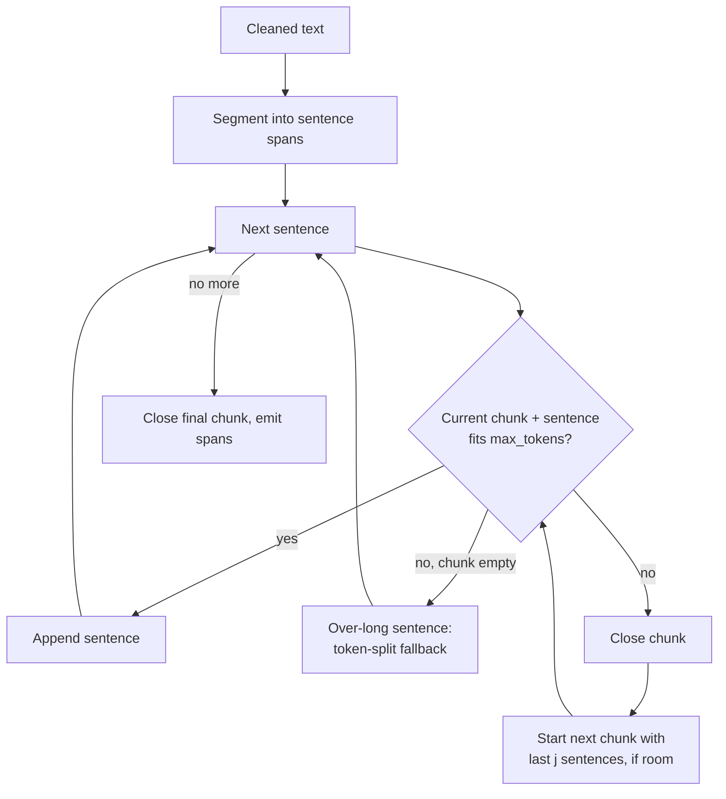

The splitters in the last two lessons count units (tokens or characters) and cut when the count runs out, adjusting at most to the nearest space. **Sentence-based chunking** changes what a boundary may be: chunks are built from whole sentences, so no chunk ever begins or ends in the middle of one. The size limit still applies, but it is met by deciding how many sentences fit, not by cutting wherever the limit falls.

This removes the most common chunking defect, the half-sentence at each end of a chunk, and it makes overlap meaningful, because the repeated text is a complete sentence rather than an arbitrary strip of tokens. It also introduces a new dependency: you need to know where sentences end, which is harder than looking for full stops. This lesson covers both halves: **sentence segmentation** (finding the boundaries) and **sentence packing** (grouping sentences into chunks under a token budget).

## Learning objectives

- Explain why sentence boundaries make better chunk boundaries than raw token or character positions.
- Identify the cases that defeat naive sentence splitting, and describe rule-based, unsupervised and model-based segmenters.
- Use NLTK's Punkt segmenter with span offsets, and extend it with domain abbreviations.
- Implement greedy sentence packing with a token budget, sentence-level overlap and a fallback for over-long sentences.
- Predict the number of chunks greedy packing produces and judge when sentence-based chunking is the right choice.

## Prerequisites

- [Token-based chunking](/learn/chunking-fundamentals/token-based-chunking): counting with the embedding model's tokeniser and working with offsets.
- [Chunk overlap](/learn/chunking-fundamentals/chunk-overlap): what overlap protects and what it costs.
- [Regular expressions](/learn/data-processing/regular-expressions): the regex sentence splitter built there, and why it is a heuristic.

## Why this matters

A sentence is the smallest unit of text that usually states something complete: "Claims without a receipt are returned." Cut it in half and neither half says anything. Fixed-size chunkers cut sentences at both ends of almost every chunk, so a typical chunk begins with the tail of one sentence and ends with the head of another. Those fragments do three kinds of damage:

- **They blur the vector.** Half a sentence about a neighbouring topic pulls the chunk's embedding away from what it is mostly about.
- **They confuse the generator.** A chunk starting "…after purchase, and Mr. J. Smith approves" invites the model to guess what came before.
- **They waste budget.** The fragments are tokens you pay for that carry no usable information.

Sentence-based chunking removes the fragments. But it is only as good as its sentence segmentation, and segmentation fails in predictable ways on exactly the kind of text RAG systems ingest: policy documents full of abbreviations, technical writing full of version numbers and file names, and lists and headings that have no full stops at all.

## The intuition

Think of loading a removal van with boxes. A fixed-size chunker is like filling the van to the exact cubic metre by sawing the last box in half. A sentence chunker loads whole boxes until the next box will not fit, then closes the doors. The van is a little less than full, but every box arrives intact.

The difficulty is that the boxes are not labelled. You have to work out where one box ends and the next begins by looking at the text, and a full stop is not a reliable label: "Dr." and "e.g." and "£75.50" contain full stops that do not end anything. Finding the true box edges is the segmentation problem; loading them sensibly is the packing problem.

## How it works

### What makes sentence boundaries hard

A naive splitter breaks after every `.`, `!` or `?` followed by whitespace. It goes wrong on:

- **Abbreviations**: "Dr. Okafor", "e.g. a till slip", "approx. 3 days", "Mr. J. Smith".
- **Numbers and identifiers**: "£75.50", "version 2.4", "config.yaml", "E-4021." at the end of a line versus inside one.
- **Ellipses and quotations**: "…and so on." or a full stop inside closing quotation marks.
- **Text without terminal punctuation**: headings ("Annual leave"), list items, table cells and log lines. These are not sentences, and a sentence splitter either glues them to the next sentence or treats a whole bulleted list as one "sentence".
- **Other languages**: Chinese and Japanese end sentences with 。, not a full stop followed by a space; German writes ordinal numbers with a full stop ("am 31. März"), which looks like a sentence end.

### Three families of segmenter

1. **Rule-based** segmenters use hand-written patterns and abbreviation lists. The regex splitter in [Regular expressions](/learn/data-processing/regular-expressions) is one. They are fast and transparent, and they fail on anything their rules did not anticipate. pySBD (Sadvilkar and Neumann, 2020) is a widely used rule-based library with extensive rule sets for many languages.
2. **Unsupervised statistical** segmenters learn from raw text which tokens behave like abbreviations. The best known is **Punkt** (Kiss and Strunk, 2006), the algorithm behind NLTK's `sent_tokenize`. It notices, for example, that "Dr" is almost always followed by a full stop and then a capitalised word that is not a sentence start, and learns to treat it as an abbreviation. NLTK ships pre-trained Punkt models for many languages.
3. **Model-based** segmenters use a trained statistical or neural model. spaCy, for example, can derive sentence boundaries from its dependency parser or from a dedicated sentence-recognition component. They handle unusual text better but are slower and need a model per language.

None is perfect, and the differences matter less than one practical habit: **look at the segmenter's output on your own documents, and teach it your corpus's abbreviations**.

### Sentence packing: the mechanism

Given the sentences as character spans, packing builds chunks:

1. **Segment** the text into sentence spans `(start, end)`, after cleaning and normalisation.
2. **Measure** each candidate chunk with the embedding model's tokeniser.
3. **Add sentences greedily**: append the next sentence to the current chunk if the chunk still fits `max_tokens`.
4. **Close the chunk** when the next sentence does not fit.
5. **Start the next chunk with overlap**: the last $j$ sentences of the closed chunk, provided they leave room for at least one new sentence; otherwise start empty.
6. **Handle over-long sentences**: a single sentence longer than `max_tokens` (a run-on legal clause, a log line with no full stops) cannot fit. Put it in a chunk of its own and hand it to a token-based fallback that splits it between words, as in [Token-based chunking](/learn/chunking-fundamentals/token-based-chunking).
7. **Emit spans**: each chunk is the source text from the first sentence's start to the last sentence's end, so the original spacing and line breaks between sentences are kept.



### Sentence-level overlap

Overlap in sentences is cleaner than overlap in tokens: the repeated text is a complete statement, so the chunk opens with something readable. The cost depends on sentence length. With sentences of about 20 tokens and chunks of about 200, one sentence of overlap is roughly a 10% overlap, inflating the index by about $200/180 \approx 1.11$, by the formula in [Chunk overlap](/learn/chunking-fundamentals/chunk-overlap). Two sentences of overlap on short chunks can approach half the chunk, so check the actual inflation.

Overlap does not need to be one sentence for every chunk. Step 5's rule drops it when keeping it would leave no room, which happens when sentences are long relative to the budget.

### Library implementations

- **LlamaIndex `SentenceSplitter(chunk_size=..., chunk_overlap=...)`** measures in tokens. It splits first on a paragraph separator, then into sentences with a Punkt-based tokeniser by default, then with a punctuation regex, then by words, and merges the pieces into chunks, preferring to keep whole sentences and paragraphs together. Its overlap is in tokens.
- **LangChain `NLTKTextSplitter`** segments with NLTK and merges sentences up to `chunk_size`, measured in characters unless you give it a `length_function`.
- **A custom packer** like the one below gives you sentence-level overlap, offsets and control over the fallback, in about thirty lines.

### When sentence-based chunking fits

It suits **prose**: policies, articles, documentation, emails, transcripts with punctuation. It suits less well: code, tables, logs and bullet lists, where "sentences" are not the natural unit; and heavily structured documents, where headings and sections are better boundaries ([Paragraph-based chunking](/learn/chunking-fundamentals/paragraph-based-chunking), [Heading-based chunking](/learn/advanced-chunking-strategies/heading-based-chunking)). Placing boundaries where the *topic* shifts between sentences, rather than wherever the budget runs out, is [semantic chunking](/learn/advanced-chunking-strategies/semantic-chunking). Embedding single sentences and expanding them to their neighbours at query time is a different technique again, covered under [small-to-big retrieval](/learn/chunking-optimisation/small-to-big-retrieval).

> [!KEY]
> Sentence-based chunking keeps every sentence whole by packing complete sentences up to a token budget, with overlap in whole sentences and a token-split fallback for sentences that are too long. Its quality is capped by the segmenter, so inspect segmentation on your own text and add your corpus's abbreviations.

## The mathematics

### How many chunks greedy packing produces

**Intuition.** If every sentence had the same length, each chunk would hold the same number of sentences, and the overlap formula from tokens would apply with sentences as the unit.

If sentences are $\ell$ tokens long and the budget is $s$ tokens, a chunk holds $q = \lfloor s / \ell \rfloor$ sentences. With an overlap of $j$ sentences ($j < q$), each new chunk adds $q - j$ new sentences, so a document of $S$ sentences produces

$$
C = \left\lceil \frac{S - j}{q - j} \right\rceil, \qquad q = \left\lfloor \frac{s}{\ell} \right\rfloor
$$

- $S$ is the number of sentences in the document.
- $\ell$ is the sentence length in tokens (in reality, an average).
- $s$ is the token budget per chunk.
- $q$ is the number of whole sentences that fit in one chunk.
- $j$ is the overlap in sentences.

**By hand.** A 120-sentence policy, sentences of about $\ell = 22$ tokens, budget $s = 200$: $q = \lfloor 200/22 \rfloor = \lfloor 9.09 \rfloor = 9$. With no overlap, $C = \lceil 120/9 \rceil = 14$. With $j = 1$: $C = \lceil 119/8 \rceil = \lceil 14.875 \rceil = 15$.

Notice the **fill rate**: 9 sentences of 22 tokens is 198 of 200 tokens here, but if sentences were 26 tokens, $q = 7$ and chunks would hold only 182 tokens, 91% of the budget. Whole-sentence packing always leaves some unused space, on average more when sentences are long relative to the budget. Real sentence lengths vary, so treat $C$ as an estimate and count the output.

```python
import math

S, ell, s = 120, 22, 200
q = s // ell
for j in (0, 1, 2):
    print(f"overlap {j} sentence(s): q = {q}, chunks = {math.ceil((S - j) / (q - j))}")
```

```output
overlap 0 sentence(s): q = 9, chunks = 14
overlap 1 sentence(s): q = 9, chunks = 15
overlap 2 sentence(s): q = 9, chunks = 17
```

## In code

**The problem.** Segment a tricky passage of Meridian policy text into sentences, see where a pre-trained segmenter goes wrong, fix it with domain abbreviations, and pack the sentences into chunks of at most 40 tokens with one sentence of overlap.

**Dependencies.** NLTK provides Punkt; its pre-trained models are a separate download (`punkt_tab` in current NLTK versions). `sentence-transformers` provides the tokeniser for the budget.

```bash
pip install nltk sentence-transformers
python -c "import nltk; nltk.download('punkt_tab')"
```

**The source.** The budget of 40 tokens is deliberately tiny so that the output fits on the page; real budgets are a few hundred.

```python
from nltk.tokenize.punkt import PunktTokenizer
from sentence_transformers import SentenceTransformer

tok = SentenceTransformer("sentence-transformers/all-MiniLM-L6-v2").tokenizer

text = (
    "Expenses over £75.50 need a receipt, e.g. a till slip or an invoice. Claims go to the "
    "finance department, i.e. Dr. Okafor's team, within 30 days of purchase. Claims without a "
    "receipt are returned. Laptops are replaced every 3 yrs. after purchase, and Mr. J. Smith "
    "approves early replacements. A lost laptop must be reported to the support desk at once. "
    "The desk is staffed from 08:00 to 18:00 UK time. Outside those hours, call the on-call "
    "engineer. Remote staff must use the VPN on public Wi-Fi. Passwords rotate every 90 days."
)

punkt = PunktTokenizer("english")                     # pre-trained English model (punkt_tab)
print("Punkt, as shipped:")
for a, b in punkt.span_tokenize(text):
    print(f"  {text[a:b]!r}")

# Teach it the abbreviations this corpus uses (stored lower-case, without the final dot).
punkt._params.abbrev_types.update({"e.g", "i.e", "yrs"})
sentences = list(punkt.span_tokenize(text))
print(f"\nwith extra abbreviations: {len(sentences)} sentences")

def n_tokens(a, b):
    return len(tok(text[a:b], add_special_tokens=False)["input_ids"])

def pack(sentences, max_tokens, overlap_sentences=1):
    """Greedily pack whole sentences into chunks of at most max_tokens tokens.

    Each chunk after the first starts with the last `overlap_sentences` sentences of the
    previous one. Returns lists of sentence indices.
    """
    chunks, current, i = [], [], 0
    while i < len(sentences):
        candidate = current + [i]
        a, b = sentences[candidate[0]][0], sentences[candidate[-1]][1]
        if n_tokens(a, b) <= max_tokens or not current:
            current = candidate                        # fits (or a lone over-long sentence)
            i += 1
        else:
            chunks.append(current)
            keep = current[-overlap_sentences:] if overlap_sentences else []
            # drop the overlap if it would leave no room for the next sentence
            if keep and n_tokens(sentences[keep[0]][0], sentences[i][1]) > max_tokens:
                keep = []
            current = keep
    if current:
        chunks.append(current)
    return chunks

print("\nchunks of at most 40 tokens, 1 sentence of overlap:")
for c in pack(sentences, max_tokens=40, overlap_sentences=1):
    a, b = sentences[c[0]][0], sentences[c[-1]][1]
    print(f"  sentences {c[0]}-{c[-1]}  {n_tokens(a, b):>2} tok  {text[a:b]!r}")
```

```output
Punkt, as shipped:
  'Expenses over £75.50 need a receipt, e.g.'
  'a till slip or an invoice.'
  'Claims go to the finance department, i.e.'
  "Dr. Okafor's team, within 30 days of purchase."
  'Claims without a receipt are returned.'
  'Laptops are replaced every 3 yrs.'
  'after purchase, and Mr. J. Smith approves early replacements.'
  'A lost laptop must be reported to the support desk at once.'
  'The desk is staffed from 08:00 to 18:00 UK time.'
  'Outside those hours, call the on-call engineer.'
  'Remote staff must use the VPN on public Wi-Fi.'
  'Passwords rotate every 90 days.'

with extra abbreviations: 9 sentences

chunks of at most 40 tokens, 1 sentence of overlap:
  sentences 0-0  23 tok  'Expenses over £75.50 need a receipt, e.g. a till slip or an invoice.'
  sentences 1-2  33 tok  "Claims go to the finance department, i.e. Dr. Okafor's team, within 30 days of purchase. Claims without a receipt are returned."
  sentences 2-3  30 tok  'Claims without a receipt are returned. Laptops are replaced every 3 yrs. after purchase, and Mr. J. Smith approves early replacements.'
  sentences 3-4  36 tok  'Laptops are replaced every 3 yrs. after purchase, and Mr. J. Smith approves early replacements. A lost laptop must be reported to the support desk at once.'
  sentences 4-6  39 tok  'A lost laptop must be reported to the support desk at once. The desk is staffed from 08:00 to 18:00 UK time. Outside those hours, call the on-call engineer.'
  sentences 6-8  31 tok  'Outside those hours, call the on-call engineer. Remote staff must use the VPN on public Wi-Fi. Passwords rotate every 90 days.'
```

**The important lines.**

- `PunktTokenizer("english")` loads NLTK's pre-trained English Punkt parameters. `span_tokenize` returns `(start, end)` character spans rather than strings, which is what a chunker needs for offsets and for slicing the source.
- `punkt._params.abbrev_types.update(...)` adds abbreviations to the loaded model. Abbreviation types are stored lower-case without their final full stop. `_params` is an internal attribute of NLTK's class, so pin your NLTK version and keep a test that checks the behaviour; the documented alternative is to build a `PunktParameters` object or train Punkt on your own corpus.
- In `pack`, `if n_tokens(a, b) <= max_tokens or not current` means: add the sentence if it fits, *or* if the chunk is empty. The second clause is what stops an over-long sentence from looping forever; in production that chunk would go to a token-split fallback.
- The overlap check drops the carried-over sentence when the carried sentence plus the next one would already exceed the budget, so every chunk adds at least one new sentence.
- Chunks are sliced from the source with `text[a:b]`, so original spacing between sentences is preserved.

**What the output means.**

- Pre-trained Punkt gets "£75.50", "Dr.", "Mr." and "J." right: it does not split inside a decimal, and it knows these common abbreviations. It splits wrongly after "e.g.", "i.e." and "yrs.", producing three fragments ("a till slip or an invoice.", "Dr. Okafor's team, …", "after purchase, …") that would make poor chunk starts. Its English model learned abbreviations from its training text, and these did not behave as abbreviations often enough there.
- After adding three abbreviations, the 12 "sentences" become the correct 9.
- Every chunk starts and ends at a sentence boundary, and chunks overlap by exactly one sentence (sentence 2 appears in chunks 2 and 3, sentence 4 in chunks 4 and 5, and so on).
- The first chunk holds a single sentence and the second does not repeat it: sentences 0 and 1 together would be over 40 tokens, so the overlap rule dropped the carry-over. That is step 5 working as intended.
- Chunk sizes range from 23 to 39 tokens against a budget of 40: the fill rate is variable, which is the price of whole sentences.

**Errors people commonly hit.**

- `LookupError: Resource punkt_tab not found`: the Punkt models are not installed. Run the download command above; in a container, download at build time, not at runtime.
- Splitting with the wrong language model: English Punkt on German text splits after ordinal numbers such as "31.". Load the language's own model (`PunktTokenizer("german")`).
- Counting tokens of the sentences separately and adding them up. Tokenising a concatenation can give a slightly different count from the sum, which is why the code measures the actual span; for speed you can sum per-sentence counts and keep a small margin instead.
- Forgetting the fallback for over-long sentences, which then pass through as over-limit chunks and are truncated at embedding.

**How to extend it.** Precompute each sentence's token count once and pack using the sums plus a margin, which makes packing linear time. Add the token-split fallback from [Token-based chunking](/learn/chunking-fundamentals/token-based-chunking) for any single sentence over the budget. Treat lines that start with a bullet or a number as sentences in their own right, so lists are not glued together.

## A real-world example

Meridian's HR team complained that AskMeridian's citations "looked broken": answers were right, but the quoted source passages often began mid-sentence ("…days of purchase. Claims without…") and ended mid-sentence. The index used 200-token windows with a 20-token overlap. Staff were reluctant to trust a citation that looked like it had been torn out of the page.

Amira switched the handbook to sentence packing with a 200-token budget and one sentence of overlap, using NLTK's Punkt. The first test run produced a different complaint: some chunks now started with "a till slip or an invoice" and "Okafor's team". She printed every sentence shorter than five words across the handbook and found that Punkt was splitting after "e.g.", "i.e." and "approx.", which the handbook's authors used constantly. Adding eleven abbreviations collected from that list fixed nearly all of them.

The remaining problem was the IT runbooks, where the new splitter glued entire numbered procedures into single "sentences" because list items had no full stops. Amira kept sentence packing for prose and routed runbooks through a splitter that treats each list item and each line break as a boundary, the subject of the next lesson. The citation complaints stopped, and the share of chunks beginning with a lower-case letter, which she now tracks as a cheap quality signal on every ingestion run, fell from about a third to under one in a hundred.

## Common mistakes

- **Splitting on every full stop.** Abbreviations, decimals, versions and file names produce fragments that start chunks in the middle of a thought.
- **Using a pre-trained segmenter unexamined.** General-purpose models miss domain abbreviations ("e.g." and "i.e." in the example), producing broken sentences across the whole corpus.
- **No fallback for long sentences.** Legal clauses, run-on text and unpunctuated logs exceed the budget and are truncated by the embedding model.
- **Treating lists, headings and tables as prose.** Without terminal punctuation they merge into giant "sentences" or attach to the wrong neighbour.
- **Overlap of several long sentences.** With long sentences and small budgets, a two-sentence overlap can repeat half of every chunk, doubling the index.
- **Applying one language's model to another.** Sentence-end conventions differ by language and script.

## Best practices

- Inspect segmentation on a sample of each document type: print short "sentences" and sentences starting with lower-case letters, which are the usual symptoms of bad splits.
- Maintain a domain abbreviation list and pin the segmenter version, with a regression test on known tricky sentences.
- Pack sentences under a token budget measured with the embedding model's tokeniser, with one sentence of overlap as a default.
- Always include a token-split fallback for sentences over the budget, and log how often it fires.
- Return character spans so chunks keep their original whitespace and can be cited precisely.
- Route lists, tables, code and logs to splitters suited to them rather than forcing them through a sentence segmenter.

## Performance considerations

- **Segmentation cost.** Punkt and rule-based segmenters process text quickly; neural segmenters are much slower and may need a GPU for large corpora. For a few million tokens, any of them takes minutes at most; at billions, the choice matters.
- **Packing cost.** The packer above re-tokenises the growing chunk for every candidate sentence, so a chunk of $q$ sentences costs about $q^2/2$ sentence tokenisations. With $q = 9$ that is about 40 per chunk; summing precomputed per-sentence counts makes it 9. Precompute for large corpora.
- **Fill rate.** Whole-sentence packing leaves part of the budget unused (in the example, chunks averaged about 32 of 40 tokens). Across a corpus that means somewhat more chunks than a pure token window of the same budget, and correspondingly more vectors.
- **Overlap inflation.** One sentence of overlap costs roughly $s/(s - \ell)$; for $\ell = 22$ and $s = 200$ that is about 12%.

## Summary

- Sentence-based chunking packs whole sentences up to a token budget, so no chunk starts or ends mid-sentence.
- Segmentation is the hard part: abbreviations, numbers, lists and other languages defeat naive full-stop splitting.
- Rule-based, unsupervised (Punkt) and model-based segmenters trade speed for robustness; all of them need checking and domain abbreviations.
- Greedy packing with sentence-level overlap, a rule that drops overlap when it leaves no room, and a token-split fallback for over-long sentences is a robust core.
- Chunk count follows the same form as token overlap, $\lceil (S - j)/(q - j) \rceil$ in sentences, and whole-sentence packing leaves some of each chunk's budget unused.

## Exercises

**1.** A 300-sentence manual has sentences of about 30 tokens. With a budget of 256 tokens and one sentence of overlap, estimate the number of chunks and the average fill rate.

<details><summary>Show solution</summary>

$q = \lfloor 256/30 \rfloor = 8$ sentences per chunk. $C = \lceil (300 - 1)/(8 - 1) \rceil = \lceil 299/7 \rceil = \lceil 42.7 \rceil = 43$ chunks. Each full chunk holds $8 \times 30 = 240$ tokens, a fill rate of $240/256 \approx 94\%$.

</details>

**2.** List four strings from Meridian's documents that a "split after `.`, `!` or `?` followed by a space" rule would split wrongly, and say for each whether Punkt as shipped is likely to handle it.

<details><summary>Show solution</summary>

Examples: "Dr. Okafor approves…" (Punkt handles it: a common abbreviation); "e.g. a till slip" (the example shows Punkt as shipped did *not*); "Meridian Reports v2.4 exports…" (no space after the dot, so even the naive rule does not split; Punkt also does not); "every 3 yrs. after purchase" (Punkt as shipped split it). Others: "approx. 3 days", "see section 4.2. Then…" (a genuine boundary after a number, which segmenters must not miss), "am 31. März" in German text processed with the English model. The general lesson: test on your own text.

</details>

**3.** Add a token-split fallback to `pack`: any single sentence longer than `max_tokens` should be replaced, before packing, by pieces of at most `max_tokens` tokens cut between words. Test it by appending a 60-token sentence with no internal full stops to `text`.

<details><summary>Show solution</summary>

Split over-long sentence spans first, reusing the offset-and-boundary logic from [Token-based chunking](/learn/chunking-fundamentals/token-based-chunking):

```python
def split_long(span, max_tokens):
    a, b = span
    offs = tok(text[a:b], add_special_tokens=False, return_offsets_mapping=True)["offset_mapping"]
    pieces, start = [], 0
    while start < len(offs):
        end = min(start + max_tokens, len(offs))
        while end < len(offs) and end > start + 1 and offs[end][0] == offs[end - 1][1]:
            end -= 1                                   # do not cut inside a word
        pieces.append((a + offs[start][0], a + offs[end - 1][1]))
        start = end
    return pieces

def presplit(sentences, max_tokens):
    out = []
    for s in sentences:
        out.extend(split_long(s, max_tokens) if n_tokens(*s) > max_tokens else [s])
    return out
```

Call `pack(presplit(sentences, 40), max_tokens=40)`. The long sentence becomes two pieces, each at most 40 tokens, which are then packed like ordinary sentences. Since `text` is a global in the example, re-run the segmentation after appending to it.

</details>

**4.** Design: AskMeridian is adding transcripts of recorded all-hands meetings, produced by a speech-to-text system that emits long stretches with little punctuation. Would you use sentence-based chunking? Propose an approach.

<details><summary>Show solution</summary>

Not directly: with sparse punctuation, a segmenter finds few boundaries, producing giant "sentences" that all go to the fallback, which makes it a token chunker with extra steps. Better options: use the transcript's own structure (speaker turns and timestamps) as boundaries, packing whole speaker turns up to the budget and splitting long turns with token windows and overlap; or run a punctuation-restoration step first if one is available and evaluated. Keep timestamps and speaker names as metadata so citations can link to the recording. Evaluate on real questions, because transcripts are noisy and the best unit is not obvious in advance.

</details>

## Check your understanding

```quiz
[
  {
    "q": "What is the main benefit of sentence-based chunking over fixed token windows?",
    "options": ["It always produces fewer chunks", "No chunk begins or ends in the middle of a sentence, so chunks carry complete statements", "It needs no tokeniser", "It makes chunks exactly equal in size"],
    "answer": 1,
    "why": "Chunks are built from whole sentences, removing the fragments that fixed windows leave at both ends; sizes become variable as a result."
  },
  {
    "q": "In the example, why did pre-trained Punkt split \"e.g. a till slip\" into two sentences?",
    "options": ["Punkt cannot handle any abbreviations", "The text was not normalised", "\"e.g\" was not among the abbreviations its English model had learned, so the full stop was treated as a sentence end", "The lower-case 'a' always starts a sentence in Punkt"],
    "answer": 2,
    "why": "Punkt learns abbreviation types from training text; 'e.g' was not one of them in the shipped model, and adding it to abbrev_types fixed the split."
  },
  {
    "q": "A 90-sentence document, sentences of 25 tokens, budget 200 tokens, overlap of 1 sentence. Using C = ceil((S - j)/(q - j)), how many chunks?",
    "options": ["12", "13", "11", "15"],
    "answer": 1,
    "why": "q = floor(200/25) = 8, so C = ceil(89/7) = ceil(12.7) = 13."
  },
  {
    "q": "What should happen to a single 400-token sentence when the budget is 256 tokens?",
    "options": ["It is split by a token-based fallback into pieces under the budget, cut between words", "It is dropped from the index", "It is passed through as a 400-token chunk", "The budget is raised to 400 for that document"],
    "answer": 0,
    "why": "A sentence over the budget cannot be packed; passing it through means truncation at embedding, so it must be split by a fallback."
  },
  {
    "q": "Which content is the poorest fit for a sentence segmenter?",
    "options": ["An employee handbook written in full sentences", "A product FAQ", "A news-style announcement", "A bulleted runbook procedure without terminal punctuation"],
    "answer": 3,
    "why": "Without terminal punctuation, list items are glued into large pseudo-sentences; lists need a splitter that treats items or lines as boundaries."
  }
]
```

## Further reading

- Kiss and Strunk (2006), "Unsupervised Multilingual Sentence Boundary Detection", *Computational Linguistics* 32(4). The Punkt algorithm.
- NLTK documentation, [nltk.org](https://www.nltk.org/), the `nltk.tokenize.punkt` module and `sent_tokenize`.
- Sadvilkar and Neumann (2020), "PySBD: Pragmatic Sentence Boundary Disambiguation", Workshop for NLP Open Source Software. A rule-based segmenter with extensive test cases.
- spaCy documentation on sentence segmentation, [spacy.io](https://spacy.io/), covering parser-based and rule-based boundaries.
- LlamaIndex documentation on node parsers, [docs.llamaindex.ai](https://docs.llamaindex.ai/), for `SentenceSplitter`.
