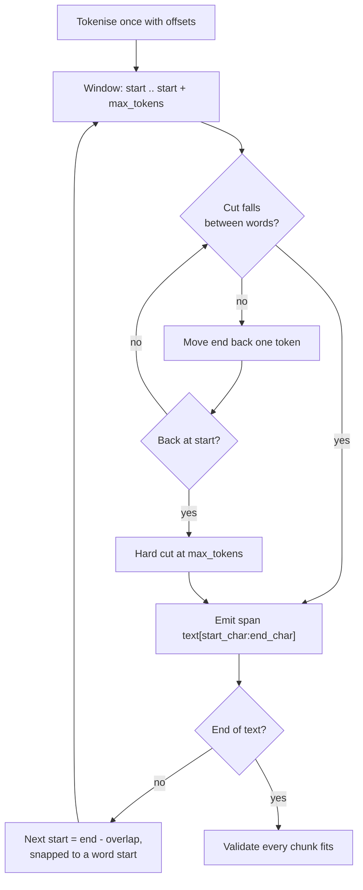

**Token-based chunking** measures chunk length in tokens, the unit that both the embedding model and the language model actually count. [Tokens and tokenisation](/learn/understanding-large-language-models/tokens-and-tokenisation) already showed the core move: encode a document once, slice the list of token ids into windows, decode each window. That code works, and it guarantees the size. This lesson is about everything it leaves unsaid: *which* tokeniser to count with, what goes wrong when you turn token ids back into text, and how to build a token chunker that respects the limit exactly while still returning the document's own words, unaltered, with their positions.

By the end you will have a chunker that measures with the embedding model's tokeniser, never cuts inside a word, and returns character offsets into the source, and you will know why two popular library splitters, used naively, return text that is not quite the text you gave them.

## Learning objectives

- Explain why tokens are the right unit for enforcing model limits, and which tokeniser should do the counting.
- Show how the same text produces different token counts under different tokenisers, and how content type changes the count.
- Identify two ways that decoding token windows corrupts text: broken multi-byte characters and lossy normalisation.
- Build a token-based chunker that uses offset mappings to return exact source text, cut only between words.
- Choose between library token splitters and a custom one, and configure the library options correctly.

## Prerequisites

- [Tokens and tokenisation](/learn/understanding-large-language-models/tokens-and-tokenisation): byte-pair encoding, tiktoken, and a first token chunker.
- [Chunk size](/learn/chunking-fundamentals/chunk-size): the hard ceiling from the embedding model's input limit.
- [Chunk overlap](/learn/chunking-fundamentals/chunk-overlap): stride, overlap and spans.
- [Encoding and Unicode](/learn/data-processing/encoding-and-unicode): code points, UTF-8 bytes and why a character can be several bytes.

## Why this matters

Both hard limits in a RAG system are counted in tokens. The embedding model truncates past its maximum sequence length, counted by *its* tokeniser; the generator's context window and price are counted by *its* tokeniser. A splitter that counts characters or words can only estimate tokens, and the estimate is worst exactly where retrieval matters most: log lines, error codes, identifiers and non-English text, which tokenise into far more tokens per character than ordinary prose. A splitter that counts tokens can make a guarantee instead of an estimate.

But token chunking has its own failure modes, and they are subtle because the output *looks* fine at a glance:

- A chunk counted with the generator's tokeniser can still exceed the embedding model's limit, and be silently truncated.
- Decoding a slice of byte-level tokens can split a character in two, leaving replacement characters (`�`) in the chunk text.
- Decoding with an uncased WordPiece tokeniser lowercases the text, strips accents and inserts spaces around punctuation, so the chunk shown to the user, quoted in a citation and sent to the generator is not what the document said.
- Cutting at an arbitrary token boundary can split a word ("refresh" into "ref" and "resh"), producing fragments that embed poorly.

Each of these degrades retrieval or answers without raising an error.

## The intuition

Imagine packing a bookshelf where every shelf holds exactly one metre of books, and the shop measures with its own tape measure. If you measure your books with a different tape (one that reads a little short on thick books), some shelves will overflow and the shop will quietly drop the books at the end. So you measure with the shop's tape.

Now suppose your method of packing is to slice the row of books every metre, regardless of where one book ends and the next begins. Every shelf is exactly full, but some books are sawn in half. The better method: measure a metre, then slide the cut back to the nearest gap between books. Shelves are slightly less than full, no book is cut, and you still never exceed a metre.

Token-based chunking done well is exactly this: measure with the model's own tokeniser, and move each cut back to the nearest gap between words.

## How it works

### Which tokeniser counts

A **tokeniser** converts text into the integer ids a particular model was trained on. Different model families use different algorithms and vocabularies: OpenAI's models use byte-level BPE vocabularies such as `cl100k_base`, read through the `tiktoken` library; BERT-derived embedding models such as `all-MiniLM-L6-v2` use **WordPiece**, a sub-word scheme in which continuation pieces are marked with `##` (so "refreshed" might become `refresh` + `##ed`). The same text gives different counts under each:

```python
import tiktoken
from sentence_transformers import SentenceTransformer

gpt_enc = tiktoken.get_encoding("cl100k_base")
minilm = SentenceTransformer("sentence-transformers/all-MiniLM-L6-v2").tokenizer

samples = {
    "policy prose": "Up to 5 unused days of annual leave may be carried over and must be used by 31 March.",
    "log line": "2025-03-14T09:21:07Z ERR atlas-sync[4412]: E-4021 vpn client outdated (sess=7f3a9c2e, host=lon-app-03)",
    "Python code": "def rotate(user):\n    if days_since(user.pw_changed) >= 90:\n        force_reset(user)",
    "German prose": "Bis zu fünf ungenutzte Urlaubstage können übertragen werden und verfallen am 31. März.",
}
print(f"{'text':<13} {'chars':>5} {'cl100k_base':>11} {'MiniLM':>6}")
for name, text in samples.items():
    n_gpt = len(gpt_enc.encode(text))
    n_mini = len(minilm(text, add_special_tokens=False)["input_ids"])
    print(f"{name:<13} {len(text):>5} {n_gpt:>11} {n_mini:>6}")
```

```output
text          chars cl100k_base MiniLM
policy prose     85          22     20
log line        102          46     54
Python code      85          22     28
German prose     86          28     31
```

Four texts of nearly equal length in characters range from 20 to 54 MiniLM tokens. The log line costs more than twice the prose, and the two tokenisers disagree by up to 25% on the same text. Two rules follow:

1. **Enforce the embedding limit with the embedding model's tokeniser.** It is the only count that predicts truncation. With `sentence-transformers`, that tokeniser is `model.tokenizer` and the limit is `model.max_seq_length`, which includes two special tokens (`[CLS]` and `[SEP]` for BERT-style models).
2. **Estimate prompt cost with the generator's tokeniser**, or with the provider's token-counting endpoint where no local tokeniser is published. [Tokens and tokenisation](/learn/understanding-large-language-models/tokens-and-tokenisation) showed this for Claude.

If you must pick one tokeniser for chunking, pick the embedding model's: exceeding the generator's budget is caught when you build the prompt, but exceeding the embedding limit is silent.

### Two ways decoding corrupts text

The simple token chunker slices ids and calls `decode` on each slice. Decoding is not always the inverse of encoding.

**Broken characters with byte-level BPE.** Byte-level tokenisers work on UTF-8 bytes, and a character outside ASCII is two to four bytes. If the vocabulary has no single token for a character, its bytes are split across tokens, and a window boundary can fall between them. Decoding half a character yields the Unicode replacement character. LangChain's `TokenTextSplitter`, which slices tiktoken ids and decodes them, shows this on Japanese text:

```python
from langchain_text_splitters import TokenTextSplitter

splitter = TokenTextSplitter(encoding_name="cl100k_base", chunk_size=5, chunk_overlap=0)
print(splitter.split_text("Meridian 日本語 の休暇は25日です"))
```

```output
['Meridian 日本�', '� の休�', '�は25日です']
```

The character 語 is encoded as two byte-tokens, and the window boundary falls between them; so do the two halves of 暇. Each chunk now contains broken characters, and neither chunk contains the word 日本語 that a query might use. The tiny `chunk_size` makes the effect easy to see; at realistic sizes it happens less often per chunk, but in a large multilingual corpus it happens constantly.

**Lossy normalisation with WordPiece.** Uncased BERT tokenisers lowercase text and strip accents before splitting, and their `decode` cannot restore what was removed; it also reinserts spaces around punctuation. LangChain's `SentenceTransformersTokenTextSplitter` decodes windows this way, so its output for the Atlas runbook used below begins `'atlas sync errors. error e - 4021 means the vpn client is out of date : update it from the it ...'`, and later contains `'cafe'` and `'wi - fi'`. Embedding that text is harmless (the model would normalise it identically anyway), but it is the text you store, show in citations and send to the generator. "E-4021" has become "e - 4021", which an exact-match keyword search will not find.

The fix for both is the same: **never use decoded text as the chunk; use the tokens only to decide where to cut, and slice the original string.**

### Offset mappings

Hugging Face's "fast" tokenisers (implemented in Rust, and the default in current `transformers`) can return an **offset mapping**: for every token, the `(start, end)` character positions in the original string that it came from. With offsets, a window of tokens `i` to `j` corresponds exactly to the source slice `text[offs[i][0]:offs[j][1]]`. The chunk is the document's own text, with original case, accents and punctuation, and the offsets are the chunk's citation coordinates.

Offsets also reveal word boundaries. If token `i` starts at a later character than token `i-1` ends, there is whitespace between them, so a cut before token `i` does not split a word. If they are contiguous (as `refresh` and `##ed` are, or `08` and `:`), cutting there would split a word.

`tiktoken` does not return offset mappings in the same form, though its byte-level tokens can be mapped back to positions with some care; for chunking against an embedding model, the Hugging Face tokeniser of that model is the natural choice anyway.

### The mechanism

A token chunker that respects words and returns exact text:

1. **Tokenise once** with the embedding model's tokeniser, without special tokens, requesting offsets.
2. **Set the budget**: the model's limit minus its special tokens minus any text you will prepend before embedding (a title, a heading).
3. **Propose a window** of `max_tokens` tokens from the current start.
4. **Back off to a word boundary**: move the end back while the cut would fall inside a word. If no boundary exists in the window (a single "word" longer than the limit, such as a long hash or URL), fall back to a hard cut.
5. **Emit the chunk** as the character span from the first token's start to the last token's end.
6. **Advance**: step back from the end by the overlap, snap to a word start, and make sure the new start is after the previous one so the loop always progresses.
7. **Validate**: re-tokenise each chunk and assert it fits.



### Library options

You do not always need a custom chunker. The common choices, and what to check:

- **LangChain `TokenTextSplitter(encoding_name=..., chunk_size=..., chunk_overlap=...)`** counts and cuts with a tiktoken encoding. Good for generator-side budgets; beware broken characters in non-ASCII text, and remember it does not count with your embedding model's tokeniser.
- **LangChain `SentenceTransformersTokenTextSplitter(model_name=..., tokens_per_chunk=..., chunk_overlap=...)`** counts with a sentence-transformers model's tokeniser. Its default `model_name` is `all-mpnet-base-v2`, so set it to the model you actually embed with, and expect decoded (normalised) text with an uncased model.
- **Length functions on boundary-aware splitters.** Most LangChain splitters accept a `length_function`, and the class methods `from_tiktoken_encoder(...)` and `from_huggingface_tokenizer(tokenizer, ...)` configure one that counts tokens. This gives boundary-aware cutting (on separators) with token-accurate sizes and returns source text rather than decoded text, the combination most production pipelines want. [Recursive character splitting](/learn/advanced-chunking-strategies/recursive-character-splitting) builds on it.
- **LlamaIndex `TokenTextSplitter`** and `SentenceSplitter` take a `chunk_size` in tokens and an optional `tokenizer` callable; pass your embedding model's tokeniser if you want its count.

> [!KEY]
> Count with the embedding model's tokeniser, cut between words, and slice the source string rather than decoding tokens. Then the size is guaranteed and the text is exactly what the document says.

## In code

**The problem.** Chunk a Meridian runbook into windows of at most 24 MiniLM tokens with an overlap of about 4, without splitting words or altering the text, and compare the result with the naive slice-and-decode approach.

**Dependencies.** `sentence-transformers` brings the Hugging Face tokeniser with offset support.

```bash
pip install sentence-transformers
```

**The source.**

```python
from sentence_transformers import SentenceTransformer

model = SentenceTransformer("sentence-transformers/all-MiniLM-L6-v2")
tok = model.tokenizer

runbook = (
    "Atlas sync errors. Error E-4021 means the VPN client is out of date: update it from the "
    "IT portal and retry the sync. Error E-4012 means the VPN certificate expired mid-sync. "
    "Staff working from a café, hotel or airport must connect to the VPN before syncing, "
    "because public Wi-Fi is never trusted. If the error persists, contact the support desk "
    "(08:00 to 18:00 UK time) and quote the error code and your laptop's asset tag."
)

def token_chunks(text, max_tokens, overlap):
    """Chunks of at most `max_tokens` embedding-model tokens, cut only between words.

    Returns (start_char, end_char) spans into `text`, so every chunk is exact source text.
    """
    offs = tok(text, add_special_tokens=False, return_offsets_mapping=True)["offset_mapping"]
    n = len(offs)

    def is_boundary(i):  # a cut before token i falls on whitespace, not inside a word
        return i == 0 or i == n or offs[i][0] > offs[i - 1][1]

    spans, start = [], 0
    while start < n:
        end = min(start + max_tokens, n)
        e = end
        while e > start + 1 and not is_boundary(e):   # back off to the last word boundary
            e -= 1
        if not is_boundary(e):                        # one "word" longer than the limit
            e = end                                   # fall back to a hard cut
        spans.append((offs[start][0], offs[e - 1][1]))
        if e == n:
            break
        nxt = max(e - overlap, start + 1)             # step back by the overlap...
        while nxt > start + 1 and not is_boundary(nxt):
            nxt -= 1                                  # ...to the start of a word
        start = nxt
    return spans

def naive_chunks(text, max_tokens, overlap):
    """Slice token ids and decode them, as many simple token splitters do."""
    ids = tok(text, add_special_tokens=False)["input_ids"]
    step = max_tokens - overlap
    return [tok.decode(ids[i:i + max_tokens]) for i in range(0, max(len(ids) - overlap, 1), step)]

print(f"runbook: {len(tok(runbook, add_special_tokens=False)['input_ids'])} tokens\n")
print("naive (slice ids, decode):")
for c in naive_chunks(runbook, 24, 4):
    print(f"  {c!r}")

print("\noffset-based, cut between words:")
for a, b in token_chunks(runbook, 24, 4):
    chunk = runbook[a:b]
    n_tok = len(tok(chunk, add_special_tokens=False)["input_ids"])
    assert n_tok <= 24
    print(f"  [{a:>3}:{b:>3}] {n_tok:>2} tok  {chunk!r}")
```

```output
runbook: 108 tokens

naive (slice ids, decode):
  'atlas sync errors. error e - 4021 means the vpn client is out of date : update it from the it'
  'it from the it portal and retry the sync. error e - 4012 means the vpn certificate expired mid -'
  'certificate expired mid - sync. staff working from a cafe, hotel or airport must connect to the vpn before syncing'
  '##n before syncing, because public wi - fi is never trusted. if the error persists, contact the support desk'
  "contact the support desk ( 08 : 00 to 18 : 00 uk time ) and quote the error code and your laptop '"
  "and your laptop ' s asset tag."

offset-based, cut between words:
  [  0: 90] 24 tok  'Atlas sync errors. Error E-4021 means the VPN client is out of date: update it from the IT'
  [ 76:164] 22 tok  'it from the IT portal and retry the sync. Error E-4012 means the VPN certificate expired'
  [141:249] 24 tok  'VPN certificate expired mid-sync. Staff working from a café, hotel or airport must connect to the VPN before'
  [235:332] 24 tok  'the VPN before syncing, because public Wi-Fi is never trusted. If the error persists, contact the'
  [311:399] 24 tok  'persists, contact the support desk (08:00 to 18:00 UK time) and quote the error code and'
  [381:424] 11 tok  "the error code and your laptop's asset tag."
```

**The important lines.**

- `return_offsets_mapping=True` gives the `(start, end)` character span of every token. `add_special_tokens=False` keeps `[CLS]` and `[SEP]` out of the count; the budget you pass in must already allow for them.
- `is_boundary(i)` is the whole word-respecting idea in one comparison: a cut before token `i` is safe if there is a gap (whitespace) between where token `i-1` ends and token `i` starts.
- The first inner `while` moves the end of the window back to a boundary; the fallback handles a single unbroken string longer than the window, which would otherwise loop forever.
- `nxt = max(e - overlap, start + 1)` guarantees progress even when the overlap is large or snapping moves a long way back.
- `runbook[a:b]` is the chunk. The tokens decided where to cut; the text comes from the source, untouched, and `(a, b)` can be stored as the chunk's citation offsets.

**What the output means.**

- The naive chunks are lowercased (`atlas`, `vpn`), accent-stripped (`cafe`) and re-spaced (`e - 4021`, `wi - fi`, `laptop ' s`). That is the uncased WordPiece tokeniser's normalisation, which `decode` cannot reverse. One of them also begins `##n before syncing`, a leftover word-piece: the window started inside "VPN", which this tokeniser splits into `vp` and `##n`.
- The offset-based chunks are exact substrings of the runbook, so "E-4021", "café" and "(08:00 to 18:00 UK time)" survive intact. Every chunk is re-tokenised and asserted to be at most 24 tokens. One chunk is 22 tokens rather than 24 because the end backed off to avoid splitting "mid-sync".
- The overlap is "about 4" rather than exactly 4 because the next start snaps back to a word start: "VPN certificate expired" is repeated whole.
- The same six-chunk structure comes out of both methods; only the cut points and the text differ. That is typical: the gains are in correctness of text and cleanliness of cuts, not in the number of chunks.

**Errors people commonly hit.**

- `NotImplementedError` or a missing `offset_mapping` key: offsets need a fast tokeniser. Current `transformers` loads fast tokenisers by default; very old setups or models without a fast tokeniser may not.
- Re-tokenising a chunk can occasionally give one more or fewer token than the window it came from, at boundaries where the tokeniser merges differently in context. The `assert` catches it; if it fires, back off by one more token.
- Forgetting to subtract the length of text you prepend before embedding (title, heading), which pushes chunks over the limit after the chunker has approved them.

**How to extend it.** Return dictionaries with `doc_id`, `position`, `start`, `end` and `text`, ready for the enrichment stage. Add a `min_tokens` parameter that merges a tiny final chunk into its predecessor. Then replace `is_boundary` with a test for sentence ends, and you have the core of [Sentence-based chunking](/learn/chunking-fundamentals/sentence-based-chunking).

## A real-world example

Meridian's support desk noticed that AskMeridian's citations for Atlas errors looked wrong. A user asked about "E-4021"; the answer was correct, but the quoted source read "error e - 4021 means the vpn client is out of date", lower-case and oddly spaced, and the "open source" link highlighted nothing because the quoted text did not occur in the runbook. Worse, the team's new keyword index, added alongside vector search to catch exact error codes, found nothing for "E-4021" in that chunk.

Priya traced it to the ingestion job. A year earlier, someone had switched to LangChain's `SentenceTransformersTokenTextSplitter` so that chunks would be measured by the embedding model's tokeniser, which was the right instinct. The splitter decoded its token windows, and with an uncased model the decoded text was normalised. The vectors were fine; everything built on the stored *text* was not.

She replaced it with an offset-based chunker like the one above, wired into the team's existing boundary-aware splitting, storing the start and end offsets with each chunk. Chunk text became byte-for-byte identical to the source, citations highlighted correctly, and the keyword index found error codes again. She added a test to the ingestion job asserting that every chunk's text is a substring of its source document at its recorded offsets, which would have caught the original problem on day one.

## Common mistakes

- **Counting with the generator's tokeniser to enforce the embedding limit.** Counts can differ by a quarter or more, and the overflow is truncated silently by the embedding model.
- **Storing decoded text as the chunk.** Uncased tokenisers lowercase and strip accents; byte-level tokenisers can produce broken characters. Citations, keyword search and the generator all receive altered text.
- **Cutting at arbitrary token boundaries.** Words such as "refreshed" and values such as "08:00" are split across chunks, producing fragments that embed and read badly.
- **Forgetting special tokens and prefixes.** A 256-token model fits 254 content tokens, minus whatever you prepend; chunks sized to 256 lose their tail.
- **Leaving the library's default model name.** `SentenceTransformersTokenTextSplitter` defaults to a different model from the one you may be embedding with.
- **Assuming token counts are stable across model versions.** Changing embedding model changes the tokeniser, which changes every chunk boundary; re-chunk when you change models.

## Best practices

- Count tokens with the embedding model's own tokeniser and budget for special tokens and prepended metadata.
- Use tokens only to decide cut positions; take chunk text from the source string using offsets.
- Snap cuts to word boundaries, with a hard-cut fallback for unbroken strings longer than the limit.
- Store `(start, end)` offsets with every chunk and test that `source[start:end] == chunk_text`.
- Re-tokenise each finished chunk and assert it fits; log any chunk that needed the hard-cut fallback.
- Prefer a boundary-aware splitter with a token-counting `length_function` over a pure token-window splitter for prose.

## Performance considerations

- **Tokenisation speed.** Both tiktoken and Hugging Face fast tokenisers are implemented in Rust and process large volumes of text quickly; for chunking, tokenisation is rarely the bottleneck compared with embedding. Tokenise each document once and reuse the offsets rather than re-tokenising candidate chunks repeatedly.
- **Validation cost.** Re-tokenising every finished chunk roughly doubles tokenisation work. That is still small next to embedding, which runs a neural network over the same tokens.
- **Memory.** Offset mappings store two integers per token. For a 100,000-token document that is 200,000 integers, a few megabytes as Python tuples; process very large documents in sections if memory is tight.
- **Fill rate.** Snapping to word boundaries leaves chunks slightly under the limit (in the example, 22 of 24 tokens for one chunk). Across a corpus that means a few per cent more chunks than a pure token window, a small price for clean cuts.

## Summary

- Token-based chunking measures size in the unit that model limits use, turning a character estimate into a guarantee.
- Count with the embedding model's tokeniser: different tokenisers disagree substantially, and code, logs and non-English text inflate counts.
- Decoding token windows can corrupt text: byte-level BPE splits multi-byte characters, and uncased WordPiece lowercases, strips accents and re-spaces punctuation.
- Offset mappings let you use tokens to choose cut points while slicing exact source text, with offsets for citation.
- Snap cuts to word boundaries, keep a hard-cut fallback, and validate every chunk against the limit.

## Exercises

**1.** An embedding model has a limit of 512 tokens including two special tokens. You prepend "Title: {title}\n" to each chunk, and the longest title in your corpus is 18 tokens including the label and newline. What should `max_tokens` be?

<details><summary>Show solution</summary>

$512 - 2 - 18 = 492$ tokens. Compute the prefix length per document rather than assuming the longest, or keep a few tokens of margin, because a new document could have a longer title.

</details>

**2.** Explain why `TokenTextSplitter(encoding_name="cl100k_base")` can produce `�` in its output for Japanese text but not for plain English, and why the same problem cannot occur in `token_chunks` above.

<details><summary>Show solution</summary>

`cl100k_base` is a byte-level BPE vocabulary. Common ASCII words are whole tokens, so a window boundary between tokens never falls inside an ASCII character. Many CJK characters are three UTF-8 bytes and are not always single tokens, so a boundary can fall between the bytes of one character, and decoding the incomplete bytes yields the replacement character. `token_chunks` never decodes: it slices the original Python string at character offsets taken from the tokeniser, so a character can never be divided.

</details>

**3.** Extend `token_chunks` to return dictionaries `{"position", "start", "end", "n_tokens", "text"}` and to merge a final chunk shorter than `min_tokens` into the previous chunk if the merged chunk still fits `max_tokens`. Test it on the runbook with `max_tokens=24, overlap=4, min_tokens=12`.

<details><summary>Show solution</summary>

```python
def token_chunk_records(text, max_tokens, overlap, min_tokens):
    spans = token_chunks(text, max_tokens, overlap)
    count = lambda a, b: len(tok(text[a:b], add_special_tokens=False)["input_ids"])
    if len(spans) > 1 and count(*spans[-1]) < min_tokens:
        merged = (spans[-2][0], spans[-1][1])
        if count(*merged) <= max_tokens:
            spans = spans[:-2] + [merged]
    return [{"position": i, "start": a, "end": b, "n_tokens": count(a, b), "text": text[a:b]}
            for i, (a, b) in enumerate(spans)]

for r in token_chunk_records(runbook, 24, 4, 12)[-2:]:
    print(r["position"], r["start"], r["end"], r["n_tokens"])
```

```output
4 317 400 22
5 381 420 10
```

The final chunk is 10 tokens, below `min_tokens`, but merging it with the previous chunk would give the span 317 to 420, which is 28 tokens, over the limit of 24, so the merge is refused and the short chunk is kept. (With `max_tokens=32` the question does not arise: the chunker's last chunk is already 28 tokens.) A more thorough version would rebalance the last two chunks instead of refusing.

</details>

**4.** Design: Meridian is adding German and Japanese versions of the handbook to the same index, with a multilingual embedding model that has a 512-token limit. The current pipeline uses `TokenTextSplitter(encoding_name="cl100k_base", chunk_size=400)`. List the problems this configuration will cause and specify a replacement.

<details><summary>Show solution</summary>

Problems: (1) the count comes from `cl100k_base`, not the multilingual model's tokeniser, so some chunks, especially Japanese ones, may exceed 512 model tokens and be truncated; (2) decoding byte-level windows can split Japanese characters, leaving `�` in stored text and breaking words; (3) cuts fall anywhere, including mid-sentence, which for Japanese (written without spaces between words) also means mid-word.

Replacement: count with the multilingual model's own tokeniser and offsets; slice source text by offsets; choose cut points at sentence ends (for Japanese, the full stop 。 and similar marks; whitespace-based word boundaries do not exist) with a token-count fallback; set `max_tokens` to 512 minus special tokens minus any prefix, with margin; validate every chunk by re-tokenising. Evaluate retrieval separately per language, since token-per-character ratios and boundary detection differ.

</details>

## Check your understanding

```quiz
[
  {
    "q": "Which tokeniser should enforce the maximum chunk length for an index built with `all-MiniLM-L6-v2`?",
    "options": ["tiktoken `cl100k_base`, because it is the most common", "The generator's tokeniser, because it determines prompt cost", "The embedding model's own tokeniser, because its count predicts truncation", "None; count words and multiply by 1.3"],
    "answer": 2,
    "why": "Truncation happens inside the embedding model according to its own token count, so only that tokeniser can guarantee a chunk fits."
  },
  {
    "q": "Decoding a window of ids from an uncased WordPiece tokeniser turns \"Error E-4021 at the café\" into roughly what?",
    "options": ["\"Error E-4021 at the café\"", "\"error e - 4021 at the cafe\"", "\"ERROR E4021 AT THE CAFE\"", "\"Error E-4021 at the caf�\""],
    "answer": 1,
    "why": "Uncased BERT tokenisers lowercase and strip accents before splitting, and decoding inserts spaces around punctuation; none of that can be undone by decode."
  },
  {
    "q": "In an offset mapping, token 7 spans characters (40, 46) and token 8 spans (46, 49). Is a cut before token 8 a word boundary?",
    "options": ["Yes, because token 8 has a different id", "No, because token 8 starts exactly where token 7 ends, so they are parts of the same word", "Yes, because offsets are always word boundaries", "It depends on the overlap setting"],
    "answer": 1,
    "why": "Contiguous offsets mean there is no whitespace between the tokens, so they belong to one word (for example a word and its ## continuation); cutting there would split it."
  },
  {
    "q": "Why does byte-level BPE chunking sometimes produce the character `�`?",
    "options": ["A window boundary fell between the bytes of a multi-byte UTF-8 character, and the incomplete bytes cannot be decoded", "The tokeniser does not support Unicode", "The overlap was set too high", "The text was not normalised to NFC"],
    "answer": 0,
    "why": "Characters outside ASCII take several bytes; when they are split across tokens and a window cuts between them, decoding the partial sequence yields the replacement character."
  },
  {
    "q": "What is the main advantage of slicing the source string by offsets instead of decoding token windows?",
    "options": ["It produces fewer chunks", "It is the only way to use overlap", "It makes embedding faster", "Chunk text is exactly the source text, and the offsets can be stored for citations and validation"],
    "answer": 3,
    "why": "Tokens decide where to cut, but the text comes from the source, untouched, and the span doubles as the chunk's location in the document."
  }
]
```

## Further reading

- Hugging Face Tokenizers documentation, [huggingface.co/docs/tokenizers](https://huggingface.co/docs/tokenizers/), including offsets and pre-tokenisation.
- Hugging Face course, chapter 6, "The Tokenizers library", [huggingface.co/learn](https://huggingface.co/learn), with sections on fast tokenisers, offset mappings and WordPiece.
- Sennrich, Haddow and Birch (2016), "Neural Machine Translation of Rare Words with Subword Units", [arXiv:1508.07909](https://arxiv.org/abs/1508.07909). The paper that brought byte-pair encoding to neural language processing.
- Wu et al. (2016), "Google's Neural Machine Translation System: Bridging the Gap between Human and Machine Translation", [arXiv:1609.08144](https://arxiv.org/abs/1609.08144). Describes the WordPiece model used by BERT-family tokenisers.
- tiktoken on GitHub, [github.com/openai/tiktoken](https://github.com/openai/tiktoken).
- LangChain documentation on splitting by tokens, [python.langchain.com](https://python.langchain.com/).
