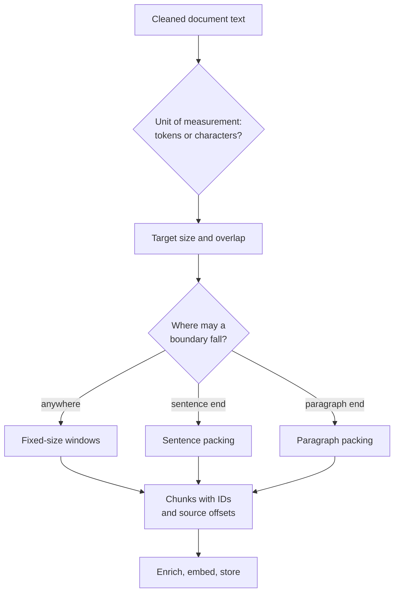

Every RAG system you have met so far in this course retrieves **chunks**: passages cut from larger documents. [What is RAG?](/learn/introduction-to-rag/what-is-rag) introduced them in one sentence and the [indexing pipeline](/learn/rag-architecture-fundamentals/indexing-pipeline) gave them a stage of their own, between cleaning and enrichment. This lesson asks the question those lessons skipped: why cut documents up at all? Why not embed each document whole and hand the best documents to the model?

The answer has three parts, and each one constrains how you chunk. Embedding models can only read a limited amount of text. A single vector cannot represent a document that is about many things. And the language model has a finite, priced context window that should be spent on relevant text. You will see the first two happen in code on a Meridian handbook, and finish with a map of the splitting choices the rest of this module examines one at a time.

## Learning objectives

- Explain the three constraints (embedding input limits, single-vector dilution and context budget) that make chunking necessary.
- Demonstrate silent truncation by an embedding model and identify which part of a document it hides.
- Calculate the idealised similarity between a query and a document that mixes several unrelated topics.
- Describe the tension between a chunk being findable and a chunk being understandable on its own.
- Name the decisions every splitter makes (unit, size, overlap, boundaries) and match each to the lesson that covers it.

## Prerequisites

- [Embeddings](/learn/understanding-large-language-models/embeddings): text as a vector whose direction encodes meaning.
- [Tokens and tokenisation](/learn/understanding-large-language-models/tokens-and-tokenisation): how text is counted in tokens.
- [Context windows](/learn/understanding-large-language-models/context-windows): the token budget of a generation request.
- [Query-document matching](/learn/rag-architecture-fundamentals/query-document-matching): scoring a chunk against a query with cosine similarity.

## Why this matters

Chunking is the stage of a RAG system that people configure once, with library defaults, and then forget. It is also the stage that decides what can ever be retrieved. Retrieval returns chunks, never fragments of chunks, so the chunk is the **unit of retrieval**: the smallest thing the retriever can find, score, and hand to the model. Every later stage inherits its shape.

When chunking is wrong, the symptoms show up far away from the cause:

- **A fact that is in the index cannot be found.** The document was embedded whole, the fact sat past the embedding model's input limit, and the model never read it. No error was raised.
- **The right document ranks below a wrong one.** The answer is one paragraph in a twelve-page policy, and the policy's vector is an average over twelve pages of other subjects.
- **The answer is right but unusable.** A chunk says "these must be used by 31 March" and nothing in it says what "these" are, because the sentence naming them landed in the previous chunk.
- **Costs and latency drift upwards.** Large chunks fill the prompt with text that is not about the question, and you pay for every token of it on every request.

None of these is fixed by a better embedding model or a cleverer prompt. They are fixed by deciding, deliberately, where documents are cut.

## The intuition

Imagine Meridian's library has one card per book in its catalogue, and each card carries a single summary sentence. Someone asks, "How many unused leave days carry over?" The answer is on page 3 of the employee handbook. The handbook's card says "Company policies for employees", which is true and useless: it also describes the expenses policy, the laptop policy and the VPN rules, and it is no closer to this question than to any other.

Now give the catalogue one card per section, each summarising a page or two. The card "Annual leave: entitlement, carry-over and deadlines" is plainly the one to pull. That is the first half of the idea: **smaller units have sharper summaries**, so a search over them can tell the relevant from the irrelevant.

Take it too far, though, and give every sentence its own card. The card for "They must be used by 31 March" is sharp but meaningless: *what* must be used? The sentence leans on its neighbour. That is the second half: **a unit must carry enough context to be understood alone**.

Chunking is choosing a point between those two pulls, and every decision in this module is a way of choosing it.

## How it works

### Constraint 1: embedding models have an input limit

An embedding model is a transformer that reads a sequence of tokens and produces one vector. It is trained and built for a maximum sequence length, and it **truncates** anything longer: the extra tokens are dropped before the model sees them. The local model used throughout this course, `all-MiniLM-L6-v2`, accepts 256 tokens (two of which are the special `[CLS]` and `[SEP]` markers), which is roughly 190 English words. Hosted embedding models accept considerably more, commonly thousands of tokens, but every model has a limit; check the documentation of the model you use, because the figure changes between models and versions.

Truncation is silent in most libraries. `SentenceTransformer.encode` cuts the input at `max_seq_length` and returns a perfectly normal-looking vector. The vector describes the beginning of the document, and nothing tells you the rest was ignored.

### Constraint 2: one vector cannot hold many topics

Suppose the model's limit were unlimited. Embedding a whole document would still be a bad idea, because a document embedding is a summary of *everything* in it. Models like MiniLM produce their vector by **mean pooling**: they compute a vector for every token and take the average. A handbook section on leave and a section on VPNs push that average in different directions, and the result points somewhere between all the subjects, close to none of them.

A query, by contrast, is usually about one thing. So the cosine between a focused query and a many-topic document is lower than between the same query and the one passage that answers it. Retrieval ranks by that cosine, so a long, mixed document loses to a short, single-topic one even when only the long one contains the answer. This effect is called **dilution**, and the mathematics section below puts a number on it.

### Constraint 3: the generator's context is a budget

Retrieval exists to choose what the language model reads. As [Context windows](/learn/understanding-large-language-models/context-windows) showed, the prompt has a fixed token budget shared by instructions, retrieved text, the question and the answer, and you pay per token. If the unit of retrieval is a whole document, retrieving the five best units may mean fifty pages, most of it irrelevant. Even where it fits, irrelevant text is not free: it costs money and latency, and research such as Liu and colleagues' "Lost in the Middle" (2023) found that the models they tested used information less reliably when it was buried in a long context. Smaller units let you send the relevant paragraphs and nothing else.

### The tension: findable versus understandable

Constraints 1 to 3 all push towards *smaller* chunks. One force pushes back: a chunk is read **in isolation**, twice. The embedding model reads it alone when it builds the vector, and the language model reads it with no guarantee that its neighbours are also in the prompt. A chunk that depends on text outside itself is weaker at both moments: its vector misses the subject that a pronoun refers to, and the model cannot answer from it.

So good chunks have two properties, which pull against each other:

- **Focused**: about one thing, so its vector is close to the questions it answers. This favours small chunks.
- **Self-contained**: understandable without its neighbours. This favours larger chunks and boundaries in the right places.

> [!KEY]
> A chunk is the unit of retrieval. Make it small enough to be about one thing and complete enough to be understood alone. Every splitter is a strategy for balancing those two requirements.

### What every splitter decides

A **splitter** (also called a chunker or text splitter) is the function that turns a document's text into a list of chunks. However it is implemented, it makes four decisions, and the rest of this module takes them one at a time:

1. **The unit of measurement.** Is a chunk's length counted in tokens, characters or something else? [Token-based chunking](/learn/chunking-fundamentals/token-based-chunking) and [Character-based chunking](/learn/chunking-fundamentals/character-based-chunking).
2. **The target size.** How long a chunk should be. [Chunk size](/learn/chunking-fundamentals/chunk-size).
3. **The overlap.** How much text neighbouring chunks share so that a fact cut at a boundary survives whole in one of them. [Chunk overlap](/learn/chunking-fundamentals/chunk-overlap).
4. **Where boundaries may fall.** Anywhere, at the end of a sentence, or at the end of a paragraph. [Sentence-based chunking](/learn/chunking-fundamentals/sentence-based-chunking) and [Paragraph-based chunking](/learn/chunking-fundamentals/paragraph-based-chunking).

The next module builds on these with splitters that use more of the document: [recursive character splitting](/learn/advanced-chunking-strategies/recursive-character-splitting), which tries a series of boundaries in order; [semantic chunking](/learn/advanced-chunking-strategies/semantic-chunking), which places boundaries where the meaning shifts; and [structure-aware chunking](/learn/advanced-chunking-strategies/structure-aware-chunking), which follows headings, tables and code. [Chunking Optimisation](/learn/chunking-optimisation) then shows how to measure chunk quality and how to separate the unit you search from the unit you send to the model with [parent-child chunking](/learn/chunking-optimisation/parent-child-chunking).



### The mechanism, step by step

Whatever the strategy, a chunking stage in an indexing pipeline does the same five things:

1. **Receive cleaned text** with its structure intact. Chunking after cleaning, not before, matters: a repeated page footer left in the text becomes a chunk boundary in the wrong place, as [Header and footer removal](/learn/document-preprocessing/header-and-footer-removal) explained.
2. **Find candidate boundaries**: every token, every whitespace, every sentence end, or every paragraph break, depending on the strategy.
3. **Group the text between boundaries into chunks** that respect the size limit, measured in the chosen unit, adding overlap if configured.
4. **Record provenance** for each chunk: the parent document ID, the chunk's position, and ideally its start and end offsets in the source, so that citations can point at the exact text.
5. **Validate**: check that no chunk exceeds the embedding model's limit and that no chunk is empty, then hand the list to enrichment.

Play with the splitter below: change the size and the overlap and watch where the cuts fall in the text.

```playground
chunking
```

## The mathematics

### How much a mixed document dilutes a query's similarity

**Intuition.** If a document's vector is the average of the vectors of its topics, then the more unrelated topics it contains, the less it resembles any one of them.

Model a document made of $m$ topics, each represented by a unit vector $\mathbf{t}_1, \dots, \mathbf{t}_m$, and assume for simplicity that the topics are unrelated, meaning their vectors are orthogonal ($\mathbf{t}_i \cdot \mathbf{t}_j = 0$ for $i \ne j$). The document vector is their mean:

$$
\mathbf{d} = \frac{1}{m}\sum_{i=1}^{m} \mathbf{t}_i, \qquad \lVert \mathbf{d} \rVert = \frac{1}{m}\sqrt{m} = \frac{1}{\sqrt{m}}
$$

A query that is exactly about topic 1 has vector $\mathbf{q} = \mathbf{t}_1$. Its cosine with the document is

$$
\cos(\mathbf{q}, \mathbf{d}) = \frac{\mathbf{q} \cdot \mathbf{d}}{\lVert \mathbf{q} \rVert \, \lVert \mathbf{d} \rVert} = \frac{1/m}{1 \cdot 1/\sqrt{m}} = \frac{1}{\sqrt{m}}
$$

- $m$ is the number of distinct topics in the document.
- $\mathbf{t}_i$ is the unit vector for topic $i$.
- $\mathbf{d}$ is the document vector (a mean of the topic vectors).
- $\mathbf{q}$ is the query vector, here identical to $\mathbf{t}_1$.

The chunk that holds only topic 1 would score $\cos(\mathbf{t}_1, \mathbf{t}_1) = 1$.

**By hand.** The handbook below has $m = 6$ sections. In the idealised model, a query that perfectly matches one section scores $1/\sqrt{6} = 1/2.449 = 0.408$ against the whole document and $1$ against its own section. With $m = 2$ it would be $0.707$; with $m = 25$, $0.2$. The penalty grows with the square root of the number of topics.

Real embeddings are not orthogonal (all text shares some direction, so real cosines are rarely near zero), and real queries do not match a section perfectly, so measured numbers differ. The direction of the effect is what carries over, and the code section measures it on real text.

**In Python:**

```python
import numpy as np

rng = np.random.default_rng(0)
dim, m = 384, 6
# m random directions in 384-d space are very nearly orthogonal
topics = rng.normal(size=(m, dim))
topics /= np.linalg.norm(topics, axis=1, keepdims=True)

doc = topics.mean(axis=0)
q = topics[0]
cos = q @ doc / (np.linalg.norm(q) * np.linalg.norm(doc))
print(f"simulated cosine: {cos:.3f}   formula 1/sqrt(m): {1 / np.sqrt(m):.3f}")
```

```output
simulated cosine: 0.384   formula 1/sqrt(m): 0.408
```

Random directions in 384 dimensions are nearly, but not exactly, orthogonal: their small chance overlaps make the simulation land a little below the formula (0.384 against 0.408). Change the seed and it moves by a few hundredths either way; raise `dim` and it closes in on $1/\sqrt{m}$.

## In code

**The problem.** Show, on real text and a real embedding model, the two failures that come from embedding a document whole: truncation hides the end of the document, and dilution lowers the similarity of every query.

**Dependencies.** `sentence-transformers` (which installs PyTorch and Hugging Face `transformers`) and NumPy. The model, about 90 MB, downloads on first use.

```bash
pip install sentence-transformers numpy
```

**The source.** A six-section extract from Meridian's employee handbook, about 290 tokens long.

```python
import numpy as np
from sentence_transformers import SentenceTransformer

model = SentenceTransformer("sentence-transformers/all-MiniLM-L6-v2")
tok = model.tokenizer

handbook = [
    "Annual leave. Every employee receives 25 days of annual leave per year. "
    "Up to 5 unused days may be carried over into the next year, and carried-over days "
    "must be used by 31 March or they are lost. Leave requests go through your line manager "
    "at least two weeks in advance.",
    "Remote work. Staff may work remotely for up to 3 days a week, agreed with their manager. "
    "A one-off home-office equipment budget of £400 covers a desk, chair or monitor. "
    "Contractors are not eligible for the equipment budget.",
    "Expenses. Expense claims must be submitted within 30 days of the purchase through the "
    "finance portal. Any single item over £75 needs an itemised receipt. Claims without a "
    "receipt are returned to the employee by the finance department.",
    "Passwords and network access. Passwords must be rotated every 90 days, and reused passwords "
    "are rejected. The VPN is required whenever you connect from public Wi-Fi, such as in a "
    "café, hotel or airport. Never share your VPN credentials with anyone.",
    "Laptops. Laptops are refreshed on a 3-year cycle. A lost or stolen laptop must be reported "
    "to the support desk at once so that it can be locked remotely. Do not install unapproved "
    "software on a company laptop.",
    "Support desk. The IT support desk is staffed from 08:00 to 18:00 UK time, Monday to Friday. "
    "Outside those hours, urgent security incidents go to the on-call engineer.",
]
full_doc = "\n\n".join(handbook)

n_tokens = len(tok(full_doc, add_special_tokens=False)["input_ids"])
print(f"model limit: {model.max_seq_length} tokens | document: {n_tokens} tokens")

def embed(texts):
    return model.encode(texts, normalize_embeddings=True)

# 1. Truncation: everything after the limit is invisible to the model.
ids = tok(full_doc, add_special_tokens=False)["input_ids"]
prefix = tok.decode(ids[: model.max_seq_length - 2])   # leave room for [CLS] and [SEP]
v_full, v_prefix = embed([full_doc, prefix])
print(f"cosine(full document, first 254 tokens only) = {v_full @ v_prefix:.4f}")

# 2. One vector per document versus one vector per section.
queries = [
    "How many unused leave days can I carry over?",
    "Do I need a receipt for a £90 expense?",
    "What time does the IT support desk open?",
]
doc_vec = embed([full_doc])[0]
chunk_vecs = embed(handbook)
for q in queries:
    qv = embed([q])[0]
    scores = chunk_vecs @ qv
    best = int(np.argmax(scores))
    print(f"\n{q}")
    print(f"  whole document : {doc_vec @ qv:.3f}")
    print(f"  best section   : {scores[best]:.3f}  -> section {best} ({handbook[best].split('.')[0]})")
```

```output
model limit: 256 tokens | document: 295 tokens
cosine(full document, first 254 tokens only) = 1.0000

How many unused leave days can I carry over?
  whole document : 0.512
  best section   : 0.718  -> section 0 (Annual leave)

Do I need a receipt for a £90 expense?
  whole document : 0.420
  best section   : 0.660  -> section 2 (Expenses)

What time does the IT support desk open?
  whole document : 0.273
  best section   : 0.682  -> section 5 (Support desk)
```

**The important lines.**

- `model.tokenizer` is the embedding model's own tokeniser. Counting with it, rather than with a word count or a different model's tokeniser, is the only way to know what the model will actually see.
- `tok.decode(ids[: model.max_seq_length - 2])` rebuilds the text of the first 254 tokens. The `- 2` leaves room for `[CLS]` and `[SEP]`, which the model adds to every input and which count towards its 256.
- `normalize_embeddings=True` makes every vector unit length, so the dot product `@` is the cosine similarity.
- Each section is embedded separately in `embed(handbook)`. That is chunking at its crudest, one chunk per section, and it is enough to show the effect.

**What the output means.**

- The document is 295 tokens, 39 more than the model reads. The embedding of the full document and the embedding of its first 254 tokens are **identical** (cosine 1.0000): the model never saw the tail. The cut falls just before the heading "Support desk", so that entire section is absent from the whole-document vector.
- That explains the third query. Against the whole document it scores 0.273; against the support-desk section, 0.682. The whole-document vector contains no trace of opening hours.
- The first two queries are about sections the model *did* read, so their drop (0.718 to 0.512, and 0.660 to 0.420) is not truncation. It is dilution: those sections share the vector with five other subjects. The drops are smaller than the idealised $1/\sqrt{6}$ model predicts because the sections are not orthogonal: they are all workplace policy, written in the same register.

**Errors people commonly hit.**

- The tokeniser prints a warning such as "Token indices sequence length is longer than the specified maximum sequence length for this model (295 > 256)" when you tokenise the full document. It is a warning from tokenisation, not from `encode`, which truncates without complaint. Treat that warning as a bug report, not noise.
- Comparing raw dot products from vectors that were not normalised gives numbers that are not cosines. Pass `normalize_embeddings=True` or normalise yourself.
- Running offline without the model in the local cache raises a connection error on the first `SentenceTransformer(...)` call.

**How to extend it.** Add a fourth query about the laptop refresh cycle and see whether its whole-document score falls by dilution only (the laptop section is before the cut) or by truncation too. Then embed each *sentence* separately instead of each section and compare the scores for "they are lost": you will see the opposite failure, a fragment too small to stand alone.

## A real-world example

Meridian's Platform team built the first version of AskMeridian over a weekend. Each IT runbook page became one record in the Qdrant cluster: page title plus full page text, embedded with a small local model. Policy questions about short pages worked. Questions about long runbooks, such as "how do I reset the VPN client on macOS?", returned the VPN runbook only some of the time, and when it did, the answer was often "the context does not say", although the runbook plainly did.

Nadia, the engineer who took over the system, checked three things. First, she counted tokens with the embedding model's tokeniser: half the runbooks were several times longer than the model's input limit, so their vectors described only their introductions. The macOS steps were near the end of the VPN runbook. Second, she looked at which runbooks the retriever preferred: short pages about one subject consistently outranked long pages that covered several, which is dilution doing exactly what the mathematics predicts. Third, she looked at what the generator received: when the VPN runbook was retrieved, it was retrieved whole, and its full text pushed the prompt so high that the team's own context-packing code had dropped it in favour of two shorter, less relevant pages.

The fix was not a new model. She introduced a chunking stage: runbooks split at section boundaries, long sections further split to stay under the model's limit, every chunk carrying the runbook title and section heading as metadata. The same questions now retrieved the specific "macOS" section, its vector was about one thing, and it fitted in the prompt with room to spare. The choices she made in the process (what size, how much overlap, which boundaries) are the subjects of the next six lessons.

## Common mistakes

- **Embedding whole documents.** Long documents are truncated silently and mixed documents are diluted, so facts that are in the index cannot be found.
- **Trusting the library default without checking the model limit.** A splitter configured for 1,000 *characters* or 1,000 tokens of a *different* tokeniser can still exceed a 256-token embedding model, and the overflow is dropped without an error.
- **Chunking before cleaning.** Boilerplate, page headers and navigation text become chunks of their own or split real paragraphs in the wrong places.
- **Throwing away provenance.** Chunks without a document ID, position and offsets cannot be cited, cannot be replaced when the document changes, and cannot be expanded to their neighbours at query time.
- **Making chunks as small as possible.** Sentence-sized fragments score well on narrow queries but often depend on context they do not contain, so the model receives text it cannot use.
- **Choosing a strategy without looking at the output.** Reading twenty real chunks takes minutes and catches most chunking bugs; skipping it means discovering them through user complaints.

## Best practices

- **Measure length with the embedding model's own tokeniser** and assert, in the ingestion job, that no chunk exceeds its limit.
- **Keep structure until the chunker has used it.** Paragraph breaks, headings and list markers are boundary signals; the cleaning stage should preserve them.
- **Store provenance with every chunk**: document ID, position, character offsets, and the title or heading it falls under.
- **Start simple and measure.** A sound baseline is a sentence- or paragraph-aware splitter at a moderate size with a little overlap; change it only when an evaluation shows a gain.
- **Inspect samples from every document type.** Policies, runbooks, tables and code fail differently; look at chunks from each.
- **Version your chunking configuration.** Changing it changes every chunk ID and vector, so record which configuration produced the current index.

## Performance considerations

Chunking itself is cheap: splitting text is linear in its length and takes milliseconds per document. Its *consequences* are what cost money.

- **Index size.** The number of vectors is roughly the corpus length divided by the chunk size. A 2-million-token corpus cut into 250-token chunks gives about 8,000 vectors; cut into 100-token chunks it gives about 20,000. With 384-dimensional float32 vectors (1,536 bytes each), that is about 12 MB versus 31 MB of raw vector data, before index overhead and stored text. Small for Meridian, but the ratio holds at a billion tokens.
- **Embedding cost.** Embedding cost is roughly proportional to the total tokens embedded, so the chunk size barely changes it, but overlap does, because overlapping text is embedded twice. [Chunk overlap](/learn/chunking-fundamentals/chunk-overlap) quantifies this.
- **Prompt cost and latency.** Every retrieved chunk is sent to the model on every request. With top-5 retrieval, 1,000-token chunks put 5,000 tokens of context in each prompt; 250-token chunks put 1,250. At an assumed price of 3 dollars per million input tokens (an illustrative figure; check your provider's current pricing), 100,000 requests a month cost about 1,500 dollars of context with the first and 375 with the second.
- **Re-chunking is expensive.** Changing the strategy means re-embedding the whole corpus. Decide with a small evaluation set before indexing millions of documents.

## Security considerations

Chunking changes what a single retrieved unit exposes. If a document carries an access-control label, every chunk cut from it must carry the same label, or a permission-filtered search can return a chunk that the user's role should not see. Chunking can also separate a sensitive passage from the heading that marked it as confidential, so a classification such as "restricted" must be copied from the document to each chunk as metadata, not inferred from the chunk's own text. Finally, smaller chunks make instructions planted in a document (prompt injection) look like any other passage; chunking does not create that risk, but it does not remove it either, so untrusted sources still need the controls described in later security modules.

## Summary

- The chunk is the unit of retrieval: the retriever can only find, score and return whole chunks.
- Embedding models truncate input beyond their limit without raising an error, so text past the limit of an unchunked document is invisible to search.
- One vector per mixed-topic document dilutes every query's similarity; in an idealised model the cosine falls as $1/\sqrt{m}$ for $m$ unrelated topics.
- The generator's context is a priced budget, and smaller units let you spend it on relevant text.
- Good chunks are focused enough to be found and self-contained enough to be understood; every splitter balances these by choosing a unit, a size, an overlap and boundary rules.

## Exercises

**1.** Using the idealised dilution model, what cosine would a perfectly matching query have against a document of 9 unrelated sections? And against a chunk containing 2 of those sections?

<details><summary>Show solution</summary>

Against the whole document, $1/\sqrt{9} = 1/3 \approx 0.333$. Against a two-section chunk, $1/\sqrt{2} \approx 0.707$. Cutting the document into two-section chunks more than doubles the idealised similarity of the right chunk.

</details>

**2.** An embedding model has a 512-token limit. A 1,400-token runbook is embedded whole. Which part of the runbook can a query still find, and what would you expect for a query about the final section?

<details><summary>Show solution</summary>

Only roughly the first 510 tokens (after two special tokens) influence the vector, so only content in about the first third of the runbook can be found. A query about the final section is compared with a vector that contains no information about that section at all. It may still rank the runbook highly by accident, for example if the introduction mentions the same subject, but the content that answers it was never read.

</details>

**3.** Modify the code example to embed each *sentence* of the handbook separately. Run the query "When must carried-over days be used?" and look at which sentence wins. Then run "When must they be used?" and explain the difference.

<details><summary>Show solution</summary>

Split with a simple rule, for example `[s.strip() for h in handbook for s in h.split(". ") if s.strip()]`, which is crude but enough here (it breaks on abbreviations, as [Sentence-based chunking](/learn/chunking-fundamentals/sentence-based-chunking) explains). With "When must carried-over days be used?", the carry-over sentence wins with a cosine of about 0.77 and the runner-up scores about 0.34: a sharp, focused match.

With "When must they be used?", the same sentence still wins, but only at about 0.43, and the runners-up (the password and VPN sentences) are within 0.2 of it. The query has lost its subject, so there is little for the vector to match on. It still works here because the handbook sentence repeats its own subject ("carried-over days must be used"). A chunk that read only "They must be used by 31 March" would have nothing to offer either query: sentence-sized chunks are only safe when each sentence names what it is about.

</details>

**4.** Design: Meridian wants to index its product documentation, a mix of short FAQ entries (40 to 120 tokens each) and long reference pages (3,000 to 10,000 tokens each, with headings). The embedding model's limit is 512 tokens. Propose a chunking approach for each kind of page and justify it using the three constraints.

<details><summary>Show solution</summary>

**FAQ entries:** keep each entry as one chunk. They are already focused (one question, one answer), well under the input limit, and self-contained. Splitting them would create fragments that lose the question.

**Reference pages:** split first at headings so that each chunk is about one subject (dilution), then split any section longer than the limit (truncation) into pieces of a few hundred tokens at paragraph or sentence boundaries, with a small overlap. Attach the page title and section heading to each chunk as metadata so that the chunk remains understandable on its own. Keep chunk size well below 512 so that top-k retrieval sends a modest amount of context (budget). Record offsets so that a chunk can be expanded to its neighbours at query time if answers need more context, which [Parent-child chunking](/learn/chunking-optimisation/parent-child-chunking) develops.

</details>

## Check your understanding

```quiz
[
  {
    "q": "An embedding model with a 256-token limit is given a 600-token document. What does `SentenceTransformer.encode` typically do?",
    "options": ["Raises an error because the input is too long", "Truncates the input to the limit and returns a vector describing only the beginning", "Splits the document automatically and averages the chunk vectors", "Compresses the document into 256 tokens by summarising it"],
    "answer": 1,
    "why": "The model truncates at its maximum sequence length and returns a normal-looking vector; the remaining tokens are never read, and no error is raised."
  },
  {
    "q": "In the idealised dilution model, a document contains 4 unrelated topics. What is the cosine between a query that exactly matches one topic and the document's mean vector?",
    "options": ["0.25", "0.75", "0.5", "1.0"],
    "answer": 2,
    "why": "The cosine is 1 divided by the square root of the number of topics, and the square root of 4 is 2, so the result is 0.5."
  },
  {
    "q": "Why is a chunk containing only the sentence \"They must be used by 31 March.\" a poor chunk?",
    "options": ["It is too long for most embedding models", "It is not self-contained: its subject is in a neighbouring sentence, so neither the embedding nor the generator knows what 'they' are", "Dates cannot be embedded", "It contains a full stop, which breaks tokenisation"],
    "answer": 1,
    "why": "A chunk is read in isolation by both the embedding model and the generator; a fragment that depends on its neighbour for its subject cannot be matched or used reliably."
  },
  {
    "q": "Which statement about chunk size and cost is correct?",
    "options": ["Smaller chunks always cost more to embed because there are more of them", "Chunk size has no effect on the cost of a generation request", "Embedding cost tracks total tokens embedded, while prompt cost per request grows with chunk size times the number of chunks retrieved", "Larger chunks reduce prompt cost because fewer of them are needed"],
    "answer": 2,
    "why": "Embedding cost depends mainly on the total tokens embedded (plus any overlap), whereas each request sends k chunks, so prompt tokens scale with chunk size times k."
  },
  {
    "q": "Which of these is NOT one of the four decisions every splitter makes?",
    "options": ["Which embedding model's vectors to store", "The unit used to measure length", "How much neighbouring chunks overlap", "Where boundaries are allowed to fall"],
    "answer": 0,
    "why": "Splitters decide unit, size, overlap and boundary rules; the choice of embedding model is a separate decision, although it constrains the maximum chunk size."
  }
]
```

## Further reading

- Lewis et al. (2020), "Retrieval-Augmented Generation for Knowledge-Intensive NLP Tasks", [arXiv:2005.11401](https://arxiv.org/abs/2005.11401). The original RAG paper, which retrieves passages rather than whole documents.
- Karpukhin et al. (2020), "Dense Passage Retrieval for Open-Domain Question Answering", [arXiv:2004.04906](https://arxiv.org/abs/2004.04906). Splits Wikipedia articles into disjoint 100-word passages as the unit of retrieval.
- Reimers and Gurevych (2019), "Sentence-BERT: Sentence Embeddings using Siamese BERT-Networks", [arXiv:1908.10084](https://arxiv.org/abs/1908.10084). The approach behind the sentence-transformers models, including mean pooling.
- Liu et al. (2023), "Lost in the Middle: How Language Models Use Long Contexts", [arXiv:2307.03172](https://arxiv.org/abs/2307.03172).
- Sentence Transformers documentation, [sbert.net](https://www.sbert.net/), including the notes on `max_seq_length` and input truncation.
