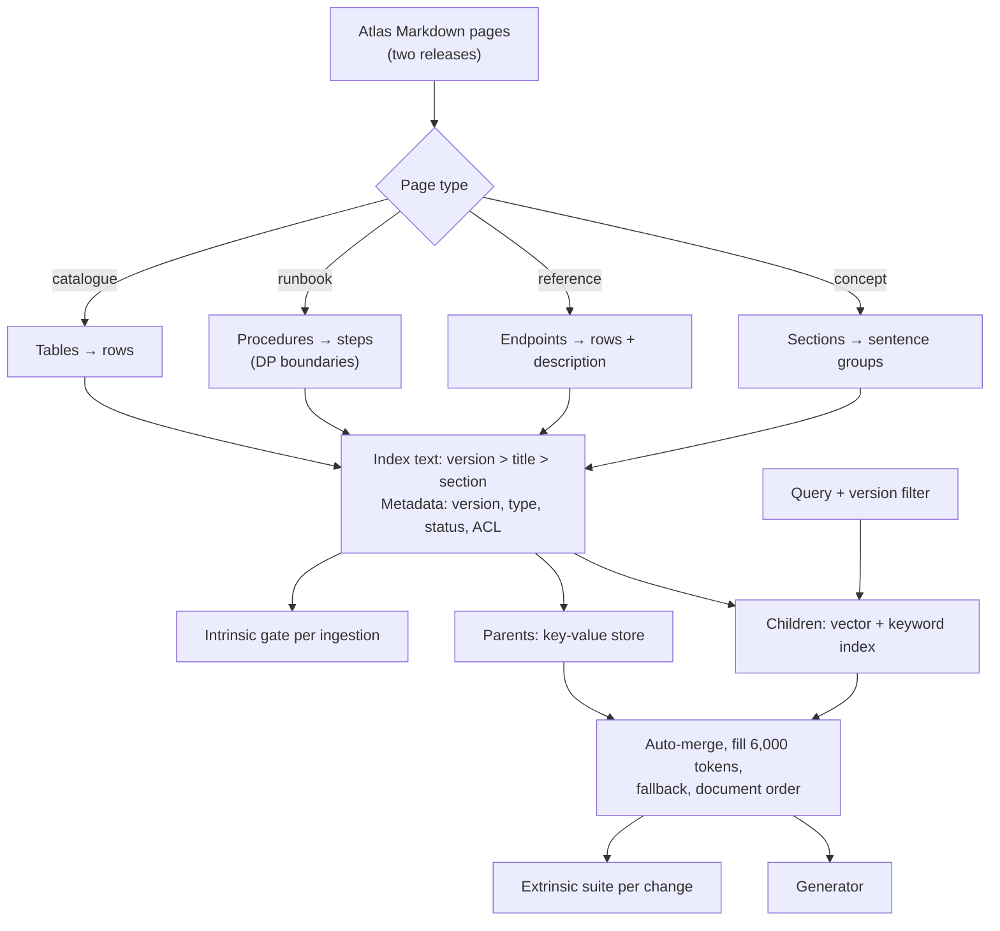

This assessment covers all eight lessons of **Chunking Optimisation**: chunk size experiments, overlap optimisation, boundary preservation, context preservation, parent-child chunking, small-to-big retrieval, late chunking and chunk quality evaluation. Answer the 18 multiple-choice questions first; the pass mark is 70% (13 of 18). Then work through the conceptual questions, the coding exercises, the design challenge and the troubleshooting scenarios, writing your own answer before opening the model answer. The written parts are not scored, but they test whether you can apply the ideas to a system rather than recognise them in a list.

```quiz
[
  {
    "q": "In a chunk-size sweep, what does the 'ceiling' metric measure?",
    "options": [
      "The largest chunk size the embedding model accepts",
      "The share of answer spans that lie wholly inside at least one chunk, which bounds what any retriever could achieve",
      "The best hit rate observed across all chunk sizes",
      "The maximum number of chunks that fit in the context budget"
    ],
    "answer": 1,
    "why": "The ceiling ignores ranking entirely. If the hit rate equals the ceiling, every failure is a split answer, which a better chunker (not a better retriever) must fix."
  },
  {
    "q": "Why should chunk sizes be compared at a fixed token budget rather than a fixed top-k?",
    "options": [
      "At a fixed top-k, larger chunks deliver more text and win for that reason alone",
      "Because top-k is undefined for small chunks",
      "Because vector databases limit the number of results",
      "Because the embedding model requires a fixed number of tokens"
    ],
    "answer": 0,
    "why": "Top-5 of 1,000-token chunks is four times the text of top-5 of 250-token chunks. Retrieving floor(B / C) chunks for a budget B makes the comparison fair."
  },
  {
    "q": "What does this code print?\n```python\ndef p_contained(C, L, O):\n    return 0.0 if L > C else min(1.0, (C - L + 1) / (C - O))\n\nprint(p_contained(100, 21, 0), p_contained(100, 21, 20))\n```",
    "options": [
      "0.79 0.9875",
      "0.8 1.0",
      "0.8 0.9875",
      "0.79 1.0"
    ],
    "answer": 1,
    "why": "Without overlap, (100 - 21 + 1) / 100 = 0.8. With O = 20, the stride is 80 and (100 - 21 + 1) / 80 = 1.0: an overlap of L - 1 = 20 guarantees the 21-token span."
  },
  {
    "q": "A team can afford a fixed number of vectors, so the stride is fixed at 200 tokens. They lengthen the window from 200 to 260 tokens. What happens?",
    "options": [
      "The number of vectors rises by 30 per cent",
      "Nothing changes, because overlap only matters at fixed window length",
      "The number of vectors is unchanged, embedded tokens rise by 30 per cent, and spans up to 61 tokens are guaranteed intact",
      "The number of vectors halves"
    ],
    "answer": 2,
    "why": "Vector count depends on the stride alone. Each window now embeds 260 tokens, and an overlap of 60 guarantees spans up to 61 tokens."
  },
  {
    "q": "With 50 per cent overlap, the top four windows contain 512 tokens but only 300 are distinct. What fixes the wasted budget without changing the index?",
    "options": [
      "A larger embedding model",
      "Merging overlapping spans from the same document and filling the budget by distinct tokens",
      "Raising the similarity threshold",
      "Re-indexing with larger chunks"
    ],
    "answer": 1,
    "why": "Merging removes the duplicated tokens, and the freed budget can hold further ranked windows. Diversity may still need MMR or de-duplication."
  },
  {
    "q": "Why is a cut immediately after a heading line penalised as heavily as a cut inside a word?",
    "options": [
      "It orphans the heading at the end of one chunk and leaves the body unlabelled in the next",
      "Headings are always longer than the maximum chunk size",
      "Embedding models ignore headings",
      "It makes the chunk exceed the model's limit"
    ],
    "answer": 0,
    "why": "The heading's value is as a label for the text below it. Separated, the heading chunk says nothing and the body chunk has lost its subject."
  },
  {
    "q": "Greedy boundary snapping and a dynamic-programming chooser use the same cost function. Which is true?",
    "options": [
      "Greedy always finds the cheapest segmentation",
      "Dynamic programming always produces fewer chunks",
      "Dynamic programming finds a segmentation whose total cost is no higher than greedy's",
      "They always agree"
    ],
    "answer": 2,
    "why": "The dynamic programme minimises the total cost over all segmentations within the size limit, and greedy's segmentation is one of those."
  },
  {
    "q": "A superseded handbook remains in the index and is sometimes returned as current. Which fix is reliable?",
    "options": [
      "Prepend '(superseded)' to the old chunks' embedded text",
      "Increase overlap",
      "Use late chunking",
      "Store a status field in metadata and filter on status = current inside every search"
    ],
    "answer": 3,
    "why": "Validity is a rule, not a similarity. In the lesson, adding version words to headers made stale matches worse; a filter excluded them completely."
  },
  {
    "q": "A 20-token header is prepended to chunks whose bodies average 40 tokens. Roughly what share of each mean-pooled vector does the header contribute?",
    "options": ["About 5 per cent", "About a third", "About half", "None, because headers are ignored"],
    "answer": 1,
    "why": "20 / (20 + 40) is about 0.33. Attention mixing makes the true influence somewhat larger, which is why headers on small chunks must be short."
  },
  {
    "q": "In parent-child chunking, why must children be cut from each parent's text rather than from the whole document?",
    "options": [
      "So that every child lies inside exactly one parent, making the parent lookup meaningful",
      "Because vector databases require it",
      "To reduce the number of parents",
      "Because parents must be embedded"
    ],
    "answer": 0,
    "why": "A child cut from the document could span two parents, and its single parent_id would then point at only half of its context."
  },
  {
    "q": "A document's section is renamed and the document is re-ingested by upserting the new records only. IDs are derived from document, version, heading and position. What is the result?",
    "options": [
      "The old section is overwritten in place",
      "Ingestion fails with a duplicate-ID error",
      "The vector database deletes the old records automatically",
      "Old parents and children remain alongside the new ones, so stale text can be retrieved"
    ],
    "answer": 3,
    "why": "New headings and versions give new IDs, so nothing overwrites the old records. Delete all of a document's records by doc_id before writing the new version."
  },
  {
    "q": "Parents average 1,500 tokens and the generator budget for retrieved text is 4,000 tokens. How many parents can be sent?",
    "options": ["1", "2", "3", "4"],
    "answer": 1,
    "why": "floor(4000 / 1500) = 2. Parent size should be bounded by the budget divided by the number of parents you want to send."
  },
  {
    "q": "What does this code print?\n```python\nchildren_of = {\"A\": [\"a1\", \"a2\", \"a3\"], \"B\": [\"b1\", \"b2\", \"b3\", \"b4\"]}\nretrieved = [\"b2\", \"a1\", \"a3\"]\nfor p, cs in children_of.items():\n    share = sum(c in retrieved for c in cs) / len(cs)\n    print(p, round(share, 2), share >= 0.5)\n```",
    "options": [
      "A 0.67 True / B 0.25 False",
      "A 0.67 False / B 0.25 False",
      "A 2 True / B 1 False",
      "A 0.33 False / B 0.25 False"
    ],
    "answer": 0,
    "why": "Two of A's three children were retrieved (0.67, merged at a 0.5 threshold); one of B's four (0.25, not merged). This is the auto-merging test."
  },
  {
    "q": "Parent X has one retrieved child scoring 0.71 out of 12 children; parent Y has two retrieved children scoring 0.60 and 0.58 out of 3. Which aggregation ranks X first?",
    "options": ["Sum", "Coverage ratio", "Max", "None of them"],
    "answer": 2,
    "why": "Max gives X 0.71 and Y 0.60. Sum gives Y 1.18; coverage gives Y 0.67 against X 0.08."
  },
  {
    "q": "What is the essential mechanism of late chunking?",
    "options": [
      "Chunking after the answer is generated",
      "Storing one vector per token and comparing with query tokens at search time",
      "Asking a language model to write context for each chunk",
      "Encoding the whole document once and mean-pooling each chunk's span of token vectors"
    ],
    "answer": 3,
    "why": "Pooling happens after a whole-document encoder pass, so each chunk's token vectors have attended to the rest of the document. Option two describes late interaction."
  },
  {
    "q": "Which constraint does late chunking impose that early chunking does not?",
    "options": [
      "The document (or a macro chunk) must fit within the embedding model's input in one pass",
      "Chunks must be exactly the same size",
      "Queries must be longer than chunks",
      "A language model call is needed per chunk"
    ],
    "answer": 0,
    "why": "Context comes from a single encoder pass. Tokens beyond the model's limit are never encoded, so long documents need long-context models or macro chunks."
  },
  {
    "q": "An answer is 10 tokens; the retrieved chunks cover 250 distinct tokens including 8 answer tokens. What are token recall and IoU?",
    "options": [
      "0.8 and 0.04",
      "0.8 and 0.0317",
      "0.032 and 0.8",
      "1.0 and 0.032"
    ],
    "answer": 1,
    "why": "Recall = 8 / 10 = 0.8. IoU = 8 / (10 + 250 - 8) = 8 / 252, about 0.0317."
  },
  {
    "q": "A new chunker beats the old one by 0.03 in mean recall on 40 questions; the paired bootstrap 95% interval is -0.05 to +0.11. What should you conclude?",
    "options": [
      "The new chunker is better and should ship",
      "The old chunker is better",
      "The data do not show a difference; more questions or a larger effect are needed",
      "Paired comparisons cannot be used for recall"
    ],
    "answer": 2,
    "why": "The interval includes zero, so the observed difference is consistent with no difference at all."
  }
]
```

## Conceptual questions

**1.** A colleague says: "Our sweep shows 1,024-token chunks have the best hit rate, so we should use them." Give three distinct reasons the conclusion may be wrong, each tied to a check you would run.

<details><summary>Show model answer</summary>

- **Unequal comparison.** If the sweep used a fixed top-k, larger chunks delivered more text. Rerun at a fixed token budget with $k = \lfloor B / C \rfloor$.
- **Truncation.** If the embedding model's limit is below 1,024 tokens (plus special tokens), each chunk's vector represents only its beginning. Count chunks over the limit; treat any size above it as invalid.
- **Small or unrepresentative test.** A sample corpus with few competing chunks makes large-chunk retrieval easy, and a small question set has wide intervals. Run on the real corpus with a few hundred questions and compare sizes with a paired bootstrap.
- (Also acceptable) **Metric bias.** Containment rises with size by construction. Report a cost measure (tokens per hit, token precision) or token-level IoU beside it.

</details>

**2.** Explain the difference between *matching* and *delivery* in overlap optimisation, and describe a corpus where query-time padding can replace index-time overlap and one where it cannot.

<details><summary>Show model answer</summary>

Matching is whether the query's embedding finds the chunk; delivery is whether the generator receives the whole answer. Index-time overlap changes what is embedded, so it can fix both. Query-time padding changes only what is sent after retrieval, so it fixes delivery only.

Padding suffices where half of a split answer still matches well: sentence-sized facts with distinctive words ("VPN is required on public Wi-Fi"), as in the Meridian experiment where padding of 8 tokens reached the same hit rate as an overlap of 16. It fails where the halves are generic: "must be submitted within" in one window and "30 days of the purchase" in the next, neither of which matches "expense deadline" well. Then index-time overlap (or better boundaries) is needed.

</details>

**3.** Classify the four places context can be restored to a chunk and give, for each, one kind of lost context it is the right remedy for and one it cannot fix.

<details><summary>Show model answer</summary>

- **Embedded text (header):** right for *subject* (which product or policy); cannot enforce *validity*, because a few words in a vector neither exclude stale chunks nor match queries that never mention the date.
- **Metadata filter:** right for *validity* and *permissions*; cannot fix *subject* matching, because it excludes rather than ranks and the query rarely names the field.
- **Prompt header:** right for *provenance* the generator needs to cite and qualify; cannot change which chunks are retrieved.
- **Query-time expansion (neighbours, parents):** right for *referent* and *structure* (what "it" means, which step comes before); cannot help a chunk that was never retrieved.

</details>

**4.** Compare parent retrieval, sentence windows and auto-merging on three axes: completeness of context, budget efficiency and respect for document structure.

<details><summary>Show model answer</summary>

- **Parent retrieval:** the most complete context (the whole coherent unit), the least budget-efficient (long parents consume the budget and may not fit at all), and fully structural if parents are sections.
- **Sentence windows:** moderate completeness (qualifiers within $w$ sentences), very budget-efficient, and blind to structure unless constrained (library windows can cross headings).
- **Auto-merging:** completeness adapts to the evidence (the parent only when enough of it matched), good budget efficiency, and structural because it merges into the hierarchy's units. It needs a hierarchy and a threshold to tune, and a fallback when the parent does not fit.

</details>

**5.** Why can intrinsic metrics separate two chunkers clearly when a retrieval evaluation on 20 questions cannot? What role should each play in a production pipeline?

<details><summary>Show model answer</summary>

Intrinsic metrics are computed over every chunk (hundreds or millions of cut points), so a difference such as "100 per cent clean cuts against almost none" is measured with essentially no sampling error. A retrieval evaluation's sample is the question set; with 20 questions each question is 5 points, and most questions are answered equally well by any reasonable chunker, so the few that differ cannot separate the two with confidence.

In production, intrinsic metrics are the everyday gate: cheap, label-free, run on every ingestion, and quick to catch broken parsing or configuration. Extrinsic token-level metrics on a few hundred labelled questions, with paired bootstrap intervals, are the change gate: run on every change to chunking code or configuration to decide whether the change helps retrieval.

</details>

## Coding exercises

**1.** Write `choose_overlap(answer_lengths, C, percentile=90)` that returns the smallest overlap guaranteeing that answers up to the given percentile length lie inside one chunk, using the nearest-rank percentile. Then report the index growth factor, and the containment probability of the longest answer with and without the chosen overlap, for $C = 256$ and the lengths `[12, 18, 25, 9, 40, 31, 22, 15, 60, 27, 19, 33]`.

<details><summary>Show solution</summary>

```python
import math

def p_contained(C, L, O):
    """Probability that an L-token span at a random position lies inside one window."""
    return 0.0 if L > C else min(1.0, (C - L + 1) / (C - O))

def choose_overlap(answer_lengths, C, percentile=90):
    """Smallest overlap guaranteeing spans up to the given percentile length."""
    ordered = sorted(answer_lengths)
    idx = math.ceil(percentile / 100 * len(ordered)) - 1          # nearest-rank percentile
    L_p = ordered[idx]
    return max(0, L_p - 1), L_p

lengths = [12, 18, 25, 9, 40, 31, 22, 15, 60, 27, 19, 33]
C = 256
O, L_p = choose_overlap(lengths, C)
print(f"90th-percentile answer length: {L_p} tokens -> overlap {O}")
print(f"index growth factor: {C / (C - O):.3f}")
print(f"P(contained) for the longest answer (60 tokens): "
      f"no overlap {p_contained(C, 60, 0):.3f}, chosen overlap {p_contained(C, 60, O):.3f}")
print(f"mean P(contained), no overlap: {sum(p_contained(C, L, 0) for L in lengths) / len(lengths):.3f}")
```

```output
90th-percentile answer length: 40 tokens -> overlap 39
index growth factor: 1.180
P(contained) for the longest answer (60 tokens): no overlap 0.770, chosen overlap 0.908
mean P(contained), no overlap: 0.903
```

An overlap of 39 tokens guarantees every answer up to 40 tokens and costs 18 per cent more chunks. The 60-token answer, above the percentile, is not guaranteed but survives with probability 0.908 instead of 0.770. Note that the mean containment without overlap is already 0.903: on average one answer in ten is split, which the chosen overlap removes for all but the longest.

</details>

**2.** Implement token-level recall, precision and IoU for a set of answer token positions and a list of retrieved token ranges that may overlap, plus a function that fills a budget of distinct tokens in rank order. Evaluate a 12-token answer at positions 100 to 111 against the ranked spans `[(96, 160), (64, 128), (128, 192), (0, 64), (300, 364)]` at top-1, top-3 and a 160-token budget.

<details><summary>Show solution</summary>

```python
def token_metrics(relevant, retrieved_spans):
    """relevant: set of token positions; retrieved_spans: (start, end) token ranges, may overlap."""
    got = set()
    for a, b in retrieved_spans:
        got |= set(range(a, b))
    inter = len(relevant & got)
    return inter / len(relevant), inter / len(got), inter / len(relevant | got)

def fill_budget(ranked_spans, budget):
    """Take ranked spans while their union has at most `budget` distinct tokens."""
    got, taken = set(), []
    for a, b in ranked_spans:
        new = got | set(range(a, b))
        if len(new) > budget:
            break
        got, taken = new, taken + [(a, b)]
    return taken

answer = set(range(100, 112))                       # a 12-token answer
ranked = [(96, 160), (64, 128), (128, 192), (0, 64), (300, 364)]
for k in (1, 3):
    r, p, iou = token_metrics(answer, ranked[:k])
    print(f"top-{k}: recall {r:.3f}  precision {p:.3f}  IoU {iou:.3f}")
taken = fill_budget(ranked, budget=160)
print("budget 160 takes", taken, "->", "recall {:.3f}  precision {:.3f}  IoU {:.3f}".format(*token_metrics(answer, taken)))
```

```output
top-1: recall 1.000  precision 0.188  IoU 0.188
top-3: recall 1.000  precision 0.094  IoU 0.094
budget 160 takes [(96, 160), (64, 128), (128, 192)] -> recall 1.000  precision 0.094  IoU 0.094
```

The first span already contains the whole answer, so extra spans only lower precision. The three overlapping spans cover 128 distinct tokens (64 to 191), not 192, which is why precision at top-3 is $12/128 \approx 0.094$. The budget of 160 stops before the fourth span, which would raise the union to 192.

</details>

**3.** Implement `auto_merge(retrieved, parent_of, children_of, threshold)` that replaces retrieved children with their parent when at least `threshold` of the parent's children were retrieved, keeps rank order by first appearance and removes duplicates. Run it with the parents `leave` (3 children), `remote` (4) and `expenses` (2), retrieved children `["r3", "l2", "r1", "e2", "l3"]`, at thresholds 0.5 and 0.7.

<details><summary>Show solution</summary>

```python
def auto_merge(retrieved, parent_of, children_of, threshold=0.5):
    """Replace children by their parent when at least `threshold` of the parent's children were retrieved.
    `retrieved` is in rank order; the result keeps the rank of each unit's first appearance."""
    out, seen = [], set()
    for child in retrieved:
        parent = parent_of[child]
        siblings = children_of[parent]
        share = sum(c in retrieved for c in siblings) / len(siblings)
        unit = parent if share >= threshold else child
        if unit not in seen:
            seen.add(unit)
            out.append(unit)
    return out

children_of = {"leave": ["l1", "l2", "l3"], "remote": ["r1", "r2", "r3", "r4"], "expenses": ["e1", "e2"]}
parent_of = {c: p for p, cs in children_of.items() for c in cs}
retrieved = ["r3", "l2", "r1", "e2", "l3"]
print(auto_merge(retrieved, parent_of, children_of))
print(auto_merge(retrieved, parent_of, children_of, threshold=0.7))
```

```output
['remote', 'leave', 'expenses']
['r3', 'l2', 'r1', 'e2', 'l3']
```

At 0.5, every parent reaches the threshold (remote 2/4, leave 2/3, expenses 1/2), so three parents are returned in the order their first child appeared. At 0.7 none does (the highest share is 0.67), so the children are returned unchanged. A two-child parent is merged by a single hit at 0.5, which is why thresholds are often combined with a minimum number of retrieved children.

</details>

## Architecture design challenge

Meridian is adding the **Atlas platform documentation** to AskMeridian: about 3,000 Markdown pages (roughly 6 million tokens) of concept guides, API references with parameter tables, troubleshooting runbooks with numbered steps and shell commands, and the error-code catalogue (codes such as E-4021). Pages are versioned with each Atlas release, and two releases are supported at any time. The embedding model accepts 512 tokens; the generator budget for retrieved text is 6,000 tokens. Engineers ask questions such as "How do I rotate the Atlas API key on 4.2?" and "What does E-4021 mean?".

Design the chunking pipeline: parent and child definitions per content type, boundary rules and protected spans, context handling (including versions), the query-time strategy, and the evaluation gates. State the main trade-offs.

<details><summary>Show reference design</summary>

**Content routing.** Detect the page type from the docs repository's front matter (concept, reference, runbook, error catalogue) and route each to its own chunker, falling back to the concept chunker.

**Parents and children.**

- *Concept guides:* parents are H2 sections, capped at 1,500 tokens (so at least four fit in 6,000) and split at H3 or paragraph boundaries when longer; children are sentence groups of up to 200 tokens.
- *API references:* parents are one endpoint or function each; children are the description paragraph and parameter-table row groups, with the table header repeated in each row group.
- *Runbooks:* parents are procedures, split at step boundaries if over 1,500 tokens; children are single steps (short consecutive steps merged up to about 150 tokens), with the "Run the following command:" lead-in kept with its code block.
- *Error catalogue:* each row is self-contained; children are rows, parents are the category tables.

**Boundaries.** Dynamic-programming boundary choice for runbooks and references (list and table structure makes greedy cuts visibly worse), greedy elsewhere. Protected spans: error codes, version numbers, file paths, URLs, inline code, and fenced code blocks under the child limit. Penalty for cutting between a lead-in ending in a colon and what it introduces.

**Context.** Index text is "Atlas *version* > page title > section" plus the child text (about 15 tokens of header on 150 to 200-token children). Metadata on every record: `doc_id`, `atlas_version`, `page_type`, `status`, `section_path`, permissions. A version filter is mandatory: from the query when it names a version ("on 4.2"), otherwise the latest supported release. Display text is the original Markdown; the prompt header is "Atlas 4.2 > Page > Section".

**Query time.** Hybrid retrieval (dense plus keyword) so exact codes and parameter names match; retrieve 30 children, auto-merge into parents with a threshold of 0.5 and a minimum of two hits per parent, rank by best child, fill 6,000 distinct tokens, fall back to the step with its section heading when a parent does not fit, send in document order.

**Evaluation.** Intrinsic gate on every ingestion per page type (chunks over 512 tokens must be zero, stub count, clean-cut rate, protected-span violations, coverage). Extrinsic suite of about 400 labelled questions stratified by page type and version, with token recall, whole@k at the 6,000-token budget, wrong-version rate and paired bootstrap comparisons for any chunking change.



**Trade-offs.** Four chunkers are more code to maintain than one, but the content types differ too much for one configuration (the error catalogue and runbooks pull in opposite directions). Version filtering doubles nothing in storage but requires reliable version detection in queries; defaulting to the latest release is wrong for engineers on the older one, so the assistant should say which version it answered for. Auto-merging adds a tunable threshold; parent retrieval alone would be simpler but wastes budget on long procedures. Late chunking is not used: the 512-token model cannot see whole pages, and headers address the dominant subject and version loss more cheaply; it could be trialled later with a long-context model on the concept guides.

</details>

## Troubleshooting scenarios

**1.** After the team raised chunk size from 400 to 1,000 tokens "to give the model more context", answers about troubleshooting steps near the end of long runbook sections became noticeably worse, while answers about the start of sections improved slightly. The embedding model's limit is 512 tokens. Diagnose and fix.

<details><summary>Show diagnosis and fix</summary>

**Diagnosis.** Every 1,000-token chunk is truncated at about 510 text tokens by the embedding model, so its vector represents only the first half. Questions about content in the second half can match only by accident, while questions about the start of a section benefit from the generator receiving more text. Counting chunks whose token length plus special tokens exceeds 512 will show that nearly all runbook chunks are affected.

**Fix.** Cap chunk size below the embedding limit minus special tokens and any header. If the goal was more context for the generator, use parent-child chunking: children of up to about 400 tokens for matching, sections or procedures as parents for reading. Re-run the size experiment at a fixed token budget to confirm.

</details>

**2.** After enabling 50 per cent overlap on 512-token chunks, the index doubled in size, and users report that answers "always cite the same document", even when a second document is relevant. Hit rate on the evaluation set did not change. Diagnose and fix.

<details><summary>Show diagnosis and fix</summary>

**Diagnosis.** A stride of 256 doubles the number of vectors. Adjacent windows share half their text, so a query that matches one passage matches its overlapping neighbours almost equally, and the top results are several shifted windows of one passage. Even if merged, the context is one long stretch of one document; the second document's windows rank below the duplicates. Hit rate is unchanged because the answers were already intact; the overlap bought nothing measurable.

**Fix.** Measure answer-span lengths and set overlap to the guarantee for a chosen percentile (often a few dozen tokens, ideally whole sentences), or obtain overlap by lengthening windows at the original stride. At query time, merge overlapping spans and fill the budget by distinct tokens, and apply de-duplication or MMR so that a second document gets a slot. Track the number of distinct documents in the delivered context alongside hit rate.

</details>

**3.** HR renamed the handbook section "Learning and development" to "Learning budget" and changed the per-item approval limit. A week later, AskMeridian still sometimes quotes the old section heading and the old limit, although the new text is also retrievable. The nightly invariant check (no orphans, no childless parents, containment) passes. Diagnose and fix.

<details><summary>Show diagnosis and fix</summary>

**Diagnosis.** Ingestion upserts the new version's records without deleting the old ones. Because IDs are derived from the heading (and version), the renamed section's records have new IDs, and the old parent and its children were never touched. The invariant check passes because every stale child still points at its stale parent; nothing checks that only one version per document exists.

**Fix.** Switch to replace-by-document: delete the document's children by a `doc_id` filter, delete its parents, write the new parents, then the new children. Add a fourth invariant to the nightly job, "one version per document, equal to the version in the source system", and run a one-off clean-up that deletes any record whose version is not current. If readers must never see a document missing during the swap, write the new version alongside the old and switch a current-version pointer atomically.

</details>
