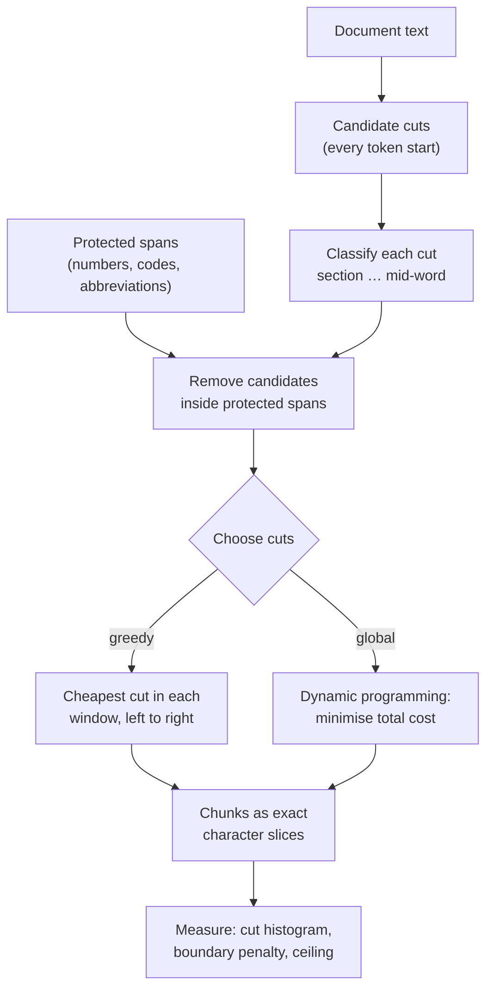

Every chunk ends somewhere, and where it ends decides what survives. The splitters in earlier modules each embody a rule for choosing that place: [sentence-based chunking](/learn/chunking-fundamentals/sentence-based-chunking) cuts only between sentences, [recursive character splitting](/learn/advanced-chunking-strategies/recursive-character-splitting) tries a hierarchy of separators, and [structure-aware chunking](/learn/advanced-chunking-strategies/structure-aware-chunking) keeps tables and code blocks whole. This lesson treats boundary choice as an **optimisation problem** in its own right. You will learn to score every possible cut, to protect spans that must never be cut, to measure how well a chunker's boundaries respect the text, and to place all the cuts in a document together with dynamic programming, the same idea typesetters use to break paragraphs into lines.

## Learning objectives

- Classify candidate cut points by boundary strength and assign each a penalty.
- Define protected spans (numbers, codes, abbreviations, headings) and exclude cuts inside them.
- Measure a chunker's boundary quality with a boundary-penalty total, a cut-type histogram and the answer-survival ceiling.
- Explain why greedy boundary snapping can make poor cuts that a global optimisation avoids, and implement the dynamic-programming version.
- Choose penalties and a size target for a given collection and justify them.

## Prerequisites

- [Sentence-based chunking](/learn/chunking-fundamentals/sentence-based-chunking): sentence segmentation and its pitfalls.
- [Recursive character splitting](/learn/advanced-chunking-strategies/recursive-character-splitting): the separator hierarchy.
- [Structure-aware chunking](/learn/advanced-chunking-strategies/structure-aware-chunking): atomic elements such as tables and code blocks.
- [Chunk size experiments](/learn/chunking-optimisation/chunk-size-experiments): the Meridian corpus, the ceiling metric and the equal-budget rule.

## Why this matters

In the [size experiments](/learn/chunking-optimisation/chunk-size-experiments), most failures at small sizes were cuts through the answer, and one cut through "home-office" produced two failures at once: the equipment-budget answer was split, and the fragment "-office equipment budget of £400" outranked the chunk that answered the contractors question. [Overlap optimisation](/learn/chunking-optimisation/overlap-optimisation) showed how to *insure* against such cuts. Boundary preservation removes them at the source.

Bad boundaries do more than split answers:

- **They create misleading fragments.** "...must not match any of your last five" followed by "passwords. If you are locked out" yields two chunks whose embeddings represent half-thoughts, and which can match queries neither half answers.
- **They corrupt values.** A cut inside "08:00", "£1,000" or "E-4021" produces "08:" and "00 to 18:00", which no generator can interpret correctly.
- **They orphan headings.** A chunk that ends with "## Expenses" carries a heading with no body, and the body's chunk has lost its label.
- **They separate a statement from its qualifier.** "Anything over £75 needs a receipt" and "Claims without a required receipt are returned unpaid" belong together; a cut between them is legal but costly.

Splitters with good defaults avoid the worst of these most of the time. Without a measurement, you do not know how often "most of the time" is, or which documents are the exceptions.

## The intuition

Imagine cutting a long paper banner into strips no longer than a metre, and the banner has words, sentences and paragraphs printed on it. You would not cut every metre exactly: you would look near each metre mark for a gap between paragraphs, and failing that, a gap between sentences, and only as a last resort cut between two words. You would never cut through a phone number.

Doing this strip by strip, from left to right, is the greedy approach. It works, but it can paint you into a corner: a perfect paragraph gap chosen for strip three might leave strip four with nothing but a cut mid-list or a stub of a few centimetres. A careful person lays the whole banner out first, marks every gap with how good a place it would be to cut, and picks the set of cuts that is best *overall*. That is the dynamic-programming approach, and it never does worse than the greedy one by its own measure of quality.

## How it works

### Step 1: candidate cuts

Every place a chunk could end is a **candidate cut**. When chunks are measured in tokens, the natural candidates are token starts: a cut before token $t$ puts tokens $0..t-1$ in one chunk and $t..$ in the next. Each candidate maps back to a character offset, so the chunks remain exact slices of the original text.

### Step 2: classify and penalise

Each candidate is classified by the strongest boundary it sits on, and each class gets a **penalty**: low for good places to cut, high for bad ones. A reasonable starting scale for prose:

| Boundary | Example | Penalty |
| --- | --- | --- |
| Section (before a heading) | `...unpaid.\n\n|## Laptops` | 0 |
| Paragraph | between two paragraphs | 1 |
| Sentence | `...90 days. |The new password` | 3 |
| Clause | `...courses, |books and` | 8 |
| Word | `...must not |match` | 20 |
| Mid-word, or between a word and its punctuation | `...up|loads`, `...out|, the` | 100 |
| Straight after a heading | `## Laptops\n|The laptop` | 100 |

The absolute numbers matter less than their order and spacing: a sentence cut should be clearly preferred to a clause cut, and a clause cut to a word cut, but a much better chunk size should be able to justify a slightly worse boundary. Cutting immediately after a heading is penalised like a mid-word cut, because it orphans the heading.

### Step 3: protect spans

Some spans must never be cut, whatever the penalties say. Find them with patterns before choosing any cut and delete every candidate that falls strictly inside one:

- **Numbers with internal punctuation:** `08:00`, `£1,000`, `3.5`, `2024-03-31`.
- **Identifiers:** error codes such as `E-4021`, ticket and runbook numbers, URLs, file paths.
- **Abbreviations that end in a full stop:** "e.g.", "i.e.", "Dr.", "No.". These also fool sentence detection: "Book via the portal, e.g. the HR portal" is one sentence, not two.
- **Atomic elements** from structure-aware parsing: table rows, code blocks, list items short enough to keep whole.

Protection is stronger than a high penalty. A penalty can be outweighed by size pressure; a deleted candidate cannot be chosen at all. If a protected span is longer than the maximum chunk size, it has to be split anyway, and that is a signal to handle it structurally (for example, a table chunked by rows).

### Step 4: choose the cuts

Given candidates with penalties, there are two ways to choose.

**Greedy snapping.** Start at the beginning, look at the candidates between half the maximum size and the maximum, take the cheapest (preferring the later one on ties), and repeat from there. This is how most boundary-aware splitters behave, and it is fast and usually good. Its weakness is that each choice is final. Taking a strong boundary early can leave the next chunk with only weak boundaries in its window, or a short stub at the end of a section.

**Global optimisation.** Define the cost of a whole segmentation as the sum, over its chunks, of the penalty of the boundary that ends each chunk plus a penalty for how far the chunk's size strays from a target. Then find the segmentation with the lowest total cost, subject to no chunk exceeding the maximum. Dynamic programming solves this exactly: the best way to segment the text up to candidate $j$ is the best way up to some earlier candidate $i$, plus one chunk from $i$ to $j$. This is the structure of Knuth and Plass's line-breaking algorithm, which TeX uses to choose where lines end in a paragraph.



### Step 5: measure

Boundary quality is measurable without any queries:

- **Cut-type histogram:** how many internal cuts land on each class of boundary. A healthy prose chunker has almost all cuts at section, paragraph or sentence boundaries.
- **Boundary penalty total:** the sum of penalties over all internal cuts, comparable between chunkers on the same corpus.
- **Protected-span violations:** cuts inside spans that should have been protected; the target is zero.
- **Size spread:** the minimum and maximum chunk sizes, to catch stubs.

These intrinsic measures are cheap enough to run on every document at ingestion, and the documents with the worst scores are the ones to inspect. The extrinsic check, whether answers survive and are retrieved, needs the labelled question set; both kinds are brought together in [chunk quality evaluation](/learn/chunking-optimisation/chunk-quality-evaluation).

## The mathematics

**Intuition.** Each chunk pays twice: once for the quality of the cut that ends it, and once for being the wrong size. The best segmentation pays the least in total.

$$
\text{cost}(\text{segmentation}) = \sum_{m=1}^{M} \Big[\, \pi(b_m) + \lambda \Big(\frac{n_m - n^\ast}{n^\ast}\Big)^2 \Big], \qquad n_m \le n_{\max}
$$

- $M$: the number of chunks in the segmentation.
- $b_m$: the boundary that ends chunk $m$; $\pi(b_m)$ is its penalty (0 for the end of the document).
- $n_m$: the size of chunk $m$ in tokens; $n^\ast$ is the target size; $n_{\max}$ the hard maximum.
- $\lambda$: how much a size deviation costs relative to boundary penalties.

The squared term makes small deviations nearly free and large ones expensive, so stubs are discouraged without forcing every chunk to the same length.

The dynamic programme computes, for each candidate $j$ in order,

$$
\text{best}(j) = \min_{i < j,\; n(i,j) \le n_{\max}} \Big[\, \text{best}(i) + \pi(b_j) + \lambda \Big(\frac{n(i,j) - n^\ast}{n^\ast}\Big)^2 \Big]
$$

with $\text{best}(0) = 0$, and remembers which $i$ achieved the minimum, so the cuts can be read back from the end. Because only candidates within $n_{\max}$ tokens of $j$ are considered, the cost is about (number of candidates) times (candidates per $n_{\max}$ tokens).

**Worked example.** A 70-token section with sentence ends after tokens 30 and 52 and a clause boundary after token 36; $n_{\max} = 40$, $n^\ast = 32$, $\lambda = 10$, sentence penalty 3, clause penalty 8. The whole section does not fit in one chunk, so consider three plans:

- Cut at 30 only: chunks of 30 and 40. Cost $= 3 + 10(2/32)^2 + 0 + 10(8/32)^2 = 3 + 0.039 + 0.625 \approx 3.66$.
- Cut at 36 only: chunks of 36 and 34. Cost $= 8 + 10(4/32)^2 + 10(2/32)^2 = 8 + 0.156 + 0.039 \approx 8.20$.
- Cut at 30 and 52: chunks of 30, 22 and 18. Cost $= 3.039 + (3 + 0.977) + 1.914 \approx 8.93$.

The first plan wins: a sentence boundary with chunks close to the target. The clause cut gives the most even sizes but pays for the weaker boundary; the extra cut pays for an additional boundary and two short chunks.

```python
COST = {"sentence": 3, "clause": 8, "end": 0}
TARGET, LAM = 32, 10

def plan_cost(chunks):
    """chunks: list of (size, kind of boundary that ends the chunk)."""
    return sum(COST[kind] + LAM * ((size - TARGET) / TARGET) ** 2 for size, kind in chunks)

plans = {
    "cut at 30 (sentence)":     [(30, "sentence"), (40, "end")],
    "cut at 36 (clause)":       [(36, "clause"), (34, "end")],
    "cut at 30 and 52":         [(30, "sentence"), (22, "sentence"), (18, "end")],
}
for name, chunks in plans.items():
    print(f"{name:<22} cost {plan_cost(chunks):.2f}")
```

```output
cut at 30 (sentence)   cost 3.66
cut at 36 (clause)     cost 8.20
cut at 30 and 52       cost 8.93
```

## In code

**The problem.** Chunk the Meridian corpus at a maximum of 40 tokens three ways (fixed windows, greedy snapping, dynamic programming), and compare their cut types, boundary penalties, size spread, ceiling and hit rate at a 256-token budget.

**Dependencies.** sentence-transformers and NumPy, plus `meridian_corpus.py` from [chunk size experiments](/learn/chunking-optimisation/chunk-size-experiments). No API key.

```bash
pip install sentence-transformers numpy
```

```python
import re
from collections import Counter
import numpy as np
from sentence_transformers import SentenceTransformer
from meridian_corpus import DOCS, QUESTIONS

model = SentenceTransformer("sentence-transformers/all-MiniLM-L6-v2")
tok = model.tokenizer
MAX, TARGET, BUDGET = 40, 32, 256

# Penalty for cutting at each kind of boundary: lower is a better place to cut.
COST = {"section": 0, "paragraph": 1, "sentence": 3, "clause": 8, "word": 20,
        "mid-word": 100, "after-heading": 100}
# Spans that must never be cut: abbreviations, numbers such as 08:00 or 1,000, codes such as E-4021.
PROTECTED = re.compile(r"\b(?:e\.g|i\.e|etc|Dr|No)\.|\d[\d,.:]*\d|[A-Z]+-\d+")

def boundary_kind(text, i):
    """Classify a cut placed just before character i."""
    if text[i - 1] == "\n":
        if text.startswith("#", i):
            return "section"
        previous_line = text[:i - 1].rsplit("\n", 1)[-1]
        return "after-heading" if previous_line.startswith("#") else "paragraph"
    if not text[i - 1].isspace():
        return "mid-word"
    before = text[:i].rstrip()
    if before.endswith((".", "?", "!")):
        return "sentence"
    if before.endswith((",", ";", ":")):
        return "clause"
    return "word"

def candidates(text, protect=True):
    """Every token start is a possible cut: (token index, char index, kind)."""
    offs = tok(text, add_special_tokens=False, return_offsets_mapping=True)["offset_mapping"]
    banned = {i for m in PROTECTED.finditer(text) for i in range(m.start() + 1, m.end())} if protect else set()
    cands = [(0, 0, None)]
    cands += [(t, offs[t][0], boundary_kind(text, offs[t][0]))
              for t in range(1, len(offs)) if offs[t][0] not in banned]
    return cands + [(len(offs), len(text), "section")]          # end of document

def fixed_cuts(text):
    """Cut every MAX tokens, wherever that lands."""
    cands = candidates(text, protect=False)
    return cands[::MAX] + ([cands[-1]] if (len(cands) - 1) % MAX else [])

def greedy_cuts(text):
    """Fill up to MAX tokens, then step back to the cheapest boundary in the second half of the window."""
    cands = candidates(text)
    cuts = [cands[0]]
    while cands[-1][0] - cuts[-1][0] > MAX:
        start = cuts[-1][0]
        window = [c for c in cands if start + MAX // 2 <= c[0] <= start + MAX]
        cuts.append(min(window, key=lambda c: (COST[c[2]], -c[0])))
    return cuts + [cands[-1]]

def dp_cuts(text):
    """Choose all cuts together to minimise boundary penalties plus a penalty for straying from TARGET."""
    cands = candidates(text)
    best = [0.0] + [np.inf] * (len(cands) - 1)
    back = [0] * len(cands)
    for j in range(1, len(cands)):
        for i in range(j - 1, -1, -1):
            size = cands[j][0] - cands[i][0]
            if size > MAX:
                break
            cost = best[i] + COST[cands[j][2]] + 10 * ((size - TARGET) / TARGET) ** 2
            if cost < best[j]:
                best[j], back[j] = cost, i
    cuts, j = [], len(cands) - 1
    while j:
        cuts.append(cands[j])
        j = back[j]
    return [cands[0]] + cuts[::-1]

def evaluate(name, cutter):
    spans, sizes, kinds = [], [], Counter()
    for d, text in DOCS.items():
        cuts = cutter(text)
        for (t0, c0, _), (t1, c1, kind) in zip(cuts, cuts[1:]):
            spans.append((d, c0, c1))
            sizes.append(t1 - t0)
            if c1 < len(text):
                kinds[kind] += 1                 # internal cuts only
    E = model.encode([DOCS[d][a:b] for d, a, b in spans], normalize_embeddings=True)
    Q = model.encode([q for q, _, _ in QUESTIONS], normalize_embeddings=True)
    ceiling = hit = 0
    for qv, (_, answer, d) in zip(Q, QUESTIONS):
        a0 = DOCS[d].index(answer)
        a1 = a0 + len(answer)
        order = np.argsort(-(E @ qv))
        whole = [spans[i][0] == d and spans[i][1] <= a0 and a1 <= spans[i][2] for i in order]
        ceiling += any(whole)
        k = np.searchsorted(np.cumsum([sizes[i] for i in order]), BUDGET, side="right")
        hit += any(whole[:k])                     # chunks that fit in the token budget
    n = len(QUESTIONS)
    penalty = sum(COST[k] * c for k, c in kinds.items())
    print(f"{name:<7} chunks {len(spans):>2}  sizes {min(sizes):>2}-{max(sizes):>2}  "
          f"boundary penalty {penalty:>3}  ceiling {ceiling / n:.2f}  hit {hit / n:.2f}")
    print("        cuts:", ", ".join(f"{k} {kinds[k]}" for k in COST if kinds[k]))

for name, cutter in [("fixed", fixed_cuts), ("greedy", greedy_cuts), ("dp", dp_cuts)]:
    evaluate(name, cutter)
```

```output
fixed   chunks 19  sizes  3-40  boundary penalty 423  ceiling 0.75  hit 0.75
        cuts: section 1, sentence 1, word 11, mid-word 2
greedy  chunks 22  sizes 15-40  boundary penalty  49  ceiling 1.00  hit 1.00
        cuts: section 5, sentence 11, clause 2
dp      chunks 22  sizes 20-40  boundary penalty  39  ceiling 1.00  hit 1.00
        cuts: section 5, sentence 13
```

**The important lines.**

- `boundary_kind()` looks at the characters around a cut. A newline before a `#` is a section boundary; a newline after a heading line is the orphaning cut; no whitespace before the cut means it is inside a word or between a word and its punctuation.
- `PROTECTED` matches abbreviations, numbers with internal punctuation and codes like `E-4021`; `candidates()` drops every cut strictly inside a match. Fixed windows are built with `protect=False` to show what happens without it.
- `greedy_cuts()` searches only the second half of each window and commits to the cheapest cut found there.
- `dp_cuts()` is the recurrence from the maths section. The inner loop walks backwards and stops as soon as a chunk would exceed `MAX`, which bounds the work per candidate.
- `np.searchsorted(np.cumsum(...), BUDGET, side="right")` counts how many ranked chunks fit in the token budget, since boundary-aware chunks vary in size.

**What the output means.**

- **Fixed windows cut almost anywhere.** Of 15 internal cuts, 11 fall between words and 2 inside a word or its punctuation ("up|loads", "locked out|, the"), for a boundary penalty of 423. The ceiling of 0.75 means a quarter of the answers were cut, and the size range of 3 to 40 shows a 3-token stub at the end of one document.
- **Both boundary-aware chunkers keep every answer intact.** Ceiling and hit rate are 1.00, with chunks never larger than 40 tokens. At this maximum size, cutting at sentences is enough to keep every one-sentence answer whole, which fixed windows needed overlap to achieve.
- **The global optimiser makes better cuts than greedy.** Greedy made two clause cuts, one splitting the list "courses, | books and conferences" and one splitting "1,000 events per second; | requests above the limit...". It also left a 15-token stub. Dynamic programming found a segmentation with sentence and section cuts only, a smaller penalty (39 against 49) and no chunk under 20 tokens. Both produce 22 chunks.
- **Retrieval does not show the difference here.** Greedy and DP have identical hit rates on this small question set. The intrinsic metrics show a quality difference the twenty questions are too few to detect; on a large corpus the mid-list cuts are exactly the kind that make an occasional answer incomplete.

**Errors people commonly hit.**

- *Classifying cuts on the decoded text.* Work on the original string through token offsets; decoded text loses case and whitespace, and with them the newlines that mark paragraphs and headings.
- *Overly broad protection.* A pattern that protects any run of digits and punctuation can swallow a whole table row and leave no legal cut within the maximum size. Then the window has no candidates, and code like `greedy_cuts` fails with `ValueError` on an empty `min()`. Add a fallback to the cheapest unprotected cut, or to a forced cut, and log it.
- *Penalties without a size term.* With boundary penalties alone, the optimiser happily makes many tiny chunks at strong boundaries. The size term is what keeps chunks near the target.

**Extending it.** Add a "list-item" boundary (a newline followed by `-`, `*` or a digit and a full stop) with penalty 2, run it on a runbook with numbered steps, and check that steps are never split. Then vary $\lambda$ from 1 to 50 and watch the trade-off between boundary quality and size uniformity.

## A real-world example

The Platform team ran the boundary measurements across AskMeridian's whole corpus during a routine re-index. Overall the recursive splitter they used looked healthy: most internal cuts fell at paragraph or sentence boundaries. Sorting documents by boundary penalty told a different story. The worst hundred were nearly all IT runbooks exported from the old wiki, where every line ended with a hard newline. The splitter treated each line break as a paragraph boundary, so it cut mid-sentence wherever a line happened to end, and its chunks of numbered procedures routinely separated "Run the following command:" from the command.

Two changes fixed it. The loader now joins lines that do not end in sentence punctuation before chunking, which restored real paragraphs. And the team added protection for inline code spans and for error codes in the Atlas catalogue format, after finding chunks that ended with "E-40" and began with "21 means". They moved from greedy snapping to the dynamic-programming chooser only for runbooks, where list structure made greedy's local choices visibly worse; for the handbook the two were indistinguishable and greedy was simpler. The measurement now runs in the ingestion pipeline, and any document whose boundary penalty per cut exceeds a threshold is flagged for review rather than silently indexed.

## Common mistakes

- **Trusting a splitter's separators without measuring.** Hard-wrapped text, PDFs and wiki exports make "paragraph" separators appear mid-sentence.
- **Splitting sentences with a naive full-stop rule.** "e.g.", "Dr." and "3.5" create false sentence boundaries, which then rank as good cuts.
- **Letting headings end chunks.** An orphaned heading wastes a chunk's label and leaves the body unlabelled.
- **Protecting too much.** If protected spans exceed the maximum chunk size, the chunker has no legal cut and either fails or overflows.
- **Optimising boundaries alone.** Without a size term, strong boundaries win at any size and produce stubs or near-maximum chunks.
- **Judging boundary quality only by retrieval metrics on a small set.** Twenty questions will not reveal a two per cent rate of mid-list cuts; the cut histogram will.

## Best practices

- Score every candidate cut by boundary class and record the class of every cut you make.
- Protect numbers, codes, abbreviations and atomic elements with patterns, and keep the pattern list in version control with tests.
- Add a size term so that boundary quality and size are traded off explicitly.
- Use greedy snapping by default; switch to the global optimiser where measurements show greedy making weak cuts, such as list-heavy documents.
- Compute the cut histogram and boundary penalty per document at ingestion, and review the worst documents.
- Fix input problems (hard wraps, broken lists) in the loader rather than compensating in the chunker.

## Performance considerations

Classification and protection are linear in the length of the text. Greedy snapping is linear too: each window is examined once. The dynamic programme examines, for each candidate, every earlier candidate within $n_{\max}$ tokens, so with one candidate per token its cost is about $T \times n_{\max}$ operations for a $T$-token document. For a 10,000-token document at $n_{\max} = 512$ that is about 5 million inner-loop steps: fast in a compiled language, and several seconds in plain Python. Two easy reductions: drop candidates whose penalty is so high they could never be chosen while any better candidate exists in range (keeping a fallback), and run the optimiser per section rather than per document, since section boundaries are nearly always chosen anyway.

Chunking runs once per document version, so even the slower optimiser is rarely the bottleneck; embedding the chunks costs far more. The real cost of boundary preservation is variable chunk size: chunks no longer fill the maximum, so a corpus produces somewhat more chunks than fixed windows of the same maximum (22 against 19 above), and a budget holds a variable number of them. Fill budgets by token count, not by a fixed $k$.

## Summary

- Treat every token start as a candidate cut, classify it by boundary strength and give it a penalty.
- Protect numbers, identifiers, abbreviations and atomic elements by removing candidate cuts inside them.
- Measure boundary quality intrinsically: cut-type histogram, total penalty, protected-span violations and size spread.
- Greedy snapping is fast and usually good; a dynamic programme minimising boundary penalties plus a size term finds the best segmentation and avoids greedy's corner cases.
- Cutting at sentence boundaries keeps one-sentence answers intact without overlap; fix input problems such as hard wraps before chunking.

## Exercises

**1.** Classify each cut (marked with `|`) and give it the penalty from the table: (a) `...within 30 days of the purchase. |Anything over £75`; (b) `...open from 08:|00 to 18:00`; (c) `## Passwords\n|Passwords must be rotated`; (d) `...hotels, |trains and cafés`.

<details><summary>Show solution</summary>

(a) Sentence, penalty 3. (b) Inside a protected number; with protection on, this candidate does not exist; without it, it is a mid-word cut, penalty 100. (c) Straight after a heading, penalty 100: the heading would end the previous chunk on its own. (d) Clause, penalty 8, and a poor one in practice because it splits a list.

</details>

**2.** With $n_{\max} = 40$, $n^\ast = 32$ and $\lambda = 10$, a 60-token passage has a sentence end after token 25 and a paragraph end after token 38 (penalty 1). Which single cut does the optimiser choose, and what are the costs?

<details><summary>Show solution</summary>

Cut at 25: chunks of 25 and 35. Cost $= 3 + 10(7/32)^2 + 10(3/32)^2 = 3 + 0.479 + 0.088 \approx 3.57$.

Cut at 38: chunks of 38 and 22. Cost $= 1 + 10(6/32)^2 + 10(10/32)^2 = 1 + 0.352 + 0.977 \approx 2.33$.

The paragraph cut wins: its better boundary outweighs the slightly less even sizes.

</details>

**3.** Add a fallback to `greedy_cuts` so that it never fails when a window has no candidates (for example because a long protected span covers it): cut at the last unprotected token start before the maximum, or at exactly the maximum if there is none, and record the forced cut. Test it by adding a document containing a 60-token run of digits.

<details><summary>Show solution</summary>

```python
def greedy_cuts(text):
    cands = candidates(text)
    everything = candidates(text, protect=False)
    cuts = [cands[0]]
    while cands[-1][0] - cuts[-1][0] > MAX:
        start = cuts[-1][0]
        window = [c for c in cands if start + MAX // 2 <= c[0] <= start + MAX]
        if not window:
            window = [c for c in cands if start < c[0] <= start + MAX]
        if window:
            cuts.append(min(window, key=lambda c: (COST[c[2]], -c[0])))
        else:
            t = start + MAX                     # forced cut inside a protected span
            cuts.append((t, everything[t][1], "forced"))
    return cuts + [cands[-1]]
```

Add `"forced": 1000` to `COST` so that the histogram and penalty report it. Test with `"Reference codes: " + ",".join(str(i % 10) for i in range(150)) + "."`: the comma-separated digits form one 299-character protected number, about 300 tokens with no legal cut inside. The original function raises `ValueError: min() iterable argument is empty`; the new one cuts after the colon (a clause boundary) and then makes seven forced cuts every 40 tokens. Forced cuts in the histogram are a warning that this content needs structural handling, not prose chunking.

</details>

**4.** Design decision. Meridian's Atlas runbooks contain numbered steps, fenced shell commands (sometimes 80 lines long), and short notes. Propose boundary classes, penalties, protected spans and a choice between greedy and global optimisation for this collection.

<details><summary>Show solution</summary>

Classes, from best to worst: section (0), step boundary, meaning a new numbered item (1), paragraph (2), sentence (4), clause (10), word (25), mid-word and after-heading (100). An extra high penalty (say 50) for cutting between a sentence ending in a colon and the code block or list it introduces, so that "Run the following command:" stays with its command.

Protected spans: error codes, version numbers, file paths, URLs, inline code, and every fenced code block shorter than the maximum chunk size. Code blocks longer than the maximum cannot be protected whole; split them at blank lines or function boundaries with [code chunking](/learn/advanced-chunking-strategies/code-chunking), and repeat the step number and the introducing sentence in each piece.

Use the global optimiser: numbered procedures are where greedy's left-to-right commitment produces mid-list cuts and stubs, and runbooks are few enough that the extra chunking time does not matter. Verify by comparing the cut histograms of greedy and global on the runbook collection.

</details>

## Check your understanding

```quiz
[
  {
    "q": "Why is a cut immediately after a heading line penalised as heavily as a cut inside a word?",
    "options": [
      "Because headings contain special tokens",
      "Because the heading ends one chunk with no body, and the body's chunk loses its label",
      "Because embedding models cannot encode headings",
      "Because it makes the chunk too long"
    ],
    "answer": 1,
    "why": "An orphaned heading wastes its descriptive value: the chunk containing it says nothing, and the chunk with the content has lost the label that says what it is about."
  },
  {
    "q": "What is the difference between protecting a span and giving cuts inside it a high penalty?",
    "options": [
      "There is no difference",
      "Protection only applies to headings",
      "A penalty can be outweighed by size pressure; a protected span has no candidate cuts inside it, so it can never be cut",
      "Protection is applied after chunking"
    ],
    "answer": 2,
    "why": "The optimiser trades penalties against each other, so a high penalty can still be paid. Removing the candidates makes the cut impossible."
  },
  {
    "q": "Greedy snapping and a dynamic-programming chooser use the same penalties. Which statement is true?",
    "options": [
      "Greedy always finds the lowest total cost",
      "The dynamic programme always produces fewer chunks",
      "They always produce identical segmentations",
      "The dynamic programme finds a segmentation with total cost no higher than greedy's under the same cost function"
    ],
    "answer": 3,
    "why": "The dynamic programme searches all segmentations that respect the maximum size and returns the cheapest, so greedy's choice is one of the options it considers."
  },
  {
    "q": "A chunker's cut histogram shows that 30% of cuts on one collection are classified as paragraph boundaries that fall mid-sentence. What is the most likely cause?",
    "options": [
      "The text has hard line wraps, so single newlines appear inside sentences",
      "The embedding model is too small",
      "The chunk size is too large",
      "The overlap is too small"
    ],
    "answer": 0,
    "why": "Hard-wrapped exports put newlines at the end of every line. A splitter that treats newlines as paragraph boundaries then cuts mid-sentence. Fix it in the loader by joining wrapped lines."
  },
  {
    "q": "Why does the cost function include a size term as well as boundary penalties?",
    "options": [
      "To make chunks exactly the target size",
      "Without it, the optimiser would cut at every strong boundary regardless of size, producing stubs or uneven chunks",
      "Because the embedding model requires it",
      "To reduce the number of protected spans"
    ],
    "answer": 1,
    "why": "Boundary penalties alone reward cutting at every section or sentence. The squared size term makes small deviations from the target cheap and large ones expensive, balancing the two goals."
  }
]
```

## Further reading

- Knuth, D. E. and Plass, M. F. (1981). *Breaking Paragraphs into Lines*. Software: Practice and Experience, 11(11). The dynamic-programming formulation of line breaking that the global chooser borrows.
- Kiss, T. and Strunk, J. (2006). *Unsupervised Multilingual Sentence Boundary Detection*. Computational Linguistics, 32(4). The Punkt algorithm behind NLTK's sentence tokeniser, and why abbreviations make sentence splitting hard.
- [LangChain documentation](https://python.langchain.com/): text splitters and their separator lists.
- [spaCy documentation](https://spacy.io/): sentence segmentation with a dependency parser or a rule-based sentenciser.
