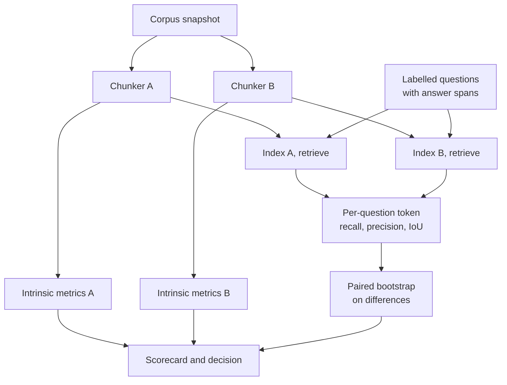

The lessons in this module each measured one property of chunks: whether answers survive the cut, where boundaries fall, what context a chunk keeps, what the generator receives. This lesson assembles those measurements into a single **chunk quality evaluation**: a harness you can run on any chunker, that reports cheap intrinsic metrics computed from the chunks alone, token-level retrieval metrics computed against labelled answers, and a paired statistical comparison that tells you whether one chunker is really better than another. You will run it on four chunkers over the Meridian corpus and find a result that is typical in practice: the intrinsic metrics separate the chunkers clearly, and twenty questions cannot.

## Learning objectives

- Distinguish intrinsic chunk metrics from extrinsic (retrieval and answer) metrics, and say what each can and cannot tell you.
- Compute token-level recall, precision and intersection over union (IoU) for retrieved chunks by hand and in code.
- Build an evaluation harness that scores any chunker on both families of metric under the same conditions.
- Compare two chunkers with a paired bootstrap and interpret the confidence interval.
- Design a chunk-quality gate for an ingestion pipeline and a regression test for chunker changes.

## Prerequisites

- [Chunk size experiments](/learn/chunking-optimisation/chunk-size-experiments): the labelled question set, the ceiling metric and sampling error.
- [Boundary preservation](/learn/chunking-optimisation/boundary-preservation): boundary classes and cut histograms.
- [Context preservation](/learn/chunking-optimisation/context-preservation): self-containedness and wrong-source rate.
- [Recall@K](/learn/retrieval-fundamentals/recall-k) and [Precision@K](/learn/retrieval-fundamentals/precision-k): the chunk-level versions of the metrics generalised here.

## Why this matters

Chunking changes are among the most frequent changes to a RAG system and among the least tested. A new splitter, a different size, a parser upgrade that changes how headings come out: each silently changes every chunk in the index. Without an evaluation, the effect shows up weeks later as vague user complaints, and nobody can say which change caused it.

Evaluating chunks is harder than it looks, for three reasons:

1. **Chunk-level metrics are not comparable across chunkers.** "The right chunk was in the top 3" means different things when chunks are 30 tokens and when they are 500. A metric defined on *tokens of the source text* puts all chunkers on the same footing.
2. **Retrieval metrics need labelled questions, which are expensive.** Intrinsic metrics need none, so they can run on every document at every ingestion. They cannot tell you whether retrieval improved, but they catch broken chunking immediately.
3. **Differences are usually small and noisy.** Two reasonable chunkers often differ by a few questions. Without a paired statistical comparison you will promote noise to a decision.

## The intuition

Think of evaluating a chunker the way you would evaluate how a library has been divided into shelves. Some things you can check by walking the shelves without asking anyone anything: are any books torn across two shelves, are shelves wildly uneven, are some books on two shelves at once? Those are intrinsic checks. Others need real readers: when someone looks for a fact, do they find the shelf that has it, and how much else do they have to carry home? Those are extrinsic checks.

And when a new shelving scheme helps three readers and hurts two, out of twenty, you do not announce an improvement. You ask how likely that split would be by chance, using the same twenty readers on both schemes.

## How it works

### Intrinsic metrics: the chunks alone

These need only the source documents and the chunks, so they are cheap and run on everything.

- **Size distribution:** count, mean and coefficient of variation (standard deviation divided by mean) of chunk sizes in the embedding model's tokens, plus the number of chunks above the model's limit (which should be zero) and below a minimum useful size (stubs).
- **Boundary cleanliness:** the share of internal cuts that fall at a sentence end or line start, or more finely the cut-type histogram from [boundary preservation](/learn/chunking-optimisation/boundary-preservation).
- **Duplication:** total tokens across chunks divided by tokens in the source. 1.0 means no overlap; 1.25 means a quarter of the indexed text is repeated.
- **Coverage:** the share of source tokens that appear in at least one chunk. Less than 1.0 means the chunker dropped text, which happens with buggy splitters and over-eager cleaning.
- **Self-containedness:** the share of chunks a model judges understandable on their own, estimated on a sample, as in [context preservation](/learn/chunking-optimisation/context-preservation).

Intrinsic metrics answer "is this chunking well formed?" They do not answer "will retrieval be better?": a perfectly clean chunker can still produce chunks that rank badly.

### Extrinsic metrics: token-level retrieval quality

Label each question with its **answer span**, the exact text in a document that answers it, as in the [size experiments](/learn/chunking-optimisation/chunk-size-experiments). Convert it to a set of source tokens $R$. For a retrieval result, take the union of source tokens covered by the retrieved chunks, $G$. Then:

- **Token recall** = $|R \cap G| / |R|$: how much of the answer was retrieved.
- **Token precision** = $|R \cap G| / |G|$: how much of what was retrieved is answer.
- **Token IoU** = $|R \cap G| / |R \cup G|$: one number that penalises both missing answer tokens and surplus text.

Because they are defined on source tokens, these metrics compare chunkers of any size or shape fairly, and overlapping chunks are not double-counted. The framing follows Smith and Troynikov's chunking evaluation for Chroma (2024), which argued for exactly this token-level view.

Also report a stricter binary version: **whole@k**, the share of questions for which every answer token was retrieved. Token recall gives partial credit for half an answer; whole@k does not.

Report metrics at a fixed number of chunks $k$ to see the precision trade-off between sizes, and at a fixed token budget (as in earlier lessons) to see which chunker makes the best use of the generator's context.

### Beyond retrieval

Retrieval metrics stop at the context. Two further levels exist, each more expensive:

- **Evidence completeness:** the share of questions whose delivered context (after any [small-to-big](/learn/chunking-optimisation/small-to-big-retrieval) expansion) contains every required fact.
- **Answer quality:** whether the generated answer is correct and faithful, judged by people or by a model. This is the subject of [generation evaluation](/learn/generation-evaluation/answer-correctness), and frameworks such as [RAGAS](/learn/rag-evaluation-frameworks/ragas) automate parts of it.

Use the cheapest level that can detect the change you are making. Most chunker changes show up at the retrieval level; changes to expansion need evidence completeness.

### Comparing chunkers

Every chunker is evaluated on the same questions, so the comparison is **paired**: for each question you have a score under chunker A and under chunker B. The question-to-question variation (some questions are simply hard) cancels in the difference. A **paired bootstrap** estimates the uncertainty of the mean difference:

1. Compute the per-question difference $d_i = \text{score}_B(i) - \text{score}_A(i)$.
2. Draw $n$ questions with replacement from the $n$ differences and take their mean.
3. Repeat many times (10,000 is typical).
4. The 2.5th and 97.5th percentiles of those means form a 95% confidence interval for the mean difference.
5. If the interval includes zero, the data do not show that B is better (or worse).

Also report the counts of questions that got better, worse and stayed the same; a small mean difference made of many large changes in both directions deserves a closer look.



## The mathematics

### Token-level metrics

**Intuition.** Treat the answer and the retrieved text as two sets of positions in the source document, and measure their overlap from each side.

$$
\text{recall} = \frac{|R \cap G|}{|R|}, \qquad
\text{precision} = \frac{|R \cap G|}{|G|}, \qquad
\text{IoU} = \frac{|R \cap G|}{|R| + |G| - |R \cap G|}
$$

- $R$: the set of source-token positions in the answer span.
- $G$: the set of source-token positions covered by the retrieved chunks (a union, so overlapping chunks count each token once).
- $|R \cup G| = |R| + |G| - |R \cap G|$.

**Worked example.** The answer is 10 tokens; the top three chunks cover 150 distinct tokens, 8 of which are answer tokens.

- Recall $= 8 / 10 = 0.800$.
- Precision $= 8 / 150 \approx 0.0533$.
- IoU $= 8 / (10 + 150 - 8) = 8 / 152 \approx 0.0526$.

When the answer is much smaller than the retrieved text, IoU is almost equal to precision: the union is dominated by $G$. IoU becomes informative when retrieved text and answers are comparable in size, as with long answers or small chunks.

### Paired bootstrap

**Intuition.** You cannot rerun the world with new questions, but you can ask how much the mean difference would move if your question set had been a slightly different sample from the same population.

$$
\bar{d} = \frac{1}{n}\sum_{i=1}^{n} d_i, \qquad \bar{d}^{\,*}_b = \frac{1}{n}\sum_{j=1}^{n} d_{I_{b,j}}, \quad I_{b,j} \sim \text{Uniform}\{1, \dots, n\}
$$

- $d_i$: per-question difference between the two chunkers.
- $\bar{d}$: the observed mean difference.
- $\bar{d}^{\,*}_b$: the mean of bootstrap resample $b$, drawn with replacement.
- The 95% interval is the 2.5th to 97.5th percentile of the $\bar{d}^{\,*}_b$.

**Worked example.** Ten questions with binary outcomes give differences $(1, 0, 0, -1, 0, 1, 0, 0, 0, 1)$: three improved, one got worse, six tied. The mean is $(1 - 1 + 1 + 1)/10 = 0.20$. Resampling shows how much that 0.20 depends on which questions happened to be included.

```python
import numpy as np

relevant, retrieved, overlap = 10, 150, 8
print(f"recall {overlap / relevant:.3f}  precision {overlap / retrieved:.4f}  "
      f"IoU {overlap / (relevant + retrieved - overlap):.4f}")

diff = np.array([1, 0, 0, -1, 0, 1, 0, 0, 0, 1])     # per-question difference, chunker B minus A
rng = np.random.default_rng(0)
boot = [diff[rng.integers(0, len(diff), len(diff))].mean() for _ in range(10_000)]
print(f"mean difference {diff.mean():+.2f}, 95% bootstrap CI {np.percentile(boot, 2.5):+.2f} to {np.percentile(boot, 97.5):+.2f}")
```

```output
recall 0.800  precision 0.0533  IoU 0.0526
mean difference +0.20, 95% bootstrap CI -0.20 to +0.60
```

The interval runs from $-0.20$ to $+0.60$: an improvement of 0.20 on ten questions is entirely consistent with no improvement at all.

## In code

**The problem.** Evaluate four chunkers (fixed windows of 32 and 64 tokens, 64 tokens with 16 tokens of overlap, and sentence packing up to 64 tokens) on the Meridian corpus with intrinsic metrics and token-level retrieval metrics at $k = 3$, then compare sentence packing with fixed 64-token windows using a paired bootstrap.

**Dependencies.** sentence-transformers and NumPy, plus `meridian_corpus.py` from [chunk size experiments](/learn/chunking-optimisation/chunk-size-experiments). No API key.

```bash
pip install sentence-transformers numpy
```

```python
import re
import numpy as np
from sentence_transformers import SentenceTransformer
from meridian_corpus import DOCS, QUESTIONS

model = SentenceTransformer("sentence-transformers/all-MiniLM-L6-v2")
tok = model.tokenizer
OFFS = {d: tok(t, add_special_tokens=False, return_offsets_mapping=True)["offset_mapping"] for d, t in DOCS.items()}
Q = model.encode([q for q, _, _ in QUESTIONS], normalize_embeddings=True)

# ---- chunkers: each returns (doc_id, first_token, end_token) spans ------------------------------
def fixed(size, overlap=0):
    def chunk(d):
        n, step = len(OFFS[d]), size - overlap
        return [(d, i, min(i + size, n)) for i in range(0, max(n - overlap, 1), step)]
    return chunk

def sentence_pack(limit):
    def chunk(d):
        text, offs = DOCS[d], OFFS[d]
        ends = [m.end() for m in re.finditer(r"[.!?](?=\s)|\n", text)]       # sentence or line ends
        cut_tokens = sorted({next(i for i, (s, _) in enumerate(offs) if s >= e)
                             for e in ends if e < offs[-1][0]})
        spans, start = [], 0
        for a, b in zip([0] + cut_tokens, cut_tokens + [len(offs)]):
            if b - start > limit and a > start:                              # close the chunk before this piece
                spans.append((d, start, a))
                start = a
        return spans + [(d, start, len(offs))]
    return chunk

CHUNKERS = {"fixed 32": fixed(32), "fixed 64": fixed(64), "fixed 64 + 16 overlap": fixed(64, 16),
            "sentences <= 64": sentence_pack(64)}

# ---- intrinsic metrics: no questions needed -----------------------------------------------------
def clean_cut(d, b):
    """A cut before token b is clean if it falls at a line start or straight after a sentence end."""
    before = DOCS[d][:OFFS[d][b][0]]
    return before.endswith("\n") or before.rstrip()[-1:] in (".", "!", "?")

def intrinsic(spans):
    sizes = np.array([b - a for _, a, b in spans])
    internal = [(d, b) for d, a, b in spans if b < len(OFFS[d])]
    return {"chunks": len(spans), "mean size": sizes.mean(), "size CV": sizes.std() / sizes.mean(),
            "clean cuts": np.mean([clean_cut(d, b) for d, b in internal]),
            "duplication": sizes.sum() / sum(len(o) for o in OFFS.values())}

# ---- extrinsic metrics: token-level recall, precision and IoU ----------------------------------
def answer_tokens(d, answer):
    a0 = DOCS[d].index(answer)
    a1 = a0 + len(answer)
    return {(d, i) for i, (s, e) in enumerate(OFFS[d]) if s < a1 and e > a0}

def extrinsic(spans, k=3):
    E = model.encode([DOCS[d][OFFS[d][a][0]:OFFS[d][b - 1][1]] for d, a, b in spans], normalize_embeddings=True)
    per_q = []
    for qv, (_, answer, d) in zip(Q, QUESTIONS):
        relevant = answer_tokens(d, answer)
        top = np.argsort(-(E @ qv))[:k]
        got = {(spans[i][0], t) for i in top for t in range(spans[i][1], spans[i][2])}
        inter = len(relevant & got)
        per_q.append((inter / len(relevant), inter / len(got), inter / len(relevant | got)))
    return np.array(per_q)                                     # columns: recall, precision, IoU

results = {}
print(f"{'chunker':<22} {'chunks':>6} {'size':>5} {'CV':>5} {'clean':>6} {'dup':>5} | "
      f"{'recall@3':>8} {'whole@3':>7} {'prec@3':>7} {'IoU@3':>6}")
for name, chunker in CHUNKERS.items():
    spans = [s for d in DOCS for s in chunker(d)]
    m, per_q = intrinsic(spans), extrinsic(spans)
    results[name] = per_q
    r, p, iou = per_q.mean(axis=0)
    whole = np.mean(per_q[:, 0] == 1.0)                      # every answer token retrieved
    print(f"{name:<22} {m['chunks']:>6} {m['mean size']:>5.0f} {m['size CV']:>5.2f} {m['clean cuts']:>6.2f} "
          f"{m['duplication']:>5.2f} | {r:>8.2f} {whole:>7.2f} {p:>7.3f} {iou:>6.3f}")

# ---- paired bootstrap: is "sentences <= 64" really better than "fixed 64" on recall? -----------
rng = np.random.default_rng(0)
diff = results["sentences <= 64"][:, 0] - results["fixed 64"][:, 0]
boot = [diff[rng.integers(0, len(diff), len(diff))].mean() for _ in range(10_000)]
lo, hi = np.percentile(boot, [2.5, 97.5])
print(f"\nrecall@3, sentences <= 64 minus fixed 64: {diff.mean():+.3f}  (95% CI {lo:+.3f} to {hi:+.3f})")
print(f"questions better / worse / tied: {(diff > 0).sum()} / {(diff < 0).sum()} / {(diff == 0).sum()}")
```

```output
chunker                chunks  size    CV  clean   dup | recall@3 whole@3  prec@3  IoU@3
fixed 32                   24    29  0.29   0.05  1.00 |     0.95    0.85   0.100  0.100
fixed 64                   12    57  0.19   0.00  1.00 |     0.97    0.95   0.052  0.052
fixed 64 + 16 overlap      15    58  0.24   0.09  1.26 |     1.00    1.00   0.058  0.058
sentences <= 64            13    53  0.13   1.00  1.00 |     0.95    0.95   0.056  0.056

recall@3, sentences <= 64 minus fixed 64: -0.022  (95% CI -0.150 to +0.083)
questions better / worse / tied: 1 / 1 / 18
```

**The important lines.**

- Every chunker returns spans of **token positions in the source document**, `(doc_id, first_token, end_token)`. That single representation is what makes all metrics comparable: chunk text is a slice of the source, and retrieved tokens are a set of positions.
- `sentence_pack()` finds token positions just after sentence ends and line breaks, then closes a chunk before any piece that would push it over the limit.
- `clean_cut()` classifies the cut before token `b` as clean if it follows a line break or a sentence-ending mark.
- `extrinsic()` builds the union `got` of token positions over the top three chunks, so overlapping chunks are not double-counted, and returns per-question recall, precision and IoU. Keeping per-question results, not just means, is what makes the paired comparison possible.
- The bootstrap resamples per-question differences with a fixed seed, so the interval is reproducible.

**What the output means.**

- **The intrinsic metrics separate the chunkers sharply.** Sentence packing makes 100 per cent clean cuts with the most uniform sizes (CV 0.13); fixed windows make almost none (0.00 to 0.09; the few clean ones are coincidences). Overlap shows up as duplication of 1.26: a quarter of the indexed text is repeated.
- **Token precision tracks chunk size.** At $k = 3$, 32-token chunks deliver about twice the precision of 64-token chunks (0.100 against about 0.05), because the same answer sits in half as much text. IoU equals precision to three decimals here, because the answers are short relative to three chunks.
- **Token recall hides splitting; whole@3 shows it.** Fixed 32-token windows have token recall 0.95 but whole@3 of 0.85: several answers were split, and the top three contained only part of them, or both halves only by luck. Overlap reaches 1.00 on both, as the overlap lesson's guarantee predicts.
- **Sentence packing is not measurably better on retrieval here.** Against fixed 64-token windows it gains one question and loses one; the mean difference in recall is $-0.022$ with a 95% interval from $-0.150$ to $+0.083$. The question it loses ("How often are laptops replaced?") is a ranking failure, not a boundary failure. Twenty questions cannot detect the benefit of clean boundaries, which the intrinsic metric shows unambiguously. This is the normal situation, and it is why both families of metric belong in the scorecard.

**Errors people commonly hit.**

- *Scoring chunk IDs instead of tokens.* Chunk-level hit rates are not comparable across chunkers of different sizes; use source-token positions.
- *Double-counting overlap.* Summing chunk lengths inflates the retrieved size for overlapping chunkers and understates their precision; take the union.
- *Comparing means without pairing.* Two independent intervals around 0.95 and 0.97 overlap almost entirely and hide the fact that only two questions changed. Pair by question.
- *Fixing only $k$.* Fixed $k$ favours large chunks on recall and small ones on precision. Report a fixed token budget as well.

**Extending it.** Add a coverage check (every source token in at least one chunk), a stub count, and a budget-based recall as in [overlap optimisation](/learn/chunking-optimisation/overlap-optimisation). Then wrap the harness in a test that fails if a chunker change reduces whole@k by more than a threshold with a bootstrap interval excluding zero.

## A real-world example

The Platform team wrote a chunk-quality harness after an incident: a parser upgrade had started emitting every list item of the IT runbooks as its own paragraph, and the splitter, treating each as a boundary, produced thousands of tiny chunks. Retrieval for runbook questions degraded for a fortnight before anyone connected the complaints to the upgrade.

The harness now runs in two places. On every ingestion run, intrinsic metrics are computed per collection and compared with the previous run: chunk count, size distribution, stubs under 20 tokens, chunks over the embedding limit, clean-cut rate and duplication. A change of more than a set tolerance in any of them blocks the publish step and posts the worst documents to the team's channel. This would have caught the parser incident in minutes, because the stub count rose by an order of magnitude.

On every pull request that touches chunking code or configuration, the extrinsic suite runs: a few hundred labelled questions from the support desk, token-level recall, whole@k at a fixed budget, and a paired bootstrap against the main branch. The rule is that a change may merge if no metric's interval lies entirely below zero. The first time it ran, it blocked a well-intentioned change to larger chunks that improved recall on handbook questions while reducing whole@k on runbooks; splitting the results by collection made the trade-off visible.

## Common mistakes

- **Evaluating chunkers with chunk-level hit rates.** Larger chunks win by construction; use token-level metrics on source positions.
- **Reporting only means.** Without per-question results there is no paired comparison and no way to see which questions changed.
- **Treating intrinsic metrics as optional.** They are the only checks cheap enough to run on every document, and they catch broken parsing immediately.
- **Treating intrinsic metrics as sufficient.** Clean boundaries do not guarantee better retrieval.
- **Concluding from twenty questions.** Use hundreds, stratified by collection and query type, and report intervals.
- **Tuning on the evaluation set.** Repeatedly adjusting a chunker until the numbers improve fits it to those questions; hold some back.

## Best practices

- Represent chunks as spans of source-token positions so all metrics are comparable and exact.
- Run intrinsic metrics on every ingestion, with tolerances and alerts per collection.
- Run token-level retrieval metrics at both fixed $k$ and fixed token budget, and report whole@k beside token recall.
- Keep per-question results, compare chunkers with a paired bootstrap, and report better / worse / tied counts.
- Stratify by collection and query type; a global average hides opposing effects.
- Version the corpus snapshot, question set, chunker configuration and embedding model with every result.

## Performance considerations

Intrinsic metrics are linear in corpus size and need no model, apart from tokenisation; on millions of chunks they take minutes and can run inside the ingestion job. A self-containedness check with a language model costs one call per chunk, so run it on a fixed random sample (a few hundred chunks per collection) rather than on everything.

Extrinsic metrics require embedding the corpus once per chunker, which dominates the cost: evaluating four chunkers on a 10-million-token corpus embeds about 40 million tokens, more with overlap. Two shortcuts keep it practical: evaluate on a fixed, representative subset of documents that contains every labelled answer plus enough distractors to keep ranking realistic, and cache embeddings keyed by chunk text hash so that unchanged chunks are not re-embedded between runs. The bootstrap itself is trivial: 10,000 resamples of a few hundred numbers take well under a second.

## Summary

- Chunk quality has intrinsic measures (sizes, boundaries, duplication, coverage, self-containedness) and extrinsic ones (retrieval and answer quality); you need both.
- Token-level recall, precision and IoU on source positions compare chunkers of any size fairly and do not double-count overlap; whole@k shows splitting that token recall hides.
- Compare chunkers on the same questions with a paired bootstrap, and report better, worse and tied counts.
- Intrinsic metrics often separate chunkers clearly when small question sets cannot; they are the right everyday gate, and extrinsic suites the right change gate.
- Version every input to the evaluation so results can be reproduced and compared.

## Exercises

**1.** An answer is 20 tokens. Chunker A's top three chunks cover 300 distinct tokens including 20 answer tokens. Chunker B's cover 120 distinct tokens including 14 answer tokens. Compute recall, precision and IoU for each. Which is better?

<details><summary>Show solution</summary>

A: recall $20/20 = 1.0$, precision $20/300 \approx 0.067$, IoU $20/(20 + 300 - 20) = 20/300 \approx 0.067$.

B: recall $14/20 = 0.7$, precision $14/120 \approx 0.117$, IoU $14/(20 + 120 - 14) = 14/126 \approx 0.111$.

B has the higher IoU and precision, A the complete answer. Which is better depends on the use: for a generator that needs the whole answer, A's complete recall matters more, and 300 tokens is a modest budget. IoU alone would pick B; this is why whole@k and recall should be reported beside it.

</details>

**2.** A colleague reports: "The new chunker improves mean token recall from 0.81 to 0.84 on 150 questions." What else do you need before accepting the change?

<details><summary>Show solution</summary>

Per-question results for both chunkers, so that you can compute a paired bootstrap interval for the difference and count better, worse and tied questions. The results broken down by collection and query type. Whole@k and precision (or IoU) beside recall, at both fixed $k$ and fixed token budget, to see whether the gain came from retrieving more text. The intrinsic metrics of the new chunker (size distribution, stubs, chunks over the limit, duplication). And confirmation that both runs used the same corpus snapshot, questions and embedding model.

</details>

**3.** Add a coverage metric and a stub count (chunks under 8 tokens) to `intrinsic()`, and a budget-based recall (fill the top-ranked chunks up to 128 distinct tokens) to `extrinsic()`. Which chunker benefits most from the budget view?

<details><summary>Show solution</summary>

```python
def coverage(spans):
    covered = {(d, t) for d, a, b in spans for t in range(a, b)}
    return len(covered) / sum(len(o) for o in OFFS.values())

def stubs(spans, minimum=8):
    return sum(b - a < minimum for _, a, b in spans)

def budget_recall(spans, E, qv, relevant, budget=128):
    got = set()
    for i in np.argsort(-(E @ qv)):
        new = got | {(spans[i][0], t) for t in range(spans[i][1], spans[i][2])}
        if len(new) > budget:
            break
        got = new
    return len(relevant & got) / len(relevant)
```

Running these gives coverage 1.000 for all four chunkers (none drops text) and two stubs, both from fixed 32-token windows, where a document's last window is short. Budget recall at 128 distinct tokens is 0.946, 0.966, 1.000 and 0.950 for fixed 32, fixed 64, overlap and sentence packing: almost exactly the fixed-$k$ values. On this corpus the right chunk is usually ranked first, so how the remaining budget is spent hardly matters, and no chunker benefits much. The budget view earns its place on larger corpora where the first result is less often right and chunkers differ more in size: there, a budget lets small chunks bring in more distinct places, while a fixed $k$ hands large chunks more text.

</details>

**4.** Design decision. Specify a chunk-quality gate for AskMeridian's nightly ingestion and a regression test for pull requests that change chunking. Name the metrics, the thresholds or decision rules, and what happens when each fails.

<details><summary>Show solution</summary>

**Nightly ingestion gate (intrinsic, per collection):** chunks over the embedding limit must be zero (fail the run); stubs under 20 tokens must not rise by more than 20 per cent over the previous run (block publish and alert); clean-cut rate must not fall by more than 5 points (alert); duplication must stay within 0.05 of its configured value (alert); coverage must be at least 0.99 (block publish). Each alert lists the ten worst documents by the failing metric.

**Pull-request regression test (extrinsic):** a versioned set of at least 300 labelled questions, stratified by collection; token recall, whole@k at the production budget and IoU at fixed $k$; a paired bootstrap against the main branch per collection. Rule: the change may merge only if no metric in any collection has a 95% interval lying entirely below zero, and the report is attached to the pull request. A failed rule blocks the merge until the trade-off is understood and explicitly accepted.

</details>

## Check your understanding

```quiz
[
  {
    "q": "Why are token-level metrics preferred to chunk-level hit rates when comparing chunkers?",
    "options": [
      "They are faster to compute",
      "They are defined on positions in the source text, so chunkers of different sizes and with overlap are compared on the same footing",
      "They do not need labelled questions",
      "They always give higher numbers"
    ],
    "answer": 1,
    "why": "A chunk-level hit means different amounts of text for different chunkers. Token positions are common to all of them, and taking unions avoids double-counting overlap."
  },
  {
    "q": "An answer is 10 tokens; the retrieved chunks cover 200 distinct tokens including all 10 answer tokens. What is the token IoU?",
    "options": ["0.05", "1.0", "0.5", "0.10"],
    "answer": 0,
    "why": "IoU = 10 / (10 + 200 - 10) = 10 / 200 = 0.05. With complete recall and much surplus text, IoU equals precision."
  },
  {
    "q": "Chunker B beats chunker A by 0.02 in mean recall on 20 questions; the paired bootstrap interval is -0.15 to +0.08. What should you conclude?",
    "options": [
      "B is better",
      "A is better",
      "The data do not show a difference; more questions or a larger effect would be needed",
      "The bootstrap was run incorrectly"
    ],
    "answer": 2,
    "why": "An interval that includes zero means the observed difference is consistent with no difference at all."
  },
  {
    "q": "Which metric would catch a parser bug that suddenly turns every list item into its own tiny chunk, without any labelled questions?",
    "options": [
      "Token IoU",
      "A paired bootstrap",
      "Whole@k",
      "A stub count or chunk-size distribution compared with the previous run"
    ],
    "answer": 3,
    "why": "Intrinsic metrics need only the chunks. A jump in the number of very small chunks reveals the bug immediately."
  },
  {
    "q": "Token recall is 0.95 but whole@3 is 0.85 for a small-chunk configuration. What does the gap indicate?",
    "options": [
      "Some answers were split across chunks and only partly retrieved",
      "The embedding model truncated chunks",
      "Precision is too high",
      "The questions are mislabelled"
    ],
    "answer": 0,
    "why": "Token recall gives partial credit for part of an answer. Whole@k requires every answer token, so the gap counts answers that were retrieved only in part."
  }
]
```

## Further reading

- Smith, B. and Troynikov, A. (2024). *Evaluating Chunking Strategies for Retrieval*. Chroma technical report. Token-level recall, precision and IoU for comparing chunkers.
- Efron, B. and Tibshirani, R. J. (1993). *An Introduction to the Bootstrap*. Chapman and Hall. The standard text on bootstrap confidence intervals.
- Sakai, T. (2014). *Statistical reform in information retrieval?* SIGIR Forum, 48(1). Why IR evaluations should report effect sizes and intervals, not only means.
- Es, S., James, J., Espinosa-Anke, L. and Schockaert, S. (2023). *RAGAS: Automated Evaluation of Retrieval Augmented Generation*. [arXiv:2309.15217](https://arxiv.org/abs/2309.15217). Context-level and answer-level metrics beyond retrieval; see also [RAGAS](/learn/rag-evaluation-frameworks/ragas).
