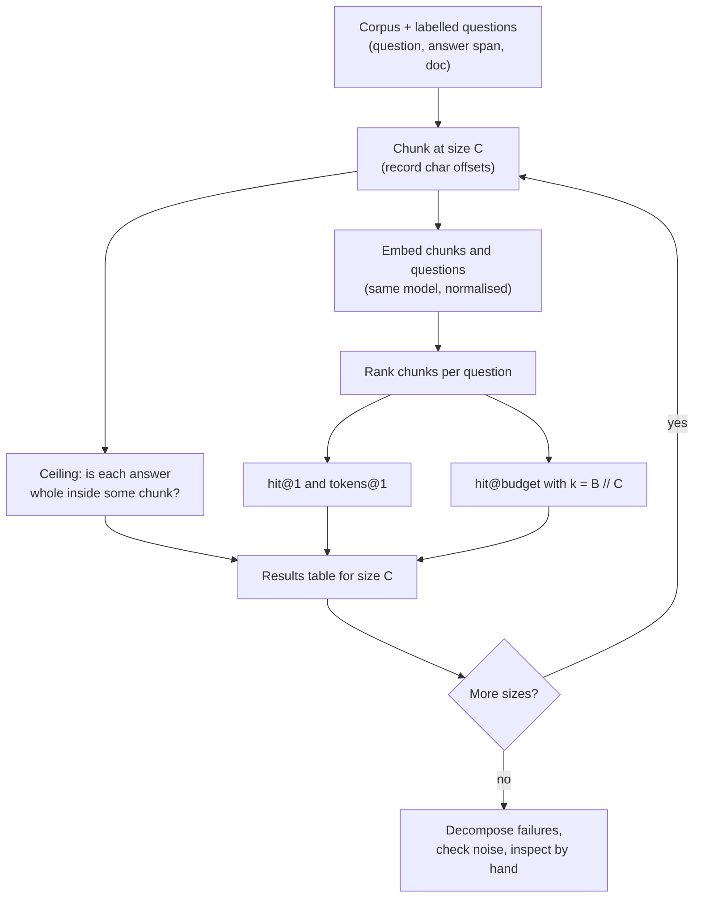

The [chunk size](/learn/chunking-fundamentals/chunk-size) lesson explained what chunk size controls and why there is no universally right value. This lesson is the next step: **finding the right value for your corpus by experiment**. You will build a labelled question set, sweep chunk sizes from 16 to 512 tokens, and read the results carefully, because a size sweep is easy to run and easy to misread. You will meet three traps: a metric that favours big chunks, an embedding model that silently ignores the end of long chunks, and a question set too small to separate the candidates. Later lessons in this module reuse the corpus built here.

## Learning objectives

- Design a chunk-size experiment that holds the embedding model, the questions and the context budget fixed while varying only the size.
- Separate retrieval failures into "the answer was split across chunks" and "the answer was intact but not retrieved", and explain why the distinction changes what you fix.
- Compare chunk sizes at an equal token budget rather than at an equal number of retrieved chunks.
- Detect when chunks exceed the embedding model's maximum sequence length, and explain what the model does with the excess.
- Estimate the sampling error of a hit rate measured on n questions and decide whether a difference between two sizes is real.

## Prerequisites

- [Chunk size](/learn/chunking-fundamentals/chunk-size): what size controls and the basic trade-off between focus and completeness.
- [Token-based chunking](/learn/chunking-fundamentals/token-based-chunking): counting and cutting in tokens rather than characters.
- [Embeddings](/learn/understanding-large-language-models/embeddings): text as vectors compared by cosine similarity.
- [Recall@K](/learn/retrieval-fundamentals/recall-k): the fraction of questions whose evidence appears in the top k results.

## Why this matters

Chunk size is set once, at indexing time, and every query lives with it until you re-index. A size copied from a tutorial affects recall, answer quality, latency and cost with no evidence behind it, and when retrieval disappoints nobody can say whether size is the cause. Measuring is not hard, but measuring *fairly* is:

1. **The metric rewards size.** "Did a retrieved chunk contain the answer?" gets easier as chunks grow. Without a cost-side measure, every sweep concludes that bigger is better.
2. **The comparison is unequal.** At the same top-k, 512-token chunks give the generator four times as much text as 128-token ones. Of course they do better.
3. **The model cannot see the whole chunk.** Text beyond the embedding model's maximum input length is truncated, usually silently.

An experiment that avoids these traps gives you a defensible number and tells you *why* the other sizes lost.

## The intuition

Imagine looking for a fact in a reference book by tearing it into pieces and asking a friend to hand you the one piece that best matches your question.

If you tear it into single lines, the friend can match your question very precisely, but the fact you need often spans two lines and you get only one of them. Worse, a line such as "Up to 5 unused days carry over" no longer says what it is about; the heading "Annual leave" is on another scrap.

If you tear it into whole chapters, the fact is almost always inside the piece you receive, but you must read a chapter to find it, and the chapter's other subjects blur your friend's matching.

The experiment finds the region between lines and chapters that suits *your* book and *your* questions. Note the two separate ways to fail: the fact was torn in half, or the fact was intact but you were handed the wrong piece. They have different cures, so the experiment must tell them apart.

## How it works

### What you hold fixed and what you vary

A chunk-size experiment is a controlled comparison. Change one thing and keep everything else identical:

- **Fixed:** the corpus, the question set, the embedding model, the similarity function, the context budget and the way chunk boundaries are chosen (here, plain token windows with no overlap).
- **Varied:** the chunk size, in tokens of the embedding model's own tokeniser.

Count in the embedding model's tokens, because that is the limit that truncates input. If your generator uses a different tokeniser, convert the budget once and say which tokeniser each number refers to.

### The question set

You need questions with known answers located in the corpus: triples of the question, an **answer span** (an exact substring of a document that answers it) and the document. Write questions the way users ask them; "How much is the training budget?" against a document that says "learning budget" is a realistic test.

Twenty questions teach the method and show gross differences, but cannot separate two close sizes, as the maths section shows. A production decision wants a few hundred, drawn from real query logs; see [golden datasets](/learn/testing-and-benchmarking/golden-datasets).

### The metrics

For each size, compute four numbers.

- **Ceiling.** The fraction of answer spans that lie wholly inside at least one chunk. If an answer is split across a boundary, no retriever can return it intact. The ceiling is the best hit rate any retriever could achieve with this chunking, so it isolates the *splitting* failure.
- **Hit@1.** The fraction of questions whose top-ranked chunk contains the whole answer span. The gap between ceiling and hit@1 is the *ranking* failure.
- **Tokens@1.** The mean length of the top-ranked chunk: the price, in context tokens, of that hit rate.
- **Hit@budget.** Fix a context budget $B$ (here 256 tokens). Retrieve $k = \lfloor B / C \rfloor$ chunks of size $C$, so that every configuration sends the generator roughly the same amount of text, and measure the hit rate at that $k$. This is the fair comparison.

"Contains the whole answer span" is deliberately strict, so absolute numbers understate usefulness; read the comparison between sizes. Graded, token-level metrics are covered in [chunk quality evaluation](/learn/chunking-optimisation/chunk-quality-evaluation).

### The procedure

1. Load the corpus and the labelled questions, and check that every answer span is an exact substring of its document.
2. For each candidate size $C$, split every document into windows of $C$ tokens and record each chunk's document and character offsets, so you can test containment exactly.
3. Count chunks longer than the embedding model's limit, remembering that special tokens such as `[CLS]` and `[SEP]` use part of it.
4. Embed the chunks and the questions with the same model, normalised so that a dot product is a cosine.
5. For each question, rank the chunks and compute ceiling, hit@1, tokens@1 and hit@budget.
6. Read the table: decompose failures into splitting and ranking, compare at equal budget, and estimate whether the differences exceed the noise.
7. Inspect the failing questions by hand before concluding anything.



### Why the embedding model's limit is part of the experiment

A transformer encoder has a fixed maximum input length. For `all-MiniLM-L6-v2` as packaged by sentence-transformers, `max_seq_length` is 256 tokens, two of which are the special tokens `[CLS]` and `[SEP]`. Anything beyond is cut off before the model runs, so the vector knows nothing about the end of the chunk. Retrieval still *returns* the whole chunk, so containment metrics look fine, but questions about the tail match only by accident. Check the limit for your model and treat any chunk size above it as a configuration error, not a candidate.

## The mathematics

The budget arithmetic ($k = \lfloor B/C \rfloor$) and the vector-count arithmetic ($N \approx T/C$) are worked through in [chunk size](/learn/chunking-fundamentals/chunk-size). What an experiment adds is a question that lesson did not need: is a measured difference real, and how many questions do you need to tell?

### Sampling error of a hit rate

**Intuition.** Each question is a coin flip that lands "hit" or "miss". With few flips, the observed proportion wanders a long way from the true one.

$$
\text{SE}(\hat{p}) = \sqrt{\frac{\hat{p}\,(1-\hat{p})}{n}}, \qquad \text{95\% interval} \approx \hat{p} \pm 1.96\,\text{SE}
$$

- $\hat{p}$: the observed hit rate.
- $n$: the number of questions.
- $\text{SE}$: the standard error, the typical distance between $\hat{p}$ and the true rate.

**Worked example.** With $\hat{p} = 0.85$ and $n = 20$: $0.85 \times 0.15 = 0.1275$; $0.1275 / 20 = 0.006375$; $\sqrt{0.006375} \approx 0.0798$. The 95% interval is about $\pm 0.156$: anything from roughly 0.69 to 1.00 fits the data. With $n = 200$ the half-width is about 0.049. Because both sizes are scored on the *same* questions, a paired comparison is sharper; [chunk quality evaluation](/learn/chunking-optimisation/chunk-quality-evaluation) shows how.

### How many questions you need

Turning the interval round gives the number of questions needed for a half-width $h$:

$$
n \approx \frac{z^2\, p\,(1-p)}{h^2}
$$

- $z = 1.96$ for 95 per cent confidence; $p$ is the expected hit rate; $h$ is the half-width you can tolerate.

**Worked example.** For $p = 0.85$ and $h = 0.05$: $1.96^2 \times 0.1275 / 0.0025 = 3.8416 \times 51 \approx 196$ questions. For $h = 0.10$, about 49. Separating sizes a few points apart needs a few hundred questions; spotting a twenty-point collapse needs a few dozen.

```python
import math

def half_width(p, n, z=1.96):
    return z * math.sqrt(p * (1 - p) / n)

def questions_needed(p, h, z=1.96):
    return math.ceil(z**2 * p * (1 - p) / h**2)

for n in (20, 200):
    print(f"n={n:>3}: 95% half-width = {half_width(0.85, n):.3f}")
for h in (0.10, 0.05):
    print(f"half-width {h:.2f}: need about {questions_needed(0.85, h)} questions")
```

```output
n= 20: 95% half-width = 0.156
n=200: 95% half-width = 0.049
half-width 0.10: need about 49 questions
half-width 0.05: need about 196 questions
```

## In code

**The problem.** Sweep six chunk sizes over a small Meridian corpus, separating splitting from ranking failures, comparing at equal budget, and flagging truncated chunks.

**Dependencies.** sentence-transformers (with PyTorch) and NumPy. The first run downloads `all-MiniLM-L6-v2`; no API key.

```bash
pip install sentence-transformers numpy
```

First, the corpus and question set. Save it as `meridian_corpus.py`; later lessons in this module import it.

```python
"""A small Meridian corpus with labelled questions, shared by the chunking-optimisation lessons."""

DOCS = {
    "handbook": """# Meridian Employee Handbook (2025)

## Annual leave
Every employee receives 25 days of annual leave per year, plus UK public holidays. Leave is booked in the HR portal and approved by your line manager. Up to 5 unused days carry over into the next year. Carried-over days must be used by 31 March, after which they are lost. Requests longer than ten consecutive working days need approval from your department head.

## Remote work
Staff may work remotely for up to 3 days a week. Your team agrees which days are office days. Contractors are not eligible for the home-office equipment budget. Permanent staff can claim a home-office equipment budget of £400. The budget covers a desk, a chair, a monitor and similar equipment, and it is claimed through the expenses process.

## Sick leave
If you are ill, tell your line manager before 10:00 on your first day of absence. Record the absence in the HR portal when you return. A fit note from a doctor is needed for any absence longer than seven calendar days.

## Learning and development
Each employee has a learning budget of £1,000 per year for courses, books and conferences. Spend over £300 on a single item needs your manager's approval in advance. Unused learning budget does not carry over.

## Expenses
The finance department processes all expenses. Expenses must be submitted within 30 days of the purchase. Anything over £75 needs a receipt. Claims without a required receipt are returned unpaid. Travel must be booked through the approved travel portal unless your manager agrees otherwise.
""",
    "it-runbook": """# IT Runbook: Accounts and Devices

## Passwords
Passwords must be rotated every 90 days. The new password must not match any of your last five passwords. If you are locked out, the support desk can reset your account after verifying your identity.

## Network access
VPN is required on public Wi-Fi, including hotels, trains and cafés. Error E-4021 means the VPN client is out of date. To fix it, update the client from the IT portal and restart your laptop.

## Laptops
The laptop refresh cycle is 3 years. A lost or stolen laptop must be reported to the support desk at once, so that the device can be locked remotely. The support desk is open from 08:00 to 18:00 UK time, Monday to Friday.
""",
    "relay-docs": """# Meridian Relay: Operations Guide

## Delivery
Meridian Relay routes events between services. If a destination is unavailable, Relay retries delivery with exponential backoff for up to 24 hours. Events that still fail are moved to a dead-letter queue, where they are kept for 14 days.

## Limits
A single event may be at most 256 KB. Each workspace can send up to 1,000 events per second; requests above the limit receive an HTTP 429 response and should be retried later.
""",
    "reports-docs": """# Meridian Reports: Product Guide

## Exporting
Meridian Reports exports any dashboard to PDF or CSV. Exports run in the background, and a download link is emailed when the file is ready. Large exports are split into several files of at most 50,000 rows each.

## Single sign-on
On the Enterprise plan, Meridian Reports supports SAML single sign-on. An administrator uploads the identity provider metadata on the Security settings page. Users then sign in with their company account, and local passwords are disabled.
""",
}

# (question, answer substring, document id). Each answer is an exact substring of its document.
QUESTIONS = [
    ("How many days of annual leave do employees get?", "25 days of annual leave per year", "handbook"),
    ("When do carried-over holiday days expire?", "Carried-over days must be used by 31 March", "handbook"),
    ("Who must approve a holiday longer than two weeks?", "need approval from your department head", "handbook"),
    ("How many days a week can I work from home?", "remotely for up to 3 days a week", "handbook"),
    ("How much can I spend on home-office equipment?", "home-office equipment budget of £400", "handbook"),
    ("Can contractors claim the home office budget?", "Contractors are not eligible for the home-office equipment budget", "handbook"),
    ("Do I need a doctor's note when I'm off sick?", "A fit note from a doctor is needed for any absence longer than seven calendar days", "handbook"),
    ("How much is the training budget?", "learning budget of £1,000 per year", "handbook"),
    ("What is the deadline for submitting an expense claim?", "submitted within 30 days of the purchase", "handbook"),
    ("When do I need a receipt for an expense?", "Anything over £75 needs a receipt", "handbook"),
    ("How often must I change my password?", "rotated every 90 days", "it-runbook"),
    ("Do I need the VPN in a hotel?", "VPN is required on public Wi-Fi", "it-runbook"),
    ("What does error E-4021 mean?", "Error E-4021 means the VPN client is out of date", "it-runbook"),
    ("How often are laptops replaced?", "The laptop refresh cycle is 3 years", "it-runbook"),
    ("What should I do if my laptop is stolen?", "must be reported to the support desk at once", "it-runbook"),
    ("What are the support desk opening hours?", "open from 08:00 to 18:00 UK time", "it-runbook"),
    ("How long does Relay keep retrying a failed delivery?", "retries delivery with exponential backoff for up to 24 hours", "relay-docs"),
    ("What is the maximum event size in Meridian Relay?", "A single event may be at most 256 KB", "relay-docs"),
    ("Which file formats can Meridian Reports export to?", "exports any dashboard to PDF or CSV", "reports-docs"),
    ("Does Meridian Reports support SAML single sign-on?", "On the Enterprise plan, Meridian Reports supports SAML single sign-on", "reports-docs"),
]

for _q, _a, _d in QUESTIONS:
    assert _a in DOCS[_d], (_q, _a)
```

The experiment, `size_sweep.py`:

```python
import numpy as np
from sentence_transformers import SentenceTransformer
from meridian_corpus import DOCS, QUESTIONS

model = SentenceTransformer("sentence-transformers/all-MiniLM-L6-v2")
tok = model.tokenizer
BUDGET = 256                          # context tokens we are willing to send per question

def chunk_tokens(doc_id, text, size):
    """Fixed-size token windows with no overlap, as (doc_id, start_char, end_char)."""
    offsets = tok(text, add_special_tokens=False, return_offsets_mapping=True)["offset_mapping"]
    return [(doc_id, offsets[i][0], offsets[min(i + size, len(offsets)) - 1][1])
            for i in range(0, len(offsets), size)]

def n_tokens(text):
    return len(tok(text, add_special_tokens=False)["input_ids"])

def evaluate(size):
    spans = [s for d, t in DOCS.items() for s in chunk_tokens(d, t, size)]
    texts = [DOCS[d][a:b] for d, a, b in spans]
    E = model.encode(texts, normalize_embeddings=True)
    Q = model.encode([q for q, _, _ in QUESTIONS], normalize_embeddings=True)
    k = BUDGET // size                 # chunks that fit in the budget
    hit1 = hitb = ceiling = 0
    top1_tokens = []
    for qv, (_, answer, doc_id) in zip(Q, QUESTIONS):
        a0 = DOCS[doc_id].index(answer)
        a1 = a0 + len(answer)
        order = np.argsort(-(E @ qv))
        contains = [spans[i][0] == doc_id and spans[i][1] <= a0 and a1 <= spans[i][2]
                    for i in order]
        ceiling += any(contains)       # is the answer whole inside ANY chunk?
        hit1 += contains[0]
        top1_tokens.append(n_tokens(texts[order[0]]))
        hitb += bool(k) and any(contains[:k])
    too_long = sum(n_tokens(t) + 2 > model.max_seq_length for t in texts)  # +2: [CLS], [SEP]
    n = len(QUESTIONS)
    budget_cols = f"{k:>3} {hitb / n:>10.2f}" if k else f"{'-':>3} {'too big':>10}"
    print(f"{size:>5} {len(spans):>7} {too_long:>9} {ceiling / n:>8.2f} {hit1 / n:>6.2f} "
          f"{np.mean(top1_tokens):>10.0f}  {budget_cols}")

print(f"{'size':>5} {'chunks':>7} {'truncated':>9} {'ceiling':>8} {'hit@1':>6} {'tokens@1':>10}  {'k':>3} {'hit@budget':>10}")
for size in (16, 32, 64, 128, 256, 512):
    evaluate(size)

# What does the model actually see of a chunk longer than its limit?
handbook = DOCS["handbook"]
first_254 = tok.decode(tok(handbook, add_special_tokens=False)["input_ids"][:254])
full, cut = model.encode([handbook, first_254], normalize_embeddings=True)
print(f"\nhandbook tokens: {n_tokens(handbook)}, model limit: {model.max_seq_length}")
print(f"cosine(full handbook, first 254 tokens only) = {full @ cut:.4f}")
```

```output
 size  chunks truncated  ceiling  hit@1   tokens@1    k hit@budget
   16      45         0     0.20   0.20         16   16       0.20
   32      24         0     0.55   0.50         32    8       0.55
   64      12         0     0.75   0.65         61    4       0.75
  128       7         0     0.90   0.80        108    2       0.85
  256       5         1     1.00   0.90        173    1       0.90
  512       4         1     1.00   0.95        234    -    too big

handbook tokens: 314, model limit: 256
cosine(full handbook, first 254 tokens only) = 1.0000
```

**The important lines.**

- `return_offsets_mapping=True` returns each token's character range. Cutting by token index and slicing the *original* string gives chunks of exact token length with their original casing (this tokeniser lower-cases, so decoding IDs would not).
- Each chunk is `(doc_id, start_char, end_char)`, so containment is an exact interval test rather than a fuzzy string search.
- `ceiling += any(contains)` looks at the whole ranking, so it measures only whether the answer survived chunking.
- `k = BUDGET // size` is the equal-budget rule. At 512 tokens $k = 0$: one chunk alone exceeds the budget, so it is reported as not fitting.
- `n_tokens(t) + 2` counts the two special tokens against the model's limit.

**What the output means.**

- **Small sizes fail by splitting, not by ranking.** At 16 tokens the ceiling is 0.20 and hit@budget is also 0.20: retrieval found every answer that still existed in one piece. Most answer spans here are 7 to 17 tokens, and a 16-token window almost always cuts through them. At 32 and 64 tokens the pattern repeats: hit@budget equals the ceiling. The cure for these sizes is not a better embedding model; it is [overlap](/learn/chunking-optimisation/overlap-optimisation) or [boundaries that respect sentences](/learn/chunking-optimisation/boundary-preservation).
- **Larger sizes start to fail by ranking.** At 128 and 256 tokens the ceiling is 0.90 and 1.00 but hit@budget is 0.85 and 0.90: some answers were intact yet not ranked first. Those are the questions to read by hand.
- **Tokens@1 is the price.** Going from 64 to 256 tokens raised hit@1 from 0.65 to 0.90 and nearly tripled the text per retrieved chunk (61 to 173 tokens). Whether that is worth it depends on your generator's budget and on how much irrelevant text it tolerates.
- **The toy corpus flatters big chunks.** At 256 tokens the whole index holds 5 chunks, so retrieval is close to "pick the right document out of four". In a corpus of tens of thousands of chunks, each large chunk competes with many that share its vocabulary, and ranking failures grow. Run the experiment on your real corpus.
- **Truncation is silent.** The handbook is 314 tokens; the model reads 254. The cosine of exactly 1.0000 between the full handbook and its first 254 tokens shows that the later sections contribute nothing to its vector.
- **128 against 256 is within noise.** 0.85 against 0.90 is one question out of twenty.

**Errors people commonly hit.** Decoding token IDs back to text and searching it for the answer fails on case and spacing; keep offsets into the original string. Tokenising a whole long document may print a sequence-length warning; it is harmless here, because only the tokeniser sees the whole document. And editing `QUESTIONS` between runs makes tables incomparable, so version the question set with the results.

**Extending it.** Add hit@3 at fixed $k = 3$ to see the unfair comparison for yourself, rerun with `BUDGET = 512`, and log which questions fail at each size; the list of failures is more informative than the table.

## A real-world example

The Platform team at Meridian ran AskMeridian on 1,000-token chunks for its first six months, a value copied from a framework's quick-start guide. Users were happy with handbook questions and unhappy with IT runbook questions, and the team suspected chunk size.

Their first sweep compared 250, 500 and 1,000 tokens at a fixed top-5 and crowned 1,000. A reviewer pointed out that top-5 at 1,000 tokens sends four times the text of top-5 at 250, and that their embedding model's limit was 512 tokens, so every 1,000-token chunk was indexed by its first half. Runbook pages open with a long preamble of prerequisites before the troubleshooting table, so the part users asked about was in the invisible half.

They reran with the budget fixed at 2,000 tokens, sizes capped at the model's limit, and 300 questions from real logs labelled by the support desk. The ceiling showed 250-token chunks splitting long numbered runbook procedures; ranking failures at 500 clustered in handbook sections covering several policies at once. Neither size won everywhere. The team chose 400 tokens with sentence-aware boundaries and recorded the per-collection failures as the motivation for the [parent-child](/learn/chunking-optimisation/parent-child-chunking) structure they adopted later. Just as valuable: the next person to question the decision could rerun the experiment.

## Common mistakes

- **Comparing at a fixed top-k.** Larger chunks get more text and look better. Fix the token budget instead.
- **Using containment as the only metric.** It rises monotonically with size and can never tell you to make chunks smaller. Report a cost measure (tokens@1, tokens sent) beside it.
- **Exceeding the embedding model's limit.** The vector represents only the start of the chunk. Check `max_seq_length` (or the provider's documented input limit) before choosing candidate sizes.
- **Mixing tokenisers.** A "512-token" chunk counted with the generator's tokeniser may be 600 tokens for the embedding model. State which tokeniser every number uses.
- **Copying document sentences into questions.** Lexical overlap flatters every configuration and hides real users' vocabulary mismatch.
- **Declaring a winner on 20 questions.** A five-point difference is one question.
- **Sweeping on a small sample corpus.** Few competing chunks make ranking easy and favour large chunks.

## Best practices

- Store chunks as offsets into the source text, so containment and overlap can be tested exactly.
- Report the ceiling beside the hit rate; it tells you whether to change the chunker or the retriever.
- Fix the context budget the generator will receive and derive $k$ from it.
- Use a few hundred questions from real logs and stratify results by collection or query type.
- Read the failing questions for the best two or three configurations before deciding.
- Version the corpus snapshot, question set, model and code together so the experiment can be rerun.

## Performance considerations

Each configuration re-embeds the corpus, so a sweep of six sizes over $T$ tokens embeds about $6T$ tokens. Time your hardware on a sample first; if a full pass is too slow, sweep a representative subset large enough that ranking stays realistic.

The chosen size has lasting costs. Index size scales with $T / C$: halving the size doubles the vectors, the memory of an in-RAM index such as HNSW, and the rebuild time. The generator reads about $B$ tokens per question whatever the size, so query-time input cost is set by the budget; fix it first and let the size determine $k$. Indexing-time embedding cost scales with $T$ (plus any overlap), not with the number of chunks.

## Summary

- A chunk-size experiment holds the corpus, questions, model, budget and boundary rule fixed and varies only the size, measured in the embedding model's tokens.
- The ceiling (answers intact in some chunk) separates splitting failures from ranking failures; small sizes fail mostly by splitting.
- Compare sizes at an equal token budget, with $k = \lfloor B/C \rfloor$, never at a fixed top-k.
- Chunks longer than the embedding model's limit are silently truncated; the vector describes only their beginning.
- On 20 questions a hit rate's 95% interval is about plus or minus 15 points; use hundreds.

## Exercises

**1.** An answer span is 20 tokens long and chunks are fixed 16-token windows. What is the ceiling for that question, and why? What happens at 32 tokens?

<details><summary>Show solution</summary>

At 16 tokens the ceiling is 0: a 20-token span cannot fit inside any 16-token window, whatever the alignment. At 32 tokens it fits in a window only if it starts within the first $32 - 20 = 12$ positions of a window, that is in 13 of the 32 possible offsets, so a span at a random position survives with probability $13/32 \approx 0.41$. This is why small windows have such low ceilings; [chunk overlap](/learn/chunking-fundamentals/chunk-overlap) derives the general formula.

</details>

**2.** A colleague reports: "At top-5, 1,024-token chunks scored 0.92 hit rate and 256-token chunks scored 0.78, so we should use 1,024." List the questions you would ask before accepting this.

<details><summary>Show solution</summary>

- Equal budget? Top-5 at 1,024 tokens sends 5,120 tokens; top-5 at 256 sends 1,280. Compare 256-token chunks at $k = 20$.
- The embedding model's limit? If it is 512, the 1,024-token chunks are embedded from their first half.
- The ceiling at each size? If 256 tokens has a ceiling of 0.80, the gap is splitting, which overlap or sentence boundaries may close more cheaply.
- How many questions, from where, on how large a corpus?
- What happens to answer quality and cost when the generator reads 5,000 tokens per question?

</details>

**3.** Modify `size_sweep.py` so that, for one chosen size, it prints each failing question with the label "split" (answer in no chunk) or "ranked" (answer intact but not in the top $k$). Run it at 128 tokens and read the "ranked" failures. What do they have in common?

<details><summary>Show solution</summary>

Unpack the question in the loop (`for qv, (question, answer, doc_id) in ...`) and add, after `contains` is computed:

```python
        if not any(contains[:max(k, 1)]):
            label = "ranked" if any(contains) else "split"
            print(f"[{label}] {question}")
            if label == "ranked":
                print("   top:", repr(texts[order[0]][:80]))
```

Calling `evaluate(128)` prints:

```output
[split] How much can I spend on home-office equipment?
[ranked] Can contractors claim the home office budget?
   top: '-office equipment budget of £400. The budget covers a desk, a chair, a monitor '
```

Both kinds of failure come from the same place: a 128-token boundary falls inside "home-office". The equipment-budget answer is cut in two (split), and the chunk that starts with "-office equipment budget" matches the contractors question so well on "office" and "budget" that it outranks the chunk that actually contains the contractors sentence (ranked). A boundary in the middle of a hyphenated word produced both failures, which is the problem [boundary preservation](/learn/chunking-optimisation/boundary-preservation) addresses. Reading the top-ranked text is what reveals it; the table alone could not.

</details>

**4.** Design decision. AskMeridian's generator has room for 3,000 tokens of retrieved context. The embedding model's limit is 512 tokens. Runbook answers are often 150-token numbered procedures; handbook answers are single sentences. Propose candidate sizes for the sweep, the metrics you would report per collection, and how you would decide if the two collections prefer different sizes.

<details><summary>Show solution</summary>

Candidates: 128, 256, 384 and 500 tokens (500 leaves room for special tokens and any prefix added later). Use $k = \lfloor 3000 / C \rfloor$: 23, 11, 7 and 6.

Report per collection: ceiling, hit@budget, tokens@1 and the failures labelled split or ranked, each hit rate with a 95% interval, on at least 150 questions per collection.

If the collections disagree (likely: 128 tokens will split runbook procedures while handbook questions prefer small chunks), you need not pick one global size. Chunk each collection with its own size and record it in chunk metadata, or match on small chunks and return larger units at query time ([small-to-big retrieval](/learn/chunking-optimisation/small-to-big-retrieval)). Choose the simpler option unless measurements show it falls short.

</details>

## Check your understanding

```quiz
[
  {
    "q": "In a chunk-size sweep, the ceiling at 32 tokens is 0.55 and the hit rate at the equal budget is also 0.55. What does this tell you?",
    "options": [
      "The embedding model is too weak for this corpus",
      "Every failure is an answer split across chunks; the retriever found every answer that survived intact",
      "The budget is too small",
      "The question set is biased towards long answers"
    ],
    "answer": 1,
    "why": "The ceiling is the best any retriever could do with this chunking. When the hit rate equals it, all remaining failures come from splitting, which a better chunker (overlap, sentence boundaries, larger size) fixes, not a better retriever."
  },
  {
    "q": "Why should chunk sizes be compared at an equal token budget rather than an equal top-k?",
    "options": [
      "Because vector databases charge per chunk returned",
      "Because top-k is not defined for large chunks",
      "Because at equal top-k larger chunks give the generator more text, which inflates their hit rate without showing they are better",
      "Because the embedding model requires it"
    ],
    "answer": 2,
    "why": "Top-5 of 1,000-token chunks is four times as much text as top-5 of 250-token chunks. Fixing the budget B and retrieving floor(B / C) chunks makes the comparison fair."
  },
  {
    "q": "A sentence-transformers model has max_seq_length = 256. A chunk of 400 tokens is encoded. What happens?",
    "options": [
      "The library raises an error",
      "The chunk is split into two vectors automatically",
      "The vector is computed from the whole chunk but with lower precision",
      "The input is truncated, so the vector represents roughly the first 254 text tokens and the rest has no influence"
    ],
    "answer": 3,
    "why": "Encoders truncate input at their maximum length, and the special tokens [CLS] and [SEP] use two positions. The tail of the chunk is never seen, usually without a warning."
  },
  {
    "q": "Two chunk sizes score hit rates of 0.85 and 0.90 on the same 20 questions. What is the most defensible conclusion?",
    "options": [
      "The 0.90 size is clearly better",
      "The difference is one question and well within sampling error; more questions are needed",
      "The 0.85 size is better because it is cheaper",
      "Hit rate is the wrong metric for chunk size"
    ],
    "answer": 1,
    "why": "With n = 20 the 95% interval on a hit rate near 0.85 is about plus or minus 0.16. One question cannot separate the two configurations."
  },
  {
    "q": "A sweep on a 10-document sample finds that the largest chunk size wins clearly. Why might this not hold on the full 50,000-document corpus?",
    "options": [
      "Because large chunks take longer to embed",
      "Because with few documents a large chunk is nearly a whole document, so ranking is easy; in a large index many large chunks share vocabulary and ranking failures grow",
      "Because large chunks cannot be stored in a vector database",
      "Because the embedding model changes with corpus size"
    ],
    "answer": 1,
    "why": "Ranking difficulty depends on how many chunks compete. A tiny index turns chunk retrieval into document selection, which flatters large chunks."
  }
]
```

## Further reading

- Reimers, N. and Gurevych, I. (2019). *Sentence-BERT: Sentence Embeddings using Siamese BERT-Networks*. [arXiv:1908.10084](https://arxiv.org/abs/1908.10084). The model family used here, and how mean pooling produces one vector per input.
- [Sentence Transformers documentation](https://www.sbert.net/): model cards and the `max_seq_length` setting that governs truncation.
- Liu, N. F. et al. (2023). *Lost in the Middle: How Language Models Use Long Contexts*. [arXiv:2307.03172](https://arxiv.org/abs/2307.03172). Why more retrieved text is not free for the generator.
- Smith, B. and Troynikov, A. (2024). *Evaluating Chunking Strategies for Retrieval*. Chroma technical report. Token-level metrics for comparing chunkers, discussed further in [chunk quality evaluation](/learn/chunking-optimisation/chunk-quality-evaluation).
