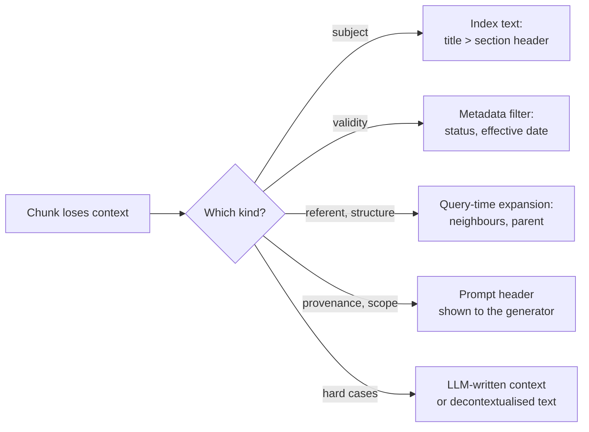

A chunk is a passage cut out of a document, and the cut removes more than neighbouring text. It removes what the passage was *about*, which product or policy "it" refers to, who the rule applies to, and whether the document is still in force. [Document-aware chunking](/learn/advanced-chunking-strategies/document-aware-chunking) introduced the basic remedy: a short context header in the text you embed, and metadata stored beside it. This lesson goes further. It classifies the kinds of context a chunk loses, shows that each kind belongs in a different place (the embedded text, a metadata filter, the prompt shown to the generator, or neighbouring text fetched at query time), and measures the effect of each choice on a corpus that contains the two classic traps: a sibling product with near-identical documentation, and a superseded handbook that was never removed from the index.

## Learning objectives

- Name five kinds of context a chunk can lose and give an example of each.
- Decide, for each kind, whether it belongs in the embedded text, in metadata used for filtering, in the prompt, or in query-time expansion.
- Measure context loss with a wrong-source rate and recall on context-dependent questions.
- Estimate how much of a chunk's vector a context header controls, and explain why headers matter most for small chunks.
- Explain why version and validity context must be enforced by filters rather than by text.

## Prerequisites

- [Document-aware chunking](/learn/advanced-chunking-strategies/document-aware-chunking): index text versus display text, and the deterministic context header.
- [Heading-based chunking](/learn/advanced-chunking-strategies/heading-based-chunking): recovering the heading path above a passage.
- [Chunk size experiments](/learn/chunking-optimisation/chunk-size-experiments): the Meridian corpus file used here.
- [Metadata](/learn/vector-database-fundamentals/metadata): what a vector database stores beside each vector.

## Why this matters

Context loss produces some of the most damaging failures in RAG, because the retrieved text is real, relevant-looking and wrong.

- **Wrong product.** Meridian Reports and Meridian Sync have export guides written from the same template. The sentence "Large exports are split into several files of at most 50,000 rows each" does not mention Reports. A question about Reports can retrieve Sync's twin sentence, and the generator will state Sync's limit as if it were Reports'.
- **Wrong version.** The 2023 handbook said the laptop refresh cycle was 4 years. The current runbook says 3. If both are indexed, "How often are laptops replaced?" can return the stale one, and nothing in the sentence says it is stale.
- **Unresolved reference.** "To fix it, update the client from the IT portal and restart your laptop." Fix what? A question about error E-4021 must match a sentence that never names it.
- **Lost scope.** "Contractors are not eligible" is an exception to a rule two sentences earlier. A chunk containing the rule but not the exception gives a confidently wrong answer to a contractor.

Bigger chunks reduce some of these losses, but at the costs you met in the [size experiments](/learn/chunking-optimisation/chunk-size-experiments). Context preservation lets you keep chunks small and focused while giving each one back what the cut removed.

## The intuition

Imagine photocopying single paragraphs from a filing cabinet of manuals and dropping them in a box. Someone pulls out a paragraph that says "The limit is 50,000 rows." Limit of what? Which product? Is this the current manual or the one replaced last year?

You could fix this in several ways. Write the manual's title at the top of each photocopy, so anyone reading it knows the subject. Stamp "SUPERSEDED" on copies from old manuals, or better, never put them in the box people search. Clip the previous paragraph to the copy when the paragraph starts with "It" or "This". Each fix answers a different missing question, and a title written at the top is no substitute for keeping withdrawn manuals out of the box. That is the core of this lesson: different kinds of missing context need different remedies.

## How it works

### Five kinds of lost context

| Kind | What is missing | Meridian example |
| --- | --- | --- |
| **Subject** | The document or section topic | "Large exports are split into several files" (of which product?) |
| **Referent** | What a pronoun or definite phrase points to | "To fix it, update the client" (fix what?) |
| **Scope** | Who or what the statement applies to, including exceptions | "The budget covers a desk..." (which budget, for whom?) |
| **Validity** | Whether the source is current, and from when | "The laptop refresh cycle is 4 years" (2023, superseded) |
| **Structure** | Where the passage sits: step 4 of 7, a footnote, a table row | "Restart the service" (after which step?) |

### Four places context can go

Context restored into a chunk is not one thing; it can go in four places, each with a different effect.

1. **The embedded text (index text).** Words added here change the vector, so they change *which questions match*. This is the place for subject context: a title and heading path let "Meridian Reports export limit" match a sentence that does not say "Reports". It is useless for validity: queries rarely say "current", and a vector cannot enforce a rule.
2. **Metadata used as a filter.** Fields such as `status`, `effective_date`, `product` and access-control lists are stored beside the vector and applied as hard constraints at search time. This is the only reliable place for validity and permissions, because a filter excludes; similarity merely ranks.
3. **The prompt (display header).** The generator needs provenance to reason and cite: "Source: Meridian Employee Handbook (2025) > Remote work". It may also need scope that does not help matching. Put this in the text shown to the generator, not necessarily in the embedded text.
4. **Neighbouring text at query time.** Referent and structure context usually live in the previous sentence or steps. Fetching neighbours after retrieval restores them for the generator without changing the index; this is [small-to-big retrieval](/learn/chunking-optimisation/small-to-big-retrieval). Including the previous sentence in the *embedded* text is possible but blurs the vector, as the experiment below shows.



### Model-generated context

Deterministic headers cannot resolve "it" or summarise a passage's role in its document. Two model-based techniques can, at a per-chunk cost:

- **Decontextualisation** rewrites the chunk so it stands alone: "To fix error E-4021, update the VPN client from the IT portal and restart your laptop." Choi and colleagues (2021) defined this task for single sentences; it is attractive for short chunks but alters the text, so keep the original as display text and cite that.
- **Contextual retrieval** asks a model to write a sentence or two situating the chunk within the whole document and prepends it to the index text. It is covered in [contextual retrieval](/learn/advanced-retrieval/contextual-retrieval).

A third family keeps the text unchanged and changes how it is embedded: [late chunking](/learn/chunking-optimisation/late-chunking) encodes the whole document before splitting, so each chunk's vector is computed with the rest of the document in view.

Use deterministic headers and filters first. They are free, exact and explainable. Add model-generated context where measurement shows referent or scope failures that headers do not fix.

### Measuring context loss

Two measurements make context loss visible.

1. **Build context-dependent test questions.** Take chunks whose text does not name its subject, and write questions that do: "How large can a Meridian Reports export file be?" for "Large exports are split...". Add questions whose answer has a stale or sibling twin in the index.
2. **Measure recall and wrong-source rate.** Recall@k tells you whether the right chunk is found at all. The **wrong-source rate**, the fraction of questions whose top result comes from a different document (a sibling product or a superseded version), measures the specific failure context should prevent. It is worse than a plain miss, because the retrieved text answers the question confidently and wrongly.

An intrinsic check complements these: ask a model, for each chunk, whether it can be understood on its own and what it would need. The code section includes one; it costs a model call per chunk, so run it on a sample.

## The mathematics

**Intuition.** Mean pooling averages the model's output vectors over every token in the input. A header is a share of those tokens, so, roughly, it controls a share of the final vector. The same 15-token header is a nudge on a 300-token chunk and a shove on a 30-token one.

$$
w_{\text{header}} \approx \frac{h}{h + n}
$$

- $h$: header length in tokens.
- $n$: chunk body length in tokens.
- $w_{\text{header}}$: the approximate share of the pooled vector contributed by header tokens.

This is an approximation. Attention mixes information between tokens, so header tokens also change the body tokens' output vectors, and the true influence is larger than the share suggests. The share is still a useful first estimate of how much a header can steer, and how much it can homogenise chunks of the same document.

**Worked example.**

- $h = 15$, $n = 300$: $15 / 315 \approx 0.048$, about 5 per cent.
- $h = 15$, $n = 30$: $15 / 45 \approx 0.333$, a third.
- $h = 40$, $n = 30$: $40 / 70 \approx 0.571$: the header now outweighs the content, and every chunk of the document starts to look alike.

```python
for h, n in [(15, 300), (15, 30), (40, 30)]:
    print(f"header {h:>2}, body {n:>3}: header share = {h / (h + n):.3f}")
```

```output
header 15, body 300: header share = 0.048
header 15, body  30: header share = 0.333
header 40, body  30: header share = 0.571
```

The practical rule: keep headers short, and expect them to matter most where chunks are small. Header tokens also count against the embedding model's input limit, so subtract them when choosing chunk size.

## In code

**The problem.** Index one sentence per chunk over a corpus that includes a sibling product guide (Meridian Sync) and the superseded 2023 handbook. Compare four index-text variants on context-dependent questions, with and without a metadata filter on document status.

**Dependencies.** sentence-transformers and NumPy, plus `meridian_corpus.py` from [chunk size experiments](/learn/chunking-optimisation/chunk-size-experiments). No API key.

```bash
pip install sentence-transformers numpy
```

```python
import re
import numpy as np
from sentence_transformers import SentenceTransformer
from meridian_corpus import DOCS

model = SentenceTransformer("sentence-transformers/all-MiniLM-L6-v2")

# The superseded 2023 handbook is still in the index, as it often is in real systems.
CORPUS = dict(DOCS)
CORPUS["handbook-2023"] = """# Meridian Employee Handbook (2023, superseded)

## Remote work
Permanent staff can claim a home-office equipment budget of £250. The budget covers a desk, a chair and a monitor.

## Laptops
The laptop refresh cycle is 4 years. The support desk is open from 09:00 to 17:00 UK time.
"""
CORPUS["sync-docs"] = """# Meridian Sync: Product Guide

## Exporting
Meridian Sync exports sync logs to CSV. Exports run in the background, and a download link is emailed when the file is ready. Large exports are split into several files of at most 10,000 rows each.

## Single sign-on
On the Business and Enterprise plans, Meridian Sync supports SAML single sign-on. An administrator uploads the identity provider metadata on the Integrations page.
"""
STATUS = {d: "superseded" if d == "handbook-2023" else "current" for d in CORPUS}

def sentence_chunks(doc_id, text):
    """One chunk per sentence, remembering the document title and the section heading above it."""
    title, section, chunks = "", "", []
    for line in text.splitlines():
        if line.startswith("# "):
            title = line[2:].strip()
        elif line.startswith("## "):
            section = line[3:].strip()
        elif line.strip():
            for sentence in re.split(r"(?<=[.!?])\s+", line.strip()):
                chunks.append({"doc": doc_id, "title": title, "section": section, "text": sentence})
    return chunks

CHUNKS = [c for d, t in CORPUS.items() for c in sentence_chunks(d, t)]
for prev, c in zip([None] + CHUNKS, CHUNKS):           # the sentence before, within the same section
    same = prev and (prev["doc"], prev["section"]) == (c["doc"], c["section"])
    c["previous"] = prev["text"] if same else ""

# Questions whose answering sentence does not say what it is about, and questions with a stale twin.
TESTS = [
    ("How large can a Meridian Reports export file be?", "Large exports are split into several files", "reports-docs"),
    ("How do I receive a Meridian Reports export?", "a download link is emailed", "reports-docs"),
    ("Where does an admin upload SAML metadata for Meridian Reports?", "An administrator uploads the identity provider metadata", "reports-docs"),
    ("How do I fix error E-4021?", "To fix it, update the client", "it-runbook"),
    ("What happens to Meridian Relay events that keep failing?", "Events that still fail are moved to a dead-letter queue", "relay-docs"),
    ("What is the rate limit for Meridian Relay?", "Each workspace can send up to 1,000 events per second", "relay-docs"),
    ("What does the home-office equipment budget cover?", "The budget covers a desk, a chair, a monitor", "handbook"),
    ("How often are laptops replaced?", "The laptop refresh cycle is 3 years", "it-runbook"),
    ("What is the home-office equipment budget?", "home-office equipment budget of £400", "handbook"),
    ("What are the support desk hours?", "open from 08:00 to 18:00 UK time", "it-runbook"),
]

VARIANTS = {
    "bare sentence":    lambda c: c["text"],
    "+ title":          lambda c: f"{c['title']}. {c['text']}",
    "+ title > section": lambda c: f"{c['title']} > {c['section']}. {c['text']}",
    "+ previous sentence": lambda c: f"{c['previous']} {c['text']}".strip(),
}

Q = model.encode([q for q, _, _ in TESTS], normalize_embeddings=True)
current = np.array([STATUS[c["doc"]] == "current" for c in CHUNKS])

def score(E, only_current):
    wrong_doc = recall3 = 0
    for qv, (_, answer, doc) in zip(Q, TESTS):
        scores = np.where(current, E @ qv, -np.inf) if only_current else E @ qv
        top = np.argsort(-scores)[:3]
        wrong_doc += CHUNKS[top[0]]["doc"] != doc
        recall3 += any(CHUNKS[i]["doc"] == doc and answer in CHUNKS[i]["text"] for i in top)
    return recall3, wrong_doc

n = len(TESTS)
print(f"{'index text':<20} {'recall@3':>8} {'wrong doc@1':>11}   {'with status filter':>18}")
for name, render in VARIANTS.items():
    E = model.encode([render(c) for c in CHUNKS], normalize_embeddings=True)
    (r, w), (rf, wf) = score(E, False), score(E, True)
    print(f"{name:<20} {r:>5}/{n} {w:>8}/{n}   {rf:>8}/{n} {wf:>6}/{n}")
```

```output
index text           recall@3 wrong doc@1   with status filter
bare sentence            7/10        1/10          7/10      0/10
+ title                 10/10        4/10         10/10      0/10
+ title > section       10/10        4/10         10/10      0/10
+ previous sentence      7/10        4/10          8/10      0/10
```

**The important lines.**

- `sentence_chunks()` records the title and section of every sentence as it walks the Markdown. Context is captured at chunking time, when it is free, rather than reconstructed later.
- Each chunk keeps its original `text`. The variants only change what is *embedded*; the text shown to the generator and cited can stay the original sentence.
- `STATUS` is metadata, never embedded. `np.where(current, E @ qv, -np.inf)` is the in-memory equivalent of a vector-database payload filter: superseded chunks cannot be returned at all.
- `wrong_doc` counts questions whose top result comes from another document, which here means Sync instead of Reports, or the 2023 handbook instead of the current sources.

**What the output means.**

- **Subject headers fix recall.** Bare sentences find the answer in the top three for 7 of 10 questions. With the title prepended, all 10. The three rescued questions are exactly the subject-loss cases: the Reports download link, the Reports SAML metadata page and the Relay rate limit, whose sentences never name their product.
- **Headers make the version problem worse.** Without a filter, the wrong-source count rises from 1 to 4 with headers. The stale 2023 chunks now carry "Meridian Employee Handbook... > Laptops", which matches "How often are laptops replaced?" *better* than the current IT runbook does. The word "superseded" in the title is a few tokens in a mean-pooled vector and no query asks for it. Validity in the text does not work.
- **The status filter does.** With superseded documents filtered out, the wrong-source count is 0 in every variant, and the header variants keep recall at 10/10. Subject in the text, validity in a filter: each kind of context in its own place.
- **The section path adds nothing measurable here.** Sections in this corpus are short and their titles overlap with the questions' words anyway. On long documents with many similar sections ("Limits" in every product guide), the section is often what distinguishes chunks.
- **Embedding the previous sentence helps little and costs focus.** It recovers one answer only with the filter, and raises wrong-source errors without it. The previous sentence brings its own topic into the vector. Referent context is better restored for the generator after retrieval, by fetching neighbours, than embedded.
- **Ten questions are a demonstration, not a decision.** The directions are consistent with the mechanism; size the effect on a few hundred labelled questions before relying on it.

**Errors people commonly hit.**

- *Header on the display text too.* If the header is concatenated into the stored text, citations quote "Meridian Employee Handbook (2025) > Remote work. The budget covers..." as if it were in the document. Store index text and display text separately.
- *Forgetting the header in token counts.* A 254-token chunk plus a 20-token header is truncated by a 256-token model. Budget for it.
- *Filtering after top-k.* Retrieving the top 10 and then discarding superseded chunks can leave nothing. Filter inside the search, which vector databases support through payload filters.

**Measuring self-containedness with a model.** The following check asks Claude whether a chunk can be understood on its own. It needs an API key and was not executed for this lesson.

```bash
pip install anthropic pydantic
```

```python
import anthropic
from pydantic import BaseModel

class ContextCheck(BaseModel):
    standalone: bool
    missing: list[str]      # e.g. ["which product", "what 'it' refers to"]

client = anthropic.Anthropic()  # reads ANTHROPIC_API_KEY from the environment

def check_chunk(chunk_text: str) -> ContextCheck:
    response = client.messages.parse(
        model="claude-opus-5-5",
        max_tokens=300,
        system=("You audit text chunks for a search index. Decide whether the chunk can be "
                "understood correctly with no surrounding document. List the missing context, "
                "such as the subject, what a pronoun refers to, who the rule applies to, or "
                "which version or date it is from."),
        messages=[{"role": "user", "content": f"<chunk>\n{chunk_text}\n</chunk>"}],
        output_format=ContextCheck,
    )
    return response.parsed_output

print(check_chunk("To fix it, update the client from the IT portal and restart your laptop."))
```

A run would return something like `standalone=False missing=['what "it" refers to', 'which client']`; your output will differ. Run it on a random sample of a few hundred chunks per collection: the fraction flagged estimates how much context loss you have, and the `missing` lists tell you which kind dominates.

**Extending it.** Add a `product` metadata field and filter on it when the question names a product, then compare with the header approach. Replace the previous-sentence variant with query-time expansion: embed bare sentences, then return each hit with its neighbours, and measure whether the generator's context now contains the answer.

## A real-world example

AskMeridian's Platform team received a ticket: the assistant had told a new starter that laptops are replaced every 4 years. The answer cited a chunk from the 2023 handbook, which HR had replaced but never asked anyone to remove. The index had no notion of document status.

The team's first instinct was to prepend "(2023, superseded)" to the chunks of old documents. A quick test like the one above showed it did not help and in some cases made matching worse. Instead they added `status` and `effective_from` fields to every chunk's payload, populated from the HR team's document register, and made `status = current` a mandatory filter on every query. Superseded documents stayed in the index, so that an administrator could still search history with the filter lifted.

They then measured subject loss. The Reports and Sync guides shared templates, and roughly one in ten questions about one product retrieved the other's sentences. A title-and-section header in the index text fixed most of those. Finally they changed the prompt so that every retrieved passage arrives as "Source: title > section (effective date)" followed by the original text, which let the generator say which document a figure came from and made the remaining errors easy to spot in review.

## Common mistakes

- **Encoding validity as text.** Words like "superseded" or a year in the header barely move a vector and are never requested by queries. Use metadata filters.
- **One remedy for every kind of context.** Headers fix subject loss, filters fix validity, neighbour expansion fixes referents. Applying only one leaves the others broken.
- **Long, boilerplate headers.** On small chunks they dominate the vector and make all chunks of a document alike.
- **Mixing index text into display text.** Citations then quote words the document never contained.
- **Embedding neighbouring sentences to resolve references.** It blurs the vector with the neighbour's topic; fetch neighbours after retrieval instead.
- **Rewriting chunks with a model and discarding the original.** The rewrite can introduce errors, and the citation should point at the source text.

## Best practices

- Capture title, heading path, document ID, version, effective date, status and permissions at chunking time.
- Put subject context (short title and heading path) in the index text; keep the original passage as display text.
- Enforce validity and access control with metadata filters inside the search.
- Show provenance in the prompt so the generator can cite and qualify its answer.
- Restore referent and structural context with query-time expansion; use model-written context where measurement shows it is needed.
- Measure wrong-source rate on questions with sibling and stale twins, not only recall.

## Performance considerations

Deterministic headers cost almost nothing to build, but they add tokens to every embedding call: a 15-token header on 100-token chunks is 15 per cent more embedding compute and, for a hosted model billed per token, 15 per cent more on the indexing bill. They also count against the model's input limit.

Metadata filters are cheap at query time when the field is indexed. Most vector databases support payload indexes for this purpose; an unindexed filter on a large collection can force a slow scan. A filter that excludes a large share of the collection can also interact badly with approximate indexes, which is covered in [metadata filtering](/learn/advanced-vector-database-engineering/metadata-filtering).

Model-based context is the expensive option. One model call per chunk at indexing time, multiplied by chunk count and by every re-index: a corpus of 200,000 chunks is 200,000 calls, each reading the chunk and, for contextual retrieval, much of its document. Prompt caching of the shared document text reduces the cost substantially; check the provider's current pricing and caching documentation before estimating. The model-based self-containedness audit, by contrast, can run on a sample of a few hundred chunks and costs little.

## Security considerations

Context fields that drive filters are security controls when they encode permissions. A chunk that inherits the wrong access-control list from a mis-parsed document can expose restricted text to every user, and no amount of header text prevents that. Populate permission metadata from the source system, not from the document's content, and test that filters are applied on every query path. Text generated by a model to contextualise a chunk is derived from document content, which may be untrusted; treat it like the document itself and never let it set metadata such as permissions or status.

## Summary

- Chunks lose subject, referent, scope, validity and structure context; each needs its own remedy.
- Subject context belongs in a short header in the embedded text; it raised recall from 7 to 10 of 10 questions here.
- Validity and permissions belong in metadata filters: text headers made stale-document errors worse, filters removed them.
- Referent and structural context are best restored after retrieval by fetching neighbours or parents; provenance belongs in the prompt.
- A header's influence on a mean-pooled vector is roughly its share of tokens, so keep it short, especially on small chunks.

## Exercises

**1.** For each chunk, name the kind of context lost and the best place to restore it: (a) "These steps apply only to Windows laptops." (b) "The limit is 256 KB." (c) "Support desk hours: 09:00 to 17:00." from the 2023 handbook. (d) "Step 3: restart the service."

<details><summary>Show solution</summary>

(a) Scope, and the referent "these steps": fetch the neighbouring steps at query time, and record `platform: windows` as metadata if users filter by it. (b) Subject: a header with the product and section ("Meridian Relay > Limits") in the index text. (c) Validity: a `status = superseded` field and a mandatory filter. (d) Structure: fetch the procedure (the parent section) at query time, or chunk procedures whole.

</details>

**2.** Chunks average 60 tokens and the team proposes a 30-token header containing the title, the full heading path and a document description. Estimate the header's share and say what you would change.

<details><summary>Show solution</summary>

$30 / 90 \approx 0.33$: a third of each vector would come from text shared by every chunk of the document, so chunks of the same document would look alike and the body's specific content would be diluted. Shorten the header to the title and the nearest one or two headings (about 10 to 15 tokens, a share of 0.14 to 0.2), drop the description, and keep the full path in metadata and in the prompt header instead.

</details>

**3.** Modify the experiment so that superseded chunks are not filtered out but penalised: subtract 0.1 from their similarity scores. Does a soft penalty achieve what the filter does? Why might a team prefer one or the other?

<details><summary>Show solution</summary>

Replace the `np.where` line with:

```python
scores = E @ qv - np.where(current, 0.0, 0.1)
```

In this corpus a penalty of 0.1 gives exactly the same table as the filter: the stale twins outscore the current chunks by at most about 0.05, so every one drops below its current counterpart. But any fixed penalty can be overcome by a stale chunk that matches much better than the current one, so it cannot guarantee correctness. A penalty is useful when old documents are sometimes the right answer (for example a question about "last year's policy"); a filter is right when superseded content must never be presented as current. Many systems use the filter by default and drop it only when the query explicitly asks about history.

</details>

**4.** Design decision. Meridian adds 40 product guides generated from a shared template, so many sections have identical headings ("Exporting", "Limits", "Single sign-on"). Design the context strategy: what goes into index text, metadata, prompt and query-time expansion, and how you would test it.

<details><summary>Show solution</summary>

- **Index text:** a short header with the product name and the section ("Meridian Sync > Limits"), because the product name is what distinguishes templated sections and users mention it.
- **Metadata:** `product`, `doc_id`, `version`, `status`, `effective_from`, permissions. Detect product names in queries (a lookup against the list of 40 names) and apply a `product` filter when one is present, falling back to unfiltered search when none is.
- **Prompt:** "Source: product guide > section (version, date)" above each passage, so that answers name the product and version.
- **Query-time expansion:** return each hit with its neighbouring sentences or its section, since templated sections are short.
- **Test:** for each pair of sibling products, write questions about one whose answers have a twin in the other; measure the wrong-source rate and recall@k with and without the header and the filter. The target is a wrong-source rate near zero on named-product questions.

</details>

## Check your understanding

```quiz
[
  {
    "q": "A superseded handbook remains in the index. Which change reliably stops it being returned as current policy?",
    "options": [
      "Prepending \"(superseded)\" to the text of its chunks before embedding",
      "A status field in each chunk's metadata, with a filter on status = current applied inside every search",
      "Increasing the chunk size",
      "Embedding each chunk together with its previous sentence"
    ],
    "answer": 1,
    "why": "A filter excludes superseded chunks outright. Words in the embedded text only shift similarity slightly, and queries rarely mention validity, so they cannot enforce it."
  },
  {
    "q": "Why does adding a document title to the index text help with templated product guides?",
    "options": [
      "It makes the chunks longer, which always helps retrieval",
      "It sets the chunk's access permissions",
      "It restores the subject that the sentence does not mention, so a query naming the product matches the right guide",
      "It resolves pronouns in the chunk"
    ],
    "answer": 2,
    "why": "Templated sentences such as 'Large exports are split into several files' are identical across products. The title puts the product name into the vector, which is what a query naming the product can match."
  },
  {
    "q": "A 15-token header is added to chunks of 30 tokens. Roughly what share of a mean-pooled vector comes from the header?",
    "options": ["About 5 per cent", "About 15 per cent", "About a third", "All of it"],
    "answer": 2,
    "why": "The header is 15 of 45 tokens, about a third. Attention mixing makes the true influence somewhat larger, which is why headers on small chunks must be short."
  },
  {
    "q": "A chunk reads 'To fix it, update the client from the IT portal.' What is the most appropriate way to give the generator the missing context?",
    "options": [
      "Fetch the neighbouring sentence after retrieval so the generator sees what 'it' refers to",
      "Add the word 'current' to the chunk",
      "Put the referent in a metadata filter",
      "Increase the overlap to 50 per cent"
    ],
    "answer": 0,
    "why": "Referent context lives in nearby text. Fetching neighbours at query time restores it for the generator without blurring the chunk's vector."
  },
  {
    "q": "Why should index text and display text be stored separately?",
    "options": [
      "Because vector databases cannot store long strings",
      "Because the generator cannot read headers",
      "Because display text must be shorter than index text",
      "So that citations quote the document's own words, while the embedded text can carry added context"
    ],
    "answer": 3,
    "why": "Headers and model-written context are not part of the source document. Keeping the original as display text keeps citations faithful."
  }
]
```

## Further reading

- Choi, E., Palomaki, J., Lamm, M., Kwiatkowski, T., Das, D. and Collins, M. (2021). *Decontextualization: Making Sentences Stand-Alone*. Transactions of the Association for Computational Linguistics, 9. The task of rewriting a passage so it stands alone.
- Chen, T. et al. (2023). *Dense X Retrieval: What Retrieval Granularity Should We Use?* [arXiv:2312.06648](https://arxiv.org/abs/2312.06648). Indexing self-contained propositions instead of passages.
- Anthropic (2024). *Introducing Contextual Retrieval*. Engineering blog post describing model-generated chunk context; see also [contextual retrieval](/learn/advanced-retrieval/contextual-retrieval).
- [Qdrant documentation](https://qdrant.tech/documentation/): payloads, payload indexes and filtering during search.
