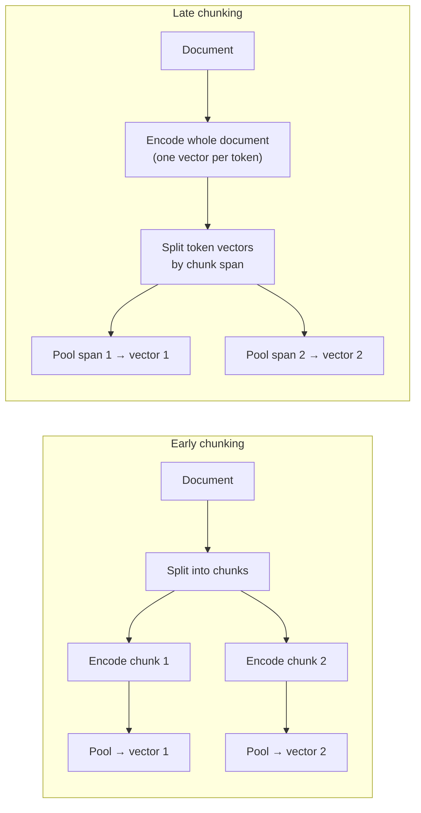

Every technique in this module so far has accepted one fact: each chunk is embedded on its own, so its vector can only reflect the words inside it. [Context preservation](/learn/chunking-optimisation/context-preservation) worked around that by adding words (headers, neighbouring sentences, model-written context). **Late chunking** changes the order of operations instead. It runs the embedding model over the *whole document* first, producing a vector for every token that has already "seen" the rest of the document through attention, and only then splits those token vectors into chunks and averages each group. The chunk text is unchanged, the number of vectors is unchanged, and yet "To fix it, update the client" is embedded by a model that has just read "Error E-4021". This lesson explains the mechanism, implements it with a small local model, measures it honestly against a plain context header, and sets out when it is worth the constraints it brings.

## Learning objectives

- Explain how late chunking differs from conventional ("early") chunking, in terms of when pooling happens.
- Implement late chunking with sentence-transformers by mapping character spans to token positions and mean-pooling token embeddings.
- State the requirements late chunking places on the embedding model (input length, pooling method) and on the pipeline.
- Compare late chunking with context headers and model-written context on cost, quality and operational complexity.
- Distinguish late chunking from late interaction (ColBERT) and from contextual retrieval.

## Prerequisites

- [Context preservation](/learn/chunking-optimisation/context-preservation): the kinds of context a chunk loses, and headers as a remedy.
- [Attention mechanisms](/learn/understanding-large-language-models/attention-mechanisms): how each token's representation depends on every other token in the input.
- [Embeddings](/learn/understanding-large-language-models/embeddings): turning text into vectors, and pooling token outputs into one vector.
- [Chunk size experiments](/learn/chunking-optimisation/chunk-size-experiments): the Meridian corpus file and the embedding model's input limit.

## Why this matters

A sentence-level chunk such as "Large exports are split into several files of at most 50,000 rows each" says nothing about which product it describes. Embedded alone, its vector is the same whether it came from the Meridian Reports guide or the Meridian Sync guide, so a question naming Reports has nothing to distinguish them by. The same happens with pronouns ("To fix it..."), with definite references ("The budget covers..."), and with every chunk whose meaning depends on a heading or an earlier paragraph.

Context headers fix the subject cheaply, but only the subject. Model-written context (contextual retrieval) can fix more, at the cost of a language-model call per chunk. Late chunking offers a third route: the context comes from the document itself, through the embedding model's own attention, at the cost of one encoder pass per document rather than per chunk and with no generated text at all. It is not a free lunch, because it constrains which models you can use and how long documents can be, but where it fits, it is an elegant fix.

## The intuition

Imagine asking several people to summarise a report, each in one sentence, but each is handed only one paragraph. The person holding "To fix it, update the client from the IT portal" writes "Something should be updated from the portal." Now hand everyone the *whole* report to read first, and then ask each person to summarise only their paragraph. The same person writes "To fix the out-of-date VPN client behind error E-4021, update it from the IT portal." Same paragraph, same one-sentence output, better summary, because the reader understood the paragraph in context.

Early chunking is the first procedure: each chunk is read alone. Late chunking is the second: the model reads everything, and each chunk's vector is built from the model's understanding of its tokens *in context*.

## How it works

### Where pooling happens

A sentence-embedding model is a transformer encoder followed by a **pooling** step. The encoder turns the input's $n$ tokens into $n$ output vectors, one per token, each computed with attention over the whole input. Pooling then collapses those $n$ vectors into one, usually by averaging them (**mean pooling**) or by taking the vector of a special first token (**CLS pooling**).

- **Early chunking (the conventional way):** split the text into chunks, then run encoder and pooling on each chunk separately. Each token vector has attended only to tokens in its own chunk.
- **Late chunking:** run the encoder once on the whole document, keep all the token vectors, then pool each chunk's *span* of token vectors separately. Each token vector has attended to the whole document.



### The algorithm

1. **Choose chunk boundaries** on the text as usual (sentences, sections, token windows), recording each chunk's character span.
2. **Tokenise the whole document** with offsets, so every token knows which characters it came from.
3. **Encode the whole document** once and keep the per-token output vectors (before pooling).
4. **Map each chunk's character span to token positions**: the tokens whose character ranges fall inside the span. Special tokens such as `[CLS]` and `[SEP]` have empty ranges and belong to no chunk.
5. **Mean-pool** each chunk's token vectors and normalise the result. That is the chunk's embedding.
6. **Store** the chunk's original text with that vector, exactly as with early chunking. Queries are embedded normally.

Nothing about the index or the query path changes. Only the ingestion step that produces chunk vectors is different, which makes late chunking easy to trial on an existing system.

### Requirements and limits

- **The document must fit in the model's input.** Late chunking needs a single encoder pass over everything that should provide context. With a 256-token model such as MiniLM, that means short documents only. The technique was proposed for long-context embedding models, which accept thousands of tokens. For documents longer than the limit, the authors describe processing overlapping macro chunks, each encoded in one pass; context then extends only as far as the macro chunk.
- **Mean pooling fits naturally.** A model trained with mean pooling has learned to make the average of token vectors meaningful, so averaging a sub-span is a natural extension. Models trained with CLS pooling have no training signal that makes sub-span averages meaningful; late chunking can still be tried, but expect weaker results.
- **The model was not trained for it.** Most embedding models were trained on short inputs and whole-input pooling. Sub-span pooling over long inputs is outside that training, so benefits vary by model; some long-context models are now described by their providers as designed to support it. Measure on your data.
- **Re-embedding granularity.** Any change to a document means re-encoding the whole document, because every chunk's vector depends on all of it. Early chunking can re-embed only the changed chunks.

### How it relates to neighbouring techniques

| Technique | What changes | Per-chunk cost | Context reach |
| --- | --- | --- | --- |
| Context header ([context preservation](/learn/chunking-optimisation/context-preservation)) | Text embedded: title and section prepended | A few extra tokens | Subject only |
| [Contextual retrieval](/learn/advanced-retrieval/contextual-retrieval) | Text embedded: model-written context prepended | One language-model call | Anything the model writes |
| Late chunking | How the vector is computed: pooled after a whole-document pass | Shares one encoder pass per document | Whatever attention picks up within the input |
| [Late interaction](/learn/reranking-models/late-interaction) (ColBERT) | Keep every token vector and score at query time | Many vectors per chunk | Within the encoded passage |

Despite the similar name, late interaction is a different idea: it keeps all token vectors and compares them with the query's token vectors at search time, which costs much more storage. Late chunking still produces one vector per chunk.

## The mathematics

**Intuition.** Both methods average token vectors over a chunk's span. The only difference is which input produced those token vectors.

$$
\mathbf{v}^{\text{early}}_c = \text{norm}\Big(\frac{1}{|c|}\sum_{t \in c} f(x_c)_t\Big), \qquad
\mathbf{v}^{\text{late}}_c = \text{norm}\Big(\frac{1}{|c|}\sum_{t \in c} f(x_{\text{doc}})_t\Big)
$$

- $c$: the set of token positions in the chunk; $|c|$ its size.
- $x_c$: the chunk's tokens alone; $x_{\text{doc}}$: the whole document's tokens.
- $f(x)_t$: the encoder's output vector for token $t$ given input $x$. Through attention, it depends on every token in $x$.
- $\text{norm}(\mathbf{u}) = \mathbf{u} / \lVert \mathbf{u} \rVert$, so cosine similarity becomes a dot product.

**Worked example.** Suppose one pass over a four-token document gives the token vectors $(1, 0)$, $(0, 1)$, $(1, 1)$ and $(2, 0)$, and the chunks are tokens 0–1 and tokens 2–3.

- Chunk 1: mean $= ((1 + 0)/2, (0 + 1)/2) = (0.5, 0.5)$; length $= \sqrt{0.5} \approx 0.707$; normalised $(0.707, 0.707)$.
- Chunk 2: mean $= ((1 + 2)/2, (1 + 0)/2) = (1.5, 0.5)$; length $= \sqrt{2.5} \approx 1.581$; normalised $(0.949, 0.316)$.

**Compute cost.** Self-attention compares every pair of tokens in the input, so its cost grows with the square of the input length. Encoding a document of $n$ tokens in one pass costs on the order of $n^2$ attention pairs; encoding it as $n / c$ chunks of $c$ tokens costs $(n / c) \cdot c^2 = n c$. For $n = 8{,}192$ and $c = 256$: about 67 million pairs against 2.1 million, 32 times more attention work. The other parts of the transformer scale linearly with $n$ and are unaffected, so the total slowdown is smaller than 32, but long documents are noticeably more expensive to encode in one pass.

```python
import numpy as np

H = np.array([[1.0, 0.0], [0.0, 1.0], [1.0, 1.0], [2.0, 0.0]])   # token vectors from one pass
spans = [(0, 2), (2, 4)]                                          # chunk = tokens [start, end)

for a, b in spans:
    v = H[a:b].mean(axis=0)
    print(f"tokens {a}-{b - 1}: mean {v}, normalised {np.round(v / np.linalg.norm(v), 3)}")

n, c = 8192, 256
print(f"attention pairs, one pass: {n * n:,}; per-chunk passes: {(n // c) * c * c:,}; ratio {n // c}")
```

```output
tokens 0-1: mean [0.5 0.5], normalised [0.707 0.707]
tokens 2-3: mean [1.5 0.5], normalised [0.949 0.316]
attention pairs, one pass: 67,108,864; per-chunk passes: 2,097,152; ratio 32
```

## In code

**The problem.** Embed sentence-level chunks of four short Meridian documents three ways: early chunking of the bare sentence, early chunking with the document title prepended, and late chunking. Rank the right sentence for eight questions whose answering sentence does not name its subject.

**Dependencies.** sentence-transformers and NumPy, plus `meridian_corpus.py` from [chunk size experiments](/learn/chunking-optimisation/chunk-size-experiments). No API key. Every document here is shorter than MiniLM's 256-token limit, which late chunking requires with this model.

```bash
pip install sentence-transformers numpy
```

```python
import re
import numpy as np
from sentence_transformers import SentenceTransformer
from meridian_corpus import DOCS

model = SentenceTransformer("sentence-transformers/all-MiniLM-L6-v2")
tok = model.tokenizer

CORPUS = {d: DOCS[d] for d in ("it-runbook", "relay-docs", "reports-docs")}
CORPUS["sync-docs"] = """# Meridian Sync: Product Guide

## Exporting
Meridian Sync exports sync logs to CSV. Exports run in the background, and a download link is emailed when the file is ready. Large exports are split into several files of at most 10,000 rows each.

## Single sign-on
On the Business and Enterprise plans, Meridian Sync supports SAML single sign-on. An administrator uploads the identity provider metadata on the Integrations page.
"""

def sentence_spans(text):
    """Character spans of sentences (headings are left out of every chunk)."""
    spans = []
    for m in re.finditer(r"[^\n]+", text):
        if m.group().startswith("#"):
            continue
        for s in re.finditer(r"[^.!?]+[.!?]", m.group()):
            a = m.start() + s.start() + (len(s.group()) - len(s.group().lstrip()))
            spans.append((a, m.start() + s.end()))
    return spans

def late_chunk(text, spans):
    """Encode the whole document once, then mean-pool the token vectors inside each span."""
    enc = tok(text, return_offsets_mapping=True, truncation=True, max_length=model.max_seq_length)
    assert len(enc["input_ids"]) < model.max_seq_length, "document must fit in one pass"
    tokens = model.encode(text, output_value="token_embeddings").cpu().numpy()   # one vector per token
    offsets = enc["offset_mapping"]
    assert len(tokens) == len(offsets)          # one output vector per input token, [CLS] and [SEP] included
    vectors = []
    for a, b in spans:
        idx = [i for i, (s, e) in enumerate(offsets) if e > s and s >= a and e <= b]
        v = tokens[idx].mean(axis=0)
        vectors.append(v / np.linalg.norm(v))
    return np.array(vectors)

chunks, naive, header, late = [], [], [], []
for doc_id, text in CORPUS.items():
    spans = sentence_spans(text)
    title = text.splitlines()[0].lstrip("# ")
    chunks += [(doc_id, text[a:b]) for a, b in spans]
    naive.append(model.encode([text[a:b] for a, b in spans], normalize_embeddings=True))
    header.append(model.encode([f"{title}. {text[a:b]}" for a, b in spans], normalize_embeddings=True))
    late.append(late_chunk(text, spans))
naive, header, late = np.vstack(naive), np.vstack(header), np.vstack(late)

TESTS = [
    ("How do I fix error E-4021?", "it-runbook", "To fix it"),
    ("How large can a Meridian Reports export file be?", "reports-docs", "Large exports are split"),
    ("How do I receive a Meridian Reports export?", "reports-docs", "Exports run in the background"),
    ("Where does an admin upload SAML metadata for Meridian Reports?", "reports-docs", "An administrator uploads"),
    ("Where does an admin upload SAML metadata for Meridian Sync?", "sync-docs", "An administrator uploads"),
    ("What happens to Meridian Relay events that keep failing?", "relay-docs", "Events that still fail"),
    ("What is the rate limit for Meridian Relay?", "relay-docs", "Each workspace can send"),
    ("How often are laptops replaced?", "it-runbook", "The laptop refresh cycle"),
]

print(f"{'question':<62} {'naive':>5} {'header':>6} {'late':>5}")
ranks = {"naive": [], "header": [], "late": []}
for q, doc_id, start in TESTS:
    qv = model.encode(q, normalize_embeddings=True)
    gold = next(i for i, (d, t) in enumerate(chunks) if d == doc_id and t.startswith(start))
    row = []
    for name, E in (("naive", naive), ("header", header), ("late", late)):
        rank = int(np.sum(E @ qv > E[gold] @ qv)) + 1
        ranks[name].append(rank)
        row.append(rank)
    print(f"{q:<62} {row[0]:>5} {row[1]:>6} {row[2]:>5}")
for name, r in ranks.items():
    print(f"{name:<7} hit@1 {np.mean(np.array(r) == 1):.2f}, MRR {np.mean(1 / np.array(r)):.2f}")
```

```output
question                                                       naive header  late
How do I fix error E-4021?                                         2      2     2
How large can a Meridian Reports export file be?                   1      1     1
How do I receive a Meridian Reports export?                        5      1     3
Where does an admin upload SAML metadata for Meridian Reports?     6      2     3
Where does an admin upload SAML metadata for Meridian Sync?        4      1     2
What happens to Meridian Relay events that keep failing?           3      2     3
What is the rate limit for Meridian Relay?                         4      3     1
How often are laptops replaced?                                    1      1     1
naive   hit@1 0.25, MRR 0.46
header  hit@1 0.50, MRR 0.73
late    hit@1 0.38, MRR 0.62
```

**The important lines.**

- `sentence_spans()` returns character spans for sentences and skips heading lines, so headings influence late-chunked vectors only through attention, never by being averaged in.
- `tok(..., return_offsets_mapping=True, truncation=True, max_length=...)` tokenises exactly as the model will, and the assertion checks the document fits in one pass.
- `model.encode(text, output_value="token_embeddings")` asks sentence-transformers for the encoder's per-token outputs instead of the pooled sentence vector. It returns a tensor on the model's device, hence `.cpu().numpy()`.
- The second assertion confirms one output vector per input token, so offsets and vectors line up; `[CLS]` and `[SEP]` have empty offsets `(0, 0)` and are excluded by `e > s`.
- The rank is computed as one plus the number of chunks scoring higher than the right one, which handles ties consistently.

**What the output means.**

- **Late chunking helps a model that was never trained for it.** Mean reciprocal rank (the average of 1 / rank) rises from 0.46 to 0.62 and hit@1 from 0.25 to 0.38. The clearest gains are exactly the context-loss cases: the Relay rate-limit sentence, which never says "Relay", moves from rank 4 to 1, and the two "administrator uploads" sentences, identical in structure across Reports and Sync, move up because each now carries some of its own document.
- **A plain title header does better here.** With the title prepended, MRR is 0.73. On this corpus nearly all the missing context is the subject (which product), and a header states it explicitly. Late chunking has to infer it through attention, with a small model trained on short sentence pairs.
- **Neither fixes the E-4021 question.** In every variant the sentence "Error E-4021 means the VPN client is out of date" outranks "To fix it, update the client...", because the first contains the query's rare term. That is a ranking problem for [small-to-big retrieval](/learn/chunking-optimisation/small-to-big-retrieval) or a reranker, not a context problem.
- **Eight questions are a demonstration, not a verdict.** The published results use long-context models with mean pooling on standard retrieval benchmarks; reproduce the comparison with your model and your questions before adopting it.

**Errors people commonly hit.**

- *Documents longer than the limit.* Without the assertion, the tokeniser truncates silently and chunks in the tail get empty token sets, producing `nan` vectors. Check length, or use macro chunks.
- *Misaligned offsets.* Tokenising with different settings from the model (another tokeniser, no special tokens, a different maximum length) shifts every index. Tokenise with the model's own tokeniser and the same truncation, and assert the lengths match.
- *A tensor on the GPU or Apple MPS device.* Converting it directly to NumPy raises `TypeError: can't convert mps:0 device type tensor to numpy`. Move it to the CPU first.
- *Pooling special tokens into a chunk.* Including `[CLS]` or `[SEP]` in the first or last chunk shifts those vectors towards a document-wide summary.

**Extending it.** Combine the two approaches (late-chunk documents whose title is repeated at the top of each section) and measure again. Swap in a model that accepts long inputs, check its pooling mode in its model card, and late-chunk the whole handbook in one pass. Jina AI's embedding API offers late chunking as a request option for its own long-context models; see its current API documentation for the parameter and limits.

## A real-world example

The Platform team had already added title-and-section headers to AskMeridian's chunks. The remaining context failures in their review were in long product guides whose sections referred back to earlier ones: "the connector configured above", "this limit", "the second option". Headers did not help, because the missing information was in another section, not in a title.

They considered contextual retrieval and estimated its cost: one model call per chunk over roughly two hundred thousand chunks, repeated on every re-index of a changed guide. Late chunking was cheaper to trial: one encoder pass per guide, no generated text, and no change to the index or query path. Their existing embedding model accepted 512 tokens, too few for whole guides, so the trial used an open long-context embedding model with mean pooling, encoding each guide in overlapping macro chunks of several thousand tokens.

On their labelled questions, late chunking reduced the cross-section reference failures noticeably and changed little elsewhere. It also made re-indexing coarser: an edit to one paragraph now re-encoded a whole macro chunk. The team adopted it for the product guides only, kept headers on everything, and recorded the encoding mode in each chunk's metadata so that the two kinds of vector were never mixed in one collection.

## Common mistakes

- **Using a model whose limit is shorter than the documents.** Text past the limit is never seen, and its chunks get no vectors or meaningless ones.
- **Assuming late chunking always beats headers.** When the missing context is the subject, a short header states it directly and may do better.
- **Confusing late chunking with late interaction.** Late interaction stores many vectors per chunk and scores at query time; late chunking stores one.
- **Mixing early and late vectors in one collection.** Their similarity distributions differ; scores are not comparable across modes.
- **Ignoring the pooling mode.** Sub-span mean pooling is natural for mean-pooling models and questionable for CLS-pooling ones.
- **Re-embedding only changed chunks.** With late chunking every chunk of the document depends on all of it; re-encode the whole document (or macro chunk).

## Best practices

- Check the embedding model's maximum input length and pooling mode before trying late chunking.
- Keep chunk boundaries meaningful (sentences or sections); late chunking changes the vectors, not what is returned.
- Map spans with the model's own tokeniser and offsets, and assert alignment.
- Measure against early chunking with headers, on questions that exercise cross-sentence and cross-section references.
- Record the encoding mode and model in chunk metadata, and keep collections homogeneous.
- For long documents, use macro chunks with overlap and accept that context reaches only within each one.

## Performance considerations

Late chunking does not change storage or query cost: one vector per chunk, the same index, the same query embedding. It changes ingestion. Attention cost grows with the square of input length, so one pass over an 8,192-token document does on the order of 32 times the attention work of 32 separate 256-token passes, although total encoding time grows by less because the rest of the network is linear in length. Memory also grows: a long input needs activations for every token at once, which limits batch size on a GPU.

The trade against contextual retrieval is the relevant one. Contextual retrieval runs a language model once per chunk, reading much of the document each time; late chunking runs an embedding encoder once per document. For large corpora, the difference in indexing cost is substantial, and late chunking produces no text that must be stored or audited. Against plain headers, late chunking costs more and requires a long-context model; it earns its place only where headers measurably fall short.

## Summary

- Late chunking encodes the whole document once, then mean-pools each chunk's span of token vectors, so each chunk's vector reflects its document.
- The text, the index and the query path are unchanged; only how chunk vectors are computed differs.
- It needs the document (or a macro chunk) to fit in the model's input, and suits mean-pooling models.
- On the Meridian test it improved a small model's MRR from 0.46 to 0.62, but a title header reached 0.73: measure against cheap alternatives.
- It is distinct from late interaction (many vectors per chunk) and from contextual retrieval (model-written text per chunk).

## Exercises

**1.** A document has token vectors $(2, 0)$, $(0, 2)$, $(1, 1)$, $(1, 3)$ from one pass. Chunk A is tokens 0–2 and chunk B is token 3. Compute both late-chunked vectors, normalised.

<details><summary>Show solution</summary>

Chunk A: mean $= ((2 + 0 + 1)/3, (0 + 2 + 1)/3) = (1, 1)$; normalised $(0.707, 0.707)$. Chunk B: $(1, 3)$; length $\sqrt{10} \approx 3.162$; normalised $(0.316, 0.949)$.

</details>

**2.** Your embedding model accepts 512 tokens and uses CLS pooling. Documents average 3,000 tokens. A colleague proposes late chunking. What are the two main obstacles, and what would you try instead or first?

<details><summary>Show solution</summary>

First, the documents are six times longer than the input limit, so a single pass cannot see whole documents; late chunking would have to work within 512-token macro chunks, which gives each chunk only a little more context than early chunking. Second, the model uses CLS pooling, so averaging sub-spans of token vectors is not what it was trained to make meaningful.

Try context headers first, measuring wrong-source rate and recall on context-dependent questions. If late chunking still looks attractive, trial it with a long-context, mean-pooling embedding model and compare on the same questions.

</details>

**3.** Modify `late_chunk()` so that it works for documents longer than the model's limit by encoding overlapping macro windows of at most 254 text tokens with a stride of 128, and pooling each chunk from the macro window that contains it entirely (choose the one where the chunk is most central). Describe the steps; code is optional.

<details><summary>Show solution</summary>

1. Tokenise the whole document without truncation and without special tokens, with offsets.
2. Create macro windows of token positions $[s, s + 254)$ for $s = 0, 128, 256, \dots$ until the end is covered.
3. For each macro window, decode nothing: build its input as `[CLS]` + those token IDs + `[SEP]`, run the encoder through the underlying transformer, and keep the 254 text-token vectors.
4. For each chunk, find its token positions (from offsets), list the macro windows that contain all of them, and choose the one where the chunk's midpoint is closest to the window's midpoint.
5. Mean-pool the chunk's token vectors from that window and normalise.

Chunks longer than 254 tokens cannot be contained in any window and must be split or pooled across windows. Context reaches at most about 254 tokens around each chunk, which is the limitation the long-context models remove.

</details>

**4.** Design decision. AskMeridian has three collections: the handbook (short sections, subject usually in the heading), IT runbooks (long procedures with references such as "the command above"), and the Atlas error catalogue (one row per code). For each, would you use context headers, late chunking, contextual retrieval, or a combination? Justify briefly.

<details><summary>Show solution</summary>

**Handbook:** headers. The missing context is almost always the subject, which a title and section state directly at almost no cost.

**Runbooks:** headers plus late chunking with a long-context model, if measurement confirms it. References like "the command above" point at earlier steps, which attention over the whole procedure can capture. If the model is not available or does not help, use small-to-big retrieval so the generator sees neighbouring steps, and consider contextual retrieval for the remaining failures.

**Error catalogue:** neither late chunking nor contextual retrieval. Rows are self-contained; repeat the table header in each row's text and add lexical matching for exact codes.

</details>

## Check your understanding

```quiz
[
  {
    "q": "What is the essential difference between late chunking and conventional chunking?",
    "options": [
      "Late chunking uses larger chunks",
      "Late chunking encodes the whole document once and pools each chunk's span of token vectors, instead of encoding each chunk separately",
      "Late chunking stores one vector per token",
      "Late chunking splits documents after generation"
    ],
    "answer": 1,
    "why": "Splitting happens after the encoder, so each token's vector has attended to the whole document. The chunk text and the number of vectors are unchanged."
  },
  {
    "q": "Why does late chunking require the document to fit within the embedding model's input limit?",
    "options": [
      "Because the index cannot store long documents",
      "Because queries must be as long as documents",
      "Because the context comes from a single encoder pass; tokens beyond the limit are never encoded and cannot contribute or receive context",
      "Because mean pooling fails on long inputs"
    ],
    "answer": 2,
    "why": "Truncated tokens produce no vectors. For longer documents you must use macro chunks, and context then reaches only within each one."
  },
  {
    "q": "How does late chunking differ from late interaction (ColBERT)?",
    "options": [
      "Late chunking keeps one vector per chunk; late interaction keeps a vector per token and compares them with query token vectors at search time",
      "They are the same technique under different names",
      "Late interaction requires an LLM call per chunk",
      "Late chunking compares query and document tokens at search time"
    ],
    "answer": 0,
    "why": "Late interaction stores many vectors per passage and scores by token-level matching; late chunking pools to one vector per chunk, so storage and search are unchanged."
  },
  {
    "q": "A team's chunks mostly lose only their subject (which product a sentence is about). Which is the cheapest remedy to try first?",
    "options": [
      "Late chunking with a long-context model",
      "Contextual retrieval with a model call per chunk",
      "Increasing overlap to 50 per cent",
      "A short title-and-section header on the embedded text"
    ],
    "answer": 3,
    "why": "A header states the subject directly at almost no cost. In the lesson's experiment it outperformed late chunking for exactly this kind of loss."
  },
  {
    "q": "One paragraph of a late-chunked document is edited. What must be re-embedded?",
    "options": [
      "Only the chunk containing the paragraph",
      "Every chunk of the document (or of the macro chunk containing the edit), because every vector depends on the whole input",
      "Nothing, because late chunking vectors do not depend on text",
      "Only the query embeddings"
    ],
    "answer": 1,
    "why": "Each token vector is computed with attention over the whole input, so an edit anywhere changes every chunk's vector from that pass."
  }
]
```

## Further reading

- Günther, M., Mohr, I., Williams, D. J., Wang, B. and Xiao, H. (2024). *Late Chunking: Contextual Chunk Embeddings Using Long-Context Embedding Models*. [arXiv:2409.04701](https://arxiv.org/abs/2409.04701). The original description, including the treatment of documents longer than the model's limit.
- Khattab, O. and Zaharia, M. (2020). *ColBERT: Efficient and Effective Passage Search via Contextualized Late Interaction over BERT*. [arXiv:2004.12832](https://arxiv.org/abs/2004.12832). The late-interaction approach that late chunking is often confused with.
- [Sentence Transformers documentation](https://www.sbert.net/): `encode()` and its `output_value="token_embeddings"` option.
- Anthropic (2024). *Introducing Contextual Retrieval*. Engineering blog post; the model-written alternative, covered in [contextual retrieval](/learn/advanced-retrieval/contextual-retrieval).
