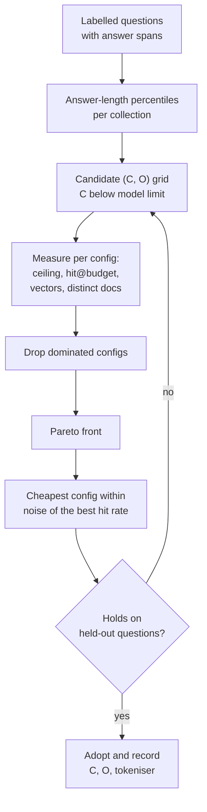

[Chunk overlap](/learn/chunking-fundamentals/chunk-overlap) derived the probability that an answer is split, the guarantee that any span of at most $o + 1$ tokens survives, and the merge step that stops overlapping neighbours wasting the prompt. This lesson takes those results as given and asks the optimisation question: **given a fixed indexing and storage budget, what combination of window length and overlap should you choose, and how do you prove it from data?** You will see that the number of vectors is set by the stride, not by the overlap; that, at the same stride, longer overlapping windows protect far more answers; that overlap costs result diversity, which no merge step restores; and that some of what overlap buys can be had at query time for nothing. The output is a small grid search with a Pareto front you can rerun on your own corpus.

## Learning objectives

- Express the cost of a chunking configuration in terms of stride and window length, and separate storage cost from embedding cost.
- Compare configurations at equal stride and explain why longer, overlapping windows protect more answers at the same index size.
- Choose an overlap from the distribution of answer lengths, per collection.
- Run a grid search over size and overlap and identify the Pareto-optimal configurations.
- Decide when query-time padding can replace index-time overlap and when it cannot.

## Prerequisites

- [Chunk overlap](/learn/chunking-fundamentals/chunk-overlap): the split-probability formula, the $o \ge L - 1$ guarantee and merging of overlapping neighbours.
- [Chunk size experiments](/learn/chunking-optimisation/chunk-size-experiments): the Meridian corpus file, the ceiling metric and the equal-budget rule used here.

## Why this matters

Overlap is usually set once, as a percentage of chunk size, and never revisited. That habit hides two decisions. The first is about cost: overlap changes how many vectors you store and how many tokens you embed, and teams routinely discover this when an index is twice the size they budgeted. The second is about quality: whether the answers your users need survive chunking at all. In the [size experiments](/learn/chunking-optimisation/chunk-size-experiments), small chunks failed almost entirely because answers were cut, not because the retriever ranked badly. A quarter of the answers were unretrievable at 64 tokens.

Treating size and overlap as two independent dials makes the trade-off look harder than it is. Reframed as "how many vectors can I afford" and "how long should each vector's window be", the choice becomes a small, measurable optimisation with a clear answer for your corpus.

## The intuition

Picture security cameras along a corridor. You can afford a fixed number of cameras, so they are spaced a fixed distance apart: that spacing is the **stride**. What you can still choose is how wide each camera's field of view is: that is the **window length**. If each camera sees exactly up to the next one, a person standing on the line between two views is half in each picture and wholly in neither. Widen the lenses so that neighbouring views overlap, and every person is wholly visible in at least one camera, with no extra cameras bought.

Wider lenses have a price of their own. Each picture now contains more of the corridor, so any one face is a smaller part of it (in chunks, the answer is a smaller part of the vector), and neighbouring cameras show much the same scene (in retrieval, near-duplicate results). Overlap optimisation is choosing the narrowest lens that still captures whole people, for the spacing you can afford.

## How it works

### Three numbers, two of them free

A sliding-window chunker has a window length $C$, a stride $s$ (the distance between window starts) and an overlap $O = C - s$. Any two determine the third. Libraries ask for $C$ and $O$, but for cost reasoning the useful pair is $s$ and $C$:

- **Number of vectors** $\approx T / s$ for a corpus of $T$ tokens. This sets index memory, storage and the size of every search. It depends on the stride only.
- **Tokens embedded** $\approx T \cdot C / s$. Each window embeds $C$ tokens, so overlapping text is embedded more than once. This sets indexing time and any per-token embedding fees.
- **Protection** for a span of $L$ tokens is $\min(1, (C - L + 1)/s)$, from the split-probability formula in [chunk overlap](/learn/chunking-fundamentals/chunk-overlap). It rises as the window grows *relative to the stride*.

So "adding overlap" is two different moves. Holding $C$ fixed and adding overlap shrinks the stride, which buys protection with more vectors. Holding $s$ fixed and adding overlap lengthens the window, which buys protection with no more vectors, paying instead in embedding compute, in a less focused vector and in redundancy. The second move is the one most teams never try.

### The costs that do not show up in the index

Two side effects of overlap matter for quality rather than budget:

1. **Dilution.** A longer window puts more unrelated text into the same vector. The answer is a smaller share of what was embedded, so its signal is weaker. This is the same force that penalises large chunks in the size experiments, and it is why the best configuration is the *narrowest* window that achieves the protection you need.
2. **Lost diversity.** Overlapping neighbours have similar vectors, so they are retrieved together. Merging them (as in the fundamentals lesson) stops the prompt repeating text, but the merged context is still one long stretch of one document. A second, independent source that would have been fifth in the ranking is pushed out. Count the distinct documents in the final context to see this cost.

### Choosing the overlap from your answers

The guarantee says a span of $L$ tokens always survives if $O \ge L - 1$. That turns overlap into a data question: how long are the spans your users need intact?

1. Label a few hundred questions with their answer spans (the [size experiments](/learn/chunking-optimisation/chunk-size-experiments) format).
2. Measure each span's length in the chunker's tokens, in context.
3. Group by collection or content type; handbook sentences and runbook procedures have very different lengths.
4. Pick a percentile $p$ (90 or 95 is typical) and set $O_p = L_p - 1$ for each group, rounded up to a whole sentence if the chunker overlaps by sentences.
5. Spans above the percentile still survive with high probability; spans longer than $C$ never do, and need a different structure.

### Matching versus delivery

Overlap does two jobs at once, and they can be separated.

- **Matching.** The embedding of a window that contains the whole answer matches the question better than the embedding of a window with half of it. Only index-time overlap helps here, because it changes what is embedded.
- **Delivery.** The generator needs the whole answer in its context. This can be fixed at query time: retrieve non-overlapping windows, then pad each retrieved window with $P$ tokens from its neighbours before building the prompt. Padding costs nothing at indexing time.

Query-time padding is enough when half an answer still ranks well, which is often the case for sentence-sized facts with distinctive words. It fails when the half that lands in each window is too generic to match the question. The experiment tells you which situation you are in. Padding is a simple form of the expansion strategies covered properly in [small-to-big retrieval](/learn/chunking-optimisation/small-to-big-retrieval).

### The optimisation procedure

1. Fix the context budget, the embedding model, the question set and the boundary rule.
2. Choose candidate window lengths (below the model's limit) and candidate overlaps, including those suggested by the answer-length percentiles.
3. For each pair, build the index and measure the ceiling, the hit rate at the budget (filled by unique tokens), the number of vectors and the distinct documents in the context.
4. Discard any configuration that is **dominated**: another configuration is at least as good on hit rate and at least as cheap in vectors, and strictly better on one of them.
5. Among the survivors (the **Pareto front**), pick the cheapest whose hit rate is within noise of the best, then check its diversity.
6. Confirm the choice on held-out questions that played no part in selecting it.



## The mathematics

### Equal-stride comparison

**Intuition.** At a fixed number of vectors, protection depends on how far each window extends past the next window's start.

$$
P_s(C) = \min\!\left(1,\ \frac{C - L + 1}{s}\right), \qquad C \ge L, \quad O = C - s
$$

- $s$: the stride, fixed by the vector budget.
- $C$: the window length, which you now vary.
- $L$: the answer span length in tokens.
- $P_s(C)$: probability that a span at a random position is wholly inside some window.

**Worked example.** Stride $s = 32$, spans of $L = 16$ tokens.

- $C = 32$ ($O = 0$): $(32 - 16 + 1)/32 = 17/32 \approx 0.53$.
- $C = 48$ ($O = 16$): $33/32$, capped at $1$.

The same number of vectors, from 53 per cent protection to a guarantee.

### Cost model

$$
V = \frac{T}{s}, \qquad E = \frac{T \cdot C}{s}
$$

- $V$: the number of vectors stored and searched.
- $E$: the number of tokens embedded at indexing time.
- $T$: corpus size in tokens.

**Worked example.** $T = 20$ million tokens.

| $C$ | $s$ | $O$ | $V$ | $E$ (million tokens) |
| --- | --- | --- | --- | --- |
| 512 | 512 | 0 | 39,063 | 20.0 |
| 512 | 448 | 64 | 44,643 | 22.9 |
| 640 | 512 | 128 | 39,063 | 25.0 |
| 512 | 256 | 256 | 78,125 | 40.0 |

Adding 128 tokens of overlap by lengthening the window (third row) costs no extra vectors and a quarter more embedding. Adding 256 by halving the stride (fourth row) doubles both.

### Pareto dominance

Configuration $a$ **dominates** $b$ if $\text{hit}(a) \ge \text{hit}(b)$ and $V(a) \le V(b)$, with at least one inequality strict. The Pareto front is the set of configurations no other configuration dominates. Nothing off the front is ever the right choice, whatever your priorities; choosing among the front is a judgement about how much a point of hit rate is worth in vectors.

## In code

**The problem.** Grid-search window length and overlap on the Meridian corpus at a 256-token budget filled by unique tokens, report cost and quality for each configuration, and mark the Pareto front.

**Dependencies.** sentence-transformers and NumPy, plus `meridian_corpus.py` from [chunk size experiments](/learn/chunking-optimisation/chunk-size-experiments). No API key.

```bash
pip install sentence-transformers numpy
```

```python
import itertools
import numpy as np
from sentence_transformers import SentenceTransformer
from meridian_corpus import DOCS, QUESTIONS

model = SentenceTransformer("sentence-transformers/all-MiniLM-L6-v2")
tok = model.tokenizer
OFFSETS = {d: tok(t, add_special_tokens=False, return_offsets_mapping=True)["offset_mapping"]
           for d, t in DOCS.items()}
Q = model.encode([q for q, _, _ in QUESTIONS], normalize_embeddings=True)
BUDGET = 256

def windows(doc_id, size, overlap):
    n, stride = len(OFFSETS[doc_id]), size - overlap
    return [(doc_id, i, min(i + size, n)) for i in range(0, max(n - overlap, 1), stride)]

def text_of(doc_id, t0, t1):
    offs = OFFSETS[doc_id]
    return DOCS[doc_id][offs[t0][0]:offs[t1 - 1][1]]

def answer_tokens(doc_id, answer):
    a0 = DOCS[doc_id].index(answer)
    a1 = a0 + len(answer)
    idx = [i for i, (s, e) in enumerate(OFFSETS[doc_id]) if s < a1 and e > a0]
    return idx[0], idx[-1] + 1

def fill_budget(ranked, budget):
    """Take ranked windows while their merged (de-duplicated) length fits the budget."""
    covered, taken = set(), []
    for d, t0, t1 in ranked:
        new = covered | {(d, i) for i in range(t0, t1)}
        if len(new) > budget:
            break
        covered, taken = new, taken + [(d, t0, t1)]
    return taken

def evaluate(size, overlap):
    chunks = [w for d in DOCS for w in windows(d, size, overlap)]
    E = model.encode([text_of(*c) for c in chunks], normalize_embeddings=True)
    ceiling = hit = 0
    n_docs = []
    for qv, (_, answer, doc_id) in zip(Q, QUESTIONS):
        a0, a1 = answer_tokens(doc_id, answer)
        ranked = [chunks[i] for i in np.argsort(-(E @ qv))]
        whole = lambda c: c[0] == doc_id and c[1] <= a0 and a1 <= c[2]
        ceiling += any(whole(c) for c in ranked)
        taken = fill_budget(ranked, BUDGET)
        hit += any(whole(c) for c in taken)
        n_docs.append(len({c[0] for c in taken}))
    n = len(QUESTIONS)
    return dict(size=size, overlap=overlap, chunks=len(chunks),
                ceiling=ceiling / n, hit=hit / n, docs=np.mean(n_docs))

results = [evaluate(c, o) for c, o in itertools.product((32, 48, 64, 96), (0, 8, 16, 32)) if o < c]

def dominated(r):
    """Another config is at least as good on hit and chunks, and strictly better on one."""
    return any(s["hit"] >= r["hit"] and s["chunks"] <= r["chunks"]
               and (s["hit"] > r["hit"] or s["chunks"] < r["chunks"]) for s in results)

print(f"{'size':>4} {'overlap':>7} {'stride':>6} {'chunks':>6} {'ceiling':>7} {'hit':>5} {'docs':>5}  pareto")
for r in sorted(results, key=lambda r: (r["chunks"], -r["hit"])):
    print(f"{r['size']:>4} {r['overlap']:>7} {r['size'] - r['overlap']:>6} {r['chunks']:>6} "
          f"{r['ceiling']:>7.2f} {r['hit']:>5.2f} {r['docs']:>5.2f}  {'' if dominated(r) else '*'}")
```

```output
size overlap stride chunks ceiling   hit  docs  pareto
  96       8     88     10    1.00  1.00  1.75  *
  96      16     80     10    1.00  0.95  1.55  
  96       0     96     10    0.90  0.90  1.90  
  96      32     64     12    1.00  1.00  1.80  
  64       0     64     12    0.75  0.75  2.25  
  64       8     56     13    0.95  0.85  2.10  
  64      16     48     15    1.00  1.00  2.15  
  48       0     48     17    0.90  0.90  2.55  
  48       8     40     18    0.90  0.90  2.30  
  64      32     32     20    1.00  1.00  2.05  
  48      16     32     21    1.00  1.00  2.30  
  32       0     32     24    0.55  0.55  3.05  
  32       8     24     29    0.95  0.95  2.60  
  48      32     16     37    1.00  1.00  2.15  
  32      16     16     41    1.00  1.00  2.45  
```

**The important lines.**

- `windows()` builds windows from a size and an overlap, and never starts a window once fewer than `overlap` new tokens remain, so the tail is covered without a redundant last window.
- `fill_budget()` takes windows in rank order while the *merged* token count fits, so every configuration sends at most 256 distinct tokens. This is the fair comparison when windows overlap.
- `docs` counts distinct documents in the filled context: the diversity cost, which merging does not remove.
- `dominated()` implements the definition from the maths section on two objectives, hit rate (higher is better) and chunks (fewer is better).

**What the output means.**

- **At equal stride, longer windows win.** Compare rows with the same stride. Stride 32: $(32, 0)$ has a ceiling of 0.55; $(48, 16)$ and $(64, 32)$ reach 1.00, with 21 and 20 chunks against 24. (The counts differ slightly because each document's tail is handled separately.) Stride 48: $(48, 0)$ scores 0.90, $(64, 16)$ scores 1.00. Stride 64: $(64, 0)$ scores 0.75, $(96, 32)$ scores 1.00. Overlap bought by lengthening the window is almost free in vectors.
- **The answer-length rule holds.** The longest answer is 16 tokens, so any configuration with $O \ge 15$ has a ceiling of 1.00, and every row with $O = 16$ or $32$ does.
- **The Pareto front here is a single point**, $(96, 8)$, because on a four-document corpus 96-token windows are nearly whole sections and the ranking is easy. That is the same caveat as in the size experiments: a toy corpus flatters long windows. On a real corpus the front has several points, and the choice among them is yours.
- **Diversity falls as windows lengthen.** The `docs` column drops from around 2.5 to 3 for short windows to below 2 for 96-token windows. Within one size, more overlap tends to lower it further. A configuration that wins on hit rate can still starve the generator of a second source; weigh this column before adopting the front-runner.
- **Ceiling and hit diverge where ranking fails.** $(64, 8)$ has a ceiling of 0.95 but hits 0.85: the answers survived, but two were not ranked into the budget. Overlap cannot help with that.

**Errors people commonly hit.**

- *Comparing configurations at fixed top-k.* Overlapping windows then send different amounts of distinct text. Fill a budget of unique tokens instead.
- *Ignoring tails.* With many small documents, per-document tail windows add noticeably to the chunk count, so measured counts sit above $T/s$. Count real chunks; do not rely on the formula alone.
- *Choosing on the same questions you report.* The Pareto choice is fitted to the question set. Report its performance on held-out questions.

**Extending it.** Add a third objective, distinct documents, to `dominated()` and watch the front widen. Then run the grid per collection (handbook versus runbooks) and check whether the fronts differ.

## A real-world example

The Platform team's AskMeridian index used 512-token windows with 256 tokens of overlap, a setting copied from a prototype. When the IT runbooks were added, the index came in at roughly twice the vector count the team had budgeted from document counts; the stride of 256 explained it.

They measured answer spans on 250 labelled questions. Handbook answers had a 90th-percentile length of about 45 tokens; runbook answers, which were numbered procedures, about 160. A grid over window lengths of 384 to 512 and overlaps of 0 to 192, split by collection, gave two quite different fronts. For the handbook, $(384, 48)$ sat on the front with half the vectors of the old setting and an indistinguishable hit rate. For the runbooks, protection mattered more: $(512, 160)$, a stride of 352, kept the long procedures intact. The team also noticed that the old configuration's merged contexts usually contained a single runbook, while the new one regularly fitted a second, which matched user complaints that answers "only ever cite one runbook".

They tried query-time padding instead of overlap for the handbook, since its answers were short sentences with distinctive terms. It reached the same hit rate with no index-time overlap at all, so they adopted it there and kept index-time overlap only for the runbooks, where the halves of a split procedure were too generic to match.

## Common mistakes

- **Setting overlap as a percentage of chunk size.** What matters is the length of what must stay intact, which does not scale with the chunk.
- **Treating overlap as an add-on cost.** Overlap gained by lengthening the window at a fixed stride costs no extra vectors; overlap gained by shrinking the stride doubles them quickly.
- **Optimising hit rate alone.** Long overlapping windows can win on hit rate while reducing the number of distinct sources the generator sees.
- **Assuming index-time overlap is the only way to deliver whole answers.** Query-time padding fixes delivery at no indexing cost; overlap is needed only where matching also suffers.
- **Picking the configuration on the same questions used to report it.** The reported number is optimistic.
- **One global setting for collections with very different answer lengths.** Short-answer collections pay for protection they do not need.

## Best practices

- Reason about cost with stride and window length; reason about protection with $C - L + 1$ relative to $s$.
- Derive candidate overlaps from answer-length percentiles per collection, then confirm with the ceiling metric.
- Fill the context budget by unique tokens when comparing overlapping configurations.
- Drop dominated configurations, then choose the cheapest within noise of the best, and check diversity.
- Try query-time padding before paying for index-time overlap on short, distinctive facts.
- Store $C$, $O$ and the tokeniser in chunk metadata so that merging and padding know the geometry.

## Performance considerations

The cost model makes budgets concrete. For $T = 20$ million tokens and 384-dimensional float32 vectors (1,536 bytes each), $V = 39{,}063$ vectors at $s = 512$ is about 60 MB of raw vectors; $s = 256$ doubles it to about 120 MB before index overhead. HNSW adds graph links on top, and memory and rebuild time grow roughly linearly with $V$, while query latency grows much more slowly.

Embedding cost grows with $E = T \cdot C / s$. Lengthening windows at a fixed stride raises $E$ but not $V$: in the table above, $(640, 512)$ embeds 25 per cent more tokens than $(512, 512)$ with the same index. If embedding is a hosted service billed per token, that is a 25 per cent higher indexing bill and nothing more; if it is local, it is 25 per cent more GPU or CPU time at each re-index.

Query-time padding moves cost from indexing to serving: each retrieved window needs its neighbours' text, which is a cheap lookup if chunks are stored as offsets into stored documents, and adds $2P$ tokens per window to the prompt. With budget filling by unique tokens, the prompt does not grow; fewer windows fit instead.

## Summary

- The number of vectors depends on the stride; the tokens embedded and the protection depend on the window length relative to the stride.
- At equal stride, longer overlapping windows protect far more answers for no extra vectors, at the price of dilution, embedding compute and diversity.
- Choose overlap from answer-length percentiles per collection, using the guarantee $O \ge L - 1$, and confirm with the ceiling metric.
- Grid-search size and overlap, compare at a budget of unique tokens, drop dominated configurations and check diversity before choosing.
- Query-time padding fixes delivery without index-time overlap; overlap is still needed when half an answer cannot be matched.

## Exercises

**1.** You can afford a stride of 200 tokens. Answers in one collection are up to 60 tokens. What window length guarantees they survive, how many more tokens do you embed than with no overlap, and how many more vectors do you store?

<details><summary>Show solution</summary>

The guarantee needs $O \ge 59$, so $C = 200 + 59 = 259$ tokens. Tokens embedded rise by a factor of $259/200 \approx 1.30$, about 30 per cent more. The number of vectors is unchanged, because it depends on the stride alone.

</details>

**2.** Two configurations score the same hit rate on 300 questions: $(256, 64)$ and $(320, 128)$, both with a stride of 192. Which costs more, and in what? What would make you prefer the more expensive one?

<details><summary>Show solution</summary>

They store the same number of vectors. $(320, 128)$ embeds $320/256 = 1.25$ times as many tokens and produces longer, more diluted windows that send fewer distinct documents per budget. Prefer it only if its ceiling is meaningfully higher on held-out questions (for example on a collection with long answers between 65 and 129 tokens) or if a stratified breakdown shows it rescuing an important query type that $(256, 64)$ fails.

</details>

**3.** Replace index-time overlap with query-time padding: index $(64, 0)$ windows, then extend each retrieved window by $P$ tokens on each side (clipped to the document) before filling the budget. Measure the hit rate at $P = 0, 8, 16$. What does the result tell you about this corpus?

<details><summary>Show solution</summary>

Add to the script:

```python
def evaluate_padded(size, pad):
    chunks = [w for d in DOCS for w in windows(d, size, 0)]
    E = model.encode([text_of(*c) for c in chunks], normalize_embeddings=True)
    hit = 0
    for qv, (_, answer, doc_id) in zip(Q, QUESTIONS):
        a0, a1 = answer_tokens(doc_id, answer)
        ranked = [chunks[i] for i in np.argsort(-(E @ qv))]
        grown = [(d, max(0, t0 - pad), min(len(OFFSETS[d]), t1 + pad)) for d, t0, t1 in ranked]
        hit += any(c[0] == doc_id and c[1] <= a0 and a1 <= c[2] for c in fill_budget(grown, BUDGET))
    return hit / len(QUESTIONS)

for pad in (0, 8, 16):
    print(pad, evaluate_padded(64, pad))
```

```output
0 0.75
8 1.0
16 1.0
```

With 8 tokens of padding, every answer reaches the context, the same as index-time overlap of 16 but with 12 vectors instead of 15 and no duplicated embedding. On this corpus, half of a split answer still matches its question well enough to be ranked into the budget, so only delivery was broken. On a corpus where the halves are generic ("must be submitted within" / "30 days of the purchase"), padding would not rescue the match and index-time overlap would be needed.

</details>

**4.** Design decision. Meridian's error-code catalogue has one row per code (about 25 tokens each), and a team proposes 512-token windows with 25 per cent overlap for it. Critique the proposal using the ideas in this lesson.

<details><summary>Show solution</summary>

A 25 per cent overlap is 128 tokens, five times what a 25-token row needs, so it pays in embedding compute or vectors for nothing. Worse, a 512-token window holds about twenty rows, so each vector is a blend of twenty error codes and a query for one code is badly diluted; that is a ranking problem overlap cannot fix. Rows are natural atomic units: chunk by row (or small groups of rows), never cut inside one, repeat the table's header in each chunk, and use no overlap at all. Exact codes such as E-4021 are also better served by adding lexical matching ([hybrid search](/learn/hybrid-search)) than by any chunking parameter.

</details>

## Check your understanding

```quiz
[
  {
    "q": "Which quantity alone determines how many vectors a sliding-window chunker produces for a corpus of T tokens?",
    "options": [
      "The window length C",
      "The overlap O",
      "The stride s = C - O",
      "The answer length L"
    ],
    "answer": 2,
    "why": "A new window starts every s tokens, so there are about T / s windows. Window length affects how many tokens each window embeds, not how many windows there are."
  },
  {
    "q": "At a fixed stride of 64 tokens, the window is lengthened from 64 to 96 tokens. What happens?",
    "options": [
      "The vector count stays the same, embedded tokens rise by half, and spans up to 33 tokens are guaranteed intact",
      "The vector count rises by half and nothing else changes",
      "The vector count halves",
      "Nothing, because overlap does not change protection at a fixed stride"
    ],
    "answer": 0,
    "why": "Vectors depend on the stride. Each window now embeds 96 tokens instead of 64, and O = 32 guarantees spans up to O + 1 = 33 tokens."
  },
  {
    "q": "A configuration wins the grid search on hit rate, but its merged contexts contain on average 1.6 distinct documents against 2.4 for the runner-up. Why might you not choose it?",
    "options": [
      "Because distinct documents do not matter once spans are merged",
      "Because long overlapping windows crowd out independent sources, which matters for questions that need more than one document",
      "Because the hit rate must be wrong",
      "Because more documents always means a better answer"
    ],
    "answer": 1,
    "why": "Merging removes repeated text but not the dominance of one passage. Questions that need corroboration or synthesis across sources suffer when the context holds one document."
  },
  {
    "q": "When can query-time padding replace index-time overlap?",
    "options": [
      "Never; padding only works with overlapping windows",
      "Always, because the generator sees the same text either way",
      "Only when the chunks are larger than the model's limit",
      "When half of a split answer still ranks well enough to be retrieved, so only delivery, not matching, needs fixing"
    ],
    "answer": 3,
    "why": "Padding changes what is sent, not what is embedded. If the partial answer in a window still matches the question, padding delivers the whole answer at no indexing cost."
  },
  {
    "q": "Configuration A has hit rate 0.92 with 40,000 vectors; B has 0.90 with 52,000; C has 0.95 with 80,000. Which are on the Pareto front for (hit rate, vectors)?",
    "options": [
      "A only",
      "A and C",
      "B and C",
      "All three"
    ],
    "answer": 1,
    "why": "A dominates B (higher hit rate, fewer vectors). Neither A nor C dominates the other: C has a higher hit rate, A is cheaper. So the front is A and C."
  }
]
```

## Further reading

- Smith, B. and Troynikov, A. (2024). *Evaluating Chunking Strategies for Retrieval*. Chroma technical report. Compares chunkers and overlap settings with token-level metrics.
- Carbonell, J. and Goldstein, J. (1998). *The Use of MMR, Diversity-Based Reranking for Reordering Documents and Producing Summaries*. SIGIR 1998. The standard remedy for redundant results.
- [LangChain documentation](https://python.langchain.com/): text splitters and the semantics of `chunk_size` and `chunk_overlap`.
- [LlamaIndex documentation](https://docs.llamaindex.ai/): node parsers such as `SentenceSplitter`, which overlap in tokens while respecting sentences.
