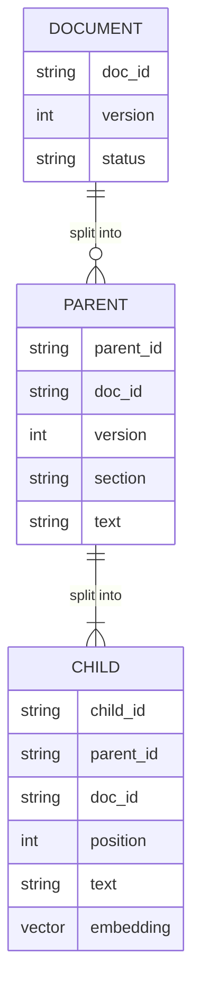
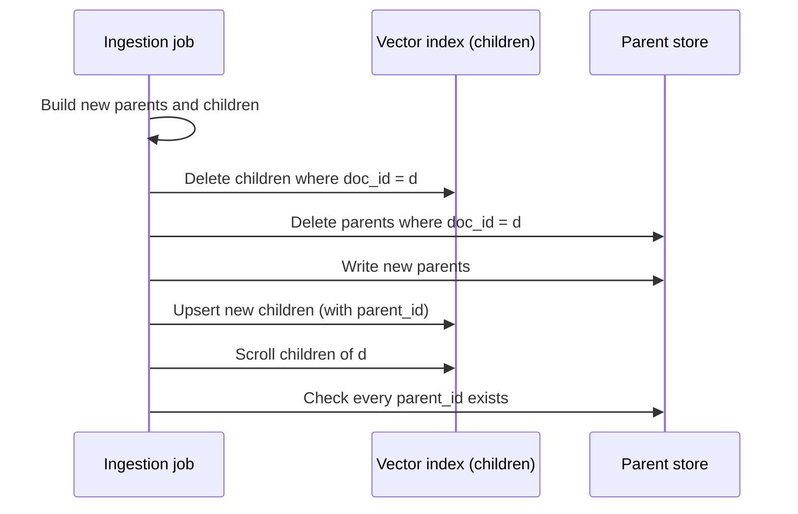

Every lesson so far has fought the same tension: small chunks match questions precisely but carry too little text to answer them, and large chunks carry enough text but match vaguely. **Parent-child chunking** stops forcing one size to do both jobs. Each document is split twice: into small **child** chunks, which are embedded and searched, and into larger **parent** chunks, which contain the children and are what the generator eventually reads. This lesson is about building that two-level structure correctly: how to define parents and children, how to link them, where to store each, and how to keep the structure consistent when documents change. How to *use* it at query time (returning parents, merging children, expanding windows) is the subject of the next lesson, [small-to-big retrieval](/learn/chunking-optimisation/small-to-big-retrieval).

## Learning objectives

- Explain why separating the unit of matching from the unit of reading resolves the chunk-size trade-off, and what it costs.
- Choose parent and child definitions (structural or fixed-size) and sizes for a given collection and generator budget.
- Design a data model with stable IDs, parent references and the invariants every parent-child index must satisfy.
- Compare the three common storage layouts for parents and estimate their storage cost.
- Re-ingest a changed document without leaving orphaned or stale children.

## Prerequisites

- [Chunk size experiments](/learn/chunking-optimisation/chunk-size-experiments): the trade-off this structure is designed to escape.
- [Context preservation](/learn/chunking-optimisation/context-preservation): headers on embedded text and metadata beside it.
- [Structure-aware chunking](/learn/advanced-chunking-strategies/structure-aware-chunking): sections and elements as natural units.
- [Metadata](/learn/vector-database-fundamentals/metadata) and [CRUD operations](/learn/vector-database-fundamentals/crud-operations): payloads and deleting by filter.

## Why this matters

The [size experiments](/learn/chunking-optimisation/chunk-size-experiments) found two failure modes pulling in opposite directions. Small chunks split answers and lose context; large chunks blur their vectors and, beyond the embedding model's limit, are silently truncated. Any single size is a compromise, and the best compromise differs between collections.

Parent-child chunking removes the compromise by giving each job its own unit:

- The **child** is sized for *matching*: small enough that its vector is about one thing, comfortably below the embedding model's limit.
- The **parent** is sized for *reading*: large enough to hold a complete answer with its surrounding qualifications, sized against the generator's budget rather than the embedding model's limit.

This only works if the structure is built carefully. A child that straddles two parents maps to the wrong text. A parent store that drifts out of step with the vector index returns text that is no longer in the document, or nothing at all. Parents that are too large consume the context budget with one hit. These are construction problems, and this lesson is about avoiding them.

## The intuition

Think of a library catalogue. Each book has many index cards: one per topic it covers, each card short and specific ("home-office equipment, contractors not eligible, page 12"). You search the cards, because short specific cards match your question well. But you do not read the card: you follow it to the page, and read the page with its surrounding paragraphs.

The cards are children, the pages are parents, and the page number on the card is the parent ID. The catalogue only works if every card points at a page that exists and contains what the card says, and if, when a new edition arrives, the old cards are withdrawn along with the old pages.

## How it works

### Choosing parents

A parent should be a unit a reader would recognise as self-contained. There are three common definitions:

1. **Structural parents:** sections or subsections from headings, or elements such as a whole procedure or a whole FAQ entry. Best for well-structured documents, because the unit matches the author's own division of the subject.
2. **Fixed-size parents:** windows of, say, 1,024 tokens cut at sentence boundaries. Best for unstructured text such as transcripts or long emails, where headings do not exist.
3. **Whole documents:** for collections of short documents (tickets, FAQ entries, product descriptions) where the document *is* the natural reading unit.

Whatever the definition, bound the size. Parents larger than a ceiling are split, at the best boundaries available, into several parents; very small sections can be merged with a neighbour if they are too short to answer anything alone. The ceiling comes from the generator's budget: if you plan to send up to $k_p$ parents in a budget of $B$ tokens, no parent should exceed $B / k_p$.

### Choosing children

Children are cut *inside* each parent, never across a parent boundary. Common definitions are single sentences, groups of sentences up to a small token limit (64 to 256 tokens is typical), or fixed windows. Two rules matter more than the exact size:

- **Containment.** Every child's text lies entirely within one parent. This is what makes the parent lookup meaningful.
- **Context on the index text.** A small child loses context faster than anything else, so give its *embedded* text a short header (title and section), as in [context preservation](/learn/chunking-optimisation/context-preservation), while its stored text stays the original.

### More than two levels

Nothing limits the hierarchy to two levels. LlamaIndex's `HierarchicalNodeParser`, for example, takes a list of chunk sizes (its default is 2,048, 512 and 128 tokens) and produces nodes at each level linked to their parents and children. Deeper hierarchies let query-time logic pick the right level per question, which is what auto-merging retrieval does; [small-to-big retrieval](/learn/chunking-optimisation/small-to-big-retrieval) covers it. Each extra level adds records and lookups, so use more than two only if you will actually use the intermediate level.

### The data model



Each child carries its `parent_id`, its `doc_id`, its `version` and its `position` within the parent. Children carry `doc_id` themselves, rather than reaching it through the parent, so that a single filtered delete can remove all of a document's children.

**IDs should be stable**: derived deterministically from the document, version and position (for example, a UUID version 5 over those parts) rather than random. Then re-running ingestion of the same document version produces the same IDs and overwrites instead of duplicating, which makes retries after a crash safe. Many vector databases restrict ID formats; Qdrant, for example, accepts unsigned integers or UUIDs, which is one reason to use UUID5 rather than a raw string.

### Where parents live

There are three common layouts:

| Layout | How it works | Cost | When it fits |
| --- | --- | --- | --- |
| **Parent text in each child's payload** | Every child stores a copy of its parent's text. | Parent text duplicated once per child. | Few children per parent; simplest possible read path. |
| **Separate parent store** | Parents in a key-value store or database table keyed by `parent_id`; children store only the ID. | One extra lookup per query (batched). | The usual choice; one copy of each parent. |
| **Parents in the vector store** | Parents are records in the same or a sibling collection, with or without their own vectors. | Parents with vectors cost embedding and index space. | When you also want to search at parent level. |

With the separate store, the vector index and the parent store are two systems, and keeping them consistent is your job.

### Invariants

A parent-child index is correct when four invariants hold:

1. **No orphans:** every child's `parent_id` exists in the parent store.
2. **Containment:** every child's text is contained in its parent's text (or its character offsets lie inside the parent's).
3. **No childless parents:** every parent has at least one child, otherwise it can never be retrieved.
4. **One version per document:** all children and parents of a document share the current version.

Check them in tests and, cheaply, after every ingestion run.

### Updating a document

When a document changes, sections are renamed, added and deleted, so children and parents cannot simply be overwritten in place. The safe procedure is replace-by-document:

1. Build the new parents and children for the document in memory.
2. Delete the document's children from the vector index with a filter on `doc_id`.
3. Delete the document's parents from the parent store.
4. Write the new parents.
5. Write the new children.
6. Check the invariants.

Deleting children before parents, and writing parents before children, means a reader at any moment may see a document missing or partially written, but never a child pointing at a parent that does not exist. Systems that cannot tolerate a missing document during the swap write the new version alongside the old one and switch a `current` flag or alias atomically; [index versioning](/learn/ci-cd-and-mlops/index-versioning) covers that pattern.



## The mathematics

**Intuition.** Children multiply vectors; parents multiply text. Each layout pays for that differently.

$$
N_c \approx \frac{T}{c}, \qquad N_p \approx \frac{T}{p}, \qquad S_{\text{dup}} \approx N_c \cdot p = \frac{T\,p}{c}, \qquad k_p = \left\lfloor \frac{B}{p} \right\rfloor
$$

- $T$: corpus size in tokens; $c$: child size; $p$: parent size (both in tokens).
- $N_c$, $N_p$: number of children (vectors) and parents.
- $S_{\text{dup}}$: tokens of text stored if every child's payload holds a copy of its parent, against $T$ for a separate parent store.
- $B$: the generator's context budget for retrieved text; $k_p$: how many parents fit.

**Worked example.** $T = 10$ million tokens, $c = 100$, $p = 1{,}000$.

- $N_c = 10^7 / 100 = 100{,}000$ child vectors; $N_p = 10{,}000$ parents.
- Duplicated payloads: $10^7 \times 1{,}000 / 100 = 10^8$ tokens, ten times the corpus. At roughly 4 characters per token that is around 400 MB of payload text, against about 40 MB for one copy in a separate store.
- With $B = 4{,}000$, only $k_p = 4$ parents fit. If the top children point at more than four distinct parents, some must be dropped, which is why parent size is bounded by the budget.

```python
T, c, p, B = 10_000_000, 100, 1_000, 4_000
print(f"children: {T // c:,}  parents: {T // p:,}")
print(f"duplicated payload text: {T * p // c:,} tokens ({T * p // c / T:.0f}x the corpus)")
print(f"parents that fit in the budget: {B // p}")
```

```output
children: 100,000  parents: 10,000
duplicated payload text: 100,000,000 tokens (10x the corpus)
parents that fit in the budget: 4
```

## In code

**The problem.** Build a parent-child index for the Meridian corpus: sections as parents (split if over 200 tokens), sentence groups of at most 32 tokens as children, children in Qdrant with a parent reference, parents in a separate store. Check the invariants, retrieve parents through children, then update a document correctly and incorrectly.

**Dependencies.** sentence-transformers and qdrant-client (Qdrant runs in-process with `":memory:"`, no server), plus `meridian_corpus.py` from [chunk size experiments](/learn/chunking-optimisation/chunk-size-experiments). No API key.

```bash
pip install sentence-transformers qdrant-client
```

```python
import re
import uuid
from sentence_transformers import SentenceTransformer
from qdrant_client import QdrantClient, models
from meridian_corpus import DOCS

model = SentenceTransformer("sentence-transformers/all-MiniLM-L6-v2")
tok = model.tokenizer
CHILD_MAX, PARENT_MAX = 32, 200            # tokens
NAMESPACE = uuid.UUID("6f1c0a52-3d4e-4b8a-9a43-0d5e2f7c9b11")   # any fixed UUID

def n_tokens(text):
    return len(tok(text, add_special_tokens=False)["input_ids"])

def stable_id(*parts):
    """Same inputs, same ID, so re-running ingestion of one version is idempotent."""
    return str(uuid.uuid5(NAMESPACE, "/".join(map(str, parts))))

def pack(sentences, limit):
    """Greedily pack whole sentences into groups of at most `limit` tokens."""
    groups, current = [], []
    for s in sentences:
        if current and n_tokens(" ".join(current + [s])) > limit:
            groups.append(" ".join(current))
            current = []
        current.append(s)
    return groups + [" ".join(current)]

def build(doc_id, text, version):
    """Parents are sections (split at sentences if too long); children are sentence groups inside one parent."""
    title = text.splitlines()[0].lstrip("# ").strip()
    parents, children = [], []
    for section in re.split(r"\n(?=## )", text)[1:]:
        heading, body = section.split("\n", 1)
        sentences = re.split(r"(?<=[.!?])\s+", body.strip())
        for p_no, p_text in enumerate(pack(sentences, PARENT_MAX)):
            pid = stable_id(doc_id, version, heading, p_no)
            parents.append({"id": pid, "doc_id": doc_id, "version": version,
                            "title": title, "section": heading[3:], "text": p_text})
            for c_no, c_text in enumerate(pack(re.split(r"(?<=[.!?])\s+", p_text), CHILD_MAX)):
                children.append({"id": stable_id(pid, c_no), "parent_id": pid, "doc_id": doc_id,
                                 "version": version, "position": c_no, "text": c_text,
                                 "index_text": f"{title} > {heading[3:]}. {c_text}"})
    return parents, children

client = QdrantClient(":memory:")
client.create_collection("children", vectors_config=models.VectorParams(
    size=model.get_sentence_embedding_dimension(), distance=models.Distance.COSINE))
PARENTS = {}                                  # the docstore: parent_id -> parent record

def ingest(doc_id, text, version, replace=True):
    # 1. remove the old version: children first, then parents, so no child points at a missing parent
    if replace:
        client.delete("children", points_selector=models.FilterSelector(filter=models.Filter(
            must=[models.FieldCondition(key="doc_id", match=models.MatchValue(value=doc_id))])))
        for pid in [p for p, rec in PARENTS.items() if rec["doc_id"] == doc_id]:
            del PARENTS[pid]
    # 2. write the new version: parents first, then children
    parents, children = build(doc_id, text, version)
    PARENTS.update({p["id"]: p for p in parents})
    vectors = model.encode([c["index_text"] for c in children], normalize_embeddings=True)
    client.upsert("children", points=[
        models.PointStruct(id=c["id"], vector=v.tolist(),
                           payload={k: c[k] for k in ("parent_id", "doc_id", "version", "position", "text")})
        for c, v in zip(children, vectors)])

def check_invariants():
    points, _ = client.scroll("children", limit=10_000, with_payload=True)
    orphans = [p for p in points if p.payload["parent_id"] not in PARENTS]
    escaped = [p for p in points if p.payload["text"] not in PARENTS[p.payload["parent_id"]]["text"]]
    childless = set(PARENTS) - {p.payload["parent_id"] for p in points}
    return len(points), len(PARENTS), len(orphans), len(escaped), len(childless)

def retrieve_parents(question, k_children=5):
    hits = client.query_points("children", query=model.encode(question, normalize_embeddings=True).tolist(),
                               limit=k_children, with_payload=True).points
    seen = []
    for h in hits:                            # keep parents in order of their best child
        if h.payload["parent_id"] not in seen:
            seen.append(h.payload["parent_id"])
    return [(PARENTS[pid], [h.payload["position"] for h in hits if h.payload["parent_id"] == pid]) for pid in seen]

for doc_id, text in DOCS.items():
    ingest(doc_id, text, version=1)
print("children, parents, orphans, escaped, childless:", check_invariants())

sizes = [n_tokens(p["text"]) for p in PARENTS.values()]
print(f"parent sizes: min {min(sizes)}, max {max(sizes)} tokens")

for parent, positions in retrieve_parents("Can contractors get money for a home office desk?")[:2]:
    print(f"\nparent: {parent['title']} > {parent['section']}  (matched children {positions})")
    print(" ", parent["text"][:110], "...")

# Version 2 of the handbook renames a section and adds a sentence.
v2 = (DOCS["handbook"].replace("## Learning and development", "## Learning budget")
      .replace("seven calendar days.", "seven calendar days. A return-to-work meeting follows any absence longer than two weeks."))

ingest("handbook", v2, version=2, replace=False)          # the tempting shortcut: upsert only
print("\nupsert only: ", check_invariants(),
      "versions:", sorted({p["version"] for p in PARENTS.values() if p["doc_id"] == "handbook"}))
ingest("handbook", v2, version=2)                         # delete the document, then write it
print("replace:     ", check_invariants(),
      "versions:", sorted({p["version"] for p in PARENTS.values() if p["doc_id"] == "handbook"}))
```

```output
children, parents, orphans, escaped, childless: (27, 12, 0, 0, 0)
parent sizes: min 42, max 73 tokens

parent: Meridian Employee Handbook (2025) > Remote work  (matched children [1, 2, 0])
  Staff may work remotely for up to 3 days a week. Your team agrees which days are office days. Contractors are  ...

parent: Meridian Employee Handbook (2025) > Expenses  (matched children [1, 0])
  The finance department processes all expenses. Expenses must be submitted within 30 days of the purchase. Anyt ...

upsert only:  (39, 17, 0, 0, 0) versions: [1, 2]
replace:      (27, 12, 0, 0, 0) versions: [2]
```

**The important lines.**

- `build()` creates children by splitting each *parent's* text, so containment holds by construction. Children of different parents can never share a sentence.
- `stable_id()` derives every ID from the document, version, heading and position with UUID5, which Qdrant accepts as a point ID.
- Each child's embedded `index_text` carries "title > section"; the stored `text` is the original sentence group, which is what the containment check and any citation use.
- `ingest()` deletes by a `doc_id` filter, children before parents, then writes parents before children: the update procedure from the How it works section.
- `check_invariants()` scrolls every child and tests the first three invariants; the version list checks the fourth.
- `retrieve_parents()` searches children and maps hits to distinct parents, ranked by each parent's best child. Deciding how many parents to keep, and in what form, is the next lesson's subject.

**What the output means.**

- **The structure is sound.** 27 children under 12 parents, with no orphans, no child escaping its parent and no childless parent. Parents are the corpus's sections, 42 to 73 tokens, all well under the 200-token ceiling, so none had to be split.
- **Child matches lead to the right parent.** For "Can contractors get money for a home office desk?", three children of *Remote work* matched, so that section is returned first with the contractor rule inside it. The second parent (*Expenses*) is there because two of its children mention claiming money; with a larger budget it would be sent too.
- **Upsert-only updates corrupt the index silently.** Without deleting first, the handbook's version-1 records stay alongside version 2: 39 children and 17 parents instead of 27 and 12, and both versions present. The invariant checks pass, because every stale child still has its stale parent. Only the version check catches it. A query could now return the old *Learning and development* section next to the new *Learning budget* one.
- **Replace-by-document restores the counts** and leaves only version 2.

**Errors people commonly hit.**

- *Random IDs.* `uuid4()` makes every re-run of ingestion insert duplicates. Derive IDs deterministically.
- *Deleting by parent instead of by document.* If a section is renamed or removed, its old parent ID is never visited, and its children survive. Delete by `doc_id`.
- *Unindexed filter fields.* On a real Qdrant server, deleting or filtering by `doc_id` on a large collection should use a payload index on that field (`create_payload_index`); without one, the filter scans.

**A library equivalent.** LlamaIndex builds the same kind of hierarchy with `HierarchicalNodeParser`. Sizes are in LlamaIndex's default tokeniser, not MiniLM's; nothing is embedded here.

```bash
pip install llama-index-core
```

```python
from llama_index.core import Document
from llama_index.core.node_parser import HierarchicalNodeParser, get_leaf_nodes, get_root_nodes
from meridian_corpus import DOCS

parser = HierarchicalNodeParser.from_defaults(chunk_sizes=[256, 64], chunk_overlap=0)
nodes = parser.get_nodes_from_documents(
    [Document(text=text, id_=doc_id) for doc_id, text in DOCS.items()])
roots, leaves = get_root_nodes(nodes), get_leaf_nodes(nodes)
print(f"{len(nodes)} nodes: {len(roots)} roots, {len(leaves)} leaves")

by_id = {n.node_id: n for n in nodes}
leaf = leaves[3]
parent = by_id[leaf.parent_node.node_id]
print("leaf:  ", repr(leaf.text[:70]))
print("parent:", repr(parent.text[:70]), f"({len(parent.child_nodes)} children)")
```

```output
19 nodes: 5 roots, 14 leaves
leaf:   '## Sick leave\nIf you are ill, tell your line manager before 10:00 on y'
parent: '# Meridian Employee Handbook (2025)\n\n## Annual leave\nEvery employee re' (5 children)
```

The parser's parents are fixed-size token windows, not sections: the handbook became two 256-token roots, and the first one starts at the document title and runs across several sections. Its leaves are sentence-aware splits of each root. That is a reasonable default for unstructured text; for documents with good headings, structural parents like the hand-built ones above usually make more coherent reading units. The leaf nodes are what you embed; the full node list goes into a document store so parents can be fetched by ID.

**Extending it.** Add a third level (documents above sections) and a `level` field; store parents in SQLite instead of a dictionary; and make `ingest()` write the new version under a new `version` before deleting the old one, switching readers with a `current_version` table.

## A real-world example

The Platform team moved AskMeridian to parent-child chunking after the size experiments showed that handbook questions wanted small chunks and runbook questions wanted large ones. They chose structural parents: handbook subsections and whole runbook procedures, each capped at 1,200 tokens, with longer procedures split at step boundaries. Children were sentence groups of up to 120 tokens with a title-and-section header on the embedded text.

Their first version stored the parent text in every child's payload, because it made the read path a single query. Within a month, the runbook collection's storage had grown several times faster than the corpus: long procedures had dozens of children each, and each carried the whole procedure. They moved parents to a table in the PostgreSQL database the platform already ran, keyed by a UUID5 parent ID, and fetched them in one batched query per request.

The second problem surfaced in an audit. Answers about the learning budget occasionally quoted a section heading that HR had renamed months earlier. The ingestion job had been upserting changed documents, and the renamed section's old parent and children were never touched. The team switched to replace-by-document, added the invariant checks plus a "one version per document" check to the nightly job, and found and removed several hundred stale children on the first run.

## Common mistakes

- **Children that cross parent boundaries.** Cutting children from the document rather than from each parent lets a child span two parents, so its parent lookup returns half the context.
- **Unbounded parents.** A 6,000-token section returned for one child hit consumes the budget. Cap parent size against $B / k_p$.
- **Duplicating parent text into every child's payload at scale.** Storage grows by $p / c$ times the corpus.
- **Random or position-only IDs.** Retries duplicate records, and inserting a sentence shifts every later ID.
- **Updating by upsert alone.** Renamed or deleted sections leave stale children that still pass orphan checks.
- **Embedding children without context.** The smaller the child, the more it needs a title or section header in its index text.

## Best practices

- Prefer structural parents where documents have reliable headings; use bounded fixed-size parents otherwise.
- Cut children from each parent so containment holds by construction, and store character offsets if you need exact provenance.
- Store parents once, in a key-value store or table, and fetch them in a single batched lookup per query.
- Derive IDs deterministically from document, version and position.
- Update by document: delete children, delete parents, write parents, write children, check invariants.
- Run the four invariant checks after every ingestion and alert on any failure.

## Performance considerations

Vectors are counted by children, so parent-child chunking costs as much index memory as indexing small chunks alone: 100,000 child vectors at 384 dimensions in float32 is about 154 MB of raw vectors before index overhead, whatever the parents look like. The parents add storage but no vectors (unless you also embed them).

At query time the extra work is the parent lookup. Searching more children than you will use (say 20 to find 4 distinct parents) costs little in an approximate index, and fetching parents by ID is one batched key lookup, typically far faster than the vector search itself when the store is local, and one network round trip when it is not. Keep the parent store close to the retrieval service.

Generation cost is set by parent size: with $k_p$ parents of $p$ tokens, the generator reads $k_p \cdot p$ tokens per question. That is the number to budget, and it is why parent size should be bounded by the generator's budget rather than by the document's structure alone.

## Security considerations

Permissions must be enforced on parents as well as children. If a parent section contains a restricted paragraph but its children are tagged from the document's public part, a child hit can return the restricted parent. Derive access-control metadata at the parent level, copy it to every child of that parent, and filter on it at search time; check in tests that no child's permissions are broader than its parent's.

## Summary

- Parent-child chunking separates the unit of matching (small children, embedded) from the unit of reading (larger parents, returned).
- Parents are structural units or bounded fixed-size windows; their size is limited by the generator's budget, children's by the embedding model and by focus.
- Children are cut inside parents, carry a stable `parent_id`, `doc_id`, version and position, and embed a short context header.
- Store parents once in a separate store; payload duplication multiplies storage by roughly $p / c$.
- Update by document (delete children, delete parents, write parents, write children) and check the invariants every time.

## Exercises

**1.** A corpus of 50 million tokens uses parents of 800 tokens and children of 80. How many child vectors and parents are there, and how much parent text is stored if every child's payload holds its parent? How many parents fit in a 3,000-token budget?

<details><summary>Show solution</summary>

Children: $5 \times 10^7 / 80 = 625{,}000$. Parents: $5 \times 10^7 / 800 = 62{,}500$. Duplicated payload text: $5 \times 10^7 \times 800 / 80 = 5 \times 10^8$ tokens, ten times the corpus. Parents in the budget: $\lfloor 3000 / 800 \rfloor = 3$.

</details>

**2.** Why must children be cut from each parent's text rather than from the whole document? Give a concrete failure.

<details><summary>Show solution</summary>

If children are cut from the document independently of parents, a child can span the end of one parent and the start of the next. Its `parent_id` can only name one of them. Suppose a child contains "...and it is claimed through the expenses process. ## Sick leave If you are ill..." and is assigned to the Remote work parent: a question about sick leave matches it, and the generator receives the Remote work section, which says nothing about sickness. Cutting inside each parent makes this impossible.

</details>

**3.** Extend `check_invariants()` to detect the problem that upsert-only updates caused, then show that it fires on the `replace=False` run.

<details><summary>Show solution</summary>

Add a version check per document:

```python
from collections import defaultdict

def mixed_versions():
    versions = defaultdict(set)
    for p in PARENTS.values():
        versions[p["doc_id"]].add(p["version"])
    points, _ = client.scroll("children", limit=10_000, with_payload=True)
    for p in points:
        versions[p.payload["doc_id"]].add(p.payload["version"])
    return {d: sorted(v) for d, v in versions.items() if len(v) > 1}
```

After the upsert-only ingest it returns `{'handbook': [1, 2]}`; after the replace it returns `{}`. A production check would compare against the version registered for each document in the source system rather than only looking for mixtures.

</details>

**4.** Design decision. Meridian's IT runbooks are long procedures (some 3,000 tokens), each with a summary paragraph, prerequisites, 10 to 30 numbered steps and a troubleshooting table. The generator budget is 6,000 tokens and you want room for at least three parents. Design the parents, the children and the storage.

<details><summary>Show solution</summary>

Budget: $6000 / 3 = 2{,}000$ tokens per parent at most. A 3,000-token runbook must therefore be split. Use structural parents: (1) summary plus prerequisites, (2) the steps, split at step boundaries into parents of at most about 1,500 tokens, each repeating the runbook title and the summary's first sentence in its display header, (3) the troubleshooting table, chunked by rows with the header row repeated.

Children: one step per child (merging very short consecutive steps up to about 100 tokens), each table row (or small group of rows) as a child, and the summary as a child. Embedded text carries "runbook title > part".

Storage: parents in the existing relational database keyed by UUID5 of (runbook ID, version, part, ordinal); children in the vector store with `parent_id`, `doc_id`, `version`, `step_number` and permissions. Update by runbook with the replace procedure and the invariant checks.

</details>

## Check your understanding

```quiz
[
  {
    "q": "In parent-child chunking, which unit is embedded and searched?",
    "options": [
      "The parent, because it contains the complete answer",
      "Both, always",
      "The child, because a small unit has a focused vector",
      "Neither; parents and children are found by keyword search"
    ],
    "answer": 2,
    "why": "Children are sized for matching and are what the vector index holds. Parents are fetched by ID after a child matches."
  },
  {
    "q": "A team stores each parent's full text in the payload of every child. Parents are 1,000 tokens and children 100. Roughly how much parent text is stored relative to the corpus size?",
    "options": ["About the same", "About twice", "About ten times", "About a hundred times"],
    "answer": 2,
    "why": "Each parent's text is copied once per child, and there are about p / c = 10 children per parent, so the stored text is about ten times the corpus."
  },
  {
    "q": "A document's section is renamed and the document is re-ingested with upserts only, using IDs derived from the section heading. What happens?",
    "options": [
      "The old section's parent and children remain in the index alongside the new ones",
      "The old section is overwritten because the document ID is the same",
      "Ingestion fails with a duplicate-ID error",
      "The vector database deletes the old section automatically"
    ],
    "answer": 0,
    "why": "The new heading produces new IDs, so nothing overwrites the old records. Delete all of a document's records by doc_id before writing the new version."
  },
  {
    "q": "Why should the update procedure delete children before parents, and write parents before children?",
    "options": [
      "Because vector databases require that order",
      "So that at no point does a child reference a parent that does not exist",
      "To make the update faster",
      "Because parents have no IDs until children are written"
    ],
    "answer": 1,
    "why": "With this order a concurrent reader may briefly miss the document, but never follows a child to a missing parent."
  },
  {
    "q": "What should bound the size of a parent?",
    "options": [
      "The embedding model's maximum input length",
      "The child size multiplied by ten",
      "Nothing; parents should be whole sections however long",
      "The generator's budget divided by the number of parents you want to send"
    ],
    "answer": 3,
    "why": "Parents are read, not embedded, so the embedding limit does not apply to them. The generator must fit several of them, so B / k_p is the ceiling."
  }
]
```

## Further reading

- [LlamaIndex documentation](https://docs.llamaindex.ai/): `HierarchicalNodeParser`, document stores and the auto-merging retriever.
- [LangChain documentation](https://python.langchain.com/): the `ParentDocumentRetriever`, which pairs a vector store of children with a document store of parents.
- [Qdrant documentation](https://qdrant.tech/documentation/): point IDs, payloads, payload indexes and deleting points by filter.
- Chen, T. et al. (2023). *Dense X Retrieval: What Retrieval Granularity Should We Use?* [arXiv:2312.06648](https://arxiv.org/abs/2312.06648). Compares passages, sentences and self-contained propositions as retrieval units.
