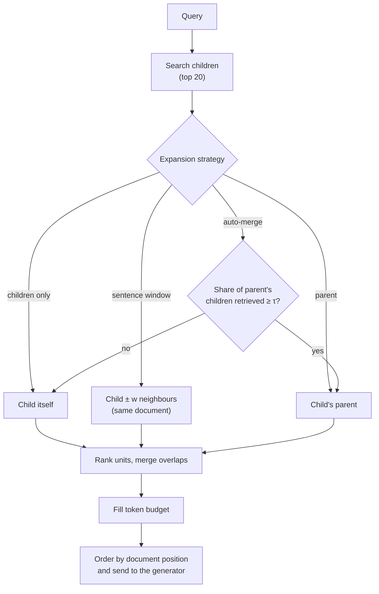

[Parent-child chunking](/learn/chunking-optimisation/parent-child-chunking) built an index in which small children are searched and larger parents are stored beside them. This lesson is about what happens at query time: **small-to-big retrieval**, the family of strategies that match on small units and then hand the generator something bigger. There are four common strategies (return the children as they are, expand each child to a window of neighbours, replace children with their parent, or merge children into their parent only when enough of them were retrieved), and each makes different decisions about how parents are scored, how duplicates are removed and how the context budget is spent. You will implement all four, compare them on questions whose complete answer needs a qualifier the question never mentions, and see how a context header on the children changes the comparison.

## Learning objectives

- Describe the four small-to-big strategies and the decision each one makes about what to send to the generator.
- Score parents from their children's scores with max, sum or coverage ratio, and predict which parents each favours.
- Fill a token budget with expanded units, removing duplicates and handling units that do not fit.
- Measure completeness of the delivered context and choose a strategy for a collection.
- Configure the equivalent components in LlamaIndex and recognise where they ignore document structure.

## Prerequisites

- [Parent-child chunking](/learn/chunking-optimisation/parent-child-chunking): the index structure these strategies read from.
- [Context preservation](/learn/chunking-optimisation/context-preservation): context headers on embedded text.
- [Overlap optimisation](/learn/chunking-optimisation/overlap-optimisation): budgets counted in unique tokens and query-time padding.
- [Top-K retrieval](/learn/retrieval-fundamentals/top-k-retrieval): ranking candidates and choosing how many to keep.

## Why this matters

Retrieval quality is usually measured by whether the right chunk was found. Users experience something different: whether the answer was *complete*. A sentence-level index can find "Up to 5 unused days carry over into the next year" for the question "How many unused leave days carry over?", and the generator will answer "5". The complete answer also says those days must be used by 31 March, after which they are lost, and that sentence matches the question poorly because the question never mentions dates. Small chunks find facts; they lose the qualifiers, exceptions and consequences around them.

Small-to-big retrieval keeps the precise matching of small units and restores what surrounds them. Done carelessly, it creates new problems: the same parent sent three times because three of its children matched, a single long parent filling the whole budget, or a window that runs across a section heading into an unrelated topic. Each strategy has a different failure profile, and choosing between them is a measurable decision.

## The intuition

Searching a long report for a phrase with a find tool lands you on one line. You never read just that line: you glance at the lines around it, and if the topic seems important, you read the whole section. If the tool highlights matches in five places and three are in the same section, you read that section once, not three times.

Those reflexes are the four strategies. Reading only the matched line is *children only*. Glancing at the surrounding lines is a *sentence window*. Reading the whole section is *parent retrieval*. Reading the section only when several matches cluster in it, and otherwise just the lines, is *auto-merging*.

## How it works

### The common pipeline

All four strategies share the same skeleton:

1. **Search children.** Retrieve more children than you will use (for example the top 20), because several will collapse into the same unit after expansion.
2. **Expand.** Map each child to the unit you intend to send: itself, a window of neighbours, its parent, or (for auto-merging) its parent only if enough siblings were retrieved.
3. **Rank units.** Order expanded units, typically by their best child's rank; other aggregations are discussed below.
4. **De-duplicate and merge.** Units that overlap (two windows sharing sentences, or the same parent reached twice) are merged so that no text is sent twice.
5. **Fill the budget.** Add units in rank order while the union of their text fits in the token budget. A unit that does not fit is skipped, and smaller later units may still be added; a production system often falls back to the child itself or a smaller window instead.
6. **Order for reading.** Within each document, send text in document order, not rank order, so the generator reads sentences in their original sequence.



### The four strategies

**Children only.** No expansion. This is the baseline and the cheapest: every token sent was matched by the query. It loses qualifiers that live in neighbouring sentences, and it scatters the budget across many places.

**Sentence window.** Each child sentence is expanded to the $w$ sentences on each side. LlamaIndex implements this with `SentenceWindowNodeParser`, which stores each sentence's window in its metadata, and `MetadataReplacementPostProcessor`, which swaps the window in after retrieval. Windows are cheap and local, which suits qualifiers that sit next to the fact. They know nothing about structure: a window can cross a heading into the next section, as the library example below shows.

**Parent retrieval.** Each child is replaced by its parent, and parents are de-duplicated. LangChain's `ParentDocumentRetriever` follows this pattern. The generator always sees a complete, coherent unit, which is the best guarantee that a qualifier stated anywhere in the section is present. The cost is size: one long parent can consume the budget, and a parent larger than the remaining budget cannot be sent at all.

**Auto-merging.** Children are kept as they are unless a large enough share of a parent's children was retrieved, in which case they are replaced by the parent. LlamaIndex's `AutoMergingRetriever` uses a ratio threshold (`simple_ratio_thresh`, default 0.5) over a multi-level hierarchy, merging repeatedly upwards. The idea is to pay for the parent only when the evidence says the whole parent is relevant.

### Scoring parents

When several children map to one parent, the parent needs a score. Three aggregations are common, and they favour different parents:

- **Max:** the parent's score is its best child's. Neutral to parent length; a single strong match is enough.
- **Sum:** the parent's score adds its children's scores. Rewards parents that match in several places, but also rewards long parents simply for having more children.
- **Coverage ratio:** the share of the parent's children that were retrieved. This is auto-merging's test. Rewards parents that are relevant throughout, and penalises long parents for which one matching child is a small share.

Max is the safe default. Use sum or coverage when you have evidence that multi-match parents are more often the right answer, and normalise for parent length if parents vary a lot in size.

### Interaction with context headers

If every child's embedded text carries its parent's title and section (as recommended in [context preservation](/learn/chunking-optimisation/context-preservation)), siblings share a prefix and therefore rank close together. That does part of small-to-big's work before any expansion: the query pulls in a cluster of sentences from the right section. The experiment shows how much, and why it does not make expansion redundant.

## The mathematics

**Intuition.** A parent's score should reflect how strongly and how broadly it matches. Max measures strength, sum measures strength times breadth, and the coverage ratio measures breadth relative to the parent's size.

$$
s^{\max}_P = \max_{i \in R \cap P} s_i, \qquad s^{\Sigma}_P = \sum_{i \in R \cap P} s_i, \qquad r_P = \frac{|R \cap P|}{|P|}
$$

- $R$: the set of retrieved children; $P$: the set of children of parent $P$.
- $s_i$: the similarity score of child $i$.
- $r_P$: the coverage ratio; auto-merging replaces the children with $P$ when $r_P \ge \tau$.

**Worked example.** Parent A has 3 children, two retrieved with scores 0.62 and 0.55. Parent B has 8 children, one retrieved with score 0.70.

- Max: A scores 0.62, B scores 0.70, so B ranks first.
- Sum: A scores $0.62 + 0.55 = 1.17$, B scores 0.70, so A ranks first.
- Coverage: $r_A = 2/3 \approx 0.67$, $r_B = 1/8 = 0.125$. With $\tau = 0.5$, A is merged into its parent; B's single child is sent alone.

The aggregations disagree on the ranking. Auto-merging sends all of A (a short parent that matches broadly) and only the matching sentence of B (a long parent that matches once), which is often exactly right.

```python
hits = {"A": [0.62, 0.55], "B": [0.70]}          # retrieved child scores per parent
n_children = {"A": 3, "B": 8}                    # total children of each parent

for p, scores in hits.items():
    ratio = len(scores) / n_children[p]
    print(f"parent {p}: max {max(scores):.2f}  sum {sum(scores):.2f}  "
          f"ratio {ratio:.2f}  merge at 0.5? {ratio >= 0.5}")
```

```output
parent A: max 0.62  sum 1.17  ratio 0.67  merge at 0.5? True
parent B: max 0.70  sum 0.70  ratio 0.12  merge at 0.5? False
```

## In code

**The problem.** Index the Meridian corpus as sentences (children) inside sections (parents). For ten questions whose complete answer needs a qualifier the question does not mention, compare the four strategies at budgets of 48 and 96 tokens, with children embedded bare and with a title-and-section header.

**Dependencies.** sentence-transformers and NumPy, plus `meridian_corpus.py` from [chunk size experiments](/learn/chunking-optimisation/chunk-size-experiments). No API key.

```bash
pip install sentence-transformers numpy
```

```python
import re
import numpy as np
from sentence_transformers import SentenceTransformer
from meridian_corpus import DOCS

model = SentenceTransformer("sentence-transformers/all-MiniLM-L6-v2")
tok = model.tokenizer

def n_tokens(text):
    return len(tok(text, add_special_tokens=False)["input_ids"])

# Children are sentences; parents are sections. SENTS keeps document order, so i-1 and i+1 are neighbours.
SENTS = []
for doc_id, text in DOCS.items():
    title = text.splitlines()[0][2:]
    for block in re.split(r"\n(?=## )", text)[1:]:
        heading, body = block.split("\n", 1)
        for s in re.split(r"(?<=[.!?])\s+", body.strip()):
            SENTS.append({"doc": doc_id, "section": (doc_id, heading[3:]), "title": title, "text": s})
SECTIONS = {}                                  # parent -> its children's indices
for i, s in enumerate(SENTS):
    SECTIONS.setdefault(s["section"], []).append(i)

# A complete answer needs the fact asked about AND a qualifier the question does not mention.
TESTS = [
    ("How do I fix error E-4021?", ["update the client from the IT portal", "E-4021 means the VPN client is out of date"]),
    ("How many unused leave days carry over?", ["Up to 5 unused days carry over", "must be used by 31 March"]),
    ("How much is the home-office equipment budget?", ["equipment budget of £400", "Contractors are not eligible"]),
    ("Do I need a receipt for a £90 lunch?", ["Anything over £75 needs a receipt", "returned unpaid"]),
    ("How do I turn on SAML for Meridian Reports?", ["Security settings page", "On the Enterprise plan"]),
    ("How long does Relay retry a failed delivery?", ["for up to 24 hours", "dead-letter queue"]),
    ("What should I do if my laptop is stolen?", ["reported to the support desk at once", "08:00 to 18:00"]),
    ("How do I download a Meridian Reports export?", ["download link is emailed", "at most 50,000 rows"]),
    ("What is the learning budget?", ["£1,000 per year", "Spend over £300 on a single item"]),
    ("How long can I be off sick without a doctor's note?", ["longer than seven calendar days", "before 10:00"]),
]

def fill(groups, budget):
    """groups: lists of sentence indices in priority order. Add whole groups while the union fits."""
    chosen = []
    for g in groups:
        new = sorted(set(chosen) | set(g))
        if sum(n_tokens(SENTS[i]["text"]) for i in new) > budget:
            continue                           # skip a group that does not fit; try smaller ones
        chosen = new
    return chosen

def children_only(ranked, budget):
    return fill([[i] for i in ranked], budget)

def sentence_window(ranked, budget, w=1):
    groups = []
    for i in ranked:
        groups.append([j for j in range(i - w, i + w + 1)
                       if 0 <= j < len(SENTS) and SENTS[j]["doc"] == SENTS[i]["doc"]])
    return fill(groups, budget)

def parents(ranked, budget):
    order = list(dict.fromkeys(SENTS[i]["section"] for i in ranked))   # parent rank = best child rank
    return fill([SECTIONS[s] for s in order], budget)

def auto_merge(ranked, budget, k=6, threshold=0.5):
    top = ranked[:k]
    groups = []
    for i in top:
        sec = SECTIONS[SENTS[i]["section"]]
        share = sum(j in top for j in sec) / len(sec)
        groups.append(sec if share >= threshold else [i])
    return fill(groups + [[i] for i in ranked[k:]], budget)

STRATEGIES = {"children only": children_only, "window ±1": sentence_window,
              "parent section": parents, "auto-merge": auto_merge}

Q = model.encode([q for q, _ in TESTS], normalize_embeddings=True)
INDEX_TEXT = {"bare sentences": lambda s: s["text"],
              "title > section + sentence": lambda s: f"{s['title']} > {s['section'][1]}. {s['text']}"}

for index_name, render in INDEX_TEXT.items():
    E = model.encode([render(s) for s in SENTS], normalize_embeddings=True)
    print(f"\nchildren embedded as: {index_name}")
    print(f"  {'strategy':<15} {'complete@48':>11} {'complete@96':>11} {'sections@96':>11}")
    for name, strategy in STRATEGIES.items():
        row = []
        for budget in (48, 96):
            complete, sections = 0, []
            for qv, (_, evidence) in zip(Q, TESTS):
                chosen = strategy(list(np.argsort(-(E @ qv))), budget)
                context = " ".join(SENTS[i]["text"] for i in chosen)
                complete += all(e in context for e in evidence)
                sections.append(len({SENTS[i]["section"] for i in chosen}))
            row.append((complete, np.mean(sections)))
        print(f"  {name:<15} {row[0][0]:>8}/10 {row[1][0]:>8}/10 {row[1][1]:>11.1f}")
```

```output
children embedded as: bare sentences
  strategy        complete@48 complete@96 sections@96
  children only          5/10        9/10         3.9
  window ±1              7/10       10/10         2.3
  parent section         6/10       10/10         1.8
  auto-merge             6/10       10/10         3.4

children embedded as: title > section + sentence
  strategy        complete@48 complete@96 sections@96
  children only          8/10       10/10         3.1
  window ±1              7/10       10/10         2.3
  parent section         6/10       10/10         1.8
  auto-merge             6/10       10/10         3.0
```

**The important lines.**

- `SENTS` keeps sentences in document order, so `i - 1` and `i + 1` are neighbours; `SECTIONS` maps each parent to its children. This is the in-memory version of the parent-child index from the previous lesson.
- Each test lists two evidence strings: the fact the question asks about and the qualifier a complete answer needs. **Complete** means both appear in the delivered context.
- `fill()` is steps 4 and 5 of the pipeline: it adds units in priority order, merges overlaps by taking the union of sentence indices, and skips any unit that would overflow the budget.
- `parents()` ranks parents by their best child's rank (the max aggregation). `auto_merge()` applies the coverage test with $\tau = 0.5$ over the top six children and leaves the rest as single sentences.
- `sections@96` counts how many different sections the delivered context draws on: a rough measure of how scattered it is.

**What the output means.**

- **With bare sentences, every expansion beats children only.** At 96 tokens, children only delivers a complete answer for 9 of 10 questions and draws on almost four sections on average; window, parent and auto-merge reach 10 of 10 with more concentrated context. At 48 tokens the window is best (7 of 10), because a sentence and its immediate neighbours are usually where the qualifier sits, and they fit.
- **Parents are hostage to their size.** At 48 tokens, parent retrieval manages 6 of 10: several sections are 50 to 73 tokens long and cannot be sent at all, and the strategy has no fallback. Auto-merging fails the same questions for the same reason. A fallback to the child or a window when the parent does not fit would recover them.
- **Headers on children do part of the job.** With title and section in the embedded text, children only rises from 5 to 8 complete answers at 48 tokens, the best of the four in that column. Siblings share a prefix, so the query pulls in several sentences of the right section, and the qualifier comes along. But this happens by accident of ranking, at the price of scattering across about three sections; there is no guarantee the qualifier is ranked into the budget, as the cases it still misses show.
- **At a generous budget all strategies converge.** At 96 tokens almost everything fits. On a real corpus, with longer sections and more competition, the budget is the binding constraint and the differences persist.
- **Ten questions show the mechanisms, not the effect size.** Measure on your own labelled questions, with evidence lists, before choosing.

**Errors people commonly hit.**

- *Sending the same parent several times.* Without de-duplication, three matching children produce three copies of one section.
- *Ordering by rank instead of position.* Merged windows sent in rank order can present step 5 before step 4. Sort by document position within each document.
- *Counting the budget in children.* "Top 5 children" expanded to parents may be 5,000 tokens. Count the budget in tokens of the expanded text.
- *Windows across documents.* A window must stop at the document boundary (the code checks `doc`); in most cases it should stop at section boundaries too.

**A library equivalent.** LlamaIndex's sentence-window components run without an embedding model for inspection:

```bash
pip install llama-index-core
```

```python
from llama_index.core import Document
from llama_index.core.node_parser import SentenceWindowNodeParser
from llama_index.core.postprocessor import MetadataReplacementPostProcessor
from llama_index.core.schema import NodeWithScore
from meridian_corpus import DOCS

parser = SentenceWindowNodeParser.from_defaults(window_size=1)
nodes = parser.get_nodes_from_documents([Document(text=DOCS["it-runbook"])])
hit = next(n for n in nodes if n.text.startswith("To fix it"))
print("embedded text:", repr(hit.text))
print("window:       ", repr(hit.metadata["window"]))

post = MetadataReplacementPostProcessor(target_metadata_key="window")
[replaced] = post.postprocess_nodes([NodeWithScore(node=hit, score=0.71)])
print("sent to LLM:  ", repr(replaced.node.get_content()))
```

```output
embedded text: 'To fix it, update the client from the IT portal and restart your laptop.\n\n'
window:        'Error E-4021 means the VPN client is out of date.  To fix it, update the client from the IT portal and restart your laptop.\n\n ## Laptops\nThe laptop refresh cycle is 3 years. '
sent to LLM:   'Error E-4021 means the VPN client is out of date.  To fix it, update the client from the IT portal and restart your laptop.\n\n ## Laptops\nThe laptop refresh cycle is 3 years. '
```

The child that matches "How do I fix error E-4021?" says "To fix it...". Its window adds the sentence that names E-4021, which is the referent the generator needs, but it also runs across the heading into the *Laptops* section, because the parser windows over sentences of the whole document and ignores structure. For well-structured documents, either constrain windows to sections (as the hand-written version could) or prefer parent retrieval. In a full pipeline these nodes go into a `VectorStoreIndex`, and the post-processor is passed to the query engine with `node_postprocessors=[...]`; that part needs an embedding model configured in LlamaIndex and is not run here. `AutoMergingRetriever(base_retriever, storage_context, simple_ratio_thresh=0.5)` wraps a retriever over the leaf nodes of a `HierarchicalNodeParser` hierarchy in the same way.

**Extending it.** Add a fallback to `parents()` that sends the child's window when the parent does not fit, and rerun at 48 tokens. Then change the parent ranking to the sum aggregation and look for questions where it changes the result.

## A real-world example

After adopting parent-child chunking, the Platform team had to decide what AskMeridian would actually send to the generator. The handbook's sections were short and coherent, typically 150 to 400 tokens, so parent retrieval was the obvious choice there: every policy arrived with its exceptions. Reviewers noticed the improvement on questions like the leave carry-over one, where earlier answers had omitted the 31 March deadline.

The IT runbooks were different. Some procedures were 1,500 tokens, and returning whole parents for a question about one step filled the budget with a single runbook. The team tried sentence windows of two sentences each side; these were cheap but sometimes cut a numbered procedure in half, so that the generator saw steps 4 to 6 without the prerequisites in step 1. They settled on auto-merging over a three-level hierarchy (procedure, groups of steps, single steps): a question that matched several steps of the same group received the group, and a question that matched the procedure in many places received the whole procedure. A fallback sent the matching step with its group heading when the group did not fit.

To check the choice they extended their golden dataset with an "evidence" list per question, the facts a complete answer must contain, and tracked the share of questions whose delivered context contained all of them. That metric, not top-k recall, became the one the team reported for retrieval changes.

## Common mistakes

- **Measuring only whether the matched child was found.** Small-to-big exists to deliver the qualifiers around it; measure completeness of the delivered context.
- **Expanding without de-duplicating.** The budget fills with repeats.
- **Unbounded parents.** A single long parent crowds out everything else; bound parent size or fall back to smaller units.
- **Windows that ignore structure.** They cross headings and pull in unrelated text.
- **Sum aggregation without length normalisation.** Long parents win by having more children.
- **Assuming context headers make expansion unnecessary.** They help siblings rank together but guarantee nothing.

## Best practices

- Retrieve generously at the child level (several times the number of units you will send), then expand, merge and fill a token budget.
- Use parent retrieval for short, coherent structural parents; auto-merging for long or deep hierarchies; windows for unstructured text, constrained to section boundaries where structure exists.
- Rank parents by their best child by default, and test other aggregations against labelled data.
- Provide a fallback (child or window) when an expanded unit does not fit the remaining budget.
- Send merged text in document order, with a provenance header per unit.
- Evaluate with evidence lists: the share of questions whose delivered context contains every required fact.

## Performance considerations

Small-to-big adds work after vector search, but little of it is expensive. Retrieving 20 children instead of 5 costs almost nothing extra in an approximate index. Expansion is a lookup: windows by position in a stored sentence list, parents by ID in a key-value store, one batched call per query. De-duplication and budget filling are linear in the number of candidates.

The real cost is in generation. The budget, not the number of retrieved children, determines how many input tokens the generator reads, so fix it explicitly and let the strategy decide how to spend it. Parent retrieval tends to spend the whole budget on one or two units; children only spreads it thin. Generator latency to the first token grows with input length, so a strategy that achieves the same completeness with fewer tokens (here, windows at tight budgets) is also faster.

Reranking interacts with expansion: a cross-encoder can score children (cheap, many short inputs) or expanded units (fewer, longer inputs, closer to what the generator reads). Scoring expanded units is usually more faithful but costs more per candidate; see [reranking fundamentals](/learn/reranking-fundamentals/why-reranking-is-needed).

## Summary

- Small-to-big retrieval matches small children and sends larger units: windows, parents, or parents chosen by auto-merging.
- All strategies share a pipeline: over-retrieve children, expand, rank, de-duplicate, fill a token budget, order by position.
- Max, sum and coverage aggregations rank parents differently; max is the safe default, coverage underlies auto-merging.
- Parents give the most complete context but can exceed the budget; windows are cheap but ignore structure unless constrained.
- Measure completeness of the delivered context against evidence lists, not just whether the matching child was found.

## Exercises

**1.** A parent has 10 children; 3 are retrieved with scores 0.58, 0.51 and 0.49. Another parent has 2 children; 1 is retrieved with score 0.60. Rank the two parents by max, by sum and by coverage ratio, and say which are merged at $\tau = 0.5$.

<details><summary>Show solution</summary>

Max: second parent 0.60, first 0.58; second ranks first. Sum: first $0.58 + 0.51 + 0.49 = 1.58$, second 0.60; first ranks first. Coverage: first $3/10 = 0.3$, second $1/2 = 0.5$; second ranks first. At $\tau = 0.5$ only the second parent is merged; the first parent's three children are sent individually.

</details>

**2.** A generator budget is 3,000 tokens and parents average 1,200 tokens. The top 20 children point at 7 distinct parents. What does parent retrieval send, and what would you change if the answer often needs evidence from 4 or more parents?

<details><summary>Show solution</summary>

Two parents fit ($2 \times 1{,}200 = 2{,}400$); a third would exceed 3,000. Parent retrieval sends the two parents with the best children and loses the other five. If answers need evidence from many parents, switch to auto-merging or windows so that weakly matching parents contribute only their matching sentences, or reduce the parent size so that more of them fit.

</details>

**3.** Add a fallback to `parents()`: when a parent does not fit in the remaining budget, try the child's ±1 window instead, then the child alone. Rerun at 48 tokens with bare sentences. What changes?

<details><summary>Show solution</summary>

```python
def parents_with_fallback(ranked, budget):
    groups, seen = [], set()
    for i in ranked:
        sec = SENTS[i]["section"]
        if sec in seen:
            continue
        seen.add(sec)
        window = [j for j in (i - 1, i, i + 1)
                  if 0 <= j < len(SENTS) and SENTS[j]["section"] == sec]
        groups += [SECTIONS[sec], window, [i]]   # fill() skips whichever does not fit
    return fill(groups, budget)
```

Because `fill()` skips groups that do not fit, listing the parent, then the window, then the child gives the fallback order. Adding `"parent + fallback": parents_with_fallback` to `STRATEGIES` and rerunning raises the bare-sentence result at 48 tokens from 6 to 8 complete answers: sections too long for the budget now contribute their best window instead of nothing. The window here is constrained to the section, unlike LlamaIndex's.

</details>

**4.** Design decision. Meridian's support desk wants AskMeridian to answer from the Atlas error-code catalogue (one short row per code) and from long troubleshooting guides. Choose a small-to-big strategy for each collection and justify the parent definition, the aggregation and the fallback.

<details><summary>Show solution</summary>

**Catalogue.** Each row is self-contained and short, and the useful context is the table header and perhaps the code's category. Children are rows; there is little to expand. Use children only, with the header repeated in each row's display text, or treat a category's rows as a parent and use auto-merging so that a question matching many codes in one category receives the category. Fallback: the row alone.

**Troubleshooting guides.** Long, structured, with qualifiers spread across steps. Use a hierarchy of guide, section and step; auto-merging with $\tau$ around 0.5 so that broad questions receive sections and narrow ones receive steps; rank by max child score; fall back to the step with its section heading when a section exceeds the remaining budget. Measure on questions with evidence lists drawn from support tickets.

</details>

## Check your understanding

```quiz
[
  {
    "q": "What problem does small-to-big retrieval primarily solve?",
    "options": [
      "Small chunks match precisely but lose the qualifiers and context around the matched fact",
      "Vector search is too slow on small chunks",
      "Large chunks cannot be stored in a vector database",
      "Embedding models cannot encode sentences"
    ],
    "answer": 0,
    "why": "Matching on small units is precise, but a complete answer often needs surrounding sentences. Small-to-big sends a larger unit after matching on the small one."
  },
  {
    "q": "Three of the top five retrieved children belong to the same section. What should happen before the context is sent?",
    "options": [
      "Send the section three times, once per child",
      "Drop all three children because they are redundant",
      "Merge them so the section (or the union of their windows) is sent once",
      "Send only the first child"
    ],
    "answer": 2,
    "why": "Expanded units that overlap are merged so no text is sent twice, and the freed budget goes to other units."
  },
  {
    "q": "A parent has 20 children and one of them is the top hit. Another has 2 children, both retrieved with lower scores. Which aggregation ranks the short parent first?",
    "options": [
      "Max",
      "Coverage ratio",
      "Neither; both rank the long parent first",
      "Alphabetical order"
    ],
    "answer": 1,
    "why": "Coverage is 2/2 = 1.0 for the short parent and 1/20 = 0.05 for the long one. Max favours the long parent's single top hit; sum depends on the scores."
  },
  {
    "q": "LlamaIndex's sentence window for a matched sentence includes text from the next section's heading. Why?",
    "options": [
      "Because the post-processor is misconfigured",
      "Because the parser windows over sentences of the whole document and does not respect headings",
      "Because the embedding model merged the sentences",
      "Because the window size must be at least 3"
    ],
    "answer": 1,
    "why": "The sentence-window parser counts neighbouring sentences regardless of structure. Constrain windows to sections, or use parents, when structure matters."
  },
  {
    "q": "Children are embedded with their section title as a prefix, and 'children only' retrieval improves noticeably. What is the best explanation?",
    "options": [
      "The title makes every child unique",
      "Headers make the embedding model more accurate in general",
      "The budget became larger",
      "Siblings share the prefix and rank close together, so a query pulls in several sentences of the right section"
    ],
    "answer": 3,
    "why": "A shared header makes sibling vectors similar, so they cluster in the ranking. This partly imitates expansion but does not guarantee the qualifier is ranked into the budget."
  }
]
```

## Further reading

- [LlamaIndex documentation](https://docs.llamaindex.ai/): `SentenceWindowNodeParser`, `MetadataReplacementPostProcessor`, `HierarchicalNodeParser` and `AutoMergingRetriever`.
- [LangChain documentation](https://python.langchain.com/): `ParentDocumentRetriever` and its child and parent splitters.
- Chen, T. et al. (2023). *Dense X Retrieval: What Retrieval Granularity Should We Use?* [arXiv:2312.06648](https://arxiv.org/abs/2312.06648). How the choice of retrieval unit affects retrieval and downstream answers.
- Liu, N. F. et al. (2023). *Lost in the Middle: How Language Models Use Long Contexts*. [arXiv:2307.03172](https://arxiv.org/abs/2307.03172). Why expanding to ever larger units has diminishing returns.
