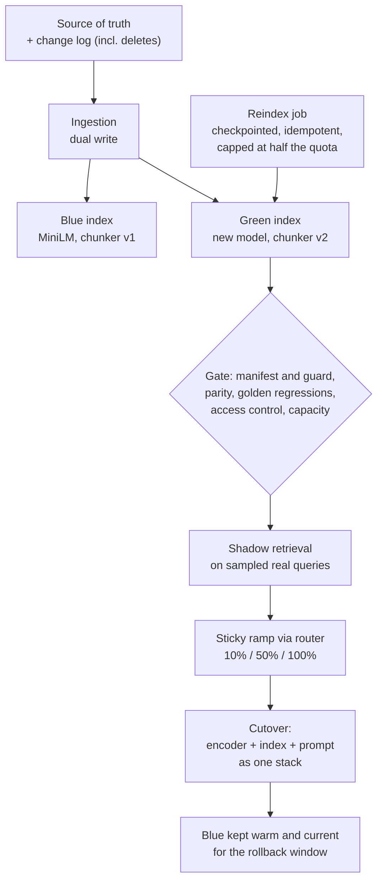

This assessment covers all nine lessons of **CI/CD and MLOps**: Git workflows, automated testing, CI/CD pipelines, model versioning, data versioning, index versioning, reindexing, rollbacks and blue-green deployments. Answer the 18 multiple-choice questions first; the pass mark is 70% (13 of 18). Then work through the conceptual questions, the coding exercises, the design challenge and the troubleshooting scenarios, writing your own answer before opening each model answer. The written parts are not scored, but they test whether you can apply the ideas to a system you have not seen before.

```quiz
[
  {
    "q": "Which of these should NOT be committed to a RAG repository's Git history?",
    "options": [
      "Prompt templates",
      "Evaluation questions and their expected documents",
      "API keys and a multi-gigabyte vector index",
      "Chunking configuration"
    ],
    "answer": 2,
    "why": "Secrets and large generated artefacts do not belong in Git: keys leak through history, and indexes are build outputs that should live in an artefact store with a manifest."
  },
  {
    "q": "Why do unit tests for RAG code replace the embedding model and the language model with test doubles?",
    "options": [
      "Real models cannot be called from Python",
      "So the suite is fast, free and deterministic, while still exercising your own code",
      "Because test doubles are more accurate than real models",
      "Because pytest forbids network access"
    ],
    "answer": 1,
    "why": "Real models are slow to load, cost money and give varying output. Doubles at seams let most tests run in milliseconds with fixed results; a few contract and evaluation tests cover the real thing."
  },
  {
    "q": "In a CI pipeline for a RAG service, a change to only a README should ideally trigger which jobs?",
    "options": [
      "The full evaluation against the paid language model",
      "A rebuild of the production index",
      "Cheap checks only, such as linting and link checks",
      "Nothing, and be merged without review"
    ],
    "answer": 2,
    "why": "Path-based triggers keep expensive jobs for changes that can affect answers. Documentation changes still deserve cheap checks and review."
  },
  {
    "q": "What does 'build once, promote the same artefact' mean for a RAG release?",
    "options": [
      "Rebuild the image in each environment to catch environment bugs",
      "The exact image, tested in staging, is the one deployed to production, rather than a fresh rebuild",
      "Only build on Fridays",
      "Never rebuild the index"
    ],
    "answer": 1,
    "why": "A rebuild can pick up different dependency versions, so what you tested is not what you ship. Promote the identical artefact."
  },
  {
    "q": "A team loads an embedding model by its Hub name with no pinned revision. What risk does this create?",
    "options": [
      "The model will be slower",
      "A new commit to the repository can silently change the model's vector space, making the live index and query encoder inconsistent",
      "The model cannot be used offline under any circumstances",
      "Embeddings will have a different dimension each day"
    ],
    "answer": 1,
    "why": "A name is not a version. Pinning the commit hash is what makes the encoder reproducible and lets the index manifest state exactly what built the index."
  },
  {
    "q": "Which fields belong in the embedding-space part of an index manifest, and so in the space ID?",
    "options": [
      "Build time and build machine",
      "Model ID, revision, prefixes, normalisation, metric and dimension",
      "The number of documents only",
      "The HNSW parameter m"
    ],
    "answer": 1,
    "why": "Those determine which vector space text lands in, and so what the query encoder must match. HNSW settings and timestamps do not affect compatibility."
  },
  {
    "q": "A new HNSW m and ef_construct are the only difference between two index builds with the same vectors. In versioning terms this is:",
    "options": [
      "A major change",
      "A minor change",
      "A patch change: same vectors, new index structure",
      "No change at all, since the index is identical"
    ],
    "answer": 2,
    "why": "The space and the content are unchanged, so queries stay compatible and the vectors can be copied; only the search structure is rebuilt."
  },
  {
    "q": "An embedding model swap keeps the 384 dimensions. A query service on the old model queries the new index. What happens?",
    "options": [
      "Qdrant raises a dimension error",
      "The query succeeds and returns results of worse quality, with no error",
      "Qdrant re-embeds the query",
      "The query is rejected by the alias"
    ],
    "answer": 1,
    "why": "Databases check dimension, not meaning. Only a manifest-based guard in the application can catch a space mismatch."
  },
  {
    "q": "Why should point IDs in a reindex job be derived deterministically (for example with UUID version 5)?",
    "options": [
      "They are shorter",
      "A batch that runs twice after a crash overwrites the same points instead of duplicating them",
      "Random IDs are not allowed in Qdrant",
      "They make search faster"
    ],
    "answer": 1,
    "why": "Crash windows guarantee that some batch will be replayed eventually. With stable IDs the replay is harmless, so the job is idempotent."
  },
  {
    "q": "What does this print?\n```python\nprint(sum(min(60, 2**a) for a in range(8)))\n```",
    "options": ["255", "183", "120", "128"],
    "answer": 1,
    "why": "The terms are 1, 2, 4, 8, 16, 32, 60 and 60 (the cap applies from a = 6), which sum to 183."
  },
  {
    "q": "A reindex job's checkpoint should be written:",
    "options": [
      "Before each batch is written, to record intent",
      "After each batch is durably written, so a crash can repeat a batch but never skip one",
      "Only when the job finishes",
      "Never, because Qdrant tracks progress"
    ],
    "answer": 1,
    "why": "Saving after the write turns crashes into repeats, which idempotent IDs absorb. Saving before the write risks silent holes."
  },
  {
    "q": "Why does a reindex using the same embedding API key as the live query service need a cap or its own quota?",
    "options": [
      "Reindexes cannot use API keys",
      "The batch job can consume the shared rate limit and cause 429 errors for users' queries",
      "API keys expire during long jobs",
      "Embeddings from batch jobs are lower quality"
    ],
    "answer": 1,
    "why": "Rate limits are shared per account or project. An uncapped batch job competes with real-time traffic."
  },
  {
    "q": "Rolling back an index by re-pointing the alias at the previous collection is unsafe if the previous collection:",
    "options": [
      "Has a different name",
      "Stopped receiving updates at the switch and contains documents deleted since",
      "Was built in the morning",
      "Has an alias already"
    ],
    "answer": 1,
    "why": "A frozen collection is stale and can resurrect deleted or erased documents. The source of truth moves forward even when the index goes back."
  },
  {
    "q": "How should the rollback window be sized?",
    "options": [
      "At least as long as the slowest important failure takes to detect",
      "Exactly 24 hours",
      "As short as storage allows",
      "Equal to the reindex duration"
    ],
    "answer": 0,
    "why": "If a regression is found after the window closes, there is nothing to return to. The window follows from your monitoring."
  },
  {
    "q": "An unexplained quality regression appears after a release and the previous version is known good and safely restorable. The best first action is usually to:",
    "options": [
      "Roll forward with a speculative fix",
      "Roll back, then diagnose with users no longer affected",
      "Wait a week for more data",
      "Delete the new index"
    ],
    "answer": 1,
    "why": "When the cause is unknown, restoring a known-good version limits harm; diagnosis is easier afterwards."
  },
  {
    "q": "Why is a rolling update a poor way to ship a change of embedding model?",
    "options": [
      "It is too fast",
      "During the rollout some replicas encode with the old model and some with the new, so some queries hit a mismatched index",
      "Kubernetes does not support it",
      "It deletes the index"
    ],
    "answer": 1,
    "why": "There is no safe replacement order. Blue-green avoids mixing by switching a whole self-consistent stack."
  },
  {
    "q": "In a percentage ramp, why assign users with a salted hash of a stable ID rather than a random draw per request?",
    "options": [
      "To keep each user on one stack and make each increase only add users to green",
      "Because hashing is cryptographically required",
      "To balance load across replicas",
      "To reduce embedding cost"
    ],
    "answer": 0,
    "why": "Sticky, monotonic assignment keeps conversations consistent and makes comparisons across ramp steps clean."
  }
]
```

## Conceptual questions

**1.** Explain why the embedding space is called "the contract between the index and the query service", and give two changes that alter the space and two that do not.

<details><summary>Show model answer</summary>

A query is only meaningful if it is encoded into the same vector space as the stored chunks, so everything that decides where text lands (model, exact revision, document and query prefixes, normalisation, metric, dimension) must agree between the code that builds the index and the code that serves queries. Changes that alter the space: a new model or model revision; a changed query prefix or embedding input format. Changes that do not: new documents or a new chunker (content changes inside the same space); HNSW settings or a new payload field (index structure and schema). The practical value is that the space ID can be compared mechanically at start-up, which is how a silent mismatch becomes a loud failure.

</details>

**2.** A rollback "restores an earlier recipe, brought up to date with everything since". Explain this sentence, and what ingestion must do to make it possible.

<details><summary>Show model answer</summary>

The source of truth and its deletions only move forward, so an index rollback cannot mean returning to last week's data: documents deleted since must stay deleted, and edits made since must be present. The old index is therefore a starting point (its chunker, model and settings) that must be caught up to the present. That needs a durable change log that includes deletions and is retained for the whole rollback window, a recorded `applied_seq` per index version, and either dual writing to the standby or a catch-up replay before the switch. An erasure ledger provides a second line of defence by letting preflight check that no erased document is present in the target.

</details>

**3.** Compare shadow, canary and blue-green deployment. For a change of embedding model, which would you use, in what order, and why?

<details><summary>Show model answer</summary>

Shadow duplicates traffic to the new stack and discards its responses: no user risk, so it measures behaviour and difference. A canary serves a small share of real users from the new stack: it measures real outcomes but exposes those users. Blue-green keeps two complete stacks and switches by one reference change: it gives instant cutover and instant rollback. For an embedding-model change use all three in sequence: build the green stack (encoder plus index), gate it with health and golden-set checks, shadow real traffic to examine retrieval differences, ramp a sticky canary with step sizes sized for statistical power, cut over, and keep blue warm and current for the rollback window. Neither a rolling update nor an alias flip alone is safe, because the encoder and index must change together.

</details>

**4.** Why can a small canary percentage be useless on a low-traffic assistant, and what should the team use instead?

<details><summary>Show model answer</summary>

The number of queries needed to detect a regression of a given size depends on the baseline rate and the effect size, not on the percentage. A 5 per cent slice of 40 queries an hour yields two queries an hour on the new stack, so detecting a 2-point rise in a 5 per cent failure rate (about 1,460 queries) takes roughly a month. "No problems seen" then means "nothing could have been seen". The team should rely on evidence that does not need volume: golden-set regressions per query, shadow comparison on logged queries, an LLM-judge on a sample of answers, and larger ramp steps held for the time the arithmetic requires.

</details>

**5.** Why do the Git workflow, the automated tests and the CI/CD pipeline of a RAG repository need to treat prompts, chunking configuration and evaluation data as first-class files?

<details><summary>Show model answer</summary>

Each of them changes answers as much as code does. If prompts and chunking settings live outside version control, a change cannot be reviewed, attributed to a commit, tested by CI or reverted; `git bisect` cannot find the commit that broke retrieval. Evaluation questions and expected documents are the specification the pipeline gates on, so they need review and code owners as well. Treating them as files lets path-based triggers run the right (and expensive) checks only for the changes that can affect answers, and lets the release record tie one commit to one set of image, model, index and prompt versions.

</details>

## Coding exercises

**1.** Write `classify(old, new)` that takes two manifests and returns `"major"`, `"minor"`, `"patch"` or `"none"`, following the lesson's rules. Test it on a new model revision, a new corpus snapshot, a new HNSW `m` and an identical manifest.

<details><summary>Show solution</summary>

```python
import hashlib

def space_id(m):   return hashlib.sha256(repr(sorted(m["space"].items())).encode()).hexdigest()[:8]

def classify(old, new):
    if space_id(old) != space_id(new):
        return "major"
    if (old["chunker"], old["corpus"]) != (new["chunker"], new["corpus"]):
        return "minor"
    if old["index"] != new["index"]:
        return "patch"
    return "none"

base = {"space": {"model": "minilm", "rev": "a1", "prefix": ""},
        "chunker": "v1", "corpus": "s1", "index": {"m": 16}}
cases = {
    "new revision":   {**base, "space": {"model": "minilm", "rev": "b2", "prefix": ""}},
    "new snapshot":   {**base, "corpus": "s2"},
    "new m":          {**base, "index": {"m": 32}},
    "identical":      dict(base),
}
for name, m in cases.items():
    print(f"{name:<14} {classify(base, m)}")
```

```output
new revision   major
new snapshot   minor
new m          patch
identical      none
```

The checks run from the most disruptive change down, so a change that is both major and patch is reported as major.

</details>

**2.** Implement a sticky percentage ramp: `bucket(user, salt)` returns 0 to 99 from a hash, and a user is on green if `bucket < percent`. Show the share assigned at 5, 25, 50 and 100 per cent for 20,000 users, that raising the percentage only adds users, and that a different salt gives an independent assignment.

<details><summary>Show solution</summary>

```python
import hashlib

def bucket(user, salt="ramp-7"):
    return int(hashlib.sha256(f"{salt}:{user}".encode()).hexdigest(), 16) % 100

users = [f"u{i}" for i in range(20_000)]
on = {p: {u for u in users if bucket(u) < p} for p in (5, 25, 50, 100)}
for p, s in on.items():
    print(f"{p:>3}% target -> {len(s) / len(users):.2%} assigned")
print("monotonic:", all(on[a] <= on[b] for a, b in ((5, 25), (25, 50), (50, 100))))
other = {u for u in users if bucket(u, "ramp-8") < 25}
print("overlap with a different salt at 25%:", f"{len(on[25] & other) / len(on[25]):.2f}", "(about 0.25 if independent)")
```

```output
  5% target -> 4.75% assigned
 25% target -> 24.78% assigned
 50% target -> 49.57% assigned
100% target -> 100.00% assigned
monotonic: True
overlap with a different salt at 25%: 0.25 (about 0.25 if independent)
```

The assigned shares are close to, but not exactly, the targets because hashing is pseudo-random. A salt per rollout stops the same users being the guinea pigs in every experiment.

</details>

**3.** Write a "full jitter" backoff schedule: attempt $a$ waits a random time between 0 and $\min(\text{cap}, \text{base} \cdot 2^a)$. Print eight waits with a fixed seed, and the expected total wait with and without jitter.

<details><summary>Show solution</summary>

```python
import random

def backoff_schedule(n_attempts, base=1.0, cap=60.0, seed=0):
    rng = random.Random(seed)
    return [min(cap, base * 2**a) * rng.random() for a in range(n_attempts)]   # "full jitter"

def expected_total(n_attempts, base=1.0, cap=60.0):
    return sum(min(cap, base * 2**a) / 2 for a in range(n_attempts))

print([round(w, 2) for w in backoff_schedule(8)])
print("expected total wait over 8 tries:", expected_total(8), "s")
print("no jitter, 8 tries:", sum(min(60, 2**a) for a in range(8)), "s")
```

```output
[0.84, 1.52, 1.68, 2.07, 8.18, 12.96, 47.03, 18.2]
expected total wait over 8 tries: 91.5 s
no jitter, 8 tries: 183 s
```

Full jitter halves the expected wait and, more importantly, spreads many clients' retries across the interval instead of having them collide at the same instants. Some designs keep a minimum wait, which this variant gives up.

</details>

## Architecture design challenge

**Brief.** Meridian wants to move AskMeridian from MiniLM to a larger embedding model and change the chunker at the same time. The corpus is 200,000 chunks, the assistant serves about 40 queries an hour at peak with three query-service replicas, the handbook receives roughly 400 edits a day and erasure requests must take effect within 24 hours. The embedding provider rate limit is shared with the query service. Design the release: how the new stack is built, validated, switched and, if needed, reversed. State what you keep for how long, and the trade-offs you accept.

<details><summary>Show reference design</summary>



**Build.** Record a watermark, then run a reindex into a new collection named from its manifest, with deterministic IDs, a fixed document order, atomic checkpoints and a dead-letter list. Cap the job at about half of the shared embedding quota and run it off-peak, or use a separate quota. Estimate first: 200,000 chunks at an assumed 350 tokens is 70 million tokens, so at a 1,000,000 tokens-per-minute limit with 50 per cent headroom the build takes about 140 minutes; replay of the changes made during that window is a few hundred edits. After the build, replay the change log from the watermark and dual-write from then on.

**Gate.** Green is a separate stack: new encoder, new index, new prompt if the chunk format changed. Gate on the start-up guard (space IDs match), a parity check against the source, no regressions on critical golden queries and a per-query diff for the rest, access-control tests, and a latency check of the larger encoder against the budget at peak.

**Validate.** Shadow retrieval for a sample of real queries for two days, comparing overlap and top-1 score distributions, and sending a few hundred sampled answers to an LLM judge. Because traffic is only about 40 queries an hour, a 5 per cent canary could not detect a 2-point regression for weeks, so lean on golden and shadow evidence and use larger steps (for example 25, 50, then 100 per cent), each held for the time the sample-size arithmetic requires or until the abort conditions fire.

**Switch.** The router moves the whole stack with one reference change; the alias alone is not enough because the encoder changes. Caches are namespaced by stack. Rollback is the same change in reverse.

**Rollback window.** Keep blue as a full collection, warm and dual-written, for 14 days (an assumption: sized from the slowest failure to detect, which here is a weekly quality review). Keep all manifests and registry rows indefinitely. Erasure requests are applied to every retained collection through the change log, and the preflight check refuses a rollback target that contains an erased document.

**Trade-offs.** Dual writing doubles ingestion embedding cost for the window, but makes rollback near-instant and avoids a 2-hour catch-up. A larger model raises storage (more dimensions) and encoder latency, which the gate must check against budget. Holding ramp steps for statistical power slows the release; the alternative is accepting a regression you cannot detect. Two full stacks roughly double serving cost during the window, which is the price of instant rollback.

</details>

## Troubleshooting scenarios

**1. "We rolled back and it got worse."** After a bad release the on-call engineer flipped the alias to the previous collection. Complaints stopped for the new regression, but within an hour support reports that AskMeridian is quoting a policy that was withdrawn on Wednesday, and recent handbook edits are missing.

<details><summary>Show diagnosis and fix</summary>

The standby was not dual-written: it stopped receiving changes at the original switch, so the flip re-published a frozen collection with stale edits and a withdrawn document. Immediate fix: remove the withdrawn document from the live collection, replay the change log from the standby's `applied_seq` (deletions included), or switch back to the new version if that is the lesser harm. Lasting fixes: make deletions durable log events, record `applied_seq` in the registry, add an erasure-ledger check and a catch-up step to the rollback tool, dual-write the standby or retain the log for the window, and rehearse rollbacks.

</details>

**2. "Quality dropped on one replica."** After a release that changed the embedding model, the dashboard shows top-1 similarity on one of three replicas at about a third of the others. No errors appear anywhere.

<details><summary>Show diagnosis and fix</summary>

That replica is encoding queries with the old model against the new index: the dimensions match so the database accepts the queries, and results are ranked in the wrong space. Probably a stale image or configuration. Restart or redeploy it with the pinned revision. Prevent a repeat with a readiness guard that compares the space ID of the alias target with the replica's own encoder configuration, and ship encoder changes as a blue-green stack switch, not a rolling update.

</details>

**3. "The reindex keeps restarting from zero and duplicating chunks."** A six-hour reindex is pre-empted at 80 per cent. After restart, the job begins at the first batch, and retrieval now returns the same chunk three times.

<details><summary>Show diagnosis and fix</summary>

There is no usable checkpoint, and point IDs are random, so each restart writes new points for documents already written. Fix: process documents in a fixed sorted order; derive point IDs deterministically from the index version and chunk identity so replays overwrite; save an atomic checkpoint (write then rename) after each batch is durably written; resume from it. Clean up the duplicates by deleting the half-built collection and rebuilding with the corrected job, or by deduplicating on `doc_id` and chunk index if the build is nearly complete, then running a parity check before any switch.

</details>
