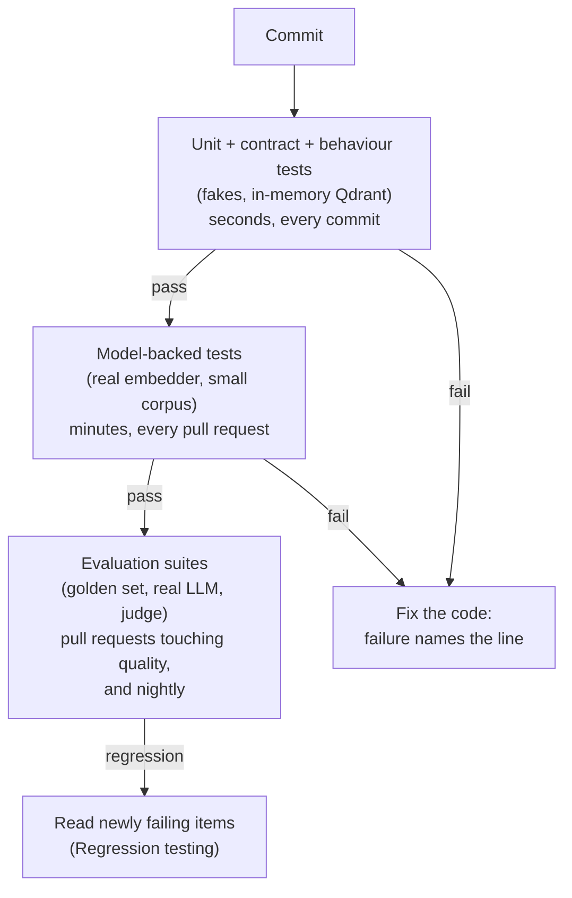

An **automated test** is a small program that runs part of your system and checks that it behaved as expected, without a person watching. A RAG codebase needs a great many of them, and it needs them to be fast, reliable and cheap, because they run on every commit. That is harder than it sounds. The pipeline's interesting parts call an embedding model that takes seconds to load, a vector database that normally runs as a server, and a language model that costs money per call and gives a differently worded answer each time.

This lesson is about the engineering that makes RAG code testable. It covers the kinds of test and what each is for, how to design the code so that slow and costly dependencies can be swapped for **test doubles**, how to run contract tests against a real vector database without a server, and how to keep a suite fast and free of flaky failures. It is deliberately about the code. Measuring answer quality against a golden set, with baselines and statistical gates, is the subject of [Regression testing](/learn/testing-and-benchmarking/regression-testing); this lesson builds the layer underneath it, and [CI/CD pipelines](/learn/ci-cd-and-mlops/ci-cd-pipelines) runs both.

## Learning objectives

- Classify a RAG test as a unit, contract, behaviour or model-backed test, and say what each kind can and cannot catch.
- Design RAG components with injectable dependencies, and write fakes for an embedder and a language model.
- Write pytest tests using fixtures, parametrisation and markers, including contract tests against an in-memory Qdrant.
- Calculate how per-test flakiness affects the probability of a green build, and choose a response that does not hide real bugs.
- Decide which checks belong in the per-commit suite and which belong in slower model-backed or evaluation runs.

## Prerequisites

- [Functions and classes](/learn/python-for-rag-engineering/functions-and-classes): the Python the examples use.
- [Qdrant](/learn/vector-database-ecosystem/qdrant): collections, points, payloads and filters.
- [Regression testing](/learn/testing-and-benchmarking/regression-testing): the evaluation-based tests that sit on top of this lesson's tests.
- [Git workflows](/learn/ci-cd-and-mlops/git-workflows): pull requests and required checks, where tests become a gate.

## Why this matters

Without automated tests, every change is verified by someone typing a few questions into the chat window. That check is slow, never the same twice, and misses exactly the things that matter: the tokeniser change that splits "E-4021" into "e", "4021" and breaks exact-code retrieval; the filter that stopped excluding the superseded 2023 handbook; the refactor that sends the prompt without the grounding instruction. Each of these is a one-line bug that a test catches in milliseconds and a person catches only when an employee is given wrong information.

The opposite failure is a test suite nobody trusts. Teams often start with tests that call the real embedding model and LLM. The suite takes eight minutes, costs money, and fails one run in five because an answer was worded differently, so developers rerun it until it passes, real failures included. A slow, costly or flaky suite stops being a safety net.

The goal is a large, fast, deterministic suite that runs on every commit and catches broken code, plus a small, slower set of model-backed checks, plus the evaluation suites of the previous module, each run at the frequency its cost allows.

## The intuition

Think of how a car is tested. Brake pads are tested on a rig that presses them against a disc a million times. The anti-lock controller is tested on a bench with fake wheel-speed sensors that can be told "the left wheel just locked". Only then does the whole car go to the test track, and the crash test happens a few times per model, not after every bolt is changed.

A RAG system has the same structure. The tokeniser, the prompt builder and the score threshold are parts that can be rigged: give them inputs, check outputs, thousands of times a second. The retriever needs an embedding model and the generator needs an LLM, so they are tested on a bench with stand-ins that behave predictably: a fake embedder that always produces the same vector for the same text, a fake LLM that records what it was sent. The test track (real models, real questions, scored answers) is the evaluation suite, run less often because it is slow and costly.

## How it works

### Kinds of test

| Kind | What it exercises | Typical speed | Catches | Cannot catch |
| --- | --- | --- | --- | --- |
| **Unit** | One pure function: tokeniser, chunker, prompt builder, score threshold | Microseconds | Logic errors, edge cases, broken invariants | Problems that only appear with real dependencies |
| **Contract** | Your code against a real instance of a dependency (an in-memory vector database) | Milliseconds | Wrong filter syntax, wrong payload fields, API misuse | Quality of real embeddings |
| **Behaviour** | The whole flow with fakes for the model calls | Milliseconds | Wrong wiring: missing grounding rule, LLM called when it should refuse | Whether the real LLM obeys the prompt |
| **Model-backed** | Real embedding model or reranker, small fixed corpus | Seconds | Model-loading bugs, gross retrieval failures | Statistical quality changes |
| **Evaluation** | Real models on a golden set, scored and compared with a baseline | Minutes | Quality regressions | Nothing in the code paths above, if they are not exercised |

The **test pyramid** says to write many fast, cheap tests and few slow, expensive ones. In RAG the top (evaluation) is irreplaceable because only it measures quality, but it only tells you *that* quality dropped; the fast layers tell you *which line* is wrong.

### Designing for testability: seams

A **seam** is a place where you can substitute one implementation for another without editing the code under test. In Python the simplest seam is a constructor argument. Code that does this inside a function has no seam:

```python
def answer(question):
    model = SentenceTransformer("sentence-transformers/all-MiniLM-L6-v2")   # hard-wired
    client = anthropic.Anthropic()                                         # hard-wired
    ...
```

Every test of `answer` now loads a model and needs an API key. Passing the dependencies in, a practice called **dependency injection**, creates the seam:

```python
def answer(question, index, llm):
    ...
```

To say what `index` and `llm` must provide, Python's `typing.Protocol` describes an interface by its methods: any object with an `encode(texts)` method returning an array is an `Embedder`, without inheriting from anything. Production code passes the real model; tests pass a fake.

### Test doubles

A **test double** is any object that stands in for a real dependency in a test. The vocabulary comes from Gerard Meszaros's *xUnit Test Patterns* (2007):

- A **stub** returns canned answers. A stub LLM always returns "Annual leave is 25 days [1]."
- A **fake** is a working, simplified implementation. A hash-based embedder that turns words into a deterministic vector really does make texts with shared words similar; it is just not semantically clever.
- A **spy** records how it was called, so the test can assert on the call: was the LLM called once, and did its prompt contain the grounding rule?
- A **mock** is pre-programmed with expectations and fails the test if they are not met (Python's `unittest.mock`).

For RAG, a fake embedder plus a stub-and-spy LLM covers most needs. Two rules keep doubles honest. First, **a fake embedder must be deterministic across processes**. Python's built-in `hash()` of a string is randomised per process unless `PYTHONHASHSEED` is set, so a fake built on it gives different vectors in different test runs; use `hashlib` instead. Second, **doubles must not encode wishful behaviour**. A fake LLM that always returns a perfect cited answer lets you test your wiring, never the model's obedience. Anything about what the real model does belongs in the evaluation suites.

### Contract tests against a real vector database

Faking the vector database is tempting and usually a mistake. Its filter language and payload handling are exactly where bugs live (a `must` that should have been `must_not`, a misspelt payload key), and a hand-written fake shares your misunderstanding.

The better answer is a **contract test**: run your code against the real database client in a lightweight mode. The Qdrant Python client accepts `QdrantClient(":memory:")`, which runs a local implementation inside the Python process with no server. It supports the same API calls, though the client documentation describes local mode as intended for development and testing, and it does not reproduce server behaviour such as HNSW approximation, sharding or performance. For those, CI can start a real server container (see [CI/CD pipelines](/learn/ci-cd-and-mlops/ci-cd-pipelines)). Other databases offer similar options; PostgreSQL with pgvector, for example, is commonly tested against a throwaway container.

### What to test in each RAG component

Write down, for each component, its **invariants**: statements that must hold whatever the input.

1. **Tokenisation.** Error codes and product names survive unchanged; empty input does not crash.
2. **Chunking.** No text is lost; no chunk exceeds the size limit or splits an identifier; every chunk carries its document ID.
3. **Indexing.** Re-adding a document is idempotent; deleting a document removes all its chunks.
4. **Retrieval.** No superseded or forbidden chunk is ever returned; an exact identifier retrieves its own chunk.
5. **Prompt building.** The grounding rule is present; sources are numbered; the budget is respected; no chunk is cut in half.
6. **Orchestration.** With nothing relevant retrieved, the system refuses without calling the LLM; LLM errors are handled.

The last group is where behaviour tests with a spy LLM shine: they check the decisions your code makes around the model, which are deterministic, without asking the model anything.

### pytest essentials

**pytest** is the standard Python test runner. Four of its features carry most RAG suites:

- **Test discovery.** Files named `test_*.py` and functions named `test_*` are collected and run; a plain `assert` produces a detailed failure message.
- **Fixtures.** A function decorated with `@pytest.fixture` builds something a test needs, such as a fresh in-memory index; a test asks for it by naming it as a parameter. Fixtures in a `conftest.py` file are shared by every test in the directory. By default a fixture is rebuilt for each test, which keeps tests independent.
- **Parametrisation.** `@pytest.mark.parametrize` runs one test body over a table of inputs, which suits invariants such as "every error code survives tokenisation".
- **Markers.** `@pytest.mark.slow` labels a test; `pytest -m "not slow"` deselects labelled tests. Registering markers in `pytest.ini` avoids warnings and typos.



## The mathematics

### Flaky tests and the probability of a green build

**Intuition.** A **flaky test** passes or fails on the same code depending on timing, ordering, network or randomness. One flaky test is a nuisance. Many slightly flaky tests make a build that is almost never green, because the build passes only if every test passes.

If the $n$ tests fail independently and each fails spuriously with probability $p$, the probability that a run with no real bug is entirely green is:

$$
P(\text{green}) = (1 - p)^{n}
$$

$n$ is the number of tests, $p$ is the per-test probability of a spurious failure, and $1 - p$ is the probability that one test passes when it should. Independence is an assumption; flaky tests that share a cause (a slow network) fail together, which changes the numbers but not the lesson.

**By hand.** AskMeridian's suite has $n = 300$ tests. If each is flaky with $p = 0.001$ (one spurious failure in a thousand runs, which feels negligible), then $P(\text{green}) = 0.999^{300}$. Using $\ln 0.999 \approx -0.0010005$, the exponent is $300 \times -0.0010005 \approx -0.300$, and $e^{-0.300} \approx 0.741$. About **one build in four fails for no reason**. At $p = 0.005$, the green rate falls to about 0.22.

The tempting fix is to retry failures automatically. With one retry, a test fails only if both attempts fail, probability $p^2$, so $P(\text{green}) = (1 - p^2)^{n}$, which for $p = 0.001$ is about 0.9997. The build looks healthy. But a real bug that shows up one time in two, such as a race condition in concurrent ingestion, now also passes three times in four. Retries convert flakiness from a visible cost into an invisible one.

```python
n = 300
for p in [0.001, 0.005]:
    green = (1 - p) ** n
    green_retry = (1 - p ** 2) ** n
    print(f"p={p}: green {green:.4f}, spurious failure {1 - green:.4f}, "
          f"green with one retry {green_retry:.6f}")
```

```output
p=0.001: green 0.7407, spurious failure 0.2593, green with one retry 0.999700
p=0.005: green 0.2223, spurious failure 0.7777, green with one retry 0.992528
```

The right response is to remove the cause. In RAG suites the usual causes are network calls (a model download, a hosted API), shared state between tests (one index reused and mutated), unseeded randomness, and assertions on exact LLM wording. The fixes are, in order: no network in the per-commit suite, a fresh fixture per test, fixed seeds, and assertions on properties rather than strings. A test that is still flaky goes into quarantine (marked and excluded from the gate) with an owner and a deadline, rather than being retried.

## In code

**The problem.** Build a small but complete RAG core for AskMeridian in a testable shape, and a pytest suite that checks its tokeniser, prompt builder, filters and refusal logic in well under a second, plus one model-backed test that is excluded from the default run.

**Dependencies.** pytest, NumPy and the Qdrant client for the fast suite; sentence-transformers for the slow test. The fast suite needs no network and no API key.

```bash
pip install pytest numpy qdrant-client sentence-transformers
```

### The code under test

```python
"""askmeridian/rag.py: a small RAG core written so that every dependency can be swapped in tests."""
import re
from dataclasses import dataclass
from typing import Protocol

import numpy as np
from qdrant_client import QdrantClient, models

GROUNDING_RULE = "Answer only from the provided context. If the answer is not there, say you don't know."
REFUSAL = "I don't know: the handbook and runbooks I can search don't cover that."


class Embedder(Protocol):
    dim: int
    def encode(self, texts: list[str]) -> np.ndarray: ...


class LLM(Protocol):
    def complete(self, system: str, prompt: str) -> str: ...


@dataclass
class Chunk:
    id: int
    text: str
    source: str
    superseded: bool = False


def tokens(text: str) -> list[str]:
    # Keep identifiers such as "E-4021" in one piece.
    return re.findall(r"[a-z]+-\d+|[a-z0-9]+", text.lower())


def build_prompt(question: str, chunks: list[Chunk], max_chars: int = 2000) -> str:
    parts, used = [], 0
    for n, c in enumerate(chunks, 1):
        block = f"[{n}] ({c.source}) {c.text}"
        if used + len(block) > max_chars:
            break                               # never cut a chunk in half
        parts.append(block)
        used += len(block)
    context = "\n".join(parts)
    return f"Context:\n{context}\n\nQuestion: {question}\nCite sources by number."


class VectorIndex:
    def __init__(self, client: QdrantClient, embedder: Embedder, name: str = "chunks"):
        self.client, self.embedder, self.name = client, embedder, name
        client.create_collection(name, vectors_config=models.VectorParams(
            size=embedder.dim, distance=models.Distance.COSINE))

    def add(self, chunks: list[Chunk]) -> None:
        vectors = self.embedder.encode([c.text for c in chunks])
        self.client.upsert(self.name, points=[
            models.PointStruct(id=c.id, vector=v.tolist(),
                               payload={"text": c.text, "source": c.source, "superseded": c.superseded})
            for c, v in zip(chunks, vectors)])

    def search(self, query: str, k: int = 3) -> list[tuple[Chunk, float]]:
        q = self.embedder.encode([query])[0]
        hits = self.client.query_points(
            self.name, query=q.tolist(), limit=k,
            query_filter=models.Filter(must_not=[models.FieldCondition(
                key="superseded", match=models.MatchValue(value=True))]),
        ).points
        return [(Chunk(h.id, h.payload["text"], h.payload["source"]), h.score) for h in hits]


def answer(question: str, index: VectorIndex, llm: LLM, k: int = 3, min_score: float = 0.2) -> str:
    hits = [(c, s) for c, s in index.search(question, k) if s >= min_score]
    if not hits:
        return REFUSAL                          # no model call when nothing relevant was found
    return llm.complete(GROUNDING_RULE, build_prompt(question, [c for c, _ in hits]))
```

The two `Protocol` classes are the seams. `VectorIndex` takes its client and embedder as arguments, and `answer` takes an index and an LLM, so nothing inside them decides which real service to use. The production LLM is a thin adapter around the Anthropic SDK. It was not executed here, because it needs an API key, and it is deliberately too simple to need a unit test of its own:

```python
import anthropic

class ClaudeLLM:
    def __init__(self, model: str = "claude-opus-5-5"):
        self.client = anthropic.Anthropic()  # reads ANTHROPIC_API_KEY from the environment
        self.model = model

    def complete(self, system: str, prompt: str) -> str:
        response = self.client.messages.create(
            model=self.model,
            max_tokens=1024,
            system=system,
            messages=[{"role": "user", "content": prompt}],
        )
        return "".join(block.text for block in response.content if block.type == "text")
```

### The doubles and fixtures

```python
"""fakes.py: test doubles that are deterministic, offline and fast."""
import hashlib

import numpy as np

from rag import tokens


class HashEmbedder:
    """Bag-of-words hashed into a fixed number of buckets. Same text, same vector, every run."""
    def __init__(self, dim: int = 64):
        self.dim = dim

    def encode(self, texts):
        out = np.zeros((len(texts), self.dim))
        for i, text in enumerate(texts):
            for tok in tokens(text):
                h = int(hashlib.md5(tok.encode()).hexdigest(), 16)   # not hash(): that is salted per process
                out[i, h % self.dim] += 1.0 if (h >> 64) % 2 else -1.0
            norm = np.linalg.norm(out[i])
            if norm:
                out[i] /= norm
        return out


class FakeLLM:
    """A stub (scripted reply) and a spy (records every call)."""
    def __init__(self, reply: str = "Annual leave is 25 days [1]."):
        self.reply, self.calls = reply, []

    def complete(self, system, prompt):
        self.calls.append({"system": system, "prompt": prompt})
        return self.reply
```

```python
"""conftest.py: fixtures shared by every test in the directory."""
import os

os.environ.setdefault("HF_HUB_OFFLINE", "1")   # tests must never download anything

import pytest
from qdrant_client import QdrantClient

from fakes import FakeLLM, HashEmbedder
from rag import Chunk, VectorIndex

CORPUS = [
    Chunk(1, "Annual leave is 25 days. Up to 5 unused days carry over and must be used by 31 March.", "handbook-2025"),
    Chunk(2, "Staff may work remotely up to 3 days a week. The home-office equipment budget is £400.", "handbook-2025"),
    Chunk(3, "Error E-4021: the VPN client is out of date. Update it from the IT portal.", "it-runbook"),
    Chunk(4, "Error E-4012: the VPN certificate has expired.", "it-runbook"),
    Chunk(5, "The home-office equipment budget is £250.", "handbook-2023", superseded=True),
]


@pytest.fixture
def index():
    # A fresh in-memory Qdrant per test: no server, no shared state between tests.
    idx = VectorIndex(QdrantClient(":memory:"), HashEmbedder())
    idx.add(CORPUS)
    return idx


@pytest.fixture
def llm():
    return FakeLLM()
```

```text
# pytest.ini
[pytest]
markers =
    slow: needs a real model or takes more than a second
addopts = -m "not slow"
```

### The tests

```python
"""test_rag.py"""
import pytest

from fakes import HashEmbedder
from rag import GROUNDING_RULE, REFUSAL, Chunk, answer, build_prompt, tokens


# ---- Unit tests: pure functions, microseconds each -------------------------
@pytest.mark.parametrize("text, expected", [
    ("Error E-4021 again", ["error", "e-4021", "again"]),
    ("VPN: e-4012!", ["vpn", "e-4012"]),
])
def test_tokens_keep_error_codes_whole(text, expected):
    assert tokens(text) == expected


def test_prompt_numbers_sources_and_never_splits_a_chunk():
    chunks = [Chunk(1, "a" * 50, "s1"), Chunk(2, "b" * 50, "s2")]
    prompt = build_prompt("q?", chunks, max_chars=70)
    assert "[1] (s1)" in prompt
    assert "[2]" not in prompt and "b" not in prompt.split("Question")[0]


def test_fake_embedder_is_deterministic():
    e = HashEmbedder()
    assert (e.encode(["VPN error E-4021"]) == e.encode(["VPN error E-4021"])).all()


# ---- Contract tests: our code against a real (in-memory) Qdrant ------------
def test_exact_error_code_ranks_first(index):
    top_chunk, _ = index.search("what does E-4021 mean", k=1)[0]
    assert top_chunk.id == 3


def test_superseded_documents_are_never_returned(index):
    sources = {c.source for c, _ in index.search("home-office equipment budget", k=5)}
    assert "handbook-2023" not in sources


# ---- Behaviour tests: the whole flow with a fake LLM -----------------------
def test_answer_sends_grounding_rule_and_retrieved_context(index, llm):
    answer("How many days of annual leave?", index, llm)
    assert len(llm.calls) == 1
    assert llm.calls[0]["system"] == GROUNDING_RULE
    assert "Annual leave is 25 days" in llm.calls[0]["prompt"]


def test_off_topic_question_is_refused_without_calling_the_model(index, llm):
    assert answer("Who won the 1966 World Cup?", index, llm) == REFUSAL
    assert llm.calls == []


# ---- Slow tests: real embedding model, excluded from the default run --------
@pytest.mark.slow
def test_real_model_matches_paraphrase():
    from qdrant_client import QdrantClient
    from sentence_transformers import SentenceTransformer
    from conftest import CORPUS
    from rag import VectorIndex

    class MiniLM:
        dim = 384
        def __init__(self):
            self.m = SentenceTransformer("sentence-transformers/all-MiniLM-L6-v2", device="cpu")
        def encode(self, texts):
            return self.m.encode(texts, normalize_embeddings=True)

    idx = VectorIndex(QdrantClient(":memory:"), MiniLM())
    idx.add(CORPUS)
    top_chunk, _ = idx.search("How much vacation am I entitled to?", k=1)[0]
    assert top_chunk.id == 1
```

Run the default suite, then everything:

```bash
pytest -q -p no:warnings
pytest -v -p no:warnings -m "slow or not slow"
```

```output
8 passed, 1 deselected in 0.05s

test_rag.py::test_tokens_keep_error_codes_whole[Error E-4021 again-expected0] PASSED [ 11%]
test_rag.py::test_tokens_keep_error_codes_whole[VPN: e-4012!-expected1] PASSED [ 22%]
test_rag.py::test_prompt_numbers_sources_and_never_splits_a_chunk PASSED [ 33%]
test_rag.py::test_fake_embedder_is_deterministic PASSED                  [ 44%]
test_rag.py::test_exact_error_code_ranks_first PASSED                    [ 55%]
test_rag.py::test_superseded_documents_are_never_returned PASSED         [ 66%]
test_rag.py::test_answer_sends_grounding_rule_and_retrieved_context PASSED [ 77%]
test_rag.py::test_off_topic_question_is_refused_without_calling_the_model PASSED [ 88%]
test_rag.py::test_real_model_matches_paraphrase PASSED                   [100%]

============================== 9 passed in 8.83s ===============================
```

**What the output means.** Eight tests covering tokenisation, prompt construction, Qdrant filtering and refusal logic ran in five hundredths of a second, with no network and no key. That is fast enough to run on every save, let alone every commit. Adding the one model-backed test multiplied the time by about 170, almost all of it loading MiniLM; that is why it carries the `slow` marker.

**The important lines.**

- `test_superseded_documents_are_never_returned` is a contract test. The superseded 2023 chunk mentions the equipment budget and would rank highly; only the `must_not` filter keeps it out. Had the filter been written as `must`, or the payload key misspelt, this test fails against Qdrant's real filter implementation, which a hand-written fake index could not promise.
- `test_off_topic_question_is_refused_without_calling_the_model` checks a decision your code makes, not the model's behaviour, and the spy proves the decision held: `llm.calls == []`. This is also a cost guarantee: unanswerable questions do not spend tokens.
- `os.environ.setdefault("HF_HUB_OFFLINE", "1")` in `conftest.py` makes the Hugging Face libraries use only the local cache. A test suite that silently downloads a model is slow on a fresh CI runner and fails whenever the hub is unreachable, a classic source of flakiness.
- `index` is a function-scoped fixture, so every test gets a fresh collection. A shared, module-scoped index is faster to build but lets one test's writes change another test's results, so test order starts to matter.

**A failure worth reading.** The slow test was first written with the query "How much holiday do I get?". It failed: MiniLM ranked the remote-work chunk above the annual-leave chunk for that wording. That is not a bug in the code; it is a fact about the model, and a single fixed query asserting rank 1 is a brittle way to test a statistical system. Model-backed tests should check gross behaviour with margin (the right chunk somewhere in the top 3, over several paraphrases), and anything finer belongs in the evaluation suite, where a [golden set](/learn/testing-and-benchmarking/golden-datasets) measures it properly.

**Common errors.** `ImportError` for `rag` when pytest runs from another directory (set `pythonpath` in `pytest.ini`); a connection error under `HF_HUB_OFFLINE=1` (the model is not cached yet; download it in a set-up step); collection-already-exists errors (a fixture reusing one client across tests).

**Extending it.** Add chunker invariants, a deletion test, and a test that LLM client exceptions become a polite error.

## A real-world example

When AskMeridian launched, its test suite was twelve end-to-end tests, each calling the production embedding service and the Claude API and comparing the answer with an expected string. It took six minutes, cost money on every run and failed often because answers were reworded, so the Platform team set CI to retry up to three times, and the build went green.

Then a refactor swapped the arguments of the helper that built the Qdrant filter, and superseded documents stopped being excluded for some queries. No end-to-end test asked about the equipment budget, so the bug reached production and an employee was told the home-office budget was £250.

The team rebuilt the suite in the shape of this lesson: invariants as unit tests, a contract test against `QdrantClient(":memory:")` for every filter (including a must-not-retrieve test per superseded document), behaviour tests with a spy LLM, a handful of `slow` real-model tests with top-3 assertions, and answer quality moved to the evaluation suite of [Regression testing](/learn/testing-and-benchmarking/regression-testing). Retries were switched off. The per-commit suite now runs in about a second.

## Common mistakes

- **Calling real models and paid APIs in the per-commit suite.** Slow, costly, flaky; developers learn to ignore failures.
- **Asserting on exact LLM wording.** The answer varies between calls, so the test is flaky by construction. Assert properties, and leave answer quality to evaluation.
- **Faking the vector database with a hand-written dictionary.** The fake shares your misunderstanding of the filter syntax, so filter bugs pass. Use the real client in memory or in a container.
- **Building fakes on `hash()`.** String hashes are randomised per process, so "deterministic" vectors change between runs.
- **Shared mutable fixtures.** One test's upserts or deletes change another's results; failures then depend on test order.
- **Automatic retries as the cure for flakiness.** They hide intermittent real bugs as well as noise.
- **No test for the refusal path.** The code that should refuse and skip the LLM call is rarely exercised by happy-path tests, so it breaks unnoticed.

## Best practices

- Inject every slow or external dependency (embedder, reranker, vector client, LLM) through constructor arguments described by a `Protocol`.
- Write invariants for each component and test them with parametrised unit tests.
- Test filters, payloads and deletions against the real vector database client, in memory for speed and in a container for server behaviour.
- Use spies to test the decisions around the model: whether it is called, with what system prompt and context, and when it is not called at all.
- Mark model-backed tests and exclude them from the default run; run them on pull requests with offline mode and a pre-populated cache.
- Keep the per-commit suite under a minute, with no network access.
- Quarantine flaky tests with an owner instead of retrying them.

## Performance considerations

The per-commit suite's budget is set by human attention: under a minute, developers wait for it; over ten, they stop running it. Tests with fakes cost microseconds to milliseconds, and an in-memory Qdrant collection of a few dozen points is created in milliseconds, so a fresh one per test is affordable.

Model loading dominates anything model-backed. In the run above, loading MiniLM took most of the 8.8 seconds; the inference itself was a few milliseconds. If you have several slow tests, load the model once with a **session-scoped fixture** (`@pytest.fixture(scope="session")`), which is safe because a model is read-only, and keep per-test state (the collection) function-scoped. The `pytest-xdist` plugin can spread tests across CPU cores, but each worker process loads its own copy of any session-scoped model, so memory grows with the worker count.

Evaluation runs cost money in proportion to golden items times calls per item; [CI/CD pipelines](/learn/ci-cd-and-mlops/ci-cd-pipelines) works out when each tier runs.

## Security considerations

- **No real credentials in tests.** The per-commit suite should run with no API keys present at all; any test that needs one is in the wrong tier. This also makes the suite safe to run on pull requests from forks, which do not receive repository secrets on most CI platforms.
- **Test the security invariants explicitly.** Must-not-retrieve tests for restricted documents (a contractor never sees HR-only chunks), tests that untrusted chunk text is placed inside the context block and never into the system prompt, and tests that the refusal path cannot be bypassed. These are cheap and catch the refactors that quietly remove a control.
- **No real personal data in fixtures.** Failing tests print their inputs into CI logs; use synthetic documents.

## Summary

- RAG code needs a large, fast, deterministic suite under the evaluation suites: unit, contract and behaviour tests on every commit, model-backed tests less often.
- Dependency injection creates seams so that embedders and LLMs can be replaced by fakes, stubs and spies; fakes must be deterministic across processes.
- Test the vector database for real, in memory or in a container: filters and payloads are where bugs live.
- Behaviour tests with a spy LLM check the decisions around the model, such as refusing without a call, without depending on the model's wording.
- Per-test flakiness compounds: $(1-p)^n$ makes a suite of individually reliable tests unreliable as a whole. Remove the causes; do not retry them away.

## Exercises

1. **Classify.** For each check, name the test kind (unit, contract, behaviour, model-backed, evaluation): (a) the chunker never produces a chunk longer than 512 tokens; (b) a query for "E-4012" never returns the E-4021 runbook first, using the production embedding model; (c) faithfulness on the golden set has not dropped; (d) deleting the 2023 handbook removes all its points from Qdrant; (e) when the LLM client raises a timeout, the API returns a 503 with a friendly message.

<details><summary>Show solution</summary>

(a) Unit: a pure function and an invariant. (b) Model-backed: it depends on the real model's vectors, so it cannot be a unit test with a fake embedder. (c) Evaluation: statistical, needs the real LLM and a baseline. (d) Contract: your deletion code against the real Qdrant client. (e) Behaviour: a stub LLM that raises the timeout, and an assertion on the response.

</details>

2. **Flakiness budget.** Your team wants the per-commit suite to be spuriously red at most once in 50 runs. The suite has 400 tests. What per-test flakiness rate can you tolerate, assuming independence?

<details><summary>Show solution</summary>

You need $(1-p)^{400} \ge 0.98$. Taking logarithms, $400 \ln(1-p) \ge \ln 0.98 \approx -0.0202$, so $\ln(1-p) \ge -0.0000505$ and $p \le$ about 0.00005, one spurious failure in 20,000 runs per test. In practice that means "no known source of nondeterminism at all": no network, no shared state, no unseeded randomness, no timing assumptions.

</details>

3. **Write the test.** Add a test that adding the same chunks to the index twice leaves the number of points unchanged (idempotent indexing). Which Qdrant behaviour makes it pass, and what change to `VectorIndex.add` would make it fail?

<details><summary>Show solution</summary>

```python
from conftest import CORPUS

def test_reindexing_is_idempotent(index):
    before = index.client.count(index.name).count
    index.add(CORPUS)
    assert index.client.count(index.name).count == before
```

It passes because `upsert` with an existing point ID replaces that point rather than adding a second one. It would fail if `add` generated new IDs on every call (for example `uuid4()`), which would duplicate every chunk on re-ingestion; the test protects the deterministic-ID design described in [Document identifiers](/learn/document-engineering/document-identifiers).

</details>

## Check your understanding

```quiz
[
  {
    "q": "Why is a contract test against `QdrantClient(\":memory:\")` usually better than a hand-written fake index for testing filters?",
    "options": ["It is faster than a dictionary", "It exercises Qdrant's real filter implementation, so a misunderstanding of the filter syntax makes the test fail", "It reproduces HNSW approximation exactly", "It needs no Python dependencies"],
    "answer": 1,
    "why": "A fake written by the same person shares their misunderstanding. The real client's local mode applies the real filter semantics, though not server behaviour such as HNSW."
  },
  {
    "q": "A fake embedder uses Python's built-in `hash(token)` to choose a bucket. What goes wrong?",
    "options": ["Nothing; hash is deterministic", "It is too slow for tests", "It cannot produce 384 dimensions", "String hashes are randomised per process, so vectors change between test runs"],
    "answer": 3,
    "why": "Unless PYTHONHASHSEED is fixed, str hashes differ between interpreter processes. Use hashlib for a fake that is stable across runs."
  },
  {
    "q": "A suite has 200 tests, each spuriously failing with probability 0.002, independently. Roughly how often is a run on correct code red?",
    "options": ["About 0.2% of runs", "About 2% of runs", "About 33% of runs", "About 90% of runs"],
    "answer": 2,
    "why": "0.998 to the power 200 is about 0.67, so about a third of runs fail for no reason."
  },
  {
    "q": "Which assertion belongs in a per-commit behaviour test with a spy LLM?",
    "options": ["The answer to the leave question contains a correct citation", "For an off-topic question the system returns the refusal message and the LLM is never called", "The model's answer is faithful to the context", "The model prefers the 2025 handbook over the 2023 one"],
    "answer": 1,
    "why": "The refusal decision is made by your code and is deterministic. The other options are about the real model's behaviour, which belongs in evaluation."
  },
  {
    "q": "The model-backed test 'top-1 result for a fixed paraphrase is the leave chunk' starts failing after an embedding-model upgrade, while evaluation recall is unchanged. What is the best response?",
    "options": ["Assert gross behaviour with margin (right chunk in the top 3 across several paraphrases) and leave fine-grained ranking to evaluation", "Pin the old model forever", "Add automatic retries", "Delete all model-backed tests"],
    "answer": 0,
    "why": "A single-query rank-1 assertion is a brittle test of a statistical system. Model-backed tests should catch gross failures; the golden set measures quality."
  }
]
```

## Further reading

- pytest documentation, especially fixtures, parametrisation and markers: [docs.pytest.org](https://docs.pytest.org/)
- Qdrant Python client documentation, including local in-memory mode: [python-client.qdrant.tech](https://python-client.qdrant.tech/)
- Gerard Meszaros (2007), *xUnit Test Patterns: Refactoring Test Code*, the source of the stub, fake, spy and mock vocabulary.
- Martin Fowler, "Mocks Aren't Stubs", an essay on the difference between state-based and behaviour-based testing: [martinfowler.com](https://martinfowler.com/articles/mocksArentStubs.html)
- Michael Feathers (2004), *Working Effectively with Legacy Code*, which introduced the idea of seams for making untested code testable.
