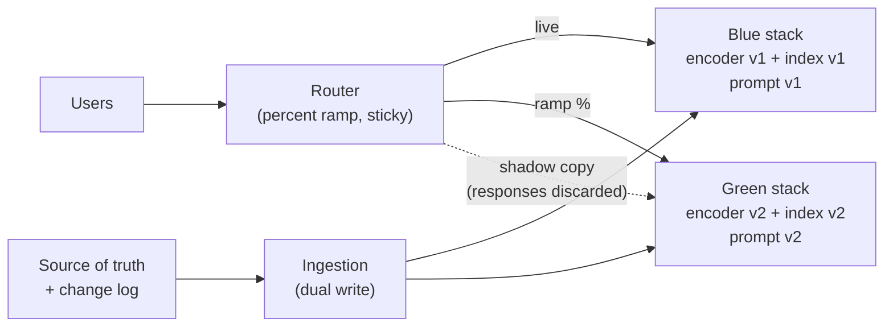

Blue-green deployment is the technique of running two complete copies of a system, one serving users (blue) and one idle or under test (green), and switching traffic between them by changing a single reference. The old version is never modified; it is simply left alone and ready. For ordinary web services this gives zero-downtime releases and instant rollback. For a RAG system it is more valuable than usual, because the thing being released is not just code but a pairing of a query encoder, an index, prompts and generation settings that must change together or not at all.

This lesson shows how to apply blue-green to RAG: what counts as one "colour", how to prove the green stack is good before it sees users (shadow traffic, golden queries), how to shift traffic gradually and stickily, what stays shared between the two stacks (and what must not), and how to retire the loser. The rollback procedure is in [Rollbacks](/learn/ci-cd-and-mlops/rollbacks) and the rebuild that creates the green index in [Reindexing](/learn/ci-cd-and-mlops/reindexing); this lesson ties them into a release.

## Learning objectives

- Define a RAG "stack" as a unit of release and list what it must contain for blue and green to be independent.
- Compare blue-green, canary and shadow deployment, and choose among them for a given change.
- Implement a deterministic, sticky percentage ramp between two stacks and a cutover that is one reference change.
- Design the pre-switch gate: shadow comparison, golden-set regression checks and health checks.
- Identify the state that blue and green must share, and the problems that sharing it causes.

## Prerequisites

- [Rollbacks](/learn/ci-cd-and-mlops/rollbacks): preflight checks, catch-up and rollback windows.
- [Index versioning](/learn/ci-cd-and-mlops/index-versioning): manifests and the embedding-space contract.
- [A/B testing](/learn/testing-and-benchmarking/a-b-testing): deterministic assignment and sample ratio checks.
- [Kubernetes fundamentals](/learn/deployment/kubernetes-fundamentals): readiness probes and rolling updates, which blue-green builds on.

## Why this matters

The default way to release software is a **rolling update**: replace instances one at a time until all run the new version. That works when old and new versions are interchangeable, and fails for a RAG system exactly where it matters. During a rolling update of a query service that changes the embedding model, some replicas encode queries with the old model and some with the new, while the index is in one space or the other. For the duration of the rollout a share of queries is answered by a mismatched encoder, quietly, with no errors. There is no safe order in which to roll.

Blue-green avoids this by never mixing. All of blue is consistent; all of green is consistent; a user is on one or the other. It also changes what a bad release costs. If green turns out to be bad, the remedy is to point back at blue, which has been running unchanged all along, rather than to rebuild or redeploy anything.

The price is real: two full stacks cost roughly double while both exist, and the technique does not remove the need to test; it moves testing to before the switch, on the real infrastructure.

## The intuition

A restaurant is replacing its kitchen. The disruptive way is to rip out equipment station by station while serving dinner: the sauce station is new, the grill is old, and nothing quite works together. The blue-green way is to build the new kitchen next door. Cook the same orders in both for a week, with the new kitchen's plates going into the bin, and compare them. Then send a few tables to the new kitchen, then more, then all. If the new kitchen has a problem at any point, you stop sending tables there, and the old kitchen, which never closed, takes over at once. When you are sure, you shut the old kitchen down, but not before.

## How it works

### A stack is the unit of release

For blue and green to be independent, a **stack** must contain everything that can differ between releases, bundled so it is deployed, tested and switched as one:

- the **query encoder** (model, pinned revision, prefixes) and its configuration;
- the **index** the encoder is paired with (collection, built from a specific manifest);
- the **retrieval and reranking configuration** (top-k, filters, reranker model);
- the **prompt templates and generation settings**, since they may assume a chunk format;
- the application code that wires these together.

If any of these is shared between colours, a change to the shared part is a change to both, and you have lost your safety net. The [index versioning](/learn/ci-cd-and-mlops/index-versioning) manifest is what lets you assert that a stack is self-consistent: its space ID must equal the space ID the stack's encoder computes.

What *is* shared, deliberately: the **source of truth** and its change log, the **user-facing API** and the **router** that decides which stack serves a request. Ingestion must keep both indexes current while both are in play (the dual-write discipline from [Index updates](/learn/advanced-vector-database-engineering/index-updates)); otherwise green starts stale and blue becomes a stale rollback target the moment green goes live.



### Blue-green, canary and shadow

These three are often confused. They are tools for different questions.

| Technique | What users see | Question it answers | Cost |
| --- | --- | --- | --- |
| **Shadow** | Nothing: requests are duplicated to green and its responses discarded | Does green behave sanely on real traffic? How different is it? | Double compute for the sampled traffic |
| **Canary** | A small percentage are served by green | Do real users get worse outcomes on green? | Real users exposed to any defect |
| **Blue-green** | All users move at once (or after ramp) | Can I switch, and switch back, instantly? | Two full stacks |

They compose. A sound release uses shadow to learn how green behaves with no user risk, a small canary to check real outcomes, then a cutover with the blue stack kept warm. Strictly, "blue-green" names the two-environment structure and instant switch; the gradual ramp is what you get by combining it with canary.

Shadow has a RAG-specific limit. It compares *retrieval* well (top-k overlap, scores, latency) and *generation* only roughly, because comparing two free-text answers needs a judge. A shadow run that compares retrieval deterministically and samples a few hundred answers for an LLM judge ([LLM-as-a-judge](/learn/testing-and-benchmarking/llm-as-a-judge)) is a practical compromise. Shadowing also doubles load on shared dependencies: if both stacks call the same generation API, shadow generation costs real money and consumes rate limit, so shadow retrieval for all sampled requests and generation for a small fraction.

### The pre-switch gate

Before any user reaches green, a gate decides whether the ramp may start. A useful gate has four layers.

1. **Health**: green is ready, its guard passes (encoder space matches index space), and it answers a synthetic probe within the latency budget.
2. **Golden set**: no golden query that passed on blue fails on green. Look at *regressions per query*, not only the average, for the reasons in [Regression testing](/learn/testing-and-benchmarking/regression-testing). Critical queries (those you have designated must never fail) are a hard stop.
3. **Shadow comparison**: on a sample of real queries, retrieval overlap and score distributions are within expected bounds. Low overlap is acceptable for a better model; a collapsing top-1 score distribution or a rising empty-result rate is not.
4. **Capacity**: green can handle the traffic it is about to receive; cold caches and under-provisioned replicas are the commonest cause of a slow cutover.

A failed gate blocks the ramp unless a named human accepts the specific regression. That sign-off should be recorded, as it is a deliberate risk decision.

### Ramping traffic

The router sends a percentage of users to green. Two details decide whether the ramp is trustworthy.

**Deterministic and sticky.** Assign a user to a bucket by hashing a stable identifier with a salt specific to this rollout, and compare the bucket (0 to 99) with the current percentage. A user in bucket 7 is on green from 8% upwards, always. Randomising per request would flip a user between versions mid-conversation, and would make follow-up questions (which depend on earlier answers) inconsistent. Stickiness also gives the monotonic property: raising the percentage only *adds* users to green, never moves a user back, so comparisons across ramp steps are clean. The same assignment technique, and its pitfalls such as sample ratio mismatch, are covered in [A/B testing](/learn/testing-and-benchmarking/a-b-testing).

**Hold at each step long enough to see.** Ramp in steps (for instance 5, 25, 50, 100 per cent), and hold each until the metrics you decided in advance have enough data to detect a problem of the size you care about. A 5 per cent canary on a service with 40 queries an hour sees two queries an hour; it cannot detect anything for a day. The ramp schedule should be derived from traffic, not from a calendar convention.

At each step, compare green against blue *over the same window* (they face the same time-of-day load), on the same metrics: error rate, latency percentiles, empty-answer rate, top-1 similarity, user feedback and judged answer quality. Automatic abort on a threshold breach is preferable to a human watching a dashboard.

### Cutover and the standby

The cutover is the point at which green becomes the live stack. In implementation terms it is a single reference change: a router variable, a Kubernetes Service selector, a load-balancer target, or a vector-database alias. It must be **atomic**, so no request sees a half-switched state, and it must be **reversible by the same mechanism**, so the rollback is the same operation in the other direction.

After cutover, blue becomes the standby. This is the **rollback window** from [Rollbacks](/learn/ci-cd-and-mlops/rollbacks): blue must stay warm (running or quickly startable), current (still receiving ingestion writes, or replayable from the change log), and unmodified. Only after the window, and a clean bill of health from green, is blue decommissioned, and its index deleted subject to the retention and erasure points in [Index versioning](/learn/ci-cd-and-mlops/index-versioning).

### Where the colour switch lives

There are several places to switch, with different strengths.

- **Router or API gateway.** Supports percentage ramps, stickiness and shadowing; the most flexible, and the place for RAG-aware logic.
- **Kubernetes.** Two Deployments with a Service selector (or an ingress or service-mesh weighting) gives blue-green; check your platform's documentation for traffic-splitting features.
- **Vector-database alias.** Flips only the index; correct only when the encoder and prompts do not change with it (a minor or patch change in versioning terms).
- **Feature flag.** A runtime flag read per request chooses the stack; fast to change and easy to ramp, but a flag service becomes a dependency of the query path.

A major change (new embedding space) needs a switch that moves the encoder and index together, which means the router or Kubernetes level, not the alias alone.

### Shared state and database migrations

Two stacks sharing one stateful dependency is the classic blue-green trap. In RAG the shared state is usually: the conversation store, caches, the user-feedback table and any semantic cache.

- A **semantic cache** keyed by query embedding must be namespaced by embedding space (or by stack). A cache entry created by green's encoder, served by blue, is a hit in the wrong space.
- A **response cache** keyed by query text may serve blue's answers to green users and vice versa, hiding the very differences you are testing; namespace it by stack during the ramp.
- Any **schema** change to a shared store must be backward compatible with both stacks (add columns, do not rename or drop) until the old stack is retired.

## The mathematics

### How long to hold each ramp step

A ramp step is a small experiment: with $n$ users on green, can you detect that its failure rate is higher than blue's? For a rate near $p$, the number of observations needed per arm to detect an increase of $\delta$ (at conventional significance and power) is roughly

$$
n \approx \frac{(z_{\alpha} + z_{\beta})^2 \cdot 2\,p(1-p)}{\delta^2}
$$

where $z_\alpha$ and $z_\beta$ are the standard normal quantiles for the significance and power you choose (about 1.64 and 0.84 for a one-sided test at 5% significance and 80% power), $p$ is the baseline rate and $\delta$ the smallest increase you care to catch. The derivation is in [A/B testing](/learn/testing-and-benchmarking/a-b-testing).

Worked by hand: baseline empty-answer rate $p = 0.05$ and you want to catch an increase of $\delta = 0.02$. Then $(1.64 + 0.84)^2 = 6.15$, $2p(1-p) = 0.095$, so $n \approx 6.15 \times 0.095 / 0.0004 \approx 1{,}460$ queries on green. At 5 per cent of 40 queries per hour that is 2 queries per hour on green, so the step must run for about $1{,}460 / 2 = 730$ hours: a month. At 25 per cent (10 queries per hour) it is about 146 hours, six days. The arithmetic says that a low-traffic assistant cannot use a small-percentage canary to detect small regressions; it must rely on golden sets, shadow comparison and judged samples instead.

```python
z = 1.64 + 0.84
p, delta = 0.05, 0.02
n = z**2 * 2 * p * (1 - p) / delta**2
for pct, qph in ((5, 40), (25, 40), (50, 40)):
    print(f"{pct:>2}% of {qph}/h -> {pct / 100 * qph:>4.0f} queries/h on green; need {n:,.0f} -> {n / (pct / 100 * qph):,.0f} h")
```

```output
 5% of 40/h ->    2 queries/h on green; need 1,461 -> 730 h
25% of 40/h ->   10 queries/h on green; need 1,461 -> 146 h
50% of 40/h ->   20 queries/h on green; need 1,461 -> 73 h
```

## In code

**The problem.** Model a blue-green release of AskMeridian's retrieval stack. Blue is MiniLM with its index; green is BGE-small with its own index and query prefix. Each is a `Stack` that bundles encoder and collection, so they cannot be mixed. Run a shadow comparison, a golden-set gate, a sticky percentage ramp over 10,000 simulated users, a cutover and an instant rollback.

Everything runs offline against in-memory Qdrant and cached models. Real routers, Kubernetes services and flag systems are not exercised; the code shows the logic those systems implement.

```bash
pip install sentence-transformers qdrant-client
```

```python
import os, hashlib, time
os.environ["HF_HUB_OFFLINE"] = "1"
from dataclasses import dataclass
from sentence_transformers import SentenceTransformer
from qdrant_client import QdrantClient, models

DOCS = {
    "hb-leave": "Annual leave is 25 days; up to 5 unused days carry over and must be used by 31 March.",
    "hb-remote": "Staff may work remotely up to 3 days a week; the home-office equipment budget is £400.",
    "hb-expenses": "Expenses must be submitted within 30 days; anything over £75 needs a receipt.",
    "it-password": "Passwords must be rotated every 90 days.",
    "it-vpn": "The VPN is required whenever you work on public Wi-Fi.",
    "it-laptop": "Laptops are refreshed every 3 years.",
    "it-desk": "The support desk is open 08:00 to 18:00 UK time.",
    "it-e4021": "Error E-4021 means the VPN client is out of date; update it from the IT portal.",
}
GOLDEN = [("How many holiday days do I get?", "hb-leave"),
          ("When can I phone the help desk?", "it-desk"),
          ("Do I need a receipt for a taxi?", "hb-expenses"),
          ("How often do I have to change my password?", "it-password"),
          ("What does error E-4021 mean?", "it-e4021"),
          ("Can I work from home on Fridays?", "hb-remote"),
          ("How much can I spend on a home office chair?", "hb-remote"),
          ("Is the VPN needed in a cafe?", "it-vpn")]

client = QdrantClient(":memory:")

@dataclass
class Stack:
    """One complete, self-consistent environment: encoder + collection travel together."""
    name: str
    model: SentenceTransformer
    query_prefix: str
    collection: str

    def search(self, q, k=3):
        v = self.model.encode(self.query_prefix + q, normalize_embeddings=True).tolist()
        return [p.payload["doc"] for p in client.query_points(self.collection, query=v, limit=k).points]

def make_stack(name, model_id, query_prefix=""):
    m = SentenceTransformer(model_id)
    coll = f"askmeridian_{name}"
    client.create_collection(coll, vectors_config=models.VectorParams(
        size=m.get_embedding_dimension(), distance=models.Distance.COSINE))
    vecs = m.encode(list(DOCS.values()), normalize_embeddings=True)
    client.upsert(coll, [models.PointStruct(id=i, vector=v.tolist(), payload={"doc": d})
                         for i, (d, v) in enumerate(zip(DOCS, vecs))])
    return Stack(name, m, query_prefix, coll)

blue = make_stack("blue", "sentence-transformers/all-MiniLM-L6-v2")
green = make_stack("green", "BAAI/bge-small-en-v1.5", "Represent this sentence for searching relevant passages: ")

class Router:
    def __init__(self, live, candidate=None):
        self.live, self.candidate, self.percent = live, candidate, 0
    def bucket(self, user_id):                       # sticky: same user, same bucket, every time
        return int(hashlib.sha256(f"ramp-1:{user_id}".encode()).hexdigest(), 16) % 100
    def stack_for(self, user_id):
        if self.candidate and self.bucket(user_id) < self.percent:
            return self.candidate
        return self.live
    def cutover(self):                               # the atomic switch is one reference change
        self.live, self.candidate, self.percent = self.candidate, self.live, 0
    def rollback(self):
        self.cutover()                               # the old stack is still warm and current

# 1. Shadow: run every golden query on both stacks, serve only blue, compare.
agree = sum(blue.search(q)[0] == green.search(q)[0] for q, _ in GOLDEN)
print(f"shadow: top-1 agreement blue vs green {agree}/{len(GOLDEN)}")
hits = lambda s: sum(s.search(q)[0] == g for q, g in GOLDEN)
print(f"gate input: golden top-1 blue {hits(blue)}/{len(GOLDEN)}, green {hits(green)}/{len(GOLDEN)}")

# 2. Gate: no golden query may regress. A failure blocks the ramp unless a human signs off.
regressed = [q for q, g in GOLDEN if blue.search(q)[0] == g and green.search(q)[0] != g]
print("regressed on green:", regressed)
GATE_OK = not regressed
SIGNED_OFF = True        # stands in for a reviewer accepting this one regression (for the demo)
router = Router(blue, green)
print("gate passed:", GATE_OK, "| ramp allowed:", GATE_OK or SIGNED_OFF)
users = [f"user-{i}" for i in range(10_000)]
for pct in (5, 25, 100):
    router.percent = pct
    served = sum(router.stack_for(u) is green for u in users)
    print(f"ramp {pct:>3}%: {served:>5} of {len(users):,} users on green ({served / len(users):.1%})")
router.percent = 25
before = {u: router.stack_for(u).name for u in users[:2000]}
router.percent = 100
print("users on green at 25% still on green at 100%:",
      all(router.stack_for(u).name == "green" for u, n in before.items() if n == "green"))

# 3. Cut over, then roll back instantly.
router.cutover(); print("after cutover  live:", router.live.name, "| standby:", router.candidate.name)
t0 = time.perf_counter(); router.rollback(); dt = (time.perf_counter() - t0) * 1000
print(f"after rollback live: {router.live.name} (switch took {dt:.3f} ms; no rebuild)")
```

```output
shadow: top-1 agreement blue vs green 7/8
gate input: golden top-1 blue 8/8, green 7/8
regressed on green: ['Can I work from home on Fridays?']
gate passed: False | ramp allowed: True
ramp   5%:   518 of 10,000 users on green (5.2%)
ramp  25%:  2500 of 10,000 users on green (25.0%)
ramp 100%: 10000 of 10,000 users on green (100.0%)
users on green at 25% still on green at 100%: True
after cutover  live: green | standby: blue
after rollback live: blue (switch took 0.002 ms; no rebuild)
```

**The important lines.**

- `Stack` is a dataclass holding the encoder, its query prefix and its collection name. Its `search` method always uses its own encoder against its own collection, which is what makes mixing impossible by construction.
- `Router.bucket` hashes the user ID with a rollout-specific salt (`ramp-1`) into 0 to 99. `stack_for` compares that bucket with `percent`, so assignment is deterministic and monotonic.
- `cutover` swaps two references; `rollback` is the same call, because the old stack still exists and is current.
- The gate looks at *per-query regressions* (`regressed`) rather than a single average.

**What the output means.** In shadow, blue and green agree on the top result for 7 of 8 golden queries. Scored against the expected documents, blue gets 8 of 8 and green 7 of 8: green regressed on "Can I work from home on Fridays?". The gate therefore fails. In a real release this blocks the ramp until someone looks at the query, decides what the regression means (here, plausibly a model that matches "work from home" to something other than the remote-work policy) and either fixes it or signs off, recorded. The script uses `SIGNED_OFF = True` as a stand-in for that decision so the rest can be shown; it does *not* mean the regression is acceptable. This is a reminder that eight queries is a toy gate, and that a model with higher average quality can still lose a query that matters.

The ramp then assigns about 5, 25 and 100 per cent of users (the first is 5.2 per cent, because hashing is not exact). Users on green at 25 per cent are still on green at 100 per cent, which is the stickiness and monotonicity property. After cutover, blue is the standby; the rollback switches back in a fraction of a millisecond because nothing is rebuilt. That speed is the entire argument for keeping blue warm.

**Errors you may hit.** If you forget to dual-write, green and blue answer from different corpora and every comparison is contaminated; check parity first. If the percentage ramp is based on `random()` per request instead of a hash, users flip between stacks and the "stickiness" check will fail.

**Extending it.** Add a health probe to `Router.stack_for` that falls back to blue if green's guard fails; log which stack served each request so metrics can be compared by stack; shadow a sample of production queries instead of the golden set; and namespace the cache key by `Stack.name`.

## A real-world example

Meridian's Platform team upgrades AskMeridian from MiniLM to a larger embedding model. Because this is a major change in the index-versioning sense, they cannot use an alias flip alone, and a rolling update of the query service would mix encoders.

They build a green stack in the same cluster: the new encoder, a collection built by a [reindexing](/learn/ci-cd-and-mlops/reindexing) job and verified by its manifest, a prompt unchanged from blue, and its own cache namespace. Ingestion dual-writes to both indexes from the moment the build started. The gate runs: green is ready, its start-up guard passes, and the golden set shows no critical regressions. Shadow traffic then runs for two days at 20 per cent of queries; retrieval overlap is moderate and top-1 scores are healthy, and an LLM judge scores 300 sampled answers.

They then ramp: 5 per cent for a day, 25 per cent for three days (traffic is low, and the calculation above shows why holding for longer matters), 100 per cent on day six. After the cutover they keep blue for two weeks as the standby, still receiving ingestion writes. Nothing goes wrong, and on day 20 blue is retired and its collection deleted, with the registry row and manifest retained.

## Common mistakes

- **Sharing the index or encoder between blue and green.** A shared piece makes a change to it a change to both, and removes the isolation that blue-green exists to provide.
- **Rolling update of an encoder change.** Replicas disagree about the vector space during the rollout; blue-green avoids that.
- **Not dual-writing to the idle stack.** Green launches stale, and blue becomes stale as soon as green is live, which undermines rollback.
- **Per-request random assignment.** Users flip between versions within a conversation and metrics lose their meaning; hash a stable ID.
- **Ramp steps with no statistical power.** A 5 per cent canary on low traffic cannot detect anything for weeks; the team then sees "no problems" and mistakes it for "no regression".
- **Shared caches across stacks.** Cached answers or embeddings from one stack are served by the other, hiding differences or serving wrong-space vectors.
- **Decommissioning blue immediately.** The rollback window is zero.
- **Calling a gate pass "safe" on average metrics.** A per-query regression on a critical query can hide inside an improved mean.

## Best practices

- Define a stack as encoder plus index plus retrieval config plus prompts plus code, deployed and switched as a unit, and assert self-consistency through the manifest.
- Dual-write ingestion to both indexes from the start of the build until blue is retired.
- Gate on health, golden-set regressions per query, shadow comparison and capacity before any user is exposed.
- Assign users to green with a salted hash of a stable ID, ramp monotonically, and size each step from traffic and the effect size you need to detect.
- Make cutover and rollback one atomic, symmetric reference change, and keep blue warm for a window set by detection time.
- Namespace caches and other shared state by stack, and keep shared schemas backward compatible until the old stack is gone.

## Performance considerations

**Cost.** Two full stacks cost roughly twice as much while both exist. The expensive parts are index memory and GPU or API capacity for the encoder. For a short release window this is acceptable; for a long one, scale blue down once the ramp completes (if your rollback plan can tolerate a scale-up delay), or keep it fully warm and treat the cost as the price of instant rollback.

**Shadow load.** Shadowing duplicates retrieval work for the sampled traffic; the cost is the sampled fraction times the per-request retrieval cost. Do not shadow generation for all traffic unless you accept the token bill; sample.

**Cold start.** A freshly started green stack has empty caches and unmapped index segments. Warm it with the golden and shadow traffic before the ramp so users do not pay for it.

**Latency during the ramp.** Compare p50 and p95 latency per stack at each step; a larger embedding model raises encoder latency, and its effect on the end-to-end budget should be calculated before the release, not discovered during it.

## Security considerations

- **Both stacks must enforce the same access control.** A new stack that omits a permission filter exposes data to the users routed to it. Test access control as a gate item, not an assumption.
- **Shadow traffic copies user queries.** Duplicated requests carry user data into a stack that is not yet live; apply the same logging, retention and redaction rules to shadow stacks.
- **The router is a high-value target.** Whoever can change the percentage or the cutover decides what users see; restrict, audit and log changes.
- **Green is a new attack surface.** A new model, a new prompt or a new reranker can change how the system responds to prompt injection in documents; include injection tests in the gate.

## Summary

- Blue-green runs two complete, self-consistent stacks and switches between them by one atomic reference change, avoiding the mixed-version states that a rolling update creates for encoder changes.
- A stack bundles encoder, index, retrieval settings, prompts and code; the source of truth, ingestion and router are the shared parts.
- Shadow, canary and blue-green answer different questions and are best combined: shadow for behaviour, canary for outcomes, blue-green for instant switch and rollback.
- Gate the release on health, per-query golden regressions, shadow comparison and capacity; ramp deterministically and stickily, with each step sized for statistical power.
- Keep blue warm and current for a rollback window, namespace shared caches by stack, and decommission only after the window.

## Exercises

**1.** For each change, say whether an alias flip is enough or a full blue-green stack switch is needed: (a) a new HNSW `m`; (b) a new embedding model of the same dimension; (c) a new chunker; (d) a new system prompt that expects chunk titles in a new format.

<details><summary>Show solution</summary>

(a) **Alias flip**: same vectors, queries unaffected. (b) **Stack switch**: the query encoder must change with the index. (c) **Alias flip** is enough for the retrieval side if the space is unchanged, but if the prompt depends on the chunk format, switch the stack. (d) **Stack switch** (or at least an application release coupled to the index), since the prompt and the chunks must match; the alias alone would pair new chunks with an old prompt or the reverse.

</details>

**2.** Using the formula in this lesson, how many queries are needed on green to detect a rise in the no-answer rate from 8 per cent to 10 per cent? At 100 queries per hour, how long must a 10 per cent canary run?

<details><summary>Show solution</summary>

$p = 0.08$, $\delta = 0.02$: $n \approx 6.15 \times 2 \times 0.08 \times 0.92 / 0.0004 \approx 6.15 \times 0.1472 / 0.0004 \approx 2{,}263$. A 10 per cent canary sees 10 queries per hour, so about 226 hours, nine to ten days. Use a larger step or more traffic, or rely on other signals.

</details>

**3.** Why must a response cache be namespaced by stack during a ramp, and what would you key it on?

<details><summary>Show solution</summary>

Otherwise an answer generated by one stack can be served to users on the other, so green's users may see blue's answers (hiding regressions or improvements) and the measured metrics blend the two stacks. Key the cache on the stack identity (for example the index version from the manifest plus the prompt version) as well as the normalised query. For a semantic cache keyed by embedding, the embedding space is part of the key.

</details>

**4.** Write a pre-cutover checklist for a blue-green release of AskMeridian, with at least six items and what evidence satisfies each.

<details><summary>Show solution</summary>

(1) Green manifest recorded and space ID equals encoder space ID (guard output). (2) Parity check: nothing missing, extra or stale versus the source of truth (parity report). (3) Golden set: zero regressions on critical queries, regressions listed and reviewed on the rest (per-query diff). (4) Shadow: overlap and top-1 score distribution within agreed bounds on a sample of real queries (report). (5) Access control tests pass on green (test run). (6) Capacity and latency: p95 within budget under a load test at expected peak (load-test results). (7) Dual-write confirmed to both indexes and blue's `applied_seq` current (registry). (8) Rollback rehearsed: the switch back was run in staging (log). (9) Triggers and owners for the ramp defined (runbook).

</details>

## Check your understanding

```quiz
[
  {
    "q": "Why is a rolling update unsafe when a release changes the embedding model?",
    "options": [
      "Rolling updates are always slower",
      "During the rollout some replicas encode queries with the old model and some with the new, so a share of queries is answered in the wrong vector space",
      "Kubernetes cannot roll out new container images",
      "The vector database rejects mixed traffic"
    ],
    "answer": 1,
    "why": "There is no safe order of replacement: at any moment some queries use an encoder that does not match the index they hit, and nothing raises an error."
  },
  {
    "q": "What does shadow traffic do?",
    "options": [
      "Serves a small percentage of users from the new stack",
      "Duplicates requests to the new stack and discards its responses, so behaviour can be compared with no user risk",
      "Replaces the old stack gradually",
      "Caches responses between stacks"
    ],
    "answer": 1,
    "why": "Shadowing exposes no user to the new stack, which is why it complements a canary, where real users see the new stack's answers."
  },
  {
    "q": "Why should user assignment to green use a salted hash of a stable ID instead of a random draw per request?",
    "options": [
      "Hashing is faster than random numbers",
      "So that a user stays on the same stack, and raising the percentage only adds users to green",
      "Because random numbers cannot be seeded",
      "Because Qdrant requires hashed IDs"
    ],
    "answer": 1,
    "why": "Stickiness keeps conversations consistent and makes comparisons across ramp steps clean; a per-request draw flips users between versions."
  },
  {
    "q": "A 5% canary on a service with 40 queries an hour needs about 1,500 queries on green to detect a 2-point rise in a 5% failure rate. Roughly how long does the step take?",
    "options": [
      "About 3 hours",
      "About a day",
      "About a month",
      "It cannot be estimated"
    ],
    "answer": 2,
    "why": "5% of 40 is 2 queries per hour, so 1,461 queries take about 730 hours. Low-traffic services need larger steps or other evidence."
  },
  {
    "q": "Which statement about caches during a blue-green ramp is correct?",
    "options": [
      "A shared response cache speeds up the ramp and has no downsides",
      "Caches should be namespaced by stack or embedding space so one stack does not serve the other's entries",
      "Caches should be disabled permanently",
      "Only semantic caches need namespacing, never response caches"
    ],
    "answer": 1,
    "why": "Shared caches hide differences between stacks and a semantic cache entry from a different embedding space is a wrong-space hit."
  }
]
```

## Further reading

- Martin Fowler, [BlueGreenDeployment](https://martinfowler.com/bliki/BlueGreenDeployment.html), bliki: the original short description of the pattern.
- Humble and Farley (2010), *Continuous Delivery*, Addison-Wesley: blue-green deployments and canary releases in deployment pipelines.
- Kubernetes documentation, [kubernetes.io/docs](https://kubernetes.io/docs/home/): Deployments, Services and rolling updates.
- Kohavi, Tang and Xu (2020), *Trustworthy Online Controlled Experiments*, Cambridge University Press: assignment, ramp-up and sample ratio mismatch.
- Qdrant documentation, [Collections](https://qdrant.tech/documentation/concepts/collections/): aliases for switching indexes.
