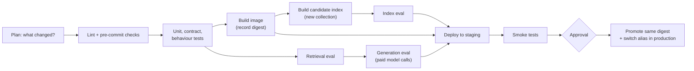

A **CI/CD pipeline** is the automated route a change takes from a pull request to production: a sequence of jobs that build the software, test it, evaluate it and deploy it, each one gating the next. The previous two lessons supplied the ingredients, a [Git workflow](/learn/ci-cd-and-mlops/git-workflows) in which every change arrives as a pull request and [automated tests](/learn/ci-cd-and-mlops/automated-testing) that check the code in seconds. This lesson assembles them into a pipeline for a RAG service.

A RAG pipeline differs from an ordinary web service's in three ways. Some of its checks are expensive (an evaluation run calls a paid model hundreds of times), so it must choose which checks a change actually needs. Some changes require rebuilding data, not just code (a new embedding model means a new index). And the thing being promoted to production is not one artefact but a set that must stay consistent: an image, a model version, an index version and a prompt version. You will build a planner that decides which jobs a change triggers and how long the pipeline takes, work out what evaluation in CI costs, and read a GitHub Actions workflow that implements the design.

## Learning objectives

- Distinguish continuous integration, continuous delivery and continuous deployment, and say which a given RAG team should adopt.
- Design a pipeline for a RAG service whose jobs are selected by what changed, and compute its wall-clock time from the critical path.
- Estimate the monthly cost of running generation evaluation in CI and choose triggers that keep it within budget.
- Explain "build once, promote the same artefact" and list the versioned components a RAG release must pin together.
- Configure secrets, approvals and permissions so that untrusted pull requests cannot reach production credentials.

## Prerequisites

- [Automated testing](/learn/ci-cd-and-mlops/automated-testing): the fast test tiers this pipeline runs first.
- [Regression testing](/learn/testing-and-benchmarking/regression-testing): the evaluation gate this pipeline runs on quality-affecting changes.
- [Docker](/learn/deployment/docker): images, tags and digests, which the pipeline builds and promotes.
- [Collections](/learn/advanced-vector-database-engineering/collections): versioned collections and aliases, which an index-building job produces.

## Why this matters

A team without a pipeline still deploys; it just does so by hand. Someone runs the tests locally (or forgets), builds an image on their laptop (with whatever is in their working directory), and pushes it. Each step is a chance to skip a check, ship an untested build or deploy a different artefact from the one that was tested. In a RAG system the hand process has a further gap: the embedding model in production and the model that built the index can drift apart, because they are deployed by different people at different times.

The opposite failure is a pipeline that runs everything on every change. A README typo waits forty minutes for an index rebuild; every pull request spends money on a full generation evaluation; developers batch changes to avoid the wait, which brings back the big, unattributable pull requests that [Git workflows](/learn/ci-cd-and-mlops/git-workflows) warned against. A RAG pipeline earns its keep by running **the right checks for each change, in parallel where possible, and promoting exactly what it tested**.

## The intuition

Think of an airport. Every passenger goes through the same security check, which is quick and catches the common problems. After that, the route depends on where you are going: a domestic passenger walks to the gate, an international one also passes passport control, and someone carrying unusual cargo goes through a separate inspection that takes an hour. Nobody sends every passenger through every check, and nobody lets a passenger who skipped security onto any plane.

A RAG pipeline routes changes the same way. Every change goes through lint and unit tests. A prompt change also goes through generation evaluation; a model change also goes through an index rebuild and index evaluation; a typo in the documentation goes straight to the gate. And the boarding pass, the artefact that reaches production, is issued once, after the checks, and cannot be swapped on the way to the plane.

## How it works

### Three terms

- **Continuous integration (CI)**: every change is merged into the main branch frequently, and each merge (and each pull request) is automatically built and tested. The goal is that `main` is always in a working state.
- **Continuous delivery (CD)**: every change that passes the pipeline produces a release candidate that *could* be deployed to production at the press of a button. A person still decides when.
- **Continuous deployment**: every change that passes the pipeline is deployed to production automatically, with no human step.

Most RAG teams should practise continuous delivery, with an approval step before production. The reason is that the evaluation gate measures quality on a golden set, which is a sample: a change can pass the gate and still degrade answers on questions the set does not cover. A short human look at the newly failing items, and a staged rollout, are cheap insurance. Continuous deployment becomes reasonable for low-risk change types (code changes with no effect on retrieval or prompts) once the team trusts its gates.

### What a RAG release contains

A conventional service release is one artefact, a container image. A RAG release is a **consistent set**:

| Component | Identified by | Changes when |
| --- | --- | --- |
| Application image | Image digest (`sha256:…`) | Code or dependencies change |
| Prompt set | Prompt version, inside the image or a config store | Prompt files change |
| Embedding model | Model name and pinned revision | `config/models.yaml` changes |
| Index | Versioned collection name behind an alias | The embedding model, chunker or corpus changes |
| LLM | Model identifier | `config/models.yaml` changes |
| Golden set and baseline | Golden-set version and baseline results | Evaluation data changes |

The pipeline's job is to make sure these are tested **together** and promoted **together**. The most dangerous mismatch is between the query-side embedding model (in the image) and the index (built by a separate job): a new image that embeds queries with a new model, pointed at an index built with the old one, returns nonsense without raising a single error. [Model versioning](/learn/ci-cd-and-mlops/model-versioning) shows a check that catches this at start-up; the pipeline prevents it earlier by building and evaluating the new index before the new image is allowed to deploy.

### Stages



1. **Plan.** Compute the list of changed files against the target branch and decide which jobs run. Cheap, and it saves most of the cost.
2. **Lint and static checks.** Formatting, type checks and the pre-commit guard from [Git workflows](/learn/ci-cd-and-mlops/git-workflows), rerun here because local hooks can be skipped.
3. **Fast tests.** Unit, contract and behaviour tests, with no network and no secrets.
4. **Build the image** once, tag it with the commit hash, push it to a registry and record its digest.
5. **Evaluation.** Retrieval evaluation (cheap, deterministic) for anything that affects retrieval; generation evaluation (paid, slower) for prompt, LLM and retrieval changes; both compared with the stored baseline using the gate from [Regression testing](/learn/testing-and-benchmarking/regression-testing).
6. **Index jobs**, only for structural changes: build a new versioned collection with the new model or chunker, then run retrieval evaluation against that collection. The procedure itself is the subject of [Reindexing](/learn/ci-cd-and-mlops/reindexing).
7. **Deploy to staging** the exact digest that was tested, with the candidate index if there is one, and run smoke tests: the service starts, health checks pass, five known questions return the expected documents.
8. **Approval and promotion.** A person reviews the evaluation report and approves; the pipeline deploys the same digest to production and, if there is a new index, switches the alias. The rollout strategy is the subject of [Blue-green deployments](/learn/ci-cd-and-mlops/blue-green-deployments), and undoing it of [Rollbacks](/learn/ci-cd-and-mlops/rollbacks).

### Triggers

A pipeline runs in response to events. Four matter for RAG:

- **Pull request**: plan, lint, tests and the evaluations the change needs. No deployment, and (for safety, below) no production secrets.
- **Merge to `main`**: the same checks again on the merged result, then build, deploy to staging and wait for approval.
- **Schedule**: a nightly run of the full evaluation catches changes nobody committed, such as a hosted model updated behind an alias or a document re-ingested with a parsing bug.
- **Data change**: a new corpus version from the ingestion pipeline. Corpus updates do not go through code review, but a new index built from them should still pass index evaluation before an alias moves. This is often a separate pipeline owned by the same team.

### Build once, promote the same artefact

A rule from Humble and Farley's *Continuous Delivery* (2010) matters doubly for RAG: **build the artefact once and promote that exact artefact** through every environment. Rebuilding for production, even from the same commit, can pull a newer base image, a newer transitive dependency or a newer model file if anything is unpinned. The tested thing and the deployed thing are then different. The pipeline records the image digest when it builds, and every later job refers to the digest, never to a tag that could be moved. The same applies to indexes: the collection that passed index evaluation is the collection the production alias points to; it is not rebuilt.

### Secrets, permissions and untrusted code

A CI pipeline executes the code in the pull request, so whoever can open a pull request can run code on your CI runners. Three controls follow:

1. **No secrets in pull-request jobs from forks.** GitHub Actions does not pass repository secrets to workflows triggered by `pull_request` from a fork, which is the safe default. The `pull_request_target` trigger does run with secrets and is dangerous if it checks out and runs the fork's code.
2. **Least-privilege tokens.** Set the workflow's default token permissions to read-only and grant write access per job where needed.
3. **Environments with protection rules.** A GitHub Actions **environment** (other platforms have equivalents) holds production secrets and can require named reviewers to approve before any job that uses it runs. Generation evaluation needs an LLM key, so it runs on pull requests from the main repository only, with a separate evaluation key that has a spending limit, never the production key.

Where the cloud provider supports it, prefer **OpenID Connect (OIDC)** federation, in which the CI job receives a short-lived cloud credential for one run, over long-lived access keys stored as secrets.

## The mathematics

### Wall-clock time and the critical path

**Intuition.** Jobs that do not depend on each other run in parallel, so a pipeline's duration is not the sum of its jobs. It is the length of the longest chain of jobs that must run one after another: the **critical path**. Shortening any job off that path changes nothing.

For each job $j$, its earliest finish time is

$$
F_j = d_j + \max_{i \in \text{needs}(j)} F_i
$$

where $d_j$ is the job's own duration, $\text{needs}(j)$ is the set of jobs it waits for, and the maximum over an empty set is 0. The pipeline's wall-clock time is the largest $F_j$. The serial time, if nothing ran in parallel, is $\sum_j d_j$.

**By hand.** A change to the retriever triggers lint (1 minute), unit tests (2), contract tests (3, needs unit), build image (6, needs unit), retrieval evaluation (8, needs unit), deploy to staging (5, needs the image and both test gates) and smoke tests (3).

- $F_{\text{lint}} = 1$; $F_{\text{unit}} = 2 + 1 = 3$.
- $F_{\text{contract}} = 3 + 3 = 6$; $F_{\text{image}} = 6 + 3 = 9$; $F_{\text{retrieval}} = 8 + 3 = 11$.
- $F_{\text{deploy}} = 5 + \max(9, 6, 11) = 16$; $F_{\text{smoke}} = 3 + 16 = 19$.

Wall clock 19 minutes against a serial total of 28. The critical path runs through retrieval evaluation, so making the image build faster would not shorten this pipeline at all; making retrieval evaluation faster would.

### What evaluation in CI costs

**Intuition.** Generation evaluation costs money per item per run, so its monthly cost is items × cost per item × runs. The number of runs is the lever.

$$
C_{\text{month}} = R \times N \times \left( \frac{T^{\text{in}} p^{\text{in}} + T^{\text{out}} p^{\text{out}}}{10^6} \right)
$$

$R$ is runs per month, $N$ is golden items per run, $T^{\text{in}}$ and $T^{\text{out}}$ are input and output tokens per item summed over the answer call and the judge call, and $p^{\text{in}}$, $p^{\text{out}}$ are prices per million tokens.

**By hand.** Assume, for illustration only, prices of 3 dollars per million input tokens and 15 per million output tokens (check your provider's current pricing). Each item makes an answer call (3,000 tokens in, 300 out) and a judge call (3,500 in, 100 out), so $T^{\text{in}} = 6{,}500$ and $T^{\text{out}} = 400$. Per item: $(6{,}500 \times 3 + 400 \times 15)/10^6 = (19{,}500 + 6{,}000)/10^6 = 0.0255$ dollars. With $N = 200$, one run costs 5.10 dollars. Nightly runs alone ($R = 30$) cost 153 dollars a month; adding 60 prompt-affecting pull requests makes it 459; running it on all 400 pull requests a month would cost about 2,190.

```python
# Assumed prices in dollars per million tokens: check your provider's current pricing page.
PRICE_IN, PRICE_OUT = 3.00, 15.00
items = 200
answer_in, answer_out = 3_000, 300      # tokens per answer call
judge_in, judge_out = 3_500, 100        # tokens per judge call

def cost(tok_in, tok_out):
    return tok_in * PRICE_IN / 1e6 + tok_out * PRICE_OUT / 1e6

per_item = cost(answer_in, answer_out) + cost(judge_in, judge_out)
per_run = items * per_item
print(f"per item: {per_item:.4f}   per run: {per_run:.2f}")
for runs, label in [(30, "nightly only"), (30 + 60, "nightly + 60 prompt PRs"), (30 + 400, "on every one of 400 PRs")]:
    print(f"{label:<26} {runs:>4} runs/month  {runs * per_run:8.2f} per month")
```

```output
per item: 0.0255   per run: 5.10
nightly only                 30 runs/month    153.00 per month
nightly + 60 prompt PRs      90 runs/month    459.00 per month
on every one of 400 PRs     430 runs/month   2193.00 per month
```

The factor of nearly five between the second and third lines is what change-based job selection buys. Caching (re-using results for items whose prompt, context and model are unchanged, as described in [Regression testing](/learn/testing-and-benchmarking/regression-testing)) cuts it further.

## In code

**The problem.** Given the files a pull request changes, decide which jobs AskMeridian's pipeline must run, add the jobs they depend on, and compute the wall-clock time and critical path. This is the "plan" job that runs first in the pipeline; its output decides which later jobs are skipped.

**Dependencies.** Python's standard library only (`graphlib` needs Python 3.9 or later).

```bash
python plan.py
```

```python
from fnmatch import fnmatch
from graphlib import TopologicalSorter

# job: (minutes, jobs it needs). Durations are this team's measured medians.
GATES = ["contract", "model_tests", "retrieval_eval", "generation_eval", "index_eval"]
JOBS = {
    "lint":            (1,  []),
    "unit":            (2,  ["lint"]),
    "contract":        (3,  ["unit"]),
    "build_image":     (6,  ["unit"]),
    "model_tests":     (5,  ["unit"]),
    "retrieval_eval":  (8,  ["unit"]),
    "generation_eval": (25, ["retrieval_eval"]),
    "build_index":     (40, ["build_image"]),
    "index_eval":      (10, ["build_index"]),
    "deploy_staging":  (5,  ["build_image"]),   # also waits for every selected gate (below)
    "smoke_staging":   (3,  ["deploy_staging"]),
}

# Which changed paths trigger which jobs. Every change gets "lint".
RULES = [
    ("docs/*",             []),
    ("tests/*",            ["unit", "contract"]),
    ("src/*",              ["unit", "contract", "retrieval_eval", "deploy_staging", "smoke_staging"]),
    ("prompts/*",          ["unit", "generation_eval", "deploy_staging", "smoke_staging"]),
    ("eval/golden/*",      ["retrieval_eval", "generation_eval"]),
    ("config/models.yaml", ["model_tests", "build_index", "index_eval", "retrieval_eval",
                            "generation_eval", "deploy_staging", "smoke_staging"]),
    ("uv.lock",            list(JOBS)),   # a dependency change can affect anything
]

def needs(job, wanted):
    # Hard dependencies, plus: deployment waits for whichever gates this change selected.
    extra = [g for g in GATES if g in wanted] if job == "deploy_staging" else []
    return JOBS[job][1] + extra

def plan(changed):
    wanted = {"lint"}
    for path in changed:
        for pattern, jobs in RULES:
            if fnmatch(path, pattern):
                wanted.update(jobs)
    # Add everything the wanted jobs depend on.
    stack = list(wanted)
    while stack:
        for dep in JOBS[stack.pop()][1]:
            if dep not in wanted:
                wanted.add(dep)
                stack.append(dep)
    graph = {j: needs(j, wanted) for j in wanted}
    order = list(TopologicalSorter(graph).static_order())
    finish = {}
    for j in order:                       # earliest finish = own time + latest-finishing dependency
        finish[j] = JOBS[j][0] + max((finish[d] for d in graph[j]), default=0)
    serial = sum(JOBS[j][0] for j in order)
    return order, graph, finish, serial

def critical_path(graph, finish):
    j = max(finish, key=finish.get)
    path = [j]
    while graph[j]:
        j = max(graph[j], key=finish.get)
        path.append(j)
    return list(reversed(path))

pull_requests = {
    "fix typo in README":     ["docs/README.md"],
    "tighten refusal prompt": ["prompts/answer.txt"],
    "new retriever filter":   ["src/askmeridian/retriever.py", "tests/test_retriever.py"],
    "switch embedding model": ["config/models.yaml"],
}
for title, changed in pull_requests.items():
    order, graph, finish, serial = plan(changed)
    print(f"{title}: {len(order)} jobs, wall clock {max(finish.values())} min (serial {serial} min)")
    print("   critical path:", " -> ".join(critical_path(graph, finish)))
```

```output
fix typo in README: 1 jobs, wall clock 1 min (serial 1 min)
   critical path: lint
tighten refusal prompt: 7 jobs, wall clock 44 min (serial 50 min)
   critical path: lint -> unit -> retrieval_eval -> generation_eval -> deploy_staging -> smoke_staging
new retriever filter: 7 jobs, wall clock 19 min (serial 28 min)
   critical path: lint -> unit -> retrieval_eval -> deploy_staging -> smoke_staging
switch embedding model: 10 jobs, wall clock 67 min (serial 105 min)
   critical path: lint -> unit -> build_image -> build_index -> index_eval -> deploy_staging -> smoke_staging
```

**The important lines.**

- `RULES` is the heart of the design: a reviewed, versioned statement of which changes need which checks. `config/models.yaml` triggers the index jobs because a new embedding model is a structural change; `prompts/*` triggers generation evaluation but not an index rebuild. Getting a rule wrong in the permissive direction (a model change that does not trigger `build_index`) is a real bug, so this file deserves code-owner review like any other.
- The dependency closure (`stack` loop) adds what the selected jobs need: selecting `generation_eval` pulls in `retrieval_eval`, `unit` and `lint`.
- `needs()` adds **soft dependencies**: staging deployment waits for whichever gates this change selected, but does not force unselected gates to run. Without this, deployment would either wait for every gate (forcing a 40-minute index rebuild for a prompt change) or for none.
- `finish[j]` is the critical-path formula from the mathematics section, evaluated in topological order so every dependency's finish time is known first.
- `fnmatch` lets `*` match across `/`, so `src/*` covers every file under `src/`. That is convenient here; real CI path filters usually use `**` for "any depth", so check your platform's glob rules.

**What the output means.** The typo costs one minute. The embedding-model switch takes 67 minutes, dominated by the 40-minute index build, and the planner shows that the right optimisation is to make the index build faster (embed in larger batches, use a GPU runner), not to speed up anything else. The prompt change's critical path runs through generation evaluation, the job that costs money, which argues for caching unchanged items.

**Common errors.** Comparing against the wrong base: on a pull request the changed files are `git diff --name-only <merge-base>...HEAD`, and a shallow CI checkout may not contain the merge base (fetch enough history). Forgetting that the plan itself must be correct: test `plan()` with unit tests like any other code.

**Extending it.** Emit the plan as JSON for the CI system to consume (the workflow below does this), add a "full" override label for risky pull requests, and attach the estimated evaluation cost to the plan so reviewers see it.

### The workflow

The planner plugs into a CI system. Here is the shape of the workflow in GitHub Actions. It was not executed here (it needs a GitHub repository, runners and secrets) and is trimmed to the jobs that illustrate the design; check the GitHub Actions documentation for current action versions.

```yaml
name: askmeridian
on:
  pull_request:
  push:
    branches: [main]
  schedule:
    - cron: "0 2 * * *"            # nightly full evaluation

permissions:
  contents: read                   # least privilege by default

concurrency:
  group: ci-${{ github.ref }}
  cancel-in-progress: true         # a new push cancels the stale run

jobs:
  plan:
    runs-on: ubuntu-latest
    outputs:
      jobs: ${{ steps.plan.outputs.jobs }}
    steps:
      - uses: actions/checkout@v4
        with: { fetch-depth: 0 }   # history is needed to diff against the base
      - id: plan
        run: python ci/plan.py --base "origin/${{ github.base_ref || 'main' }}" --github-output

  unit:
    needs: plan
    runs-on: ubuntu-latest
    steps:
      - uses: actions/checkout@v4
      - uses: actions/setup-python@v5
        with: { python-version: "3.12" }
      - run: pip install --require-hashes -r requirements.txt
      - run: pytest -q

  generation_eval:
    needs: [plan, unit]
    if: contains(fromJSON(needs.plan.outputs.jobs), 'generation_eval')
    runs-on: ubuntu-latest
    env:
      ANTHROPIC_API_KEY: ${{ secrets.EVAL_ANTHROPIC_API_KEY }}   # spend-limited eval key
      HF_HUB_OFFLINE: "1"
    steps:
      - uses: actions/checkout@v4
      - uses: actions/cache@v4
        with:
          path: ~/.cache/huggingface
          key: hf-${{ hashFiles('config/models.yaml') }}         # new model, new cache
      - run: python eval/run.py --suite dev --compare baseline --gate

  deploy_production:
    needs: [plan, unit, generation_eval]
    if: ${{ github.ref == 'refs/heads/main' && !failure() && !cancelled() }}
    runs-on: ubuntu-latest
    environment: production        # required reviewers are configured on this environment
    steps:
      - run: ./deploy.sh "askmeridian-api@${{ vars.CANDIDATE_DIGEST }}"
```

Points worth noticing. The `if: contains(fromJSON(...))` condition skips evaluation jobs the plan did not select. In GitHub Actions, a job whose dependency was *skipped* is itself skipped by default, so a deployment job that should run after optional gates needs a condition such as `!failure() && !cancelled()`, which runs it when its dependencies succeeded or were skipped. The model cache key is derived from `config/models.yaml`, so changing the model invalidates the cache. And the production job names an `environment`, so the approval rules and production secrets live there rather than in the workflow file. How the candidate digest is passed from the build job to the deploy job varies (job outputs, an artefact, a release record); `vars.CANDIDATE_DIGEST` is a stand-in for whichever you use.

## A real-world example

The Platform team's first AskMeridian pipeline ran every job on every pull request: tests, a full generation evaluation and a full index rebuild with whatever embedding model was configured. Each pull request took about 70 minutes and made several hundred paid model calls. Developers responded predictably: they stacked several changes into each pull request to wait less often, and the evaluation results became impossible to attribute.

A second problem appeared in production. The pipeline built the image on the pull request and then rebuilt it after merge for deployment. One week, a transitive dependency of the PDF parser released a new version between the two builds; the production image parsed some tables differently from the tested one. Nothing in the pipeline had tested the image that was deployed.

The redesign followed this lesson. A planning job selects jobs by changed paths, with the rules file owned jointly by Platform and AI Quality. Generation evaluation runs on pull requests that touch prompts, retrieval code, model configuration or the golden set, and nightly; it uses a spend-limited evaluation key. The image is built once on merge, its digest recorded, and every later job, including production deployment, refers to that digest. Model changes build a new versioned collection in a separate job, evaluate it, and promote it together with the image. Typical pull requests now finish in under twenty minutes, and the monthly evaluation bill fell by roughly the factor the cost arithmetic predicted.

## Common mistakes

- **Running every check on every change.** Slow feedback pushes developers into large pull requests, and evaluation spend grows with pull-request count rather than with risk.
- **Too-permissive path rules.** A model change that does not trigger an index rebuild, or a retrieval change that skips retrieval evaluation, ships untested.
- **Rebuilding for production.** The deployed artefact differs from the tested one whenever anything is unpinned.
- **Deploying by mutable tag.** `latest` or a reused version tag can point at a different image by the time deployment runs.
- **Evaluating with the production LLM key.** A runaway loop or a malicious pull request spends against production limits; use a separate, spend-limited key.
- **Using `pull_request_target` to get secrets on fork pull requests.** It runs with repository secrets; if it checks out and runs the fork's code, anyone can exfiltrate them.
- **Treating a skipped job as a failed one, or vice versa.** Misconfigured conditions either block every deployment after an unselected gate or deploy past a failed one.

## Best practices

- Plan first: select jobs from the changed paths, and keep the rules in a reviewed file with tests.
- Order jobs cheapest first so most failures appear within a minute or two.
- Build each artefact once, record its digest or version, and promote exactly that through every environment.
- Treat image, prompt version, model revisions and index version as one release record, promoted together.
- Run generation evaluation on quality-affecting changes and nightly, with caching and a spend-limited key.
- Default workflow permissions to read-only; keep production credentials in a protected environment with required reviewers; prefer short-lived OIDC credentials.
- Use continuous delivery with a human approval for production until the gates have earned trust.

## Performance considerations

Wall-clock time is set by the critical path, so measure job durations and optimise the jobs on it. In the examples above, that is the index build for model changes and generation evaluation for prompt changes. Two levers apply to both. **Parallelism within a job**: generation evaluation is a set of independent API calls, so running them concurrently (within the provider's rate limits) divides its duration roughly by the concurrency. **Caching across runs**: model weights keyed on the model revision, Python packages keyed on the lock file, Docker layers keyed on the Dockerfile, and evaluation results keyed on everything that determines them.

Index builds scale with corpus size. Embedding 200,000 chunks at an assumed 500 chunks per second on a CPU runner takes about 400 seconds of pure embedding time; the same at an assumed 5,000 per second on a GPU runner takes 40. Measure your own throughput; the ratio decides whether a GPU runner pays for itself.

Runner minutes cost money too. Cancelling stale runs when a new commit is pushed (`concurrency` with `cancel-in-progress`) avoids paying for results nobody will read.

## Security considerations

- **CI runs untrusted code.** Pull-request jobs must have no access to production secrets or to infrastructure that can modify production.
- **Supply chain.** Pin third-party CI actions to a full commit SHA rather than a movable tag where your risk appetite requires it, install Python packages with hashes from the lock file, and pin base images by digest.
- **Evaluation data.** Golden sets and evaluation outputs uploaded as CI artefacts are readable by anyone with repository access; keep personal data out of them.
- **Audit.** Record who approved each production deployment and which release record (digest, model revisions, index version, prompt version) it promoted; this is what an incident review and an auditor will both ask for.

## Summary

- A CI/CD pipeline turns a pull request into a tested, approved, deployed release automatically; most RAG teams should practise continuous delivery with an approval before production.
- A RAG release is a consistent set (image digest, prompt version, model revisions, index version), built once and promoted together.
- Select jobs by what changed: prompts trigger generation evaluation, model changes trigger an index rebuild, documentation triggers almost nothing.
- Wall-clock time is the critical path, $F_j = d_j + \max F_{\text{needs}(j)}$; optimise the jobs on it.
- Evaluation cost is runs × items × per-item cost; triggers and caching are the levers.
- Pull-request jobs run untrusted code and must never see production credentials.

## Exercises

1. **Which jobs?** Using the planner's rules, list the jobs triggered by a pull request that changes `eval/golden/handbook.jsonl` only, and explain why it does not deploy anything. Is that the right behaviour?

<details><summary>Show solution</summary>

`lint`, `unit`, `retrieval_eval` and `generation_eval` (selected directly, plus their dependencies). It does not build or deploy because the shipped artefact has not changed. That is right, with one addition worth considering: a golden-set change alters what the gate measures, so its pull request should re-run the baseline on the new set version and store it, otherwise the next code change is compared with a baseline computed on different questions.

</details>

2. **Critical path by hand.** Suppose generation evaluation is parallelised and drops from 25 to 8 minutes. Recompute the wall-clock time for the "tighten refusal prompt" pull request, then check it by editing `JOBS` and rerunning.

<details><summary>Show solution</summary>

$F_{\text{lint}} = 1$, $F_{\text{unit}} = 3$, $F_{\text{retrieval}} = 11$, $F_{\text{generation}} = 19$, $F_{\text{image}} = 9$, $F_{\text{deploy}} = 5 + \max(9, 11, 19) = 24$, $F_{\text{smoke}} = 27$. Wall clock falls from 44 to 27 minutes, and generation evaluation is still on the critical path. Changing `"generation_eval": (8, ["retrieval_eval"])` and rerunning prints `wall clock 27 min (serial 33 min)`.

</details>

3. **Budget the gate.** The team has a budget of 300 dollars a month for generation evaluation, the per-run cost is 5.10 dollars, nightly runs are mandatory, and about 80 pull requests a month touch prompts or retrieval. Propose a policy that fits the budget, and say what risk it accepts.

<details><summary>Show solution</summary>

Nightly costs 153 dollars, leaving 147, which is about 28 full runs. Options: (a) run a 60-item "critical" subset on every relevant pull request (about 1.53 dollars, 122 dollars for 80) and the full set nightly; (b) cache item results, so a pull request only pays for items whose prompt, context or model changed; (c) run full evaluation only on pull requests labelled high-risk. A sensible policy combines (a) and (b). The accepted risk is that a regression confined to items outside the subset is found by the nightly run, up to a day later, rather than before merge; the release approval step should require the latest nightly result.

</details>

## Check your understanding

```quiz
[
  {
    "q": "What distinguishes continuous delivery from continuous deployment?",
    "options": ["Continuous delivery skips tests", "Continuous deployment needs no version control", "In continuous delivery every passing change is releasable but a person decides when to deploy; in continuous deployment it deploys automatically", "There is no difference"],
    "answer": 2,
    "why": "Both build and test every change. Continuous delivery keeps a human release decision; continuous deployment removes it."
  },
  {
    "q": "Jobs: A (2 min), B (10 min, needs A), C (4 min, needs A), D (3 min, needs B and C). What is the wall-clock time if B and C run in parallel?",
    "options": ["19 minutes", "15 minutes", "9 minutes", "12 minutes"],
    "answer": 1,
    "why": "F_A = 2, F_B = 12, F_C = 6, F_D = 3 + max(12, 6) = 15. The critical path is A, B, D."
  },
  {
    "q": "Why should the production deployment use the image digest recorded when the pipeline built and tested the image?",
    "options": ["Rebuilding or deploying by a movable tag can produce a different image from the one that was tested", "Digests are shorter than tags", "Registries delete tagged images after a day", "Digests make images smaller"],
    "answer": 0,
    "why": "Build once, promote the same artefact: a rebuild can pick up changed unpinned dependencies, and a tag can be moved."
  },
  {
    "q": "A pull request changes only `config/models.yaml` to a new embedding model. Which job is it essential that the pipeline runs before deploying the new image?",
    "options": ["Only lint", "Generation evaluation with the old index", "Nothing; model changes are configuration", "Building and evaluating a new index embedded with the new model"],
    "answer": 3,
    "why": "Queries embedded by the new model must be searched against an index built with the same model; deploying the image alone mixes two vector spaces."
  },
  {
    "q": "Why should generation evaluation in CI use a separate, spend-limited API key?",
    "options": ["The production key is slower", "CI jobs run code from pull requests, so a bug or malicious change could spend against production limits or leak the key", "Separate keys give better answers", "Evaluation calls are free with a separate key"],
    "answer": 1,
    "why": "Limiting the blast radius of a leaked or misused key is the point; production credentials stay in a protected environment."
  }
]
```

## Further reading

- Jez Humble and David Farley (2010), *Continuous Delivery: Reliable Software Releases through Build, Test, and Deployment Automation*.
- Martin Fowler, "Continuous Integration": [martinfowler.com](https://martinfowler.com/articles/continuousIntegration.html)
- GitHub Actions documentation, including workflow syntax, environments and security hardening: [docs.github.com/actions](https://docs.github.com/en/actions)
- Python `graphlib` documentation for `TopologicalSorter`: [docs.python.org](https://docs.python.org/3/library/graphlib.html)
- D. Sculley and colleagues (2015), "Hidden Technical Debt in Machine Learning Systems", NeurIPS, on why ML systems need data and model dependencies managed like code.
