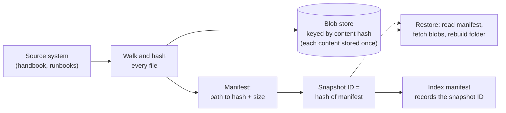

Code is versioned by Git, and a model by its revision, but a RAG system's behaviour depends just as much on its data: the documents, the text extracted from them, the chunks cut from that text, and the questions used to evaluate it. A policy page is edited on Tuesday, the nightly ingestion picks it up, and on Wednesday the assistant answers differently with no code or model change at all. **Data versioning** is the practice of giving every state of that data a stable identifier, so that you can say exactly which data an index was built from, compare two states, rebuild an old one, and decide on purpose when an index moves to new data.

This lesson covers what to version and at what grain, how content-addressed snapshots work, the tools that implement the idea (DVC, lakeFS, object-store versioning), how to diff and restore snapshots, and the tension between keeping history and the obligation to delete data. It builds on [Document versioning](/learn/document-engineering/document-versioning), which is about the versions of individual documents inside the corpus as the retrieval system sees them. This lesson is about versions of the *whole corpus* as an engineering artefact, and on the identifier that [Index versioning](/learn/ci-cd-and-mlops/index-versioning) records in its manifest.

## Learning objectives

- Distinguish the data layers of a RAG system (raw documents, parsed text, chunks, vectors, golden sets) and choose a versioning approach for each.
- Explain content addressing and compute a snapshot identifier from a manifest of file hashes.
- Build, diff and restore corpus snapshots, and estimate the storage saved by deduplication.
- Compare Git-based pointers (DVC-style), branching object stores (lakeFS-style) and native object-store versioning by what each costs and guarantees.
- Reconcile immutable snapshots with deletion obligations, and say what a restore must refuse to bring back.

## Prerequisites

- [Document versioning](/learn/document-engineering/document-versioning): validity intervals and versions of single documents.
- [Incremental ingestion](/learn/understanding-document-ingestion/incremental-ingestion): content hashes and change detection.
- [Git workflows](/learn/ci-cd-and-mlops/git-workflows): which artefacts belong in Git and which hold only a pointer.
- [Golden datasets](/learn/testing-and-benchmarking/golden-datasets): the evaluation set that must stay aligned with the corpus.

## Why this matters

Three questions come up in every RAG incident review, and without data versions none of them can be answered.

**"What data was this answer built from?"** An answer is produced from chunks, the chunks come from an index, and the index was built from a corpus at some moment. If that moment is not recorded, an answer cannot be traced to the documents behind it, and a dispute about whether the assistant quoted an old policy cannot be settled.

**"Why did quality change?"** Evaluation scores move for three reasons: the code, the models, or the data. The first two have identifiers. If the data does not, a drop in recall after a nightly refresh cannot be separated from a drop caused by a code change, and teams waste days bisecting the wrong thing. The golden set has the same problem from the other side: if its questions or its expected documents change without a version, a score comparison between two runs compares different exams.

**"Can we rebuild the index as it was?"** Rollbacks ([Rollbacks](/learn/ci-cd-and-mlops/rollbacks)) usually switch back to an old index. If that index is lost or corrupted, the only recovery is to rebuild it, which needs the old corpus. A source system that overwrites documents in place has already destroyed it, and a rebuild "from the sources" now produces a different index.

The costs of the opposite habit, keeping every copy of everything forever, are real as well: storage grows, personal data that should have been erased sits in old snapshots, and nobody can find the right version in the pile. Data versioning is about choosing what to keep, at what grain, for how long.

## The intuition

A newspaper archive is a good model. Every edition is bound and shelved with its date; nobody rewrites yesterday's paper. When you need to know what was reported on 14 March you take down that volume, and the answer is unarguable. The archive does not keep a separate full copy of every unchanged page: if the weather column is identical in two editions, a good archive shares the plate. And the archive has a policy for the rare case where a page must be pulled for legal reasons: it removes the page and leaves a note saying that a page was removed and why.

A versioned corpus follows the same pattern. Each state of the corpus is a dated edition with an identifier. Unchanged documents are stored once and shared between editions. And a deliberate, logged mechanism exists for removing something from every edition when the law or a policy demands it.

## How it works

### What data, at what grain

A RAG system has several data layers, each derived from the one before. The right versioning approach differs per layer, mostly according to size and whether the layer can be regenerated.

| Layer | Example | Size and nature | Versioning approach |
| --- | --- | --- | --- |
| Raw documents | HR handbook exports, runbooks, PDFs | Large, owned by others, sometimes personal, not regenerable | **Snapshot** the corpus with a manifest; store content outside Git |
| Parsed text and metadata | Output of the parsers and cleaners | Medium, regenerable from raw plus parser version | Version by (raw snapshot ID, parser version); often not stored at all |
| Chunks | Chunked text with IDs | Medium, regenerable from parsed text plus chunker config | Same: identified by inputs, regenerated on demand |
| Vectors and index | Embeddings in Qdrant | Large, regenerable from chunks plus model | Versioned as a whole in [Index versioning](/learn/ci-cd-and-mlops/index-versioning) |
| Golden set and evaluation results | Questions, expected documents, baselines | Small, human-authored, not regenerable | In Git, reviewed ([Git workflows](/learn/ci-cd-and-mlops/git-workflows)) |

The principle: **version the sources you cannot regenerate, and record the recipe for everything you can.** Raw documents and golden sets get real versions. Parsed text, chunks and vectors are *derived data*, identified by the identifiers of their inputs. Storing a derived layer is a cache, a convenient one that speeds rebuilds, but the identity of the layer is the recipe: "raw snapshot `28d5…` + parser 1.3 + chunker config `c91a…`".

### Snapshots and content addressing

A **snapshot** is an immutable, identified state of a collection of files. The standard way to build one is **content addressing**: the name of a stored object is the hash of its contents.

1. Walk the corpus and compute a SHA-256 hash of every file.
2. Store each file's bytes under its hash. If a blob with that hash already exists, the content is already stored; nothing is written.
3. Write a **manifest**: a list of (path, hash, size) for every file, plus where the data came from and when.
4. Hash the manifest itself. That hash is the **snapshot ID**.

Two properties follow. **Identical inputs give identical IDs**, so nobody has to remember to bump a version number, and two teams who snapshot the same corpus agree on its name. **Any change gives a new ID**: editing one file changes its hash, which changes the manifest, which changes the snapshot ID. The ID is therefore both a name and a checksum of the entire corpus.

The manifest must be hashed in a canonical form (sorted keys, fixed separators), or two semantically identical manifests could serialise differently and get different IDs. And the snapshot ID should cover *content*, not incidental facts such as when the snapshot was taken or which machine ran it, for the same reason discussed in [Index versioning](/learn/ci-cd-and-mlops/index-versioning): if timestamps are in the hash, identical corpora get different IDs.



### Diffing snapshots

With two manifests, the difference between two states of the corpus is a set comparison: paths only in the new one are **added**, only in the old one **removed**, in both but with different hashes **modified**. This is cheap (no file contents are read) and extremely useful:

- It drives **incremental reindexing**: only added and modified documents are re-chunked and re-embedded, and removed documents' chunks are deleted. [Reindexing](/learn/ci-cd-and-mlops/reindexing) uses this to decide between an incremental update and a full rebuild.
- It explains **evaluation changes**: "recall dropped between snapshots `23e0…` and `28d5…`; one handbook file changed" is a hypothesis you can test, and the diff tells you which golden items to read first.
- It supports **review of data changes**: a nightly refresh that removes forty documents is a smell. A guard that refuses to promote a snapshot whose diff exceeds a limit (the mass-deletion guard from [Incremental ingestion](/learn/understanding-document-ingestion/incremental-ingestion)) turns that smell into a stop.

### Tools

You can build the above in an afternoon, as the example below does. Existing tools implement the same ideas with more scale and convenience. Details change with versions, so treat the descriptions as the general shape and read each tool's documentation.

- **DVC (Data Version Control)** keeps data out of Git and stores in Git small pointer files containing content hashes, while the data itself lives in a configured remote store such as object storage. A commit in Git then pins a data version: checking out an old commit and pulling fetches the matching data. Its fit is a team that already works in Git and wants data versions tied to code commits.
- **lakeFS** presents an object store (such as S3) as a repository with **branches and commits**, so you can ingest into a branch, validate it, and merge it, or discard it. Its fit is large, frequently changing data where several pipelines write at once and you want Git-like isolation and atomic promotion.
- **Object-store versioning** (for example S3 bucket versioning, and equivalents on other clouds) keeps previous versions of overwritten or deleted objects automatically. It is simple and protects against accidental deletion, but it versions individual objects, not consistent sets: it does not by itself tell you "the state of the whole bucket as of last Tuesday 02:00". Restoring a consistent corpus needs a manifest or a feature layered on top.
- **Table formats with time travel** (such as Delta Lake and Apache Iceberg) version tabular data and let you query it as of a version or timestamp. They fit corpora stored as tables of documents or chunks.

Whatever the tool, the requirement is the same: for any index you can name the data version it was built from, fetch that data, and prove it is unchanged.

### Data versions and the other versions

The corpus snapshot ID is one input to a larger identity. The index manifest of [Index versioning](/learn/ci-cd-and-mlops/index-versioning) records it together with the embedding model and chunker configuration. The golden set, kept in Git, carries its own version and must be checked against the snapshot: a golden item whose expected document does not exist in the snapshot being evaluated is stale ([Golden datasets](/learn/testing-and-benchmarking/golden-datasets)). A good pipeline therefore validates golden items against the snapshot before running an evaluation, and reports "3 items reference documents absent from snapshot `28d5…`" instead of silently scoring them as failures.

### History versus deletion

Immutable history is in direct tension with an obligation to delete. If an employee's personal data was in a document, and the law or company policy requires erasure, every snapshot that contains it is a copy that must be dealt with. Three practices keep this manageable:

1. **Do not put what you must be able to delete in places you cannot.** Keep personal data out of long-retention snapshots where you can, by redacting at ingestion, and see [Secure deletion](/learn/enterprise-rag-governance/secure-deletion) for the full treatment.
2. **Set retention.** Keep recent snapshots at full fidelity and delete old ones on a schedule (for example, daily snapshots for 30 days, then monthly ones for a year). Retention limits both storage and exposure.
3. **Make erasure a first-class operation.** Content addressing makes erasing a blob easy (delete the object with that hash) and makes the consequence visible: the manifest still lists the hash, but a restore now *fails loudly* for that file, rather than silently producing a corpus with a hole. The restore procedure should refuse to resurrect erased content, and an erasure log should record what was removed and why. Snapshots that can no longer be fully restored are marked as such rather than deleted, so the history of IDs stays intact.

Legal advice on what erasure requires differs by jurisdiction and situation; this lesson describes mechanisms, not obligations. The principle that holds in engineering terms is that an erasure that leaves restorable copies in backups and snapshots is not an erasure.

## The mathematics

### What deduplication saves

**Intuition.** If only a small fraction of documents change between snapshots, and unchanged documents are stored once, then storage grows with the amount of *change*, not with the number of snapshots.

Let $D$ be the number of documents, $b$ the average size of a document, $f$ the fraction that changes between consecutive snapshots, and $S$ the number of snapshots kept. Storing a full copy each time costs

$$
C_{\text{full}} = S \cdot D \cdot b
$$

while content-addressed storage keeps the first copy of everything and then only the changed documents:

$$
C_{\text{dedup}} = D \cdot b + (S - 1) \cdot f \cdot D \cdot b
$$

This treats every changed document as a wholly new blob (a one-word edit changes the whole file's hash), and assumes deleted documents' blobs remain until retention removes them.

**By hand.** Take $D = 312$ documents of $b = 40$ KB, $f = 0.02$ (about six documents change per week) and weekly snapshots for a year, $S = 52$.

- Full copies: $52 \times 312 \times 40 \text{ KB} = 649{,}000$ KB, about 649 MB.
- First copy: $312 \times 40 = 12{,}480$ KB, about 12.5 MB.
- Changes: $51 \times 0.02 \times 312 \times 40 = 12{,}730$ KB, about 12.7 MB.
- Deduplicated total: about 25.2 MB, roughly 26 times smaller.

```python
docs, kb, weekly, snaps = 312, 40, 0.02, 52
full = docs * kb * snaps / 1000
dedup = (docs * kb + (snaps - 1) * docs * weekly * kb) / 1000
print(f"full copies {full:.0f} MB, content-addressed {dedup:.1f} MB, ratio {full / dedup:.1f}")
```

```output
full copies 649 MB, content-addressed 25.2 MB, ratio 25.7
```

The saving shrinks as $f$ grows; at $f = 1$ (everything rewritten) the two costs are equal. It also shows that storage for the *corpus* is rarely the problem: 25 MB is trivial. The expensive artefacts are the derived ones, vectors and indexes, which is why they are regenerated from versioned sources rather than versioned file by file.

## In code

**The problem.** Implement the snapshot idea end to end with the standard library: build a content-addressed store and manifest for a small Meridian corpus, show that identical inputs give the same snapshot ID, diff two snapshots, restore an old one and verify it, and show what happens when a blob is erased.

**Dependencies.** Python's standard library only.

```bash
python snap.py
```

```python
import hashlib, json, tempfile
from pathlib import Path

def file_hash(path):
    return hashlib.sha256(Path(path).read_bytes()).hexdigest()

def make_snapshot(root, source, store):
    """Hash every file under root, copy new content into a content-addressed store,
    and return a manifest whose own hash is the snapshot ID."""
    root, store = Path(root), Path(store)
    entries = {}
    for p in sorted(root.rglob("*")):
        if p.is_file():
            digest = file_hash(p)
            blob = store / digest[:2] / digest
            if not blob.exists():                       # unchanged content is stored once
                blob.parent.mkdir(parents=True, exist_ok=True)
                blob.write_bytes(p.read_bytes())
            entries[p.relative_to(root).as_posix()] = {"sha256": digest, "bytes": p.stat().st_size}
    body = {"source": source, "files": entries}
    canonical = json.dumps(body, sort_keys=True, separators=(",", ":"))
    return {**body, "snapshot_id": hashlib.sha256(canonical.encode()).hexdigest()[:12]}

def diff(old, new):
    o, n = old["files"], new["files"]
    return {"added":    sorted(set(n) - set(o)),
            "removed":  sorted(set(o) - set(n)),
            "modified": sorted(k for k in set(o) & set(n) if o[k]["sha256"] != n[k]["sha256"])}

def restore(manifest, store, target):
    target = Path(target)
    for name, e in manifest["files"].items():
        blob = Path(store) / e["sha256"][:2] / e["sha256"]
        if not blob.exists():
            raise FileNotFoundError(f"{name}: content {e['sha256'][:8]} is no longer in the store")
        dest = target / name
        dest.parent.mkdir(parents=True, exist_ok=True)
        dest.write_bytes(blob.read_bytes())

with tempfile.TemporaryDirectory() as tmp:
    corpus, store, out = Path(tmp, "corpus"), Path(tmp, "store"), Path(tmp, "restored")
    (corpus / "handbook").mkdir(parents=True)
    (corpus / "runbooks").mkdir()
    (corpus / "handbook/leave.md").write_text("Annual leave is 25 days. Up to 5 unused days carry over.")
    (corpus / "handbook/remote.md").write_text("Staff may work remotely up to 3 days a week.")
    (corpus / "runbooks/e4021.md").write_text("Error E-4021: the VPN client is out of date.")
    s1 = make_snapshot(corpus, "export 2025-01-06", store)

    (corpus / "handbook/leave.md").write_text("Annual leave is 25 days. Up to 5 unused days carry over and must be used by 31 March.")
    (corpus / "runbooks/e4012.md").write_text("Error E-4012: the VPN certificate has expired.")
    (corpus / "handbook/remote.md").unlink()
    s2 = make_snapshot(corpus, "export 2025-01-13", store)

    again = make_snapshot(corpus, "export 2025-01-13", store)
    print("snapshot 1:", s1["snapshot_id"], len(s1["files"]), "files")
    print("snapshot 2:", s2["snapshot_id"], len(s2["files"]), "files")
    print("same inputs, same ID:", again["snapshot_id"] == s2["snapshot_id"])
    print("diff:", json.dumps(diff(s1, s2)))
    blobs = sum(1 for p in store.rglob("*") if p.is_file())
    print(f"blobs in store: {blobs} for {len(s1['files']) + len(s2['files'])} file versions")

    restore(s1, store, out)
    print("restored snapshot 1 matches:", make_snapshot(out, "export 2025-01-06", Path(tmp, "scratch"))["snapshot_id"] == s1["snapshot_id"])

    # A deletion request: erase one blob, as a legal erasure would.
    gone = s1["files"]["handbook/remote.md"]["sha256"]
    (store / gone[:2] / gone).unlink()
    try:
        restore(s1, store, Path(tmp, "restored2"))
    except FileNotFoundError as e:
        print("restore after erasure:", e)
```

```output
snapshot 1: 23e0fdc21775 3 files
snapshot 2: 28d53d57d414 3 files
same inputs, same ID: True
diff: {"added": ["runbooks/e4012.md"], "removed": ["handbook/remote.md"], "modified": ["handbook/leave.md"]}
blobs in store: 5 for 6 file versions
restored snapshot 1 matches: True
restore after erasure: handbook/remote.md: content 12738344 is no longer in the store
```

**The important lines.**

- `if not blob.exists()` is the deduplication: the `runbooks/e4021.md` content appears in both snapshots but is stored once, which is why five blobs hold six file versions.
- `json.dumps(..., sort_keys=True, separators=(",", ":"))` produces the canonical form, so the snapshot ID depends only on the content of the manifest. The `source` label is included, so two exports of identical files labelled differently get different IDs; whether that is desirable is a design choice, and many teams hash only the file list.
- `diff` reads only manifests, never file contents, so it runs in milliseconds on a corpus of any size.
- The final check restores snapshot 1 into a fresh folder and re-snapshots it. Getting the same ID back is the end-to-end proof that restore is faithful.
- `restore` raises when a blob is missing rather than skipping the file. A restore that quietly produces a corpus with a missing document would produce an index that silently lacks it.

**What the output means.** The first snapshot ID names the original three files, the second names the state after one edit, one addition and one removal, and the diff says exactly that. The restore proves the old state is recoverable. After the erasure, the old snapshot still *exists* as a record (its ID and manifest remain) but can no longer be fully restored, and the failure message names the missing file. In production that exception would be caught, logged to the erasure record, and the snapshot flagged as partially erased.

**Common errors.** Hashing text after normalising line endings in one place and not another gives different hashes for identical documents; hash exactly the bytes you store. Walking a directory in filesystem order instead of sorted order makes manifests differ between machines. Reading a very large file entirely into memory, as this short example does, should become block-wise hashing for big files ([Model versioning](/learn/ci-cd-and-mlops/model-versioning) shows a block-wise `sha256` helper). Snapshotting a folder while a sync job is still writing to it captures a half-updated state; snapshot from a quiesced export or a consistent view.

**Extending it.** Add retention (delete blobs referenced by no kept manifest, after a dry run), add a mass-change guard to `diff` consumers, record the parser version beside the snapshot ID for derived layers, and write the snapshot ID into the index manifest and into every answer's release record.

## A real-world example

AskMeridian's ingestion job copied the HR team's handbook export into a shared bucket every night, overwriting the previous night's files. The index was rebuilt from the bucket whenever the embedding model changed. In March, the Platform team noticed that evaluation recall on handbook questions was 6 points lower than in January, after a model change that had improved recall on a test set.

Nobody could say whether the model or the data had caused the drop. The January corpus no longer existed; the bucket held only the latest export. The HR team had, in the meantime, restructured the carry-over section into three shorter pages and added a Frequently Asked Questions page containing near-duplicate statements of the same rules. The golden set's expected documents still pointed at the old page IDs, so several items counted as failures that were really stale labels.

The team introduced snapshots. A nightly job writes a manifest and content-addressed blobs, producing a snapshot ID that is recorded in each index manifest and release record. A diff step reports changes per HR section and blocks promotion if more than 5 percent of documents were removed in one night. Golden items are validated against the snapshot before every evaluation. Retention keeps daily snapshots for 30 days and weekly ones for a year, and an erasure procedure removes named blobs and logs it. When the next unexplained drop appeared, the team diffed two snapshot IDs and found, in ten minutes, a runbook export that had started including draft pages.

## Common mistakes

- **Overwriting sources in place and keeping no snapshot.** The state an index was built from is gone, so rebuilds produce a different index and comparisons are impossible.
- **Versioning by date only.** "The corpus on 6 January" is a description, not an identity: an export re-run later the same day can differ. Hash the content.
- **Storing derived data as if it were source.** Keeping every version of every embedding file multiplies storage; version the recipe, regenerate the vectors.
- **Putting timestamps or machine names into the hashed identity.** Identical corpora then get different snapshot IDs.
- **Evaluating on a changed golden set or corpus without recording either version.** A score comparison between runs is meaningless if the exam or the material changed.
- **Treating snapshots as backups of deletion-sensitive data.** Erased personal data survives in old snapshots, in backups of the store, and in indexes built from them.
- **Restores that skip missing blobs.** The index silently lacks documents and nobody is told.

## Best practices

- Snapshot every source corpus before an index is built from it, and record the snapshot ID in the index manifest and each answer's release record.
- Version what you cannot regenerate (raw documents, golden sets) and record recipes for what you can (parsed text, chunks, vectors).
- Use content addressing, canonical manifests and identifiers computed from content only.
- Diff snapshots before promoting them, and block or escalate on unusual changes such as mass deletions.
- Validate golden items against the snapshot under evaluation, and report stale items separately from failures.
- Define retention for snapshots, test restores regularly, and keep an erasure log; make restores fail loudly on erased content.
- Choose tooling to match your situation: Git pointers when data versions should follow code commits, branching object stores for concurrent pipelines, native versioning as a safety net.

## Performance considerations

Snapshotting costs one pass over the corpus: reading every byte to hash it. SHA-256 on a modern CPU core hashes on the order of hundreds of megabytes per second (measure on your hardware), so a 5 GB corpus takes seconds to tens of seconds, dominated by disk and network reads rather than hashing. Incremental approaches avoid the full read by hashing only files whose size or modification time changed, trusting a stored hash for the rest; the trade-off is that a file changed without changing size or mtime is missed, so a periodic full hash is the safety net.

Storage follows the deduplication arithmetic above: proportional to the change rate, not to the snapshot count, with the caveat that large binary documents (a PDF re-exported with a new timestamp inside it) change entirely when only metadata changed. Where exports are noisy this way, hash the *extracted text* as well as the bytes and use the text hash to decide whether a document really changed.

Restores cost a read and write of the snapshot's bytes. For a rollback that needs an old index quickly, restoring the *index* from a snapshot is far faster than restoring the corpus and rebuilding it, which is why [Index versioning](/learn/ci-cd-and-mlops/index-versioning) keeps recent indexes and corpus snapshots for different purposes.

## Security considerations

- **Snapshots are copies of your data.** Everyone who can read the blob store can read every historical document, including ones since withdrawn or restricted. Apply the same access control to snapshots as to the sources, and encrypt the store at rest.
- **Personal and confidential content.** Redact before long-retention snapshots where possible; set retention; and have an erasure procedure that covers blobs, manifests' stored text if any, backups and derived indexes. See [Secure deletion](/learn/enterprise-rag-governance/secure-deletion) and [Data lineage](/learn/enterprise-rag-governance/data-lineage).
- **Integrity.** A hash proves a blob matches its manifest entry; it does not prove the manifest is genuine. Protect manifests against tampering (store them in a write-once location or sign them) when snapshot identity feeds compliance or audit.
- **Poisoned or malicious documents** that entered one snapshot remain in it. A snapshot ID makes it possible to find which indexes were built from the bad data and rebuild them from an earlier clean snapshot.

## Summary

- Data changes answers as much as code and models, so the corpus needs identifiers: version the sources you cannot regenerate, and record recipes for derived layers.
- A content-addressed snapshot stores each unique file once, records a canonical manifest of hashes, and takes the manifest's hash as its ID; identical content always gets the same ID.
- Diffing manifests is cheap and drives incremental reindexing, explains evaluation changes and guards against bad refreshes.
- DVC-style pointers, branching object stores and native versioning implement the same idea at different points on the convenience and scale curve.
- Storage for deduplicated snapshots grows with the change rate, not the snapshot count; the expensive artefacts are derived vectors, which are regenerated.
- Immutability must coexist with deletion: set retention, make erasure an explicit logged operation, and make restores fail loudly rather than resurrect or skip erased content.

## Exercises

1. **Which layer?** For each artefact say whether it gets a stored version or a recorded recipe, and why: (a) the HR PDF exports; (b) the parsed Markdown produced from them; (c) the chunk list; (d) the golden set; (e) the Qdrant collection.

<details><summary>Show solution</summary>

(a) Stored version: not regenerable, owned by another team. (b) Recipe: raw snapshot ID plus parser version regenerates it; it may be cached. (c) Recipe: parsed text plus chunker configuration. (d) Stored version in Git: human-authored and not regenerable. (e) Recipe, identified by the index version, which hashes the model and settings together with the corpus snapshot ID; keep recent collections as rollback targets, but the identity is the inputs.

</details>

2. **Storage arithmetic.** A corpus has 1,000 documents of 50 KB, 5 percent change per week, and you keep 26 weekly snapshots. Compute full-copy and deduplicated storage, and say what happens to the ratio if 30 percent change per week.

<details><summary>Show solution</summary>

Full copies: $26 \times 1{,}000 \times 50 = 1{,}300{,}000$ KB, 1,300 MB. Deduplicated: $1{,}000 \times 50 = 50{,}000$ KB plus $25 \times 0.05 \times 1{,}000 \times 50 = 62{,}500$ KB, total 112.5 MB, a ratio of about 11.6. At 30 percent change: $50{,}000 + 25 \times 0.30 \times 50{,}000 = 425{,}000$ KB, 425 MB, a ratio of about 3.1. The saving shrinks as churn rises.

</details>

3. **Extend the code.** Add a function `unrestorable(manifest, store)` that returns the paths in a manifest whose blobs are missing, without writing any files, and use it to mark a snapshot as partially erased. Why is this better than catching the exception from `restore`?

<details><summary>Show solution</summary>

```python
def unrestorable(manifest, store):
    return sorted(name for name, e in manifest["files"].items()
                  if not (Path(store) / e["sha256"][:2] / e["sha256"]).exists())

# after the erasure in the example:
print(unrestorable(s1, store))          # ['handbook/remote.md']
```

It reports every missing file at once instead of stopping at the first, needs no target folder, and can be run as a scheduled audit across all snapshots, so the status "partially erased" is recorded in the registry before anyone tries a restore under pressure.

</details>

4. **Design the guard.** The nightly refresh produced a snapshot in which 38 of 312 documents were removed. Design the promotion rule and what a reviewer should see.

<details><summary>Show solution</summary>

Compute the diff against the currently promoted snapshot: 38 of 312 is about 12 percent removed, above a 5 percent limit, so promotion pauses automatically instead of failing the build. The reviewer sees the diff grouped by source folder (are all 38 from one section?), the names of the removed documents, whether those documents are referenced by golden items, and whether the source system reported an outage or a permissions change. If the removals are legitimate (a section was withdrawn), a named owner approves an override that is logged with the snapshot ID. If not, ingestion is rerun and the bad snapshot is kept for diagnosis but never promoted.

</details>

## Check your understanding

```quiz
[
  {
    "q": "Why is a snapshot ID computed as the hash of a canonical manifest of file hashes?",
    "options": ["Identical content always gets the same ID and any change gives a new one, with no manual version bumps", "It makes the corpus smaller", "It encrypts the documents", "It lets the vector database skip embedding"],
    "answer": 0,
    "why": "Content addressing makes the identifier both a name and a checksum of the whole corpus."
  },
  {
    "q": "A weekly snapshot job keeps full copies. 2 percent of documents change per week and 52 snapshots are kept. Compared with content-addressed storage, full copies use roughly",
    "options": ["The same space", "Twice the space", "About ten percent more space", "More than twenty times the space"],
    "answer": 3,
    "why": "Deduplicated storage is about one corpus plus 51 weeks of 2 percent changes, roughly 2 corpora, versus 52 for full copies: a ratio of about 26."
  },
  {
    "q": "After an erasure request a blob is deleted from the store but the old manifest remains. What should a restore of that snapshot do?",
    "options": ["Skip the missing file and continue", "Fail loudly, naming the missing file, and the snapshot is marked partially erased", "Re-download the file from the source", "Delete the manifest"],
    "answer": 1,
    "why": "Skipping would produce an index silently missing a document, and resurrecting the data would defeat the erasure."
  },
  {
    "q": "Which RAG artefact should be versioned as a stored, real version rather than a recorded recipe?",
    "options": ["The chunk list", "The raw documents exported from the HR system", "The vectors in Qdrant", "The parsed Markdown"],
    "answer": 1,
    "why": "Raw documents are not regenerable and are owned by someone else. Derived layers are identified by the identifiers of their inputs."
  },
  {
    "q": "Recall dropped between two evaluation runs; code and model identifiers are identical. What does a snapshot diff give you first?",
    "options": ["The exact new recall value", "Which files were added, removed or modified, pointing at which golden items to read", "A new embedding model", "Proof the golden set is correct"],
    "answer": 1,
    "why": "The diff compares manifests only and localises the data change, which is the likely cause once code and models are pinned."
  }
]
```

## Further reading

- DVC documentation: [dvc.org/doc](https://dvc.org/doc)
- lakeFS documentation: [docs.lakefs.io](https://docs.lakefs.io/)
- Amazon S3 documentation on bucket versioning: [docs.aws.amazon.com/AmazonS3](https://docs.aws.amazon.com/AmazonS3/latest/userguide/Versioning.html)
- Delta Lake documentation, on time travel: [docs.delta.io](https://docs.delta.io/)
- Martin Kleppmann (2017), *Designing Data-Intensive Applications*, the chapters on encoding, replication and derived data.
- D. Sculley and colleagues (2015), "Hidden Technical Debt in Machine Learning Systems", NeurIPS.
