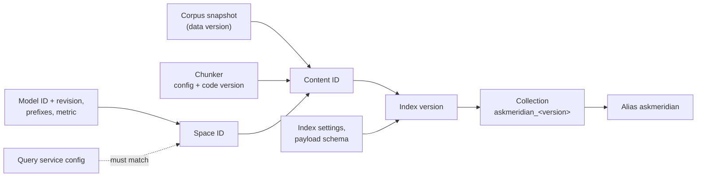

A vector index looks like a database, but it behaves like a compiled build artefact. It is produced by a recipe (a snapshot of documents, a chunker, an embedding model, a set of index settings), it cannot be edited back into a different recipe, and it only works with a query service that was built from the matching part of that recipe. This lesson treats the index the way a release engineer treats a binary: every index gets a version that records exactly what produced it, a short identity derived from that record, a place in a registry, and a guard that stops the wrong query encoder from ever reaching it.

[Collections](/learn/advanced-vector-database-engineering/collections) introduced versioned collection names and aliases. This lesson goes underneath the name: what an index version must record, how to tell which kind of change you are making, and how to make a mismatch fail loudly at start-up instead of quietly in production.

## Learning objectives

- List the inputs that determine an index's contents and write them into an index manifest.
- Derive a vector-space identity, a content identity and an index version from a manifest, and explain what each one protects.
- Classify a proposed change as a new vector space, new content or new index settings, and state what must be deployed with it.
- Implement a start-up compatibility check that refuses to serve when the query encoder does not match the index.
- Design a registry and retention policy for index versions, including how erasure requests reach old versions.

## Prerequisites

- [Collections](/learn/advanced-vector-database-engineering/collections): versioned collection names and atomic alias switching.
- [Model versioning](/learn/ci-cd-and-mlops/model-versioning): pinning an embedding model to an exact revision.
- [Data versioning](/learn/ci-cd-and-mlops/data-versioning): identifying the corpus snapshot an index was built from.
- [Document embeddings](/learn/dense-retrieval/document-embeddings): how the embedding input (prefixes, titles, context) is constructed.

## Why this matters

Ask a team what is inside the production index and the answers are often vague: probably the handbook as of last Tuesday, probably MiniLM, probably the new chunker. Every "probably" is a question someone will need answered during an incident, and an index cannot answer it by itself. A vector is 384 floating-point numbers. Nothing in it says which model produced it.

**The silent mismatch.** The index is rebuilt with a new embedding model of the same dimension, but one query-service replica still runs the old encoder because its configuration was not redeployed. The vector database accepts the query, since the dimension matches, and returns results. They are worse, sometimes much worse, and nothing raises an error. The collections lesson called this "the dangerous case precisely because nothing will reject it". This lesson builds the thing that rejects it.

**The irreproducible index.** Last month's index scored better than today's. Rebuilding it to investigate needs its document snapshot, chunker version, model revision, prefixes and index settings; miss one and you have a number you cannot explain.

**The unsafe rollback.** A rollback re-points the alias at an older collection. Whether that is safe depends on what the older collection contains and which query encoder it needs, which is only knowable if it was recorded when the collection was built. [Rollbacks](/learn/ci-cd-and-mlops/rollbacks) builds on exactly this record.

Index versioning is the discipline that turns "probably" into a lookup.

## The intuition

Think of a printed road atlas. A page is useful only with its legend, which says what the symbols mean and which survey it was drawn from. In a 2019 atlas a red line may be a motorway; in a 2024 one, a planned road. Tear out the pages and lose the cover, and you have maps you can read but cannot trust.

An index without a manifest is a torn-out page. The manifest is the cover and the legend: which survey (the document snapshot), which cartographer (the chunker), which projection (the embedding model and its exact revision), which printing (the index settings). And just as you must read a map with the legend it was drawn for, a query must be encoded in the projection the index was built in. Mixing a 2024 legend with a 2019 map is the silent mismatch: every symbol still looks meaningful.

## How it works

### What determines an index's contents

Start by listing everything that, if changed, changes what a query returns. For a dense RAG index there are five groups.

| Input | Examples | Changing it means |
| --- | --- | --- |
| **Corpus snapshot** | Which documents, which versions of each, deletions applied | Different chunks |
| **Chunker** | Algorithm, chunk size, overlap, code version | Different chunk boundaries, so different vectors |
| **Embedding space** | Model ID, exact revision, document and query prefixes, normalisation, dimension, metric, quantisation of stored vectors | Vectors in a different space |
| **Index structure** | HNSW `m` and `ef_construct`, quantisation of the search structure, sharding | Same vectors, different approximate neighbours |
| **Payload schema** | Which metadata fields exist and how they are named | Filters and citations behave differently |

Notice where the query side appears: only in the embedding-space row. The query service must encode queries with the same model, revision, normalisation and *query* prefix as the index expects. Instruction-tuned models such as BGE and E5 use a different prefix for queries and documents, so the query prefix belongs to the space even though it is never applied to a document. Everything else (corpus, chunker, index structure) can change without the query service changing at all.

That observation is the key to the whole lesson, so it is worth stating as a rule: **the embedding space is the contract between the index and the query service; the rest is the index's private business.**

### Three identities from one manifest

An **index manifest** is a structured record, written when the index is built, that captures every input above. From it you derive three short identities, each a hash of a different subset.

1. **Space ID**: a hash of the embedding-space fields only. Two indexes with the same space ID accept the same query vectors. The query service computes the same hash from its own configuration and compares.
2. **Content ID**: a hash of the space ID, the chunker configuration and the corpus snapshot ID. Two indexes with the same content ID contain the same vectors, up to floating-point noise.
3. **Index version**: a hash of the content ID, the index-structure settings and the payload schema version. This is the identity of the whole artefact, and the natural suffix for the physical collection name: `askmeridian_a8d44341000f`.

Hashes are **content-addressed**: the identity is computed from the inputs, so two builds from the same inputs get the same identity, and any change to an input produces a new one. Nobody has to remember to bump a number. Human-friendly names (`askmeridian_bge_v3`) are still useful for operators, and many teams keep both, but the hash is what machines compare.



### Classifying a change

Comparing two manifests tells you what kind of change you are about to ship, and the kind decides the deployment plan. Borrowing the vocabulary of semantic versioning:

- **Major (new space ID).** A new model, a new revision of the same model, a new prefix, a change of metric or normalisation. Every chunk must be re-embedded, and the query encoder must change at the same moment the alias moves. Neither half works without the other, so they ship as one release. [Reindexing](/learn/ci-cd-and-mlops/reindexing) plans the re-embedding; [Blue-green deployments](/learn/ci-cd-and-mlops/blue-green-deployments) plans the coordinated switch.
- **Minor (same space, new content ID).** New documents, a new chunker, a fixed parser. Vectors change but stay in the same space, so the running query service is compatible with both the old and new index. The alias can move on its own.
- **Patch (same content, new index version).** Different HNSW parameters, a payload index added, quantisation of the search structure changed. The vectors could be copied rather than recomputed; only the search structure is rebuilt.

Once manifests exist, a CI pipeline can classify changes mechanically.

### Revisions, not names

A model ID such as `BAAI/bge-small-en-v1.5` is a name, and names can be re-pointed: a Hugging Face repository can receive new commits, and loading by name fetches whatever is current unless you pin a **revision** (a commit hash). Embedding APIs differ in what they guarantee behind a stable model name, so read the provider's versioning policy. Record the most specific identifier available. [Model versioning](/learn/ci-cd-and-mlops/model-versioning) covers pinning; the point here is that the pin must also be written into the index manifest, because the index outlives the deployment that built it.

The same applies to the corpus. "The handbook" is a name. "Snapshot `7c41…` of the handbook, 312 documents, deletions up to change-log sequence 88,214" is a version. Record the identifier your [data versioning](/learn/ci-cd-and-mlops/data-versioning) scheme produces, not a description.

### Where the manifest lives

Put the manifest in at least two places.

1. **With the index.** Recent Qdrant versions let you attach arbitrary metadata to a collection at creation (the `metadata` argument of `create_collection`); check that your server version supports it. Elasticsearch and OpenSearch have a `_meta` field in the index mapping. Where nothing like this exists, a reserved record in the index or a sidecar file next to a FAISS index file works. Keeping it with the index means anyone who can reach the index can read what it is, including during an incident when other systems may be down.
2. **In a registry.** One row per index version with the manifest, build status, evaluation results, and who promoted it and when. A relational table is enough; ML model registries such as MLflow's embody similar ideas.

A registry row moves through the life cycle drawn in [Collections](/learn/advanced-vector-database-engineering/collections): created, loading, verified, live, standby, retired. The registry adds what the collection itself cannot store well: the evaluation scores that justified promotion and the history of every alias change.

### The start-up guard

The most valuable single use of the manifest is a check the query service runs before it accepts traffic, and again whenever the alias target changes:

1. Resolve the alias to the physical collection it currently points at.
2. Read that collection's manifest.
3. Compute the space ID from the service's own encoder configuration (model, revision, query prefix, normalisation, metric).
4. If the two space IDs differ, fail the readiness check and refuse to serve.

Failing readiness, rather than crashing or logging a warning, matters in an orchestrator such as Kubernetes: a replica that is not ready receives no traffic, so a misconfigured replica simply never joins, and the rollout stalls where an operator can see it. A warning in a log is read after the damage.

If the alias can move while the service runs, the check must be repeated; exercise 2 shows how.

### What not to put in the identity

Keep build timestamps, build-machine names and run IDs in the manifest but *out* of the hashed identities. If they were hashed, two identical builds would get different versions and the content-addressing would be lost.

The content ID identifies the *recipe*, not the bytes. The same text encoded on different hardware or library versions can differ in the last decimal places, and approximate index construction can depend on insertion order, so two builds with one content ID should agree on nearly all results but not on every bit. To detect byte-level drift, store a checksum of the vectors as a build output, outside the identity.

## The mathematics

Truncated hashes are convenient (`a8d44341000f` fits in a collection name), so it is worth knowing how short is safe. The risk is a **collision**: two different manifests that happen to produce the same truncated identity.

The intuition is the birthday problem. A clash between *some* pair becomes likely far sooner than a clash with one particular value, because the number of pairs grows with the square of the number of items. For $n$ identities drawn uniformly from $N = 2^b$ possible values, the probability of at least one collision is approximately

$$
p \approx 1 - e^{-n(n-1)/(2N)} \approx \frac{n^2}{2^{b+1}} \quad \text{when } p \text{ is small,}
$$

where $n$ is the number of index versions you will ever create, $b$ is the number of bits kept, and $N = 2^b$ is the number of possible identities. Twelve hexadecimal characters carry $b = 48$ bits.

Worked by hand: suppose Meridian builds 10,000 index versions over the system's lifetime (a deliberately generous number, including every CI build). Then $n^2 = 10^8$ and $2^{49} \approx 5.63 \times 10^{14}$, so $p \approx 10^8 / 5.63 \times 10^{14} \approx 1.8 \times 10^{-7}$, about two in ten million. Eight hex characters ($b = 32$) would give $10^8 / 8.6 \times 10^9 \approx 0.012$, more than one in a hundred, which is not negligible.

```python
import math

def collision_probability(n: int, bits: int) -> float:
    return -math.expm1(-n * (n - 1) / (2 * 2**bits))

for bits in (32, 48, 64):
    print(f"{bits} bits ({bits // 4} hex chars): p = {collision_probability(10_000, bits):.2e}")
```

```output
32 bits (8 hex chars): p = 1.16e-02
48 bits (12 hex chars): p = 1.78e-07
64 bits (16 hex chars): p = 2.71e-12
```

Twelve characters are ample for index versions. Keep the full hash in the manifest anyway, so that a check that really matters (the start-up guard) can compare full values.

## In code

**The problem.** AskMeridian moves from `all-MiniLM-L6-v2` to `bge-small-en-v1.5`. Both produce 384-dimensional vectors, so the vector database cannot tell them apart. Build manifests for the old and new index, classify three kinds of change, show what a stale query encoder does to the new index, and add a start-up guard that refuses it.

**Dependencies.** Both models must already be in the local Hugging Face cache; `local_files_only=True` makes the script fail rather than download.

```bash
pip install sentence-transformers qdrant-client huggingface_hub
```

```python
import hashlib, json
from pathlib import Path
from huggingface_hub import snapshot_download
from sentence_transformers import SentenceTransformer
from qdrant_client import QdrantClient, models

DOCS = {
    "hb-leave": "Annual leave is 25 days; up to 5 unused days carry over and must be used by 31 March.",
    "hb-remote": "Staff may work remotely up to 3 days a week; the home-office equipment budget is £400.",
    "hb-expenses": "Expenses must be submitted within 30 days; anything over £75 needs a receipt.",
    "it-password": "Passwords must be rotated every 90 days.",
    "it-vpn": "The VPN is required whenever you work on public Wi-Fi.",
    "it-laptop": "Laptops are refreshed every 3 years.",
    "it-desk": "The support desk is open 08:00 to 18:00 UK time.",
    "it-e4021": "Error E-4021 means the VPN client is out of date; update it from the IT portal.",
}
GOLDEN = [("How many holiday days do I get?", "hb-leave"),
          ("When can I phone the help desk?", "it-desk"),
          ("Do I need a receipt for a taxi?", "hb-expenses"),
          ("How often do I have to change my password?", "it-password"),
          ("What does error E-4021 mean?", "it-e4021"),
          ("Can I work from home on Fridays?", "hb-remote"),
          ("How much can I spend on a home office chair?", "hb-remote"),
          ("Is the VPN needed in a cafe?", "it-vpn")]

def sha(obj) -> str:
    """Stable short hash of any JSON-serialisable object."""
    blob = json.dumps(obj, sort_keys=True, separators=(",", ":")).encode()
    return hashlib.sha256(blob).hexdigest()[:12]

def embedding_space(model_id, query_prefix="", doc_prefix=""):
    """Everything that decides which vector space a text lands in."""
    path = snapshot_download(model_id, local_files_only=True)   # no download
    model = SentenceTransformer(path)
    return model, {
        "model_id": model_id,
        "revision": Path(path).name,                 # the exact commit in the HF cache
        "dim": model.get_embedding_dimension(),
        "normalised": True, "metric": "cosine",
        "query_prefix": query_prefix, "doc_prefix": doc_prefix,
    }

def build_manifest(space, chunker, index_params, docs):
    corpus = {"snapshot": sha(docs), "documents": len(docs)}
    m = {"embedding_space": space, "chunker": chunker, "corpus": corpus,
         "index": index_params, "payload_schema": 1}
    m["space_id"] = sha(space)                                    # query compatibility
    m["content_id"] = sha([m["space_id"], chunker, corpus])       # what the vectors are
    m["index_version"] = sha([m["content_id"], index_params, 1])  # the whole artefact
    return m

def classify(old, new):
    """What kind of change separates two index versions, and what must move with it."""
    if old["space_id"] != new["space_id"]:
        return "MAJOR: new vector space; re-embed everything, ship the query encoder with it"
    if old["content_id"] != new["content_id"]:
        return "MINOR: new content, same space; queries stay compatible"
    if old["index_version"] != new["index_version"]:
        return "PATCH: same vectors, new index settings; rebuild the index only"
    return "IDENTICAL"

client = QdrantClient(":memory:")

def build(name, model, manifest, docs):
    space = manifest["embedding_space"]
    client.create_collection(name, metadata={"manifest": manifest},
        vectors_config=models.VectorParams(size=space["dim"], distance=models.Distance.COSINE),
        hnsw_config=models.HnswConfigDiff(**manifest["index"]))
    vecs = model.encode([space["doc_prefix"] + t for t in docs.values()], normalize_embeddings=True)
    client.upsert(name, [models.PointStruct(id=i, vector=v.tolist(), payload={"doc": d})
                         for i, (d, v) in enumerate(zip(docs, vecs))])

minilm, s1 = embedding_space("sentence-transformers/all-MiniLM-L6-v2")
bge, s2 = embedding_space("BAAI/bge-small-en-v1.5",
    query_prefix="Represent this sentence for searching relevant passages: ")
chunker = {"name": "one-chunk-per-doc", "version": 1}
v1 = build_manifest(s1, chunker, {"m": 16, "ef_construct": 100}, DOCS)
v2 = build_manifest(s2, chunker, {"m": 16, "ef_construct": 100}, DOCS)
v1b = build_manifest(s1, chunker, {"m": 32, "ef_construct": 200}, DOCS)
v1c = build_manifest(s1, chunker, {"m": 16, "ef_construct": 100},
                     {**DOCS, "it-e4012": "Error E-4012 means the VPN certificate has expired."})

for m in (v1, v2):
    print(f"{m['embedding_space']['model_id']:<40} rev {m['embedding_space']['revision'][:8]} "
          f"dim {m['embedding_space']['dim']}  space {m['space_id']}  version {m['index_version']}")
print("v1 -> v2 :", classify(v1, v2))
print("v1 -> v1c:", classify(v1, v1c))
print("v1 -> v1b:", classify(v1, v1b))

name = f"askmeridian_{v2['index_version']}"
build(name, bge, v2, DOCS)
client.update_collection_aliases([models.CreateAliasOperation(
    create_alias=models.CreateAlias(collection_name=name, alias_name="askmeridian"))])

def golden(model, space):
    qs = model.encode([space["query_prefix"] + q for q, _ in GOLDEN], normalize_embeddings=True)
    tops = [client.query_points("askmeridian", query=v.tolist(), limit=1).points[0] for v in qs]
    hit = sum(t.payload["doc"] == g for t, (_, g) in zip(tops, GOLDEN))
    return f"{hit}/{len(GOLDEN)} golden top-1, mean top score {sum(t.score for t in tops)/len(tops):.2f}"

print("\nquery encoder bge    (matches the index):", golden(bge, s2))
print("query encoder MiniLM (stale config)     :", golden(minilm, s1), " <- no error raised")

class IndexMismatch(RuntimeError): pass

def check_compatible(alias, query_space):
    target = next(a.collection_name for a in client.get_aliases().aliases if a.alias_name == alias)
    served = client.get_collection(target).config.metadata["manifest"]
    if served["space_id"] != sha(query_space):
        raise IndexMismatch(f"{alias} -> {target} expects space {served['space_id']} "
                            f"({served['embedding_space']['model_id']}); query encoder is {sha(query_space)}")
    return target

try:
    check_compatible("askmeridian", s1)
except IndexMismatch as e:
    print("\nstartup guard:", e)
print("startup guard with bge encoder: OK, serving", check_compatible("askmeridian", s2))
```

```output
sentence-transformers/all-MiniLM-L6-v2   rev 1110a243 dim 384  space 9f043df4c95e  version 3d06fb9e3283
BAAI/bge-small-en-v1.5                   rev 5c38ec7c dim 384  space a1dc917062e2  version a8d44341000f
v1 -> v2 : MAJOR: new vector space; re-embed everything, ship the query encoder with it
v1 -> v1c: MINOR: new content, same space; queries stay compatible
v1 -> v1b: PATCH: same vectors, new index settings; rebuild the index only

query encoder bge    (matches the index): 7/8 golden top-1, mean top score 0.67
query encoder MiniLM (stale config)     : 6/8 golden top-1, mean top score 0.19  <- no error raised

startup guard: askmeridian -> askmeridian_a8d44341000f expects space a1dc917062e2 (BAAI/bge-small-en-v1.5); query encoder is 9f043df4c95e
startup guard with bge encoder: OK, serving askmeridian_a8d44341000f
```

Model loading progress messages, written to standard error, are omitted. Your revision hashes will match only if your cache holds the same model commits.

**The important lines.**

- `embedding_space` records the **revision** as the name of the cache snapshot folder, which on the Hugging Face Hub is the commit hash. It also records both prefixes, because BGE's query instruction is part of the space even though no document carries it.
- `build_manifest` hashes nested subsets: the space ID feeds the content ID, which feeds the index version. A change to any lower layer therefore propagates upwards, and `classify` only needs to compare from the top down.
- `create_collection(..., metadata={"manifest": manifest})` stores the manifest with the collection, and `get_collection(...).config.metadata` reads it back.
- `check_compatible` resolves the alias *first*, then reads the manifest of whatever it points at. Reading the manifest of a collection name held in configuration would check the wrong thing after the alias moves.

**What the output means.** The two models have the same dimension and different space IDs. The three comparisons show the three kinds of change: swapping the model is major, adding one document is minor, and changing HNSW parameters is a patch. (In-memory Qdrant searches exhaustively, so the HNSW settings are recorded but have no effect here; on a server they shape the graph.)

The middle block is the reason the guard exists. With the stale MiniLM encoder querying the BGE index, the database raised no error and still put the right document first for 6 of 8 golden questions. A quick manual check would probably pass. But the mean top score fell from 0.67 to 0.19: the query vectors are in a different space, and the matches are partly coincidental. With this tiny, well-separated corpus some coincidences land on the right document; with thousands of similar chunks they will not, and any score threshold tuned on the matching encoder would now reject nearly everything. The degradation is partial and quiet, which is worse than a crash. The guard turns it into a clear start-up failure naming both spaces.

**Errors you may hit.** `LocalEntryNotFoundError` means the model is not cached. If your Qdrant server rejects `metadata`, it predates collection metadata; store the manifest in your registry and in a reserved point instead. A `KeyError: 'manifest'` in the guard means the alias points at a collection built before manifests existed, and the right response is to refuse to serve, not to skip the check.

**Extending it.** Record the chunker's code commit and parser versions, and write each manifest to a registry table at build time so promotion reads from it.

## A real-world example

Meridian's Platform team runs AskMeridian with three query-service replicas behind a load balancer. In the spring they move from MiniLM to BGE-small. The new collection is built, evaluated and promoted by switching the alias, and the query-service configuration is changed in the same release. Two replicas restart with the new encoder. The third is on a node that is being drained for maintenance, comes back an hour later from a cached older image, and runs the MiniLM encoder against the BGE index.

For two days a third of AskMeridian's traffic gets subtly worse answers, not absurd ones, as the code above showed on a small scale. What gives it away is a dashboard from [Retrieval monitoring](/learn/rag-observability/retrieval-monitoring): the top-1 similarity score, broken down by replica, shows one replica at around a third of the others. An engineer reads the replica's configuration, finds the old model ID, and restarts it.

The review adds three things: every collection carries its manifest and has a registry row; every replica runs the start-up guard in its readiness check, so a mismatched replica never receives traffic; and the release pipeline refuses to promote a major change unless the same release contains a query-service configuration with a matching space ID.

## Common mistakes

- **Versioning the index by a hand-maintained number only.** Someone forgets to bump it after changing the chunker, and two different indexes share a name. Derive the identity from the inputs.
- **Recording the model name without the revision.** A re-published model under the same name changes the space without changing the manifest; the guard then passes a mismatched encoder.
- **Leaving the query prefix out of the space.** An instruction-tuned model queried without its instruction is a different space in practice; omitting the prefix from the hash makes that mismatch invisible.
- **Hashing timestamps into the identity.** Two identical builds get different versions, and caching or deduplication by version stops working.
- **Checking compatibility against a configured collection name instead of the alias target.** The check passes on the old collection while traffic goes to the new one.
- **Warning instead of refusing.** A log line saying "encoder mismatch" during start-up is read after the incident, not before it.
- **Keeping manifests only in the build system.** During an incident the build system may be slow or unreachable; the collection should describe itself.

## Best practices

- Write a manifest for every index build, covering corpus snapshot, chunker (configuration and code version), embedding space (model, revision, prefixes, normalisation, metric, dimension), index settings and payload schema.
- Derive a space ID, a content ID and an index version by hashing nested subsets, and use the index version in the physical collection name.
- Store the manifest with the index and in a registry that also records evaluation results and every alias change.
- Run a compatibility guard in the query service's readiness check, comparing the space ID of the alias target with the service's own encoder configuration.
- Classify each change as major, minor or patch in CI, and refuse to promote a major change without a matching query-service release.

## Performance considerations

The manifest itself costs nothing measurable: a few kilobytes per index version. The costs that matter are the ones versioning makes visible.

**Storage for retained versions.** Each retained full version costs about $N \times d \times 4$ bytes of `float32` vectors plus index and payload overhead. For AskMeridian at, say, 200,000 chunks of 384 dimensions (an assumed figure), that is $200{,}000 \times 384 \times 4 \approx 307$ MB of raw vectors per version. A live version plus one standby doubles it; a year of weekly versions would be 52 times it. Retention policy is part of index versioning.

**Patch changes need not re-embed.** If the classifier says patch, the vectors can be read out of the old collection (scrolling with vectors included) and written into a new one with different index settings. That is far cheaper than re-encoding, and safe because the content ID guarantees they are the vectors you want.

**The guard's cost.** One alias lookup and one collection-info call at start-up and on alias change: a few milliseconds, paid rarely. Do not run it per query.

## Security considerations

- **Old versions hold old data.** A retained index version contains every document as it was at build time, including documents since deleted for legal or privacy reasons and permissions since revoked. An erasure request must be applied to every retained version (or those versions deleted), and the registry is how you find them all. [Rollbacks](/learn/ci-cd-and-mlops/rollbacks) returns to this, because re-pointing an alias at an old version can re-publish removed content.
- **Manifests can leak** internal repository names and model choices; protect them like the index.
- **Protect the alias and the registry.** Whoever can move an alias decides what every user is answered from. Restrict alias changes to the promotion pipeline's credentials and log every change in the registry.

## Summary

- An index is a build artefact: it is produced by a corpus snapshot, a chunker, an embedding space and index settings, and it should carry a manifest recording all of them.
- The embedding space (model, exact revision, prefixes, normalisation, metric) is the contract with the query service; the rest of the manifest is internal to the index.
- Hashing nested subsets of the manifest gives a space ID, a content ID and an index version, which classify every change as major, minor or patch.
- A model swap of the same dimension fails quietly: the database accepts the query and results degrade without errors. A readiness guard comparing space IDs turns that into a loud failure.
- Store manifests with the index and in a registry with evaluation results and alias history, and apply retention and erasure policies to every retained version.

## Exercises

**1.** For each change, say whether it is major, minor or patch, and whether the query service must be redeployed with it: (a) adding 40 new runbook pages; (b) moving from `bge-small-en-v1.5` at one commit to the same model name at a newer commit; (c) enabling scalar quantisation of the search structure while keeping the original vectors; (d) changing the chunk size from 400 to 300 tokens.

<details><summary>Show solution</summary>

(a) **Minor**: new content in the same space; no query-service change. (b) **Major**: a new revision is a new space unless you have verified the weights are identical, and the query encoder must be updated with the index. (c) **Patch**: same vectors, different search structure. Quantisation changes approximate scores, so evaluate it, but queries stay compatible. (d) **Minor**: every chunk is re-embedded, yet the space is unchanged, so the query service can stay as it is.

</details>

**2.** Extend `check_compatible` so that a long-running query service notices when the alias moves to an incompatible collection after start-up. Describe the behaviour you want, then write the code.

<details><summary>Show solution</summary>

Pin the physical collection the service validated and query that name, not the alias. Re-run `check_compatible` on a timer (say every 30 seconds) and on any alias-change notification. If the new target passes, switch the pinned name; if it fails, mark the service not ready so the readiness probe fails and the orchestrator drains it:

```python
def refresh(state, alias, space):
    try:
        state["target"], state["ready"] = check_compatible(alias, space), True
    except IndexMismatch:
        state["ready"] = False   # readiness probe reports failure; stop serving
```

Every query then reads `state["target"]` and refuses if `state["ready"]` is false. Because queries use the pinned physical name, a request never reaches a collection the service has not validated. Failing closed is the safer default; serving the old target while unready is a policy choice.

</details>

**3.** Design a retention policy for AskMeridian's index versions that supports a 14-day rollback window, keeps storage bounded, and satisfies erasure requests. State what is kept, for how long, and what happens on an erasure request.

<details><summary>Show solution</summary>

Keep the live version and the previous live version as full collections until 14 days after the next promotion; then delete the older one. Keep every manifest and registry row permanently (they are small and contain no document text), so any past index can be described and, if its corpus snapshot is still retained, rebuilt. Do not keep other full versions; CI evaluation builds are deleted after their run. On an erasure request, delete the affected points from every collection the registry lists as existing, record the request against those versions, and ensure the corpus snapshots used for rebuilds have the document removed too, otherwise a later rebuild reintroduces it.

</details>

## Check your understanding

```quiz
[
  {
    "q": "An index built with model A is queried by a service still encoding with model B. Both produce 384-dimensional vectors. What does the vector database do?",
    "options": [
      "Rejects the query with a dimension error",
      "Accepts the query and returns results ranked in the wrong space, without any error",
      "Converts the query vector into model A's space automatically",
      "Falls back to keyword search"
    ],
    "answer": 1,
    "why": "The database only checks dimension. Vectors from different models occupy unrelated spaces, so results degrade silently; only an application-level check on the embedding space can catch it."
  },
  {
    "q": "Which change produces a new space ID but leaves the corpus and chunker unchanged?",
    "options": [
      "Raising HNSW m from 16 to 32",
      "Adding a department payload field",
      "Changing the query instruction prefix of an instruction-tuned embedding model",
      "Adding 50 new documents"
    ],
    "answer": 2,
    "why": "The query prefix decides where queries land in the space, so it belongs to the embedding-space contract. The other changes alter the index settings, payload schema or content."
  },
  {
    "q": "Why should the build timestamp be stored in the manifest but excluded from the hashed index version?",
    "options": [
      "Timestamps cannot be serialised to JSON",
      "So that two builds from identical inputs receive the same identity",
      "Because Qdrant rejects metadata containing dates",
      "So that the version sorts chronologically"
    ],
    "answer": 1,
    "why": "Content addressing means identity follows the inputs. Hashing a timestamp would make every build unique even when nothing that affects results has changed."
  },
  {
    "q": "A query service checks compatibility by reading the manifest of the collection named in its configuration file, askmeridian_3d06fb9e3283, while it queries the alias askmeridian. What is wrong?",
    "options": [
      "Nothing; the configured collection and the alias are always the same",
      "The check should read the manifest of whatever the alias currently points at, because that is what queries reach",
      "Manifests should be read from the query vectors instead",
      "Compatibility checks should only run in CI"
    ],
    "answer": 1,
    "why": "After the alias moves, the configured name and the alias target differ. The check must resolve the alias first, or it validates a collection that receives no traffic."
  },
  {
    "q": "Using the birthday approximation, roughly how does the collision probability change if you double the number of index versions while keeping 12 hex characters?",
    "options": [
      "It halves",
      "It stays the same",
      "It roughly doubles",
      "It roughly quadruples"
    ],
    "answer": 3,
    "why": "The approximation is n squared divided by 2 to the power b+1, so doubling n multiplies the probability by about four."
  }
]
```

## Further reading

- Qdrant documentation, [Collections](https://qdrant.tech/documentation/concepts/collections/): collection configuration, aliases and collection metadata.
- Hugging Face Hub documentation, [huggingface.co/docs/huggingface_hub](https://huggingface.co/docs/huggingface_hub/index): repositories, revisions and the local cache layout.
- Tom Preston-Werner, [Semantic Versioning 2.0.0](https://semver.org/): the major, minor and patch vocabulary borrowed here.
- Sculley et al. (2015), "Hidden Technical Debt in Machine Learning Systems", NeurIPS: configuration debt and undeclared dependencies between data, models and serving.
- MLflow documentation, [Model Registry](https://mlflow.org/docs/latest/index.html): a widely used registry design whose stages and lineage ideas carry over to index versions.
