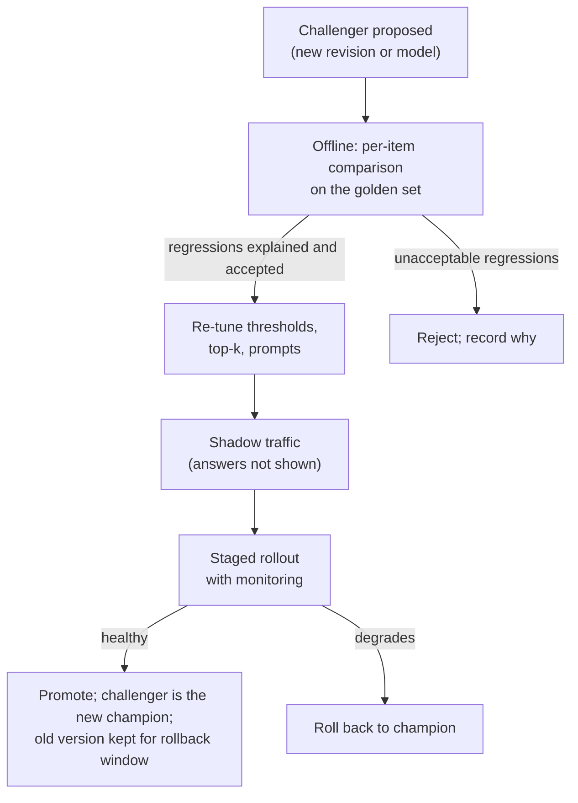

A RAG system contains several models, and each one can change underneath you. The embedding model turns chunks and queries into vectors. A reranker may reorder the candidates. A large language model writes the answer. Behind each name there is a particular set of weights, and behind the weights there are settings that matter just as much: the prefix added to queries, whether vectors are normalised, the prompt that wraps the context. **Model versioning** is the practice of pinning each of these to an identifier precise enough that "which model produced this answer?" always has one answer, and of changing them only through a tested, reversible procedure.

This lesson covers what counts as a model version, how to pin local and hosted models, how to detect that a pinned model has silently changed, how to compare a candidate with the model in production before it replaces it, and what to record with every answer. It deliberately stops at the model. How an embedding model's identity is written into an index manifest and checked at start-up belongs to [Index versioning](/learn/ci-cd-and-mlops/index-versioning), and rebuilding vectors after a model change belongs to [Reindexing](/learn/ci-cd-and-mlops/reindexing).

## Learning objectives

- List what must be pinned to identify an embedding model, a reranker and an LLM, beyond the model's name.
- Pin a Hugging Face model to a commit revision and verify its files against recorded hashes.
- Explain the difference between a floating alias and a pinned model identifier for hosted models, and describe how to prepare for deprecation.
- Run a champion versus challenger comparison per item and per slice, and explain why a model change also forces threshold re-tuning.
- Specify the model information that is logged with each answer so that any answer can be reproduced or explained later.

## Prerequisites

- [Git workflows](/learn/ci-cd-and-mlops/git-workflows): why model identifiers belong in a reviewed config file, not in a notebook.
- [Local embedding models](/learn/embedding-models/local-embedding-models): loading models from a local cache and pinning revisions.
- [Model selection](/learn/embedding-optimisation/model-selection): how a candidate is chosen in the first place.
- [Regression testing](/learn/testing-and-benchmarking/regression-testing): the per-item comparison used below.

## Why this matters

In most software, a dependency changes when you change it. Models are different in two ways. First, many of them are fetched by **name** from a place you do not control: a Hugging Face repository can receive new commits, and a hosted model alias can be re-pointed by the provider. Second, a change in a model changes behaviour everywhere at once and without an error message. Nothing crashes when an embedding model is replaced by one with the same vector dimension; queries are simply compared against vectors from a different space, and the results degrade quietly.

Four failures follow from unversioned models:

- **Silent drift.** A cold start downloads a newer revision of the embedding model than the one that built the index. Retrieval quality drops, with no code change to blame.
- **Irreproducible answers.** An employee disputes an answer from three weeks ago. Without a record of the models, prompt and settings, you cannot say what produced it, let alone reproduce it.
- **Forced, unplanned upgrades.** A hosted model is retired by its provider. The team learns about it from a failed request, and must choose, evaluate and ship a replacement in a day.
- **Mismatched components.** The query side and the index side are upgraded on different days, because nobody wrote down that they are one unit.

## The intuition

Think of a model as a recipe's key ingredient, such as a particular flour. "Flour" is a name; "this mill's strong white flour, batch 4471" is a version. A baker who writes only "flour" in the recipe book will get a different loaf whenever the supplier changes the batch, and will not know why. A careful baker writes the batch number, keeps a sample, and when switching supplier bakes two loaves side by side, one with each flour, and tastes both before changing the recipe. The mill's retirement of a product is announced in advance, and the baker uses the notice period to find and test a replacement rather than to hope.

Model versioning is the same discipline. Record the exact batch (revision, hashes, dated identifier), keep it fixed until you decide otherwise, test the new flour next to the old one, and use deprecation notices as a schedule.

## How it works

### What a model version is

The name of a model is the weakest part of its identity. The list below says what to record for each model in a RAG system.

| Model | Pin these | Why |
| --- | --- | --- |
| Embedding model | Name, **revision** (commit hash) or provider's version string, dimension, normalisation, query prefix, document prefix, similarity metric, maximum input length | Together these define the vector space; a change to any of them requires re-embedding the corpus |
| Reranker | Name, revision, input truncation length, score scale and any threshold applied | Scores from one reranker are not comparable with another's; thresholds are tuned per model |
| LLM | Provider's most specific identifier, and the date you last evaluated it | Behaviour on your prompts is what you evaluated; a different underlying model is a different system |
| Prompt set | Prompt version (see [Git workflows](/learn/ci-cd-and-mlops/git-workflows)) | The system prompt is as much a part of the generator as its weights |
| Tokeniser (local models) | Travels with the model's files; hashed with them | A tokeniser change alters the model's input and so its output |

Treat the **embedding space** as one unit. Model, revision, prefixes, normalisation and metric are separate settings but only one thing: any change moves vectors, and the whole index must be rebuilt. [Index versioning](/learn/ci-cd-and-mlops/index-versioning) hashes exactly these fields into a "space ID" and refuses to serve queries against an index with a different one.

### Pinning local models

A model loaded from the Hugging Face Hub with only its name, for example `SentenceTransformer("BAAI/bge-small-en-v1.5")`, fetches whatever the repository holds today. Passing `revision="<commit hash>"` fixes the files to one commit. Three further steps make the pin real:

1. **Resolve and record.** When you choose a model, look up the commit hash of the revision you evaluated and write it into the config file next to the name.
2. **Hash the files.** A revision identifies a commit on the hub; hashing the downloaded files (the weights, the tokeniser, the configuration) gives you evidence that what is on disk is what you evaluated, whatever route it took there (a mirror, a baked image layer, a copied cache directory).
3. **Run offline in production.** Setting `HF_HUB_OFFLINE=1` makes the libraries use only the local cache and fail loudly if something is missing, instead of silently downloading a different version. This is the habit introduced for container images in [Docker](/learn/deployment/docker); the image digest then identifies code and weights together.

A **lock file** records the result. It is to models what a package lock file is to Python dependencies: generated by a tool, committed to Git, and diffed in review.

> [!NOTE]
> Weights in the safetensors format are plain tensor files, which is safer than pickled weights that can execute code on load. Prefer safetensors, and treat any model file from outside your organisation as untrusted input, as described under security below.

### Hosted models

A model behind an API is versioned by the provider. Providers offer identifiers of different stability, and the terms differ between providers and over time, so read the current documentation rather than assuming. The general pattern:

- A **floating alias** points at "the current model of this family" and can be re-pointed to a newer model. It is convenient and unsuitable as the only identifier in production, because behaviour can change on a date you did not choose.
- A **pinned identifier** (often dated or version-numbered) refers to one model snapshot that stays stable until the provider retires it.
- A **deprecation notice** announces the retirement date. Providers publish deprecation policies with notice periods; look up your provider's, and calendar the dates.

This lesson's examples use `claude-opus-5-5`, the identifier used throughout this course. For production, check Anthropic's models and deprecation documentation for which identifiers are stable and how long notice is given, and record whichever you use in the lock file.

Hosted embedding and reranking APIs deserve the same care, with higher stakes: because the vectors in your index were produced by one version, a provider-side change under the same name would silently make the index and the query encoder disagree. Where a provider does not give a version guarantee for a model name, treat "same name" as "same until proven otherwise": keep a handful of canary texts, embed them on a schedule, and compare with stored vectors. A drift beyond floating-point noise is an alarm.

### The model lock file

Putting it together, a RAG repository keeps one reviewed file such as `config/models.lock.json`:

```json
{
  "embedding": {
    "name": "sentence-transformers/all-MiniLM-L6-v2",
    "revision": "1110a243fdf4706b3f48f1d95db1a4f5529b4d41",
    "dim": 384, "normalise": true, "query_prefix": "", "doc_prefix": "",
    "files": { "model.safetensors": "sha256:53aa5117…" }
  },
  "reranker": { "name": "cross-encoder/ms-marco-MiniLM-L-6-v2", "revision": "…", "min_score": 0.0 },
  "llm": { "provider": "anthropic", "model": "claude-opus-5-5", "last_evaluated": "2026-11-01" },
  "prompt_version": 4
}
```

Because it is a file in Git, [CODEOWNERS](/learn/ci-cd-and-mlops/git-workflows) can require AI Quality review for any change to it, and [the pipeline](/learn/ci-cd-and-mlops/ci-cd-pipelines) treats a change to it as a trigger for an index rebuild and for evaluation. A model change then arrives as one small, reviewable diff.

### Changing a model: champion and challenger

The model in production is the **champion**; the proposed replacement is the **challenger**. Never swap on the strength of a leaderboard or a vendor announcement. The procedure:

1. **Offline comparison.** Run both on the golden set, per item, and compare by slice. The comparison produces newly failing and newly passing items, as in [Regression testing](/learn/testing-and-benchmarking/regression-testing). The aggregate is not enough, because a challenger that fixes paraphrases and breaks identifiers can leave the average unchanged.
2. **Re-tune what depends on the model.** Thresholds, top-k, fusion weights and prompts were tuned against the champion. Score scales differ between models (the example below shows how much), so a cut-off that rejected off-topic queries under one model may let them through under another.
3. **Shadow traffic.** Run the challenger on a copy of live queries without showing its answers, and compare behaviour on real traffic: retrieval overlap, refusal rate, latency, cost. This catches the queries your golden set does not contain.
4. **Staged rollout.** Send a small share of traffic to the challenger, watch the [monitoring](/learn/rag-observability/retrieval-monitoring) for the metrics you chose in advance, and widen gradually. [Blue-green deployments](/learn/ci-cd-and-mlops/blue-green-deployments) covers switching mechanisms.
5. **Keep the champion available** until the challenger has run long enough to trust, because rollback needs something to roll back to ([Rollbacks](/learn/ci-cd-and-mlops/rollbacks)).

For an embedding change, steps 3 and 4 need a second index built with the challenger, since the two models cannot share one. For an LLM change, the retrieval side is unchanged and the comparison is of answers: [LLM-as-a-judge](/learn/testing-and-benchmarking/llm-as-a-judge) and the generation metrics apply.



### What to log with every answer

For an answer to be explainable later, its log record carries a small **release record**: the application's commit or image digest, the lock-file version or hash, the prompt version, the index version, and the model identifiers. This is cheap (a few short strings per request) and turns "why did it say that on Tuesday?" into a lookup. The [logging lesson](/learn/rag-observability/logging) covers structured logging; the point here is which fields to include. A single `release_id` that hashes these together keeps each log line short.

## In code

**The problem.** Produce a lock entry for a local embedding model, verify a copy of the model against it and catch a tampered copy; then compare a challenger embedding model with the champion item by item on a small AskMeridian golden set, and see what a model change does to score scales.

**Dependencies.** `sentence-transformers` and its dependencies; both models must already be in the local Hugging Face cache (the code runs offline). The first block uses only the standard library and `huggingface_hub`, which `sentence-transformers` installs.

```bash
pip install sentence-transformers numpy
```

### Locking and verifying a model

```python
import hashlib, os, shutil, tempfile
from pathlib import Path
os.environ["HF_HUB_OFFLINE"] = "1"
from huggingface_hub import snapshot_download

KEEP = {"model.safetensors", "config.json", "tokenizer.json", "tokenizer_config.json", "vocab.txt",
        "modules.json", "sentence_bert_config.json", "special_tokens_map.json"}

def sha256(path):
    h = hashlib.sha256()
    with open(path, "rb") as f:
        for block in iter(lambda: f.read(1 << 20), b""):
            h.update(block)
    return h.hexdigest()

def lock_entry(name, revision=None):
    folder = Path(snapshot_download(name, revision=revision, local_files_only=True))
    files = {p.name: sha256(p) for p in sorted(folder.iterdir()) if p.name in KEEP}
    return {"name": name, "revision": folder.name, "files": files}

def verify(entry, folder):
    problems = []
    for fname, expected in entry["files"].items():
        p = Path(folder) / fname
        if not p.exists():
            problems.append(f"{fname}: missing")
        elif sha256(p) != expected:
            problems.append(f"{fname}: hash changed")
    return problems

entry = lock_entry("sentence-transformers/all-MiniLM-L6-v2")
print("name:    ", entry["name"])
print("revision:", entry["revision"])
for f, h in entry["files"].items():
    print(f"  {f:<28} {h[:16]}")

folder = snapshot_download(entry["name"], revision=entry["revision"], local_files_only=True)
print("verify untouched copy:", verify(entry, folder) or "OK")

with tempfile.TemporaryDirectory() as tmp:
    copy = Path(tmp) / "model"
    shutil.copytree(folder, copy)               # follows the cache's symlinks, so real files
    (copy / "tokenizer_config.json").write_text((copy / "tokenizer_config.json").read_text() + " ")
    (copy / "vocab.txt").unlink()
    print("verify tampered copy: ", verify(entry, copy))
```

```output
name:     sentence-transformers/all-MiniLM-L6-v2
revision: 1110a243fdf4706b3f48f1d95db1a4f5529b4d41
  config.json                  953f9c0d463486b1
  model.safetensors            53aa51172d142c89
  modules.json                 84e40c8e006c9b1d
  sentence_bert_config.json    fc1993fde0a95c24
  special_tokens_map.json      303df45a03609e4e
  tokenizer.json               be50c3628f2bf5bb
  tokenizer_config.json        acb92769e8195aab
  vocab.txt                    07eced375cec144d
verify untouched copy: OK
verify tampered copy:  ['tokenizer_config.json: hash changed', 'vocab.txt: missing']
```

**The important lines.** `snapshot_download(..., local_files_only=True)` returns the path of the cached snapshot without touching the network; the snapshot folder is named by the commit hash, which is how the revision is recovered. Hashing in 1 MiB blocks keeps memory flat for large weight files. `verify` is deliberately independent of Hugging Face: it takes any folder, so the same check runs on a baked image layer or a mounted volume. The tampered copy shows both failure kinds that matter: a changed file and a missing one. Note that the tokeniser file was changed by a single trailing space, which is invisible to a reader and caught by the hash.

**What the output means.** The lock entry is what you commit to `config/models.lock.json` and review. Run `verify` at image build time and at container start-up; a mismatch means the container is not running the model you evaluated. Hashing hundreds of megabytes costs a second or two of start-up, so for large models verify at build time and store a digest of the image instead.

**Common errors.** `LocalEntryNotFoundError` means the model is not in the cache yet; download it once in a build step with network access. Hashing a symlink target in a copied cache directory differs from hashing the symlink itself, which is why the example copies with `copytree`, which follows links. Revisions that you pass to `SentenceTransformer(..., revision=...)` must be the full commit hash from the hub.

### Champion versus challenger

```python
import os
os.environ["HF_HUB_OFFLINE"] = "1"
import numpy as np
from sentence_transformers import SentenceTransformer

DOCS = {
    "leave":    "Annual leave is 25 days per year. Up to 5 unused days carry over and must be used by 31 March.",
    "remote":   "Staff may work remotely up to 3 days a week. The home-office equipment budget is £400.",
    "expenses": "Expenses must be submitted within 30 days. Anything over £75 needs a receipt.",
    "password": "Passwords must be rotated every 90 days.",
    "vpn":      "VPN is required on public Wi-Fi.",
    "laptop":   "The laptop refresh cycle is 3 years.",
    "support":  "The support desk is open 08:00 to 18:00 UK time.",
    "e4021":    "Error E-4021: the VPN client is out of date. Update it from the IT portal.",
    "e4012":    "Error E-4012: the VPN certificate has expired.",
}
GOLD = [  # (question, slice, gold doc)
    ("How many days of annual leave do I get?", "paraphrase", "leave"),
    ("How much holiday am I entitled to?", "paraphrase", "leave"),
    ("Can I work from home on Fridays?", "paraphrase", "remote"),
    ("How soon must I claim expenses?", "paraphrase", "expenses"),
    ("How often must I change my password?", "paraphrase", "password"),
    ("When do I get a new laptop?", "paraphrase", "laptop"),
    ("What time does IT support close?", "paraphrase", "support"),
    ("What does E-4021 mean?", "identifier", "e4021"),
    ("E-4012", "identifier", "e4012"),
    ("Is a VPN needed in a cafe?", "paraphrase", "vpn"),
]
CANDIDATES = {
    "champion (MiniLM)":  ("sentence-transformers/all-MiniLM-L6-v2", ""),
    "challenger (bge-small)": ("BAAI/bge-small-en-v1.5", "Represent this sentence for searching relevant passages: "),
}
ids, texts = list(DOCS), list(DOCS.values())

def ranks(name, prefix):
    m = SentenceTransformer(name, device="cpu")
    D = m.encode(texts, normalize_embeddings=True)
    out = []
    for q, _, gold in GOLD:
        s = D @ m.encode([prefix + q], normalize_embeddings=True)[0]
        out.append(int((s > s[ids.index(gold)]).sum()) + 1)      # rank of the gold document
    return out

res = {k: ranks(*v) for k, v in CANDIDATES.items()}
champ, chall = res["champion (MiniLM)"], res["challenger (bge-small)"]
print(f"{'question':<42}{'slice':<12}{'champ':>6}{'chall':>6}")
for (q, sl, _), a, b in zip(GOLD, champ, chall):
    print(f"{q:<42}{sl:<12}{a:>6}{b:>6}" + ("   <- regression" if b > a else "   <- improvement" if b < a else ""))
for k, r in res.items():
    print(f"{k:<24} recall@1 {np.mean([x == 1 for x in r]):.2f}  recall@3 {np.mean([x <= 3 for x in r]):.2f}  MRR {np.mean([1 / x for x in r]):.3f}")

# Score scales differ between models: the same threshold means different things.
for k, (name, prefix) in CANDIDATES.items():
    m = SentenceTransformer(name, device="cpu")
    D = m.encode(texts, normalize_embeddings=True)
    top1 = [float((D @ m.encode([prefix + q], normalize_embeddings=True)[0]).max()) for q, _, _ in GOLD]
    off = float((D @ m.encode([prefix + "Who won the 1966 World Cup?"], normalize_embeddings=True)[0]).max())
    print(f"{k:<24} mean top-1 cosine {np.mean(top1):.2f}  off-topic top-1 {off:.2f}")
```

```output
question                                  slice        champ chall
How many days of annual leave do I get?   paraphrase       1     1
How much holiday am I entitled to?        paraphrase       2     1   <- improvement
Can I work from home on Fridays?          paraphrase       1     1
How soon must I claim expenses?           paraphrase       1     1
How often must I change my password?      paraphrase       1     1
When do I get a new laptop?               paraphrase       1     1
What time does IT support close?          paraphrase       1     1
What does E-4021 mean?                    identifier       1     1
E-4012                                    identifier       1     1
Is a VPN needed in a cafe?                paraphrase       1     1
champion (MiniLM)        recall@1 0.90  recall@3 1.00  MRR 0.950
challenger (bge-small)   recall@1 1.00  recall@3 1.00  MRR 1.000
champion (MiniLM)        mean top-1 cosine 0.58  off-topic top-1 0.07
challenger (bge-small)   mean top-1 cosine 0.70  off-topic top-1 0.38
```

**What the output means.** On ten questions the challenger fixes one item and breaks none, so recall@1 rises from 0.90 to 1.00. That is encouraging and proves almost nothing: one item is the entire difference, and a ten-item set over nine documents is easy. The right conclusion is "no regressions found; worth a proper evaluation", not "ship it". The per-item table is what you would read in a real report, where the newly failing list is the part to study.

The last two lines are the more important lesson. Under the champion, an off-topic question's best cosine is 0.07; under the challenger it is 0.38. A relevance threshold of 0.2, which cleanly separates on-topic from off-topic for MiniLM here (every on-topic top-1 would pass, the off-topic one would not), would pass the off-topic query under bge and so fail to refuse it. The challenger's *ranking* is fine; its *scale* is different. Swapping the model without re-tuning the threshold would have broken the refusal behaviour that [Retrieval thresholding](/learn/advanced-retrieval-optimisation/retrieval-thresholding) establishes. The numbers come from one nine-document corpus and one off-topic probe, so they illustrate the effect and should not be taken as properties of the models.

**Extending it.** Add more golden items per slice, report newly failing items first, compute a confidence interval or paired test as in [Regression testing](/learn/testing-and-benchmarking/regression-testing), and re-fit the threshold on a labelled set of on-topic and off-topic queries for each candidate.

**Not executed.** Recording the LLM's identifier needs no code beyond reading it from the lock file, and calling it follows the standard shape:

```python
import anthropic

client = anthropic.Anthropic()  # reads ANTHROPIC_API_KEY from the environment

def generate(lock, system, prompt):
    response = client.messages.create(
        model=lock["llm"]["model"],            # from the reviewed lock file, never a literal in code
        max_tokens=1024,
        system=system,
        messages=[{"role": "user", "content": prompt}],
    )
    answer = "".join(block.text for block in response.content if block.type == "text")
    return answer, response.model              # log the model the API reports serving, too
```

Logging `response.model` alongside the identifier you requested lets you notice if an alias resolved to something different from what you expected. This snippet was not run, as it needs an API key.

## A real-world example

AskMeridian's embedding model was configured as a bare name, `all-MiniLM-L6-v2`, in an environment variable. The container pulled the model from the hub when it started. For eight months nothing changed. Then the Platform team added a second replica, and an engineer noticed that the two replicas sometimes returned different top-3 results for the same query.

The cause was mundane: the model repository had received a commit that changed a non-weight file, and replicas that started after it behaved slightly differently from replicas that started before. The index had been built with the older state. No one had recorded which revision that was, and the old container images were gone.

Recovery took two days. The team could not prove which revision matched the index, so they re-embedded the corpus with a revision they pinned, rebuilt and evaluated the index, and switched an alias. They then adopted the practices in this lesson: a lock file with revisions and file hashes, `HF_HUB_OFFLINE=1` in production, weights baked into the image, a release record logged with every answer, and a champion-challenger procedure with threshold re-tuning for any future change. The following spring, when the team moved to a different embedding model, the procedure surfaced one regression in the identifiers slice and a threshold that needed lowering, both before any user saw them.

## Common mistakes

- **Pinning the name but not the revision.** The name is a pointer; the contents behind it can change, so a fresh start-up can load a different model than the one that built the index.
- **Floating aliases for hosted models in production.** Behaviour changes on the provider's schedule, with no change in your repository to explain it.
- **Treating the embedding model as one setting.** Changing a prefix or normalisation moves the vector space exactly as a new model does, and needs the same rebuild.
- **Swapping a model on benchmark scores alone.** Public leaderboards measure other corpora, and your thresholds, prompts and top-k were tuned to the old model.
- **Keeping the old threshold.** Score scales differ across models, so a cut-off tuned for one can reject everything or accept everything under another.
- **No release record in logs.** Without the model, prompt and index identifiers, a disputed answer cannot be explained or reproduced.
- **Ignoring deprecation notices.** The replacement is then chosen and tested in a hurry, under an outage.

## Best practices

- Keep a reviewed lock file in Git that records revision or provider version, prefixes, normalisation and metric for every model, and the prompt version.
- Run production offline against baked or verified weights, and verify file hashes at build time.
- Prefer pinned identifiers for hosted models, calendar every deprecation date, and re-run your evaluation on the replacement well before the retirement date.
- Change one model at a time, in its own pull request, with a champion-challenger comparison per item and per slice.
- Re-tune thresholds, top-k and fusion weights for each new model, and treat the prompt as part of the generator's version.
- Add canary texts for hosted embedding APIs and alarm on drift.
- Log a release record with every answer, and keep the previous champion deployable until the new one has proven itself.

## Performance considerations

Model changes carry costs that scale with the corpus and the traffic. Re-embedding a corpus costs roughly the chunk count times the per-chunk embedding time (or the token count times the provider's price), and [Reindexing](/learn/ci-cd-and-mlops/reindexing) works that arithmetic through. A challenger's query-time cost matters as well: a larger embedding model raises per-query latency and memory, a higher-dimensional vector raises index size in proportion (a 1,024-dimensional float32 index is roughly 2.7 times the size of a 384-dimensional one, since 1,024 / 384 is about 2.7), and a larger LLM raises both latency and per-token price. Put these into the comparison next to the quality numbers, because a challenger that is slightly better and three times as expensive may not be the right replacement.

Shadow traffic doubles the model work for the duration of the test, and a staged rollout needs both index versions live, so budget temporary capacity. Hash verification adds a one-time cost at start-up of seconds for models of hundreds of megabytes, which is why large models are verified at build time instead.

## Security considerations

- **Model files are untrusted code and data.** Downloading weights from a public hub means trusting their publisher. Prefer the safetensors format over pickled formats, which can run code when loaded; pin revisions so a later malicious commit is not picked up; and consider mirroring approved models into your own registry. Be careful with options that execute a repository's custom code (for example `trust_remote_code=True`): they run the publisher's Python on your machine.
- **Licences travel with versions.** A new revision or model may carry different licence terms, which matters for commercial use. Record the licence in the lock file review.
- **Hosted models send your data to a third party.** A model change to a different provider changes where queries and retrieved context go, which may need a data-protection review before rollout.
- **Keys.** LLM and embedding API keys are injected from a secrets manager per environment, with separate keys for evaluation, as in [CI/CD pipelines](/learn/ci-cd-and-mlops/ci-cd-pipelines).

## Summary

- A model's version is its pinned revision or provider identifier plus the settings that define its behaviour: prefixes, normalisation, metric, prompt.
- Pin local models to a commit revision, hash the files, and run production offline; pin hosted models to the most stable identifier your provider offers and track deprecation dates.
- Keep the whole picture in a reviewed lock file and log a release record with every answer.
- Change models by champion-challenger: offline per-item comparison, threshold re-tuning, shadow traffic, staged rollout, rollback ready.
- Score scales differ between models, so thresholds must be re-tuned; a model that ranks well can still break refusal behaviour.

## Exercises

1. **What to pin.** A colleague proposes that the config file say `embedding_model: bge-small-en-v1.5` and nothing else. List five further things you would record and say what goes wrong without each.

<details><summary>Show solution</summary>

The revision (without it, a fresh start-up can load different files from the one that built the index); the query prefix (omitting or changing it moves queries relative to documents without any error); the document prefix (same, for the index side); normalisation and the similarity metric (a change alters score meaning and, for unnormalised vectors, ranking); and the vector dimension (a mismatch should fail loudly, and recording it lets a check do so). The file hashes are a sixth, as evidence that the files on disk are the ones evaluated.

</details>

2. **Read the report.** A challenger improves recall@3 from 0.82 to 0.84 overall on 150 items, but the "identifier" slice (20 items) drops from 0.90 to 0.75. Do you ship it? What do you do next?

<details><summary>Show solution</summary>

Not on this evidence. Three more identifier items fail (15 percentage points of 20 items is 3 items), which is the very slice where lexical exactness matters and where the aggregate hides the harm. Read the newly failing items to see what they have in common (for example codes split into word pieces), check whether hybrid search with BM25 would absorb the weakness, and consider adding an identifier-specific safeguard. With 20 items the slice is small, so also add items to see whether the drop is real before deciding.

</details>

3. **Write the check.** Extend `lock_entry` to also record the SHA-256 of the probe embeddings (two fixed sentences, rounded to 2 decimals), and write `canary(entry, model)` that returns True if the model still produces them. Why is rounding needed, and what does a failure of `canary` with a passing `verify` suggest?

<details><summary>Show solution</summary>

```python
import hashlib
import numpy as np

PROBES = ["How many days of annual leave do I get?", "Error E-4021: the VPN client is out of date."]

def probe_digest(model):
    v = model.encode(PROBES, normalize_embeddings=True)
    return hashlib.sha256(np.round(v, 2).astype(np.float32).tobytes()).hexdigest()

def canary(entry, model):
    return probe_digest(model) == entry["probe_digest"]
```

Rounding absorbs floating-point differences between hardware and library versions, which would otherwise change the hash on every machine. If the files verify but the canary fails, the weights are the same and something else changed: the library version, a pooling or normalisation setting, a prefix, the device or precision, or the way text is tokenised before it reaches the model. That is exactly the class of change that file hashing cannot see.

</details>

4. **Plan a deprecation.** Your provider announces that the LLM identifier in your lock file will be retired in 90 days. Write the plan with dates and gates, assuming a full generation evaluation takes one day and shadow traffic needs two weeks.

<details><summary>Show solution</summary>

Days 0 to 7: choose one or two candidate replacements; record the deprecation date and owner. Days 7 to 14: run the champion-challenger offline comparison on the golden set and the judge-based generation metrics; re-check prompt behaviour (refusals, citations), since a prompt tuned for one model may need adjustment. Days 14 to 28: revise the prompt if needed and re-evaluate; re-tune any thresholds the generator affects. Days 28 to 42: shadow traffic for two weeks, comparing refusal rate, citation validity, latency and cost. Days 42 to 56: staged rollout at 5, 25, 50 and 100 percent with monitoring and a documented rollback. Days 56 to 80: the old model remains available as the rollback target. Day 90 is the deadline; the plan finishes with a month of slack for surprises.

</details>

## Check your understanding

```quiz
[
  {
    "q": "Why is `SentenceTransformer(\"BAAI/bge-small-en-v1.5\")` without a revision risky in production?",
    "options": ["It always loads the model on a GPU", "It cannot run offline", "It fetches whatever the repository holds today, which may differ from the model that built the index", "It returns vectors of the wrong dimension"],
    "answer": 2,
    "why": "A name is a pointer. Passing a commit revision (and running offline) fixes the exact files."
  },
  {
    "q": "The challenger's retrieval ranking is as good as the champion's, but off-topic queries are no longer refused after the swap. What is the most likely cause?",
    "options": ["The relevance threshold was tuned to the champion's score scale and was not re-tuned", "The vector database is corrupt", "The golden set is too small", "The LLM identifier changed"],
    "answer": 0,
    "why": "Cosine scales differ between embedding models. In the lesson's example, the off-topic top-1 cosine rose from 0.07 to 0.38, past a 0.2 cut-off."
  },
  {
    "q": "Which change to an embedding setup does NOT require re-embedding the corpus?",
    "options": ["A new revision of the same model", "A different query prefix", "Switching from cosine to dot product on unnormalised vectors", "A change to the application's log format"],
    "answer": 3,
    "why": "Model revision, prefixes and metric all alter the vector space or its scoring. A log format change does not touch vectors."
  },
  {
    "q": "File hashes verify but the canary embeddings no longer match the stored ones. What does this suggest?",
    "options": ["The weight files were tampered with", "Something outside the model files changed, such as a library version, pooling, prefix, precision or tokenisation path", "The hash function is broken", "The canary texts must be wrong"],
    "answer": 1,
    "why": "Identical files that produce different outputs point at the code and settings around the files, which hashing cannot see."
  },
  {
    "q": "On a 10-item golden set a challenger fixes one item and breaks none. What is the sound conclusion?",
    "options": ["Promote it; recall@1 rose by 0.10", "It is worse, because the sample is small", "No regressions found, but the set is too small to be conclusive; evaluate properly before promoting", "The champion must have been misconfigured"],
    "answer": 2,
    "why": "One item is the whole difference. A small set can reveal collapses, not small improvements."
  }
]
```

## Further reading

- Hugging Face Hub documentation on revisions, caching and offline mode: [huggingface.co/docs/huggingface_hub](https://huggingface.co/docs/huggingface_hub)
- Sentence Transformers documentation, on loading models and the `revision` argument: [sbert.net](https://www.sbert.net/)
- Anthropic documentation on models and deprecations: [docs.anthropic.com](https://docs.anthropic.com/)
- The safetensors format documentation: [huggingface.co/docs/safetensors](https://huggingface.co/docs/safetensors)
- D. Sculley and colleagues (2015), "Hidden Technical Debt in Machine Learning Systems", NeurIPS.
- Nils Reimers and Iryna Gurevych (2019), "Sentence-BERT: Sentence Embeddings using Siamese BERT-Networks", the paper behind the Sentence Transformers library.
