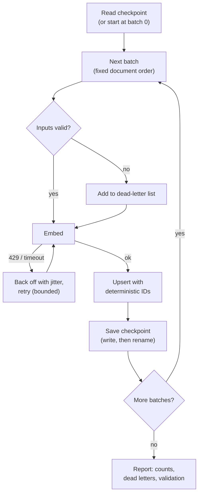

Reindexing means recomputing some or all of an index from its sources: re-chunking, re-embedding and re-loading. Every RAG system does it, usually more often than its designers expected, because embedding models improve, parsers get fixed and chunking strategies change. A reindex of a large corpus is a long-running batch job that calls a rate-limited model thousands of times, runs for hours, and must survive crashes, partial failures and its own retries without corrupting the result. Then it must prove the new index is better before anyone switches to it.

This lesson is about running that job well: deciding whether you need a reindex and how much of the index it must touch, estimating its time and cost, building it so that it can be killed and resumed safely, and validating the result. Keeping the new index current with edits made during the build is covered in [Index updates](/learn/advanced-vector-database-engineering/index-updates), and switching traffic to it in [Blue-green deployments](/learn/ci-cd-and-mlops/blue-green-deployments); this lesson links to both rather than repeating them.

## Learning objectives

- Decide, for a given change, whether a full, partial or no reindex is required, using index manifests and per-point lineage.
- Estimate a reindex's duration, request count and required concurrency from corpus size and rate limits.
- Build a reindex job that is checkpointed, idempotent and rate-limit aware, and explain what each property protects against.
- Validate a rebuilt index against the live one with judged metrics, per-query differences and rank overlap.

## Prerequisites

- [Index versioning](/learn/ci-cd-and-mlops/index-versioning): manifests and the major, minor and patch classification of index changes.
- [Index updates](/learn/advanced-vector-database-engineering/index-updates): watermarks, dual writes and parity checks during a rebuild.
- [Batch ingestion](/learn/understanding-document-ingestion/batch-ingestion): batching, retries and throughput in ingestion pipelines.
- [Recall@K](/learn/retrieval-evaluation/recall-k): the metric used to compare old and new indexes.

## Why this matters

A reindex is the most expensive routine operation in a RAG system. It touches every document, pays for every embedding, and its output decides what every user sees. Teams get it wrong in a few recurring ways.

**They reindex too much, or too little.** A parser fix that affects only scanned PDFs triggers a full rebuild of a million chunks, costing a day and a bill. Or the opposite: a model revision is treated as "only a small change", the index is patched in place, and old and new vectors end up mixed in one collection.

**The job is not restartable.** After six hours at 80 per cent complete, the worker is pre-empted, or the embedding provider returns errors for twenty minutes. The job has no record of what it finished, so it starts again from zero. Or it has a record but uses random point IDs, so the restart duplicates every chunk already written and retrieval returns the same passage three times.

**It competes with live traffic.** The reindex uses the same embedding API key as the query service. It consumes the whole rate limit, and users' queries start failing with "429 Too Many Requests" while the batch job happily retries.

**Nobody checks the result properly.** The new index finishes, the point count looks right, one average metric is slightly up, and the alias moves. A week later someone notices that a class of query (error codes, say) got much worse, hidden inside the improved average.

## The intuition

Imagine relabelling every box in a warehouse. Nobody starts at shelf one and hopes. They check which boxes really need new labels, estimate the time from the number of printers, tick each shelf off on a clipboard so a lunch break does not lose progress, make sure a label printed twice replaces the first, put damaged boxes on a side table, work at night so the pickers are not blocked, and scan a sample with the new system before it goes live. Scope, estimate, clipboard, idempotent labels, side table, off-peak scheduling and a comparison scan are the parts of a reindex job.

## How it works

### Step 1: decide the scope

The [index versioning](/learn/ci-cd-and-mlops/index-versioning) classification gives the first answer.

| Change | Classification | Reindex scope |
| --- | --- | --- |
| New embedding model, revision, prefix or metric | Major | Full re-embed into a **new** collection |
| New chunker or chunk size for all documents | Minor | Full re-chunk and re-embed; a new collection is simplest |
| Parser fix affecting one document type | Minor | **Partial**: only the affected documents |
| New payload field derived from existing metadata | Minor | No re-embedding; back-fill payloads in place |
| HNSW or quantisation settings | Patch | No re-embedding; rebuild the index structure, or copy vectors to a new collection |

Two rules govern the table. First, a change of vector space can never be done partially or in place: one collection must never contain vectors from two spaces, because every similarity comparison between them is meaningless. Second, inside one space, touch the smallest set of points that the change actually affects.

Finding that smallest set requires **per-point lineage**: payload fields, written at ingestion, that record what produced each point. Useful ones are the source document ID and content hash, the parser and its version, the chunker version and the pipeline version. With them, "re-process every chunk that came from a PDF parsed by parser version 2.x" becomes a filtered query rather than a guess. Without them, every change is a full reindex.

A **partial** reindex of a document replaces its chunks. Do it in the order *insert new, then delete old*: write the document's new chunks (whose IDs include the new pipeline version, so they do not collide with the old ones), then delete the points whose `doc_id` matches and whose pipeline version is old. The reverse order leaves a window in which the document has no chunks and cannot be retrieved.

### Step 2: estimate before you start

A reindex has three resources: model throughput (or the provider's rate limits), vector-database write throughput, and money. Estimate all three before launching anything; the mathematics section below works one example. The estimate also answers a question teams often get backwards: how many parallel workers to run. More workers than the rate limit can feed only produce more 429 errors.

Reserve headroom for live traffic. If the query service embeds user queries with the same provider account, those queries draw from the same quota. Either give the reindex its own key or project with its own quota, or cap the reindex at a fraction of the limit (80 per cent is a common starting point, not a rule). Self-hosted models have the same problem in a different form: a reindex on the GPUs that serve queries raises query latency.

### Step 3: run a job that survives failure

The job processes the corpus in batches. Three properties make it safe to stop and restart at any point.

1. **Checkpointed.** After each batch is durably written to the target collection, the job records its progress (the next batch number, or the last processed document ID in a fixed order) in a checkpoint. The checkpoint is written to a temporary file and renamed into place, because a rename on the same filesystem replaces the file in one step, so a crash never leaves half a checkpoint. On start, the job reads the checkpoint and continues from there. The order of documents must be deterministic (sort by document ID), or "batch 7" means different documents on each run.
2. **Idempotent.** Running a batch twice must leave the index as if it had run once. The crash window between "upsert succeeded" and "checkpoint saved" guarantees that some batch will eventually run twice. Deterministic point IDs make this harmless: derive each ID from the index version and the chunk's identity (a UUID version 5 is a standard way to turn a string into a stable UUID), so a repeated upsert overwrites the same points instead of adding copies.
3. **Rate-limit aware.** Expect throttling and transient errors. Retry with **exponential backoff and jitter**: wait roughly 1, 2, 4, 8 seconds, capped, each multiplied by a random factor so that many workers do not retry in lock-step. If the provider sends a `Retry-After` header, honour it. Give up on a batch only after a bounded number of tries, and then fail the job loudly rather than skip the batch silently.

Bad *inputs* are handled differently from transient *errors*. An empty document, one that the tokeniser cannot handle, or one the provider rejects as too long will fail every retry. Put it in a **dead-letter list** recorded in the checkpoint, keep going, and report the list at the end. A reindex that aborts on the first malformed document never finishes on a real corpus; one that silently drops documents gives you an index with holes.



### Step 4: keep it current while it runs

A full reindex into a new collection takes long enough that the sources change during it. The watermark, dual-write and replay procedure in [Index updates](/learn/advanced-vector-database-engineering/index-updates) handles that, and its parity check (nothing missing, nothing extra, nothing stale) is the first validation step. Partial reindexes in place need no replay, but they race with ordinary ingestion: if the regular pipeline updates a document while the partial reindex is rewriting it, the older write can land last. Process each document under a per-document version check (write only if the source version you embedded is still the newest), or pause regular ingestion for the affected documents.

### Step 5: validate against the live index

Counting points proves the job finished. It does not prove the new index is better. Validation compares old and new on three levels.

1. **Judged metrics.** Run the golden set (queries with known relevant documents) against both indexes and compare recall@k and the other metrics from [Retrieval evaluation](/learn/retrieval-evaluation). This is the headline number.
2. **Per-query differences.** Count queries that got better, worse and stayed the same, and read the ones that got worse. An improved average can hide a category that collapsed. [Regression testing](/learn/testing-and-benchmarking/regression-testing) gives a paired statistical test (McNemar's) for deciding whether a difference is real.
3. **Rank overlap on unjudged queries.** Golden sets are small. A sample of real production queries, run against both indexes, tells you how much the system's behaviour will change even where you have no judgements. **Overlap@k** is the fraction of the top-$k$ results shared by the two indexes. Low overlap is not bad in itself (a better model *should* change results) but every low-overlap query is one whose answers will change for users, so a sample of them deserves human or [LLM-as-a-judge](/learn/testing-and-benchmarking/llm-as-a-judge) review.

Only after validation does the new index go to the switch: an alias move for a minor change, or a coordinated release for a major one.

## The mathematics

### How long will it take?

The intuition: a reindex is limited by whichever resource runs out first. A provider typically limits both tokens per minute and requests per minute; you are bound by the tighter of the two, after reserving headroom for live traffic.

$$
T = \max\left(\frac{N \cdot \bar{t}}{h \cdot L_{\text{tok}}},\ \frac{\lceil N / B \rceil}{h \cdot L_{\text{req}}}\right)
$$

- $T$: duration in minutes.
- $N$: number of chunks; $\bar{t}$: average tokens per chunk; $B$: chunks per request (batch size).
- $L_{\text{tok}}$, $L_{\text{req}}$: the provider's tokens-per-minute and requests-per-minute limits.
- $h$: the fraction of the limit the reindex may use (headroom), between 0 and 1.

Worked by hand, with assumed figures (real limits vary by provider, model and account tier; check your provider's documentation): $N = 200{,}000$ chunks, $\bar{t} = 350$, $B = 64$, $L_{\text{tok}} = 1{,}000{,}000$ per minute, $L_{\text{req}} = 3{,}000$ per minute, $h = 0.8$.

- Tokens: $200{,}000 \times 350 = 70{,}000{,}000$; time $= 70{,}000{,}000 / 800{,}000 = 87.5$ minutes.
- Requests: $\lceil 200{,}000 / 64 \rceil = 3{,}125$; time $= 3{,}125 / 2{,}400 \approx 1.3$ minutes.

The token limit binds: about 87.5 minutes. Batching made the request limit irrelevant, which is typical.

### How many workers?

**Little's law** says that in a stable system the average number of items in progress equals the arrival rate times the average time each spends in the system: $L = \lambda W$. Here $L$ is the number of requests in flight (the concurrency you need), $\lambda$ the request rate the budget allows, and $W$ the latency of one request.

With the figures above, $\lambda = 3{,}125$ requests over $87.5 \times 60 = 5{,}250$ seconds, about $0.60$ requests per second. If a request takes $W = 1.5$ seconds (an assumption), then $L = 0.60 \times 1.5 \approx 0.9$. A single sequential worker already keeps the token budget busy. Ten workers would not finish faster; they would spend their time in backoff.

```python
chunks, tokens_per_chunk, batch = 200_000, 350, 64
tpm_limit, rpm_limit, headroom = 1_000_000, 3_000, 0.8   # assumed provider limits
latency_s = 1.5                                          # assumed time per request

total_tokens = chunks * tokens_per_chunk
requests = -(-chunks // batch)                           # ceiling division
minutes = max(total_tokens / (headroom * tpm_limit), requests / (headroom * rpm_limit))
rate_per_s = requests / (minutes * 60)
print(f"{total_tokens:,} tokens in {requests:,} requests -> {minutes:.1f} minutes")
print(f"needed concurrency (Little's law): {rate_per_s * latency_s:.2f} requests in flight")
```

```output
70,000,000 tokens in 3,125 requests -> 87.5 minutes
needed concurrency (Little's law): 0.89 requests in flight
```

Cost follows from the same token count: total tokens divided by one million, times the provider's price per million tokens. Prices change; look them up rather than hard-coding them in a plan.

## In code

**The problem.** Re-embed a corpus from `all-MiniLM-L6-v2` into a new collection with `bge-small-en-v1.5`, through an embedding call that is rate-limited and a worker that gets killed part-way. Show that the job resumes from its checkpoint, routes a broken document to a dead-letter list, produces no duplicates even when rerun from scratch, and then validate the new index against the old one.

Meridian's eight-sentence handbook is too small to show batching or meaningful evaluation, so this example uses 1,000 abstracts from the BEIR SciFact dataset as a stand-in corpus: every document judged relevant for SciFact's 300 test queries, plus randomly chosen others. The rate limiting and the crash are simulated around a real local model; the embeddings, upserts and evaluation are real.

```bash
pip install sentence-transformers qdrant-client pandas pyarrow huggingface_hub
```

The script expects both models and the `BeIR/scifact` and `BeIR/scifact-qrels` datasets in the local Hugging Face cache, and runs offline.

```python
import os
os.environ["HF_HUB_OFFLINE"] = "1"          # use the local cache only; never download
import json, random, uuid
import numpy as np, pandas as pd
from huggingface_hub import hf_hub_download
from sentence_transformers import SentenceTransformer
from qdrant_client import QdrantClient, models

# --- A stand-in corpus: 1,000 SciFact abstracts, with relevance judgements -------------
get = lambda repo, f: hf_hub_download(repo, f, repo_type="dataset", local_files_only=True)
corpus = pd.read_parquet(get("BeIR/scifact", "corpus/corpus-00000-of-00001.parquet"))
queries = pd.read_parquet(get("BeIR/scifact", "queries/queries-00000-of-00001.parquet"))
qrels = pd.read_csv(get("BeIR/scifact-qrels", "test.tsv"), sep="\t", dtype=str)
relevant = set(qrels["corpus-id"])
rng = random.Random(0)
others = rng.sample(sorted(set(corpus["_id"]) - relevant), 1000 - len(relevant))
corpus = corpus[corpus["_id"].isin(relevant | set(others))].sort_values("_id")
DOCS = {i: f"{t}. {x}" for i, t, x in zip(corpus["_id"], corpus["title"], corpus["text"])}
DOCS[others[0]] = "   "                      # a broken document from a faulty parser

# --- A real model behind a simulated rate-limited API -----------------------------------
class RateLimited(Exception): pass
class Crash(Exception): pass

class FlakyEmbedder:
    def __init__(self, model_id, prefix="", seed=0, p_429=0.2, crash_after=None):
        self.model, self.prefix = SentenceTransformer(model_id), prefix
        self.rng, self.p_429, self.crash_after, self.calls = random.Random(seed), p_429, crash_after, 0
    def embed(self, texts):
        if self.crash_after is not None and self.calls == self.crash_after:
            raise Crash("worker killed (node pre-empted)")
        self.calls += 1
        if self.rng.random() < self.p_429:
            raise RateLimited("429 Too Many Requests")
        return self.model.encode([self.prefix + t for t in texts], normalize_embeddings=True)

# --- The reindex job: checkpointed, idempotent, rate-limit aware --------------------------
def point_id(doc_id, index_version):              # same input -> same ID -> upsert overwrites
    return str(uuid.uuid5(uuid.NAMESPACE_URL, f"{index_version}/{doc_id}"))

def save_checkpoint(path, state):                 # write-then-rename: never half a file
    with open(path + ".tmp", "w") as f:
        json.dump(state, f)
    os.replace(path + ".tmp", path)

def reindex(client, target, docs, embedder, ckpt, index_version, batch_size=64, max_tries=6, sleep=None):
    ids = sorted(docs)
    state = json.load(open(ckpt)) if os.path.exists(ckpt) else \
            {"index_version": index_version, "next_batch": 0, "dead_letter": [], "waited_s": 0.0}
    assert state["index_version"] == index_version, "checkpoint belongs to another build"
    batches = [ids[i:i + batch_size] for i in range(0, len(ids), batch_size)]
    for b in range(state["next_batch"], len(batches)):
        good = [d for d in batches[b] if docs[d].strip()]
        state["dead_letter"] += [d for d in batches[b] if not docs[d].strip()]
        for attempt in range(max_tries):
            try:
                vecs = embedder.embed([docs[d] for d in good])
                break
            except RateLimited:
                wait = min(60, 2 ** attempt) * (0.5 + random.Random(b * 10 + attempt).random())
                state["waited_s"] += wait          # exponential backoff with jitter
                (sleep or (lambda s: None))(wait)
        else:
            raise RuntimeError(f"batch {b} still rate-limited after {max_tries} tries")
        client.upsert(target, [models.PointStruct(id=point_id(d, index_version), vector=v.tolist(),
                                                  payload={"doc_id": d, "index_version": index_version})
                               for d, v in zip(good, vecs)])
        state["next_batch"] = b + 1                # commit only after the upsert succeeded
        save_checkpoint(ckpt, state)
    return state

client = QdrantClient(":memory:")
for name in ("scifact_minilm", "scifact_bge"):
    client.create_collection(name, vectors_config=models.VectorParams(size=384, distance=models.Distance.COSINE))

old = SentenceTransformer("sentence-transformers/all-MiniLM-L6-v2")   # the live index
valid = [d for d in sorted(DOCS) if DOCS[d].strip()]
client.upload_collection("scifact_minilm", old.encode([DOCS[d] for d in valid], normalize_embeddings=True),
                         payload=[{"doc_id": d} for d in valid], ids=list(range(len(valid))))

CKPT, VERSION = "reindex.ckpt.json", "bge-small-v1"
if os.path.exists(CKPT): os.remove(CKPT)
try:
    reindex(client, "scifact_bge", DOCS, FlakyEmbedder("BAAI/bge-small-en-v1.5", seed=1, crash_after=7),
            CKPT, VERSION)
except Crash as e:
    print("run 1:", e, "| checkpoint:", json.load(open(CKPT))["next_batch"], "batches committed,",
          client.count("scifact_bge").count, "points")
state = reindex(client, "scifact_bge", DOCS, FlakyEmbedder("BAAI/bge-small-en-v1.5", seed=2), CKPT, VERSION)
print(f"run 2: resumed and finished | {client.count('scifact_bge').count} points, "
      f"dead letter {state['dead_letter']}, simulated backoff {state['waited_s']:.0f} s")
os.remove(CKPT)
reindex(client, "scifact_bge", DOCS, FlakyEmbedder("BAAI/bge-small-en-v1.5", seed=3, p_429=0), CKPT, VERSION)
print("run 3: full rerun from scratch |", client.count("scifact_bge").count, "points (idempotent, no duplicates)")

# --- Validate before any switch: judged recall, and how much the rankings moved ---------
qtext = dict(zip(queries["_id"], queries["text"]))
gold = qrels.groupby("query-id")["corpus-id"].apply(set).to_dict()
qids = sorted(gold, key=int)
bge = SentenceTransformer("BAAI/bge-small-en-v1.5")
qv_old = old.encode([qtext[q] for q in qids], normalize_embeddings=True)
qv_new = bge.encode(["Represent this sentence for searching relevant passages: " + qtext[q] for q in qids],
                    normalize_embeddings=True)
def top(coll, v, k=10):
    return [p.payload["doc_id"] for p in client.query_points(coll, query=v.tolist(), limit=k).points]
rec_old, rec_new, overlap = [], [], []
for q, vo, vn in zip(qids, qv_old, qv_new):
    a, b = top("scifact_minilm", vo), top("scifact_bge", vn)
    rec_old.append(len(gold[q] & set(a)) / len(gold[q]))
    rec_new.append(len(gold[q] & set(b)) / len(gold[q]))
    overlap.append(len(set(a) & set(b)) / 10)
rec_old, rec_new, overlap = map(np.array, (rec_old, rec_new, overlap))
print(f"\n{len(qids)} judged queries   recall@10 old {rec_old.mean():.3f}  new {rec_new.mean():.3f}")
print(f"per query: better {(rec_new > rec_old).sum()}, worse {(rec_new < rec_old).sum()}, "
      f"same {(rec_new == rec_old).sum()}")
print(f"overlap@10 old vs new: mean {overlap.mean():.2f}; queries with overlap < 0.3: {(overlap < 0.3).sum()}")
```

```output
run 1: worker killed (node pre-empted) | checkpoint: 6 batches committed, 384 points
run 2: resumed and finished | 999 points, dead letter ['36653415'], simulated backoff 5 s
run 3: full rerun from scratch | 999 points (idempotent, no duplicates)

300 judged queries   recall@10 old 0.883  new 0.923
per query: better 16, worse 5, same 279
overlap@10 old vs new: mean 0.47; queries with overlap < 0.3: 26
```

Library log messages on standard error are omitted. Recall here is measured on a 1,000-document subset, so it is far higher than on the full SciFact corpus; only the comparison between the two indexes is meaningful.

**The important lines.**

- `FlakyEmbedder` wraps a real model and, with a seeded random generator, raises `RateLimited` on about one call in five and `Crash` on a chosen call, so failures are reproducible. In production these would be your provider's rate-limit exception and a real pre-emption.
- `point_id` derives a UUID from the index version and document ID with `uuid.uuid5`. The same document in the same build always gets the same ID, which is what makes run 3 harmless.
- `save_checkpoint` writes a temporary file and renames it with `os.replace`, which atomically replaces the destination on the same filesystem.
- The checkpoint is saved only *after* `client.upsert` returns. A crash between the two repeats one batch, which idempotent IDs make safe. Saving it before the upsert would risk skipping a batch, which nothing would detect.
- The `assert` on `index_version` stops a checkpoint from one build being used to resume a different build, which would skip batches that the new build never wrote.
- Inputs that can never succeed (here, a whitespace-only document) go to `dead_letter` and do not block the batch; transient errors are retried with `2 ** attempt` seconds of backoff, capped at 60 and scaled by a random factor between 0.5 and 1.5. The script records the waits instead of sleeping so that it runs instantly; pass `sleep=time.sleep` to wait for real.

**What the output means.** Run 1 was killed on its eighth call to the model. Because two calls were throttled and retried, only six batches (384 points) had been committed, and the checkpoint says exactly that. Run 2 started at batch 6 and finished, writing 999 points: 1,000 documents minus the one broken document, which is named in the dead-letter list. Run 3 deleted the checkpoint and reprocessed everything; the count stayed at 999 because every upsert overwrote an existing point.

The validation block is the part that decides whether to switch. Recall@10 rose from 0.883 to 0.923, and per query 16 improved and 5 got worse. Those 5 are the ones to read before switching, because they show what kind of question the new model handles worse. The mean overlap@10 of 0.47 says that more than half of each top-10 list changed: users will see substantially different results, and the 26 queries with overlap below 0.3 are the obvious candidates for a human or LLM-judge review sample.

**Errors you may hit.** An offline-mode error means a model or dataset is not cached. If you change `VERSION` after interrupting run 1, the `assert` fires, as intended. With a real API, a `RuntimeError` after `max_tries` often means the limit is shared with the live query service.

**Extending it.** Read the batch order from a filtered scroll of the live collection (for a partial reindex by lineage), store the checkpoint in a database rather than a local file so another worker can resume it, add a token-length check against the model's maximum sequence length to the input validation, and write the validation results into the index registry next to the manifest.

## A real-world example

Meridian's Platform team discovers that the PDF parser used for IT runbooks has been dropping table contents since an upgrade three months earlier. Runbook tables hold most of the Atlas error codes, so questions such as "what does E-4030 mean?" are answered poorly. The fix to the parser is one line. The question is how much to reindex.

Because AskMeridian writes `parser` and `parser_version` into every point's payload, an engineer can count the affected points with a filter: about 6 per cent of the collection, all from runbook PDFs parsed by the upgraded version. The embedding model is unchanged, so this is a minor change and a partial reindex in place is safe. The team rejects a full rebuild, which would take most of a day and re-embed the handbook for no reason.

The job selects affected documents by lineage, processes them in a fixed order with a checkpoint in the pipeline's database, and replaces each document's chunks insert-first, delete-second. It runs with half of the embedding quota so that daytime queries are unaffected, and finishes in under an hour. Four documents land in the dead-letter list: scanned pages with no text layer, which go to the team that owns the runbooks. Validation runs the golden set, whose error-code slice improves, and a sample of logged error-code queries, which the on-call engineer spot-checks before declaring the job done.

## Common mistakes

- **Patching a new model's vectors into the old collection.** Two vector spaces in one collection make every similarity comparison between them meaningless, and nothing raises an error.
- **Random point IDs.** Every retry or restart duplicates the points it rewrites, so retrieval returns the same chunk several times and counts never match.
- **Saving the checkpoint before the write.** A crash between the two silently skips a batch.
- **Non-deterministic batch order.** Iterating over an unordered set or an unsorted query means "resume at batch 7" processes different documents after a restart.
- **Unbounded retries, or skipping failed batches.** The first can hang a job forever behind a hard error; the second leaves holes nobody finds.
- **Sharing the live query service's rate limit.** The reindex starves real users; give it its own quota or a capped share.
- **Validating with counts only.** A complete index can still be a worse one; compare judged metrics, per-query changes and rank overlap.

## Best practices

- Record lineage (source ID, content hash, parser, chunker and pipeline versions) on every point so a reindex can be scoped by filter.
- Estimate time, requests, concurrency and cost before starting, with headroom reserved for live traffic.
- Process in a fixed order, write deterministic point IDs, and save an atomic checkpoint after each committed batch.
- Retry transient errors with capped exponential backoff and jitter, honour `Retry-After`, and send permanently bad inputs to a dead-letter list.
- Validate with the golden set, a per-query comparison and rank overlap on a sample of real queries, and read the queries that got worse.
- Schedule large reindexes off-peak, and treat the switch as a separate, deliberate step.

## Performance considerations

**Batching.** Larger batches cut request overhead and per-request rate-limit pressure, as the worked example showed. They also make each retry more expensive and each checkpoint coarser. Batches of tens to a few hundred chunks are a common middle ground; respect any per-request input limit the provider sets.

**Database writes.** Bulk loading a new collection is faster if index construction is deferred until the load ends; [Collections](/learn/advanced-vector-database-engineering/collections) covers this for Qdrant. A partial reindex in place writes into a live, indexed collection, so it also causes the segment churn discussed in [Index updates](/learn/advanced-vector-database-engineering/index-updates).

## Security considerations

- A reindex reads every source document, so its credentials should be read-only on the sources and scoped to the target collection on the database. A reindex job with write access to sources is a needless risk.
- Re-processing re-applies today's access-control metadata. If permissions are copied into payloads at ingestion, a reindex is an opportunity to fix stale permissions, and a risk if the permission lookup fails open. Fail the batch, not the check.
- Documents removed for legal reasons must not come back with a reindex from an old snapshot; build from the current, erasure-applied sources.

## Summary

- Choose the smallest correct scope: a new vector space always means a full rebuild into a new collection; within one space, per-point lineage lets you reindex only what a change affects.
- Estimate before you start: the tighter of the token and request limits, after headroom for live traffic, sets the duration, and Little's law sets the concurrency worth running.
- Make the job checkpointed (progress saved atomically after each committed batch), idempotent (deterministic point IDs) and rate-limit aware (bounded backoff with jitter, dead letters for bad inputs).
- Validate with judged metrics, per-query improvements and regressions, and rank overlap on real queries before switching.

## Exercises

**1.** Using the formula from this lesson, estimate the duration of re-embedding 1,500,000 chunks averaging 300 tokens, in batches of 100, with assumed limits of 5,000,000 tokens and 5,000 requests per minute and a headroom of 0.7. Which limit binds?

<details><summary>Show solution</summary>

Tokens: $1{,}500{,}000 \times 300 = 450{,}000{,}000$; time $= 450{,}000{,}000 / 3{,}500{,}000 \approx 128.6$ minutes. Requests: $15{,}000 / 3{,}500 \approx 4.3$ minutes. The token limit binds: a little over two hours, before retries.

</details>

**2.** In the lesson's job, a reviewer suggests moving `save_checkpoint` above `client.upsert` "so progress is never lost". Explain what goes wrong, and describe a failure that idempotent IDs cannot repair.

<details><summary>Show solution</summary>

If the process dies after saving the checkpoint but before the upsert completes, the resumed job starts at the next batch and the failed batch is never written: a silent hole. With the original order, the worst case is writing a batch twice, which deterministic IDs make harmless. Idempotent IDs cannot repair a *skipped* write, only a repeated one. A final parity check against the source would catch the hole, which is a second reason to run one.

</details>

**3.** Design how AskMeridian's reindex job should share embedding capacity with the live query service when both use the same provider account, so that queries are never throttled by the reindex. Consider at least two mechanisms and their trade-offs.

<details><summary>Show solution</summary>

Options: (1) **Separate quota**: a separate project or key with its own limits for batch work, the cleanest isolation if the provider supports it. (2) **A fixed cap**: the job uses at most a fraction of the shared limit, enforced by a client-side token bucket; simple, but the cap must leave room for peak query load, wasting capacity off-peak. (3) **Adaptive throttling**: the job slows down when it sees 429s or when the query service reports rising embedding latency, and speeds up gradually (additive increase, multiplicative decrease, as in network congestion control); efficient but needs a feedback signal and testing. (4) **Scheduling**: run large jobs at night. A sensible combination is a separate quota where available, otherwise a cap that rises off-peak, plus a rule that the query path is never retried behind batch traffic.

</details>

## Check your understanding

```quiz
[
  {
    "q": "Why must a reindex job derive point IDs deterministically from the build and the chunk, rather than generate random UUIDs?",
    "options": [
      "Random UUIDs are slower to index",
      "So that a batch processed twice after a crash overwrites the same points instead of duplicating them",
      "Because Qdrant only accepts UUID version 5",
      "So that the IDs sort alphabetically"
    ],
    "answer": 1,
    "why": "A crash between the write and the checkpoint means some batch will run twice. Deterministic IDs make the second run an overwrite, so the job is idempotent."
  },
  {
    "q": "A team has a provider limit of 1,000,000 tokens per minute and already batches 64 chunks per request. A reindex is running slowly. What is the most likely effect of raising the number of parallel workers from 2 to 20?",
    "options": [
      "A tenfold speed-up",
      "No speed-up, and many more 429 responses, because throughput is capped by the token limit",
      "Lower total cost per token",
      "Better recall in the new index"
    ],
    "answer": 1,
    "why": "Once the token budget is saturated, extra concurrency only adds throttled requests. Little's law shows how few requests in flight a budget actually needs."
  },
  {
    "q": "A parser fix affects 5% of documents and the embedding model is unchanged. Which plan is most appropriate?",
    "options": [
      "Rebuild everything into a new collection",
      "Select affected points by lineage metadata and replace their chunks in place, inserting new chunks before deleting old ones",
      "Delete the affected chunks now and re-ingest them next week",
      "Change the HNSW parameters to compensate"
    ],
    "answer": 1,
    "why": "Same vector space and a small affected set: a partial reindex by lineage is correct, and insert-then-delete avoids a window where documents are missing."
  },
  {
    "q": "The new index improves mean recall@10, but mean overlap@10 with the old index is 0.4. What should you conclude?",
    "options": [
      "The new index is broken and must be discarded",
      "Results will change for many users; review a sample of low-overlap queries and the queries that got worse before switching",
      "Overlap must be above 0.9 for any reindex to be valid",
      "Nothing; overlap is irrelevant when recall improves"
    ],
    "answer": 1,
    "why": "Low overlap is expected when a model improves, but it means user-visible behaviour changes widely, so unjudged changes deserve review."
  },
  {
    "q": "Where should a reindex job save its checkpoint relative to writing a batch to the vector database?",
    "options": [
      "Before the write, so progress is never lost",
      "After the write succeeds, so a crash can only cause a batch to repeat, never to be skipped",
      "Only at the end of the job",
      "It does not matter if IDs are deterministic"
    ],
    "answer": 1,
    "why": "Saving after the write turns every crash into, at worst, a repeated batch, which deterministic IDs make harmless. Saving before risks a silently skipped batch."
  }
]
```

## Further reading

- Qdrant documentation, [qdrant.tech/documentation](https://qdrant.tech/documentation/): bulk upload, collection aliases and optimiser settings for large loads.
- Thakur et al. (2021), "BEIR: A Heterogeneous Benchmark for Zero-shot Evaluation of Information Retrieval Models", [arXiv:2104.08663](https://arxiv.org/abs/2104.08663): the benchmark that packages the SciFact data used here.
- Marc Brooker, "Exponential Backoff And Jitter", AWS Architecture Blog (2015): why jitter matters when many clients retry.
- Kleppmann (2017), *Designing Data-Intensive Applications*, O'Reilly, chapters 10 and 11: batch and stream processing, idempotence and exactly-once effects.
- Python documentation, [`uuid` module](https://docs.python.org/3/library/uuid.html): `uuid5` and name-based UUIDs.
