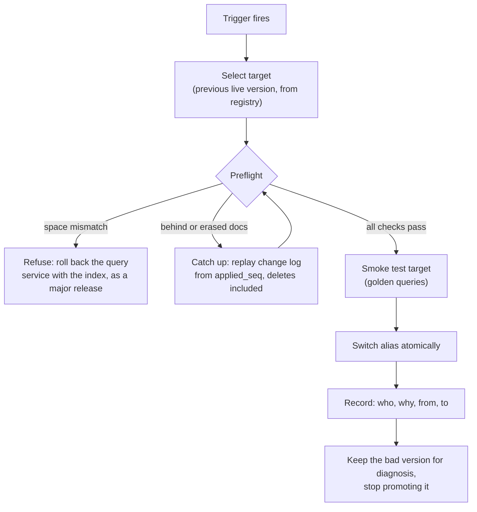

A rollback is the promise that makes every other deployment safe: if the new thing is bad, you can get the old thing back, quickly, without thinking. In ordinary software that promise is cheap, because the old build is a file. In a RAG system it is not, because the "thing" is a bundle of code, prompts, models, an index and the data inside it, and the data keeps changing while the new version runs. Re-pointing an alias at last week's collection takes one API call; whether that call restores a *correct* system depends on everything that happened since.

This lesson covers what a rollback actually has to restore in a RAG system, how to decide when to roll back, why index rollbacks are different from code rollbacks (stale data, erased documents, incompatible query encoders), and how to build a rollback that checks itself before it acts. The mechanics of running two versions side by side and switching traffic belong to [Blue-green deployments](/learn/ci-cd-and-mlops/blue-green-deployments); building the candidate index belongs to [Reindexing](/learn/ci-cd-and-mlops/reindexing).

## Learning objectives

- Enumerate the components of a RAG release that must roll back together, and identify which ones are stateful.
- Define rollback triggers as measurable conditions with thresholds, and distinguish rolling back from rolling forward.
- Explain three ways a naive alias flip produces a wrong system: stale data, resurrected erased documents and an incompatible query encoder.
- Implement a rollback that runs preflight checks, repairs a stale target by replaying a change log, and records the action.
- Design a retention window for rollback targets that balances storage cost against recovery options.

## Prerequisites

- [Index versioning](/learn/ci-cd-and-mlops/index-versioning): manifests, space IDs and the registry.
- [Collections](/learn/advanced-vector-database-engineering/collections): aliases and atomic switching.
- [Index updates](/learn/advanced-vector-database-engineering/index-updates): change logs, watermarks and dual writes.
- [CI/CD pipelines](/learn/ci-cd-and-mlops/ci-cd-pipelines): how releases are promoted and gated.

## Why this matters

Three incidents, all plausible, all avoidable.

A new chunker is promoted on a Tuesday after passing the golden set. By Thursday, support tickets show that error-code questions are failing: the golden set had four error-code queries, and the new chunker splits catalogue tables badly. The team decides to roll back. Someone flips the alias to the previous collection. That collection stopped receiving updates on Tuesday, so the handbook edits made on Wednesday are missing, and a legal notice withdrawn on Wednesday is back. The rollback traded one incident for two.

A second team rolls back the *index* but not the *query service*. The old index was built with one embedding model, the running service now uses another, and the two have the same dimension, so nothing errors. Retrieval quality collapses and nobody connects it to the rollback, because the rollback "worked".

A third team has no rollback target at all: the old collection was deleted to save storage the day after promotion, and the only way back is a six-hour rebuild while the bad version keeps serving.

A rollback is a procedure to be designed, tested and rehearsed before it is needed. At 3 a.m. with users affected, nobody should be working out what state the standby index is in.

## The intuition

Think of a hospital pharmacy that swaps a medication supplier. Going back to the old supplier is easy in principle: it is the same shelf. But three things can have changed in the meantime. Stock records since the swap were written against the new supplier's product codes (stale data). A batch has been recalled, and the old supplier's remaining stock on the back shelf includes it (resurrected content). And the dispensing machines were reconfigured to read the new supplier's barcodes (incompatible clients). A sensible pharmacist does not just move the label back; she checks each of those, fixes what is stale, and writes down what she did.

## How it works

### What a release contains

A RAG release is several versioned things that must be consistent with each other.

| Component | Stateful? | Rollback mechanism |
| --- | --- | --- |
| Application code (API, orchestration) | No | Redeploy the previous image |
| Prompts and configuration | No | Revert the versioned config |
| Embedding model and query encoder | No, but must match the index | Redeploy with the previous pinned revision |
| Generation model choice | No | Revert the config; check the provider still serves the old model |
| **Index** (collection plus alias) | **Yes** | Re-point the alias, after checks |
| Source data and change log | Yes, and only moves forward | **Not rolled back**: it is the truth, and rollback must catch up to it |

Stateless components roll back by redeploying an old artefact. The index is the hard one, and the last row is the crucial insight: **the source of truth never rolls back**. Documents deleted on Wednesday stay deleted when you roll back on Thursday. So an index rollback is not "return to the state of last Tuesday". It is "return to last Tuesday's *recipe*, brought up to date with everything since".

### Deciding to roll back

A rollback needs a trigger decided in advance, because deciding under pressure leads to either panic or paralysis. Good triggers are measurable conditions evaluated on live signals:

- **Hard failures**: error rate or timeout rate above a threshold for a sustained window; the readiness guard failing; a dependency (the vector store) unreachable.
- **Retrieval health**: top-1 similarity, empty-result rate or no-answer rate departing from baseline (see [Retrieval monitoring](/learn/rag-observability/retrieval-monitoring)).
- **Quality**: an online sample scored by an LLM judge, or user feedback signals, dropping beyond a margin (see [Generation monitoring](/learn/rag-observability/generation-monitoring)).
- **Safety**: any report that restricted or erased content is being served. This is a rollback-or-disable trigger with no threshold at all.

Latency of detection matters as much as the threshold: quality signals are noisy, so they need a window long enough to be statistically meaningful, and during that window users are affected. This is the main argument for introducing changes gradually ([Blue-green deployments](/learn/ci-cd-and-mlops/blue-green-deployments) covers traffic shifting), so that the exposed fraction of users is small while you wait.

**Rolling back versus rolling forward.** Rolling back restores a known version; rolling forward ships a fix. Roll back when the cause is unclear, the previous version is known good, and the rollback is safe and fast. Roll forward when the problem is a small, understood defect (a wrong filter, a missing payload index) and the fix can be validated faster than a rollback can be completed, or when rolling back is itself risky (it would resurrect erased data, or the previous version cannot serve current traffic). The default for an unexplained quality regression is to roll back first and diagnose afterwards, because diagnosis is easier when users are no longer affected.

### Why index rollbacks go wrong

An alias flip restores a *collection*. Three properties of that collection decide whether the result is correct.

**1. Staleness.** While the new version was live, ingestion wrote to it. If the old collection was not also written to (no dual write), it is frozen at the switch. A rollback re-publishes a frozen past: edits made since are missing. Fix: either keep dual-writing to the standby for the whole rollback window (costing embedding and write capacity), or *catch up on rollback*, replaying the change log from the standby's recorded `applied_seq`. Catch-up needs the change log to be retained for at least the rollback window, and needs the registry to record each version's applied position.

**2. Resurrected content.** Deletions are the dangerous case. A frozen collection still contains documents deleted since, whether for being superseded, withdrawn, or erased for legal or privacy reasons. Replaying the change log fixes it, but only if deletions are *in* the log, which is a design requirement on the ingestion pipeline: an erasure must produce a durable event, not just a delete against the live collection. As a defence in depth, keep an **erasure ledger** (document IDs that must never be served) and have the rollback preflight verify that the target contains none of them.

**3. Compatibility.** A rolled-back index must be queried by the encoder it was built for. If the previous index is in a different embedding space from the one the query service runs, the rollback must be a coordinated one: previous index and previous query-service configuration together. That is a major change in the [index versioning](/learn/ci-cd-and-mlops/index-versioning) sense, so the registry's space IDs make the check mechanical. Prompts and generation settings have the same kind of coupling if the prompt expects a particular chunk format.

### The preflight rollback

These three properties turn a rollback into a short procedure.



Each step earns its place. Selecting the target from the registry, not from memory, uses the alias history. The smoke test uses the golden set against the *target* before any traffic reaches it, because a standby that has sat unused for days is the least tested component in the system. Recording the rollback preserves the audit trail and tells the next engineer which version is suspect. Finally, keep the failed version rather than deleting it: you will need it to reproduce the problem.

### Retention: how long is a rollback window?

A rollback target costs storage and, if you dual-write, ongoing write and embedding cost. The window should match the **detection time** of your slowest important failure. A crash is detected in minutes; a quality regression that only shows in a weekly review is detected in a week. If the window is shorter than detection time, you will detect a problem and have nothing to return to. Common practice is to keep the previous version for a period measured in days to a couple of weeks, but the right number follows from your monitoring, not from a convention. After the window the old collection is deleted, though its manifest and registry row stay.

## The mathematics

### The cost of staleness

If ingestion produces changes at a rate $\lambda$ per hour and the standby has been frozen for $t$ hours, a rollback without catch-up serves a collection that is $\lambda t$ changes behind, a share of which are deletions. Catch-up time is the replay of those changes at rate $\mu$ changes per hour:

$$
T_{\text{catch-up}} = \frac{\lambda\, t}{\mu}
$$

where $\lambda$ is the change arrival rate, $t$ the time since the standby was last current, and $\mu$ the replay throughput (including embedding). The intuition is that a longer window makes rollback slower unless you dual-write, which pays the cost continuously instead of at rollback.

Worked by hand: if edits arrive at 400 changes per hour (assumed) and the standby is 72 hours stale, that is $400 \times 72 = 28{,}800$ changes. At a replay throughput of 12,000 changes per hour (assumed, bound by embedding), catch-up takes $28{,}800 / 12{,}000 = 2.4$ hours. Rollback cannot be quick, so the choice is between dual writing, which keeps the cost per rollback near zero, and a documented 2.4-hour recovery.

```python
arrival, hours_stale, replay = 400, 72, 12_000    # assumed figures
behind = arrival * hours_stale
print(f"{behind:,} changes behind; catch-up {behind / replay:.1f} h")
```

```output
28,800 changes behind; catch-up 2.4 h
```

## In code

**The problem.** Model the rollback of a bad promotion. AskMeridian runs v2; v1 is the standby and was *not* dual-written. A document was edited and another (a legacy VPN notice) was erased since the switch. Show what a naive alias flip serves, then implement a guarded rollback with preflight checks and catch-up, and an alias history.

This uses the local MiniLM model and in-memory Qdrant, so it runs offline. The change log, registry and erasure ledger are plain Python structures standing in for a database.

```bash
pip install sentence-transformers qdrant-client
```

```python
import os, hashlib
os.environ["HF_HUB_OFFLINE"] = "1"
from sentence_transformers import SentenceTransformer
from qdrant_client import QdrantClient, models

model = SentenceTransformer("sentence-transformers/all-MiniLM-L6-v2")
SPACE = "minilm-1110a243"                       # space ID the query service runs
client = QdrantClient(":memory:")
ALIAS = "askmeridian"

# Source of truth and an append-only change log: (seq, op, doc_id, text)
SOURCE = {"leave": "Annual leave is 25 days; up to 5 unused days carry over and must be used by 31 March.",
          "desk": "The support desk is open 08:00 to 18:00 UK time.",
          "old-vpn": "Contractors may use the legacy VPN gateway vpn-old.meridian.example."}
LOG = []
def change(op, doc_id, text=None):
    LOG.append((len(LOG) + 1, op, doc_id, text))
    if op == "put": SOURCE[doc_id] = text
    else: SOURCE.pop(doc_id, None)

REGISTRY = {}        # version -> {"collection", "space", "applied_seq", "status"}
HISTORY = []         # every alias change: (alias, from, to, reason)
ERASED = set()       # doc IDs that must never be served again (erasure ledger)

def apply(coll, seq, op, doc_id, text):
    pid = int(hashlib.sha1(doc_id.encode()).hexdigest()[:8], 16)
    if op == "put":
        v = model.encode(text, normalize_embeddings=True).tolist()
        client.upsert(coll, [models.PointStruct(id=pid, vector=v, payload={"doc": doc_id, "text": text})])
    else:
        client.delete(coll, models.PointIdsList(points=[pid]))

def build(version, docs_at_seq, seq):
    coll = f"askmeridian_{version}"
    client.create_collection(coll, vectors_config=models.VectorParams(size=384, distance=models.Distance.COSINE))
    for d, t in docs_at_seq.items():
        apply(coll, seq, "put", d, t)
    REGISTRY[version] = {"collection": coll, "space": SPACE, "applied_seq": seq, "status": "standby"}

def promote(version, reason):
    cur = current()
    client.update_collection_aliases([
        *([models.DeleteAliasOperation(delete_alias=models.DeleteAlias(alias_name=ALIAS))] if cur else []),
        models.CreateAliasOperation(create_alias=models.CreateAlias(
            collection_name=REGISTRY[version]["collection"], alias_name=ALIAS))])
    if cur: REGISTRY[cur]["status"] = "standby"
    REGISTRY[version]["status"] = "live"
    HISTORY.append((ALIAS, cur, version, reason))

def current():
    a = [x.collection_name for x in client.get_aliases().aliases if x.alias_name == ALIAS]
    return next((v for v, r in REGISTRY.items() if r["collection"] == a[0]), None) if a else None

def write_all(seq, op, doc_id, text, dual):
    """Ingestion: always write the live index; optionally keep the standby current too."""
    for v, r in REGISTRY.items():
        if v == current() or (dual and r["status"] == "standby"):
            apply(r["collection"], seq, op, doc_id, text); r["applied_seq"] = seq
    if op == "delete": ERASED.add(doc_id)

def preflight(version, query_space):
    r, problems = REGISTRY[version], []
    if r["space"] != query_space:
        problems.append(f"incompatible vector space {r['space']} (query encoder is {query_space})")
    behind = [e for e in LOG if e[0] > r["applied_seq"]]
    if behind:
        problems.append(f"{len(behind)} change(s) behind (applied_seq {r['applied_seq']}, log head {len(LOG)})")
    hits = [d for d in ERASED if client.count(r["collection"], count_filter=models.Filter(must=[
        models.FieldCondition(key="doc", match=models.MatchValue(value=d))])).count]
    if hits:
        problems.append(f"contains erased document(s): {hits}")
    return problems

def catch_up(version):
    r = REGISTRY[version]
    for seq, op, d, t in LOG:
        if seq > r["applied_seq"]:
            apply(r["collection"], seq, op, d, t); r["applied_seq"] = seq

def rollback(query_space, reason, target=None, fix=True):
    cur = current()
    target = target or next(v for v in reversed([h[1] for h in HISTORY if h[2] == cur]) if v)
    problems = preflight(target, query_space)
    if problems and fix:
        catch_up(target); problems = preflight(target, query_space)
    if problems:
        return f"REFUSED {cur} -> {target}: " + "; ".join(problems)
    promote(target, reason)
    return f"rolled back {cur} -> {target}"

def top(q):
    v = model.encode(q, normalize_embeddings=True).tolist()
    return [p.payload["doc"] for p in client.query_points(ALIAS, query=v, limit=2).points]

# --- Timeline -------------------------------------------------------------------------
build("v1", SOURCE, 0); promote("v1", "initial release")
build("v2", SOURCE, 0); promote("v2", "new chunker")          # v2 live; v1 on standby
for op, d, t in [("put", "leave", SOURCE["leave"] + " Part-time staff get a pro-rata amount."),
                 ("delete", "old-vpn", None)]:
    change(op, d, t)                                  # source of truth and log
    write_all(len(LOG), op, d, t, dual=False)         # only the live index is written
print("live:", current(), "| v1 applied_seq:", REGISTRY["v1"]["applied_seq"], "| log head:", len(LOG))
print("top for 'legacy VPN gateway' on v2:", top("legacy VPN gateway"))

print("\nNaive rollback (alias flip only) would serve v1:")
client.update_collection_aliases([models.DeleteAliasOperation(delete_alias=models.DeleteAlias(alias_name=ALIAS)),
    models.CreateAliasOperation(create_alias=models.CreateAlias(collection_name="askmeridian_v1", alias_name=ALIAS))])
print("  top for 'legacy VPN gateway':", top("legacy VPN gateway"), "<- erased document is back")
promote("v2", "undo the naive flip")

print("\nGuarded rollback, no repair allowed:")
print(" ", rollback(SPACE, "recall regression", fix=False))
print("Guarded rollback with catch-up replay:")
print(" ", rollback(SPACE, "recall regression"))
print("  live:", current(), "| top for 'legacy VPN gateway':", top("legacy VPN gateway"))
print("\nAlias history:")
for h in HISTORY: print("  ", h)
```

```output
live: v2 | v1 applied_seq: 0 | log head: 2
top for 'legacy VPN gateway' on v2: ['leave', 'desk']

Naive rollback (alias flip only) would serve v1:
  top for 'legacy VPN gateway': ['old-vpn', 'desk'] <- erased document is back

Guarded rollback, no repair allowed:
  REFUSED v2 -> v1: 2 change(s) behind (applied_seq 0, log head 2); contains erased document(s): ['old-vpn']
Guarded rollback with catch-up replay:
  rolled back v2 -> v1
  live: v1 | top for 'legacy VPN gateway': ['leave', 'desk']

Alias history:
   ('askmeridian', None, 'v1', 'initial release')
   ('askmeridian', 'v1', 'v2', 'new chunker')
   ('askmeridian', 'v1', 'v2', 'undo the naive flip')
   ('askmeridian', 'v2', 'v1', 'recall regression')
```

**The important lines.**

- `REGISTRY` records, per version, the collection, the vector space and `applied_seq`, the last change-log position applied to it. Everything in `preflight` reads from it.
- `write_all` writes the live collection always and the standby only when `dual=True`. Here it is `False`, which is the realistic cheap configuration and the one that makes the standby go stale.
- `preflight` runs three independent checks: space compatibility, how many log entries lie beyond `applied_seq`, and whether any document in the erasure ledger is still in the target (a filtered `count`).
- `rollback` chooses the target from the alias history, runs preflight, replays the log if checks fail (`catch_up`, which applies deletes as well as puts), re-checks, and only then calls `promote`, which switches the alias in one `update_collection_aliases` call and appends to the history.

**What the output means.** After the two changes, the live v2 collection correctly returns no legacy VPN document for the query (its top hit is the nearest unrelated document), but v1 is 2 changes behind. The naive flip puts `old-vpn` straight back at rank 1: an erased document served again, with no error. The guarded rollback without repair refuses and says precisely why. With catch-up allowed, it replays both changes, the checks pass, and the alias moves; the erased document is gone from the results and the history records the reason. The extra "undo the naive flip" line is an artefact of the demonstration.

The space check is not triggered here because both versions use the same model. If `REGISTRY["v1"]["space"]` named a different space, `rollback` would refuse with an "incompatible vector space" message and the correct action would be to roll back the query service with the index.

**Errors you may hit.** Qdrant point IDs must be unsigned integers or UUIDs, hence the hash-derived integer ID. A `StopIteration` from `rollback` means the alias history has no previous version to return to, which is the signal that no rollback target exists.

**Extending it.** Add a golden-query smoke test between preflight and `promote`; store the registry, ledger and log in a database; make `promote` refuse when the new target's manifest is not marked verified; and alert on any promotion or rollback.

## A real-world example

Meridian promotes a new chunker for the IT runbooks on a Tuesday afternoon. The golden set passes, and the Platform team keeps the previous collection as the standby for 10 days. They do not dual-write: embedding both versions doubled nightly ingestion cost, and the team judged that 10 days of staleness was cheaper than permanent double writes.

On Friday, the support desk reports that error-code questions are returning table fragments. An on-call engineer checks the dashboards: the empty-answer rate for questions containing `E-` is up on the new version. The trigger condition in the runbook is met, so they run the rollback tool. Preflight reports 38 changes since Tuesday and one erased document: a runbook withdrawn because it named a decommissioned gateway. The tool replays the 38 changes (about two minutes at the corpus's change rate), re-checks, runs the golden queries against the standby, and switches the alias. The whole procedure takes under ten minutes.

The post-incident review adds seven error-code queries to the golden set, because the original four were too few to catch the regression, and raises the question of whether a gradual traffic shift would have limited the exposure to the first hour. That is the subject of the next lesson.

## Common mistakes

- **Rolling back by flipping the alias alone.** The standby may be stale, may contain erased documents or may need a different encoder; none of these raises an error.
- **Deleting the previous version immediately after promotion.** The rollback window is then zero, and a regression found on day three costs a full rebuild.
- **Keeping the index but not the matching query-service configuration.** A coordinated change was deployed half-way back.
- **Deletions that are not in the change log.** Catch-up cannot replay what was never recorded, so erased documents reappear.
- **Never rehearsing the rollback.** The standby has never served traffic, and the first test is during an incident.
- **No pre-agreed triggers.** The team argues about whether the regression is "bad enough" while users are affected.
- **Rolling back the data pipeline's cursor along with the index.** The source of truth moves only forward; rewinding ingestion to an old position replays deletions out of order or loses changes.

## Best practices

- Treat each release as a set (code, config, encoder, index, prompts) and record the set in the registry so it can be restored as one.
- Define rollback triggers with metrics, thresholds and windows before launch, including a no-threshold trigger for serving erased or restricted content.
- Keep the previous version for a window at least as long as your slowest failure takes to detect.
- Either dual-write the standby or retain the change log long enough to replay it, and make every erasure a durable log event.
- Run preflight (compatibility, staleness, erased content) and a golden-query smoke test before switching, and record every switch with a reason.
- Rehearse rollbacks on a schedule, in staging and occasionally in production off-peak.

## Performance considerations

**Switch time versus catch-up time.** The alias flip itself is effectively instant; the cost is the catch-up. Use the formula above: with dual writes it is near zero but you pay embedding and write capacity continuously; without, you pay $\lambda t / \mu$ at rollback.

**Standby storage.** A retained version costs the same as the live index. At 200,000 chunks of 384 dimensions that is about 307 MB of raw `float32` vectors (assumed corpus), before index overhead; a standby collection is also memory if the database keeps vectors in RAM, so check how your store handles inactive collections.

**Warm-up.** A standby that has not been queried may have cold caches or on-disk segments; the first requests after a rollback can be slower. The smoke test doubles as warm-up.

## Security considerations

- **Rollbacks can republish removed content.** This is the most important security property of an index rollback. Erasures, revoked permissions and withdrawn documents must be re-applied to any target before it serves, which is what the ledger check and the catch-up do.
- **Restrict who can roll back.** Moving the alias changes what every user is answered from; it needs the same access control and audit trail as a promotion.
- **Old versions carry old access-control metadata.** If permissions are stored in payloads, a stale standby can grant access that has since been revoked. Catch-up must include permission changes, not just content changes.
- **Retention is a liability.** Each retained version is another copy of the data; apply the retention window, and apply erasure requests to every version in it.

## Summary

- A RAG release is a set of components; stateless ones roll back by redeploying, but the index is stateful and the source of truth never rolls back.
- Define measurable triggers in advance; roll back first when the cause is unknown and the target is safe, roll forward when the defect is small and understood.
- A naive alias flip can serve stale data, resurrect erased documents or pair an index with the wrong encoder, all without errors.
- A safe rollback runs preflight checks, replays the change log (deletes included) onto the target, smoke-tests it, switches atomically and records why.
- The rollback window should match your slowest failure's detection time, and every retained version is also a data-retention obligation.

## Exercises

**1.** Meridian's standby index is 48 hours stale. Edits arrive at 250 per hour and replay runs at 10,000 per hour. How long does catch-up take, and what would dual writing change?

<details><summary>Show solution</summary>

$250 \times 48 = 12{,}000$ changes; $12{,}000 / 10{,}000 = 1.2$ hours. With dual writing the standby is always current, so catch-up is near zero, at the price of embedding and writing every change twice, continuously.

</details>

**2.** An engineer proposes that rollback should always rewind the ingestion cursor to the time the standby froze, "so everything is consistent". What goes wrong?

<details><summary>Show solution</summary>

The source of truth moves only forward. Rewinding the cursor makes ingestion re-process old changes in the context of newer ones: a document updated, then deleted, is replayed as an update and its deletion may be skipped or applied out of order; and the work duplicates what catch-up does more safely. Instead, leave the cursor, and replay the log forward into the standby from its own `applied_seq`.

</details>

**3.** Write the rollback trigger section of a runbook for AskMeridian: at least four triggers with a metric, a threshold and an evaluation window, and one that needs no threshold.

<details><summary>Show solution</summary>

Illustrative thresholds, to be tuned from your own baselines: (1) 5xx rate above 2 per cent for 5 minutes; (2) readiness guard failing on any replica for 10 minutes; (3) empty-answer rate more than 5 percentage points above the 7-day baseline for 30 minutes, on at least 200 queries; (4) LLM-judge faithfulness on a sampled 2 per cent of traffic more than 3 points below baseline over 24 hours; (5) no threshold: any report that erased or restricted content was served triggers rollback or disabling the affected collection immediately.

</details>

**4.** Extend the lesson's `rollback` to run a golden-query smoke test before switching. Describe what it should do on failure and why it belongs after catch-up.

<details><summary>Show solution</summary>

After `catch_up`, run each golden query against the target collection (not the alias) and compare the top result with the expected document, returning `REFUSED ... golden queries failed: [...]` if any miss beyond a tolerance. It belongs after catch-up because the target must be current to be tested fairly, and before `promote` because the point is that no traffic reaches an unverified collection. On failure, do not switch; page a human, since the standby is itself broken.

</details>

## Check your understanding

```quiz
[
  {
    "q": "Which component of a RAG release never rolls back to an earlier state?",
    "options": [
      "The query service container",
      "The prompt configuration",
      "The source data and its change log",
      "The embedding model revision"
    ],
    "answer": 2,
    "why": "Source documents and deletions only move forward. A rollback restores an earlier recipe, then brings it up to date with everything that has changed since."
  },
  {
    "q": "A standby index was not dual-written and has been frozen for three days. What is the main risk of flipping the alias to it?",
    "options": [
      "The alias call will fail",
      "It serves stale content and may resurrect documents that were deleted since",
      "It will use a different distance metric",
      "Qdrant will refuse queries to a standby collection"
    ],
    "answer": 1,
    "why": "A frozen collection holds the past; edits and deletions made since the switch are missing, and no error is raised."
  },
  {
    "q": "When is rolling forward preferable to rolling back?",
    "options": [
      "Always, because rollbacks are risky",
      "When the defect is small and understood, and the fix can be validated faster than a rollback completes, or rolling back would itself be unsafe",
      "When the cause of the regression is unknown",
      "Only when the error rate is zero"
    ],
    "answer": 1,
    "why": "For an unexplained regression, rolling back first is the default. Roll forward when the problem is understood and the fix is faster or safer than going back."
  },
  {
    "q": "The previous index used a different embedding model from the one the query service now runs. What should the rollback do?",
    "options": [
      "Flip the alias anyway; the dimensions match",
      "Refuse the index-only rollback and roll back the query service configuration together with the index",
      "Re-embed the queries with both models and merge the results",
      "Delete the old index"
    ],
    "answer": 1,
    "why": "The index and the query encoder must share an embedding space. Rolling back one without the other degrades retrieval silently."
  },
  {
    "q": "How should the length of the rollback window be chosen?",
    "options": [
      "A fixed 24 hours for every system",
      "As long as the slowest important failure takes to detect",
      "As short as storage cost allows",
      "It does not matter if the alias is atomic"
    ],
    "answer": 1,
    "why": "If a regression is detected after the window closes, there is nothing to return to; the window should follow from your monitoring, not from convention."
  }
]
```

## Further reading

- Qdrant documentation, [Collections](https://qdrant.tech/documentation/concepts/collections/): aliases and the atomic alias update operation.
- Beyer, Jones, Petoff and Murphy (eds.) (2016), *Site Reliability Engineering*, O'Reilly, the chapter on release engineering and the material on managing incidents: rollback as a first-line mitigation.
- Humble and Farley (2010), *Continuous Delivery*, Addison-Wesley: deployment pipelines, rollback and roll-forward strategies.
- Kleppmann (2017), *Designing Data-Intensive Applications*, O'Reilly, chapter 11: logs as the source of truth that derived data is rebuilt from.
- Sculley et al. (2015), "Hidden Technical Debt in Machine Learning Systems", NeurIPS.
