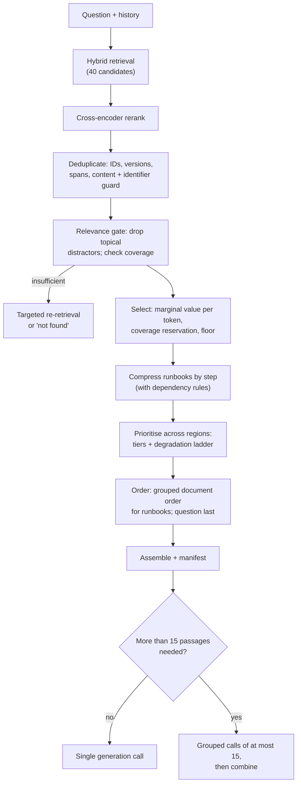

This assessment covers the whole Context Engineering module: [context windows](/learn/context-engineering/context-windows), [selection](/learn/context-engineering/context-selection), [ordering](/learn/context-engineering/context-ordering), [compression](/learn/context-engineering/context-compression), [deduplication](/learn/context-engineering/context-deduplication), the [lost-in-the-middle problem](/learn/context-engineering/lost-in-the-middle-problem), [relevance](/learn/context-engineering/context-relevance) and [prioritisation](/learn/context-engineering/context-prioritisation). Start with the 18-question quiz; aim for at least 14 correct (about 75%) before moving on. Then work through the open questions, coding exercises, design challenge and troubleshooting scenarios, attempting each before opening its model answer. The coding solutions run with NumPy and the standard library; their outputs below are real.

```quiz
[
  {"q": "What is the difference between a model's nominal and effective context length?", "options": ["Nominal is the largest input accepted; effective is the longest input over which the model still performs your task acceptably", "Nominal is measured in words, effective in tokens", "Effective length is fixed at half the nominal length", "There is no difference for modern models"], "answer": 0, "why": "The nominal length is a hard limit; the effective length is task-dependent and must be measured on your own questions."},
  {"q": "A request layout is: system prompt, retrieved evidence, conversation history, question. What is the main problem for prompt caching?", "options": ["The system prompt is too early", "Questions cannot be cached", "History must always come first", "The changing evidence sits before the history, so the shared prefix stops after the system prompt on every turn"], "answer": 3, "why": "A prefix cache reuses only leading tokens identical to the previous request; per-request evidence placed early cuts that prefix short."},
  {"q": "With B = 500 base tokens, h = 200 tokens per exchange and full history, what is the total input over 6 turns?", "options": ["3,000", "6,000", "4,000", "9,000"], "answer": 1, "why": "TB + h T(T-1)/2 = 3,000 + 200 x 15 = 6,000."},
  {"q": "Why does exact 0/1 knapsack selection over reranker values sometimes pick a poor context?", "options": ["Knapsack ignores token costs", "Knapsack can only select one chunk", "Its objective adds values, so it counts repeated evidence (a long section and a chunk it contains) twice", "Dynamic programming is too slow for more than three chunks"], "answer": 2, "why": "Evidence has diminishing returns; an additive objective cannot see that a second passage repeats the first."},
  {"q": "A candidate has value 0.6, cost 40 tokens and similarity 0.5 to the most similar chunk already selected. What is its marginal value per token?", "options": ["0.0075", "0.015", "0.0125", "0.03"], "answer": 0, "why": "0.6 x (1 - 0.5) / 40 = 0.3 / 40 = 0.0075."},
  {"q": "Reranker logits for a two-part question are 7.2, 6.8, 2.1, 1.9, -0.5. The third chunk is the only one answering part two. What does a largest-gap cut-off keep?", "options": ["All five", "The first four", "Only the first", "The first two only, losing part two's evidence"], "answer": 3, "why": "The largest drop (4.7) is between 6.8 and 2.1, so the rule keeps the first two and discards the evidence for part two."},
  {"q": "What does this print?\n```python\nr = ['a', 'b', 'c', 'd', 'e', 'f', 'g']\nprint(r[0::2] + r[1::2][::-1])\n```", "options": ["['a', 'b', 'c', 'd', 'e', 'f', 'g']", "['a', 'c', 'e', 'g', 'f', 'd', 'b']", "['g', 'f', 'e', 'd', 'c', 'b', 'a']", "['a', 'g', 'b', 'f', 'c', 'e', 'd']"], "answer": 1, "why": "Odd ranks go to the front in order and even ranks to the back reversed: the edges-first arrangement."},
  {"q": "Under a position-weight model with weights rising steadily towards the question, which chunk ordering maximises utility?", "options": ["Rank descending", "Edges-first", "Rank ascending (best chunk last)", "Random"], "answer": 2, "why": "By the rearrangement inequality, the best chunk goes in the highest-weighted position, which is the last."},
  {"q": "Why should runbook steps be presented in grouped document order even if another ordering scores higher on a position-weight model?", "options": ["Position weights ignore coherence, and steps out of sequence change the instruction", "Grouped order is cheaper", "Models cannot read numbered lists", "Grouped order improves caching of the system prompt"], "answer": 0, "why": "The utility model knows nothing about sequence; for procedures, reading order carries meaning."},
  {"q": "In the compression lesson, why did a plain sentence threshold drop 'It is not available to contractors.'?", "options": ["It exceeded the budget", "Cross-encoders reject negations", "It was a duplicate", "Scored in isolation, the pronoun gives the cross-encoder no link to the budget, so it scored low"], "answer": 3, "why": "Sentence-level scoring without context loses references, so a decisive qualifier looks irrelevant."},
  {"q": "Evidence of 3,000 tokens is compressed with a ratio of 3. With a generator at 2 dollars per million input tokens and an LLM compressor at 1 dollar per million input and 4 per million output (illustrative prices), does compression pay on cost?", "options": ["Yes, it saves about 0.004 dollars per request", "No: it saves 0.004 dollars and costs 0.007", "It breaks exactly even", "It cannot be computed"], "answer": 1, "why": "Saving = 2,000 x 2/10^6 = 0.004; cost = 3,000 x 1/10^6 + 1,000 x 4/10^6 = 0.007. Compression loses money here."},
  {"q": "A 5-trigram FAQ sentence is wholly contained in a passage with 30 distinct trigrams. What are Jaccard similarity and containment?", "options": ["Jaccard 1.0, containment 0.17", "Both 0.17", "Jaccard 0.17, containment 1.0", "Both 1.0"], "answer": 2, "why": "Jaccard = 5/30 (the union is the passage's 30 trigrams); containment = 5/5."},
  {"q": "Two passages about VPN errors have embedding cosine 0.8; one describes E-4021, the other E-4012. What should an assembly-time deduplicator do?", "options": ["Keep both, because their identifiers differ", "Merge them, because cosine is high", "Keep the higher-ranked one only", "Drop both"], "answer": 0, "why": "An identifier guard prevents merging passages that differ in a code; merging would delete one of two different facts."},
  {"q": "In a position sweep, 160/200 questions are correct at position 1 and 150/200 in the middle. What is the right conclusion?", "options": ["The model clearly loses the middle", "The model has no position effect at all", "Reorder all contexts edges-first", "The 5-point difference is within noise at this sample size; more questions or a paired test are needed"], "answer": 3, "why": "Detecting a 5-point difference needs many hundreds of questions per position with an unpaired design; 200 is not enough."},
  {"q": "What is an attention sink?", "options": ["A layer that discards tokens", "The disproportionate attention models put on the very first tokens of the input", "A prompt cache", "A type of reranker"], "answer": 1, "why": "Xiao and colleagues (2023) observed it; it is one proposed contributor to the primacy advantage."},
  {"q": "Which passage is a topical distractor for 'How many unused leave days can I carry over?'", "options": ["'Up to 5 unused days carry over and must be used by 31 March.'", "'Expenses must be submitted within 30 days.'", "'Book annual leave in the HR portal two weeks in advance.'", "'Passwords must be rotated every 90 days.'"], "answer": 2, "why": "It is about annual leave, so it scores high on topical similarity, but it does not answer the question."},
  {"q": "What is the utility u = r x a x 2^(-t/h) of an item with r = 0.9, a = 0.5, t = 90 days and h = 180 days?", "options": ["0.32", "0.45", "0.23", "0.11"], "answer": 0, "why": "0.9 x 0.5 = 0.45; half a half-life multiplies by 2^(-0.5), about 0.707, giving about 0.32."},
  {"q": "Under budget pressure, a tier-strict assembler drops all retrieved evidence before touching conversation history. What is the likely symptom?", "options": ["Requests are rejected for being too long", "Higher prompt-cache hit rates only", "Citations to the wrong chunk labels", "Answers that are coherent with the conversation but not grounded in the policy that answers the question"], "answer": 3, "why": "The chunk that answers the question is the first casualty, so the model answers from history and tool output instead."}
]
```

## Conceptual questions

**1.** Explain why "the context window is 200,000 tokens, so we can send everything" is a poor basis for a RAG design. Give three separate reasons.

<details><summary>Show model answer</summary>

First, the nominal window is only what the model accepts; its effective length on realistic tasks, with plausible distractors and answers phrased differently from questions, is often much shorter and must be measured. Second, cost and time to first token grow with every input token on every request, so a large context multiplies the bill and latency for no guaranteed gain. Third, retrieved non-answers are near-relevant by construction, and research (Cuconasu and colleagues, 2024; Shi and colleagues, 2023) shows such passages degrade answers; position effects can further bury the answer in the middle. The window is a ceiling; the working budget should be chosen per route from evaluation results.

</details>

**2.** Distinguish topical relevance, answer-bearing relevance and sufficiency, and give a Meridian example where each of the first two holds while the next fails.

<details><summary>Show model answer</summary>

Topical relevance: the passage is about the question's subject. Answer-bearing: it contains information that answers the question. Sufficiency: the context as a whole contains everything needed for a complete answer.

Topical but not answer-bearing: for "Can contractors claim the equipment budget?", the passage "The home-office equipment budget is £400." is on topic but does not answer, and is dangerous because it invites "yes". Answer-bearing but not sufficient: for "How many leave days do I get and how many carry over?", the carry-over passage answers part two, but without the 25-day entitlement passage the context is insufficient.

</details>

**3.** Compression and deduplication both remove text. Explain why their characteristic failures are different, and give one safeguard for each.

<details><summary>Show model answer</summary>

Compression removes text *within* a passage on the judgement that it is irrelevant to the question; its characteristic failure is deleting a qualifier, number or referent that the answer depends on (dropping "It is not available to contractors"). Safeguards: dependency rules (keep antecedents of pronoun sentences, exception markers next to kept sentences) or scoring sentences with their neighbours.

Deduplication removes whole passages on the judgement that they repeat another; its characteristic failure is merging two passages that look alike but state different facts (E-4021 and E-4012, £250 and £400), deleting one fact. Safeguard: an identifier guard that refuses any merge where codes, amounts or dates differ, turning the pair into a recorded conflict instead.

</details>

**4.** A colleague cites the lost-in-the-middle paper and proposes edges-first ordering for every route. Write a short, evidence-based reply.

<details><summary>Show model answer</summary>

Liu and colleagues measured a U-shaped position effect for the models they tested in 2023; later models often show flatter curves, and the effect depends on context length and distractors. Edges-first is optimal only if our model has a U-shaped profile at our context sizes, which we have not measured; for a flat profile it changes nothing, and for procedural routes it breaks reading order. Proposal: run a position sweep on our deployed model at our actual $k$ values, with realistic distractors, enough questions per position and a closed-book baseline. Shorten contexts first, since that reduces any position effect at its source, and choose ordering per route from a paired experiment that includes random permutations as a control.

</details>

**5.** Why should source authority in a prioritisation policy come from metadata rather than document content, and what attack does this prevent?

<details><summary>Show model answer</summary>

Anyone who can write a document can write "OFFICIAL POLICY" in it, so authority derived from content can be forged. Authority from trusted metadata (which repository or ingestion pipeline, which owning team) cannot be set by the document's author. This prevents a planted or edited page from claiming high authority so that it survives prioritisation and deduplication in place of the real policy, a form of data poisoning; combined with the identifier guard, a forged variant of a policy surfaces as a conflict rather than silently replacing it.

</details>

## Coding exercises

### 1. Marginal-value packing

Write `pack_marginal(values, costs, sim, budget, floor, min_gain, by_density)` that greedily selects candidates by marginal value (value times one minus the maximum similarity to anything already kept), either per token (`by_density=True`) or absolute, skipping candidates below the floor, below the minimum marginal gain, or that do not fit. Run both modes on five candidates with values `[0.95, 0.90, 0.85, 0.40, 0.20]`, costs `[120, 300, 100, 80, 60]`, a budget of 450, and a similarity matrix in which candidates 0 and 2 are near-repeats (0.92). Explain the difference.

<details><summary>Show solution</summary>

```python
import numpy as np

def pack_marginal(values, costs, sim, budget, floor=0.3, min_gain=0.1, by_density=True):
    """Greedy by marginal value per token, discounting similarity to what is already kept."""
    pool = [i for i in range(len(values)) if values[i] >= floor]
    kept, used, total, log = [], 0, 0.0, []
    while pool:
        def gain(i):
            red = max((sim[i][j] for j in kept), default=0.0)
            return values[i] * (1 - red)
        best = max(pool, key=lambda i: gain(i) / costs[i] if by_density else gain(i))
        pool.remove(best)
        g = gain(best)
        if g < min_gain:
            log.append(f"skip {best}: marginal value {g:.2f} below {min_gain}")
        elif used + costs[best] > budget:
            log.append(f"skip {best}: {costs[best]} tokens do not fit ({used} used)")
        else:
            kept.append(best); used += costs[best]; total += g
            log.append(f"keep {best}: marginal value {g:.2f}, {used} tokens used")
    return kept, used, round(total, 2), log

values = [0.95, 0.90, 0.85, 0.40, 0.20]
costs  = [120, 300, 100, 80, 60]
sim = np.array([
    [1.00, 0.30, 0.92, 0.10, 0.05],
    [0.30, 1.00, 0.35, 0.20, 0.10],
    [0.92, 0.35, 1.00, 0.10, 0.05],
    [0.10, 0.20, 0.10, 1.00, 0.30],
    [0.05, 0.10, 0.05, 0.30, 1.00],
])
for by_density in (True, False):
    kept, used, total, log = pack_marginal(values, costs, sim, budget=450, by_density=by_density)
    print("by density" if by_density else "by marginal value")
    print("\n".join("  " + line for line in log))
    print(f"  kept {kept}, {used} tokens, total marginal value {total}")
```

```output
by density
  keep 2: marginal value 0.85, 100 tokens used
  keep 3: marginal value 0.36, 180 tokens used
  skip 1: 300 tokens do not fit (180 used)
  skip 0: marginal value 0.08 below 0.1
  kept [2, 3], 180 tokens, total marginal value 1.21
by marginal value
  keep 0: marginal value 0.95, 120 tokens used
  keep 1: marginal value 0.63, 420 tokens used
  skip 3: 80 tokens do not fit (420 used)
  skip 2: marginal value 0.07 below 0.1
  kept [0, 1], 420 tokens, total marginal value 1.58
```

Both modes refuse to keep 0 and 2 together: after one is kept, the other's marginal value falls below the minimum gain. But density greedy picks the cheaper repeat (2), then fills with the weak candidate 3 (value 0.40), and can no longer fit the valuable 300-token candidate 1, ending with a total marginal value of 1.21. Greedy by marginal value keeps 0 and then 1, for 1.58. This is the classic weakness of density greedy for knapsack-like problems: it can lock out a large, valuable item. A standard remedy is to run both and keep the better result, which here costs one extra pass over five candidates.

</details>

### 2. Deduplication with conflict resolution

Write `dedupe(passages, authority, min_containment)` for passages given best-first as `(id, source, text)`. Merge a passage into a kept one if their shingle containment (shorter into longer) is at least the threshold and their identifiers agree, keeping the more authoritative wording and merging IDs. If containment is high but identifiers differ, record a conflict and drop the less authoritative side. Test it on an HR FAQ, a handbook passage, a stale wiki page that says 10 days carry over, and an unrelated handbook passage.

<details><summary>Show solution</summary>

```python
import re

def shingles(text, n=3):
    w = re.findall(r"[a-z0-9£]+(?:-[0-9]+)?", text.lower())
    return {tuple(w[i:i + n]) for i in range(len(w) - n + 1)}

def identifiers(text):
    return set(re.findall(r"[A-Z]-\d{4}|£\d+|\b\d+\b", text))

def dedupe(passages, authority, min_containment=0.6):
    """passages: list of (id, source, text), best first. Returns kept passages and conflicts."""
    kept, conflicts = [], []
    for pid, src, text in passages:
        merged = False
        for k in kept:
            a, b = shingles(text), shingles(k["text"])
            short, long_ = (a, b) if len(a) <= len(b) else (b, a)
            c = len(short & long_) / len(short) if short else 0.0
            if c < min_containment:
                continue
            ids_a, ids_b = identifiers(text), identifiers(k["text"])
            if not (ids_a <= ids_b or ids_b <= ids_a):          # similar text, different facts
                loser = pid if authority[src] < authority[k["source"]] else None
                conflicts.append({"between": (pid, k["ids"][0]), "differ": sorted(ids_a ^ ids_b),
                                  "dropped": loser})
                if loser:                                          # less authoritative side loses
                    merged = True
                    break
                continue
            if authority[src] > authority[k["source"]]:
                k["text"], k["source"] = text, src
            k["ids"].append(pid)
            merged = True
            break
        if not merged:
            kept.append({"ids": [pid], "source": src, "text": text})
    return kept, conflicts

passages = [
    ("faq-3", "faq", "Annual leave is 25 days. Up to 5 unused days carry over."),
    ("hb-7", "handbook", "Annual leave is 25 days. Up to 5 unused days carry over and must be used by 31 March."),
    ("wiki-2", "wiki", "Annual leave is 25 days. Up to 10 unused days carry over."),
    ("hb-9", "handbook", "Laptops are refreshed every 3 years."),
]
authority = {"handbook": 3, "faq": 2, "wiki": 1}
kept, conflicts = dedupe(passages, authority)
for k in kept:
    print(k["ids"], k["source"], "|", k["text"])
for c in conflicts:
    print("conflict:", c)
```

```output
['faq-3', 'hb-7'] handbook | Annual leave is 25 days. Up to 5 unused days carry over and must be used by 31 March.
['hb-9'] handbook | Laptops are refreshed every 3 years.
conflict: {'between': ('wiki-2', 'faq-3'), 'differ': ['10', '31', '5'], 'dropped': 'wiki-2'}
```

The FAQ sentence is wholly contained in the handbook passage with matching identifiers, so they merge and the handbook's wording (higher authority, and more complete) survives with both IDs. The wiki page shares enough wording with the merged passage to count as similar (containment 0.7, above the 0.6 threshold) but states 10 days instead of 5: a conflict, resolved by dropping the lower-authority wiki page and recording why. The identifier difference lists `31` too, because only the handbook mentions 31 March; a production guard would compare identifiers in the overlapping region rather than the whole passages. The laptop passage is unrelated and kept.

</details>

## Architecture design challenge

Meridian wants AskMeridian to support an "IT incident assistant" route for the support desk (open 08:00 to 18:00 UK time). Inputs per request: the agent's question; a multi-turn conversation; up to 40 retrieved candidates from IT runbooks (authoritative, stable), incident notes (authoritative, fast-ageing) and a team wiki (informal); a ticket-lookup tool whose output can be long; and the system prompt with security rules. The working input budget is 6,000 tokens; the model shows a measurable mid-context dip above about 15 passages. Design the context-assembly stage: the stages and their order, the policies in each, what is logged, and how you would validate it.

<details><summary>Show reference design</summary>



**Stages and order.** Deduplicate before selection so budget is never spent on repeats, and version filtering happens before content comparison. Gate relevance before selection so distractors never compete for budget; a "not found" or re-retrieval path handles insufficiency. Compress after selection, so only chosen evidence is processed, splitting runbooks on numbered steps and keeping step headings and error-code lines. Prioritise across regions after evidence is prepared, then order.

**Policies.** Tiers: system prompt with security rules and the question are protected; history (three verbatim turns plus a summary refreshed when turns roll over), ticket output (one-line short form unless the question is about a ticket) and memory are shrinkable; evidence competes. Authority from ingestion metadata: runbooks 1.0, incident notes 0.8, wiki 0.4. Half-lives: runbooks a year, incident notes about two days, wiki two years. Protected minimum: two evidence items, at least one runbook if any clears the floor, so a fresh incident note cannot crowd out the standard procedure. Ladder: drop sub-floor evidence, shrink tier 1, drop low-utility tier 1, compress evidence, drop evidence to the minimum, fail loudly.

**Position.** Because the measured dip appears above 15 passages, cap single-call evidence at about 15 passages; for broader questions, group by document and use parallel calls whose extracts are combined. Grouped document order keeps procedures readable; the question goes last; layout is cache-friendly (system prompt and tool definitions first, history next, evidence and question last).

**Logging.** The manifest records region token counts, every candidate's decision and reason (duplicate of, superseded by, distractor, below floor, dropped by ladder rung), utility factors, chunk precision and useful-token share, order and labels, and the provider's cached-token count.

**Validation.** An evaluation set for the route with single-fact, multi-part, procedural and incident questions; a targeted set of qualifier-dependent questions for compression; a position sweep at the route's real $k$; fixture tests for the prioritisation policy at several budgets; and dashboards on useful-token share and "not found" rate per route.

**Trade-offs.** Map-reduce over groups costs more calls and some synthesis risk, in exchange for staying inside the measured effective length. Aggressive gating lowers distraction but risks abstaining on answerable questions; the gate keeps the best chunk when nothing clears the threshold. Short incident half-lives keep stale notes out but require the incident feed to be updated during an incident.

</details>

## Troubleshooting scenarios

**1.** After a re-index that switched the handbook to heading-based chunking, users report that AskMeridian answers multi-part HR questions only partially. Retrieval recall on the evaluation set is unchanged. What is the likely cause and fix?

<details><summary>Show diagnosis and fix</summary>

Heading-based chunking produced long section chunks alongside the old short ones. The reranker ranks a long section highly (it is relevant), and a score-greedy selector either spends most of the budget on it or stops when the next large chunk does not fit, so the evidence for the question's other part is retrieved but not selected. Recall is unchanged because the loss happens after retrieval. Confirm from manifests (the missing fact's chunk appears among candidates with "over budget" as the drop reason). Fix: select by marginal value per token with a similarity discount, add a coverage reservation for multi-part questions, and track per-part coverage in evaluation.

</details>

**2.** The monthly bill for AskMeridian rose sharply after follow-up questions were enabled, and the provider reports almost no cached input, although the system prompt is long and unchanged. What do you check, and what do you change?

<details><summary>Show diagnosis and fix</summary>

Check the request layout and the history region in the manifests. Likely causes: per-request content (retrieved evidence, a timestamp, the user's name) placed before the history, so the shared prefix ends right after the system prompt; history entries re-formatted each turn; and unbounded history, whose total cost grows with the square of conversation length. Change the layout to system → tool definitions → history → evidence → question, remove variable values from stable regions, append history without rewriting it, and adopt a windowed or summarised history policy whose boundary moves rarely (summarise several exchanges at once). Add region token counts and the cached-token figure to the manifest and alert when the cached share drops.

</details>

**3.** The relevance gate was enabled on all routes. On the IT runbook route, the "I couldn't find that" rate doubled, while on the HR route quality improved. Diagnose.

<details><summary>Show diagnosis and fix</summary>

The gate's threshold was tuned on HR prose. Runbook text (commands, numbered steps, error codes, tables) differs from the question-passage pairs the MS MARCO cross-encoder was trained on, so genuinely answer-bearing runbook sentences score below the threshold; and sentence splitting breaks steps and code blocks into fragments that individually answer nothing. Check by labelling a sample of runbook chunks and comparing score distributions for answer-bearing and non-answer-bearing ones, and by scoring whole steps instead of sentences. Fix with per-route thresholds, structure-aware splitting (steps, list items, table rows), and a fallback that keeps the best chunk when nothing clears the threshold rather than abstaining.

</details>
