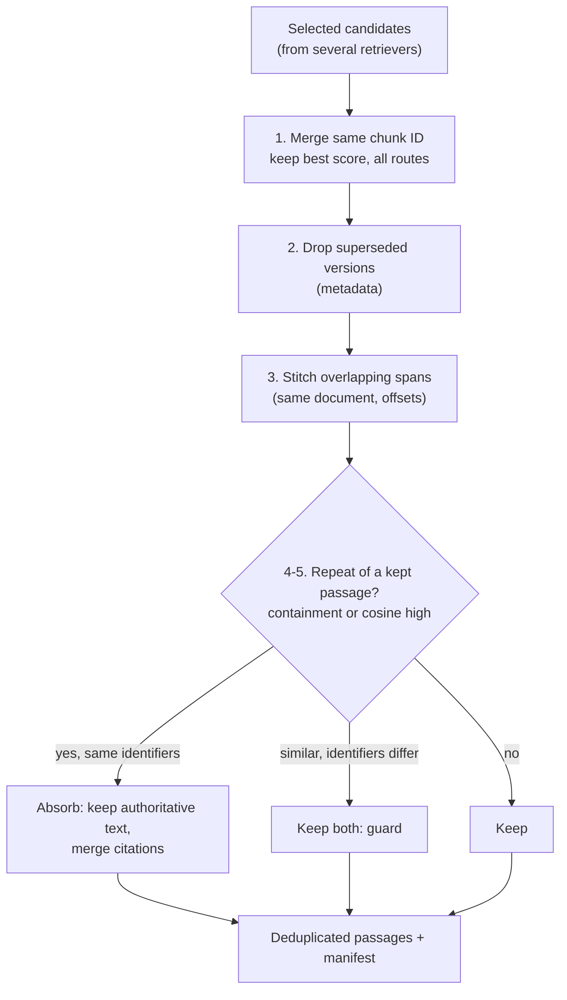

By the time candidates reach the assembly stage they have often come from several places: a dense retriever and a keyword retriever, several rewritten versions of the query, neighbouring chunks of the same document, an FAQ that copies a paragraph from the handbook, and last year's version of the handbook itself. **Context deduplication** is the step that makes sure each piece of evidence appears in the window once, in its best form, without losing track of every source that supported it.

Duplicate detection at *ingestion* time, with hashing, shingling, MinHash and LSH over a whole corpus, is taught in [Duplicate detection](/learn/data-processing/duplicate-detection), and removing duplicates from a ranked list is the subject of [Duplicate removal](/learn/advanced-retrieval-optimisation/duplicate-removal). This lesson is about the last, small-scale and most consequential pass: a few dozen candidates for one question, where the decisions are not only "is this a repeat?" but "which copy do we keep, what happens to its citations, how do we join overlapping fragments, and how do we avoid merging two things that only look alike?"

## Learning objectives

- Name five ways repeated evidence reaches the context window and the correct treatment for each.
- Compute shingle containment and Jaccard similarity by hand and explain why containment suits the snippet-inside-a-section case.
- Implement an assembly-time deduplication pipeline that merges retriever duplicates, drops superseded versions, stitches overlapping spans and absorbs repeated content while merging citations.
- Use an identifier guard to stop semantically similar but factually different passages (E-4021 and E-4012) being merged.
- Choose which copy of repeated content to keep using authority, recency and rank.

## Prerequisites

- [Duplicate detection](/learn/data-processing/duplicate-detection): hashing, shingles and Jaccard similarity.
- [Chunk overlap](/learn/chunking-fundamentals/chunk-overlap): why neighbouring chunks share text.
- [Context selection](/learn/context-engineering/context-selection): the similarity discount that handles partial overlap during packing.

## Why this matters

Repeated evidence does three kinds of damage.

**It wastes the budget.** Two copies of the equipment-budget paragraph cost twice the tokens and add nothing. In a tight budget, the copy displaces a chunk carrying a different fact.

**It distorts the model's weighing of evidence.** A claim that appears three times looks better supported than one that appears once, even if all three are copies of one paragraph. If the copies come from an outdated FAQ, the stale claim can outvote the current one.

**It breaks citations in either direction.** Drop a duplicate carelessly and you may lose the citation to the document a user trusts most ("the handbook says"), keeping the FAQ instead. Merge too eagerly and two different facts become one, cited to a source that states only one of them.

The last failure is the one specific to RAG. Embedding similarity, the obvious tool for "near duplicates", is *designed* to say that the runbook entries for E-4021 (client out of date) and E-4012 (certificate expired) are similar. A deduplicator that trusts it will delete the answer to one of those questions.

## The intuition

You are compiling a briefing pack from photocopies colleagues have handed you. Several copies of the same page arrive from different people: keep one, but note everyone who suggested it. Two photocopies of overlapping parts of one page: tape them together into one strip rather than keeping both. A page from last year's edition next to this year's: keep this year's. A short note that quotes a paragraph from the official manual: keep the manual's version and note that the note agreed. And two pages that look nearly identical but differ in one number, an error code or a price: those are *not* duplicates. Keep both, because the one number is the whole point.

## How it works

### Five kinds of repetition

| Kind | How it arises | Detect by | Treatment |
| --- | --- | --- | --- |
| Same chunk, several routes | Hybrid search, multi-query retrieval | Chunk ID | Merge; keep best score; record every route |
| Superseded version | Old and new editions both indexed | Document ID + version metadata | Keep the current version (unless the question is about change) |
| Overlapping spans | Sliding-window chunking, neighbour expansion | Same document version, overlapping offsets | Stitch into one passage |
| Copied content | An FAQ or intranet page quotes the handbook | Shingle containment | Keep the most authoritative wording; merge citations |
| Paraphrase | Two documents state the same fact differently | Embedding similarity **and** identical identifiers | Keep one; merge citations |

A sixth case looks like repetition and is not: **near-identical passages with different facts** (two error codes, two prices, two dates). The treatment is to keep both, and the detection rule must be built so that it never merges them.

### Order of operations

Cheap, certain checks come first; expensive, fuzzy ones last, on what remains.

1. **Merge by chunk ID.** Exact, free, and it must happen first so that later stages do not count one chunk twice.
2. **Drop superseded versions.** Uses metadata, not text, so it is reliable when the metadata is. Doing it before content comparison avoids a stale copy "winning" a near-duplicate comparison.
3. **Stitch overlapping spans.** Uses document offsets. The result is a longer, coherent passage, which later stages compare as a whole.
4. **Absorb copied content** by shingle containment, with the identifier guard.
5. **Absorb paraphrases** by embedding similarity, with the identifier guard.
6. **Record** every merge and drop, with the IDs of all absorbed sources, in the manifest.



### Containment, not only Jaccard

[Jaccard similarity](/learn/data-processing/duplicate-detection) compares two shingle sets symmetrically: shared shingles over all shingles. It is right for "are these two documents near-copies?" It is wrong for the most common assembly-time case, a short snippet that appears *inside* a longer passage. The FAQ's one-sentence answer shares all of its shingles with the handbook section, but the section has many more, so their Jaccard similarity is low. **Containment** asks the asymmetric question: what fraction of the *shorter* text's shingles appear in the longer one? A value near 1 means the short text adds nothing.

### Stitching overlapping spans

When two chunks come from the same version of the same document and their character ranges overlap, they are fragments of one passage. Rather than keep both (repeating the overlap) or drop one (losing its unique part), join them: take the earlier chunk, find where the later chunk's text starts repeating its end, and append only the new part. With character offsets stored at indexing time this is exact. Without offsets, find the longest suffix of the first text that is a prefix of the second, as the code below does. Stitching also restores reading order, which [Context ordering](/learn/context-engineering/context-ordering) cares about.

### The identifier guard

Before merging two passages on similarity, extract their **identifiers**: error codes, amounts, numbers, dates, version strings, product names. If the candidate contains an identifier that the kept passage does not, they are not duplicates, however similar they look. The rule is crude, and it is meant to be: it errs towards keeping both, which costs a few tokens, rather than merging, which can cost the answer.

> [!KEY]
> In deduplication the two errors are not symmetric. Keeping a duplicate wastes tokens. Merging two different facts deletes one of them. Tune every threshold so that the second error is rare, and accept more of the first.

### Which copy to keep, and what happens to citations

When content repeats, keep the copy that is best by, in order:

1. **Authority**: the policy owner's document (the handbook, owned by HR) over a derivative (an FAQ, a wiki page, a chat transcript).
2. **Currency**: the current version over a superseded one.
3. **Completeness**: the longer passage that contains the shorter.
4. **Rank**: the higher-scoring copy, if nothing else distinguishes them.

Then **merge citations**: the surviving passage carries the IDs of every absorbed source. The model cites one label, and your rendering code can show "Employee handbook (also stated in HR FAQ)". This keeps the support visible without repeating the text, and it keeps the audit trail complete.

### When duplicates are the point

Some questions are *about* repetition or change: "What changed in the equipment budget since 2023?", "Do the FAQ and the handbook agree?". For those routes, version dropping and content merging must be switched off, and the versions kept adjacent and labelled. Make deduplication rules a per-route setting, like ordering.

## The mathematics

### Jaccard similarity and containment

**Intuition.** Jaccard asks how much two sets overlap relative to everything in either. Containment asks how much of one set lies inside the other.

$$
J(A, B) = \frac{|A \cap B|}{|A \cup B|}, \qquad C(A, B) = \frac{|A \cap B|}{|A|}
$$

- $A$, $B$: the sets of word shingles (here, runs of 3 consecutive words) of two texts; $A$ is the candidate, usually the shorter.
- $|A \cap B|$: shingles in both. $|A \cup B|$: shingles in either.
- $J$ is symmetric; $C(A, B)$ is not: it is 1 when every shingle of $A$ appears in $B$.

**By hand.** $A$ is the FAQ sentence "The home-office equipment budget is £400." Lower-cased and split into words: the, home, office, equipment, budget, is, £400, which is 7 words and so $7 - 2 = 5$ trigrams. $B$ is the stitched handbook passage of 27 words, which has 25 trigram positions, 3 of them repeats ("the home office", "home office equipment", "office equipment budget" each appear twice), so 22 distinct trigrams. Every trigram of $A$ is in $B$, so $|A \cap B| = 5$ and $|A \cup B| = 22$.

$$
J = \frac{5}{22} \approx 0.227, \qquad C = \frac{5}{5} = 1.0
$$

Jaccard says "quite different"; containment says "entirely repeated". For deciding whether the FAQ sentence adds anything to the handbook passage, containment is the right question.

```python
import re

def shingles(text, n=3):
    w = re.findall(r"[a-z0-9£]+(?:-[0-9]+)?", text.lower())
    return {tuple(w[i:i + n]) for i in range(len(w) - n + 1)}

faq = shingles("The home-office equipment budget is £400.")
hb = shingles("Staff may work remotely up to 3 days a week. The home-office equipment budget is £400. "
              "Contractors are not eligible for the home-office equipment budget.")
inter = len(faq & hb)
print("|A| =", len(faq), " |B| =", len(hb), " |A & B| =", inter, " |A | B| =", len(faq | hb))
print("Jaccard     =", round(inter / len(faq | hb), 3))
print("containment =", round(inter / len(faq), 3))
```

```output
|A| = 5  |B| = 22  |A & B| = 5  |A | B| = 22
Jaccard     = 0.227
containment = 1.0
```

## In code

**The problem.** Eight candidates for questions about the equipment budget and VPN errors arrive from two retrievers. Deduplicate them in the five-stage order, keep the most authoritative wording, merge citations and do not merge the two different error codes.

**Dependencies.** `sentence-transformers` for the embedding model (`all-MiniLM-L6-v2`, about 90 MB on first use). The rest is the standard library.

```bash
pip install sentence-transformers
```

```python
import re
from sentence_transformers import SentenceTransformer

# Candidates after selection, best first. Several retrievers contributed; some overlap.
candidates = [
    {"id": "hb-25#12", "doc": "handbook", "ver": 2025, "start": 0,   "end": 120, "score": 0.92, "via": "dense",
     "text": "Staff may work remotely up to 3 days a week. The home-office equipment budget is £400."},
    {"id": "hb-25#12", "doc": "handbook", "ver": 2025, "start": 0,   "end": 120, "score": 0.88, "via": "bm25",
     "text": "Staff may work remotely up to 3 days a week. The home-office equipment budget is £400."},
    {"id": "hb-25#13", "doc": "handbook", "ver": 2025, "start": 66,  "end": 190, "score": 0.81, "via": "dense",
     "text": "The home-office equipment budget is £400. Contractors are not eligible for the home-office equipment budget."},
    {"id": "faq-07",   "doc": "hr-faq",   "ver": 2025, "start": 0,   "end": 60,  "score": 0.79, "via": "dense",
     "text": "The home-office equipment budget is £400."},
    {"id": "hb-23#12", "doc": "handbook", "ver": 2023, "start": 0,   "end": 110, "score": 0.77, "via": "dense",
     "text": "Staff may work remotely up to 3 days a week. The home-office equipment budget is £250."},
    {"id": "it-41",    "doc": "it-runbook", "ver": 2025, "start": 0, "end": 70, "score": 0.55, "via": "dense",
     "text": "E-4021: the VPN client is out of date; update it from the IT portal."},
    {"id": "it-42",    "doc": "it-runbook", "ver": 2025, "start": 200, "end": 270, "score": 0.54, "via": "dense",
     "text": "E-4012: the VPN certificate has expired; reinstall it from the IT portal."},
    {"id": "itfaq-03", "doc": "it-faq", "ver": 2025, "start": 0, "end": 80, "score": 0.50, "via": "bm25",
     "text": "Error E-4021 means the VPN client is out of date; update it via the IT portal."},
]
AUTHORITY = {"handbook": 2, "hr-faq": 1, "it-runbook": 2, "it-faq": 1}   # higher wins when content repeats

def log(msg):
    print("  " + msg)

# 1. Same chunk from several retrievers: merge, keep best score, remember every route.
def merge_ids(cands):
    merged = {}
    for c in cands:
        if c["id"] in merged:
            m = merged[c["id"]]
            m["via"] = sorted(set(m["via"]) | {c["via"]})
            m["score"] = max(m["score"], c["score"])
            log(f"id      {c['id']} found again via {c['via']}: merged")
        else:
            merged[c["id"]] = {**c, "via": [c["via"]], "sources": [c["id"]]}
    return list(merged.values())

# 2. Superseded versions of the same document: keep the newest.
def drop_superseded(cands):
    newest = {}
    for c in cands:
        newest[c["doc"]] = max(newest.get(c["doc"], 0), c["ver"])
    keep = []
    for c in cands:
        if c["ver"] < newest[c["doc"]]:
            log(f"version {c['id']} is {c['doc']} {c['ver']}, superseded by {newest[c['doc']]}: dropped")
        else:
            keep.append(c)
    return keep

# 3. Overlapping spans of the same document version: stitch into one passage.
def stitch(cands):
    out = []
    for c in sorted(cands, key=lambda c: (c["doc"], c["ver"], c["start"])):
        prev = out[-1] if out else None
        if prev and prev["doc"] == c["doc"] and prev["ver"] == c["ver"] and c["start"] < prev["end"]:
            overlap_chars = prev["end"] - c["start"]
            # find the longest suffix of prev that is a prefix of c
            k = max(k for k in range(len(c["text"]) + 1) if prev["text"].endswith(c["text"][:k]))
            prev["text"] += c["text"][k:]
            prev["end"] = max(prev["end"], c["end"])
            prev["score"] = max(prev["score"], c["score"])
            prev["sources"] += c["sources"]
            log(f"span    {c['id']} overlaps {prev['sources'][0]} by {overlap_chars} chars: stitched")
        else:
            out.append(c)
    return sorted(out, key=lambda c: -c["score"])

# 4. Content repeated across documents: shingle containment or embedding similarity, with an identifier guard.
def shingles(text, n=3):
    w = re.findall(r"[a-z0-9£]+(?:-[0-9]+)?", text.lower())
    return {tuple(w[i:i + n]) for i in range(len(w) - n + 1)}

def identifiers(text):
    return set(re.findall(r"[A-Z]-\d{4}|£\d+|\b\d+\b", text))

model = SentenceTransformer("sentence-transformers/all-MiniLM-L6-v2")

def drop_repeats(cands, contain_min=0.8, cos_dup=0.85, cos_warn=0.75):
    E = model.encode([c["text"] for c in cands], normalize_embeddings=True)
    keep = []
    for i, c in enumerate(cands):
        absorbed = False
        for j in keep:
            k = cands[j]
            a, b = shingles(c["text"]), shingles(k["text"])
            containment = len(a & b) / len(a) if a else 0.0
            cosine = float(E[i] @ E[j])
            same_ids = identifiers(c["text"]) <= identifiers(k["text"])
            if (containment >= contain_min or cosine >= cos_dup) and same_ids:
                if AUTHORITY[c["doc"]] > AUTHORITY[k["doc"]]:      # more authoritative wording wins
                    k["text"], k["doc"] = c["text"], c["doc"]
                k["sources"] = sorted(set(k["sources"] + c["sources"]))
                log(f"repeat  {c['id']} repeats {k['id']} (C={containment:.2f}, cos={cosine:.2f}): "
                    f"kept {k['doc']} text, citations merged")
                absorbed = True
                break
            if cosine >= cos_warn and not same_ids:
                log(f"guard   {c['id']} vs {k['id']}: cos={cosine:.2f} but identifiers differ "
                    f"{sorted(identifiers(c['text']) ^ identifiers(k['text']))}: both kept")
        if not absorbed:
            keep.append(i)
    return [cands[i] for i in keep]

print(f"start: {len(candidates)} candidates")
stage = merge_ids(candidates)
stage = drop_superseded(stage)
stage = stitch(stage)
stage = drop_repeats(stage)
print(f"end: {len(stage)} passages")
for c in stage:
    print(f"  [{', '.join(c['sources'])}] via {c['via']}  {c['text']}")
```

```output
start: 8 candidates
  id      hb-25#12 found again via bm25: merged
  version hb-23#12 is handbook 2023, superseded by 2025: dropped
  span    hb-25#13 overlaps hb-25#12 by 54 chars: stitched
  repeat  faq-07 repeats hb-25#12 (C=1.00, cos=0.61): kept handbook text, citations merged
  guard   it-42 vs it-41: cos=0.78 but identifiers differ ['E-4012', 'E-4021']: both kept
  repeat  itfaq-03 repeats it-41 (C=0.57, cos=0.91): kept it-runbook text, citations merged
end: 3 passages
  [faq-07, hb-25#12, hb-25#13] via ['bm25', 'dense']  Staff may work remotely up to 3 days a week. The home-office equipment budget is £400. Contractors are not eligible for the home-office equipment budget.
  [it-41, itfaq-03] via ['dense']  E-4021: the VPN client is out of date; update it from the IT portal.
  [it-42] via ['dense']  E-4012: the VPN certificate has expired; reinstall it from the IT portal.
```

**The important lines.**

- `merge_ids` keys on the chunk ID and accumulates `via`, the retrievers that found it. That record is useful later: a chunk found by both dense and keyword retrieval is more likely to be relevant than one found by either alone.
- `drop_superseded` compares versions per document. Here it works at document level; production systems need a lineage link between a chunk and the chunk that supersedes it, because a new edition can rewrite one section and leave others unchanged.
- In `stitch`, `k = max(k for k in range(...) if prev["text"].endswith(c["text"][:k]))` finds the longest overlap between the end of the earlier text and the start of the later one, and only the remainder is appended.
- `same_ids = identifiers(c["text"]) <= identifiers(k["text"])` is the identifier guard: the candidate may be absorbed only if every code, amount and number it contains also appears in the passage that absorbs it.
- `k["sources"] = sorted(set(k["sources"] + c["sources"]))` merges citations, so the surviving passage still points at every document that supported it.

**What the output means.**

- **Eight candidates became three passages**, with every source ID preserved in the brackets.
- `hb-25#12` arrived twice, from dense and BM25 retrieval. It was merged and remembers both routes.
- The 2023 handbook chunk, with its £250 budget, was dropped as superseded *before* any content comparison, so it could never be chosen as the surviving wording.
- `hb-25#13` overlapped `hb-25#12` by 54 characters (the shared sentence about £400) and was stitched on, producing one passage that states the budget once and then the contractor exclusion.
- **The FAQ sentence was caught by containment (1.00) although its cosine was only 0.61.** A short sentence and a longer passage that contains it are far apart in embedding space, because the passage's vector also encodes remote work and contractors. Embedding similarity alone would have kept the repeat.
- **The IT FAQ's paraphrase of E-4021 was caught by cosine (0.91) although its containment was only 0.57.** Different wording ("means", "via") breaks shingles, but the meaning and the identifier match. The two signals cover each other's blind spots.
- **The guard kept E-4012 next to E-4021.** Their cosine of 0.78 is high, and a similarity-only rule with a threshold of 0.75 would have merged them. The guard saw differing identifiers and kept both.

**Errors people commonly hit.**

- Running content deduplication before version filtering, so a stale copy is chosen as the "representative".
- Dropping the absorbed copy's ID instead of merging it, which loses the citation users trust.
- Using one similarity threshold everywhere. Short texts, long texts and different embedding models have different similarity distributions; inspect yours before choosing.
- Writing an identifier regex for one domain only. Meridian's codes look like `E-4021`; another corpus has ticket numbers, versions (`v2.3.1`) or ISO dates. Extend the pattern per corpus.

**Extending it.** Add a "change" route flag that skips `drop_superseded` and the content stages, and instead returns the 2023 and 2025 passages adjacent with their versions in the labels. Then add a lineage field (`supersedes`) to each chunk and drop only chunks that are explicitly superseded.

## A real-world example

The HR team at Meridian maintains the employee handbook; for years, the IT team also maintained a "Quick answers" intranet page that copied paragraphs from it. Both were indexed in AskMeridian. When the handbook raised the equipment budget from £250 to £400, the quick-answers page was not updated for several weeks.

Users who asked about the budget got inconsistent answers. Ifeoma, on the Platform team, pulled manifests for a sample. Most contexts held the handbook paragraph and the stale quick-answers copy, both scoring highly; the model sometimes said £400, sometimes £250, and sometimes both. The old assembler had a deduplication step, but it used embedding similarity with a threshold of 0.95, which the two passages, differing only in the amount, did not reach.

The team rebuilt the stage as in this lesson. Authority ranks were added to the index metadata (HR handbook above derivative pages), so when content repeated, the handbook's wording survived and the derivative's ID was kept only as a citation. More importantly, they noticed that the identifier guard, applied to the stale copy, would correctly have *refused* to merge £250 with £400: that pair was not a duplicate but a conflict. Conflicts went to a separate rule: when two passages share most of their wording but disagree on an identifier, keep the more authoritative and current one, and write the conflict to a report for the owning teams. That report found eleven stale paragraphs on the quick-answers page in its first week, and the IT team retired the page in favour of links to the handbook.

## Common mistakes

- **Deduplicating by embedding similarity alone.** It misses snippets contained in longer passages and merges near-identical passages with different identifiers.
- **Using Jaccard for the snippet-in-section case.** A short repeated sentence has a low Jaccard similarity with a long passage that contains it; use containment.
- **Keeping whichever copy ranked highest.** A derivative or outdated page can outrank the authoritative source; choose by authority and currency first.
- **Discarding the absorbed copy's citation.** The answer loses the source a reader trusts, and the audit trail is incomplete.
- **Keeping both overlapping fragments.** The overlap is repeated and the passage reads as two half-thoughts; stitch them.
- **Applying the same rules to every route.** Questions about change or agreement need the duplicates and versions that other routes discard.

## Best practices

- Run cheap exact checks first (chunk ID, version metadata, offsets), fuzzy checks last.
- Combine shingle containment and embedding similarity; each catches what the other misses.
- Guard every fuzzy merge with an identifier check, and bias thresholds towards keeping both.
- Keep authority and version metadata in the index so the keep-rule does not depend on text.
- Merge citations rather than dropping them, and log each merge with its reason.
- Make deduplication per-route, and report detected conflicts to the content owners.

## Performance considerations

At assembly time the numbers are small. For $n$ candidates, pairwise comparison is $n(n-1)/2$ pairs: 30 candidates give 435 pairs. Shingling 30 passages of 200 words and intersecting sets is microseconds to milliseconds in Python. Embedding 30 short passages with a MiniLM-sized model on a CPU takes on the order of tens of milliseconds; if your vector store returns stored embeddings with the hits, reuse them, but note that stitched passages are new texts and need fresh embeddings (or a conservative fallback to the fragments' embeddings).

MinHash and LSH, essential for millions of documents at ingestion, are unnecessary here: exact sets are cheap at this scale and give exact containment.

The token saving is direct. If, as an assumption for illustration, a quarter of the evidence tokens on a route are repeats, removing them cuts evidence cost by a quarter and frees that space for different evidence. Measure the share on your own manifests: log tokens before and after deduplication.

## Security considerations

Deduplication decides which wording survives, so authority rules are a security control. An attacker who can publish a page that copies a policy paragraph with one change (a different amount, an extra sentence of instructions) wants their version to be the one kept. Rank-based keep-rules hand them that choice if their page scores higher. Authority from trusted metadata, not from the text or its score, decides which copy survives; the identifier guard stops their altered amount from being silently merged with the real one, turning it into a visible conflict instead. Derivative and user-generated sources should never outrank owned policy documents. See [Data poisoning](/learn/rag-security-fundamentals/data-poisoning).

## Summary

- Repetition reaches the window by several routes: the same chunk from several retrievers, superseded versions, overlapping spans, copied content and paraphrase. Each has its own detector and treatment.
- Order matters: chunk IDs, then versions, then spans, then fuzzy content comparison.
- Containment, not Jaccard, detects a snippet inside a longer passage; embedding similarity detects paraphrase; use both.
- An identifier guard prevents merging passages that differ in a code, amount or date; merging two different facts is far worse than keeping a duplicate.
- Keep the most authoritative, current wording and merge citations from every absorbed source.

## Exercises

**1.** A 4-word sentence is wholly contained in a 40-word passage that has no repeated trigrams. Using word trigrams, compute Jaccard similarity and containment.

<details><summary>Show solution</summary>

The sentence has $4 - 2 = 2$ trigrams, the passage $40 - 2 = 38$. All 2 are in the passage, so $|A \cap B| = 2$, $|A \cup B| = 38$. $J = 2/38 \approx 0.053$; $C = 2/2 = 1.0$. Jaccard would call them unrelated; containment correctly says the sentence adds nothing.

</details>

**2.** Classify each pair and give the treatment: (a) chunk `rb-vpn#4` returned by both the dense and keyword retrievers; (b) "Expenses must be submitted within 30 days." in the handbook and in the finance department's FAQ; (c) "Laptops are refreshed every 3 years." (2025 handbook) and "Laptops are refreshed every 4 years." (2023 handbook); (d) "E-4021: update the VPN client" and "E-4012: renew the VPN certificate".

<details><summary>Show solution</summary>

(a) Same chunk, several routes: merge by ID, keep the best score, record both routes. (b) Copied content: absorb by containment; which wording survives depends on your authority ranks (expenses belong to the finance department, so its FAQ may well be the owning source); merge citations. (c) Superseded version: drop the 2023 chunk by version metadata, unless the route is about change, in which case keep both, adjacent and labelled. Note that the identifier guard would also refuse to merge them (3 versus 4). (d) Similar but different: the identifier guard keeps both.

</details>

**3.** Modify `drop_repeats` so that, when a candidate is similar to a kept passage (containment at least 0.8 *or* cosine at least 0.85) but the identifiers differ, it records a **conflict** with both IDs and the differing identifiers, instead of only logging. Return the conflicts alongside the kept passages. Test it by adding a stale quick-answers chunk "The home-office equipment budget is £250." with a 2025 version from a different document.

<details><summary>Show solution</summary>

```python
def drop_repeats(cands, contain_min=0.8, cos_dup=0.85, cos_warn=0.75):
    E = model.encode([c["text"] for c in cands], normalize_embeddings=True)
    keep, conflicts = [], []
    for i, c in enumerate(cands):
        absorbed = False
        for j in keep:
            k = cands[j]
            a, b = shingles(c["text"]), shingles(k["text"])
            containment = len(a & b) / len(a) if a else 0.0
            cosine = float(E[i] @ E[j])
            similar = containment >= contain_min or cosine >= cos_dup
            same_ids = identifiers(c["text"]) <= identifiers(k["text"])
            if similar and same_ids:
                k["sources"] = sorted(set(k["sources"] + c["sources"]))
                absorbed = True
                break
            if similar and not same_ids:
                conflicts.append({"ids": (c["id"], k["id"]),
                                  "differ": sorted(identifiers(c["text"]) ^ identifiers(k["text"]))})
        if not absorbed:
            keep.append(i)
    return [cands[i] for i in keep], conflicts
```

The stale sentence's trigrams are "the home office", "home office equipment", "office equipment budget", "equipment budget is" and "budget is £250"; four of five appear in the handbook passage, so containment is 0.8 and the pair counts as similar, while the identifiers differ. Running it records `{'ids': ('qa-02', 'hb-25#12'), 'differ': ['3', '£250', '£400']}` (the symmetric difference also lists the handbook's '3' from '3 days'). Both passages stay, and a later rule (authority and currency) decides what the model sees.

</details>

**4.** AskMeridian adds a route for "what changed?" questions. Specify, stage by stage, how deduplication should behave on that route and why.

<details><summary>Show solution</summary>

Stage 1 (chunk ID): unchanged; a chunk found twice is still one chunk. Stage 2 (versions): disabled; the old version is the evidence for the change. Stage 3 (stitching): unchanged within a version, never across versions. Stages 4 and 5 (content): run only *within* a version, so copies in derivative pages are still absorbed, but never across versions, because a cross-version near-match is exactly the change being asked about. Then order the surviving passages so each old/new pair is adjacent and labelled with its version and date. The manifest records that version filtering was skipped by route.

</details>

## Check your understanding

```quiz
[
  {"q": "Why does containment detect a repeated FAQ sentence inside a handbook section better than Jaccard similarity?", "options": ["Containment uses embeddings", "Jaccard divides by the union, which the long section's extra shingles inflate, so a fully repeated short sentence still scores low", "Jaccard cannot handle punctuation", "Containment is always larger than 1"], "answer": 1, "why": "Containment divides the shared shingles by the shorter text's shingles only, so a snippet wholly inside a longer passage scores 1."},
  {"q": "In the lesson's output, the E-4021 and E-4012 passages have cosine 0.78. Why were they not merged?", "options": ["Their containment was 1.0", "They came from different retrievers", "The identifier guard saw different error codes", "Their version numbers differed"], "answer": 2, "why": "A fuzzy merge is allowed only when the candidate's identifiers are all present in the kept passage; E-4012 is not in the E-4021 passage."},
  {"q": "Which order of deduplication stages is recommended?", "options": ["Chunk ID, then superseded versions, then span stitching, then content comparison", "Embedding similarity, then chunk ID, then versions", "Content comparison first, because it is the most thorough", "Versions last, so the newest text wins similarity comparisons"], "answer": 0, "why": "Cheap, exact checks first; dropping superseded versions before content comparison stops a stale copy being kept as the representative."},
  {"q": "Two copies of a paragraph come from the HR-owned handbook and a derivative intranet page; the intranet copy ranked higher. Which wording should survive?", "options": ["The intranet copy, because it ranked higher", "Both, because they come from different documents", "Neither", "The handbook's, with the intranet page's ID merged into the citations"], "answer": 3, "why": "Authority comes before rank; merging citations keeps the derivative's support visible without repeating the text."},
  {"q": "Which deduplication error is usually more harmful?", "options": ["Keeping a duplicate, because it wastes tokens", "Merging two passages that state different facts, because one fact disappears", "Both are equally harmful", "Neither affects answers"], "answer": 1, "why": "A kept duplicate costs a few tokens; a wrong merge deletes evidence, possibly the answer itself."}
]
```

## Further reading

- Broder, A. Z. (1997). *On the resemblance and containment of documents.* Proceedings of Compression and Complexity of Sequences. Defines resemblance (Jaccard) and containment over shingles.
- Leskovec, J., Rajaraman, A. and Ullman, J. D. *Mining of Massive Datasets*, chapter 3, "Finding Similar Items". Shingling, Jaccard, MinHash and LSH at scale. Free online at [mmds.org](http://www.mmds.org).
- Sentence Transformers documentation, at [sbert.net](https://www.sbert.net). The embedding model used for paraphrase detection.
