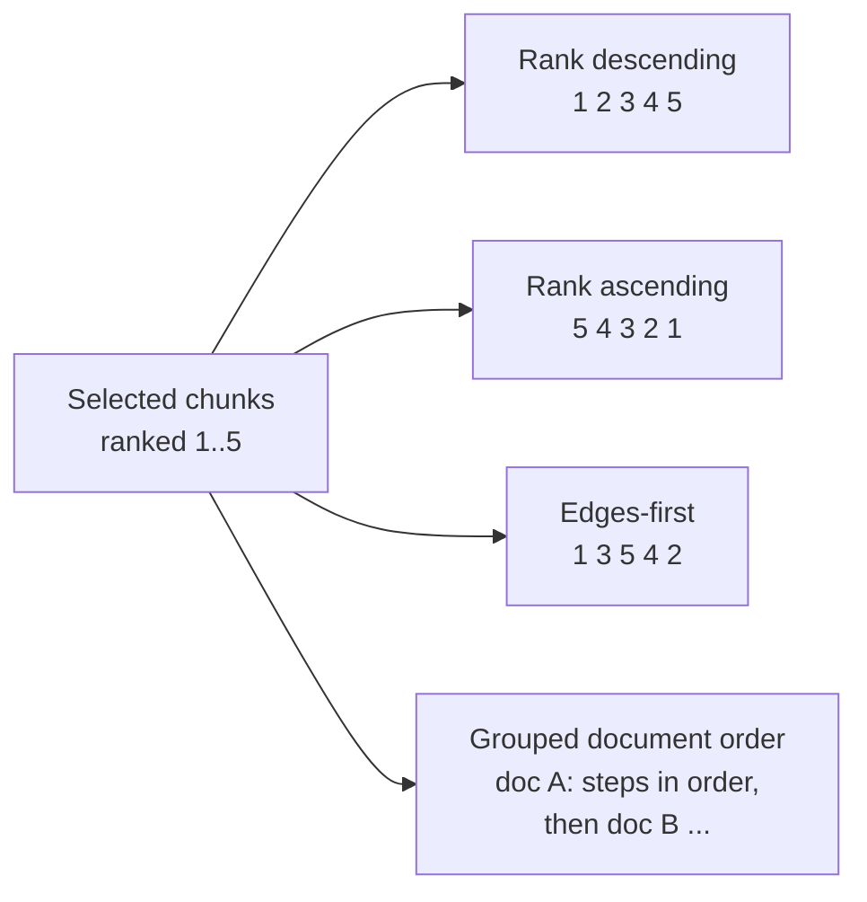

Once you know *which* chunks go into the window, you still have to decide *where* each one goes. A language model reads its input as a sequence, and it does not treat every position the same: what comes first, what comes last and what sits next to what all influence the answer. **Context ordering** is the set of decisions about that sequence: the order of the evidence chunks, where the question and instructions sit relative to them, and how chunks from the same document are kept together.

[Context construction](/learn/rag-architecture-fundamentals/context-construction) listed the main orderings in a table. This lesson explains the mechanism behind each one, gives a simple model that tells you which ordering is best *if* you know how much your model attends to each position, implements the orderings (including LangChain's `LongContextReorder`) and shows how to choose between them by experiment. The evidence for position effects themselves is the subject of [Lost-in-the-middle problem](/learn/context-engineering/lost-in-the-middle-problem); here we take the effect as a possibility and engineer around it.

## Learning objectives

- Describe four chunk orderings (rank descending, rank ascending, edges-first, grouped document order) and the situation each suits.
- Use the rearrangement inequality to show which ordering maximises a position-weighted utility, and compute that utility by hand.
- Implement the orderings in Python and verify an edges-first ordering against LangChain's `LongContextReorder`.
- Decide where to place the question, the instructions and dated or conflicting sources relative to the evidence.
- Design an experiment that measures whether ordering matters for your model and questions.

## Prerequisites

- [Context selection](/learn/context-engineering/context-selection): ordering starts from the selected set.
- [Context construction](/learn/rag-architecture-fundamentals/context-construction): labels, delimiters and the basic ordering options.
- [Attention mechanisms](/learn/understanding-large-language-models/attention-mechanisms): how each output token draws on earlier input tokens.

## Why this matters

Two contexts containing exactly the same chunks can produce different answers. Three kinds of failure trace back to order.

**The decisive chunk is underused.** If a model uses some positions more reliably than others, putting the most important evidence in a weak position wastes it. Liu and colleagues (2023) measured exactly this for the models they tested: accuracy depended strongly on where the answer-bearing passage sat. Current models vary in how much they show it, but none is guaranteed immune, and you will not know for yours until you test.

**Procedures and arguments are scrambled.** Retrieval scores chunks independently, so a runbook's step 4 can rank above step 2. Presented in score order, a procedure reads out of sequence, and the model may reproduce it out of sequence. "Uninstall the client, restart, install again" is not the same instruction in a different order.

**Conflicts are resolved by accident.** When two sources disagree (the superseded 2023 handbook says the equipment budget is £250; the current one says £400), a model left to its own devices may favour whichever it read last, or first, or most often. If the order is arbitrary, so is the answer.

## The intuition

Imagine giving a colleague a stack of five printed pages before a meeting, knowing they will read the first page carefully, skim the middle and read the last page again just before walking in. You would put the most important page on top and the second most important at the bottom, and let the less important pages fill the middle. If two of the pages are consecutive steps of one procedure, you would staple them together in the right order rather than separate them by ranking. And you would write the question you need answered on the last page, so it is the freshest thing in their mind when they decide what matters.

Whether your colleague really reads that way is an empirical question. If they read every page with equal care, the order hardly matters, and keeping the stapled procedure in sequence is the only rule that still counts.

## How it works

### The four orderings

**Rank descending** (best chunk first) is the default most code produces, because retrieval returns a sorted list. It puts the strongest evidence where the model starts reading, and directly after the system prompt.

**Rank ascending** (best chunk last) puts the strongest evidence immediately before the question when the question follows the context. The argument is proximity: the tokens of the best chunk are the most recent ones the model processes before it reads the question and starts answering.

**Edges-first** places the best chunks at both ends and the weakest in the middle: rank 1 first, rank 2 last, rank 3 second, rank 4 second to last, and so on. It is designed for models that use the start and the end of their input better than the middle. LangChain implements it as `LongContextReorder`.

**Grouped document order** groups chunks by source document, orders the groups by their best chunk's score, and within each group restores the document's own order (by chunk position). It sacrifices strict relevance order for coherence. It is the right choice for procedures, legal clauses, tables split across chunks, and anything where meaning depends on sequence.



### A model of position: weights and the rearrangement inequality

To compare orderings you need a hypothesis about how much the model "uses" each position. Write it as a **position weight** $w_p$ for positions $p = 1, \dots, k$: a high weight means information placed there is used reliably. A model with no position effect has equal weights; a lost-in-the-middle profile has high weights at both ends and low weights in the middle.

If chunk relevance is $r_i$ and utility is the sum of weight times relevance, then a classical result, the **rearrangement inequality**, says the sum is largest when the largest relevance is paired with the largest weight, the second largest with the second largest, and so on. So the optimal ordering is entirely determined by the *ranking* of the position weights:

1. Sort positions by weight, highest first.
2. Sort chunks by relevance, highest first.
3. Put the $j$-th best chunk into the $j$-th best position.

With equal weights every ordering is equally good. With weights falling from front to back, rank descending is optimal. With weights rising towards the question, rank ascending is optimal. With a U-shape whose ends alternate in strength, edges-first is optimal. The orderings are not competing folk remedies; each is the best response to a particular position profile. Which profile your model has is what you must measure.

> [!KEY]
> Ordering cannot add information; it can only help or hinder the model's use of what is there. A strong ordering effect is a symptom of too much or too noisy context, so the first fix is usually better [selection](/learn/context-engineering/context-selection), and ordering is the second.

### Where the question and instructions go

The position of the question relative to the evidence matters at least as much as the order of the chunks.

- **Question after the evidence** is the widely recommended layout for long inputs. Anthropic's long-context prompting guidance advises placing long documents near the top of the prompt and the query at the end. It also fits the cache-friendly layout from [Context windows](/learn/context-engineering/context-windows), where per-request content comes last.
- **Question before and after.** Some teams state the question briefly before the evidence, so the model reads the evidence knowing what to look for, and repeat it after. This costs a few tokens and is cheap to test; treat it as a hypothesis for your model, not a rule.
- **Instructions about the evidence** ("answer only from the sources; cite them") belong in the system prompt, which comes first. A short reminder of the output format next to the question is sometimes useful in long contexts, because it is the last thing read before answering.

### Ordering conflicting and dated sources

When selected chunks disagree because one supersedes another, do not rely on order to resolve the conflict. Models have no reliable built-in rule such as "the later passage wins". Instead:

1. **Label each chunk with its version and date** in the source tag, so the model can see which is current.
2. **State the rule** in the system prompt: "where sources conflict, prefer the most recent version and mention the conflict".
3. **Better still, resolve it before ordering.** If you know the 2023 handbook is superseded, the de-duplication and prioritisation stages should drop it or mark it as historical ([Context deduplication](/learn/context-engineering/context-deduplication), [Context prioritisation](/learn/context-engineering/context-prioritisation)).
4. **Keep versions adjacent** when both must stay (for a "what changed?" question), so the comparison is local rather than spread across the window.

### Labels follow presentation

Assign citation labels (`S1`, `S2`, ...) in the order the chunks are *presented*, not in retrieval-rank order. A model reading `[S4]` first and `[S1]` last will sometimes cite by position rather than by label. Keep the label-to-chunk map in code, as Context construction showed, so reordering never breaks citations.

### Determinism

Ordering should be deterministic: given the same selected set, produce the same sequence. Break ties explicitly (by chunk ID, say), not by whatever order a dictionary or a parallel retriever happened to return. Non-deterministic order makes failures hard to reproduce, makes evaluation noisy, and changes the request bytes, which defeats any caching that covers the evidence.

### The ordering procedure

1. **Start from the selected set**, with each chunk's score, document ID, position in its document and version.
2. **Resolve conflicts first** (drop or mark superseded versions).
3. **Choose the ordering by route**: grouped document order for procedural and sequential content; otherwise the ordering your experiments favour (rank descending as the default).
4. **Break ties deterministically.**
5. **Assign labels in presentation order** and record the order in the manifest.
6. **Place the question after the evidence.**

## The mathematics

### Position-weighted utility

**Intuition.** If position $p$ is used with strength $w_p$, a chunk of relevance $r$ placed there contributes $w_p r$. The ordering that maximises the total puts the best chunks in the strongest positions.

$$
U(\pi) = \sum_{p=1}^{k} w_p \, r_{\pi(p)}
$$

- $k$: number of chunks.
- $w_p$: weight of position $p$, a hypothesis about how reliably the model uses that position.
- $\pi$: an ordering; $\pi(p)$ is the chunk placed at position $p$.
- $r_{\pi(p)}$: relevance of that chunk.
- $U(\pi)$: utility of the ordering.

The **rearrangement inequality** states that for two sequences, $\sum_p w_p r_{\pi(p)}$ is maximised when both are sorted in the same order (largest with largest) and minimised when sorted in opposite orders.

**By hand.** Five positions with a hypothetical U-shaped profile $w = (1.0, 0.7, 0.5, 0.6, 0.9)$, and five chunks with relevance $0.9, 0.8, 0.5, 0.3, 0.1$.

*Rank descending* places them in that order:

$$
U = 1.0(0.9) + 0.7(0.8) + 0.5(0.5) + 0.6(0.3) + 0.9(0.1) = 0.90 + 0.56 + 0.25 + 0.18 + 0.09 = 1.98
$$

*Edges-first* places ranks 1, 3, 5, 4, 2, so relevances $0.9, 0.5, 0.1, 0.3, 0.8$:

$$
U = 1.0(0.9) + 0.7(0.5) + 0.5(0.1) + 0.6(0.3) + 0.9(0.8) = 0.90 + 0.35 + 0.05 + 0.18 + 0.72 = 2.20
$$

Sorting positions by weight gives $1.0$ (position 1), $0.9$ (5), $0.7$ (2), $0.6$ (4), $0.5$ (3). Pairing them with the relevances in order puts rank 1 at position 1, rank 2 at position 5, rank 3 at position 2, rank 4 at position 4 and rank 5 at position 3: exactly edges-first. Under this profile, edges-first is optimal.

```python
import numpy as np
w = np.array([1.0, 0.7, 0.5, 0.6, 0.9])          # position weights, positions 1..5
r_desc = np.array([0.9, 0.8, 0.5, 0.3, 0.1])     # relevance in rank order
r_edges = np.array([0.9, 0.5, 0.1, 0.3, 0.8])    # edges-first arrangement
print("rank order: ", round(float(w @ r_desc), 2))
print("edges first:", round(float(w @ r_edges), 2))
```

```output
rank order:  1.98
edges first: 2.2
```

The size of the gain depends entirely on how uneven the weights are. With $w = (1, 1, 1, 1, 1)$ both orderings score $2.6$. That is the whole argument for measuring before reordering.

## In code

**The problem.** Order five chunks retrieved for "My VPN shows E-4021, what do I do?" in each of the four ways, confirm that the edges-first implementation matches LangChain's `LongContextReorder`, and compute each ordering's utility under a hypothetical U-shaped position profile, alongside the brute-force optimum.

**Dependencies.** NumPy, and `langchain-core` plus `langchain-community` for the comparison. No model download, no API key.

```bash
pip install numpy langchain-core langchain-community
```

```python
from itertools import permutations
import numpy as np
from langchain_core.documents import Document
from langchain_community.document_transformers import LongContextReorder

# Retrieved chunks, already sorted by reranker score (best first).
chunks = [
    {"id": "it-vpn-04",  "doc": "IT runbook: VPN", "pos": 4, "score": 0.94, "text": "E-4021: the VPN client is out of date; update it from the IT portal."},
    {"id": "it-vpn-02",  "doc": "IT runbook: VPN", "pos": 2, "score": 0.81, "text": "VPN is required on public Wi-Fi."},
    {"id": "it-vpn-05",  "doc": "IT runbook: VPN", "pos": 5, "score": 0.77, "text": "If the update fails, uninstall the client, restart, then install it again."},
    {"id": "it-cert-01", "doc": "IT runbook: certificates", "pos": 1, "score": 0.52, "text": "E-4012: the VPN certificate has expired."},
    {"id": "hb-pw-01",   "doc": "Employee handbook", "pos": 7, "score": 0.31, "text": "Passwords must be rotated every 90 days."},
]

def by_score_desc(cs):
    return sorted(cs, key=lambda c: -c["score"])

def by_score_asc(cs):            # best chunk last, next to the question
    return sorted(cs, key=lambda c: c["score"])

def edges_first(cs):
    """Best chunks at both ends, weakest in the middle: 1st, 3rd, 5th ... then ... 4th, 2nd."""
    ranked = by_score_desc(cs)
    front, back = ranked[0::2], ranked[1::2]
    return front + back[::-1]

def grouped_document_order(cs):
    """Group by document (best group first), keep each document's own reading order."""
    best_in_doc = {}
    for c in cs:
        best_in_doc[c["doc"]] = max(best_in_doc.get(c["doc"], 0), c["score"])
    return sorted(cs, key=lambda c: (-best_in_doc[c["doc"]], c["pos"]))

def show(name, cs):
    print(f"{name:<20}" + "  ".join(c["id"] for c in cs))

for name, fn in [("score desc", by_score_desc), ("score asc", by_score_asc),
                 ("edges first", edges_first), ("grouped doc", grouped_document_order)]:
    show(name, fn(chunks))

# LangChain's implementation of the same idea, for comparison.
docs = [Document(page_content=c["text"], metadata={"id": c["id"]}) for c in by_score_desc(chunks)]
reordered = LongContextReorder().transform_documents(docs)
print(f"{'LongContextReorder':<20}" + "  ".join(d.metadata["id"] for d in reordered))

# Position weights: a hypothetical U-shaped profile (NOT measured; illustrative only).
w = np.array([1.0, 0.7, 0.5, 0.6, 0.9])
def utility(cs):
    return float(sum(wi * c["score"] for wi, c in zip(w, cs)))

best = max(permutations(chunks), key=utility)
print(f"\nposition weights  {w.tolist()}")
for name, fn in [("score desc", by_score_desc), ("score asc", by_score_asc),
                 ("edges first", edges_first), ("grouped doc", grouped_document_order)]:
    print(f"utility {name:<12} {utility(fn(chunks)):.3f}")
print(f"utility {'brute-force best':<12} {utility(best):.3f}  " + "  ".join(c["id"] for c in best))
```

```output
score desc          it-vpn-04  it-vpn-02  it-vpn-05  it-cert-01  hb-pw-01
score asc           hb-pw-01  it-cert-01  it-vpn-05  it-vpn-02  it-vpn-04
edges first         it-vpn-04  it-vpn-05  hb-pw-01  it-cert-01  it-vpn-02
grouped doc         it-vpn-02  it-vpn-04  it-vpn-05  it-cert-01  hb-pw-01
LongContextReorder  it-vpn-04  it-vpn-05  hb-pw-01  it-cert-01  it-vpn-02

position weights  [1.0, 0.7, 0.5, 0.6, 0.9]
utility score desc   2.483
utility score asc    2.391
utility edges first  2.675
utility grouped doc  2.444
utility brute-force best 2.675  it-vpn-04  it-vpn-05  hb-pw-01  it-cert-01  it-vpn-02
```

With the installed version, importing `langchain_community` also prints a `DeprecationWarning` to standard error saying the package is being sunset; it does not affect the result, but it is a reminder not to depend on a third-party package for a ten-line function.

**The important lines.**

- `front, back = ranked[0::2], ranked[1::2]` splits the ranking into odd and even ranks; `front + back[::-1]` sends the odd ranks to the front in order and the even ranks to the back in reverse. That is the whole of edges-first.
- `grouped_document_order` sorts by a two-part key: the best score in the chunk's document (negated, so the best document comes first), then the chunk's position in that document. Chunks of one document end up adjacent and in reading order.
- `max(permutations(chunks), key=utility)` tries all $5! = 120$ orderings. It is there to check the rearrangement argument, not for production: for 10 chunks it would try 3.6 million.

**What the output means.**

- **Edges-first equals `LongContextReorder` and the brute-force optimum** under this profile. The library and the ten-line function produce the same sequence, and both are what the rearrangement inequality predicts.
- **Grouped document order** puts `it-vpn-02`, `it-vpn-04` and `it-vpn-05` together in reading order: the requirement to use the VPN, the meaning of E-4021, then the fallback if the update fails. Score order would separate the fix (`it-vpn-04`) from its fallback (`it-vpn-05`) with the Wi-Fi rule in between; edges-first would put the fallback *before* the fix it refers to ("if the update fails" before the update). Under the hypothetical weights, grouped order scores lower (2.444), but the utility model knows nothing about coherence, which is exactly why procedural routes should use grouped order regardless.
- **The utility differences are hypothetical.** They follow from weights invented for illustration. With measured weights from your own model the ranking of orderings could change, and with flat weights all orderings tie.

**Errors people commonly hit.**

- Passing `LongContextReorder` documents that are not sorted best-first. It assumes the input is in descending relevance; given another order, it puts the wrong chunks at the edges.
- Reordering after assigning labels, so `S1` is no longer the first source shown.
- Grouping by document but sorting within the group by score, which loses the reading order that was the reason for grouping.

**Extending it.** Replace the hypothetical weights with ones you measure: the [Lost-in-the-middle problem](/learn/context-engineering/lost-in-the-middle-problem) lesson builds the position-sweep experiment that produces them. Then add a route switch that chooses grouped order when most selected chunks come from one procedural document.

### Testing whether order matters for you

Ordering is cheap to change and cheap to test. A sound test:

1. Take an evaluation set of questions with known answers and their selected chunks.
2. For each question, build the context in each candidate ordering, keeping everything else (chunks, labels, question placement) fixed.
3. Generate answers and grade them (correctness and citation accuracy).
4. Compare orderings *per question* (paired), not just in aggregate, because most questions will be answered correctly under every ordering and only a minority will be sensitive.
5. Also run two or three random permutations per question. If random orders do as well as your favourite, ordering is not where your problem is.

Here is the generation side with the Anthropic SDK; it needs an API key and was not executed here:

```python
import anthropic

client = anthropic.Anthropic()  # reads ANTHROPIC_API_KEY from the environment

def answer(question, ordered_chunks):
    sources = "\n".join(
        f'<source id="S{n}" title="{c["doc"]}">{c["text"]}</source>'
        for n, c in enumerate(ordered_chunks, 1)          # labels follow presentation order
    )
    response = client.messages.create(
        model="claude-opus-5-5",
        max_tokens=512,
        system="Answer only from the provided sources and cite them as [S1], [S2]. "
               "If the answer is not there, say you don't know.",
        messages=[{"role": "user", "content": f"{sources}\n\nQuestion: {question}"}],
    )
    return "".join(block.text for block in response.content if block.type == "text")

orderings = {"desc": by_score_desc, "edges": edges_first, "grouped": grouped_document_order}
results = {name: answer("My VPN shows E-4021, what do I do?", fn(chunks)) for name, fn in orderings.items()}
```

## A real-world example

Meridian's IT team noticed that AskMeridian's answers to VPN troubleshooting questions were correct in content but occasionally wrong in sequence: asked what to do about E-4021, it would sometimes say "uninstall the client, restart and reinstall; alternatively update it from the IT portal", inverting the runbook's advice to try the simple update first.

Kwame, on the Platform team, looked at the manifests for those requests. The runbook's steps had been chunked separately, and the reranker scored the fallback step slightly above the first step for questions that mentioned "fix" or "not working". In rank order, the fallback came first. The team had also recently switched all routes to edges-first ordering after reading about lost in the middle, which separated consecutive steps even further.

They did not argue about orderings in the abstract. They ran the five-step test above on their troubleshooting evaluation set with three orderings. For single-fact policy questions, the three orderings were indistinguishable: almost every question was answered correctly under all three, which showed that their contexts were short enough for position not to matter much on that route. For troubleshooting questions, grouped document order produced correctly sequenced answers noticeably more often than either alternative. The team made ordering a per-route setting: grouped order for runbooks, rank descending (the simplest, and as good as anything else they tested) for policy questions, and they dropped edges-first because it had shown no benefit on their contexts.

## Common mistakes

- **Adopting edges-first everywhere because of a paper.** It is optimal only for a U-shaped position profile; for short contexts or models without that profile it changes nothing, and for procedures it breaks reading order.
- **Presenting procedural chunks in score order.** Steps are shown out of sequence and may be repeated out of sequence.
- **Relying on order to resolve conflicting versions.** The model has no dependable "later wins" rule; label versions and resolve conflicts explicitly.
- **Assigning citation labels before reordering.** Labels no longer match presentation order, and citations drift.
- **Non-deterministic tie-breaking.** The same request produces different contexts, which makes failures irreproducible and evaluation noisy.
- **Placing the question before long evidence only.** For long inputs the documented recommendation is evidence first, query last.

## Best practices

- Make ordering a per-route setting, with grouped document order for sequential content.
- Choose between orderings by a paired experiment on your own evaluation set, including random permutations as a control.
- Put the question after the evidence, and keep instructions in the system prompt.
- Label chunks with version and date, and resolve superseded sources before ordering.
- Assign labels after ordering, keep the label map in code and record the order in the manifest.
- Break ties deterministically by a stable key.

## Performance considerations

Ordering is computationally free: sorting $k$ chunks is $O(k \log k)$ for a handful of items. Its performance effects are indirect.

**Caching.** If evidence regions are ever cached (for example, a fixed set of pinned documents shared by many requests), a deterministic order is a precondition for the bytes to match. Random or unstable ordering defeats it.

**Evaluation cost.** Testing $m$ orderings on $n$ questions costs $m \times n$ generations. For $n = 300$ questions and $m = 5$ orderings (three named plus two random), that is 1,500 model calls; at an assumed 3,000 input and 300 output tokens each, about 4.5 million input and 0.45 million output tokens. That is affordable as an occasional experiment, and much cheaper than running ordering experiments in production on users.

**Context length as the lever.** The utility model shows that ordering matters in proportion to how uneven the position weights are, and position effects are reported to be stronger in longer contexts. Shortening the context through better selection often reduces the stakes of ordering more cheaply than tuning order does.

## Security considerations

Position influences how much weight the model gives to a passage, so an attacker who can get a document retrieved will want it in a strong position. Rank-based orderings put the highest-scoring chunk at the front, which is where a document optimised to score well will land. Do not let untrusted sources occupy privileged positions just because they scored well: prioritise trusted sources ([Context prioritisation](/learn/context-engineering/context-prioritisation)), keep the system prompt's instructions about untrusted content first, and never place retrieved text after the final instructions where it could be read as the last word. See [Indirect prompt injection](/learn/rag-security-fundamentals/indirect-prompt-injection).

## Summary

- Order affects how a model uses the same evidence; it cannot add information, so fix selection first.
- Rank descending, rank ascending, edges-first and grouped document order each suit a particular position profile or content type.
- Under a position-weight model, the rearrangement inequality says to pair the best chunks with the strongest positions; edges-first is optimal for a U-shaped profile and pointless for a flat one.
- Sequential content (procedures, clauses) needs grouped document order whatever the scores say.
- Put the question after the evidence, label versions and resolve conflicts explicitly, assign labels after ordering, and break ties deterministically.
- Choose orderings per route from a paired experiment that includes random permutations.

## Exercises

**1.** Position weights are $w = (0.6, 0.6, 0.7, 0.8, 1.0)$ (rising towards the question) and five chunks have relevance $0.9, 0.7, 0.4, 0.2, 0.1$. Which ordering maximises utility, and what is its value? Compare with rank descending.

<details><summary>Show solution</summary>

The weights rise from front to back, so the best chunk goes last: rank ascending. Placing relevances $0.1, 0.2, 0.4, 0.7, 0.9$ gives $0.06 + 0.12 + 0.28 + 0.56 + 0.90 = 1.92$. Rank descending gives $0.6(0.9) + 0.6(0.7) + 0.7(0.4) + 0.8(0.2) + 1.0(0.1) = 0.54 + 0.42 + 0.28 + 0.16 + 0.10 = 1.50$.

</details>

**2.** Write `edges_first` without slicing, using a deque that alternately appends to the left and to the right, and confirm it gives the same order as the lesson's version for 6 chunks.

<details><summary>Show solution</summary>

```python
from collections import deque

def edges_first_deque(ranked):
    out = deque()
    for i, item in enumerate(reversed(ranked)):   # weakest first
        if i % 2 == 0:
            out.append(item)
        else:
            out.appendleft(item)
    return list(out) if len(ranked) % 2 == 0 else list(out)[::-1]

def edges_first_slices(ranked):
    return ranked[0::2] + ranked[1::2][::-1]

for n in (5, 6):
    r = list(range(1, n + 1))
    print(n, edges_first_slices(r), edges_first_deque(r))
```

```output
5 [1, 3, 5, 4, 2] [1, 3, 5, 4, 2]
6 [1, 3, 5, 6, 4, 2] [1, 3, 5, 6, 4, 2]
```

Building from the weakest outwards places the strongest items last, at the ends; the final reversal for odd lengths puts rank 1 at the front rather than the back. The simpler slicing version is easier to read and to test.

</details>

**3.** AskMeridian selects two chunks for "What is the home-office equipment budget?": the current handbook (£400) and the 2023 handbook (£250), both scoring highly. Propose how to handle this across selection, labelling, ordering and the system prompt.

<details><summary>Show solution</summary>

Best: resolve before ordering. The documents carry version metadata, so the de-duplication or prioritisation stage should drop the 2023 chunk as superseded for a "what is" question. If the route is a comparison ("what changed?"), keep both, label each with its version and effective date (`<source id="S1" title="Employee handbook" version="2025" status="current">`), place them adjacent, and add a system-prompt rule: "where sources conflict, prefer the current version and say that an older version differed". Do not rely on putting the current version last and hoping the model favours it.

</details>

**4.** Design an experiment to decide between rank descending and edges-first for AskMeridian's policy route. Say what you hold fixed, what you measure, how you compare, and what result would make you keep rank descending.

<details><summary>Show solution</summary>

Hold fixed: the evaluation questions, the selected chunks per question, labels, question placement, model and prompt. Vary only the ordering: rank descending, edges-first and two random permutations. Measure answer correctness and citation accuracy with the same grader. Compare per question: count questions correct under one ordering and wrong under the other, in both directions, and test whether the imbalance is larger than chance (for example with a sign test). Keep rank descending if edges-first does not win significantly more of the discordant questions, or if the random permutations do about as well as either (meaning order is not the bottleneck), since rank descending is simpler and preserves "best first" for debugging.

</details>

## Check your understanding

```quiz
[
  {"q": "For five chunks ranked 1 to 5, what order does an edges-first (LongContextReorder-style) arrangement produce?", "options": ["1 2 3 4 5", "5 4 3 2 1", "1 3 5 4 2", "3 2 1 2 3"], "answer": 2, "why": "Odd ranks go to the front in order and even ranks to the back in reverse, so the strongest chunks sit at both ends and the weakest in the middle."},
  {"q": "Under a position-weight model, which ordering is optimal when weights rise steadily from the first position to the last?", "options": ["Rank ascending", "Rank descending", "Edges-first", "Any ordering, since utility does not depend on order"], "answer": 0, "why": "The rearrangement inequality pairs the largest relevance with the largest weight, which is the last position, so the best chunk goes last."},
  {"q": "Why should a troubleshooting route use grouped document order even if another ordering scores higher on a position-weight model?", "options": ["Grouped order uses fewer tokens", "Grouped order makes the reranker faster", "Models cannot read more than one document", "The utility model ignores coherence, and procedures must be read in sequence"], "answer": 3, "why": "Position weights say nothing about sequence; a procedure split across chunks loses its meaning if the steps are presented out of order."},
  {"q": "Two retrieved chunks disagree: the 2023 handbook says £250 and the current one says £400. What is the most reliable approach?", "options": ["Put the current version last so the model reads it most recently", "Drop or mark the superseded version before ordering, label versions and dates, and state the conflict rule in the system prompt", "Put the current version first", "Shuffle them so neither is favoured"], "answer": 1, "why": "Models have no dependable rule tying order to authority; conflicts should be resolved or made explicit, not left to position."},
  {"q": "In an ordering experiment, why include random permutations as a control?", "options": ["To increase the number of tokens", "Random orders are always best", "If random orders do as well as the favoured ordering, ordering is not where the problem lies", "They make the results deterministic"], "answer": 2, "why": "A control reveals whether any specific ordering matters at all for your model and contexts."}
]
```

## Further reading

- Liu, N. F. et al. (2023). *Lost in the Middle: How Language Models Use Long Contexts.* [arxiv.org/abs/2307.03172](https://arxiv.org/abs/2307.03172). The position experiments that motivated edges-first ordering.
- Hardy, G. H., Littlewood, J. E. and Pólya, G. (1934). *Inequalities.* Cambridge University Press. The rearrangement inequality (chapter 10).
- LangChain documentation for `LongContextReorder`, at [python.langchain.com](https://python.langchain.com). The library implementation compared in the code.
- Anthropic documentation: long-context prompting tips, at [docs.anthropic.com](https://docs.anthropic.com). Guidance on placing documents before the query.
