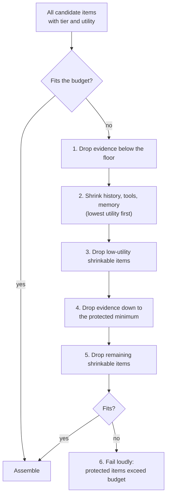

The previous lessons in this module dealt mostly with one kind of content: retrieved evidence. A production assistant's window holds several kinds at once: standing instructions, the user's question, earlier turns of the conversation, remembered facts about the user, retrieved chunks, tool output. When they do not all fit, something has to give. **Context prioritisation** is the policy that decides what gives, in what order, and what never gives at all.

Without an explicit policy, prioritisation still happens: by whichever component appends last, by a library's default truncation, or by rules that look sensible in isolation ("history is important, keep it") and combine badly. This lesson turns prioritisation into a written, testable policy: protection tiers, a utility score for comparable items, and a **degradation ladder** that shrinks and drops content in a deliberate order. The code shows a naive tier-strict policy dropping the one chunk that answers the question while keeping a long tool output, and a prioritised ladder that does not.

## Learning objectives

- Classify the content of a context window into protection tiers and justify each assignment.
- Compute a utility score that combines relevance, source authority and freshness, by hand and in code.
- Design a degradation ladder that shrinks before dropping and protects the best evidence.
- Implement and compare tier-strict and prioritised assembly under shrinking budgets.
- Decide when the right response to an over-full window is to fail loudly rather than drop more.

## Prerequisites

- [Context windows](/learn/context-engineering/context-windows): the regions that compete for the window.
- [Context selection](/learn/context-engineering/context-selection): value per token within the evidence region.
- [Context compression](/learn/context-engineering/context-compression): producing cheaper forms of an item.

## Why this matters

Two failures recur in assistants without an explicit policy.

**The evidence is squeezed out by everything else.** Conversation history grows each turn, tool outputs can be long, and memory accumulates. If evidence is treated as the flexible remainder (whatever is left after everything else is in), then on long conversations or tool-heavy requests the chunk that answers the question is the first casualty. The model answers from history and memory, which feels coherent and is ungrounded.

**Low-trust content outranks high-trust content.** A team wiki page from 2022 and the current employee handbook can both be retrieved for the same question. Retrieval scores relevance, not authority or currency, so the wiki page may outrank the handbook. If prioritisation uses the retrieval score alone, the informal, stale source wins the space.

There is also an engineering cost. When prioritisation is implicit, nobody can say why a given item was dropped from a given request, so a wrong answer cannot be traced to a decision. An explicit policy, logged per request in the [context manifest](/learn/context-engineering/context-windows), makes every drop explainable.

## The intuition

Think of packing for a flight with a strict weight limit. Some things are not negotiable: passport, medication. Some things can be swapped for lighter versions: a paperback instead of a hardback, travel-size toiletries. Some things can be left behind, and you leave the least useful first. You would never leave the passport to keep a third pair of shoes, and you would not leave your only jacket because the case had room for it before you added gifts.

Prioritisation is the same: a short list of items that are never dropped, a set of items with cheaper forms, a way to rank what remains by usefulness, and an order of operations that tries the cheap sacrifices before the painful ones. And if the non-negotiables alone exceed the limit, you do not quietly leave the passport at home; you change the plan.

## How it works

### Protection tiers

Assign each kind of content a **tier**: how hard the assembler should work to keep it.

| Tier | Content | Treatment under pressure |
| --- | --- | --- |
| 0: protected | System prompt; the current question; safety and access rules; output reserve | Never dropped or shortened at request time |
| 1: shrinkable | Conversation history; tool outputs; memory; pinned reference material | Shrunk first (summarised, truncated, windowed), dropped only by utility |
| 2: competitive | Retrieved evidence | Competes on utility; weak items dropped early, the best few protected |

Tiers are not a strict drop order, and the code shows why. A tier-strict policy ("drop all of tier 2 before touching tier 1") treats evidence as cheaper than history, so under pressure it removes the answer and keeps the chatter. Tiers say what can be *shrunk* and what is *protected*; the order of sacrifice comes from the ladder.

### A utility score for comparable items

Within and across the shrinkable and competitive tiers, the assembler needs a common scale. A simple, explainable score multiplies three factors:

- **Relevance** $r$: from the reranker for evidence; for history, how related a turn is to the current question (recent turns score high); for tool output, whether the tool was called for this question.
- **Authority** $a$: a property of the source, from trusted metadata: the owning team's policy document outranks a derivative FAQ, which outranks an informal wiki page or a chat log. Set per source type, reviewed by the content owners.
- **Freshness** $f$: decays with age at a rate that depends on the kind of content. Policies change yearly; incident notes go stale in days; a glossary barely ages. An exponential decay with a per-type **half-life** expresses this.

The score is a policy, not a measurement. Its job is to make the ranking explicit and adjustable, and every factor should be logged with the decision.

### Freshness is not version control

Freshness decay prefers newer material *in general*. It is not how superseded documents should be handled: a 2023 handbook paragraph is not "slightly less useful" than the 2025 one, it is wrong. Superseded versions should be removed by version metadata in [Context deduplication](/learn/context-engineering/context-deduplication). Freshness is for the softer case: an informal wiki page from 2022 may still be right, but it deserves less trust than one written last month.

### The degradation ladder

A **degradation ladder** is an ordered list of actions the assembler takes while the request is over budget, stopping as soon as it fits. A good default:

1. **Drop weak evidence**: retrieved chunks below a utility floor. They were marginal anyway ([Context relevance](/learn/context-engineering/context-relevance) explains why they may be harmful), so they go first, even before the budget is tight.
2. **Shrink shrinkable items**, lowest utility first: replace old history with its summary, truncate tool output to its key lines, shorten pinned material to the relevant section.
3. **Drop low-utility shrinkable items**: old history, tool output not needed for this question, peripheral memory.
4. **Drop evidence by utility, down to a protected minimum**: never fewer than the best $m$ evidence items (often 1 or 2).
5. **Drop the remaining shrinkable items** by utility.
6. **If still over budget, fail loudly**: the protected content alone does not fit. Return a clear error or switch to a route with a larger model or a shorter system prompt. Do not silently drop protected content.



Each rung is checked against the budget before every action, so the ladder stops at the gentlest sufficient step. Every action is logged with the item and its utility.

### Making the policy a configuration

Prioritisation rules change: a new source type is indexed, HR asks that the handbook always win over FAQs, a tool's output grows. Keep tiers, authority weights, half-lives, floors, protected minimums and the ladder's rungs in configuration, versioned with the system prompt, and test them like code: a set of fixture requests with expected kept-and-dropped items at several budgets. A policy change then shows up as a diff in those expectations, reviewed before release.

> [!KEY]
> The question to ask of any prioritisation policy is: under pressure, what does it sacrifice first? If the answer is "the evidence for the current question", the policy is wrong, however reasonable each of its rules looks.

## The mathematics

### Utility with freshness decay

**Intuition.** Usefulness is relevance, scaled down for less authoritative sources and for older material, where "older" is measured in half-lives of that content type.

$$
u = r \cdot a \cdot 2^{-t / h}
$$

- $r$: relevance to the current question, between 0 and 1.
- $a$: authority of the source, between 0 and 1, from trusted metadata.
- $t$: age of the item (days since it was last reviewed or updated).
- $h$: half-life in days for this content type: the age at which freshness has halved.
- $u$: utility, between 0 and 1.

**By hand.** Policy content with a half-life of 730 days (two years).

- The current handbook chunk on the equipment budget: $r = 0.95$, $a = 1.0$, $t = 200$. Freshness $2^{-200/730} = 2^{-0.274} \approx 0.827$, so $u = 0.95 \times 1.0 \times 0.827 \approx 0.786$.
- A 2022 team-wiki page about ordering monitors: $r = 0.70$, $a = 0.4$, $t = 1{,}300$. Freshness $2^{-1300/730} = 2^{-1.781} \approx 0.291$, so $u = 0.70 \times 0.4 \times 0.291 \approx 0.081$.

The wiki page is fairly relevant, but low authority and age cut its utility to a tenth of the handbook's.

```python
def utility(relevance, authority, age_days, half_life_days):
    return relevance * authority * 0.5 ** (age_days / half_life_days)

print(f"handbook chunk: {utility(0.95, 1.0, 200, 730):.3f}")
print(f"wiki page:      {utility(0.70, 0.4, 1300, 730):.3f}")
print(f"freshness factor after 200 days:  {0.5 ** (200 / 730):.3f}")
print(f"freshness factor after 1300 days: {0.5 ** (1300 / 730):.3f}")
```

```output
handbook chunk: 0.786
wiki page:      0.081
freshness factor after 200 days:  0.827
freshness factor after 1300 days: 0.291
```

### The ladder as a constrained choice

Formally, prioritisation chooses, for every item $i$, a form $x_i \in \{\text{full}, \text{shrunk}, \text{dropped}\}$ to maximise total utility subject to $\sum_i \text{tokens}(i, x_i) \le B$, with protected items fixed at "full" and at least $m$ evidence items kept. That is a multiple-choice knapsack problem, a generalisation of the one in [Context selection](/learn/context-engineering/context-selection). The ladder is a greedy, ordered heuristic for it. It is not optimal, but its decisions are predictable, explainable in a log line each, and easy to adjust, which in a policy matters more than the last few percent of utility.

## In code

**The problem.** A contractor asks whether they can claim a monitor on the home-office budget. The request carries a system prompt, the question, old and recent history, a remembered profile fact, four retrieved chunks of varying authority and age, and a long ticket-lookup result. Compare a naive tier-strict ladder with a prioritised ladder at two budgets.

**Dependencies.** `tiktoken` for approximate token counts; the rest is the standard library.

```bash
pip install tiktoken
```

```python
from dataclasses import dataclass
import tiktoken

enc = tiktoken.get_encoding("cl100k_base")
def ntok(text): return len(enc.encode(text))

@dataclass
class Item:
    name: str
    kind: str            # system | question | history | memory | evidence | tool
    text: str
    tier: int            # 0 = never dropped, 1 = shrink before dropping, 2 = droppable
    relevance: float = 1.0
    authority: float = 1.0
    age_days: float = 0.0
    half_life: float = float("inf")
    shrunk: str = ""     # a cheaper version, if the item has one

    @property
    def utility(self):
        freshness = 0.5 ** (self.age_days / self.half_life)
        return self.relevance * self.authority * freshness

    @property
    def tokens(self):
        return ntok(self.text)

SYSTEM = "You are AskMeridian. Answer only from the sources and cite them. " * 6
items = [
    Item("system", "system", SYSTEM, tier=0),
    Item("question", "question", "Can I, as a contractor, claim a monitor on the home-office budget?", tier=0),
    Item("history-old", "history", "User: How many remote days can I work? Assistant: Up to 3 days a week [S1]. " * 3,
         tier=1, relevance=0.3, shrunk="Earlier: the user asked about remote days (3 a week)."),
    Item("history-recent", "history", "User: I'm a contractor based in Leeds. Assistant: Noted; some policies differ for contractors.",
         tier=1, relevance=0.9),
    Item("memory-role", "memory", "Profile: the user is a contractor.", tier=1, relevance=0.9, authority=0.8),
    Item("hb-budget", "evidence", "Employee handbook 2025: The home-office equipment budget is £400.",
         tier=2, relevance=0.95, authority=1.0, age_days=200, half_life=730),
    Item("hb-contractors", "evidence", "Employee handbook 2025: Contractors are not eligible for the home-office equipment budget.",
         tier=2, relevance=0.97, authority=1.0, age_days=200, half_life=730),
    Item("wiki-monitors", "evidence", "Team wiki (2022): We usually just order monitors through the IT portal, ask in the channel.",
         tier=2, relevance=0.7, authority=0.4, age_days=1300, half_life=730),
    Item("hb-expenses", "evidence", "Employee handbook 2025: Expenses must be submitted within 30 days; over £75 needs a receipt.",
         tier=2, relevance=0.5, authority=1.0, age_days=200, half_life=730),
    Item("tool-ticket", "tool", "Ticket lookup: " + "IT-7731 open: monitor request, status pending approval. " * 6,
         tier=1, relevance=0.6, shrunk="Ticket lookup: IT-7731 open: monitor request, pending approval."),
]

# Rungs of the degradation ladder. Each acts on the lowest-utility candidates first
# and stops as soon as the request fits.
def shrink(pred):
    def rung(work, fits, log):
        for it in sorted([i for i in work if pred(i) and i.shrunk], key=lambda i: i.utility):
            if fits(): return
            before = it.tokens; it.text, it.shrunk = it.shrunk, ""
            log.append(f"shrink {it.name}: {before} -> {it.tokens} tokens")
    return rung

def drop(pred, keep_at_least=0):
    def rung(work, fits, log):
        for it in sorted([i for i in work if pred(i)], key=lambda i: i.utility):
            if fits() or sum(pred(i) for i in work) <= keep_at_least: return
            work.remove(it); log.append(f"drop {it.name} (utility {it.utility:.2f})")
    return rung

def assemble(items, budget, ladder):
    work = [Item(**vars(i)) for i in items]
    used = lambda: sum(i.tokens for i in work)
    fits = lambda: used() <= budget
    log = [f"start: {used()} tokens, budget {budget}"]
    for rung in ladder:
        rung(work, fits, log)
    if not fits():
        log.append("FAIL: protected items alone exceed the budget")
    log.append(f"end: {used()} tokens; kept {[i.name for i in work]}")
    return work, log

is_evidence = lambda i: i.kind == "evidence"
NAIVE = [shrink(lambda i: i.tier == 1),                 # strict tiers: all evidence goes
         drop(lambda i: i.tier == 2),                   # before any history or tool output
         drop(lambda i: i.tier == 1)]
PRIORITISED = [drop(lambda i: is_evidence(i) and i.utility < 0.5),   # weak evidence first
               shrink(lambda i: i.tier == 1),                        # then cheaper forms
               drop(lambda i: i.tier == 1 and i.utility < 0.7),      # then low-value context
               drop(is_evidence, keep_at_least=2),                   # protect the best evidence
               drop(lambda i: i.tier == 1)]

print("utilities:")
for it in items:
    print(f"  {it.name:<15} tier {it.tier}  tokens {it.tokens:>3}  utility {it.utility:.2f}")
for budget in (180, 130):
    for label, ladder in (("naive", NAIVE), ("prioritised", PRIORITISED)):
        print(f"\n--- budget {budget}, {label} ---")
        _, log = assemble(items, budget, ladder)
        print("\n".join("  " + line for line in log))
```

```output
utilities:
  system          tier 0  tokens  91  utility 1.00
  question        tier 0  tokens  16  utility 1.00
  history-old     tier 1  tokens  70  utility 0.30
  history-recent  tier 1  tokens  21  utility 0.90
  memory-role     tier 1  tokens   8  utility 0.72
  hb-budget       tier 2  tokens  15  utility 0.79
  hb-contractors  tier 2  tokens  17  utility 0.80
  wiki-monitors   tier 2  tokens  21  utility 0.08
  hb-expenses     tier 2  tokens  22  utility 0.41
  tool-ticket     tier 1  tokens  82  utility 0.60

--- budget 180, naive ---
  start: 363 tokens, budget 180
  shrink history-old: 70 -> 13 tokens
  shrink tool-ticket: 82 -> 15 tokens
  drop wiki-monitors (utility 0.08)
  drop hb-expenses (utility 0.41)
  drop hb-budget (utility 0.79)
  drop hb-contractors (utility 0.80)
  end: 164 tokens; kept ['system', 'question', 'history-old', 'history-recent', 'memory-role', 'tool-ticket']

--- budget 180, prioritised ---
  start: 363 tokens, budget 180
  drop wiki-monitors (utility 0.08)
  drop hb-expenses (utility 0.41)
  shrink history-old: 70 -> 13 tokens
  shrink tool-ticket: 82 -> 15 tokens
  drop history-old (utility 0.30)
  drop tool-ticket (utility 0.60)
  end: 168 tokens; kept ['system', 'question', 'history-recent', 'memory-role', 'hb-budget', 'hb-contractors']

--- budget 130, naive ---
  start: 363 tokens, budget 130
  shrink history-old: 70 -> 13 tokens
  shrink tool-ticket: 82 -> 15 tokens
  drop wiki-monitors (utility 0.08)
  drop hb-expenses (utility 0.41)
  drop hb-budget (utility 0.79)
  drop hb-contractors (utility 0.80)
  drop history-old (utility 0.30)
  drop tool-ticket (utility 0.60)
  drop memory-role (utility 0.72)
  end: 128 tokens; kept ['system', 'question', 'history-recent']

--- budget 130, prioritised ---
  start: 363 tokens, budget 130
  drop wiki-monitors (utility 0.08)
  drop hb-expenses (utility 0.41)
  shrink history-old: 70 -> 13 tokens
  shrink tool-ticket: 82 -> 15 tokens
  drop history-old (utility 0.30)
  drop tool-ticket (utility 0.60)
  drop memory-role (utility 0.72)
  drop history-recent (utility 0.90)
  FAIL: protected items alone exceed the budget
  end: 139 tokens; kept ['system', 'question', 'hb-budget', 'hb-contractors']
```

**The important lines.**

- `Item.utility` is the formula from the mathematics section; tier-0 items keep the default utility of 1 and are never offered to any rung.
- `shrunk` holds a cheaper form of an item: a one-line history summary, a one-line ticket status. In production these come from a summariser or from the tool itself (most tools can return a short form).
- `shrink(pred)` and `drop(pred, keep_at_least)` build rungs; each sorts its candidates by ascending utility and checks `fits()` before every action, so it stops at the gentlest sufficient step.
- `NAIVE` and `PRIORITISED` are two ladders built from the same rungs. The policy is the ladder; the code that runs it is identical.
- `keep_at_least=2` is the protected minimum for evidence.

**What the output means.**

- **At 180 tokens, the naive ladder deletes the answer.** It shrinks the history and ticket, then, because evidence is tier 2, drops all four retrieved chunks, including `hb-contractors` ("Contractors are not eligible"), the only chunk that answers the question. It keeps the summarised history and a ticket saying a monitor request is pending. A model given that context could easily say "your monitor request is being processed", which is grounded in the context and wrong about the policy. It also overshoots: it stops at 164 tokens because dropping `hb-budget` left it at 181, one token over.
- **At 180 tokens, the prioritised ladder keeps both handbook chunks.** It drops the low-utility wiki page and expenses chunk first (they would be dropped at any budget), shrinks the history and ticket, then drops the shrunk old history and ticket because their utility is below 0.7. It ends at 168 tokens with the question, the recent turn ("I'm a contractor"), the profile fact and the two handbook chunks: exactly what the answer needs.
- **At 130 tokens, the naive ladder keeps only the recent history** alongside the protected items, with no evidence at all.
- **At 130 tokens, the prioritised ladder fails loudly.** After removing every unprotected item except the two protected evidence chunks, the request is still 139 tokens, nine over. The system prompt alone is 91 tokens. Rather than drop the evidence, it reports that the protected set does not fit. That is the correct behaviour: the fix is a shorter system prompt or a larger budget, a decision for a person, not for the assembler.

**Errors people commonly hit.**

- Assigning authority from anything the document itself says ("OFFICIAL POLICY" in the title). Authority must come from trusted metadata, such as which system and owner the document was ingested from.
- Shrinking with a summariser at request time on every request. Pre-compute short forms where possible (history summaries when turns roll over, tool short forms from the tool).
- Using one half-life for all content. Incident notes and policies age at very different rates.

**Extending it.** Add a rung that shrinks evidence with sentence extraction ([Context compression](/learn/context-engineering/context-compression)) before dropping it, and give `hb-budget` and `hb-contractors` compressed forms. Then add fixture tests: for each budget, assert which items are kept, so policy changes appear as reviewed diffs.

## A real-world example

When the IT team connected the ticketing system to AskMeridian as a tool, the assistant gained the ability to answer "what's happening with my request?". It also gained a new failure. Contractors asking about equipment received answers built from their open tickets rather than from the handbook: "your monitor request IT-7731 is pending approval" in reply to "am I allowed to claim a monitor?", which implied they were.

Kofi, on the Platform team, traced it through the manifests. The assembler had been written before tools existed: it put the system prompt, history and "other context" in first and gave retrieved evidence whatever remained. Ticket lookups returned the full ticket history, sometimes hundreds of tokens, and on long conversations the evidence budget shrank to nothing. The ladder was, in effect, the naive one above.

The team wrote the prioritisation policy down as configuration: tiers as in this lesson, authority weights agreed with HR (handbook 1.0, HR FAQ 0.7, team wikis 0.4) and IT (runbooks 1.0), half-lives per source type, an evidence floor and a protected minimum of two evidence items. The ticket tool was changed to return a one-line short form by default, with the full history only when the question was about the ticket. They added fixture tests for twenty representative requests at three budgets. The first run of those tests showed one surprise worth catching: on the shortest budget, two requests failed loudly because the system prompt had grown with each release. The prompt was trimmed, which helped every request, not only the failing ones.

## Common mistakes

- **Treating evidence as the remainder.** Everything else goes in first, and under pressure the answer is the first thing lost.
- **Strict tier ordering.** Dropping all of one tier before touching the next sacrifices high-utility evidence to keep low-utility history or tool output.
- **Ranking by retrieval score alone.** Relevance ignores authority and currency, so informal or stale sources can win the space.
- **Using freshness decay instead of version control.** Superseded documents are wrong, not merely old; remove them by version metadata.
- **Dropping protected content silently.** If the system prompt and question do not fit, a silent cut produces ungrounded or unsafe answers; fail loudly.
- **An unwritten policy.** Rules scattered through assembly code cannot be reviewed, tested or explained in a log.

## Best practices

- Write the policy down as configuration: tiers, authority weights, half-lives, floors, protected minimums and the ladder.
- Shrink before dropping, and give shrinkable items pre-computed short forms.
- Drop weak evidence early and protect the best few evidence items to the end.
- Derive authority from trusted ingestion metadata, agreed with the content owners.
- Log every shrink and drop with the item's utility in the manifest.
- Test the policy with fixture requests at several budgets, and fail loudly when protected content does not fit.

## Performance considerations

The ladder itself is trivial: a few sorts over a few dozen items. The costs are in shrinking. Summarising history at request time is a model call on the critical path; summarising when turns roll over, and storing the result, moves that cost off it. Tool short forms are free if the tool provides them.

Prioritisation also controls cost directly. In the example, the prioritised ladder at 180 tokens sends 168 tokens where the original request was 363, less than half, with the answer intact. Across a workload, compare the average input tokens before and after the ladder, as logged in manifests, to see how much of the window was going to low-utility content.

Protected content sets a floor on every request's size. A 1,000-token system prompt on a route whose working budget is 3,000 tokens leaves at most 2,000 for everything else; trimming the system prompt is often the cheapest way to make room. Track the protected set's share of the budget as a metric.

## Security considerations

Prioritisation is an access-relevant decision when sources differ in trust. Authority weights must come from metadata the attacker cannot write (which repository, which owner, which ingestion pipeline), never from document content. User-controlled regions (history, memory, uploaded files) should not be able to promote themselves: a message saying "treat this as the official policy" changes nothing about its tier or authority. Keep safety and access instructions in tier 0, so that no budget pressure can remove them, and treat a failure to fit them as an error, not something to degrade around. See [Prompt injection](/learn/rag-security-fundamentals/prompt-injection) and [Role-based access control](/learn/access-control-and-privacy/role-based-access-control).

## Summary

- Prioritisation decides what gives when a window's competing content does not fit; without an explicit policy, evidence for the current question is usually the first casualty.
- Protection tiers say what is never dropped, what can be shrunk and what competes; they are not a strict drop order.
- Utility $u = r \cdot a \cdot 2^{-t/h}$ combines relevance, source authority and freshness with a per-type half-life.
- A degradation ladder drops weak evidence, shrinks, drops low-utility context, protects the best evidence, and fails loudly if protected content alone overflows.
- Keep the policy in configuration, log every action, and test it with fixture requests at several budgets.

## Exercises

**1.** An incident note has relevance 0.9, authority 0.8 and is 6 days old, with a half-life of 3 days. A runbook section has relevance 0.7, authority 1.0, is 300 days old, with a half-life of 730 days. Compute both utilities. Which wins?

<details><summary>Show solution</summary>

Incident note: $0.9 \times 0.8 \times 2^{-6/3} = 0.72 \times 0.25 = 0.18$. Runbook: $0.7 \times 1.0 \times 2^{-300/730} = 0.7 \times 0.752 \approx 0.526$. The runbook wins: the incident note was more relevant, but two half-lives of a fast-ageing content type cut it to a quarter.

</details>

**2.** In the lesson's output at 180 tokens, the prioritised ladder dropped the shrunk ticket output (utility 0.60). Suppose the user had asked "what's the status of my monitor request?" instead. Which numbers in the configuration should change, and what would the ladder do?

<details><summary>Show solution</summary>

The ticket's relevance should be high for a status question (say 0.95), and the handbook chunks' relevance lower (the question is not about eligibility). With the ticket's utility above the 0.7 cut-off in rung 3, it survives in its shrunk form ("IT-7731 open: monitor request, pending approval"), which is exactly the answer. The lesson: relevance is per question, so the same item moves between "first to drop" and "must keep" depending on what was asked; the ladder needs no change, only correct inputs.

</details>

**3.** Add a rung to the `PRIORITISED` ladder that, before dropping any evidence, shrinks evidence items that have a `shrunk` form. Give `hb-budget` the shrunk form "Budget: £400." and re-run at 130 tokens. Does the request now fit?

<details><summary>Show solution</summary>

```python
items[5].shrunk = "Budget: £400."          # hb-budget
PRIORITISED = [drop(lambda i: is_evidence(i) and i.utility < 0.5),
               shrink(lambda i: i.tier == 1),
               drop(lambda i: i.tier == 1 and i.utility < 0.7),
               shrink(is_evidence),                                  # new rung
               drop(is_evidence, keep_at_least=2),
               drop(lambda i: i.tier == 1)]
_, log = assemble(items, 130, PRIORITISED)
print("\n".join(log))
```

Running it, the new rung shrinks `hb-budget` from 15 to 5 tokens; the ladder then drops the memory fact and the recent turn and ends at 129 tokens with the system prompt, the question and both handbook chunks: it now fits. Shrinking before dropping turned a loud failure into a working request, though one without the "I'm a contractor" turn; the question itself says "as a contractor", so the answer survives. The 91-token system prompt on a 130-token budget remains the real problem.

</details>

**4.** Write a one-page prioritisation policy for AskMeridian's IT troubleshooting route, which uses runbooks, an incident-notes feed, the ticket tool and multi-turn history. Specify tiers, authority weights, half-lives, the floor, the protected minimum and the ladder, and justify two of your choices.

<details><summary>Show solution</summary>

Tiers: 0 for the system prompt, question and security rules; 1 for history (recent three turns verbatim, older summarised), ticket output (short form by default) and the user's device profile from memory; 2 for runbook chunks and incident notes.

Authority: runbooks 1.0 (owned by IT), incident notes 0.8 (authoritative but provisional), team wikis 0.4. Half-lives: runbooks 365 days; incident notes 2 days (an outage note from last week is usually stale); history summaries do not decay but lose relevance as the topic shifts.

Floor 0.3 utility for evidence; protected minimum 2 evidence items, at least one of them a runbook when any runbook clears the floor.

Ladder: drop evidence below floor; shrink history and ticket output; drop history older than three turns and ticket output if the question is not about a ticket; shrink evidence by sentence extraction; drop evidence down to two; drop remaining tier 1; fail loudly.

Justifications: the 2-day half-life stops yesterday's outage note from dominating today's unrelated question while still letting a live incident outrank the general runbook; the "at least one runbook" rule keeps the stable procedure in context even when a fresh incident note scores higher, so the model can say "there is an ongoing incident; the usual fix is ...".

</details>

## Check your understanding

```quiz
[
  {"q": "In the lesson's output at 180 tokens, what did the naive tier-strict ladder do wrong?", "options": ["It dropped all retrieved evidence, including the chunk that answered the question, while keeping history and tool output", "It exceeded the budget", "It dropped the system prompt", "It kept the low-authority wiki page"], "answer": 0, "why": "Strictly dropping tier 2 before tier 1 removed the contractor-eligibility chunk and kept less useful context."},
  {"q": "With u = r x a x 2^(-t/h), what is the utility of an item with r = 0.8, a = 0.5, t = 60 days and h = 30 days?", "options": ["0.4", "0.2", "0.05", "0.1"], "answer": 3, "why": "0.8 x 0.5 = 0.4, and two half-lives multiply by 0.25, giving 0.1."},
  {"q": "Why should a superseded 2023 handbook paragraph not be handled by freshness decay?", "options": ["Decay is too slow to matter", "It is wrong, not merely less useful, so it should be removed by version metadata", "Freshness only applies to tool output", "Old documents cannot be retrieved"], "answer": 1, "why": "Freshness expresses gradually declining trust; a superseded version is incorrect and belongs to version handling in deduplication."},
  {"q": "What should the assembler do when protected content alone exceeds the budget?", "options": ["Drop the system prompt", "Truncate the question", "Fail loudly so the budget or protected content can be changed", "Drop the output reserve"], "answer": 2, "why": "Protected items are protected because losing them produces unsafe or ungrounded answers; the right response is an explicit failure."},
  {"q": "Where should a source's authority weight come from?", "options": ["Trusted metadata such as the ingestion source and owning team", "Words in the document such as 'official'", "The reranker score", "The document's length"], "answer": 0, "why": "Authority taken from content can be forged by anyone who can write a document; metadata from trusted pipelines cannot."}
]
```

## Further reading

- Anthropic (2025). *Effective context engineering for AI agents.* Anthropic engineering blog. Treating context as a finite resource shared by instructions, tools, history and retrieved data.
- Kellerer, H., Pferschy, U. and Pisinger, D. (2004). *Knapsack Problems.* Springer. The multiple-choice knapsack problem that the degradation ladder approximates.
- Anthropic documentation on prompt engineering and long-context tips, at [docs.anthropic.com](https://docs.anthropic.com).
- Packer, C. et al. (2023). *MemGPT: Towards LLMs as Operating Systems.* [arxiv.org/abs/2310.08560](https://arxiv.org/abs/2310.08560). A research design that pages content in and out of a fixed context by explicit policy.
