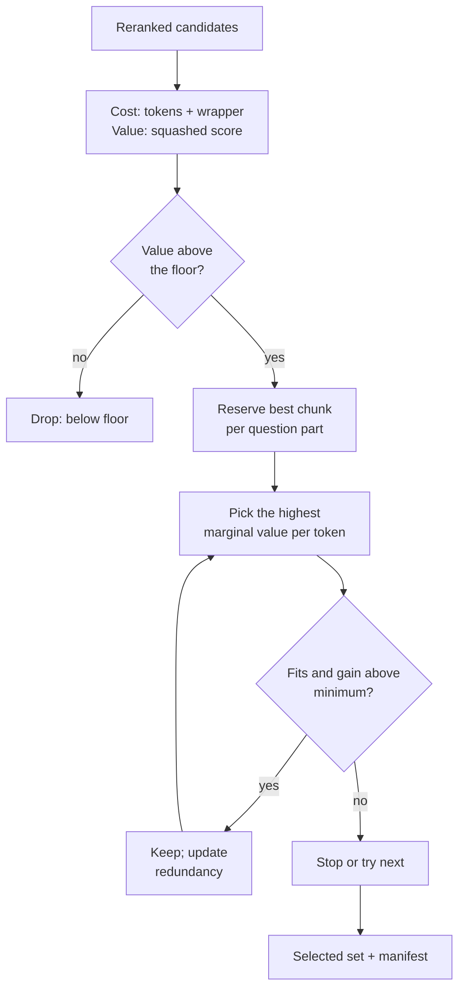

Retrieval and reranking hand you a ranked list of candidates with scores. **Context selection** decides which of them actually enter the window. It looks like a trivial step ("take the top five"), and in [Context construction](/learn/rag-architecture-fundamentals/context-construction) you met its simplest form: walk down the ranking and keep what fits. This lesson treats selection properly, as an optimisation problem: get the most useful evidence into the model for the fewest tokens.

You will see why a fixed `k` is the wrong control, how to state selection as a knapsack problem and solve it exactly, why the exact solution can still pick a poor context, and how a greedy rule based on *marginal* value per token fixes that. The code runs a real cross-encoder on Meridian's handbook chunks and compares six selection policies on the same candidates.

## Learning objectives

- Explain why a fixed number of chunks is a poor selection rule when chunk sizes and question types vary.
- Formulate context selection as a 0/1 knapsack problem and solve a small instance by hand and by dynamic programming.
- Compare greedy-by-score, greedy-by-density and exact knapsack selection, and predict where each goes wrong.
- Implement selection by marginal value per token, discounting candidates that repeat evidence already selected.
- Choose a relevance floor and an adaptive cut-off, and explain the failure mode of score-gap rules on multi-part questions.

## Prerequisites

- [Context windows](/learn/context-engineering/context-windows): the working budget and the regions that compete for it.
- [Context construction](/learn/rag-architecture-fundamentals/context-construction): greedy packing with stop, skip and truncate.
- [Cross-encoders](/learn/reranking-fundamentals/cross-encoders): where the relevance scores used here come from.

## Why this matters

Selection is the last point at which a retrieved chunk can be lost. Retrieval may have found the passage that answers the question; if selection leaves it out, the model never sees it, and [context recall](/learn/advanced-retrieval-optimisation/context-recall) drops for a reason no retrieval metric will show.

The opposite failure is just as common. A selection rule that always takes eight chunks will, for a simple question, pad the window with near-misses. Each one costs tokens on every request, and each is a plausible distractor the model must decide to ignore.

Three facts make "take the top k" a poor rule:

- **Chunks differ in size.** Five chunks may be 500 tokens or 5,000. A count says nothing about the budget.
- **Questions differ in need.** "What is the VPN error E-4021?" needs one passage. "Compare the 2023 and current equipment budgets and say whether contractors qualify" needs three. A single `k` is too large for the first and too small for the second.
- **Chunks overlap in content.** Two highly ranked chunks that say the same thing are worth little more than one. Ranking scores each chunk alone and cannot see this.

## The intuition

You are packing a small rucksack for a day walk. Each item has a weight and a usefulness. You would not pack "the five most useful items" without looking at their weight: a tent is very useful and very heavy. Nor would you pack two identical water bottles just because water scores highly. You think about what each *additional* item adds, given what is already in the bag, per kilogram it costs.

Context selection is exactly this. Tokens are weight. Relevance is usefulness. And what a chunk adds depends on what you have already packed.

## How it works

### The quantities

For each candidate chunk $i$ selection needs two numbers:

- **Cost** $c_i$: the tokens it would occupy, including its wrapper (source tags, label, title).
- **Value** $v_i$: how much it is expected to help answer the question.

Cost is easy to measure. Value is the hard part, and every selection policy is ultimately a choice of how to estimate it. The usual estimate is the reranker's score, mapped to a number between 0 and 1. Two cautions apply. A reranker scores *topical relevance to the query*, which is related to, but not the same as, *usefulness for the answer* ([Context relevance](/learn/context-engineering/context-relevance) explores the gap). And a squashed score such as $\sigma(\text{logit})$ is not a calibrated probability unless you have calibrated it on labelled data ([Score calibration](/learn/advanced-retrieval-optimisation/score-calibration)). For *ranking* candidates within one query it is still a sensible value; for comparing values across queries, be careful.

### Policy 1: a fixed count

Take the top $k$. It ignores cost entirely, so the token total varies with chunk size, and it ignores need, so it under- or over-fills. Its one virtue is predictability, which is why it persists. Never use it alone; at minimum, combine it with a token budget.

### Policy 2: greedy by score within a budget

Walk the ranking and keep each chunk that fits, either stopping at the first that does not or skipping it and continuing. This is the policy from [Context construction](/learn/rag-architecture-fundamentals/context-construction). It respects the budget but not the trade-off between value and size: a large, slightly better chunk ranked first can crowd out two small chunks that together answer more.

### Policy 3: greedy by density

Sort candidates by **value density** $v_i / c_i$, value per token, and pack in that order. This is the classical heuristic for the knapsack problem. It favours short, highly relevant chunks, which is usually what you want, but it can under-use the budget when one large chunk is uniquely valuable.

### Policy 4: exact knapsack

Choose the subset of candidates that maximises total value without exceeding the budget. This is the **0/1 knapsack problem** ("0/1" because each chunk is either in or out). It is NP-hard in general, but with token budgets in the thousands and a few dozen candidates, the standard dynamic-programming solution runs in microseconds. The mathematics section shows the formulation.

### The flaw shared by policies 1 to 4: additive value

All four policies assume that the value of a set is the *sum* of its members' values. For evidence that is false. If a long handbook section contains the carry-over rule and a short chunk states the same rule, including both does not double the evidence for that rule. An exact knapsack optimiser, given additive values, will happily spend tokens on such repeats because each looks valuable on its own. The output in the code section shows it doing exactly that.

### Policy 5: marginal value per token

Fix the assumption by valuing each candidate *given what has already been selected*. A simple, effective form discounts a candidate's value by its similarity to the most similar chunk already kept:

$$
g_i(S) = \frac{v_i \,\big(1 - \max_{j \in S} \text{sim}(i, j)\big)}{c_i}
$$

and repeatedly adds the candidate with the highest $g_i$ until the budget is spent or the best remaining marginal value falls below a minimum. This is a close relative of [MMR](/learn/advanced-retrieval-optimisation/mmr), which balances relevance and novelty when *ranking*; here the same idea is applied per token when *packing*. Exact de-duplication rules (which copy to keep, how to merge citations) belong to [Context deduplication](/learn/context-engineering/context-deduplication); the marginal discount handles the softer case where chunks overlap in content without being copies.

Maximising a set function with diminishing returns, such as coverage of distinct facts, is **submodular maximisation**, for which greedy algorithms have approximation guarantees; that is why greedy marginal selection is principled, not merely convenient.

### Floors and adaptive cut-offs

Every policy above should run only over candidates that clear a **relevance floor**, a minimum value below which a chunk is never included however much budget remains. The floor turns an empty budget into an honest "not enough evidence", which the model can act on ([Handling missing information](/learn/prompt-engineering-for-rag/handling-missing-information)). How to set floors from labelled data is covered in [Retrieval thresholding](/learn/advanced-retrieval-optimisation/retrieval-thresholding).

**Adaptive cut-offs** try to choose the number of chunks per query from the shape of the score distribution. Two common rules:

- **Relative to the best**: keep candidates whose score is within some margin of the top score.
- **Largest gap**: sort the scores and cut at the biggest drop between neighbours.

Both have a characteristic failure on multi-part questions. If one part of the question is matched almost perfectly and the other only moderately, the biggest drop can fall between the two parts' best chunks, and the rule discards the evidence for the second part. Gap rules also ignore absolute level: a cut below a chunk that scores 0.12 keeps a chunk that is probably irrelevant. Use them only together with a floor, and check them on multi-part questions specifically.

### Coverage of the question's parts

For multi-part questions the key signal is **coverage**: is there a good chunk for each part? Decompose the question ([Query decomposition](/learn/advanced-retrieval/query-decomposition)), score candidates against each part, and reserve the best chunk per part before filling the rest by marginal value. Otherwise one strongly matched part can absorb the whole budget.

### Expanding around a good chunk

When a rule is in one chunk and its exception in the next, selection can **expand** a selected chunk with its neighbours or its parent section ([Small-to-big retrieval](/learn/chunking-optimisation/small-to-big-retrieval)). Treat each neighbour as a candidate with its own discounted value rather than adding it unconditionally.

### The selection procedure

Putting it together, a robust selector does this for each request:

1. **Score** every candidate (reranker logits are typical) and compute its token cost including the wrapper.
2. **Convert** scores to values in a common range and **drop** candidates below the floor.
3. **Reserve** coverage: if the question has parts, add the best candidate for each part first.
4. **Fill** the remaining budget greedily by marginal value per token, discounting by similarity to what is already selected.
5. **Stop** when the budget is spent or the best marginal value falls below a minimum gain.
6. **Optionally expand** selected chunks with neighbours, treating each as a new candidate.
7. **Record** every decision (kept, below floor, redundant, over budget) in the manifest.



## The mathematics

### Selection as a knapsack

**Intuition.** Choose which chunks to include so that the total value is as large as possible without the total cost exceeding the budget.

$$
\max_{x \in \{0,1\}^n} \sum_{i=1}^{n} v_i x_i \quad \text{subject to} \quad \sum_{i=1}^{n} c_i x_i \le B
$$

- $n$: number of candidates.
- $x_i$: 1 if chunk $i$ is selected, 0 if not.
- $v_i$: value of chunk $i$ (here, its squashed reranker score).
- $c_i$: token cost of chunk $i$, wrapper included.
- $B$: token budget for evidence.

The dynamic-programming solution builds a table $V[i][b]$, the best value achievable using the first $i$ candidates with budget $b$:

$$
V[i][b] = \max\big(V[i-1][b],\; V[i-1][b - c_i] + v_i\big) \quad \text{if } c_i \le b, \text{ else } V[i-1][b]
$$

The first option leaves chunk $i$ out; the second includes it and spends $c_i$ tokens. The answer is $V[n][B]$, computed in $O(nB)$ time.

**By hand.** Three candidates for "How many days of annual leave do I get, and can I carry unused days over?", with the costs and values the code below measures, and $B = 110$:

| Chunk | Cost $c_i$ | Value $v_i$ | Density per 1,000 tokens |
| --- | --- | --- | --- |
| carry-over rule | 36 | 1.000 | 27.8 |
| full leave policy | 105 | 0.999 | 9.5 |
| entitlement | 33 | 0.933 | 28.3 |

Feasible subsets within 110 tokens: {carry-over, entitlement} costs $36 + 33 = 69$ and is worth $1.000 + 0.933 = 1.933$; {full policy} alone costs 105 and is worth 0.999; any pair containing the full policy costs at least $105 + 33 = 138 > 110$. The optimum is {carry-over, entitlement}. Greedy-by-score takes the carry-over rule (36), then tries the full policy ($36 + 105 = 141 > 110$): with "stop" it ends there, holding only the carry-over rule and missing the entitlement entirely.

**In Python**, by brute force over subsets, which is fine for three items:

```python
from itertools import combinations

items = {"carryover": (36, 1.000), "policy-full": (105, 0.999), "entitlement": (33, 0.933)}
budget = 110
for name, (c, v) in items.items():
    print(f"{name:<12} cost {c:>3}  value {v:.3f}  density {1000 * v / c:.1f} per 1,000 tokens")

feasible = []
for r in range(1, len(items) + 1):
    for combo in combinations(items, r):
        c = sum(items[n][0] for n in combo)
        v = sum(items[n][1] for n in combo)
        if c <= budget:
            feasible.append((round(v, 3), c, combo))
for v, c, combo in sorted(feasible, reverse=True):
    print(f"value {v:.3f}  cost {c:>3}  {combo}")
```

```output
carryover    cost  36  value 1.000  density 27.8 per 1,000 tokens
policy-full  cost 105  value 0.999  density 9.5 per 1,000 tokens
entitlement  cost  33  value 0.933  density 28.3 per 1,000 tokens
value 1.933  cost  69  ('carryover', 'entitlement')
value 1.000  cost  36  ('carryover',)
value 0.999  cost 105  ('policy-full',)
value 0.933  cost  33  ('entitlement',)
```

### Marginal value

**Intuition.** A chunk that mostly repeats something already selected adds little, however relevant it is.

$$
g_i(S) = \frac{v_i \,\big(1 - \max_{j \in S} s_{ij}\big)}{c_i}
$$

- $S$: the set already selected; the maximum is 0 when $S$ is empty.
- $s_{ij}$: cosine similarity between the embeddings of chunks $i$ and $j$, between 0 and 1 for these texts.
- $g_i(S)$: marginal value per token of adding $i$ to $S$.

**By hand.** Suppose the entitlement chunk is selected, and the full policy has similarity $0.85$ to it (the code measures this). The full policy's marginal value is $0.999 \times (1 - 0.85) = 0.150$, or $0.150 / 105 = 0.0014$ per token, against its stand-alone $0.999 / 105 = 0.0095$. It has lost 85% of its appeal, because most of what it says is already in the window.

## In code

**The problem.** For the leave question above, score six candidates with a real cross-encoder and compare six selection policies at two budgets.

**Dependencies.** `sentence-transformers` (with PyTorch) for the cross-encoder and embedding model, `tiktoken` for approximate token counts, NumPy. The models download on first use (about 90 MB each); after that, no network is needed.

```bash
pip install sentence-transformers tiktoken numpy
```

```python
import numpy as np
import tiktoken
from sentence_transformers import CrossEncoder, SentenceTransformer

enc = tiktoken.get_encoding("cl100k_base")
reranker = CrossEncoder("cross-encoder/ms-marco-MiniLM-L-6-v2")
WRAPPER = 12   # tokens for <source id="..."> ... </source> around each chunk

query = "How many days of annual leave do I get, and can I carry unused days over?"
candidates = {
    "leave-policy-full": ("Annual leave: permanent staff receive 25 days per year, pro rata for part-time contracts. "
        "Leave is booked in the HR portal and approved by your line manager. Requests over 10 consecutive days "
        "need two months' notice. Up to 5 unused days carry over to the next year and must be used by 31 March. "
        "Bank holidays are in addition to annual leave. Leave cannot be taken during the first two weeks of "
        "a notice period without manager approval."),
    "leave-entitlement": "Annual leave is 25 days per year for all permanent staff, pro rata for part-time contracts.",
    "leave-carryover": "Up to 5 unused days of annual leave carry over to the next year and must be used by 31 March.",
    "leave-booking": "Book annual leave in the HR portal at least two weeks in advance where possible.",
    "sick-leave": "Sick leave must be reported to your manager before 10:00 on the first day of absence.",
    "remote": "Staff may work remotely up to 3 days a week. The home-office equipment budget is £400.",
}
ids = list(candidates)
logits = reranker.predict([(query, candidates[i]) for i in ids])
value = 1 / (1 + np.exp(-logits))                   # squash logits into (0, 1)
cost = np.array([len(enc.encode(candidates[i])) + WRAPPER for i in ids])
rank = list(np.argsort(-logits))                    # best first
embedder = SentenceTransformer("sentence-transformers/all-MiniLM-L6-v2")
E = embedder.encode([candidates[i] for i in ids], normalize_embeddings=True)
sim = E @ E.T                                       # cosine similarity between chunks

print(f"{'chunk':<18}{'logit':>7}{'value':>7}{'cost':>6}")
for i in rank:
    print(f"{ids[i]:<18}{logits[i]:>7.2f}{value[i]:>7.3f}{cost[i]:>6}")

def top_k(k, budget, floor):
    return rank[:k]

def greedy(k, budget, floor, skip=True):
    kept, used = [], 0
    for i in rank:
        if value[i] < floor:
            break
        if used + cost[i] > budget:
            if skip:
                continue
            break
        kept.append(i); used += cost[i]
    return kept

def largest_gap(k, budget, floor):
    s = logits[rank]
    cut = int(np.argmax(s[:-1] - s[1:])) + 1        # keep everything above the biggest drop
    return rank[:cut]

def knapsack(k, budget, floor):
    """0/1 knapsack by dynamic programming: maximise total value within the budget."""
    items = [i for i in rank if value[i] >= floor]
    best = {0: (0.0, [])}                            # tokens used -> (value, chosen items)
    for i in items:
        for used, (v, chosen) in list(best.items()):
            new_used = used + cost[i]
            if new_used <= budget and v + value[i] > best.get(new_used, (-1, None))[0]:
                best[new_used] = (v + value[i], chosen + [i])
    return max(best.values(), key=lambda x: x[0])[1]

def marginal(k, budget, floor):
    """Greedy on marginal value per token: value discounted by similarity to what is already kept."""
    kept, used = [], 0
    pool = [i for i in rank if value[i] >= floor]
    while pool:
        def gain(i):
            redundancy = max((sim[i, j] for j in kept), default=0.0)
            return value[i] * (1 - redundancy) / cost[i]
        best = max(pool, key=gain)
        pool.remove(best)
        if used + cost[best] <= budget and gain(best) * cost[best] > 0.2:
            kept.append(best); used += cost[best]
    return kept

def report(name, chosen, budget):
    used = int(sum(cost[i] for i in chosen))
    names = ", ".join(ids[i] for i in chosen)
    flag = "  OVER BUDGET" if used > budget else ""
    print(f"  {name:<14} {used:>4} tok  value {sum(value[i] for i in chosen):.2f}  [{names}]{flag}")

for budget in (110, 160):
    print(f"\nBudget {budget} tokens, floor 0.5")
    report("top-3", top_k(3, budget, 0.5), budget)
    report("largest gap", largest_gap(3, budget, 0.5), budget)
    report("greedy stop", greedy(3, budget, 0.5, skip=False), budget)
    report("greedy skip", greedy(3, budget, 0.5), budget)
    report("knapsack", knapsack(3, budget, 0.5), budget)
    report("marginal", marginal(3, budget, 0.5), budget)
print("\nsimilarity of leave-policy-full to carryover and entitlement:",
      round(float(sim[0, 2]), 2), round(float(sim[0, 1]), 2))
```

```output
chunk               logit  value  cost
leave-carryover      7.91  1.000    36
leave-policy-full    6.90  0.999   105
leave-entitlement    2.63  0.933    33
leave-booking       -1.94  0.125    28
remote              -8.81  0.000    33
sick-leave         -10.21  0.000    33

Budget 110 tokens, floor 0.5
  top-3           174 tok  value 2.93  [leave-carryover, leave-policy-full, leave-entitlement]  OVER BUDGET
  largest gap     202 tok  value 3.06  [leave-carryover, leave-policy-full, leave-entitlement, leave-booking]  OVER BUDGET
  greedy stop      36 tok  value 1.00  [leave-carryover]
  greedy skip      69 tok  value 1.93  [leave-carryover, leave-entitlement]
  knapsack         69 tok  value 1.93  [leave-carryover, leave-entitlement]
  marginal         69 tok  value 1.93  [leave-entitlement, leave-carryover]

Budget 160 tokens, floor 0.5
  top-3           174 tok  value 2.93  [leave-carryover, leave-policy-full, leave-entitlement]  OVER BUDGET
  largest gap     202 tok  value 3.06  [leave-carryover, leave-policy-full, leave-entitlement, leave-booking]  OVER BUDGET
  greedy stop     141 tok  value 2.00  [leave-carryover, leave-policy-full]
  greedy skip     141 tok  value 2.00  [leave-carryover, leave-policy-full]
  knapsack        141 tok  value 2.00  [leave-carryover, leave-policy-full]
  marginal         69 tok  value 1.93  [leave-entitlement, leave-carryover]
```

The final similarity line printed `0.62 0.85`: the full policy is fairly similar to the carry-over chunk and very similar to the entitlement chunk.

**The important lines.**

- `reranker.predict(...)` returns raw logits for this model, which is why they range from about $-10$ to $8$. `1 / (1 + np.exp(-logits))` squashes them into values between 0 and 1 so they can be added up.
- `cost = ... + WRAPPER` charges each chunk for its tags. Forgetting the wrapper makes a full budget overflow by a few tokens per chunk.
- `knapsack` keeps a dictionary from "tokens used" to the best (value, items) found so far: the dynamic-programming table, stored sparsely.
- `marginal` recomputes each candidate's gain after every pick, because redundancy depends on what is already selected. The `> 0.2` test is the minimum marginal value: below it, a chunk is not worth its tokens even if it fits.

**What the output means.**

- **The reranker ranks the long section second.** It contains both answers, so it is genuinely relevant, but it costs three times as much as either short chunk.
- **Top-3 and the gap rule ignore the budget**, and the gap rule also keeps the booking chunk (value 0.125) because the largest drop happens to fall *below* it, between $-1.94$ and $-8.81$. The gap rule chooses a cut-off, not a quality level.
- **At 110 tokens, greedy-stop loses the entitlement.** It reaches the 105-token section, cannot fit it, and stops, so the model would know the carry-over rule but not that leave is 25 days. Skip, knapsack and marginal all find the 69-token answer.
- **At 160 tokens, every additive policy picks a redundant pair.** Greedy and knapsack spend 141 tokens on the carry-over chunk plus the full section that repeats it, and leave the entitlement chunk out. By their arithmetic that is "value 2.00", which is a fiction: the carry-over rule is counted twice. Marginal selection discounts the long section by its 0.85 similarity to the entitlement chunk, finds its marginal value below the minimum, and stops at 69 tokens with both facts. It is cheaper *and* complete.

**Errors people commonly hit.**

- Applying `sigmoid` to a model that already outputs probabilities, or adding raw logits, which can be negative. Check what your reranker's `predict` returns.
- Running the knapsack over hundreds of candidates with a large budget: $O(nB)$ grows quickly. Pre-filter by the floor and cap $n$.
- Choosing the similarity discount on a model whose similarities between unrelated texts are already high (some embedding models give 0.5 or more to unrelated pairs). Inspect the similarity distribution of your model first.

**Extending it.** Add a coverage reservation: split the query into "how many days of annual leave" and "can I carry unused days over", rerank against each part, and pre-select the best chunk for each before running `marginal` on the rest. Then add a third candidate pair from the superseded 2023 handbook and see whether similarity-based redundancy discards it or whether you need the version rules from [Context deduplication](/learn/context-engineering/context-deduplication).

## A real-world example

AskMeridian's first selector was "top 6 after reranking, then pack within the budget". The HR team, who own the handbook, raised a pattern: answers about leave were often half-right. Asked "how much leave do I get and what happens to unused days?", the assistant would state the carry-over rule precisely and say nothing about the 25-day entitlement, or the reverse.

Amara, on the Platform team, replayed a sample of those requests from their manifests. In most of them the missing fact *had* been retrieved and reranked into the top six. It was lost at selection. The handbook had recently been re-chunked with heading-based chunking, which produced a long "Annual leave" section chunk alongside the older short chunks from the FAQ. The long chunk ranked near the top, consumed most of the evidence budget, and pushed out the short chunk for the other half of the question, or, when the budget was larger, sat next to a short chunk that repeated part of it.

The team replaced the selector with the procedure from this lesson: a floor, a coverage reservation for questions their query analyser split into parts, and marginal-value packing with a similarity discount. On their evaluation set, multi-part HR questions were answered completely more often, and evidence size on single-fact questions fell. Logging the candidates dropped as redundant also showed HR where the FAQ and the handbook said the same thing twice.

## Common mistakes

- **Selecting a fixed number of chunks.** Token use varies with chunk size and the count ignores how much evidence the question needs; simple questions get padding and complex ones get too little.
- **Treating values as additive.** Knapsack and greedy-by-score will pack repeats of the same fact and report them as extra value.
- **Using a score-gap cut-off without a floor.** The cut can land below clearly irrelevant chunks, or between the two halves of a multi-part answer.
- **Ignoring wrapper tokens in the cost.** The context overflows by a few tokens per chunk, and the last chunk is truncated or the request fails.
- **Filling the budget because it is there.** Once the relevant evidence is in, every extra chunk is cost and distraction.

## Best practices

- Select by tokens and value, not by count; keep a count cap only as a safety limit.
- Apply a relevance floor before any packing, and treat an empty selection as a signal to answer "not found".
- Discount candidates by their similarity to what is already selected, and stop when marginal value falls below a minimum.
- Reserve budget for each part of a multi-part question before filling the rest.
- Log every selection decision, with its reason, in the context manifest.
- Evaluate the selector on multi-part questions specifically; average metrics hide coverage failures.

## Performance considerations

**Selection itself is cheap.** For 30 candidates the pairwise similarity matrix is 900 dot products of 384 numbers, about $350{,}000$ multiply-adds, negligible next to a model call. If the vector store returns embeddings with the hits, no extra embedding is needed.

**The exact knapsack** is $O(nB)$: 30 candidates and a 4,000-token budget is 120,000 table updates, still fast in Python, but there is rarely a reason to prefer it to marginal greedy, which handles redundancy and the knapsack does not.

**The savings are in the model call.** Suppose, as an illustrative assumption, that a fixed top-8 selector averages 2,400 evidence tokens and a marginal selector averages 1,200 on the same traffic. At 50,000 requests a day that is $1{,}200 \times 50{,}000 = 60$ million fewer input tokens a day, which at an assumed 3 dollars per million is 180 dollars a day, and a shorter prompt to process before the first output token.

## Security considerations

Selection decides which documents influence the answer, so it is a target. A document padded with words likely to appear in questions can score highly and win budget; a document written to be short and dense will look attractive to density-based selection. Selection should never be the access-control mechanism: filter by the user's permissions *before* scoring ([Document-level permissions](/learn/access-control-and-privacy/document-level-permissions)), so that an unauthorised chunk is never a candidate. When a selected chunk comes from a low-trust source, record that in the manifest and consider giving trusted sources priority, which [Context prioritisation](/learn/context-engineering/context-prioritisation) covers.

## Summary

- Selection decides which retrieved candidates enter the window; a chunk lost here is lost however good retrieval was.
- Each candidate has a cost (tokens, wrapper included) and a value (usually a squashed reranker score); a fixed count ignores both.
- Selection is a 0/1 knapsack problem, solvable exactly by dynamic programming, but its additive-value assumption makes it pack repeated evidence.
- Greedy selection by marginal value per token, discounting similarity to chunks already chosen, produces smaller and more complete contexts.
- Floors stop irrelevant chunks filling spare budget; gap cut-offs need a floor and fail on multi-part questions; coverage reservation protects each part.

## Exercises

**1.** Four candidates have costs 40, 90, 50, 30 and values 0.9, 0.95, 0.6, 0.5. With a budget of 120 tokens, what do greedy-by-score (skip), greedy-by-density and the exact knapsack select?

<details><summary>Show solution</summary>

By score: 0.95 (90) fits, used 90; 0.9 (40) would make 130, skipped; 0.6 (50) skipped; 0.5 (30) fits, used 120. Selected {90, 30}, value 1.45.

By density: 0.9/40 = 0.0225, 0.5/30 = 0.0167, 0.6/50 = 0.012, 0.95/90 = 0.0106. Take 40 (used 40), 30 (70), 50 (120). Value $0.9 + 0.5 + 0.6 = 2.0$.

Exact: {40, 30, 50} = 120 tokens, value 2.0, is optimal ({40, 90} = 130 does not fit). Density greedy matched the optimum; score greedy fell well short by committing to the large chunk first.

</details>

**2.** A reranker gives logits 6.1, 5.8, 1.2, 0.9, -4.0 for a question with two parts. The first two chunks answer part one; the third answers part two. Which chunks does a largest-gap rule keep, and what would you change?

<details><summary>Show solution</summary>

The gaps are 0.3, 4.6, 0.3 and 4.9. The largest is between 0.9 and $-4.0$, so the rule keeps the first four chunks, which includes part two's answer only by luck: had the last logit been 0.0, the largest gap would have been 4.6 (between 5.8 and 1.2) and part two's evidence would have been cut. Use a floor plus coverage reservation instead: score candidates against each part separately and guarantee the best chunk for each part a place.

</details>

**3.** Extend the lesson's code with a `coverage` policy: given a list of sub-questions, rerank all candidates against each, reserve the top candidate for each sub-question (if above the floor), then fill the remaining budget with `marginal`. Run it at a budget of 70 tokens with the sub-questions "How many days of annual leave do I get?" and "Can I carry unused leave over?".

<details><summary>Show solution</summary>

```python
def coverage(subqueries, budget, floor):
    kept, used = [], 0
    for sq in subqueries:
        lg = reranker.predict([(sq, candidates[i]) for i in ids])
        best = int(np.argmax(lg))
        if 1 / (1 + np.exp(-lg[best])) >= floor and best not in kept and used + cost[best] <= budget:
            kept.append(best); used += cost[best]
    rest = [i for i in marginal(3, budget - used, floor) if i not in kept]
    return kept + rest

report("coverage", coverage(["How many days of annual leave do I get?",
                             "Can I carry unused leave over?"], 70, 0.5), 70)
```

Running it prints `coverage 69 tok value 1.93 [leave-entitlement, leave-carryover]`: the entitlement chunk is the best match for the first sub-question (logit 7.95) and the carry-over chunk for the second (7.12), and together they fill 69 of the 70 tokens. If a sub-question's best match is the 105-token section, it cannot be reserved within 70 tokens, which is a signal that the budget for this route is too small or the chunking too coarse.

</details>

**4.** Your team proposes replacing the similarity discount with exact knapsack over "deduplicated" candidates, arguing that exact optimisation is always better than greedy. Write a short reply.

<details><summary>Show solution</summary>

Knapsack is exact only for its objective, which assumes the value of a set is the sum of its parts. Exact-duplicate removal fixes copies but not partial overlap: a long section that contains a short chunk's fact is not a duplicate, yet adds little once that fact is in. Marginal greedy models diminishing returns directly, which is closer to what we want, runs in comparable time and is easier to explain in the manifest ("dropped: 85% similar to S1"). Exact optimisation of the wrong objective is not better than approximate optimisation of the right one.

</details>

## Check your understanding

```quiz
[
  {"q": "Why is 'always send the top 5 chunks' a poor selection rule?", "options": ["Rerankers cannot score more than five chunks", "It ignores both chunk size (so token use varies) and how much evidence the question needs", "Five is always too many for any model", "It breaks prompt caching for the system prompt"], "answer": 1, "why": "A count says nothing about tokens, and different questions need different amounts of evidence."},
  {"q": "In the 0/1 knapsack formulation of selection, what does the constraint express?", "options": ["Each chunk must be relevant", "The number of chunks must not exceed k", "The total tokens of the selected chunks must not exceed the budget", "The values must sum to 1"], "answer": 2, "why": "The sum of c_i x_i must be at most B: selected chunks, wrappers included, must fit the evidence budget."},
  {"q": "At a 160-token budget, why did the exact knapsack in the lesson pick the carry-over chunk plus the full leave section?", "options": ["Its additive objective counted the repeated carry-over rule twice as value", "The knapsack code had a bug", "The entitlement chunk was below the floor", "The full section was the cheapest option"], "answer": 0, "why": "Knapsack maximises the sum of individual values; it cannot see that the long section repeats a fact already selected."},
  {"q": "A candidate has value 0.8, cost 50 tokens and similarity 0.75 to the most similar chunk already selected. What is its marginal value per token?", "options": ["0.016", "0.012", "0.0004", "0.004"], "answer": 3, "why": "0.8 x (1 - 0.75) / 50 = 0.2 / 50 = 0.004."},
  {"q": "What is the main purpose of a relevance floor in selection?", "options": ["To make the reranker faster", "To stop spare budget being filled with irrelevant chunks, so an empty result can mean 'not found'", "To guarantee exactly k chunks", "To sort the candidates"], "answer": 1, "why": "Without a floor, any unused budget invites low-value chunks; with one, the absence of evidence becomes visible."}
]
```

## Further reading

- Carbonell, J. and Goldstein, J. (1998). *The use of MMR, diversity-based reranking for reordering documents and producing summaries.* SIGIR 1998. The relevance-novelty trade-off behind the marginal discount.
- Kellerer, H., Pferschy, U. and Pisinger, D. (2004). *Knapsack Problems.* Springer. The standard reference for knapsack formulations, dynamic programming and greedy heuristics.
- Krause, A. and Golovin, D. (2014). *Submodular Function Maximization.* In *Tractability: Practical Approaches to Hard Problems*, Cambridge University Press. Why greedy selection with diminishing returns works well.
- Sentence Transformers documentation on cross-encoders, at [sbert.net](https://www.sbert.net). The `CrossEncoder` API used in the code.
