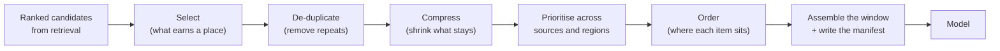
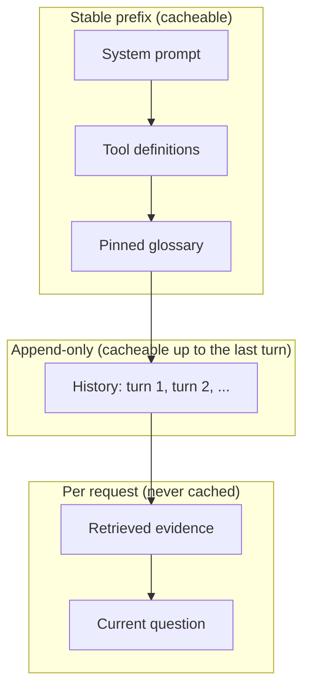

In Phase 1 you learnt what a [context window](/learn/understanding-large-language-models/context-windows) is and how to budget it: subtract the system prompt, the question, an answer reserve and a margin, and pack chunks into what is left. That arithmetic keeps requests from failing. It does not tell you how to use the window *well*. This module is about that second problem, which is now usually called **context engineering**: deciding what the model sees on each request, in what form, in what order and at what cost.

This first lesson treats the window as a designed object rather than a number. You will see what competes for it beyond retrieved chunks, why the size a provider advertises is not the size you can rely on, how the layout of the window decides whether prompt caching can help, why conversation history quietly dominates cost in multi-turn assistants, and how to record what actually went in. The remaining seven lessons take each stage of the assembly in turn.

## Learning objectives

- Name the regions that compete for a RAG request's context window and classify each as static or per-request.
- Distinguish a model's nominal context length from its effective context length, and explain why the second must be measured.
- Lay out a request so that the longest possible prefix stays identical between requests, and calculate how much of the input a prefix cache can reuse.
- Calculate the total input tokens of a multi-turn conversation with full and windowed history.
- Design a context manifest that records what entered the window and why.

## Prerequisites

- [Context windows](/learn/understanding-large-language-models/context-windows): the window, the shared input-output limit and the chunk budget $C = W - S - Q - R - M$.
- [Context construction](/learn/rag-architecture-fundamentals/context-construction): the basic assembly steps (floor, de-duplicate, select, order, label, delimit).
- [System prompts](/learn/prompt-engineering-for-rag/system-prompts): the static/dynamic split and how prompt caching rewards a stable prefix.

## Why this matters

Once requests stop failing, a different class of problem appears, and none of them raises an error.

**The window fills with the wrong things.** A multi-turn assistant re-sends every earlier exchange on every request. By the tenth turn, history can outweigh the evidence for the *current* question several times over. Nobody decided this; it is what happens when history is appended without a policy.

**A large window is mistaken for a large capacity.** The advertised length is what the model will *accept*. How reliably it finds and combines facts across that length is a separate, task-dependent property, and usually lower. Filling the window "because it fits" costs money and can make answers worse.

**Cost is decided by layout.** Prompt caching makes repeated prefixes cheaper and faster, but only if the start of the request is byte-for-byte identical across requests. One per-request value placed early and the cache never hits. The same tokens in a different order cost a different amount.

**Nobody can say what the model saw.** If the assembly code does not record the context, every investigation of a wrong answer starts with guesswork.

## The intuition

Think of the window as the desk of a consultant paid by the minute to read. Before each call your team lays papers on it. Some never change (the firm's rules), some change slowly (notes from this client's earlier calls), and some change every call (today's archive pages and the question).

Three rules follow. Put the papers that never change first, in the same order every time, so the consultant can skip re-reading them: that is prompt caching. Do not let the call notes grow until they cover the desk. And a bigger desk does not make the consultant read more carefully: among forty pages, the one that matters is easier to miss than among four.

## How it works

### From a budget to a design

Phase 1 gave you a ceiling. Context engineering is everything beneath it, a pipeline of decisions each owned by a lesson in this module:



[Context selection](/learn/context-engineering/context-selection) decides which candidates earn a place; [Context deduplication](/learn/context-engineering/context-deduplication) removes repeats without losing citations; [Context compression](/learn/context-engineering/context-compression) shrinks what stays; [Context prioritisation](/learn/context-engineering/context-prioritisation) arbitrates between different kinds of content when they do not all fit; [Context ordering](/learn/context-engineering/context-ordering) and [Lost-in-the-middle problem](/learn/context-engineering/lost-in-the-middle-problem) deal with position; [Context relevance](/learn/context-engineering/context-relevance) asks whether what remains actually helps. This lesson covers the container they all work in.

### What competes for the window

In a single-turn demo, the window holds a system prompt, some chunks and a question. In a production assistant it holds more:

| Region | Example in AskMeridian | Changes |
| --- | --- | --- |
| System prompt | Role, grounding and citation rules | Rarely (per release) |
| Tool definitions | Schemas for "search the runbooks", "open a ticket" | Rarely |
| Pinned material | A glossary of Meridian product names | Occasionally |
| Conversation history | Earlier questions and answers in this chat | Every turn (grows) |
| Memory | "This user is a contractor in the London office" | Occasionally |
| Retrieved evidence | Chunks for the current question | Every request |
| Tool results | Output of a ticket lookup | When a tool is used |
| Current question | What the user just typed | Every request |
| Output reserve | Room for the answer and any hidden reasoning | Per route |

Two properties of each region matter. **Stability**: how often it changes between requests, which decides whether it can be cached. **Elasticity**: whether it can shrink under pressure. The system prompt is stable and inelastic; retrieved evidence is unstable and elastic. History is awkward: it changes every turn, but by *appending*, and shrinks only by forgetting or summarising.

### Nominal and effective context length

The **nominal context length** is the largest input the model accepts, the number on the model card. The **effective context length** is the longest input over which the model still performs a given task acceptably. They differ for three reasons.

1. **Finding is easier than using.** The popular "needle in a haystack" test hides one distinctive sentence in long filler text and asks the model to repeat it; many models score close to perfectly. A RAG question instead asks the model to find a passage phrased differently from the question, ignore near-misses and sometimes combine passages. The RULER benchmark (Hsieh and colleagues, 2024) added multi-needle, multi-hop tracing and aggregation tasks and found that many models which looked near-perfect on simple needle retrieval degraded substantially as input length grew, often well before their advertised limits.
2. **Position matters.** Models tend to use information at the start and end of a long input more reliably than information in the middle. [Lost-in-the-middle problem](/learn/context-engineering/lost-in-the-middle-problem) covers the evidence and the countermeasures.
3. **Distractors matter.** Retrieved chunks are, by construction, similar to the question, including the ones that are wrong. The more of them you add, the more plausible near-misses the model must reject. [Context relevance](/learn/context-engineering/context-relevance) looks at this.

So the effective length is a property of *your model on your task*, to be measured rather than read from a model card. Newer models generally handle long inputs better than those in early studies, so someone else's result is a hypothesis for your model, not a fact about it.

> [!KEY]
> The nominal window is a hard ceiling set by the provider. The working budget is a design choice set by you, from measurements of quality, cost and latency on your own questions. For most RAG requests it should sit far below the ceiling.

### Choosing an operating point

The **operating point** is the input size you actually target for a given kind of request. Three forces push it down from the ceiling:

- **Cost** scales with input tokens.
- **Latency** to first token grows with the input ([Model inference](/learn/understanding-large-language-models/model-inference)).
- **Quality** typically rises with the first few relevant chunks, then flattens or falls as extra chunks add more distraction than evidence.

One force pushes it up: **coverage**. Questions that need several facts need room for several passages. So mature systems set the operating point per **route** (a class of request with its own settings) rather than globally, and take the values from evaluation runs, not intuition.

### Layout: regions in order of stability

Prompt caching, which the [System prompts](/learn/prompt-engineering-for-rag/system-prompts) lesson introduced, reuses work for a request's **prefix**, its leading portion, when that prefix is identical to one seen recently. A cache can therefore help only up to the first token that differs from the previous request. That single fact dictates the layout:

1. **Order regions from most stable to least stable.** System prompt, then tool definitions, then pinned material, then history, then retrieved evidence and tool results, then the current question.
2. **Keep every stable region byte-for-byte identical.** No timestamps, request IDs or user names inside them; serialise tool schemas deterministically (sorted keys, fixed whitespace).
3. **Append history; do not rewrite it.** If turn 5's history is turn 4's history with one exchange added at the end, the whole of turn 4's history is a shared prefix.
4. **Put per-request material last.** Retrieved chunks change with every question, so anything placed after them cannot be reused.
5. **Place the question after the evidence.** This is also what Anthropic's long-context prompting guidance recommends for quality: long documents near the top, the query at the end.
6. **Mark cache breakpoints where your provider requires them.** Anthropic's API, for example, caches up to blocks you mark with `cache_control`; minimum cacheable lengths and cache lifetimes vary by model and change over time, so check the current documentation.



There is a tension. Step 3 keeps old turns in the prefix verbatim, so any policy that edits history (dropping the oldest turn, summarising three turns) changes the prefix from that point on and costs a cache miss. You trade cache reuse against window size; the code below measures that trade.

### History: the region that grows

Each turn adds a question and an answer to the history, and the whole history is re-sent on every later request. Input grows linearly with the turn number, so the *total* over a conversation grows with the square of its length (made exact in the mathematics section). Three policies control it:

- **Full history**: simplest, best for follow-up questions, unbounded cost.
- **Windowed history**: keep the last $w$ exchanges. Bounded cost; the model forgets older turns entirely.
- **Summarised history**: replace older exchanges with a short summary and keep recent ones verbatim. Bounded cost and some long-range memory, at the price of an extra model call and the risk that the summary drops a detail the user later relies on.

Do not store earlier turns' retrieved chunks in the history by default: they are large, were selected for an old question, and retrieval will find them again if needed. Store the question and the cited answer. [Multi-turn RAG](/learn/generation-strategies/multi-turn-rag) covers multi-turn design in depth.

### The context manifest

A **context manifest** is a structured record, written by the assembly code, of what went into one request's window. It is to context engineering what a query plan is to a database: the thing you read first when the output is wrong. A useful manifest records:

- per region: token count and a content hash (or version ID, for the system prompt);
- per retrieved item: chunk ID, document ID and version, retrieval score, and the stage that kept or dropped it, with the reason ("below floor", "duplicate of S2", "over budget");
- the total input, the output reserve and the nominal window of the model used;
- the cached-prefix length reported by the provider (Anthropic's response includes `cache_read_input_tokens`).

Log it with the request ID. It turns "the model ignored the policy" into a checkable claim: was the policy chunk in the window, and where?

## The mathematics

### Total input over a conversation

**Intuition.** Every request carries a base load (system prompt, evidence, question) plus all the history so far. The history grows by one exchange per turn, so later requests are bigger, and the sum over the conversation grows faster than the number of turns.

Let $B$ be the base tokens per request, $h$ the tokens one exchange adds to the history, and $T$ the number of turns. Request $t$ carries $t-1$ earlier exchanges, so its input is $B + (t-1)h$. Summing over the conversation:

$$
\text{Total}_{\text{full}} = \sum_{t=1}^{T} \big(B + (t-1)h\big) = TB + h\,\frac{T(T-1)}{2}
$$

With a window of the last $w$ exchanges, request $t$ carries $\min(t-1, w)$ of them:

$$
\text{Total}_{w} = TB + h \sum_{t=1}^{T} \min(t-1,\, w)
$$

- $B$: tokens per request excluding history (system prompt, evidence, question, wrappers).
- $h$: tokens added to the history by one exchange (question plus answer).
- $T$: number of turns in the conversation.
- $w$: number of most recent exchanges kept.

The $T(T-1)/2$ term is why long chats are expensive: doubling the conversation roughly quadruples the history tokens.

**By hand.** Take $B = 360$, $h = 72$, $T = 8$ (the numbers the code below produces).

- Full history: $8 \times 360 + 72 \times \frac{8 \times 7}{2} = 2{,}880 + 72 \times 28 = 2{,}880 + 2{,}016 = 4{,}896$ tokens.
- Window $w = 3$: the history counts per turn are $0, 1, 2, 3, 3, 3, 3, 3$, which sum to $18$. Total $= 2{,}880 + 72 \times 18 = 2{,}880 + 1{,}296 = 4{,}176$ tokens.

Over a longer chat the gap widens. At $T = 40$, full history needs $14{,}400 + 72 \times 780 = 70{,}560$ tokens. The window's history counts are $0 + 1 + 2 + 3 \times 37 = 114$, so it needs $14{,}400 + 72 \times 114 = 22{,}608$.

### Reusable prefix

**Intuition.** A prefix cache can reuse at most the leading tokens that match the previous request. With layout system → history → evidence → question, request $t$ shares the system prompt and the previous request's history:

$$
P_t = S + (t-2)h \quad \text{for } t \ge 2
$$

where $S$ is the tokens of the stable prefix. With evidence placed *before* history, $P_t = S$ for every turn: the evidence differs each time and cuts the shared prefix short.

```python
B, h, T, w = 360, 72, 8, 3
full = T * B + h * T * (T - 1) // 2
windowed = T * B + h * sum(min(t - 1, w) for t in range(1, T + 1))
print("full history:", full)
print("window of 3: ", windowed)
for T_long in (8, 20, 40):
    f = T_long * B + h * T_long * (T_long - 1) // 2
    win = T_long * B + h * sum(min(t - 1, w) for t in range(1, T_long + 1))
    print(f"T={T_long:>2}: full {f:>6}, windowed {win:>6}, ratio {f / win:.2f}")
```

```output
full history: 4896
window of 3:  4176
T= 8: full   4896, windowed   4176, ratio 1.17
T=20: full  20880, windowed  11088, ratio 1.88
T=40: full  70560, windowed  22608, ratio 3.12
```

Full history costs grow quadratically and windowed history linearly, so the ratio keeps rising with conversation length.

## In code

**The problem.** For a simulated eight-turn AskMeridian conversation, measure each request's size and how much a prefix cache could reuse under three layouts: evidence before history, history before evidence, and the latter with a three-turn window.

**Dependencies.** `tiktoken`. It ships OpenAI's tokenisers, not Claude's, so counts are approximate; the *comparisons* between layouts are what matter. For exact counts, use the token-counting endpoint shown afterwards.

```bash
pip install tiktoken
```

```python
from dataclasses import dataclass
import tiktoken

enc = tiktoken.get_encoding("cl100k_base")   # an approximation, not Claude's tokeniser

def n_tokens(text: str) -> int:
    return len(enc.encode(text))

SYSTEM = (
    "You are AskMeridian, the internal assistant for Meridian staff. "
    "Answer only from the sources inside <source> tags. Cite each claim as [S1], [S2]. "
    "If the sources do not contain the answer, say you don't know and suggest the support desk. "
) * 4   # stands in for a realistic system prompt of a few hundred tokens

CHUNKS = [
    "Annual leave is 25 days per year. Up to 5 unused days carry over and must be used by 31 March.",
    "Staff may work remotely up to 3 days a week. The home-office equipment budget is £400.",
    "Contractors are not eligible for the home-office equipment budget.",
    "Expenses must be submitted within 30 days. Anything over £75 needs a receipt.",
]

def sources_block(chunks):
    return "\n".join(f'<source id="S{i}">{c}</source>' for i, c in enumerate(chunks, 1))

@dataclass
class Region:
    name: str
    text: str

def layout(order, system, history, retrieved, question):
    parts = {"system": system, "history": history, "retrieved": retrieved, "question": question}
    return [Region(name, parts[name]) for name in order]

def shared_prefix_tokens(prev: str, cur: str) -> int:
    """Tokens in the longest common prefix of two serialised requests."""
    a, b = enc.encode(prev), enc.encode(cur)
    n = 0
    while n < min(len(a), len(b)) and a[n] == b[n]:
        n += 1
    return n

def simulate(order, turns=8, keep_turns=None):
    history, prev, rows = [], "", []
    for t in range(1, turns + 1):
        question = f"Question {t}: how does policy {t} apply to me if I work from home?"
        kept = history if keep_turns is None else history[-keep_turns:]
        regions = layout(order, SYSTEM, "\n".join(kept),
                         sources_block(CHUNKS[t % 4:] + CHUNKS[:t % 4]), question)
        request = "\n\n".join(r.text for r in regions if r.text)
        total = n_tokens(request)
        cached = shared_prefix_tokens(prev, request) if prev else 0
        rows.append((t, total, cached))
        answer = f"Answer {t}: " + "Under the handbook, remote staff may claim it once, with a receipt. " * 3
        history.append(f"User: {question}\nAssistant: {answer}")
        prev = request
    return rows

for label, order, keep in [
    ("A: retrieved before history, full history", ["system", "retrieved", "history", "question"], None),
    ("B: history before retrieved, full history", ["system", "history", "retrieved", "question"], None),
    ("C: as B, last 3 turns only",                ["system", "history", "retrieved", "question"], 3),
]:
    rows = simulate(order, keep_turns=keep)
    total = sum(r[1] for r in rows)
    cached = sum(r[2] for r in rows)
    print(f"\n{label}")
    print("  turn  input  shared-prefix")
    for t, n, c in rows:
        print(f"  {t:>4}{n:>7}{c:>15}")
    print(f"  total input {total}, reusable prefix {cached} ({cached / total:.0%})")
```

```output
A: retrieved before history, full history
  turn  input  shared-prefix
     1    360              0
     2    432            239
     3    504            239
     4    576            239
     5    648            239
     6    720            239
     7    792            239
     8    864            239
  total input 4896, reusable prefix 1673 (34%)

B: history before retrieved, full history
  turn  input  shared-prefix
     1    360              0
     2    432            233
     3    504            304
     4    576            376
     5    648            448
     6    720            520
     7    792            592
     8    864            664
  total input 4896, reusable prefix 3137 (64%)

C: as B, last 3 turns only
  turn  input  shared-prefix
     1    360              0
     2    432            233
     3    504            304
     4    576            376
     5    576            237
     6    576            237
     7    576            237
     8    576            237
  total input 4176, reusable prefix 1861 (45%)
```

**The important lines.**

- `layout(order, ...)` builds the same four regions in a chosen order, so any difference between A and B is caused by layout alone.
- `shared_prefix_tokens` counts the leading tokens shared with the previous request: an upper bound on what a prefix cache could reuse.
- `CHUNKS[t % 4:] + CHUNKS[:t % 4]` rotates the evidence so each question gets a different first chunk, as real retrieval would.
- `history[-keep_turns:]` is the whole windowed-history policy.

**What the output means.**

- **The input grows by 72 tokens a turn** in A and B: that is $h$, one exchange. The totals, 4,896 and 4,176, are exactly what the formulas in the mathematics section predict with $B = 360$.
- **Layout A caches almost nothing.** Its shared prefix is stuck at 239 tokens: the system prompt (233 tokens) plus the few tokens of `<source id="S1">` that every evidence block happens to start with. The changing evidence sits in front of the history and hides it from the cache.
- **Layout B caches most of the input.** Same total, but the shared prefix grows by 72 a turn because last turn's history is a prefix of this turn's: 64% reusable against 34%.
- **Layout C saves tokens but breaks the cache.** From turn 5 the oldest exchange is dropped, which edits the start of the history, so little beyond the system prompt is shared. Windowing cut total input by 15% and reusable prefix by 41%. Whether that trade pays depends on cached and uncached prices; the point is that you can compute it.

**Exact counts from the provider.** For a real Claude model, count with the API rather than an approximate tokeniser. This needs an API key and was not executed here:

```python
import anthropic

client = anthropic.Anthropic()  # reads ANTHROPIC_API_KEY from the environment

count = client.messages.count_tokens(
    model="claude-opus-5-5",
    system=SYSTEM,
    messages=[{"role": "user", "content": sources_block(CHUNKS) + "\n\nCan contractors claim the home-office budget?"}],
)
print(count.input_tokens)
```

**Errors people commonly hit.**

- Comparing one tokeniser's counts with another model's limits. Use the provider's counter near a limit.
- Building history with anything that varies between requests (re-formatted old answers, a date per turn). The shared prefix collapses silently.
- Reading the shared-prefix column as what *will* be cached. It is the maximum; check the cached tokens the provider reports.

**Extending it.** Add a summarised-history policy (exercise 3), then attach illustrative prices to cached and uncached tokens and find the conversation length at which windowing pays for its cache misses.

## A real-world example

The Platform team at Meridian added follow-up questions to AskMeridian ("and does that apply to contractors?"). Three weeks later the inference bill was well above forecast.

Tomasz, who owned the assembler, pulled the logged token counts. Single-turn requests were unchanged. Multi-turn requests grew with every turn, and a small share of afternoon-long conversations accounted for a large share of all input tokens: the $T(T-1)/2$ term at work. The provider's usage reports showed almost no cached input, despite a long, stable system prompt.

The manifest explained why. An old single-turn template built the user message as "sources, then history, then question", so each turn's fresh evidence broke the prefix, exactly like layout A. Each history entry also began with a local-time timestamp.

The team reordered the request to system → history → evidence → question and removed the timestamps. They capped history at six verbatim exchanges plus a summary rewritten only when three more exchanges had accumulated, so the cache broke once every few turns rather than every turn. They added region token counts and the provider's cached-token figure to the manifest, with an alert if the cached share fell. Before release they ran the evaluation set of follow-up questions, because summarised history is exactly the kind of change that quietly loses a detail a user refers back to.

## Common mistakes

- **Treating the nominal window as usable capacity.** Quality can decline long before the limit, while cost keeps rising.
- **Putting per-request content early in the request.** A timestamp, user name or the retrieved chunks before the stable regions disables prefix caching for everything after them.
- **Appending history with no policy.** Input grows every turn and total cost grows quadratically with conversation length; eventually the evidence for the current question is squeezed out.

## Best practices

- Set a working budget per route from evaluation results, well below the nominal window, and treat the nominal window only as a hard ceiling.
- Lay out regions from most to least stable, keep stable regions byte-identical, and put the question after the evidence.
- Choose an explicit history policy (full, windowed or summarised) and change the history only at well-defined points.
- Write a manifest for every request: region token counts, chunk IDs and versions, and each keep-or-drop reason.

## Performance considerations

**Cost.** Input cost per request is roughly $\text{price}_{\text{uncached}} \times (N - P) + \text{price}_{\text{cached}} \times P$, with $N$ input tokens and $P$ the cached prefix, plus any cache-write charge. Assume, for illustration only, that cached reads cost a tenth of the uncached rate. Layout B's conversation then costs about $0.36 + 0.064 = 0.42$ of its uncached price, layout A's about $0.66 + 0.034 = 0.69$. Check current prices before relying on the ratio.

**Latency.** Time to first token grows with the uncached part of the input, because cached prefix work can be skipped. Moving per-request content to the end therefore helps latency as well as cost.

**Memory and throughput.** On self-hosted models a long input's attention cache occupies accelerator memory for the whole request, so long inputs reduce how many requests a server handles at once.

**History growth.** Size the worst case with $TB + hT(T-1)/2$: at 50 turns and $h = 300$, the history term alone is $300 \times 50 \times 49 / 2 = 367{,}500$ tokens.

## Security considerations

Every region is a channel into the model, and they differ in trust. The system prompt is yours. Retrieved chunks, tool results and earlier turns may contain text written by someone else, including text crafted to look like instructions ([Indirect prompt injection](/learn/rag-security-fundamentals/indirect-prompt-injection)). Keep untrusted regions clearly delimited and labelled, and never splice them into the system prompt for convenience.

History and memory are persistence channels: an injected instruction that reached an earlier answer is re-sent every turn, and memory carries it across conversations. Validate what you write to memory. Store manifests under the same access controls and retention rules as conversation logs, preferring IDs and hashes to raw text.

## Summary

- Context engineering designs what the model sees on each request, inside the budget Phase 1 taught you to compute.
- The window holds many regions besides chunks, each with a stability and an elasticity.
- Nominal length is what the model accepts; effective length is what it uses well on your task. Measure the second and set a working budget per route.
- Order regions from most to least stable so a prefix cache can reuse as much as possible; editing history breaks the prefix.
- With full history, total input over a conversation grows as $TB + hT(T-1)/2$; windowing and summarising bound it at the cost of memory and cache reuse.
- A per-request context manifest makes every later diagnosis possible.

## Exercises

**1.** A request has $B = 1{,}500$ base tokens and each exchange adds $h = 250$ tokens to the history. Compute the total input over a 12-turn conversation with full history and with a window of the last 4 exchanges.

<details><summary>Show solution</summary>

Full: $12 \times 1{,}500 + 250 \times \frac{12 \times 11}{2} = 18{,}000 + 250 \times 66 = 34{,}500$ tokens.

Window of 4: the per-turn history counts are $0, 1, 2, 3, 4, 4, 4, 4, 4, 4, 4, 4$, summing to $6 + 4 \times 9 = 42$. Total $= 18{,}000 + 250 \times 42 = 28{,}500$ tokens.

</details>

**2.** A colleague proposes adding "Today's date is 2026-11-14" to the start of the system prompt so the model can reason about deadlines. Explain the effect on prompt caching and propose a layout that gives the model the date without that cost.

<details><summary>Show solution</summary>

The first request each day misses the cache, and everything after the date (the rest of the system prompt, tools, history) loses its cached prefix too; with a time included, every request misses. Put the date in the per-request part instead, as a line just before the question ("Current date: 2026-11-14"). The stable regions stay cacheable and the date sits next to the question that needs it.

</details>

**3.** Modify the simulation from the lesson to add a fourth layout: history before evidence, with a summary policy that replaces all but the last 3 exchanges with a fixed summary string, rewritten only on turns 5 and 8. Report total input and reusable prefix, and explain the shape of the shared-prefix column.

<details><summary>Show solution</summary>

One way to implement the policy inside `simulate`:

```python
def summarised(history, t, cache={}):
    if len(history) <= 3:
        return history
    if t in (5, 8) or "s" not in cache:
        cache["s"] = f"Summary (written at turn {t}): earlier questions covered remote-work policies."
    return [cache["s"]] + history[-3:]
```

Replace the `kept = ...` line with `kept = summarised(history, t)`. Running it gives a total input of 4,236 tokens and a reusable prefix of 1,889 (45%). Input is bounded at 591 tokens a turn, but the shared prefix collapses to about the system prompt (233 to 252 tokens) from turn 5. On turns 6 and 7 the unchanged summary line adds 19 shared tokens; then the verbatim window, which rolls every turn, diverges. On turn 8 the summary itself is rewritten. The lesson: a summary policy is cache-friendly only if both the summary *and* the boundary between summary and verbatim turns move rarely, for example by folding three exchanges into the summary every third turn instead of one every turn.

</details>

**4.** Design a context manifest for AskMeridian as a JSON object, with enough fields to answer: "Was the contractor-eligibility chunk in the window for request 8f2c, where was it, and why was the chunk ranked just above it dropped?"

<details><summary>Show solution</summary>

```json
{
  "request_id": "8f2c",
  "model": "claude-opus-5-5",
  "route": "policy-lookup",
  "regions": [
    {"name": "system", "tokens": 233, "version": "sys-v14"},
    {"name": "history", "tokens": 412, "turns_verbatim": 3},
    {"name": "evidence", "tokens": 318},
    {"name": "question", "tokens": 11}
  ],
  "candidates": [
    {"chunk_id": "hb-remote-07", "doc_version": "2025.2", "score": 0.91, "decision": "kept", "label": "S1", "position": 1},
    {"chunk_id": "faq-remote-02", "doc_version": "2024.1", "score": 0.88, "decision": "dropped", "reason": "duplicate of S1"},
    {"chunk_id": "hb-contractors-03", "doc_version": "2025.2", "score": 0.84, "decision": "kept", "label": "S2", "position": 2}
  ],
  "usage": {"input_tokens": 974, "cache_read_input_tokens": 645, "output_tokens": 121}
}
```

The `candidates` list answers all three parts: whether the chunk was kept, its label and position, and why its neighbour was dropped.

</details>

## Check your understanding

```quiz
[
  {"q": "What is the difference between a model's nominal and effective context length?", "options": ["Nominal counts characters and effective counts tokens", "Effective length is always exactly half the nominal length", "Nominal is the largest input accepted; effective is the longest input over which the model still performs a given task acceptably", "They are the same for any model trained on long documents"], "answer": 2, "why": "The nominal length is a hard limit on input size. The effective length depends on the task and must be measured; benchmarks such as RULER found it is often well below the advertised limit."},
  {"q": "Which layout lets a prefix cache reuse the most input across turns of a conversation?", "options": ["System prompt, history, retrieved evidence, question", "Retrieved evidence, system prompt, history, question", "System prompt, retrieved evidence, history, question", "Question, system prompt, history, retrieved evidence"], "answer": 0, "why": "A cache reuses only the leading tokens that match the previous request. Stable regions first and append-only history next keep that shared prefix long; per-request evidence must come after them."},
  {"q": "With B = 400 base tokens, h = 100 tokens per exchange and full history, what is the total input over 10 turns?", "options": ["4,000", "5,000", "14,000", "8,500"], "answer": 3, "why": "TB + h T(T-1)/2 = 4,000 + 100 x 45 = 8,500."},
  {"q": "Why does a windowed history policy (keep the last 3 exchanges) reduce prefix-cache reuse once the window starts rolling?", "options": ["Windowed history cannot be tokenised", "Dropping the oldest exchange changes the beginning of the history, so the request diverges from the previous one earlier", "Providers refuse to cache histories shorter than three turns", "The model rejects requests whose history has been shortened"], "answer": 1, "why": "The shared prefix ends at the first differing token. Removing the oldest exchange alters the history right after the system prompt, so only the stable regions before it remain shared."},
  {"q": "Which of these belongs in a context manifest?", "options": ["The user's password, so the request can be replayed exactly", "Only the final answer text", "Per-region token counts, chunk IDs and versions, and the reason each candidate was kept or dropped", "A copy of the embedding model's weights"], "answer": 2, "why": "The manifest is a record of what entered the window and why, so that a wrong answer can be traced to a selection, ordering or budget decision."}
]
```

## Further reading

- Hsieh, C.-P. et al. (2024). *RULER: What's the Real Context Size of Your Long-Context Language Models?* [arxiv.org/abs/2404.06654](https://arxiv.org/abs/2404.06654). Shows why simple needle tests overstate usable context.
- Liu, N. F. et al. (2023). *Lost in the Middle: How Language Models Use Long Contexts.* [arxiv.org/abs/2307.03172](https://arxiv.org/abs/2307.03172). The position effect, examined in this module's sixth lesson.
- Anthropic documentation: prompt caching, token counting and long-context prompting tips, at [docs.anthropic.com](https://docs.anthropic.com). Current cache lifetimes, minimum lengths and layout advice.
- Anthropic (2025). *Effective context engineering for AI agents.* Anthropic engineering blog. A practitioner's view of the window as a finite resource.
