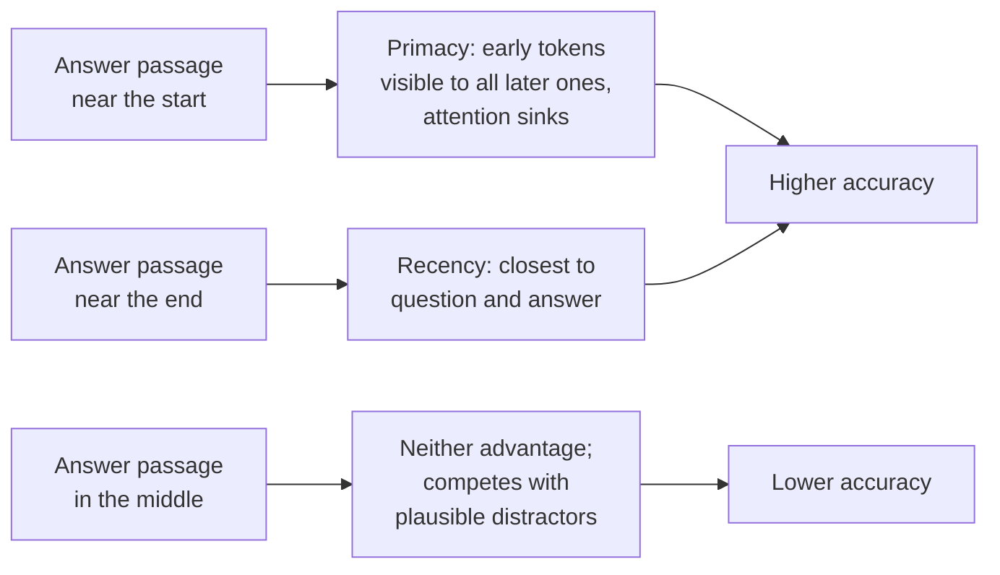

In 2023, Nelson Liu and colleagues ran a simple experiment. They gave language models a question and a set of retrieved passages, exactly one of which contained the answer, and moved that passage from the first position to the last. If models read their whole input equally well, accuracy would be flat across positions. It was not. For the models they tested, accuracy was highest when the answer was at the start or the end, and lowest when it was in the middle, a U-shaped curve. They called the effect **lost in the middle**.

This lesson explains what was measured and what was not, the leading explanations for why it happens, how far later models have reduced it, and, most usefully, how to measure it for *your* model and *your* contexts. You will build a position-sweep harness with proper confidence intervals, demonstrate it on a simulated model with a known bias, and see how to plug in a real one. The engineering responses (selection, ordering, compression) are owned by the earlier lessons in this module; this lesson tells you when you need them.

## Learning objectives

- Describe the experimental design and main findings of Liu and colleagues (2023), including what the results do and do not show about current models.
- Explain the leading hypotheses for position bias: causal attention and attention sinks, positional-encoding effects, and training-data distribution.
- Build a position-sweep experiment that places a gold passage at controlled positions and measures accuracy with Wilson confidence intervals.
- Calculate how many questions per position are needed to detect a given accuracy difference.
- Choose mitigations in proportion to the measured effect.

## Prerequisites

- [Attention mechanisms](/learn/understanding-large-language-models/attention-mechanisms): how each token attends to earlier tokens.
- [Context windows](/learn/context-engineering/context-windows): nominal versus effective context length.
- [Context ordering](/learn/context-engineering/context-ordering): orderings designed around position effects.

## Why this matters

Retrieval metrics assume that a passage in the context is a passage the model can use. If the model uses position 1 reliably and position 7 poorly, then [Recall@K](/learn/retrieval-fundamentals/recall-k) overstates what your system delivers: a "hit" at rank 7 may be worth much less than a hit at rank 1. Raising $k$ to improve recall can then make answers *worse*, because each added passage pushes the others towards the middle and adds a distractor.

The effect also shapes how you debug. When a RAG system gives a wrong answer although the manifest shows the right chunk was in the window, there are three explanations: the chunk was there but buried; the chunk was there but contradicted or diluted by distractors; or the model reasoned badly. Position sweeps separate the first from the others.

Finally, the original result is widely quoted and widely over-generalised. "Models ignore the middle" is not a law of nature; it is a measurement on particular models and tasks. Engineering decisions should rest on measurements of the model you deploy.

## The intuition

Think of reading a long briefing pack in a hurry. You read the first page properly, because you are fresh and it sets the scene. You read the last page properly, because it is right before the meeting. The pages in between get skimmed. If the crucial figure is on page 7 of 20, you may well walk into the meeting without it, even though it was in your hands the whole time.

A tiny numerical version: suppose a reader catches a fact on the first page 9 times in 10, on the last page 9 times in 10, and on a middle page 5 times in 10. With 20 pages and the fact equally likely to be on any page, most of the pages are "middle", so the reader's overall hit rate is much closer to 5 in 10 than to 9 in 10. Moving the fact to page 1 recovers the 9 in 10, without changing a word of the pack.

## How it works

### What was measured

Liu and colleagues used two tasks.

1. **Multi-document question answering.** Questions from NaturalQuestions-Open, each with one passage containing the answer and a set of distractor passages that a retriever had judged relevant but that did not contain the answer. Contexts of 10, 20 and 30 passages were built, with the answer-bearing passage placed at each position in turn. An answer counted as correct if it contained an accepted answer string.
2. **Synthetic key-value retrieval.** A JSON object of many random key-value pairs (UUIDs) and a request for the value of one key. This strips away language understanding and tests pure retrieval from the context.

They tested several models available at the time, both open and commercial, including models with extended context windows. The main findings:

- **The U-shape.** Accuracy was highest with the answer near the start or end and lowest in the middle, for most models and context sizes.
- **Bigger windows did not fix it.** Extended-context versions of a model were not reliably better at using information in the middle of inputs that fitted both windows.
- **The middle can be worse than nothing.** For at least one model in the 20-document setting, accuracy with the answer in the middle fell below its closed-book accuracy, that is, with no documents at all.
- **More retrieved passages gave diminishing returns.** In an open-domain QA study within the paper, reader accuracy saturated long before retriever recall did, so adding more passages beyond a modest number helped little.

### What it does not show

- **It does not show that every model has the effect, or the same shape.** Model families differ, and models trained later with more long-context data and targeted training have been reported to show flatter curves on similar tests. Others still show position effects on harder tasks. The direction of the original finding is a hypothesis to test; its magnitude for your model is unknown until measured.
- **It does not mean passages in the middle are ignored.** Accuracy drops; it does not fall to zero.
- **It does not isolate position from distraction.** The distractors were retrieved, hence plausible. Position effects in real RAG come mixed with the distractor effect discussed in [Context relevance](/learn/context-engineering/context-relevance).
- **Simple needle tests can hide it.** A single distinctive sentence in irrelevant filler is easy to find at any position. Effects show up more when the passage resembles its neighbours and the question is phrased differently from the answer, as in RAG. Benchmarks such as RULER (Hsieh and colleagues, 2024) were built partly for this reason.

### Why it might happen

These are the leading explanations. They are hypotheses with supporting evidence, not settled science, and several probably act together.

1. **Causal attention and attention sinks.** In a decoder-only model, each token attends only to earlier tokens, so early tokens are visible to every later token and accumulate attention. Xiao and colleagues (2023) observed that models put disproportionate attention on the very first tokens, which they called **attention sinks**. A primacy advantage is consistent with this.
2. **Recency.** The tokens just before the question and the answer are the closest; positional encodings such as rotary embeddings were designed with a tendency for attention to decay with relative distance, and local patterns are abundant in training text. A recency advantage is consistent with this.
3. **Training data and instruction tuning.** Important information in documents tends to be at the beginning (titles, summaries) and the end (conclusions), and instruction-tuning prompts usually put instructions first. Models may have learnt to expect it there.
4. **An intrinsic positional attention bias.** Hsieh and colleagues (2024), in *Found in the Middle*, argued that models attend in a U-shape regardless of relevance, and showed that calibrating attention to remove that positional component improved use of mid-context information. This requires access to the model's internals, so it is not available through a hosted API.



### Measuring it: the position sweep

The experiment is the same one Liu and colleagues ran, adapted to your data:

1. **Assemble an evaluation set** of questions, each with a known answer, one gold passage that contains it, and $k - 1$ distractors. The best distractors are realistic: passages your retriever actually returns for that question that do not contain the answer.
2. **Fix everything except position**: the same distractors in the same order, the same prompt, the same model, the same output limit.
3. **For each position** $p$ in a chosen set (first, last and several in between), insert the gold passage at $p$ and ask the question.
4. **Grade** each answer: string match for short factual answers, or a judge model for longer ones.
5. **Compute accuracy per position with a confidence interval**, and the difference between the best position and the middle, with its interval.
6. **Repeat for the context sizes you actually use.** An effect absent at $k = 5$ may appear at $k = 30$.
7. **Add a closed-book baseline** (no passages) to see whether a buried answer is worse than none.

The output is a curve: your model's position profile, which is exactly the "position weights" that [Context ordering](/learn/context-engineering/context-ordering) needs to choose an ordering.

### What to do about it

Respond in proportion to what you measure.

- **No meaningful dip at your context sizes.** Keep the simplest ordering (rank descending) and spend effort elsewhere.
- **A dip that grows with $k$.** The cheapest fix is fewer, better passages: tighter [selection](/learn/context-engineering/context-selection), a reranker, [compression](/learn/context-engineering/context-compression). Shorter contexts have less middle.
- **A persistent U-shape.** Use an edges-first ordering so the strongest passages occupy the strongest positions; place the question after the evidence (and, if testing supports it, briefly before as well).
- **Many passages genuinely needed.** Split the work: answer from groups of passages separately and combine the partial answers (a map-reduce pattern, covered in [Multi-document synthesis](/learn/generation-strategies/multi-document-synthesis)), so no single call has a long middle.

> [!KEY]
> Lost in the middle is a reason to keep contexts short and well ranked, and a reason to measure. It is not, on its own, a reason to adopt any particular ordering.

## The mathematics

### A confidence interval for accuracy at one position

**Intuition.** Accuracy measured on $n$ questions is an estimate. With few questions it is noisy, and two positions can differ by chance. A confidence interval says how far the true accuracy could plausibly be from the estimate. The **Wilson score interval** behaves well even when accuracy is close to 0 or 1, unlike the simple "plus or minus 1.96 standard errors" interval.

$$
\frac{\hat p + \frac{z^2}{2n} \pm z\sqrt{\frac{\hat p(1-\hat p)}{n} + \frac{z^2}{4n^2}}}{1 + \frac{z^2}{n}}
$$

- $\hat p$: observed accuracy at this position, correct answers divided by $n$.
- $n$: number of questions tested at this position.
- $z$: the normal quantile for the confidence level, 1.96 for 95%.

**By hand.** 178 correct out of 200, so $\hat p = 0.89$, $n = 200$, $z^2 = 3.8416$.

- $z^2 / 2n = 0.009604$, so the numerator's centre is $0.89 + 0.009604 = 0.899604$.
- Denominator: $1 + 3.8416 / 200 = 1.019208$. Centre: $0.899604 / 1.019208 = 0.88265$.
- Inside the root: $0.89 \times 0.11 / 200 = 0.0004895$, plus $3.8416 / 160{,}000 = 0.0000240$, total $0.0005135$; root $0.022661$; times 1.96 gives $0.044416$; divided by $1.019208$ gives $0.04358$.
- Interval: $0.88265 \pm 0.04358 = [0.8391, 0.9262]$.

### How many questions you need

**Intuition.** To tell two positions apart, the difference between them must be large compared with the noise. The standard sample-size formula for comparing two proportions gives the number of questions per position:

$$
n = \frac{(z_{\alpha/2} + z_{\beta})^2 \,\big(p_1(1-p_1) + p_2(1-p_2)\big)}{(p_1 - p_2)^2}
$$

- $p_1, p_2$: the accuracies you expect at the two positions.
- $z_{\alpha/2}$: 1.96 for a two-sided test at the 5% level.
- $z_{\beta}$: 0.8416 for 80% power, the probability of detecting a real difference of that size.

**By hand.** To detect 0.80 against 0.70: $(1.96 + 0.8416)^2 = 7.849$; $0.8 \times 0.2 + 0.7 \times 0.3 = 0.37$; $(0.1)^2 = 0.01$. So $n = 7.849 \times 0.37 / 0.01 = 290.4$, rounded up to 291 questions per position. A ten-point dip is not something 30 questions can reveal. (Testing the *same* questions at every position, a paired design, needs fewer, and a paired test such as McNemar's is then the right analysis; the unpaired formula is a safe upper bound.)

```python
import math

def wilson(successes, n, z=1.96):
    p = successes / n
    centre = (p + z * z / (2 * n)) / (1 + z * z / n)
    half = z * math.sqrt(p * (1 - p) / n + z * z / (4 * n * n)) / (1 + z * z / n)
    return centre - half, centre + half

lo, hi = wilson(178, 200)
print(f"Wilson interval for 178/200: [{lo:.4f}, {hi:.4f}]")

z_a, z_b = 1.96, 0.8416          # two-sided 5% significance, 80% power
p1, p2 = 0.80, 0.70
n = (z_a + z_b) ** 2 * (p1 * (1 - p1) + p2 * (1 - p2)) / (p1 - p2) ** 2
print(f"questions per position to detect 0.80 vs 0.70: {math.ceil(n)}")
```

```output
Wilson interval for 178/200: [0.8391, 0.9262]
questions per position to detect 0.80 vs 0.70: 291
```

## In code

**The problem.** Build a reusable position-sweep harness: insert a gold passage at chosen positions among distractors, ask a model, grade, and report accuracy per position with Wilson intervals and the first-versus-middle difference. To show the harness working without an API key, run it against a *simulated* model with a known, built-in U-shaped bias; then plug in a real model.

**Dependencies.** NumPy and the standard library. The real-model version needs the `anthropic` package and an API key.

```bash
pip install numpy anthropic
```

```python
import math
import numpy as np

rng = np.random.default_rng(7)

# --- The harness: independent of which model is being tested ---------------
def build_context(gold, distractors, position):
    """Insert the gold passage at `position` (0-based) among the distractors."""
    docs = distractors[:position] + [gold] + distractors[position:]
    return "\n".join(f'<source id="S{i}">{d}</source>' for i, d in enumerate(docs, 1))

def wilson(successes, n, z=1.96):
    """95% Wilson score interval for a proportion."""
    p = successes / n
    centre = (p + z * z / (2 * n)) / (1 + z * z / n)
    half = z * math.sqrt(p * (1 - p) / n + z * z / (4 * n * n)) / (1 + z * z / n)
    return centre - half, centre + half

def position_sweep(ask, items, k, positions):
    """ask(question, context) -> answer text. items: (question, answer, gold, distractors)."""
    results = {}
    for pos in positions:
        correct = 0
        for question, answer, gold, distractors in items:
            context = build_context(gold, distractors[: k - 1], pos)
            correct += answer.lower() in ask(question, context).lower()
        results[pos] = correct
    return results

# --- A SIMULATED model with a built-in U-shaped bias (for demonstrating the harness) ---
# It "answers correctly" with a probability that depends on where the gold passage is.
# This is not a real model and its numbers are invented; swap in a real `ask` to measure one.
def make_simulated_model(k, base=0.55, edge_bonus=0.35):
    def ask(question, context):
        sources = context.split("\n")
        pos = next(i for i, s in enumerate(sources) if "GOLD" in s)
        x = pos / (k - 1)                                  # 0 at the start, 1 at the end
        p = base + edge_bonus * (2 * x - 1) ** 2           # U-shape: high at both ends
        return "25 days" if rng.random() < p else "I don't know"
    return ask

k, n_items = 10, 200
items = [("How many days of annual leave do I get?", "25 days",
          "GOLD: Annual leave is 25 days per year.",
          [f"Distractor passage {j} about another policy." for j in range(k - 1)])
         for _ in range(n_items)]

ask = make_simulated_model(k)
positions = [0, 2, 4, 5, 7, 9]
results = position_sweep(ask, items, k, positions)

print(f"k={k} passages, n={n_items} questions per position (simulated model)")
print("position  accuracy  95% interval")
for pos, s in results.items():
    lo, hi = wilson(s, n_items)
    print(f"{pos + 1:>8}  {s / n_items:>8.2f}  [{lo:.2f}, {hi:.2f}]")

first, middle = results[0], results[4]
diff = (first - middle) / n_items
se = math.sqrt((first / n_items) * (1 - first / n_items) / n_items
               + (middle / n_items) * (1 - middle / n_items) / n_items)
print(f"first minus middle: {diff:.2f} +/- {1.96 * se:.2f}")
```

```output
k=10 passages, n=200 questions per position (simulated model)
position  accuracy  95% interval
       1      0.89  [0.84, 0.93]
       3      0.62  [0.55, 0.68]
       5      0.54  [0.47, 0.60]
       6      0.59  [0.52, 0.66]
       8      0.69  [0.62, 0.75]
      10      0.90  [0.85, 0.93]
first minus middle: 0.35 +/- 0.08
```

> [!WARNING]
> These numbers come from a simulated model whose U-shape was written into the code (`base + edge_bonus * (2x - 1)^2`). They demonstrate that the harness recovers a known bias. They say nothing about any real model.

**The important lines.**

- `build_context` inserts the gold passage at `position` and leaves the distractors in a fixed order, so the only thing that changes between runs is where the gold passage sits.
- `position_sweep` takes `ask` as a parameter. The harness does not know or care whether it is calling a simulation, a local model or a hosted API.
- `answer.lower() in ask(...).lower()` is the grading rule Liu and colleagues used for short answers: does the response contain an accepted answer string? It is crude (an answer that says "not 25 days" passes); for longer answers use a judge.
- `wilson(s, n_items)` turns each count into an interval; the final lines compute the first-versus-middle difference with a normal-approximation interval.

**What the output means.** The harness recovered the shape that was built in: about 0.9 at both ends, about 0.55 in the middle. The intervals at positions 1 and 5, $[0.84, 0.93]$ and $[0.47, 0.60]$, do not overlap, and the difference of 0.35 has an interval of $\pm 0.08$, so with 200 questions per position a dip of this size is unambiguous. A real model will usually show a much smaller effect, which is why the sample-size calculation above matters: a five-point dip can need around a thousand questions per position to detect reliably with an unpaired design.

**A real model.** Replace the simulated `ask` with a call to the model you deploy. This needs an API key and was not executed here:

```python
import anthropic

client = anthropic.Anthropic()  # reads ANTHROPIC_API_KEY from the environment

def ask(question, context):
    response = client.messages.create(
        model="claude-opus-5-5",
        max_tokens=100,
        system="Answer only from the provided sources, in as few words as possible. "
               "If the answer is not there, say you don't know.",
        messages=[{"role": "user", "content": f"{context}\n\nQuestion: {question}"}],
    )
    return "".join(block.text for block in response.content if block.type == "text")

# items: build from your evaluation set, with real distractors your retriever returns.
# results = position_sweep(ask, items, k=20, positions=[0, 4, 9, 14, 19])
```

Use many different questions, not one question repeated, and realistic distractors. Each position costs one model call per question, so a sweep of 5 positions over 300 questions is 1,500 calls.

**Errors people commonly hit.**

- Changing the distractors or their order between positions, which confounds position with content.
- Using filler text as distractors, which makes the task a needle test and understates the effect.
- Comparing positions with 30 questions each and reading a 5-point difference as real.
- Forgetting the closed-book baseline, and so missing that a buried answer is worse than no context.

**Extending it.** Run the sweep at two context sizes (say, $k = 5$ and $k = 20$) and plot both curves; then replace the unpaired difference with McNemar's test on the paired results at positions 1 and the middle.

## A real-world example

When the IT team asked for AskMeridian to handle "explain everything about the VPN" questions, the Platform team raised the evidence budget for that route from 6 to 25 chunks. Answers became longer, but the IT team noticed they often omitted the fix for certificate errors (E-4012), which lived in a runbook chunk that typically ranked in the middle of the 25.

Before changing anything, Chidi on the Platform team ran a position sweep. From the evaluation set he took 300 questions with one gold chunk each, used the retriever's own non-answer hits as distractors, and ran the deployed model at $k = 6$ and $k = 25$ with the gold chunk at five positions. At $k = 6$ the curve was flat within its confidence intervals. At $k = 25$ there was a clear dip in the middle positions, smaller than in the 2023 paper but well outside the noise.

That result shaped the fix. Reordering alone would have helped a little, but the measured curve said the real problem was the long middle. The team kept the 25-chunk retrieval but split the route: chunks were grouped by runbook, each group answered separately with a short prompt, and the partial answers combined in a final call. Every call now had six or fewer chunks, the regime where the sweep had shown no dip. They kept the sweep as a scheduled job, rerun on each model upgrade, because the curve belongs to a model version, not to the route.

## Common mistakes

- **Treating the 2023 findings as a property of all models.** The size and shape of the effect vary; measure your deployed model.
- **Testing with needle-in-a-haystack filler.** Distinctive needles in unrelated text are easy at any position; realistic distractors reveal effects that needle tests miss.
- **Under-powered sweeps.** With tens of questions per position, noise looks like a curve. Compute the sample size first.
- **Responding by reordering only.** If the effect grows with context length, shorter contexts are a more reliable cure than clever orders.
- **Raising $k$ to raise recall without measuring answer quality.** Recall goes up; usable recall may go down.
- **Running the sweep once.** Position profiles change with model versions and prompt changes.

## Best practices

- Keep contexts as short as the question allows; it is the most reliable mitigation.
- Measure the position profile of each deployed model at the context sizes you use, with realistic distractors and a closed-book baseline.
- Report accuracy per position with confidence intervals, and size the experiment to detect the difference that matters to you.
- Feed the measured profile into ordering decisions rather than adopting an ordering by default.
- For routes that need many passages, split the work across several calls with short contexts.
- Rerun the sweep on every model or prompt change.

## Performance considerations

The sweep's cost is $(\text{positions}) \times (\text{questions}) \times (\text{context sizes})$ model calls. Five positions, 300 questions and two sizes is 3,000 calls. At an assumed 4,000 input tokens on average (between the small and large contexts) and 50 output tokens per call, that is 12 million input and 0.15 million output tokens: at an illustrative 3 dollars per million input and 15 per million output, about 36 plus 2.25 dollars. A batch interface, where your provider offers one, is well suited to this kind of offline experiment.

In production, the mitigations have their own costs. Fewer chunks reduce cost and latency. Reordering is free. Splitting a route into several calls multiplies calls but each is short; run them in parallel and the latency is roughly one short call plus the final combination call, often less than one call over a long context.

## Security considerations

Position effects matter for injected content. If a model gives the most weight to the start and end of its input, then retrieved text that ends up in those positions has the most influence, including any instructions an attacker planted in a document. Keep your own instructions in the system prompt and, where you repeat them, after the evidence; never let retrieved text sit after the final instructions. See [Indirect prompt injection](/learn/rag-security-fundamentals/indirect-prompt-injection).

## Summary

- Liu and colleagues (2023) found a U-shaped accuracy curve over the position of the answer passage for the models they tested, with the middle sometimes worse than no context at all.
- Explanations include causal attention and attention sinks, recency from positional encoding and training data, and an intrinsic positional attention bias; none is settled alone.
- Later models often show flatter curves, so measure your own model with a position sweep using realistic distractors and a closed-book baseline.
- Use Wilson intervals per position and compute the sample size in advance: detecting a ten-point dip needs hundreds of questions per position.
- Respond in proportion: shorter, better-ranked contexts first; ordering second; splitting the work when many passages are needed.

## Exercises

**1.** A sweep gives 140 correct out of 200 at position 1 and 120 out of 200 in the middle. Compute both Wilson intervals (use the code) and say whether the difference is convincing.

<details><summary>Show solution</summary>

`wilson(140, 200)` gives about $[0.633, 0.760]$ and `wilson(120, 200)` about $[0.531, 0.665]$. The intervals overlap, so this alone is not decisive. The difference is $0.10$ with standard error $\sqrt{0.7 \times 0.3/200 + 0.6 \times 0.4 / 200} = 0.0474$, an interval of $0.10 \pm 0.093$: just excluding zero. Borderline: run more questions, or analyse the paired results with McNemar's test, before acting on it.

</details>

**2.** You expect accuracy of 0.85 at the ends and suspect 0.80 in the middle. How many questions per position do you need for 80% power at the 5% level (unpaired)? What does that imply for your evaluation plan?

<details><summary>Show solution</summary>

$n = 7.849 \times (0.85 \times 0.15 + 0.8 \times 0.2) / 0.05^2 = 7.849 \times 0.2875 / 0.0025 \approx 902.6$, so 903 questions per position. That is more than most teams' evaluation sets. Use a paired design (the same questions at every position) and McNemar's test, which needs far fewer when most questions are answered identically at both positions, or accept that a five-point effect is below what you can measure and focus on shortening contexts.

</details>

**3.** Modify the simulated model so that it has *no* position bias (constant probability 0.75) and rerun the sweep. What do you expect, and what does the result teach about reading position curves?

<details><summary>Show solution</summary>

Call `make_simulated_model(k, base=0.75, edge_bonus=0.0)`. Every position's true accuracy is 0.75. One run gave 0.74, 0.70, 0.77, 0.77, 0.75 and 0.73, with "first minus middle" of $-0.03 \pm 0.08$: positions 3 and 5 differ by 0.07 purely by chance, and every interval contains 0.75. The lesson: an uneven-looking curve is not evidence of a position effect unless the differences exceed their intervals.

</details>

**4.** AskMeridian's comparison route needs evidence from up to 30 chunks. Your sweep shows a significant mid-context dip at $k = 30$ but not at $k = 8$. Propose an architecture for the route and explain how you would verify it.

<details><summary>Show solution</summary>

Group the selected chunks into batches of at most 8 (by document, so related chunks stay together), ask the question of each batch in parallel with an instruction to extract only relevant facts with citations, then combine the partial answers in a final call that sees only the short extracts. Every call stays in the $k \le 8$ regime where no dip was measured. Verify by running the route's evaluation set through both architectures and comparing answer completeness and citation accuracy per question, and by re-running the position sweep on the final combining call at its actual input size.

</details>

## Check your understanding

```quiz
[
  {"q": "In Liu and colleagues' multi-document QA experiment, what was varied while everything else was held fixed?", "options": ["The position of the passage containing the answer", "The model's temperature", "The wording of the question", "The number of answer-bearing passages"], "answer": 0, "why": "One gold passage was moved through the positions among fixed distractors, which isolates the effect of position."},
  {"q": "Why can a simple needle-in-a-haystack test understate position effects for RAG?", "options": ["It uses too few tokens", "It only tests the last position", "It cannot be run on hosted models", "A distinctive sentence in unrelated filler is easy to find anywhere, whereas RAG passages resemble their distractors"], "answer": 3, "why": "Realistic retrieved distractors are plausible near-misses; filler is not, so the needle task is easier than RAG."},
  {"q": "A sweep shows 0.88 at position 1 and 0.82 in the middle with 40 questions per position. What is the right conclusion?", "options": ["The model clearly loses the middle", "The difference is too small to detect reliably with 40 questions; the intervals will overlap widely", "The model has no position bias", "Reorder the chunks immediately"], "answer": 1, "why": "With n = 40 the Wilson intervals are roughly plus or minus 0.1, so a 6-point difference is well within noise."},
  {"q": "Which mitigation is usually the most reliable first response to a dip that grows with context length?", "options": ["Raising the number of retrieved chunks", "Repeating every chunk twice", "Shorter, better-ranked contexts through tighter selection and reranking", "Switching off the system prompt"], "answer": 2, "why": "A shorter context has less middle and fewer distractors, which reduces the effect at its source."},
  {"q": "What is an attention sink?", "options": ["The observation that models put disproportionate attention on the very first tokens of the input", "A layer that discards irrelevant tokens", "A type of positional encoding", "A cache for repeated prompts"], "answer": 0, "why": "Xiao and colleagues (2023) observed large attention to initial tokens, which is one proposed contributor to the primacy advantage."}
]
```

## Further reading

- Liu, N. F. et al. (2023). *Lost in the Middle: How Language Models Use Long Contexts.* Published in TACL, 2024. [arxiv.org/abs/2307.03172](https://arxiv.org/abs/2307.03172).
- Hsieh, C.-Y. et al. (2024). *Found in the Middle: Calibrating Positional Attention Bias Improves Long Context Utilization.* Findings of ACL 2024. A positional-attention explanation and a calibration method.
- Xiao, G. et al. (2023). *Efficient Streaming Language Models with Attention Sinks.* [arxiv.org/abs/2309.17453](https://arxiv.org/abs/2309.17453). The attention-sink observation.
- Hsieh, C.-P. et al. (2024). *RULER: What's the Real Context Size of Your Long-Context Language Models?* [arxiv.org/abs/2404.06654](https://arxiv.org/abs/2404.06654). Harder long-context tests than needle retrieval.
- Wilson, E. B. (1927). *Probable inference, the law of succession, and statistical inference.* Journal of the American Statistical Association. The score interval used here.
