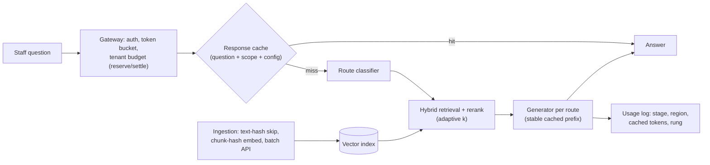

This assessment covers all seven lessons of **Cost Engineering**: embedding costs, LLM inference costs, token budgets, model selection, quantisation, caching strategies and cost-performance trade-offs. Answer the 18 multiple-choice questions first; the pass mark is 70% (13 of 18). Then work through the conceptual questions, the coding exercises, the design challenge and the troubleshooting scenarios, writing your own answer before opening each model answer. All prices in this assessment are hypothetical; the reasoning, not the figures, is what transfers.

```quiz
[
  {
    "q": "Chunks of 400 tokens with 100 tokens of overlap are used on long documents. Roughly how many times is each interior token embedded?",
    "options": ["1.00", "1.25", "1.33", "4.00"],
    "answer": 2,
    "why": "Each window advances by S - O = 300 tokens, so interior tokens are embedded 400 / 300 = 1.33 times."
  },
  {
    "q": "A pipeline uses fixed token windows. An editor inserts a paragraph at the top of a long runbook. With chunk-level content hashing, how much of the runbook is re-embedded?",
    "options": [
      "Only the chunk containing the new paragraph",
      "Nothing, because hashes ignore position",
      "Essentially every chunk after the insertion, because all later window boundaries shift",
      "Only the last chunk"
    ],
    "answer": 2,
    "why": "Fixed windows move with the text; an insertion shifts every later boundary, changing every later chunk's text and hash."
  },
  {
    "q": "Why must an embedding cache key include the model identifier?",
    "options": [
      "So that cached vectors from an old model are never served into an index built with a new one",
      "Because the API bills per model",
      "To reduce hash collisions",
      "Because different models use different chunk sizes"
    ],
    "answer": 0,
    "why": "Vectors from different models are not comparable; a text-only key would mix them after a migration."
  },
  {
    "q": "A request has 3,000 input tokens and 200 output tokens; output is priced at five times input. What share of the cost is output?",
    "options": ["About 6%", "About 25%", "About 50%", "About 75%"],
    "answer": 1,
    "why": "Output costs 200 x 5 = 1,000 input-token equivalents against 3,000, so 1,000 / 4,000 = 25%."
  },
  {
    "q": "Which of these is billed at the output-token price?",
    "options": [
      "Cached prefix reads",
      "Tool definitions",
      "A model's reasoning (thinking) tokens",
      "The system prompt"
    ],
    "answer": 2,
    "why": "Reasoning tokens are generated by the model, so they are output tokens, whether or not their text is returned."
  },
  {
    "q": "A self-hosted model costs 0.30 dollars per million tokens at full load. Its server is busy 20% of the time. What is the effective cost per million tokens?",
    "options": ["0.06 dollars", "0.30 dollars", "0.60 dollars", "1.50 dollars"],
    "answer": 3,
    "why": "Effective cost scales as 1 / utilisation: 0.30 / 0.20 = 1.50."
  },
  {
    "q": "What does this code print?\n```python\np_in, p_out = 4 / 1e6, 20 / 1e6\nC_max, T_out = 0.010, 200\nprint(round((C_max - p_out * T_out) / p_in))\n```",
    "options": ["1000", "1500", "2000", "2500"],
    "answer": 1,
    "why": "Output worst case is 200 x 20 / 1e6 = 0.004; the remaining 0.006 buys 0.006 / 4e-6 = 1,500 input tokens."
  },
  {
    "q": "Why does a per-tenant budget reserve a request's worst-case cost before calling the model?",
    "options": [
      "Because the provider requires prepayment",
      "So that concurrent requests cannot all pass the balance check and overspend together",
      "To make requests faster",
      "Because actual cost cannot be measured afterwards"
    ],
    "answer": 1,
    "why": "Without reservations, every in-flight request sees the same remaining balance before any of them settles."
  },
  {
    "q": "A token bucket has capacity 120,000 tokens and refills at 60,000 tokens per minute. A full bucket receives a burst of 180,000 tokens. How long do the last 60,000 tokens wait?",
    "options": ["0 seconds", "30 seconds", "60 seconds", "120 seconds"],
    "answer": 2,
    "why": "120,000 are served immediately; the remaining 60,000 need 60,000 / 1,000 per second = 60 seconds of refill."
  },
  {
    "q": "A small model costs 0.002 per question, a large one 0.010. Above what escalation rate does a small-then-large cascade cost more than the large model alone?",
    "options": ["20%", "50%", "80%", "90%"],
    "answer": 2,
    "why": "Break-even is 1 - C_s / C_L = 1 - 0.2 = 0.8."
  },
  {
    "q": "A model scores 94% on 100 evaluation questions against a 92% bar. Which conclusion is soundest?",
    "options": [
      "It clears the bar",
      "With a standard error of about 2.4 points, the evidence cannot show it clears the bar",
      "It fails the bar",
      "Evaluation sets of 100 questions are always sufficient"
    ],
    "answer": 1,
    "why": "SE = sqrt(0.94 x 0.06 / 100) = 0.024; the one-sided 95% lower bound is about 0.90, below 0.92."
  },
  {
    "q": "One output channel of a weight matrix contains values 30 times larger than the rest. Which quantisation choice limits the damage most?",
    "options": [
      "A single scale for the whole tensor",
      "Per-channel or per-group scales",
      "Rounding down instead of to nearest",
      "Using more calibration data with a per-tensor scale"
    ],
    "answer": 1,
    "why": "The scale is set by the largest value in its group; separate scales confine the coarse grid to the outlier's group."
  },
  {
    "q": "An 8-billion-parameter model is moved from 16-bit to 4-bit weights. On a GPU with 800 GB/s of memory bandwidth, what is the approximate per-sequence decoding ceiling at 4 bits?",
    "options": ["50 tokens/s", "100 tokens/s", "200 tokens/s", "400 tokens/s"],
    "answer": 2,
    "why": "Weights are 8e9 x 4 / 8 = 4 GB; 800 / 4 = 200 tokens per second at most."
  },
  {
    "q": "A team quantises its embedding model to int8 but keeps the existing index. What is the main risk?",
    "options": [
      "The index becomes larger",
      "Query vectors from the quantised model no longer match document vectors from the original, degrading ranking",
      "The reranker stops working",
      "Nothing; int8 vectors are identical"
    ],
    "answer": 1,
    "why": "A quantised model produces different vectors; the corpus must be re-embedded with the model that will serve queries."
  },
  {
    "q": "A team enables prompt caching but `cache_read_input_tokens` is zero on every request and `cache_creation_input_tokens` is large. What is the most likely cause?",
    "options": [
      "The provider does not support caching",
      "Something before the cache breakpoint changes on every request, such as a timestamp",
      "The answers are too long",
      "The retrieved chunks are after the breakpoint"
    ],
    "answer": 1,
    "why": "Caching matches an exact prefix; a varying value before the breakpoint makes every request a new write."
  },
  {
    "q": "A route receives about 3 requests per hour at random, and the prompt cache's lifetime is 5 minutes. Roughly what fraction of requests find the prefix still cached?",
    "options": ["About 22%", "About 50%", "About 78%", "About 99%"],
    "answer": 0,
    "why": "lambda = 0.05 per minute, tau = 5, so P(warm) = 1 - e^-0.25 = 0.22."
  },
  {
    "q": "Which response-cache key is safe in a system where some documents are visible only to HR managers?",
    "options": [
      "The normalised question text",
      "The question text and the model name",
      "The normalised question, the requester's access scope and the configuration version",
      "The requester's user ID only"
    ],
    "answer": 2,
    "why": "Access scope prevents restricted answers from being served to others; configuration version prevents stale-configuration answers."
  },
  {
    "q": "Configuration A costs 0.012 per request with 82% success; B costs 0.015 with 88%. A failed answer costs an assumed 0.20 in follow-up work. Which is cheaper per request once failures are counted?",
    "options": [
      "A, because it is cheaper per request",
      "B: 0.015 + 0.12 x 0.20 = 0.039 against A's 0.012 + 0.18 x 0.20 = 0.048",
      "They are equal",
      "It cannot be determined"
    ],
    "answer": 1,
    "why": "Including the expected cost of failures, B's total is 0.039 and A's is 0.048."
  }
]
```

## Conceptual questions

**1.** A colleague says: "Embedding is so cheap per call that its cost doesn't need managing." Give two situations in which that is true and two in which it is false, and say what you would measure to tell them apart.

<details><summary>Show solution</summary>

True: a small, stable corpus (a few thousand documents) where the backfill costs less than an hour of engineering time; and a system where generation spend is many times larger than all embedding spend combined. False: a very large corpus that must be re-embedded on every model migration (a full backfill plus double storage during the switch); and a pipeline whose change detection is broken, so it re-embeds the corpus nightly. Measure tokens embedded per day against the real content churn (a large ratio means change amplification), the backfill cost of a full migration, and the share of total spend that embedding represents.

</details>

**2.** Explain why ranking spend by *tokens* and ranking it by *dollars* can point to different optimisations in a RAG system. Which regions of the prompt tend to move up or down between the two rankings?

<details><summary>Show solution</summary>

Input and output are priced differently, typically with output several times dearer. In a token ranking, the input regions (retrieved chunks, system prompt, history) dominate because they are long. In a dollar ranking, output moves up sharply, often to second or first place, because each output token costs several input tokens' worth, and reasoning tokens add to it. An engineer working from token counts would trim the prompt; one working from dollars might first cap answer length or lower reasoning effort. Both rankings are needed: tokens for latency and window limits, dollars for the bill.

</details>

**3.** Describe a degradation ladder for a RAG assistant and explain why stepping down *before* a budget is exhausted can serve users better than refusing when it runs out.

<details><summary>Show solution</summary>

A ladder lists progressively cheaper configurations: full (best model, generous context), lean (same model, fewer chunks, shorter answers), economy (smaller model), cache or extractive-only (no generation), and finally refusal. Stepping down early keeps budget in reserve for later in the period, so users who arrive late still get answers, and each cheaper answer costs a fraction of a full one, so the same remaining budget serves several times as many requests. Refusing only at exhaustion gives full quality to early users and nothing to later ones. Every rung must be evaluated for quality, and the rung recorded on every response.

</details>

**4.** When does a model cascade save money, and what determines whether it preserves quality? Why can a cascade's measured gains disappear in production?

<details><summary>Show solution</summary>

It saves money when the escalation rate stays below $1 - C_s/C_L$. It preserves quality when the confidence signal escalates the questions the small model gets wrong and keeps those it gets right. Gains can disappear because thresholds are tuned on a finite evaluation set and overfit it; because traffic drifts towards harder questions, raising the escalation rate; because the confidence signal behaves differently on new kinds of questions; and because the cascade forfeits shared prompt caching between models and adds latency on escalated requests.

</details>

**5.** Quantising a self-hosted generator from 16 to 4 bits saves memory. Trace how that memory saving can become a cost saving, and give one reason it might not.

<details><summary>Show solution</summary>

Smaller weights may let the model fit on fewer or cheaper accelerators, cutting the hourly cost directly. At small batch sizes, decoding is limited by memory bandwidth, so fewer bytes per weight raises tokens per second, and cost per token is hourly cost divided by throughput. Freed memory can hold more KV cache, allowing more concurrent sequences and higher utilisation. It might not save money if the hardware or kernels make the quantised path no faster (or slower), if the workload is compute-bound at large batch sizes, if the model already fitted on the cheapest hardware, or if quality loss on RAG-specific behaviour forces more retries or escalations.

</details>

## Coding exercises

**1. Cost by stage from usage logs.** Write a function that takes a list of usage records (stage, model, uncached input tokens, cache-write tokens, cache-read tokens, output tokens) and a price table, and reports spend by stage and the amount saved by prompt caching. Use a write multiplier of 1.25 and a read multiplier of 0.10.

<details><summary>Show solution</summary>

```python
from collections import defaultdict

# Hypothetical prices (dollars per million tokens) and cache multipliers.
PRICES = {"large": (5.00, 25.00), "small": (1.00, 5.00)}
WRITE, READ = 1.25, 0.10

records = [   # what a day's usage log might contain, one row per model call
    {"stage": "rewrite",  "model": "small", "input": 900,  "cache_write": 0,    "cache_read": 0,    "output": 30},
    {"stage": "generate", "model": "large", "input": 1400, "cache_write": 2000, "cache_read": 0,    "output": 210},
    {"stage": "generate", "model": "large", "input": 1350, "cache_write": 0,    "cache_read": 2000, "output": 160},
    {"stage": "generate", "model": "large", "input": 1500, "cache_write": 0,    "cache_read": 2000, "output": 190},
    {"stage": "check",    "model": "small", "input": 1700, "cache_write": 0,    "cache_read": 0,    "output": 10},
]

def cost(r):
    p_in, p_out = (p / 1e6 for p in PRICES[r["model"]])
    return (r["input"] + WRITE * r["cache_write"] + READ * r["cache_read"]) * p_in + r["output"] * p_out

def uncached_cost(r):
    p_in, p_out = (p / 1e6 for p in PRICES[r["model"]])
    return (r["input"] + r["cache_write"] + r["cache_read"]) * p_in + r["output"] * p_out

by_stage = defaultdict(float)
for r in records:
    by_stage[r["stage"]] += cost(r)
total = sum(by_stage.values())
for stage, c in sorted(by_stage.items(), key=lambda kv: -kv[1]):
    print(f"{stage:<9} {c:.5f} dollars  {c / total:6.1%}")
saved = sum(uncached_cost(r) for r in records) - total
print(f"total {total:.5f} dollars; prompt caching saved {saved:.5f}")
```

```output
generate  0.04975 dollars   94.7%
check     0.00175 dollars    3.3%
rewrite   0.00105 dollars    2.0%
total 0.05255 dollars; prompt caching saved 0.01550
```

The generation stage dominates. Caching saved 0.0155 dollars on three generation calls even though the first paid the write premium: one write and two reads cost $1.25 + 0.2 = 1.45$ prefix-units instead of 3.

</details>

**2. Reservations under concurrency.** Ten requests arrive before any of them settles. The tenant's budget is 0.10 dollars, each request's worst case is 0.021 and its actual cost 0.014. Simulate a check-only budget and a reserve-and-settle budget, and report how many requests each admits and what each spends.

<details><summary>Show solution</summary>

```python
LIMIT, WORST, ACTUAL = 0.10, 0.021, 0.014     # dollars: budget, worst case per request, typical actual
IN_FLIGHT = 10                                 # requests that arrive before any of them settles

def naive():
    spent, admitted = 0.0, 0
    for _ in range(IN_FLIGHT):                 # every check sees the same settled balance
        if LIMIT - spent >= WORST:
            admitted += 1
    spent += admitted * ACTUAL                 # they all settle later
    return admitted, spent

def reserving():
    spent, reserved, admitted = 0.0, 0.0, 0
    for _ in range(IN_FLIGHT):
        if LIMIT - spent - reserved >= WORST:
            reserved += WORST
            admitted += 1
    spent += admitted * ACTUAL
    return admitted, spent

for name, f in (("check only", naive), ("reserve and settle", reserving)):
    n, s = f()
    print(f"{name:<19} admitted {n:>2}  spent {s:.3f} of {LIMIT:.2f}")
```

```output
check only          admitted 10  spent 0.140 of 0.10
reserve and settle  admitted  4  spent 0.056 of 0.10
```

The check-only budget admits every request and overspends by 40%. Reservations admit four, and after they settle, the 0.044 released can admit more. Reservations are conservative: they hold the worst case, so keep `max_tokens` realistic or the budget will look exhausted while mostly held.

</details>

**3. Choosing a cascade threshold honestly.** Simulate 400 graded troubleshooting questions for a small and a large model with an imperfect confidence signal. Split them in half; choose the cheapest threshold on the first half whose accuracy is at least the large model's, and report cost and accuracy on the second half.

<details><summary>Show solution</summary>

```python
import numpy as np

rng = np.random.default_rng(11)
n = 400                                            # graded troubleshooting questions (simulated)
difficulty = rng.beta(5, 3, n)
small = rng.random(n) < 1 / (1 + np.exp(-12 * (0.55 - difficulty)))
large = rng.random(n) < 1 / (1 + np.exp(-12 * (0.85 - difficulty)))
conf = 0.35 * small + rng.normal(0.4, 0.15, n)     # imperfect confidence signal
C_S, C_L = 0.003, 0.015                            # hypothetical cost per question

idx = rng.permutation(n)
cal, test = idx[: n // 2], idx[n // 2:]            # choose on one half, report on the other

def evaluate(tau, ids):
    esc = conf[ids] < tau
    acc = np.where(esc, large[ids], small[ids]).mean()
    return acc, C_S + esc.mean() * C_L

target = large[cal].mean()
taus = np.round(np.arange(0.30, 1.01, 0.02), 2)
ok = [(evaluate(t, cal)[1], t) for t in taus if evaluate(t, cal)[0] >= target]
cost_cal, tau = min(ok)
acc_t, cost_t = evaluate(tau, test)
print(f"chosen tau {tau} on calibration half: cost {cost_cal:.4f}, accuracy {evaluate(tau, cal)[0]:.1%} "
      f"(large alone {target:.1%})")
print(f"test half: cascade accuracy {acc_t:.1%}, cost {cost_t:.4f}; "
      f"large alone accuracy {large[test].mean():.1%}, cost {C_L:.4f}")
```

```output
chosen tau 0.7 on calibration half: cost 0.0128, accuracy 86.5% (large alone 86.0%)
test half: cascade accuracy 85.0%, cost 0.0141; large alone accuracy 86.0%, cost 0.0150
```

On the calibration half, the cascade looked both cheaper and slightly more accurate than the large model. On held-out questions it was cheaper by 6% but one point *less* accurate. Thresholds chosen on the same data used to report results are optimistic; always report on held-out data, and treat a one-point difference on 200 questions as noise in either direction.

</details>

## Architecture design challenge

Meridian is acquiring a sister company and AskMeridian will serve 2,000 staff instead of 400, with an expected tenfold rise in traffic. Finance has set a monthly model budget roughly four times the current one. The corpus will grow from about 3,000 to about 20,000 documents, including the sister company's product manuals, and a new embedding model is being considered. Design the cost architecture: what is cached, how the generator is chosen, what budgets exist and where they are enforced, how ingestion costs are controlled, and how you will know the design is working. State your assumptions.

<details><summary>Show solution</summary>

**Assumptions.** Generation dominates spend today. Traffic remains skewed towards a head of common policy and IT questions. Documents carry access scopes (company, department), and both companies' staff may see shared handbook content but not each other's internal runbooks at first.



**Caching.** Provider prompt caching on a long, stable system prefix, shared across routes where possible so low-traffic routes stay warm; verify read tokens per route. An exact-match response cache keyed on normalised question, access scope and configuration version, with provenance-based invalidation and personal questions routed around it. A semantic cache only after measuring its false-hit rate on real logs.

**Generator choice.** Per-route assignment from a golden set extended with the sister company's questions: the cheapest model whose bootstrap lower bound clears each route's bar. Test the strongest model at lower effort before adding a cascade; add a cascade only where held-out measurement shows a material saving.

**Budgets.** Per-request: output cap and input allowance from a cost ceiling per route; agent and retry limits. Per tenant (each company and department): monthly allowance with reserve and settle in a shared atomic store, plus a token bucket per API key. Global: alerts at 50% and 80% of the monthly budget. A degradation ladder evaluated per route; IT troubleshooting degrades to extractive answers rather than a weaker model.

**Ingestion.** Skip unchanged documents by text hash; embed only chunk-hash misses keyed on the model identifier; structure-aware chunking for frequently edited manuals; backfills and contextual enrichment through batch interfaces with per-job budgets. Treat the embedding-model change as a migration project: cost the full re-embed and the dual-index period, and run the retrieval evaluation before switching.

**Knowing it works.** Dashboards of cost per successful answer by route, spend by stage and region, cache read share, response-cache hit and invalidation rates, and the rung serving each response, reviewed monthly alongside quality metrics.

**Trade-offs.** Response caching and route-specific models add invalidation and evaluation work; budgets and ladders add product decisions about acceptable quality; a semantic cache and cascades add risk for modest additional savings and are deferred until measured.

</details>

## Troubleshooting scenarios

**1.** After a "harmless" refactor of the prompt builder, AskMeridian's model bill rose by about 40% with no change in traffic or answer length. Nothing errors. What do you check, and what is the likely fix?

<details><summary>Show solution</summary>

**Diagnosis.** Compare `cache_read_input_tokens` and `cache_creation_input_tokens` before and after the refactor. A rise of this size with unchanged traffic and outputs points to prompt caching having stopped working: reads have fallen to near zero and writes have risen, so the static prefix is billed at full price (or with the write premium) on every request. Typical causes: the refactor moved per-request content (date, user name, retrieved chunks) before the cache breakpoint; changed the order of sections; made the serialisation of tool definitions or JSON non-deterministic; or removed the `cache_control` marker. **Fix.** Restore a byte-identical static prefix with the breakpoint after it, move volatile content after it, and add an alert on the cached-read share per route so that a future regression is caught in hours, not at month end.

</details>

**2.** The Sales tenant's monthly budget is exhausted by the 9th of every month, and their users complain that the assistant refuses them for the rest of the month. Usage logs show average actual cost per request well below the per-request ceiling. What could be wrong, and what would you change?

<details><summary>Show solution</summary>

**Diagnosis.** Three possibilities to check in the logs. (a) Runaway or bulk traffic: a script or integration sending far more requests than people do; look at requests per API key and per hour. (b) Hidden calls: agent loops, retries or checks multiplying calls per user request; look at calls per request. (c) Over-reservation leaking: reservations not released on failed or timed-out calls, so the "spent plus reserved" total grows without real spend; compare settled spend with the provider's bill, and look for reservations older than the request timeout. **Fix.** For (a), a per-key token bucket and a separate batch route for bulk work; for (b), step and retry limits; for (c), settle in a `finally` block and expire stale reservations. In every case, add a degradation ladder so that the tenant steps down to cheaper rungs before refusal, and an alert at 50% of the monthly budget.

</details>

**3.** To cut costs, the team quantised the self-hosted query-rewrite model to 4 bits and the embedding model to int8 and redeployed both. Overall answer quality on the golden set fell slightly, but questions containing error codes became much worse. What happened, and how do you fix it without losing all the saving?

<details><summary>Show solution</summary>

**Diagnosis.** Two separate effects are likely. First, the 4-bit rewrite model may be corrupting exact identifiers (changing E-4021 to E-4012, dropping product names), a common weakness on rare tokens that aggregate scores hide; check rewrites of identifier-containing questions directly. Second, if the int8 embedding model was deployed for queries but the corpus was not re-embedded with it, query and document vectors come from slightly different models, degrading ranking generally. **Fix.** Re-embed the corpus with the int8 model (or revert it if measurement on the deployment hardware shows no saving). For the rewrite model, try 8-bit, which often preserves identifiers and may still fit the cheaper hardware, and add a guard that falls back to the original question if any identifier is missing from the rewrite. Add identifier-heavy questions to the golden set and evaluate quantised variants on that slice before deploying.

</details>
