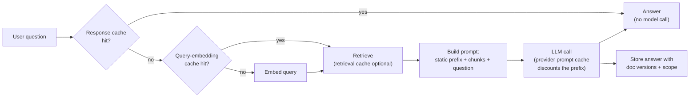

The cheapest model call is the one you do not make, and the second cheapest is the one whose input you have already paid to process. A RAG system offers several places to exploit both: the provider can cache the processed prefix of a prompt, you can cache whole answers, retrieved results and query embeddings, and the ingestion pipeline can avoid re-embedding unchanged text. Each cache has a different cost profile, a different hit rate, and a different way of going wrong.

The [Performance Optimisation](/learn/performance-optimisation) module covers caching for speed, with lessons on [Caching](/learn/performance-optimisation/caching), [Semantic caching](/learn/performance-optimisation/semantic-caching) and [Query caching](/learn/performance-optimisation/query-caching) that explain how to build each cache. This lesson takes the cost view: how much each layer saves, what it costs to run, when it pays for itself, and how to choose between them. You will simulate a working day of AskMeridian traffic and measure five caching strategies against the same requests.

## Learning objectives

- List the cache layers in a RAG system and state which cost each one avoids.
- Calculate the break-even reuse of a provider prompt cache from its write and read prices, and the probability a prefix is still cached from the request rate and the time-to-live.
- Estimate the saving of a response cache from its hit rate, and explain why exact-match hit rates are usually far lower than intent-level ones.
- Design cache keys and invalidation so that cached answers respect document updates and permissions.
- Combine cache layers and predict their joint saving on a traffic sample.

## Prerequisites

- [LLM inference costs](/learn/cost-engineering/llm-inference-costs): the cost of a request by prompt region.
- [Context windows](/learn/context-engineering/context-windows): laying out a prompt so its stable prefix is as long as possible.
- [Embedding costs](/learn/cost-engineering/embedding-costs): content-hash caching of chunk embeddings.
- [Caching](/learn/performance-optimisation/caching): cache mechanics, eviction and time-to-live.

## Why this matters

RAG traffic is repetitive in two different ways, and each repetition is money spent twice.

The first is **structural repetition inside every request**. Every AskMeridian prompt begins with the same system prompt, the same answer-format instructions and perhaps the same tool definitions. In the [LLM inference costs](/learn/cost-engineering/llm-inference-costs) simulation, the system prompt alone was a fifth of all spend, identical on every request. Paying full price to process the same tokens a million times is waste that prompt caching removes almost entirely.

The second is **repetition across requests**. Internal assistants and support bots see the same questions again and again: "how many days of annual leave do I get?", "how do I reset my VPN?". If the documents have not changed and the asker is allowed to see the same answer, generating it afresh each time pays for the whole request again. A response cache can avoid the entire call.

Both kinds of cache also have costs and risks: a write premium, storage, lookups, and, worst of all, stale or leaked answers. Without the arithmetic, teams either skip caching and overpay, or cache aggressively and serve last month's policy to the wrong person.

## The intuition

A busy help desk receives the same questions all day. A sensible clerk does three things. She keeps the policy binder open on her desk instead of fetching it from the archive for every caller, because opening it costs a little effort and saves a lot when the next caller arrives within minutes (**prompt caching**: pay once to load the context, then reuse it while it is warm). She keeps a sheet of answers to the questions she hears most, so she can read one out without looking anything up (**response caching**). And when the binder is updated, she crosses out every answer on the sheet that the change affects (**invalidation**).

Her sheet is only useful if callers ask the same question; it is far more useful if she recognises that "how much holiday do I get?" and "what's my leave allowance?" are the same question. And she must never read an answer from the managers' sheet to a caller who is not a manager.

## How it works

### The cache layers and what each avoids



| Layer | Avoids | Typical saving per hit | Main risk |
| --- | --- | --- | --- |
| Provider prompt cache | Reprocessing a stable prompt prefix | Most of the prefix's input cost | Silent misses when the prefix changes |
| Response cache (exact or semantic) | The whole request: retrieval and generation | The full request | Stale or wrongly shared answers |
| Retrieval-result cache | Embedding, search and reranking | Retrieval cost, small next to generation | Stale results after index updates |
| Query-embedding cache | One embedding call | Very small | Model mismatch after migration |
| Chunk-embedding cache (ingestion) | Re-embedding unchanged chunks | Ingestion cost | Model mismatch, covered in [Embedding costs](/learn/cost-engineering/embedding-costs) |

For most RAG systems, generation dominates cost, so the two layers that matter financially are the prompt cache and the response cache. The others matter more for latency.

### Provider prompt caching

Several LLM providers, Anthropic among them, can cache the processed form of a prompt prefix. With Anthropic's API you mark a breakpoint with `cache_control`; the first request writes everything up to the breakpoint to the cache, and later requests whose prompts begin with *exactly the same bytes* read it instead of reprocessing it. The economics have three parts:

1. **A write premium.** The request that creates the cache entry pays more than the normal input price for the cached portion.
2. **A read discount.** Requests that hit the cache pay a small fraction of the input price for that portion. Anthropic's documented multipliers at the time of writing were a write of about 1.25 times the base input price for the default five-minute lifetime and a read of about 0.1 times; this lesson uses those as assumptions. Check the current documentation.
3. **A time-to-live (TTL).** An entry expires if it is not used for a while (five minutes by default on Anthropic's API, with a longer, more expensive option). Each hit refreshes it. A prefix is therefore cheap only while traffic keeps it warm.

There are practical conditions too. Caching applies to a prefix, so anything that varies between requests (a timestamp, the user's name, the retrieved chunks) must come *after* the breakpoint; a single changed byte before it causes a miss. Providers set a minimum cacheable length (it varies by model), so a short system prompt may not be cacheable at all. Caches are scoped to a model, so a cascade that sends some requests to a second model cannot share the first model's cached prefix. And the response's usage figures report cached reads and writes separately, which is how you verify the cache is working. [Context windows](/learn/context-engineering/context-windows) explains how to order the regions of a prompt so the stable prefix is as long as possible.

### Response caching

A response cache stores the final answer to a question and returns it for later requests that are, by some definition, the same. Its saving per hit is the whole request, so its value is governed almost entirely by the **hit rate**, and the hit rate depends on what "the same" means:

- **Exact match** keys on the normalised question text (lower-cased, whitespace collapsed). Cheap and safe, but people rarely phrase a question identically, so hit rates are modest.
- **Semantic match** embeds the question and returns a cached answer if a previous question is close enough. It catches paraphrases, so hit rates are higher, but every request now pays for an embedding and a vector lookup, and a threshold set too loosely returns the answer to a *different* question ("how many days of leave?" matched to "how many days to submit expenses?"). [Semantic caching](/learn/performance-optimisation/semantic-caching) covers thresholds and verification.
- **Intent match** maps the question to a canonical intent with a classifier and caches per intent. This is the upper bound on what any semantic cache can achieve, and it requires curated intents.

A cached answer is only correct while three things hold: the documents it was built from have not changed, the person asking may see those documents, and the answer does not depend on who is asking ("how many days of leave do *I* have left?" is personal and must not be shared).

### Keys and invalidation

The cache key decides what may be shared; invalidation decides how long it stays true.

1. **Scope the key by permissions.** Include the user's access scope (the set of document collections they may read, or a hash of it) in the key, so an answer generated from restricted documents is never served to someone without access. Never cache personalised answers in a shared cache.
2. **Record provenance.** Store, with each cached answer, the identifiers and versions of the chunks used to generate it (see [Document versioning](/learn/document-engineering/document-versioning)).
3. **Invalidate on change.** When a document is updated, delete or mark stale every cached answer whose provenance includes it. A TTL alone is a weak substitute: too long and answers go stale, too short and the hit rate collapses.
4. **Include the configuration.** Prompt, model and retrieval settings belong in the key or in a cache namespace, so that changing them does not serve answers produced by the old configuration.

### Which layers to combine

The layers compose. The response cache removes whole requests; the prompt cache discounts the requests that remain. Because the response cache removes the most *repeated* questions, the requests that reach the model are the varied ones, which still share the static prefix, so the prompt cache keeps working on them. The simulation below shows the combined effect.

## The mathematics

### Prompt-cache break-even

**Intuition.** You pay a premium once to write the prefix, then a fraction on each reuse. How many reuses before that beats paying full price every time?

Measure cost in units of "the prefix at the full input price". Without caching, one write-equivalent plus $n$ later uses cost $1 + n$. With caching they cost $w + n r$, where $w$ is the write multiplier and $r$ the read multiplier. Caching is cheaper when

$$
w + n r < 1 + n \iff n > \frac{w - 1}{1 - r}
$$

$n$ is the number of reads of the cached prefix before it expires. **By hand** with $w = 1.25$, $r = 0.10$: $n > 0.25 / 0.90 = 0.278$. A single reuse already pays: $1.25 + 0.10 = 1.35$ against $2$, a 32% saving; twenty reuses cost $3.25$ against $21$, an 85% saving.

### Will the prefix still be cached?

**Intuition.** If requests arrive at random at an average rate, the chance that the next one comes before the entry expires depends on rate times lifetime.

For requests arriving as a Poisson process at rate $\lambda$ per minute, and a TTL of $\tau$ minutes refreshed on every hit, the probability that the next request finds the prefix still cached is

$$
P(\text{warm}) = 1 - e^{-\lambda \tau}
$$

**By hand** with $\tau = 5$: at $\lambda = 2$ per minute, $1 - e^{-10} \approx 1.000$; at $0.2$ per minute, $1 - e^{-1} = 0.632$; at $0.05$ per minute (overnight), $1 - e^{-0.25} = 0.221$. Busy routes keep the cache warm; quiet ones pay the write premium repeatedly. Low-traffic routes may be better served by a longer TTL, if the provider offers one, or by no caching.

### Response-cache saving

$$
S = h \, C_{\text{req}} - c_{\text{lookup}}
$$

$h$ is the hit rate, $C_{\text{req}}$ the cost of a full request and $c_{\text{lookup}}$ the cost per request of checking the cache (paid on hits and misses: for a semantic cache it includes a query embedding). **By hand**, $h = 0.25$, $C_{\text{req}} = 0.0211$ dollars, $c_{\text{lookup}} = 0.00002$: $S = 0.005275 - 0.00002 = 0.00526$ dollars per request, 24.9% of the request cost.

```python
import math
w, r = 1.25, 0.10                           # assumed write and read multipliers
n_star = (w - 1) / (1 - r)
print(f"break-even reads per write: {n_star:.3f}")
for n in (1, 5, 20):
    print(f"  {n:>2} reads: cached {w + n * r:.2f} vs uncached {1 + n:.0f} prefix-units "
          f"(saves {1 - (w + n * r) / (1 + n):.0%})")

TTL = 5                                      # minutes
for lam in (2.0, 0.2, 0.05):                 # requests per minute
    print(f"rate {lam:>4}/min: P(prefix still cached) = {1 - math.exp(-lam * TTL):.3f}")

h, C, c_lookup = 0.25, 0.0211, 0.00002       # hit rate, cost of a full request, cost per lookup
print(f"response cache saves {h * C - c_lookup:.5f} dollars per request ({(h * C - c_lookup) / C:.1%})")
```

```output
break-even reads per write: 0.278
   1 reads: cached 1.35 vs uncached 2 prefix-units (saves 32%)
   5 reads: cached 1.75 vs uncached 6 prefix-units (saves 71%)
  20 reads: cached 3.25 vs uncached 21 prefix-units (saves 85%)
rate  2.0/min: P(prefix still cached) = 1.000
rate  0.2/min: P(prefix still cached) = 0.632
rate 0.05/min: P(prefix still cached) = 0.221
response cache saves 0.00526 dollars per request (24.9%)
```

## In code

**The problem.** Compare five caching strategies on the same day of AskMeridian traffic, including a mid-day handbook update that invalidates some cached answers, and see how much each saves and why.

**Dependencies.** NumPy only. The traffic is **simulated** with explicit assumptions: 10,000 questions over ten hours, busiest at midday; 5,000 possible intents whose popularity follows a Zipf-like curve (a few questions are asked very often, most rarely); and many different wordings per intent. Prices and cache multipliers are hypothetical. Replace the simulation with your own query logs to get real hit rates.

```bash
pip install numpy
```

```python
import numpy as np

rng = np.random.default_rng(3)

# ---- Assumptions (hypothetical; check your provider's current prices and multipliers) ----
P_IN, P_OUT = 5.00 / 1e6, 25.00 / 1e6        # dollars per token
CACHE_WRITE, CACHE_READ = 1.25, 0.10         # multipliers on the input price for cached prefixes
PREFIX_TTL = 300                             # seconds a cached prefix lives after its last use
STATIC, CHUNKS, QUESTION, ANSWER = 2_000, 1_300, 20, 180   # tokens per request

# ---- A working day of traffic: 10,000 questions over 10 hours, busier at midday ----
N, INTENTS = 10_000, 5_000
t = np.sort(np.clip(rng.normal(5 * 3600, 2.2 * 3600, N), 0, 10 * 3600))
popularity = 1 / np.arange(1, INTENTS + 1) ** 0.9           # Zipf-like: a few questions dominate
intent = rng.choice(INTENTS, size=N, p=popularity / popularity.sum())
variant = rng.geometric(0.05, size=N)                        # different wordings of the same question
UPDATE_AT = 5 * 3600                                        # handbook update at hour 5 ...
stale = set(rng.choice(INTENTS, size=INTENTS * 15 // 100, replace=False))  # ... changes 15% of answers

def full_cost(prefix_mult):
    return ((STATIC * prefix_mult + CHUNKS + QUESTION) * P_IN) + ANSWER * P_OUT

def simulate(prompt_cache, response_key):
    cost, prefix_last, answers, hits = 0.0, -1e9, {}, 0
    for ti, it, va in zip(t, intent, variant):
        key = None if response_key is None else response_key(it, va)
        if key is not None and key in answers:
            stored_at = answers[key]
            if not (it in stale and stored_at < UPDATE_AT <= ti):    # invalidated by the update?
                hits += 1
                continue                                             # served from cache: no LLM call
        if prompt_cache:
            mult = CACHE_READ if ti - prefix_last <= PREFIX_TTL else CACHE_WRITE
            prefix_last = ti
        else:
            mult = 1.0
        cost += full_cost(mult)
        if key is not None:
            answers[key] = ti
    return cost, hits / N

strategies = {
    "no caching":                          (False, None),
    "prompt cache (static prefix)":        (True,  None),
    "response cache, exact wording":       (False, lambda i, v: (i, v)),
    "prompt + exact response cache":       (True,  lambda i, v: (i, v)),
    "prompt + same-intent cache (bound)":  (True,  lambda i, v: i),
}
base = None
for name, (pc, rk) in strategies.items():
    cost, hit = simulate(pc, rk)
    base = base or cost
    print(f"{name:<36} USD {cost:6.2f}  ({cost / base - 1:+5.1%})  response-cache hits {hit:5.1%}")

print(f"\ndistinct intents asked: {len(set(intent)):,}   distinct wordings: {len(set(zip(intent, variant))):,}")
```

```output
no caching                           USD 211.00  (+0.0%)  response-cache hits  0.0%
prompt cache (static prefix)         USD 121.01  (-42.6%)  response-cache hits  0.0%
response cache, exact wording        USD 157.95  (-25.1%)  response-cache hits 25.1%
prompt + exact response cache        USD  90.59  (-57.1%)  response-cache hits 25.1%
prompt + same-intent cache (bound)   USD  34.10  (-83.8%)  response-cache hits 71.8%

distinct intents asked: 2,688   distinct wordings: 7,404
```

**The important lines.**

- `popularity = 1 / np.arange(1, INTENTS + 1) ** 0.9` gives intent number $i$ a weight proportional to $1/i^{0.9}$: the head of the distribution is asked often, the long tail rarely. Real query logs often show a skew of this general kind, but the exponent here is an assumption; measure yours.
- `variant = rng.geometric(0.05, ...)` gives each request one of many possible wordings of its intent (20 on average). This is what separates exact-match from intent-level hit rates.
- In `simulate()`, a cached answer is served only if it was not made stale by the update: an answer stored before hour 5 for one of the affected intents is treated as invalid afterwards, and the request goes to the model. This is provenance-based invalidation in miniature.
- The prompt-cache branch charges `CACHE_WRITE` when the previous model call was more than `PREFIX_TTL` seconds ago and `CACHE_READ` otherwise, refreshing the timestamp on every call, which is how a TTL refreshed on use behaves.
- The key functions define what "the same question" means: `(intent, variant)` for exact wording, `intent` alone for the intent-level upper bound.

**What the output means.**

- **The prompt cache alone saves 42.6%.** The static prefix is 2,000 of the 3,320 input tokens and, with traffic arriving every few seconds, it is almost never cold. Every request still runs, but at a much lower input price. It needs no change to answers and carries no staleness risk, which makes it the first cache to turn on.
- **An exact-wording response cache hits 25.1% of requests**, even though the 10,000 requests contain only 2,688 distinct intents. People phrase the same question in many ways (7,404 distinct wordings), so exact matching catches only the repeats of the most common phrasings.
- **The two layers combine to 57.1%**, close to what you would predict by applying the prompt cache's saving to the 74.9% of requests the response cache leaves: $0.749 \times 0.574 = 0.430$ of the original cost, a 57% saving.
- **An intent-level cache could reach 71.8% hits and an 83.8% saving.** That is an upper bound on what a semantic cache could achieve on this traffic, assuming it matched every paraphrase and never matched different questions. A real semantic cache sits somewhere between the exact and intent lines, and its false hits are a quality cost not shown here.
- **Invalidation costs some hits.** Answers for 15% of intents became stale at hour 5 and had to be regenerated once; without that rule, the hit rate would be a little higher and some answers would be wrong.

**Turning on prompt caching with the real API.** Put the static instructions in the system prompt with a cache breakpoint, keep the retrieved chunks and question in the user turn after it, and check the usage figures. This needs an API key and was not executed here:

```python
import anthropic

client = anthropic.Anthropic()  # reads ANTHROPIC_API_KEY from the environment
STATIC_INSTRUCTIONS = open("askmeridian_system_prompt.txt").read()   # long, never changes per request

response = client.messages.create(
    model="claude-opus-5-5",
    max_tokens=1024,
    system=[{"type": "text", "text": STATIC_INSTRUCTIONS, "cache_control": {"type": "ephemeral"}}],
    messages=[{"role": "user", "content": prompt}],   # retrieved chunks + question: after the breakpoint
)
answer = "".join(block.text for block in response.content if block.type == "text")
u = response.usage
print(u.cache_creation_input_tokens, u.cache_read_input_tokens, u.input_tokens)
```

On the first call, `cache_creation_input_tokens` should be roughly the length of the system prompt; on later calls within the TTL, `cache_read_input_tokens` should be. If reads stay at zero, something before the breakpoint is changing between requests, or the prefix is shorter than the model's minimum cacheable length.

**Errors people commonly hit.**

- Putting a timestamp, request identifier or the user's name in the system prompt. Every request then has a different prefix and the cache never hits, while every request pays the write premium.
- Assuming the cache works without checking usage figures. Misses are silent; only `cache_read_input_tokens` tells you.
- Caching responses keyed only on question text in a system with document-level permissions, which serves restricted answers to unauthorised users.

**Extending it.** Add a night period with one request every ten minutes and watch the prompt cache's saving fall as the prefix expires between calls. Add a semantic cache that matches the correct intent with some probability and a wrong intent with a small probability, and count the wrong answers it serves.

## A real-world example

AskMeridian's Platform team turned on provider prompt caching expecting a large saving, because their system prompt was long and identical on every request. The next week's bill had barely moved. Asha, the engineer who made the change, checked the usage logs: `cache_read_input_tokens` was zero on almost every request, and `cache_creation_input_tokens` was non-zero on almost every request. They were paying the write premium every time and getting nothing back.

The cause was in the prompt template. To help the model answer date-related questions, someone had added "Today is {date}, the time is {time}" as the first line of the system prompt. The time changed every minute, so the cached prefix was different on almost every request. Moving the date and time into the user turn, after the breakpoint, made the prefix stable, and cache reads appeared on the next deployment.

The team then looked at a response cache. A month of query logs showed that a small set of HR policy questions accounted for a large share of traffic, but phrased in many ways. They introduced an exact-match cache scoped by access group, with answers invalidated whenever any source chunk's document version changed, and deliberately excluded personal questions ("how many days do *I* have left?") by routing them around the cache. A semantic cache was prototyped and shelved after it matched "can I carry over leave?" to "can I carry over expenses?" in testing; the team recorded that the extra hits were not worth the wrong answers on a policy assistant.

## Common mistakes

- **Volatile content before the cache breakpoint.** Dates, user names or retrieved chunks early in the prompt break the prefix and turn every request into a cache write.
- **Not verifying cache reads.** Prompt-cache misses produce no error; without checking usage figures, a broken cache can run for months.
- **Response-cache keys without permission scope.** Answers built from restricted documents leak to users who could not have retrieved those documents.
- **Relying on TTL instead of invalidation.** Answers stay wrong for the length of the TTL after a policy change, or a short TTL destroys the hit rate.
- **Caching personalised answers in a shared cache.** One user's details are served to another.
- **Expecting semantic-cache hit rates without measuring false hits.** A loose threshold raises the hit rate by serving answers to different questions.

## Best practices

- Order every prompt from most to least stable, place the cache breakpoint after the stable part, and keep anything per-request after it.
- Monitor cached-read and cache-write tokens per route as first-class metrics, and alert when the read share drops.
- Turn on provider prompt caching first: it is the cheapest to adopt and has no staleness risk.
- Key response caches on normalised question, access scope and configuration version; store provenance and invalidate on document change.
- Exclude personal and time-dependent questions from shared response caches, using routing rules or a classifier.
- Estimate hit rates from your own logs before building a cache, and measure false hits before trusting a semantic cache.

## Performance considerations

Caches cut latency as well as cost, by different amounts. A response-cache hit returns in milliseconds instead of seconds, which also reduces load on the model provider and helps stay within rate limits. A prompt-cache hit shortens the time to first token, because the cached prefix does not have to be processed again, but does not change generation time. A semantic cache adds an embedding and a vector lookup to every request, hit or miss, so its latency cost must be repaid by its hit rate.

Cache storage is cheap next to generation: a 180-token answer is under a kilobyte, so a million cached answers fit in memory. The real operational cost is invalidation, which needs an index from chunk identifiers to cache keys, maintained on every write.

Prompt caching's value falls with traffic. For a route that receives a request every few seconds, the five-minute default lifetime is never reached; for one that receives a request every twenty minutes, nearly every call is a write. Group low-traffic routes under a shared static prefix where possible, so their combined traffic keeps it warm.

## Security considerations

A shared response cache is a data-sharing mechanism, and must be designed as one. Include the requester's access scope in the cache key, so that a cached answer can only be served to someone who could have retrieved every document it was built from. Never cache answers that contain personal data in a shared cache, and treat the cache store with the same access controls as the documents themselves.

Caches can also be poisoned. If an attacker can get a manipulated answer into the cache (for example by planting a document that injects instructions, asking the question, and then removing the document), every later user who asks the same question receives it, even after the document is gone. Invalidation by provenance helps; so does excluding answers flagged by safety checks from the cache, and keeping cache entries short-lived for routes where documents come from less-trusted sources.

Timing differences between hits and misses can reveal whether someone else recently asked a question. For most internal assistants this is a minor concern, but where the question itself is sensitive, scope caches per user or disable them.

## Summary

- The cache layers that matter most for cost are the provider prompt cache (discounting a stable prefix) and the response cache (avoiding whole requests); retrieval and embedding caches mainly save latency.
- A prompt cache pays for itself after a single reuse at typical write and read multipliers, but only while traffic keeps it warm: the chance of a warm hit is $1 - e^{-\lambda\tau}$.
- Response-cache savings are the hit rate times the request cost, minus lookup costs; exact-match hit rates are limited by how many ways people phrase the same question, and semantic matching trades extra hits for wrong-answer risk.
- Cached answers need keys that include access scope and configuration, provenance for invalidation on document change, and exclusion of personal questions.
- Layers combine multiplicatively: the response cache removes repeats, and the prompt cache discounts what remains.

## Exercises

**1.** A provider charges a write multiplier of 2.0 and a read multiplier of 0.1 for a long-lived cache option. How many reads per write are needed to break even, and what fraction of the prefix's cost is saved with 3 reads?

<details><summary>Show solution</summary>

$n > (2.0 - 1) / (1 - 0.1) = 1.11$, so at least 2 reads. With 3 reads: cached $2.0 + 3 \times 0.1 = 2.3$ against uncached $4$, saving $1 - 2.3/4 = 42.5\%$.

</details>

**2.** A low-traffic route gets 6 requests an hour, spread at random. With a five-minute TTL, what fraction of requests find the prefix warm? Is prompt caching worth it on this route at the multipliers used in the lesson?

<details><summary>Show solution</summary>

$\lambda = 0.1$ per minute, so $P(\text{warm}) = 1 - e^{-0.5} = 0.393$. About 61% of requests write (cost $1.25$) and 39% read (cost $0.10$): expected $0.607 \times 1.25 + 0.393 \times 0.10 = 0.798$ prefix-units against $1.0$ uncached, a saving of about 20%. Still worth it, but far less than on a busy route; a longer TTL or a prefix shared with busier routes would help.

</details>

**3.** Modify the simulation so that 20% of intents are personal (for example "how many days of leave do I have left?") and must never be served from the response cache. Report the new hit rate and saving for "prompt + exact response cache".

<details><summary>Show solution</summary>

```python
personal = set(rng.choice(INTENTS, size=INTENTS // 5, replace=False))
# in simulate(), before the lookup:
key = None if (response_key is None or it in personal) else response_key(it, va)
```

Draw `personal` after the other random draws so the traffic is unchanged. On our run the hit rate fell from 25.1% to 23.3% and the saving from 57.1% to 56.0%: the intents marked personal happened to miss the most popular ones. The drop tracks the share of *traffic*, not of intents, that is personal; in real systems personal questions are often among the most common, so measure their share from your logs.

</details>

**4.** Design the cache keys and invalidation for a response cache on AskMeridian, given that the handbook is readable by all staff, the IT runbooks only by IT staff, and a few HR documents only by HR managers.

<details><summary>Show solution</summary>

Key: (normalised question, access-scope identifier, configuration version), where the access scope is the set of collections the user may read, for example `all`, `all+it`, `all+hr-managers`. An answer generated for a user with scope `all+it` from handbook-only chunks could safely be shared with `all` users, but determining that requires checking provenance; the simple, safe rule is to share only within the same scope. Store, with each answer, the chunk identifiers and document versions used. On any document update, look up all cache entries whose provenance includes that document (via an index from document to cache keys) and delete them. Route questions about the asker's own balances or records around the cache. Use a TTL as a backstop (for example a day), not as the main invalidation mechanism.

</details>

## Check your understanding

```quiz
[
  {
    "q": "A team adds the current time to the first line of the system prompt and enables prompt caching. What happens to cost?",
    "options": [
      "It falls, because the system prompt is cached",
      "It rises slightly, because almost every request pays the cache-write premium and almost none read",
      "Nothing; providers ignore timestamps",
      "The API rejects the request"
    ],
    "answer": 1,
    "why": "The prefix changes on nearly every request, so every request writes a new cache entry at a premium and none is reused."
  },
  {
    "q": "With a write multiplier of 1.25 and a read multiplier of 0.1, how many reuses of a cached prefix are needed before caching is cheaper than not caching?",
    "options": ["None", "One", "Four", "Ten"],
    "answer": 1,
    "why": "Break-even is (1.25 - 1) / (1 - 0.1) = 0.28 reads, so a single reuse already saves money."
  },
  {
    "q": "Why is the hit rate of an exact-match response cache usually much lower than the share of repeated questions?",
    "options": [
      "Because exact-match caches have small capacity",
      "Because the same question is phrased in many different ways",
      "Because answers expire after five minutes",
      "Because hashing is slow"
    ],
    "answer": 1,
    "why": "Repeated intents arrive in many wordings; exact matching only catches identical phrasings."
  },
  {
    "q": "What must a shared response cache's key include in a system with document-level permissions?",
    "options": [
      "The model's temperature",
      "The requester's access scope",
      "The time of day",
      "The answer's length"
    ],
    "answer": 1,
    "why": "Without the access scope, an answer built from restricted documents can be served to users who may not see them."
  },
  {
    "q": "A route receives about one request every 25 minutes. Which statement about a five-minute prompt cache is most accurate?",
    "options": [
      "Almost every request will hit the cache",
      "Most requests will find the prefix expired and pay the write premium, so the saving is small or negative",
      "The cache will never expire",
      "Prompt caching only works on low-traffic routes"
    ],
    "answer": 1,
    "why": "With lambda = 0.04 per minute and tau = 5, P(warm) = 1 - e^-0.2 = 0.18; most calls are writes."
  }
]
```

## Further reading

- Anthropic documentation on [prompt caching](https://docs.anthropic.com/en/docs/build-with-claude/prompt-caching): breakpoints, lifetimes, minimum lengths and pricing multipliers. These change; check the current page.
- Bang, F. (2023). *GPTCache: An Open-Source Semantic Cache for LLM Applications Enabling Faster Answers and Cost Savings.* Proceedings of the 3rd Workshop for Natural Language Processing Open Source Software (NLP-OSS 2023). A semantic response cache and its design choices.
- Breslau, L., Cao, P., Fan, L., Phillips, G. and Shenker, S. (1999). *Web Caching and Zipf-like Distributions: Evidence and Implications.* IEEE INFOCOM. Why skewed request popularity makes caching effective, from the web-caching literature.
- [Redis documentation](https://redis.io/docs/latest/) on key expiry and eviction policies, the usual building blocks of a response cache.
