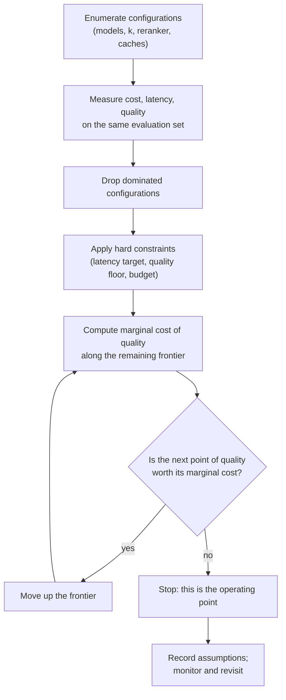

Every optimisation in this module trades something for something else: tokens for money, latency for hit rate, precision for size, safety margin for budget. Taken one at a time, each trade looks reasonable. Taken together, a team can end up with a system that is cheap, fast and no longer very good, or good and unaffordable, without ever having decided to be either. This final lesson of the module makes the trade explicit: cost, latency and quality on the same page, the options that no other option beats, quality priced in money, and an operating point you can choose, defend and revisit.

It builds on every earlier lesson in the module and on the [Performance Optimisation](/learn/performance-optimisation) and [RAG Observability](/learn/rag-observability) modules, whose measurements are the inputs to these decisions. The worked experiment measures a real retrieval task: how recall, context size, generation cost and reranking time move together as you change the number of retrieved chunks, the embedding model and whether a reranker is used.

## Learning objectives

- Define the three axes of a RAG trade-off (cost, latency, quality) and measure each per configuration.
- Identify the Pareto-optimal configurations in a set of options and explain why dominated ones should be dropped.
- Compute the marginal cost of an additional point of quality along a frontier and use it to decide where to stop.
- Convert quality differences into money with an explicit cost of failure, and compare configurations on expected total cost.
- Justify an operating point to stakeholders, with its assumptions and the conditions under which it should be revisited.

## Prerequisites

- [LLM inference costs](/learn/cost-engineering/llm-inference-costs): cost per request and per successful answer.
- [Model selection](/learn/cost-engineering/model-selection): quality bars, Pareto dominance and measurement uncertainty.
- [Caching strategies](/learn/cost-engineering/caching-strategies): the cost and latency effect of each cache layer.
- [Recall@K](/learn/retrieval-fundamentals/recall-k): the retrieval metric used in the experiment.
- [Latency optimisation](/learn/performance-optimisation/latency-optimisation): where request time goes.

## Why this matters

Optimisation without a stated objective is drift. A team told to "cut cost" will find savings, and a team told to "cut latency" will find different ones; neither is told how much quality may be given up, so the loss is whatever happens to result and is discovered by users. The usual consequence is a pendulum: a cost-cutting quarter followed by a quality-recovery quarter that undoes some of it.

The opposite failure is also common: a system tuned only for quality, with the strongest model, ten chunks of context and a reranker on every query, whose cost per answer is several times what the product can bear. Retrieving ten chunks instead of five can nearly double generation cost for a few points of recall, and nobody ever put a price on those points.

The remedy is not clever. Measure all three axes for each candidate configuration, discard the configurations that are strictly worse than another, look at what each extra point of quality costs along what remains, and choose with a stated reason. That turns a loose argument ("I think we need the reranker") into a number ("the reranker costs this much latency and buys this much recall at this k").

## The intuition

Think of choosing a delivery service. You can care about cost, speed and the chance the parcel arrives intact. Some options are simply bad: a courier that is slower, dearer and less reliable than another has no place in your decision. Among the rest, none wins on all three. Next-day costs more than three-day; insured costs more again. What you choose depends on what is in the parcel. A birthday card does not justify insured next-day delivery; a passport does.

A RAG system is the same, with the parcel's value replaced by the cost of a wrong answer. A wrong answer about the support desk's opening hours is a minor annoyance. A wrong VPN fix given to an engineer on call, or a wrong expenses rule given to finance, is not. The right operating point depends on what an error costs, and different routes in one system can reasonably sit at different points.

## How it works

### Step 1: three axes, measured per configuration

A **configuration** is a complete setting of the pipeline: embedding model, number of chunks, reranker on or off, generator, cache policy, answer length cap. For each one you need three numbers, measured on the same evaluation set and the same traffic assumptions.

1. **Cost** per thousand requests: generation cost from token counts and prices ([LLM inference costs](/learn/cost-engineering/llm-inference-costs)), plus retrieval, reranking and embedding, less the effect of caches. Use cost per *successful answer* when failure rates differ.
2. **Latency**: a percentile (usually p95) of time to first token and of total time, from traces rather than averages. A reranking stage adds its latency to every request unless it overlaps with something else.
3. **Quality**: a metric that reflects the user's outcome. Retrieval metrics ([Recall@K](/learn/retrieval-fundamentals/recall-k), [Precision@K](/learn/retrieval-fundamentals/precision-k)) are cheap and diagnose the retriever; end-to-end answer correctness and faithfulness, graded against references, measure what the user receives and cost more. Use the retrieval metric for wide sweeps and confirm finalists on answer quality.

### Step 2: the frontier

An option is **dominated** if another option is at least as good on every axis and strictly better on one. Drop dominated options. What remains is the **Pareto frontier**. With three axes, "at least as good" means no higher cost, no higher latency and no lower quality; it is often easier to view quality against cost, with latency checked as a constraint.



### Step 3: constraints first, then marginal value

Real products have hard constraints that remove options before any trade-off is weighed: a p95 time to first token the interface cannot exceed, a quality floor set by the cost of errors, a monthly budget, a data-residency rule that excludes some providers. Apply them first. Among the survivors, walk up the frontier from the cheapest option and ask at each step what the next improvement costs per unit and whether it is worth that price.

The **marginal cost of quality** between adjacent frontier points is the extra cost divided by the extra quality. It almost always rises along the frontier: the first chunks you add buy a great deal of recall, the later ones little; the strongest model costs several times the next and gains a few points. Stop where the marginal cost exceeds what a point of quality is worth.

### Step 4: pricing quality

A point of quality is worth the failures it prevents. Failures cost in different ways: a wrong answer prompts a follow-up (another full request), a support ticket (human time), a decision made on bad information (potentially far more), or loss of trust, which is hard to price and easy to underestimate. A rough, honest estimate beats none. Expected total cost per request is

$$
C_{\text{total}} = C_{\text{request}} + (1 - q) \, C_{\text{failure}}
$$

where $q$ is the probability that an answer is satisfactory and $C_{\text{failure}}$ is the expected cost of an unsatisfactory one. When a failure costs much more than a request, which is common, the more accurate and dearer configuration is cheaper overall. When failures are cheap (the user just rephrases), cheaper configurations win. Different routes have different $C_{\text{failure}}$, and so different optimal points.

### Step 5: three kinds of trade-off to recognise

- **Spend upstream to save downstream.** A better retriever or a reranker costs little compared with generation. If it lets the generator receive fewer, more relevant chunks, total cost can fall. This holds only if quality is confirmed not to drop, and the experiment below shows a case where it does not hold.
- **Latency bought with money, and the reverse.** Streaming, parallel retrieval and caches improve latency at little or no quality cost. Smaller models improve latency and cost at some quality cost. Reranking spends latency for quality. Be clear which currency you are paying in.
- **Averages versus tails and slices.** A configuration better on average can be worse on an important slice (error codes, long questions, one department) or in the latency tail. Evaluate by route and by slice before moving.

### Step 6: choose, record and revisit

Write the decision down: the configuration, the measurements, the constraints, the cost-of-failure assumption, and the conditions that would change the answer (a price change, a new model, traffic growth, quality dropping on a monitored slice). Prices, models and traffic change quickly, so a trade-off decision has a shelf life; the monitoring from [RAG Observability](/learn/rag-observability) is what tells you it has expired.

## The mathematics

### Dominance

Configuration $A$ dominates $B$ when

$$
c_A \le c_B, \quad \ell_A \le \ell_B, \quad q_A \ge q_B, \quad \text{with at least one strict inequality}
$$

where $c$, $\ell$ and $q$ are cost, latency and quality. A configuration that no other configuration dominates is on the Pareto frontier.

### Marginal cost of quality

**Intuition.** Between two frontier points, what do you pay for each extra percentage point of quality?

$$
m = \frac{c_B - c_A}{100\,(q_B - q_A)}
$$

$c_A$ and $c_B$ are costs (here, dollars per thousand requests), $q_A < q_B$ are qualities as fractions, and $m$ is the cost of one percentage point.

**By hand.** Two hypothetical configurations: A costs 11.0 and scores 0.80; B costs 14.0 and scores 0.86, per thousand requests. $m = (14.0 - 11.0) / (100 \times 0.06) = 0.50$ dollars per thousand requests per percentage point.

### Expected total cost with failures

**Intuition.** A cheaper request that fails more often can cost more once the failures are counted.

**By hand.** Suppose a failed answer costs an assumed 0.50 dollars (a follow-up request plus a share of human time). Configuration A: $0.0110 + (1 - 0.80) \times 0.50 = 0.1110$ dollars per request. Configuration B: $0.0140 + (1 - 0.86) \times 0.50 = 0.0840$. B costs 27% more per request but about 24% less overall. At an assumed failure cost of 0.02 dollars the answer reverses: A totals $0.0150$ and B $0.0168$. The conclusion is only as good as the failure-cost estimate, which is why it must be written down.

```python
a = {"cost": 0.0110, "quality": 0.80}       # hypothetical configuration A
b = {"cost": 0.0140, "quality": 0.86}       # hypothetical configuration B
m = (b["cost"] - a["cost"]) / ((b["quality"] - a["quality"]) * 100)
print(f"marginal cost: {m * 1000:.3f} dollars per 1,000 requests per percentage point")

C_err = 0.50                                # assumed cost of one failed answer (follow-up, ticket)
for name, c in (("A", a), ("B", b)):
    total = c["cost"] + (1 - c["quality"]) * C_err
    print(f"{name}: request {c['cost']:.4f} + errors {(1 - c['quality']) * C_err:.4f} = {total:.4f} dollars")
```

```output
marginal cost: 0.500 dollars per 1,000 requests per percentage point
A: request 0.0110 + errors 0.1000 = 0.1110 dollars
B: request 0.0140 + errors 0.0700 = 0.0840 dollars
```

## In code

**The problem.** A RAG pipeline has four knobs that affect all three axes: which embedding model finds the candidates, how many chunks (k) go into the prompt, whether a cross-encoder reranks the candidates first, and, implicitly, how many tokens that makes the generator read. Sweep them on a real retrieval benchmark, convert context size into generation cost, measure reranking time, and find the frontier.

**Dependencies.** sentence-transformers, PyTorch, pandas and huggingface_hub. The script uses BEIR SciFact (5,183 abstracts, 300 test claims with relevance judgements), the embedding models `all-MiniLM-L6-v2` and `BAAI/bge-small-en-v1.5`, and the cross-encoder `cross-encoder/ms-marco-MiniLM-L-6-v2`, all downloaded on first run. No API key is needed; generation is *costed*, not run.

```bash
pip install sentence-transformers pandas pyarrow huggingface_hub
```

```python
import time
import numpy as np
import pandas as pd
import torch
from huggingface_hub import hf_hub_download
from sentence_transformers import CrossEncoder, SentenceTransformer

torch.manual_seed(0)
torch.set_num_threads(4)

# ---- Hypothetical prices: replace with your own -------------------------------------
P_IN, P_OUT = 5.00 / 1e6, 25.00 / 1e6      # generator, dollars per token
FIXED_IN, OUT = 700, 180                   # system prompt + question, answer tokens
CPU_USD_PER_HOUR = 0.20                    # what one reranking machine costs per hour

def get(repo, path):
    return hf_hub_download(repo, path, repo_type="dataset")

corpus = pd.read_parquet(get("BeIR/scifact", "corpus/corpus-00000-of-00001.parquet"))
queries = pd.read_parquet(get("BeIR/scifact", "queries/queries-00000-of-00001.parquet"))
qrels = pd.read_csv(get("BeIR/scifact-qrels", "test.tsv"), sep="\t", dtype=str)
relevant = qrels.groupby("query-id")["corpus-id"].apply(set).to_dict()
queries = queries[queries["_id"].isin(relevant)].reset_index(drop=True)
doc_ids = corpus["_id"].to_numpy()
doc_texts = (corpus["title"] + ". " + corpus["text"]).tolist()
q_texts = queries["text"].tolist()

EMBEDDERS = {
    "minilm": ("sentence-transformers/all-MiniLM-L6-v2", ""),
    "bge-small": ("BAAI/bge-small-en-v1.5", "Represent this sentence for searching relevant passages: "),
}
reranker = CrossEncoder("cross-encoder/ms-marco-MiniLM-L-6-v2", device="cpu")
tok = reranker.tokenizer
doc_tokens = np.array([len(tok(t, add_special_tokens=False)["input_ids"]) for t in doc_texts])

def recall(ranked, k):
    return np.mean([len(set(doc_ids[r[:k]]) & relevant[qid]) / len(relevant[qid])
                    for r, qid in zip(ranked, queries["_id"])])

rows = []
for emb_name, (model_id, prefix) in EMBEDDERS.items():
    model = SentenceTransformer(model_id, device="cpu")
    D = model.encode(doc_texts, batch_size=64, normalize_embeddings=True)
    Q = model.encode([prefix + q for q in q_texts], normalize_embeddings=True)
    first = np.argsort(-(Q @ D.T), axis=1)[:, :30]            # first-stage top 30

    t0 = time.perf_counter()
    reranked = []
    for qi, cand in enumerate(first):
        scores = reranker.predict([(q_texts[qi], doc_texts[j]) for j in cand], batch_size=32)
        reranked.append(cand[np.argsort(-scores)])
    rerank_secs = (time.perf_counter() - t0) / len(first)       # measured seconds per query

    for rerank in (False, True):
        ranked = reranked if rerank else first
        for k in (1, 3, 5, 10):
            ctx = np.mean([doc_tokens[r[:k]].sum() for r in ranked])
            llm = (FIXED_IN + ctx) * P_IN + OUT * P_OUT
            rr = rerank_secs * CPU_USD_PER_HOUR / 3600 if rerank else 0.0
            rows.append({"config": f"{emb_name}{'+rerank' if rerank else ''} k={k}",
                         "recall": recall(ranked, k), "ctx_tokens": ctx,
                         "cost_per_1k": 1000 * (llm + rr), "rerank_ms": 1000 * rerank_secs * rerank})

df = pd.DataFrame(rows).sort_values("cost_per_1k").reset_index(drop=True)
best = -1.0
df["pareto"] = False
for i, r in df.iterrows():                       # cheapest first: keep each new best recall
    if r["recall"] > best:
        df.loc[i, "pareto"], best = True, r["recall"]
pd.set_option("display.width", 120)
print(df.round({"recall": 3, "ctx_tokens": 0, "cost_per_1k": 2, "rerank_ms": 0}).to_string(index=False))
```

Recall, context tokens and cost are deterministic for a given library version; `rerank_ms` is a timing and depends on the machine. This run was on a laptop CPU with four threads:

```output
               config  recall  ctx_tokens  cost_per_1k  rerank_ms  pareto
           minilm k=1   0.485       341.0         9.71        0.0    True
        bge-small k=1   0.563       357.0         9.78        0.0    True
    minilm+rerank k=1   0.554       372.0         9.89      607.0   False
 bge-small+rerank k=1   0.552       377.0         9.92      547.0   False
           minilm k=3   0.656      1022.0        13.11        0.0    True
        bge-small k=3   0.702      1077.0        13.38        0.0    True
    minilm+rerank k=3   0.683      1095.0        13.51      607.0   False
 bge-small+rerank k=3   0.705      1113.0        13.60      547.0    True
           minilm k=5   0.741      1688.0        16.44        0.0    True
        bge-small k=5   0.764      1813.0        17.07        0.0    True
    minilm+rerank k=5   0.742      1841.0        17.24      607.0   False
 bge-small+rerank k=5   0.761      1888.0        17.47      547.0   False
          minilm k=10   0.788      3402.0        25.01        0.0    True
   minilm+rerank k=10   0.816      3628.0        26.17      607.0   True
       bge-small k=10   0.830      3641.0        26.21        0.0    True
bge-small+rerank k=10   0.832      3775.0        26.90      547.0    True
```

**The important lines.**

- `first = np.argsort(...)[:, :30]` keeps 30 first-stage candidates per query; the reranker rescores exactly those and the pipeline then keeps the top $k$. Reranking cannot recover a relevant document that is not among the 30.
- `ctx = np.mean([doc_tokens[r[:k]].sum() ...])` measures the real context size by counting tokens in the chunks selected, then `llm = (FIXED_IN + ctx) * P_IN + OUT * P_OUT` converts it to generation cost. This is why cost rises almost linearly with $k$: the retrieved chunks are the dominant input region.
- `rerank_secs` is the measured average time to score 30 candidates, and `rr` converts it to money at an assumed machine price. Note how small that money is; the real price of reranking here is time.
- The loop at the end marks a configuration as `pareto` if it has higher recall than every cheaper configuration: a simple two-axis (cost, recall) frontier. Latency is reported in `rerank_ms` and judged separately.
- `recall()` is the fraction of each query's relevant documents that appear in the top $k$, averaged over queries. SciFact has about one relevant abstract per claim, so recall@1 is also roughly accuracy of the top result.

**What the output means.**

- **Cost is almost entirely a function of k.** Moving from $k = 1$ to $k = 10$ takes the cost from about 9.8 to about 26.2 dollars per thousand requests, a factor of 2.7, whichever embedding model is used. The embedding model and the reranker move cost by a few cents; the number of chunks moves it by dollars.
- **Quality rises quickly and then flattens.** With `bge-small`, recall goes from 0.563 at $k=1$ to 0.702 at $k=3$ (a 13.9-point gain), 0.764 at $k=5$ (6.2 points) and 0.830 at $k=10$ (6.6 points). The marginal cost of one point of recall, using the formula above, is $(13.38 - 9.78) / 13.9 = 0.26$ dollars per thousand requests for $k$ from 1 to 3, $(17.07 - 13.38) / 6.2 = 0.60$ from 3 to 5, and $(26.21 - 17.07) / 6.6 = 1.38$ from 5 to 10. Each additional point costs about five times as much at the top of the range as at the bottom. Where to stop is a question of what a point is worth; at an assumed failure cost of 0.50 dollars per failed answer, a point of quality is worth 5 dollars per thousand requests, which exceeds all three marginal costs, so on those assumptions $k=10$ is justified, while at a failure cost of 0.10 dollars (1 dollar per point per thousand) it would stop at about $k=5$.
- **The better embedding model is free quality.** `bge-small` beats `minilm` at every $k$ without reranking (for example 0.764 against 0.741 at $k=5$) for a few cents more per thousand requests, because its chunks happen to be slightly longer. Switching the embedder is the cheapest quality upgrade in the table, though note it requires a corpus re-embed ([Embedding costs](/learn/cost-engineering/embedding-costs)).
- **The reranker did not pay for itself here.** With `minilm` it helps at $k=3$ (0.656 to 0.683) and at $k=10$ (0.788 to 0.816), but with `bge-small` it changes recall by at most 0.011 (0.552 against 0.563 at $k=1$, 0.832 against 0.830 at $k=10$) while adding about 550 ms of CPU time per query. Five of the eight reranked configurations are off the frontier: another row is cheaper and at least as good. The general belief that a reranker lets you pass fewer chunks did not hold in this experiment, because the first-stage retriever was already good enough on this benchmark. This is one dataset, a small cross-encoder and a CPU; a stronger reranker, a weaker first stage or a different corpus may give the opposite answer. It is the reason to measure.
- **Latency is a separate constraint.** If the product requires p95 total latency under a budget that 550 ms of reranking would break, the reranked rows are out regardless of recall.

**Errors people commonly hit.**

- Comparing recall at different $k$ without costing the context. A higher $k$ always improves recall; the question is the price.
- Forgetting the query prefix for `bge-small` (the string `Represent this sentence for searching relevant passages: `), which lowers its recall without any error; see [BGE models](/learn/embedding-models/bge-models).
- Measuring reranking latency on one query, or including model-loading time. Time many queries after a warm-up and report a percentile.
- Treating retrieval recall as answer quality. It bounds it from above (the generator cannot use evidence it did not receive) but does not equal it, so confirm finalists on graded answers.

**Extending it.** Add latency as a third axis with a measured generation time, and recompute the frontier in three dimensions. Add the generators from [Model selection](/learn/cost-engineering/model-selection) as another axis, using their measured accuracy. Replace the fixed 0.50-dollar failure cost with one per route, and find the best $k$ for each.

## A real-world example

Meridian's IT-support route and its HR-policy route had been configured identically: ten chunks, reranker on, the large generator. The finance review asked for the cost per route, and the Platform team, led by Priya, used the opportunity to treat configuration as a decision rather than a default.

For each route they built the table above on its own golden questions, with cost from logged token counts, latency from traces and quality from graded answers, using retrieval recall for the wide sweep and graded answers for the finalists. They agreed an explicit cost of failure with each route's owner. For HR policy, a wrong answer meant a follow-up message to the HR team; the owners put it at a few pounds of staff time and accepted a lower quality floor. For IT troubleshooting, a wrong answer could send an engineer down a long diagnostic path during an incident, and the owners set a much higher number and a hard quality floor.

The two routes landed at different operating points. HR policy moved to five chunks with no reranker and a mid-sized generator, cutting its cost per request by about half, with measured quality inside the bar. IT troubleshooting kept ten chunks and the large generator, and the team spent the saved budget on closing retrieval gaps in the runbooks instead of on a bigger model. Neither decision was permanent: the notes recorded the price assumptions and the quality slice to watch, and a monthly review re-ran the sweep when a new model or price change arrived. The record of *why* was worth more to the next engineer than the settings themselves.

## Common mistakes

- **Optimising a single axis.** Cost-only or latency-only targets silently spend quality, which users then discover.
- **Keeping dominated configurations.** Options that another option beats on every axis consume engineering and operating effort for no benefit.
- **Never pricing failure.** Without a cost of failure, "cheaper" always wins an argument it should sometimes lose, and "more accurate" wins the others for free.
- **Using one operating point for every route.** Routes differ in difficulty and in what an error costs; a single configuration is too expensive for some and too weak for others.
- **Deciding on averages.** The mean hides the latency tail and the quality of the slices that matter; decide by route, percentile and slice.
- **Treating the decision as permanent.** Prices, models and traffic drift; an unrecorded, unmonitored trade-off becomes wrong without anyone noticing.

## Best practices

- State the objective and the constraints before touching a setting: a latency target, a quality floor, a budget, and a cost of failure per route.
- Measure cost, latency and quality for every candidate on the same evaluation set; sweep wide on a cheap metric and confirm finalists on graded answers.
- Drop dominated configurations, apply constraints, then compute the marginal cost of quality and stop where it exceeds its value.
- Change one thing at a time behind a flag so that effects can be attributed.
- Compare configurations on cost per successful answer or expected total cost, not cost per call.
- Record assumptions and review triggers with the decision, and monitor the quality slices and spend that would reveal it going stale.

## Performance considerations

Each axis has its own arithmetic, and the three interact. Cost scales with tokens, mostly input tokens from retrieved chunks and output tokens from the answer. Latency scales with output tokens (sequential decoding), with serial stages (a reranker adds its full time unless it is overlapped), and with queueing under load. Quality gains from added context saturate quickly, which is why the marginal cost of quality rises along the frontier.

Several levers move two axes at once in your favour, and should be taken before any trade: streaming reduces perceived latency at no cost; parallel retrieval cuts latency without changing cost; prompt caching cuts both cost and time to first token; a response cache cuts cost and latency for repeated questions. Levers that trade one axis for another (fewer chunks, smaller models, skipped reranking) come after, and need the quality measurement. Reranking in this experiment is the clearest example of a pure trade: roughly half a second of CPU time per query for a quality effect between nothing and a few points, depending on the embedder.

Measurement itself has a cost and an uncertainty. A sweep over many configurations on a small evaluation set will find spurious winners, so use held-out data for the final choice, bootstrap bounds on differences, and enough questions per route to resolve the differences that matter ([Model selection](/learn/cost-engineering/model-selection)).

## Security considerations

Trade-off decisions can quietly remove safeguards. A configuration that skips a safety or faithfulness check, retrieves fewer chunks (and so less of the permission-relevant context), or moves to a smaller model may be cheaper and faster and also easier to manipulate with injected instructions. Treat safety evaluations (adversarial documents, requests outside the user's permissions) as part of the quality axis, with a floor, so they cannot be traded away for cost. A degradation ladder or a cascade should never route a request through a path that bypasses access-control filtering.

Cost and latency dashboards, and the traces behind them, may record query text and retrieved passages; keep them under the same access controls and retention limits as the documents.

## Summary

- A RAG trade-off has three axes: cost, latency and quality. Measure all three for each configuration on the same evaluation set, using percentiles and per-route slices.
- Drop dominated configurations; apply hard constraints; then walk up the frontier while the marginal cost of a point of quality is below its value.
- The marginal cost of quality rises along the frontier. In the experiment it grew about fivefold between small and large $k$, while cost depended almost entirely on how many chunks went into the prompt.
- Price quality with an explicit cost of failure per route and compare configurations on expected total cost, not cost per call.
- Reranking and other "spend upstream, save downstream" ideas must be verified: here the reranker added latency and cost with little or no recall gain for the stronger embedding model.
- Record the decision with its assumptions and review triggers, because prices, models and traffic change.

## Exercises

**1.** A configuration list: A (cost 8, quality 0.70), B (cost 12, quality 0.78), C (cost 12, quality 0.75), D (cost 20, quality 0.82), E (cost 22, quality 0.81), with cost in dollars per thousand requests. Which are on the frontier, and what is the marginal cost per point between consecutive frontier points?

<details><summary>Show solution</summary>

C is dominated by B (same cost, lower quality); E is dominated by D (higher cost, lower quality). The frontier is A, B, D. Marginal costs: A to B is $(12 - 8) / (100 \times 0.08) = 0.50$ dollars per point; B to D is $(20 - 12) / (100 \times 0.04) = 2.00$ dollars per point. The step from B to D costs four times as much per point as the step from A to B.

</details>

**2.** A failed answer costs an assumed 0.30 dollars on a route. Configuration A costs 0.012 per request with 85% success; B costs 0.020 with 92%. Which is cheaper overall, and at what failure cost are they equal?

<details><summary>Show solution</summary>

A: $0.012 + 0.15 \times 0.30 = 0.057$. B: $0.020 + 0.08 \times 0.30 = 0.044$. B is cheaper overall. Equal when $0.012 + 0.15 F = 0.020 + 0.08 F$, so $0.07 F = 0.008$ and $F \approx 0.114$ dollars. Below that failure cost A is cheaper; above it, B.

</details>

**3.** Using the experiment's `bge-small` rows (without reranking), assume a failed answer costs 0.20 dollars and that answer success equals recall@k. Compute expected total cost per thousand requests for $k = 1, 3, 5, 10$ and choose $k$. Then repeat with a failure cost of 0.05 dollars.

<details><summary>Show solution</summary>

Expected total per thousand requests is cost plus $1000 \times (1 - \text{recall}) \times F$. At $F = 0.20$: k=1: $9.78 + 437 \times 0.2 = 9.78 + 87.4 = 97.2$; k=3: $13.38 + 298 \times 0.2 = 73.0$; k=5: $17.07 + 236 \times 0.2 = 64.3$; k=10: $26.21 + 170 \times 0.2 = 60.2$. Choose $k = 10$. At $F = 0.05$: k=1: $9.78 + 21.9 = 31.6$; k=3: $13.38 + 14.9 = 28.3$; k=5: $17.07 + 11.8 = 28.9$; k=10: $26.21 + 8.5 = 34.7$. Choose $k = 3$ (with $k=5$ almost equal). The optimum moves with the cost of failure, which is why a single default is wrong for routes with different stakes. (Treating recall as answer success is a simplification: it is an upper bound on what the generator can use.)

</details>

**4.** Meridian's IT route must keep p95 total latency under 5 seconds. Traces show: retrieval 0.2 s, reranking 0.6 s, generation at p95 4.6 s, other 0.3 s. Propose the changes you would test, in order, and explain how you would decide whether to keep each.

<details><summary>Show solution</summary>

The p95 total is 5.7 s, over by 0.7 s, and generation is the biggest term. Test in order of least quality risk. (1) Stream the answer so the user sees text early; this does not change total time but meets any time-to-first-token requirement. (2) Run retrieval concurrently with anything that can overlap it (for example query embedding with the BM25 branch). (3) Cap `max_tokens` and check how often answers are truncated; shorter answers cut decoding time directly. (4) Measure the reranker's recall contribution on the golden set; the experiment above shows it can be nearly zero, in which case dropping it saves 0.6 s and meets the target. (5) A smaller generator for easy questions only if measured quality on the route's questions stays above its bar. Keep each change only if the latency percentile improves and quality (by route and slice) stays within its floor, changing one thing at a time.

</details>

## Check your understanding

```quiz
[
  {
    "q": "Configuration X costs 10 and scores 0.80; configuration Y costs 11 and scores 0.78, both with the same latency. What can you say about Y?",
    "options": [
      "Y is on the frontier because it costs more",
      "Y is dominated by X and should be dropped",
      "Y is better because it was more expensive",
      "Nothing without the cost of failure"
    ],
    "answer": 1,
    "why": "X is cheaper and more accurate with equal latency, so it dominates Y whatever failures cost."
  },
  {
    "q": "Moving from k=5 to k=10 chunks raises cost from 17 to 26 dollars per thousand requests and recall from 0.764 to 0.830. What is the marginal cost per percentage point?",
    "options": ["About 0.26 dollars", "About 0.60 dollars", "About 1.40 dollars", "About 9 dollars"],
    "answer": 2,
    "why": "(26 - 17) / (100 x 0.066) is about 1.36 dollars per thousand requests per percentage point."
  },
  {
    "q": "A failed answer costs 0.50 dollars. A is 0.011 per request at 80% success, B is 0.014 at 86%. Which is cheaper per request including failures?",
    "options": [
      "A, at 0.111",
      "B, at 0.084",
      "They are equal",
      "A, because it is cheaper per call"
    ],
    "answer": 1,
    "why": "A totals 0.011 + 0.2 x 0.5 = 0.111; B totals 0.014 + 0.14 x 0.5 = 0.084."
  },
  {
    "q": "In the experiment, why did adding the cross-encoder reranker to the stronger embedding model not reduce cost?",
    "options": [
      "Rerankers always cost more than generators",
      "Recall barely changed, so the generator still needed the same chunks, while the reranker added latency",
      "The reranker removed relevant documents",
      "The experiment did not measure cost"
    ],
    "answer": 1,
    "why": "The first-stage retriever was already good on this benchmark, so reranking left recall almost unchanged and only added time."
  },
  {
    "q": "Why should different routes in the same RAG system often sit at different operating points?",
    "options": [
      "Because routes use different programming languages",
      "Because the cost of a wrong answer differs by route, so the value of an extra point of quality differs",
      "Because caches are per route",
      "Because latency is measured per route"
    ],
    "answer": 1,
    "why": "A point of quality is worth the failures it prevents, and failure costs vary by route."
  }
]
```

## Further reading

- Deb, K. (2001). *Multi-Objective Optimization Using Evolutionary Algorithms.* Wiley. A standard treatment of Pareto dominance and trade-off surfaces.
- Dean, J. and Barroso, L. A. (2013). *The Tail at Scale.* Communications of the ACM, 56(2). Why tail latency, not the mean, governs user experience in multi-stage systems.
- Thakur, N. et al. (2021). *BEIR: A Heterogeneous Benchmark for Zero-shot Evaluation of Information Retrieval Models.* [arXiv:2104.08663](https://arxiv.org/abs/2104.08663). The benchmark suite SciFact comes from.
- Chen, L., Zaharia, M. and Zou, J. (2023). *FrugalGPT: How to Use Large Language Models While Reducing Cost and Improving Performance.* [arXiv:2305.05176](https://arxiv.org/abs/2305.05176). Cost-quality trade-offs for LLM use.
- Anthropic documentation on [prompt caching](https://docs.anthropic.com/en/docs/build-with-claude/prompt-caching) and [model pricing](https://docs.anthropic.com/en/docs/about-claude/models): current figures for your own trade-off tables.
