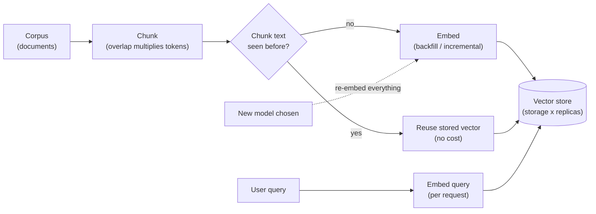

Every RAG system pays to turn text into vectors, and it pays more than once: when the corpus is first indexed, every time a document changes, every time a user asks a question, every month the vectors sit in a database, and, most expensively, every time the team decides to switch embedding models. This lesson builds a cost model for all five, shows which of them dominates at which scale, and measures the inputs to that model on a real corpus of 5,183 scientific abstracts.

It opens the Cost Engineering module. The next lesson, [LLM inference costs](/learn/cost-engineering/llm-inference-costs), does the same for the generator, usually the larger bill. Embedding costs behave differently: they are front-loaded, driven by decisions made months earlier (chunk size, overlap, model choice), and a careless pipeline can multiply them without any change in traffic.

## Learning objectives

- List the five places a RAG system spends money on embeddings and say which grow with corpus size, which with traffic and which with time.
- Calculate backfill, incremental, query and storage costs from token counts, dimensionality and an assumed unit price.
- Explain how chunk overlap, contextual enrichment and boundary-shifting edits multiply the number of tokens embedded.
- Implement content-hash caching so that an update re-embeds only the chunks whose text actually changed.
- Compare a hosted embedding API with self-hosted inference using a break-even calculation.

## Prerequisites

- [Tokens and tokenisation](/learn/understanding-large-language-models/tokens-and-tokenisation): every embedding price and limit is expressed in tokens.
- [Chunk overlap](/learn/chunking-fundamentals/chunk-overlap): overlap is the first multiplier on embedding spend.
- [Model selection](/learn/embedding-optimisation/model-selection) (embedding models): where the cost of re-embedding a corpus is first introduced.
- [Incremental ingestion](/learn/understanding-document-ingestion/incremental-ingestion): detecting which documents changed.

## Why this matters

Embedding is cheap per call, which is precisely why its cost gets out of hand. A single query embedding costs a tiny fraction of a cent on any hosted API, so nobody budgets for it. Then three things happen.

First, the ingestion pipeline is written as "on any change, re-embed the document", the nightly sync touches every file's modification time, and the whole corpus is re-embedded every night. Second, someone adds 50% chunk overlap to fix a retrieval problem, and the embedding bill rises by half with no change in traffic. Third, a better model is released, the team wants it, and they discover that switching means re-embedding hundreds of millions of tokens and running two indexes side by side during the migration.

None of these is visible in a per-request view of cost, only in a model of the whole lifecycle. That model also tells you when *not* to optimise: for a small corpus the embedding bill can be smaller than one engineer-hour, and the effort belongs on the generator.

## The intuition

Think of embedding costs the way you would think of running a library's card catalogue.

Cataloguing the collection for the first time is a large, one-off job: someone reads every book and writes its card. That is the **backfill**. When a book is revised, you rewrite its card; if you are careless, you rewrite the cards for every book on the same shelf, or the whole library. That is **incremental update**, done well or badly. Each visitor's question has to be turned into a lookup, which costs a little effort per visitor. That is **query embedding**. The cards need cabinets, and cabinets have rent. That is **storage**. And if the library decides to switch to a new classification scheme, every card must be rewritten, and for a while the old and new catalogues must coexist. That is **model migration**.

A small library with many visitors spends most effort on lookups; a vast archive with few visitors, on cataloguing and cabinets. The design work is knowing which you are.

## How it works

### The five cost centres



1. **Backfill.** Embedding the entire corpus once. Cost grows with the number of tokens embedded, which is the corpus size multiplied by everything that inflates it (overlap, enrichment, multiple representations).
2. **Incremental updates.** Embedding new and changed content. Cost grows with the *churn rate* of the corpus, and depends heavily on how precisely the pipeline detects what changed.
3. **Query embedding.** One embedding per user query (more if the system rewrites or expands queries). Cost grows with traffic.
4. **Storage.** Keeping vectors in a database: memory or disk for the vectors themselves, the index structure on top, and every replica. Cost grows with corpus size and is paid every month.
5. **Re-embedding on model change.** A full backfill again, plus the cost of running two indexes during the switch. It happens rarely, but it is the largest single event, and it is the one people forget to budget.

### What gets billed: tokens, not characters or chunks

Hosted embedding APIs price per input token, counted by *their* tokeniser. Self-hosted models cost compute time, which also grows with sequence length. So the unit of embedding cost is the token, and the first step of any estimate is counting tokens with the right tokeniser, as [Tokens and tokenisation](/learn/understanding-large-language-models/tokens-and-tokenisation) explained.

Three things inflate the token count beyond the size of the raw corpus:

- **Overlap.** With chunks of $S$ tokens and an overlap of $O$, each window advances by $S - O$ tokens, so every token in the interior of a document is embedded about $S / (S - O)$ times. A 128-token window with a 32-token overlap embeds each token about 1.33 times.
- **Enrichment.** Prepending a document title, a heading path or a generated context sentence to each chunk (as [Contextual retrieval](/learn/advanced-retrieval/contextual-retrieval) does) adds those tokens to *every* chunk. A 50-token context on a 200-token chunk is a 25% increase in embedding tokens, before counting the LLM calls that generated the context.
- **Multiple representations.** Indexing summaries alongside chunks, embedding several query variants, or storing parent and child chunks separately each add another full or partial pass over the corpus.

### Incremental updates and the boundary-shift problem

A pipeline that re-embeds whole documents on every change pays for the entire document even when one word changed. A better pipeline stores a **content hash** of each chunk (a fingerprint such as SHA-256 of the chunk text plus the model identifier) next to its vector, and on update:

1. Re-chunk the changed document.
2. Hash each new chunk.
3. Look each hash up in the store. A hit means an identical chunk was already embedded by the same model: reuse that vector.
4. Embed only the misses, then delete vectors whose hashes no longer appear in the document.

This works perfectly for edits that leave chunk boundaries where they were. It works badly for fixed-size token windows when text is inserted near the start of a document: every later boundary shifts by the length of the insertion, every later chunk's text changes, and every hash misses. The code below measures exactly this. Chunking on structural boundaries (headings, paragraphs) limits the damage to the section that changed, which is a cost argument for [structure-aware chunking](/learn/advanced-chunking-strategies/structure-aware-chunking) that is rarely made.

> [!KEY]
> Include the model identifier (and its version or revision) in the hash. Two models produce incompatible vectors for the same text; a cache keyed on text alone will happily serve a vector from the old model into the new index.

### Query embedding: small per call, steady forever

A query is short, typically 10 to 30 tokens, so one query embedding is very cheap. But it is paid on every request, forever, and multi-query retrieval or [HyDE](/learn/advanced-retrieval/hyde) multiply it. For a small, stable corpus with heavy traffic, query embedding can exceed the backfill within weeks, as the measured example below shows. Caching query embeddings is covered in [Caching strategies](/learn/cost-engineering/caching-strategies).

### Storage: the bill that never stops

The raw size of a vector index is

$$
\text{bytes} = N \times d \times b
$$

for $N$ vectors of $d$ dimensions at $b$ bytes per number. On top of that sit the index structure (an HNSW graph stores neighbour lists for every vector), metadata and payloads, and replication: a database that keeps two or three copies for availability multiplies everything. Whether these bytes live in RAM or on disk changes the price per gigabyte by a large factor, which is why the two levers that shrink $d \times b$ matter so much: [Matryoshka embeddings](/learn/embedding-optimisation/matryoshka-embeddings) reduce $d$, and [embedding quantisation](/learn/embedding-optimisation/embedding-quantisation) reduces $b$. Both are covered in their own lessons; here, note only that storage is the one embedding cost that scales with corpus size *and* time.

### Model migration: the cost that decides the others

Switching embedding models means re-embedding every chunk, because vectors from different models cannot be compared. During the switch both indexes must be live, so storage doubles for the migration window, plus an evaluation run. That is why [Model selection](/learn/embedding-optimisation/model-selection) treats the embedding model as expensive to reverse. If a full backfill costs a few dollars, try new models freely; if it costs weeks of GPU time, plan migrations.

### Hosted API or self-hosted?

The two pricing structures differ in shape:

- A **hosted API** charges per token. Cost is proportional to usage, with no fixed cost, no capacity planning and no idle hardware. Batch endpoints, where offered, give discounts for asynchronous bulk work, as described for OpenAI in [OpenAI embeddings](/learn/embedding-models/openai-embeddings).
- **Self-hosting** (see [Local embedding models](/learn/embedding-models/local-embedding-models)) charges for machines whether they are busy or idle. Cost is roughly fixed per hour, and the marginal cost per token is close to zero until the machine is saturated.

The crossover is a break-even volume, computed below. Non-monetary factors often decide first: data-residency rules can forbid an external API, and a small team may not want to operate GPU servers.

## The mathematics

### Tokens embedded

**Intuition.** The tokens you pay for are the corpus tokens, inflated by overlap and by anything you prepend to each chunk.

$$
T_{\text{embed}} \approx T_{\text{corpus}} \times \frac{S}{S - O} + C \times E
$$

$T_{\text{corpus}}$ is the number of tokens in the documents, $S$ the chunk size in tokens, $O$ the overlap, $C$ the number of chunks and $E$ the enrichment tokens prepended to each chunk. The overlap factor is an upper bound: documents shorter than one window, and the last window of each document, are not overlapped in full.

**By hand.** A 10-million-token corpus chunked at $S = 256$, $O = 64$, with a 40-token title prefix per chunk. The overlap factor is $256 / 192 = 1.333$, giving $13.33$ million tokens. The number of chunks is about $10{,}000{,}000 / 192 \approx 52{,}083$, and the prefixes add $52{,}083 \times 40 \approx 2.08$ million tokens. Total: about $15.4$ million tokens, 54% more than the corpus itself.

### Cost per centre

With an assumed price $p$ per token:

$$
\begin{aligned}
C_{\text{backfill}} &= p \, T_{\text{embed}} \\
C_{\text{incremental}} &= p \, T_{\text{embed}} \, r \, m \\
C_{\text{query}} &= p \, Q \, t_q \, k_q \\
C_{\text{storage}} &= N d b (1 + h) R \times \text{price per byte-month}
\end{aligned}
$$

$r$ is the fraction of the corpus that changes per month, and $m \geq 1$ is a **change amplification** factor: how many tokens the pipeline re-embeds per token that actually changed ($m = 1$ for perfect chunk-level hashing; much larger if whole documents are re-embedded). $Q$ is queries per month, $t_q$ tokens per query and $k_q$ embeddings per query (1 normally, more with multi-query expansion). $h$ is the index overhead fraction and $R$ the number of replicas.

**By hand.** Take $p = 0.10$ dollars per million tokens (an assumption for the arithmetic; check your provider), the 15.4-million-token corpus above, $Q = 300{,}000$ queries of $t_q = 20$ tokens, $k_q = 1$.

- Backfill: $15.4 \times 0.10 = 1.54$ dollars.
- Queries per month: $300{,}000 \times 20 = 6$ million tokens, $6 \times 0.10 = 0.60$ dollars.

At this scale both are trivial, and the engineering time spent optimising them would cost more than a decade of the bill. Scale the corpus to 20 billion tokens, though, and the backfill is 2,000 dollars before overlap, paid again on every model switch.

### Break-even between API and self-hosting

**Intuition.** A self-hosted machine costs the same per hour whether busy or idle; the API costs nothing when idle. Find the monthly volume at which they cost the same.

$$
V^{*} = \frac{H \times c_h}{p}
$$

$H$ is the hours per month the machine runs (about 730 for always-on), $c_h$ its cost per hour, $p$ the API price per token, and $V^{*}$ the break-even monthly token volume. A machine can only reach break-even if its capacity $H \times 3600 \times \tau$ (with $\tau$ its throughput in tokens per second) is at least $V^{*}$.

**By hand.** Assume an always-on machine at $c_h = 1.00$ dollar per hour and an API at $p = 0.10$ dollars per million tokens: $V^{*} = 730 \times 1.00 / (0.10 / 10^6) = 7.3$ billion tokens per month. That machine would need a sustained throughput of $7.3 \times 10^9 / (730 \times 3600) \approx 2{,}780$ tokens per second just to break even, and in practice more, since traffic is uneven. All three inputs are assumptions; the shape of the calculation is what transfers.

```python
# The worked examples above, checked in Python.
T_corpus, S, O, E = 10_000_000, 256, 64, 40
chunks = T_corpus / (S - O)
T_embed = T_corpus * S / (S - O) + chunks * E
print(f"chunks ~{chunks:,.0f}, tokens embedded ~{T_embed / 1e6:.2f} M "
      f"({T_embed / T_corpus - 1:.0%} above corpus)")

p = 0.10 / 1e6                        # assumed dollars per token
print(f"backfill USD {T_embed * p:.2f}, queries/month USD {300_000 * 20 * p:.2f}")

H, c_h = 730, 1.00                    # assumed hours per month and dollars per hour
V = H * c_h / p
print(f"break-even {V / 1e9:.1f} B tokens/month, needs {V / (H * 3600):,.0f} tokens/s sustained")
```

```output
chunks ~52,083, tokens embedded ~15.42 M (54% above corpus)
backfill USD 1.54, queries/month USD 0.60
break-even 7.3 B tokens/month, needs 2,778 tokens/s sustained
```

## In code

**The problem.** Before arguing about embedding costs, measure the inputs: how many tokens the corpus really produces after chunking, how fast your hardware embeds them, and how many tokens an update really re-embeds. Then turn those measurements into money with explicit, replaceable price assumptions.

**Dependencies.** sentence-transformers (with PyTorch), pandas and huggingface_hub. The script downloads the BEIR SciFact corpus (5,183 abstracts) and `all-MiniLM-L6-v2` on first run; no API key is needed.

```bash
pip install sentence-transformers pandas pyarrow huggingface_hub
```

```python
import hashlib, random, time
import pandas as pd
from huggingface_hub import hf_hub_download
from sentence_transformers import SentenceTransformer

MODEL_ID = "sentence-transformers/all-MiniLM-L6-v2"
CHUNK, OVERLAP = 128, 32                  # tokens per chunk, tokens shared by neighbours

# Assumptions for the arithmetic: replace with your provider's current figures.
ASSUMED_API_USD_PER_M_TOKENS = 0.10       # hosted embedding price per million tokens
ASSUMED_QUERIES_PER_MONTH = 300_000
ASSUMED_REPLICAS = 2                      # copies of the index kept by the database
ASSUMED_INDEX_OVERHEAD = 0.5              # HNSW graph etc., as a fraction of raw vectors

corpus = pd.read_parquet(hf_hub_download("BeIR/scifact", "corpus/corpus-00000-of-00001.parquet",
                                         repo_type="dataset"))
docs = dict(zip(corpus["_id"], corpus["title"] + ". " + corpus["text"]))

model = SentenceTransformer(MODEL_ID, device="cpu")
tok = model.tokenizer

def chunk(text):
    """Token-window chunking: CHUNK tokens per window, stepping CHUNK - OVERLAP."""
    ids = tok(text, add_special_tokens=False)["input_ids"]
    step = CHUNK - OVERLAP
    starts = range(0, max(len(ids) - OVERLAP, 1), step)
    return [tok.decode(ids[s:s + CHUNK]) for s in starts], len(ids)

def key(text):
    """Cache key: model identity + exact chunk text."""
    return hashlib.sha256(f"{MODEL_ID}\n{text}".encode()).hexdigest()

# 1. What the corpus costs to embed once
chunks, doc_tokens = {}, 0
for doc_id, text in docs.items():
    pieces, n = chunk(text)
    chunks[doc_id] = pieces
    doc_tokens += n
all_chunks = [c for pieces in chunks.values() for c in pieces]
lengths = [len(tok(c, add_special_tokens=False)["input_ids"]) for c in all_chunks]
chunk_tokens = sum(lengths)
print(f"documents: {len(docs):,}   chunks: {len(all_chunks):,}")
print(f"document tokens: {doc_tokens:,}   tokens embedded: {chunk_tokens:,} "
      f"(overlap multiplier {chunk_tokens / doc_tokens:.2f})")

# 2. Measured local throughput on a sample
random.seed(0)
sample = random.sample(all_chunks, 1024)
model.encode(sample[:64], batch_size=64)                  # warm-up
t0 = time.perf_counter()
model.encode(sample, batch_size=64, normalize_embeddings=True)
secs = time.perf_counter() - t0
sample_tokens = sum(len(tok(c, add_special_tokens=False)["input_ids"]) for c in sample)
print(f"local CPU throughput: {len(sample) / secs:,.0f} chunks/s, {sample_tokens / secs:,.0f} tokens/s")

# 3. The same 2% of documents edited in two ways; which chunks must be re-embedded?
cache = {key(c) for c in all_chunks}
random.seed(1)
edited = random.sample(sorted(docs), k=len(docs) // 50)

def reembed_cost(edit):
    new_chunks = [c for d in edited for c in chunk(edit(docs[d]))[0]]
    misses = [c for c in new_chunks if key(c) not in cache]
    return len(new_chunks), len(misses), sum(len(tok(c, add_special_tokens=False)["input_ids"]) for c in misses)

edits = {
    "sentence inserted at start": lambda t: "Reviewed in 2025. " + t,
    "sentence appended at end":   lambda t: t + " Reviewed in 2025.",
}
miss_tokens = {}
for name, edit in edits.items():
    n, m, mt = reembed_cost(edit)
    miss_tokens[name] = mt
    print(f"{name:<27} chunks {n:>4}  cache misses {m:>4}  tokens {mt:>7,} "
          f"({mt / chunk_tokens:.2%} of a full re-embed)")

# 4. Money and bytes
dim, bytes_per = model.get_embedding_dimension(), 4
price = ASSUMED_API_USD_PER_M_TOKENS / 1e6
q_tokens = 20 * ASSUMED_QUERIES_PER_MONTH
raw = len(all_chunks) * dim * bytes_per
stored = raw * (1 + ASSUMED_INDEX_OVERHEAD) * ASSUMED_REPLICAS
print(f"full backfill (API):      USD {chunk_tokens * price:,.4f}")
for name, mt in miss_tokens.items():
    print(f"update, {name:<27} USD {mt * price:,.6f}")
print(f"queries per month (API):  USD {q_tokens * price:,.4f}  ({q_tokens:,} tokens)")
print(f"backfill on this CPU:     {chunk_tokens / (sample_tokens / secs) / 60:,.1f} minutes")
print(f"vectors: {raw / 1e6:,.1f} MB raw, {stored / 1e6:,.1f} MB stored "
      f"({ASSUMED_REPLICAS} replicas, +{ASSUMED_INDEX_OVERHEAD:.0%} index)")
```

The throughput line depends on your hardware and on whatever else the machine is doing, so your figure will differ; every other line is deterministic. This run was on a laptop CPU:

```output
documents: 5,183   chunks: 18,995
document tokens: 1,742,496   tokens embedded: 2,190,418 (overlap multiplier 1.26)
local CPU throughput: 145 chunks/s, 16,744 tokens/s
sentence inserted at start  chunks  384  cache misses  384  tokens  43,845 (2.00% of a full re-embed)
sentence appended at end    chunks  384  cache misses  111  tokens   8,839 (0.40% of a full re-embed)
full backfill (API):      USD 0.2190
update, sentence inserted at start  USD 0.004385
update, sentence appended at end    USD 0.000884
queries per month (API):  USD 0.6000  (6,000,000 tokens)
backfill on this CPU:     2.2 minutes
vectors: 29.2 MB raw, 87.5 MB stored (2 replicas, +50% index)
```

**The important lines.**

- `tok(text, add_special_tokens=False)` counts tokens with the embedding model's *own* tokeniser. A different tokeniser (`tiktoken`, say) would give a different count, and the provider bills by theirs.
- `chunk()` implements a plain sliding token window. Its step of `CHUNK - OVERLAP` is where the overlap multiplier comes from.
- `key()` hashes the model identifier together with the chunk text, so a vector is reused only when both match.
- `reembed_cost()` re-chunks the edited documents, looks every new chunk up in the set of existing hashes, and sums the tokens of the misses: exactly the work an incremental pipeline would send to the model.

**What the output means.**

- **The overlap multiplier is 1.26, not 1.33.** The formula $S/(S-O) = 128/96$ assumes long documents. Many abstracts are shorter than two windows, and the final window of each document overlaps only on one side, so the real inflation is smaller. Measure it rather than assume it.
- **Where the edit falls matters more than how big it is.** Both edits add the same four words to the same 103 documents. Inserted at the start, they shift every window boundary, so all 384 chunks of those documents change and all must be re-embedded: 2.00% of a full re-embed for a 2% document churn, a change amplification well above what the edit deserved. Appended at the end, they change only the last window (and occasionally create a new one), so 111 chunks miss: one fifth of the cost for the same edit. Structural chunking, where an insertion changes only its own section, behaves like the second case.
- **Queries already cost more per month than the whole backfill.** For this small corpus and the assumed 300,000 queries per month, query embedding is the largest recurring embedding cost. For a corpus a thousand times larger the order flips. Neither is worth optimising at this scale; what matters is knowing which regime you are in.
- **A laptop embeds this corpus in about two minutes.** At this size, self-hosting costs nothing beyond hardware you already have, which is often the real answer for small corpora.

**Errors people commonly hit.**

- The warning *"Token indices sequence length is longer than the specified maximum"* appears when the tokeniser counts a whole document. It is harmless here, since only 128-token windows are embedded, but long text passed straight to `encode()` is silently truncated at the model's maximum (256 tokens here).
- Hashing text after an unstable transformation (a timestamp in the chunk header, a random identifier, a non-deterministic whitespace clean-up) makes every hash miss. Hash exactly what you embed, and keep the transformations deterministic.
- Forgetting deletions: the hash lookup finds what to *add*, but vectors for chunks that disappeared must be removed, or the index fills with stale text.

**Extending it.** Prepend each document's title to its chunks and watch the token count rise; persist the hashes in a key-value store so the cache survives restarts. Exercise 3 swaps in a sentence-based chunker.

## A real-world example

Meridian's Platform team runs AskMeridian over the employee handbook, the IT runbooks and the product documentation. The runbooks live in a wiki that the team syncs every night. A finance analyst preparing the quarterly cloud review noticed that the embedding line item was roughly constant from night to night, even in weeks when nobody edited anything.

Tom, who owned ingestion, traced it in an afternoon. The sync compared each page's *last-modified* timestamp with the previous run, and a wiki plugin rewrote that timestamp on every page when it rebuilt its navigation sidebar each night. Every page looked changed, so the pipeline re-embedded the whole runbook collection nightly: a full backfill per day disguised as incremental ingestion.

The fix had two parts. The sync switched from timestamps to a hash of the extracted page text, so pages whose content had not changed were skipped entirely. Inside changed pages, chunk-level hashes keyed on the model identifier meant that editing one step of a runbook re-embedded one or two chunks rather than the page. The team also switched the runbooks from fixed token windows to heading-based chunks after measuring, with a script much like the one above, that inserting a line near the top of a runbook changed every downstream window.

The bill had never been large; the lesson was that its *shape* (flat every night, regardless of edits) was a symptom, and that cost monitoring finds pipeline bugs. [Cost tracking](/learn/rag-observability/cost-tracking) covers building it.

## Common mistakes

- **Re-embedding whole documents on any change.** Cost tracks document size, not edit size; long, often-edited documents dominate the bill.
- **Detecting change with timestamps.** Metadata churn (permissions, migrations, plugins) makes unchanged content look new, turning incremental ingestion into a daily full backfill.
- **Keying the embedding cache on text alone.** After a model switch, the cache returns vectors from the old model into the new index, and retrieval quality degrades with no error.
- **Ignoring the overlap and enrichment multipliers.** More overlap or a new title prefix raises every future embedding cost, and nobody connects the bill to the chunking change.
- **Budgeting the backfill but not the migration.** The first model switch needs a full re-embed plus double storage, and arrives as a surprise.
- **Optimising embedding spend when the generator dominates.** Days go into shaving a small fraction of the total; compare with [LLM inference costs](/learn/cost-engineering/llm-inference-costs) first.

## Best practices

- Build a cost model with named assumptions (price per token, queries per month, churn, replicas) and keep it next to the pipeline code, so changes to chunking or models can be costed before they ship.
- Count tokens with the embedding model's own tokeniser or the provider's counting tool, not with a generic estimate.
- Store a content hash keyed on model identifier and exact chunk text alongside every vector; embed only misses and delete orphans.
- Prefer chunk boundaries that are stable under edits (headings, paragraphs) for frequently edited sources.
- Batch backfills and use asynchronous batch endpoints where the provider offers them; keep the synchronous path for queries.
- Record the embedding model and its version in the index metadata, and plan model migrations as projects with a budget, a dual-index window and an evaluation gate.

## Performance considerations

Embedding throughput is mostly a batching question: one chunk at a time leaves the hardware idle, while batches of similar-length chunks keep it busy and minimise padding. See [Batch processing](/learn/performance-optimisation/batch-processing) and [GPU acceleration](/learn/performance-optimisation/gpu-acceleration).

For hosted APIs, throughput during a backfill is capped by the provider's rate limits (tokens per minute), not by your code. If the limit is, as an assumption, one million tokens per minute, a 2-billion-token backfill takes at least $2{,}000$ minutes, about 33 hours, however many workers you run. Plan migrations around that number.

Query embedding sits on the latency path: a small local model embeds a short query in milliseconds on a CPU, while a hosted API adds a network round trip. Neither usually rivals generation time.

Storage cost scales with $N \times d \times b \times R$. Halving $d$ (Matryoshka truncation) or quartering $b$ (int8 quantisation) cuts it proportionally, at a quality cost you must measure.

## Security considerations

Sending documents to a hosted embedding API sends their full text to a third party. For personal data or confidential material, check the provider's data-retention terms and your own data-residency obligations before the cost comparison, not after; a cheaper API that you are not allowed to use is not an option.

Content hashes are not anonymous: anyone who can guess a short chunk's text can confirm it against its SHA-256, so keep hashes out of user-visible logs and APIs. Keep permissions on the chunk record, not on the shared cached vector.

## Summary

- Embedding spend comes from five places: backfill, incremental updates, query embedding, storage and model migration. They scale with corpus size, churn, traffic and time in different proportions.
- The billed unit is the token, inflated by overlap (up to $S/(S-O)$), per-chunk enrichment and multiple representations. Measure the real multiplier; short documents make it smaller than the formula.
- Chunk-level content hashes keyed on the model identifier make updates cost what the edit deserves, but fixed token windows amplify edits near the start of a document into a full re-embed of everything after them.
- Query embedding is cheap per call and permanent; for small corpora with heavy traffic it can exceed the backfill.
- Hosted APIs cost per token; self-hosting costs per hour. A break-even volume decides between them once data-residency and operational constraints have been applied.

## Exercises

**1.** A 40-million-token corpus is chunked at 512 tokens with 128 tokens of overlap, and each chunk gets a 30-token heading path prepended. Estimate the tokens embedded and the backfill cost at an assumed 0.10 dollars per million tokens.

<details><summary>Show solution</summary>

Overlap factor: $512 / 384 = 1.333$, giving $53.3$ million tokens. Chunks: $40{,}000{,}000 / 384 \approx 104{,}167$; prefixes add $104{,}167 \times 30 \approx 3.1$ million tokens. Total about $56.5$ million tokens, an upper bound because short documents overlap less. Cost: $56.5 \times 0.10 \approx 5.65$ dollars.

</details>

**2.** Explain why a pipeline that detects changes by comparing file modification times can embed far more than the real churn, and name two better signals.

<details><summary>Show solution</summary>

Modification times change for reasons unrelated to content (permissions, migrations, plugins, re-saves), and every touch triggers a re-embed. Better signals are a hash of the extracted text of the document (to skip unchanged documents) and chunk-level hashes keyed on the model identifier (to re-embed only the chunks whose text changed).

</details>

**3.** Modify the script so that `chunk()` splits on sentence boundaries (`". "`), packing whole sentences into chunks of at most 128 tokens with no overlap. Rerun the "sentence inserted at start" edit and report how the number of cache misses changes. Explain the result.

<details><summary>Show solution</summary>

A greedy sentence packer:

```python
def chunk(text):
    sents = [s if s.endswith(".") else s + "." for s in text.split(". ")]
    out, cur, cur_len, total = [], [], 0, 0
    for s in sents:
        n = len(tok(s, add_special_tokens=False)["input_ids"])
        total += n
        if cur and cur_len + n > CHUNK:
            out.append(" ".join(cur)); cur, cur_len = [], 0
        cur.append(s); cur_len += n
    if cur:
        out.append(" ".join(cur))
    return out, total
```

On our run, the sentence chunker produced 358 chunks for the 103 edited documents, of which 134 missed the cache (13,959 tokens, 0.80% of a full re-embed), against 384 of 384 for token windows. Most edited documents lose only their first chunk. Some cascade, because a greedy packer that receives a longer first sentence can push a sentence into the next chunk and shift later boundaries until one happens to realign. Truly stable boundaries need structure the edit does not move, such as headings or paragraphs.

</details>

**4.** Meridian is considering self-hosting its embedding model on a machine assumed to cost 1.20 dollars per hour, always on, versus an API assumed to cost 0.05 dollars per million tokens. Its total embedding volume, including a quarterly model migration amortised per month, is 3 billion tokens per month. Which is cheaper on these assumptions, and what non-cost factors could reverse the decision?

<details><summary>Show solution</summary>

Self-hosted: $730 \times 1.20 = 876$ dollars per month. API: $3{,}000 \times 0.05 = 150$ dollars per month. Break-even is $876 / (0.05 / 10^6) \approx 17.5$ billion tokens per month, far above the actual volume, so the API is cheaper. Factors that could reverse it: data-residency rules forbidding the API; a need for a model the API does not offer (a fine-tuned or domain model); latency requirements for query embedding; or an existing machine with spare capacity, whose marginal cost is near zero.

</details>

## Check your understanding

```quiz
[
  {
    "q": "A team raises chunk overlap from 0 to 128 tokens on 512-token chunks. Roughly how much does this multiply the tokens embedded for long documents?",
    "options": ["1.25", "1.33", "2.0", "It does not change the token count"],
    "answer": 1,
    "why": "Each window advances by S - O = 384 tokens, so interior tokens are embedded 512 / 384 = 1.33 times."
  },
  {
    "q": "Why should the embedding cache key include the model identifier?",
    "options": [
      "To make the hash longer and so less likely to collide",
      "Because providers bill by model",
      "So that a vector produced by one model is never reused in an index built with another",
      "Because tokenisers differ between models"
    ],
    "answer": 2,
    "why": "Vectors from different models live in unrelated spaces; a text-only key would serve old-model vectors into a new index after a migration."
  },
  {
    "q": "With fixed 128-token windows, a sentence is inserted at the start of a document. What happens to that document's chunks?",
    "options": [
      "Only the first chunk changes",
      "Every chunk's text shifts, so every chunk must be re-embedded",
      "Nothing changes because hashes ignore position",
      "Only the last chunk changes"
    ],
    "answer": 1,
    "why": "Every later window boundary moves by the length of the insertion, so every window's text, and therefore every hash, changes."
  },
  {
    "q": "A 2,000-document internal wiki serves a million queries a month. Which embedding cost is most likely the largest recurring one?",
    "options": ["Query embedding", "The initial backfill", "Index storage replicas", "Model migration"],
    "answer": 0,
    "why": "A small corpus is cheap to embed once, but every query must be embedded; at high traffic this recurring cost dominates."
  },
  {
    "q": "Under what condition is self-hosting an embedding model cheaper than a per-token API?",
    "options": [
      "Always, because there is no per-token charge",
      "When the monthly token volume exceeds the machine's monthly cost divided by the API price per token, and the machine has capacity for it",
      "Only when the corpus is under one million tokens",
      "Never, because GPUs are more expensive than APIs"
    ],
    "answer": 1,
    "why": "A machine costs a fixed amount per hour; it wins only above the break-even volume H times c_h divided by p, and only if it can process that volume."
  }
]
```

## Further reading

- Reimers, N. and Gurevych, I. (2019). *Sentence-BERT: Sentence Embeddings using Siamese BERT-Networks.* [arXiv:1908.10084](https://arxiv.org/abs/1908.10084). The architecture behind most self-hosted embedding models.
- [Sentence Transformers documentation](https://www.sbert.net/): batching, devices and the efficiency options (ONNX, quantised backends) that set self-hosted throughput.
- Muennighoff, N., Tazi, N., Magne, L. and Reimers, N. (2022). *MTEB: Massive Text Embedding Benchmark.* [arXiv:2210.07316](https://arxiv.org/abs/2210.07316).
- Your embedding provider's pricing and rate-limit pages. Prices, batch discounts and limits change often; always take the numbers for a cost model from the current official page.
