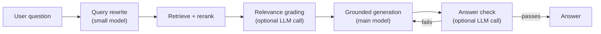

In most RAG systems the generator is the largest line on the bill. Every request sends a prompt that is mostly retrieved text, receives an answer that is short but expensive per token, and often makes extra model calls along the way that nobody counted when the system was designed. This lesson builds a precise model of what one request costs, shows where the money goes inside the prompt, and uses that model to predict which changes would save the most before you make any of them.

[Embedding costs](/learn/cost-engineering/embedding-costs) covered the retrieval side. Here the subject is the language model itself, hosted or self-hosted. Later lessons in this module act on the model you build here: [Token budgets](/learn/cost-engineering/token-budgets) caps what a request may consume, [Model selection](/learn/cost-engineering/model-selection) changes the price per token, and [Caching strategies](/learn/cost-engineering/caching-strategies) avoids paying for the same tokens twice. Measuring these costs in production is the job of [Token tracking](/learn/rag-observability/token-tracking) and [Cost tracking](/learn/rag-observability/cost-tracking).

## Learning objectives

- Write the cost of a request as a function of input tokens, output tokens and per-token prices, including cached and reasoning tokens.
- Decompose a RAG prompt into regions (system prompt, history, retrieved chunks, question) and attribute spend to each.
- Identify the hidden model calls in a RAG pipeline and include them in cost per request.
- Compute cost per successful answer and explain why it differs from cost per call.
- Calculate the cost per million tokens of a self-hosted model from hardware cost, throughput and utilisation.

## Prerequisites

- [Model inference](/learn/understanding-large-language-models/model-inference): prefill, decoding and why output tokens are slower.
- [Tokens and tokenisation](/learn/understanding-large-language-models/tokens-and-tokenisation): counting the billed unit.
- [Context windows](/learn/context-engineering/context-windows): the regions of a RAG prompt and how history grows.
- [Embedding costs](/learn/cost-engineering/embedding-costs): the previous lesson's way of building a cost model with named assumptions.

## Why this matters

A team that knows only "we spent this much last month" cannot make good decisions, because it cannot answer the next question: *which change would reduce it?* Should you retrieve fewer chunks, shorten the system prompt, cap answers, switch models, or cache? Each of these acts on a different part of the bill, and the part that looks largest is often not the part that costs most.

The classic trap is token counts. In a typical RAG request, input tokens outnumber output tokens ten to one or more, so engineers optimise the prompt. But hosted APIs commonly price output tokens at several times the input price, so a modest share of tokens can be a large share of the money. Another trap is counting only the main generation call when the pipeline also rewrites queries, grades relevance, checks the answer and retries on failure. A cost model that misses these underestimates the bill and points at the wrong lever.

## The intuition

Think of a taxi fare with two meters: one runs while the driver reads your directions (input), the other while the car moves (output), and the moving meter ticks five times faster. A RAG request hands the driver a thick folder of directions (system prompt, retrieved documents, conversation so far) and then takes a short ride (the answer). The folder is long, so the reading meter accumulates a lot; the ride is short, but its meter is fast.

Now notice that the folder contains the same first pages on every trip (the system prompt), that on follow-up trips you hand over the whole log of earlier trips (history), and that before some trips a second, cheaper driver rewrites your directions (query rewriting). To cut the fare you need to know which of these pages and drivers actually cost the most. That is the decomposition this lesson builds.

## How it works

### The pricing model of a hosted LLM

Hosted LLM APIs, Anthropic's included, bill per token, with separate prices for:

- **Input tokens**: everything you send (system prompt, messages, retrieved text, tool definitions).
- **Output tokens**: everything the model generates. Output is priced higher than input, commonly by a factor of four or five, because generating each token is a sequential decoding step while input tokens are processed in parallel (see [Model inference](/learn/understanding-large-language-models/model-inference)).
- **Reasoning tokens.** Models that think before answering generate internal reasoning tokens. These are output tokens and are billed as such, even when the reasoning text is not returned to you. Anthropic's API, for example, reports them inside `usage.output_tokens`, with a breakdown in `usage.output_tokens_details`.
- **Cached input.** With prompt caching, input that matches a previously cached prefix is billed at a reduced rate when read, and writing it to the cache costs somewhat more than normal input. [Caching strategies](/learn/cost-engineering/caching-strategies) does the arithmetic.
- **Batch processing.** Many providers offer an asynchronous batch interface at a discount for work that can wait. Anthropic's Message Batches API is one; it suits offline work such as generating contextual summaries at ingestion, never interactive queries.

Prices, ratios and discounts change and differ by model, so every figure in this lesson is labelled as an assumption. Take real ones from the provider's pricing page.

### Anatomy of a RAG request

Split the prompt of one grounded-generation call into its regions:

| Region | Typical size | Grows with |
| --- | --- | --- |
| System prompt and instructions | hundreds to a few thousand tokens | Nothing; constant per request |
| Conversation history | 0 to thousands | Number of turns |
| Retrieved chunks | $k \times$ chunk size | $k$, chunk size |
| User question | tens of tokens | Nothing |
| Output (answer, plus reasoning) | tens to hundreds; more with reasoning | Answer style, reasoning effort |

The cost of the call is the sum over input regions at the input price, plus output at the output price. Two observations follow immediately. The retrieved chunks are usually the largest input region, which makes $k$ and chunk size cost decisions as well as quality decisions. And the system prompt, although modest, is paid on every request, so a 2,000-token system prompt on a million requests is two billion input tokens.

### The hidden calls

A RAG "request" is often several model calls. Count each one:



1. **Query rewriting or decomposition** for follow-up questions and complex queries ([Query rewriting](/learn/advanced-retrieval/query-rewriting)). Input includes the history, so it grows with conversation length.
2. **Hypothetical documents** ([HyDE](/learn/advanced-retrieval/hyde)) generate text just to embed it: an output-heavy call on every query.
3. **LLM-based relevance grading or reranking**, as in [Corrective RAG](/learn/advanced-rag-patterns/corrective-rag): one call per candidate chunk or one large call over all of them.
4. **The main generation.**
5. **Answer checks** (faithfulness or policy checks), each another call with the answer and context as input.
6. **Retries** after timeouts, rate-limit errors, malformed output or failed checks. A retry repeats the full input cost.
7. **Agent loops** ([Agentic RAG](/learn/agentic-rag)), in which every step resends the growing transcript, so cost grows faster than linearly in the number of steps.

Ingestion-time calls, such as generating context for each chunk in [Contextual retrieval](/learn/advanced-retrieval/contextual-retrieval), are not per request, but they belong in the total too.

### Cost per call, per request, per answer

Three units are useful, and they answer different questions:

- **Cost per call** tells you what a model invocation costs. It is what the price table describes.
- **Cost per request** sums every call a user request triggers. It is what traffic forecasts multiply.
- **Cost per successful answer** divides total spend by the number of requests that produced a useful answer. A configuration that is 20% cheaper per request but fails more often, so that users ask again, may be more expensive per answer. This is the unit to optimise; the [Cost-performance trade-offs](/learn/cost-engineering/cost-performance-trade-offs) lesson builds on it.

### Self-hosted inference

Running an open-weight model on your own GPUs replaces per-token prices with an hourly cost. The cost per token then depends on two things you control: **throughput** (tokens per second the server generates at full load, which rises with batching, as [Model inference](/learn/understanding-large-language-models/model-inference) explained) and **utilisation** (the fraction of the time the server is actually busy). A GPU that is idle at night still costs money, so the effective price per token at 30% utilisation is more than three times the price at full load. Self-hosting tends to win when traffic is high and steady, when the model is small enough for cheap hardware, or when data cannot leave your infrastructure. It loses when traffic is spiky or low, and it adds operational work that a per-token API does not have. [Quantisation](/learn/cost-engineering/quantisation) shows how to fit a model onto cheaper hardware.

### The procedure for a cost model

1. List every model call per request, with the model each one uses.
2. For each call, estimate input tokens by region and output tokens, including reasoning, from real logs where you have them.
3. Multiply by the current prices, applying cache and batch rates where they apply.
4. Add the probability-weighted calls: rewrites only for follow-ups, retries at their observed rate.
5. Aggregate over a realistic traffic distribution, not a single average request, and report percentiles as well as the mean.
6. Rank the regions and calls by spend, and evaluate candidate changes against the ranking.

## The mathematics

### Cost of one call

**Intuition.** Two meters, each with its own rate.

$$
C_{\text{call}} = p_{\text{in}} \sum_{r} T_r + p_{\text{out}} \, (T_{\text{ans}} + T_{\text{reason}})
$$

$T_r$ is the number of input tokens in region $r$ (system, history, chunks, question), $p_{\text{in}}$ and $p_{\text{out}}$ are the per-token input and output prices, $T_{\text{ans}}$ is the number of visible answer tokens and $T_{\text{reason}}$ the reasoning tokens, both billed at the output price.

**By hand.** Assume hypothetical prices of 5 dollars per million input tokens and 25 per million output. A request has a 700-token system prompt, 1,300 tokens of chunks and a 20-token question (2,020 input tokens), and a 180-token answer.

- Input: $2{,}020 \times 5 / 10^6 = 0.0101$ dollars.
- Output: $180 \times 25 / 10^6 = 0.0045$ dollars.
- Total: $0.0146$ dollars.

Output is $180 / 2{,}200 = 8.2\%$ of the tokens but $0.0045 / 0.0146 = 30.8\%$ of the cost.

### Cost per successful answer

**Intuition.** Failed attempts and extra calls are paid for, but only successful answers are worth anything.

$$
C_{\text{answer}} = \frac{C_{\text{call}} \times r}{s}
$$

$r$ is the average number of calls of this cost per attempt (retries, checks and loops push it above 1) and $s$ is the fraction of attempts that produce a successful answer. With $r = 1.3$ and $s = 0.92$, $C_{\text{answer}} = 0.0146 \times 1.3 / 0.92 = 0.0206$ dollars, 1.41 times the single call.

### Self-hosted cost per million tokens

**Intuition.** Divide what the machine costs per hour by the tokens it actually produces per hour.

$$
p_{\text{self}} = \frac{c_h}{\tau \times 3600 \times u} \times 10^6
$$

$c_h$ is the hourly cost of the serving hardware, $\tau$ its throughput in tokens per second at full load, and $u$ the utilisation (between 0 and 1). The result is dollars per million tokens.

**By hand.** Assume $c_h = 2.50$ dollars per hour, $\tau = 1{,}500$ tokens per second and $u = 0.4$: $2.50 / (1{,}500 \times 3{,}600 \times 0.4) \times 10^6 = 2.50 / 2{,}160{,}000 \times 10^6 \approx 1.16$ dollars per million tokens. At full utilisation the same machine costs $0.46$. Utilisation is worth as much as hardware choice.

```python
p_in, p_out = 5.00 / 1e6, 25.00 / 1e6          # hypothetical dollars per token
inp, out = 700 + 1300 + 20, 180
c = inp * p_in + out * p_out
print(f"one request: input {inp * p_in:.5f} + output {out * p_out:.5f} = {c:.5f} dollars")
print(f"output share of tokens {out / (inp + out):.1%}, of cost {out * p_out / c:.1%}")

c_h, tau, u = 2.50, 1_500, 0.40                # assumed $/hour, tokens/s at full load, utilisation
print(f"self-hosted: {c_h / (tau * 3600 * u) * 1e6:.2f} dollars per million tokens "
      f"(at full utilisation {c_h / (tau * 3600) * 1e6:.2f})")

s, r = 0.92, 1.3                               # success rate, calls per attempt (retries etc.)
print(f"cost per successful answer: {c * r / s:.5f} dollars ({r / s:.2f} x the single call)")
```

```output
one request: input 0.01010 + output 0.00450 = 0.01460 dollars
output share of tokens 8.2%, of cost 30.8%
self-hosted: 1.16 dollars per million tokens (at full utilisation 0.46)
cost per successful answer: 0.02063 dollars (1.41 x the single call)
```

## In code

**The problem.** A single average request hides the structure of the bill. Simulate realistic traffic for AskMeridian (first questions and follow-ups, a rewrite call for follow-ups, variable answer lengths), attribute every dollar to a stage and a prompt region, and then test three candidate savings on the same simulated traffic before changing anything in production.

**Dependencies.** NumPy only. Prices are hypothetical constants; token sizes are modelled with seeded random draws so the run is reproducible. In production you would replace the simulation with token counts from your logs.

```bash
pip install numpy
```

```python
from collections import defaultdict
from dataclasses import dataclass
import numpy as np

# Hypothetical prices in dollars per million tokens. Real prices change: use your provider's page.
PRICES = {
    "large": {"input": 5.00, "output": 25.00},
    "small": {"input": 1.00, "output": 5.00},
}

@dataclass
class Call:
    stage: str
    model: str
    inputs: dict[str, int]        # input tokens by region of the prompt
    output_tokens: int            # includes any reasoning tokens: they are billed as output

    def cost_by_region(self) -> dict[str, float]:
        p = PRICES[self.model]
        costs = {f"{self.stage}:{k}": v * p["input"] / 1e6 for k, v in self.inputs.items()}
        costs[f"{self.stage}:output"] = self.output_tokens * p["output"] / 1e6
        return costs

def simulate_request(rng, k=5, answer_scale=1.0, generator="large") -> list[Call]:
    """One AskMeridian request: a rewrite for follow-ups, then grounded generation."""
    question = int(rng.integers(8, 40))
    history = int(rng.choice([0, 0, 0, 400, 1200]))        # most requests are first turns
    chunk_tokens = int(sum(rng.normal(260, 40, size=5)[:k]))
    answer = int(rng.lognormal(np.log(180), 0.5) * answer_scale)
    calls = []
    if history:                                             # follow-ups are rewritten first
        calls.append(Call("rewrite", "small",
                          {"instructions": 150, "history": history, "question": question}, 30))
    calls.append(Call("generate", generator,
                      {"system": 700, "history": history, "chunks": chunk_tokens, "question": question},
                      answer))
    return calls

def run(n=10_000, seed=42, **kw):
    rng = np.random.default_rng(seed)
    reqs = [simulate_request(rng, **kw) for _ in range(n)]
    per_request = np.array([sum(sum(c.cost_by_region().values()) for c in r) for r in reqs])
    return reqs, per_request

reqs, per_request = run()
calls = [c for r in reqs for c in r]
by_region = defaultdict(float)
for c in calls:
    for region, dollars in c.cost_by_region().items():
        by_region[region] += dollars
total = sum(by_region.values())

tok_in = sum(sum(c.inputs.values()) for c in calls)
tok_out = sum(c.output_tokens for c in calls)
print(f"output tokens are {tok_out / (tok_in + tok_out):.1%} of tokens "
      f"but {sum(v for k, v in by_region.items() if k.endswith('output')) / total:.1%} of spend")
print("\nspend by region:")
for region, dollars in sorted(by_region.items(), key=lambda kv: -kv[1]):
    print(f"  {region:<22} {dollars / total:6.1%}")

print(f"\ncost per request: p50 {np.percentile(per_request, 50):.4f}  "
      f"p95 {np.percentile(per_request, 95):.4f}  mean {per_request.mean():.4f} dollars")
print(f"per month at 300,000 requests: USD {per_request.mean() * 300_000:,.0f}")

print("\nwhat-if (same seed, same traffic):")
base = per_request.mean()
for label, kw in [("3 chunks instead of 5", {"k": 3}),
                  ("answers 40% shorter", {"answer_scale": 0.6}),
                  ("small model generates", {"generator": "small"})]:
    _, pr = run(**kw)
    print(f"  {label:<24} mean {pr.mean():.4f}  ({pr.mean() / base - 1:+.0%})")
```

```output
output tokens are 7.3% of tokens but 29.9% of spend

spend by region:
  generate:chunks         37.7%
  generate:output         29.5%
  generate:system         20.3%
  generate:history         9.2%
  rewrite:history          1.8%
  generate:question        0.7%
  rewrite:instructions     0.3%
  rewrite:output           0.3%
  rewrite:question         0.1%

cost per request: p50 0.0162  p95 0.0247  mean 0.0172 dollars
per month at 300,000 requests: USD 5,166

what-if (same seed, same traffic):
  3 chunks instead of 5    mean 0.0146  (-15%)
  answers 40% shorter      mean 0.0152  (-12%)
  small model generates    mean 0.0038  (-78%)
```

**The important lines.**

- `Call.inputs` is a dictionary of regions, not a single number. Recording input tokens by region is what makes the attribution possible; a log that stores only `input_tokens` cannot tell you whether chunks or history are driving cost.
- `cost_by_region()` applies the input price to each region and the output price to the output, keyed as `stage:region`, so one dictionary answers both "which call?" and "which part of the prompt?".
- `rng.choice([0, 0, 0, 400, 1200])` models a traffic mix in which three in five requests are first turns. Mixes matter: an average built from first turns only would miss history entirely.
- `rng.normal(260, 40, size=5)[:k]` always draws five chunk sizes and keeps the first `k`, so the random stream, and therefore every other quantity in the simulation, is identical across the what-if runs. Only the variable under test changes.
- `run(**kw)` replays the same seeded traffic under a different configuration, which turns the cost model into a tool for comparing changes.

**What the output means.**

- **Output is 7.3% of tokens and 29.9% of spend**, the effect of a five-to-one price ratio. Halving the answer length is worth roughly as much as halving a third of the input.
- **Retrieved chunks are the largest region (37.7%)**, followed by the output and then the **system prompt (20.3%)**. The system prompt is identical on every request, which makes it the obvious candidate for prompt caching, the subject of a later lesson.
- **The rewrite call is under 3% of spend.** It runs on a cheap model, on only two requests in five, and produces 30 tokens. Removing it would save little and probably cost quality on follow-ups. The ranking tells you where *not* to spend effort.
- **The what-ifs quantify levers before you pull them.** Retrieving three chunks instead of five saves 15%; shorter answers save 12%; moving generation to the small model saves 78%. The last is the largest by far, and it is also the one most likely to hurt quality: whether it is acceptable is a measurement question that [Model selection](/learn/cost-engineering/model-selection) takes up. A cost model ranks options; it does not tell you which quality loss is acceptable.
- **p95 is about 50% above p50.** Budget and alert on the tail, not just the mean; the long answers and long histories are where cost surprises live.

**Reading the real numbers from the API.** In production, take token counts from the response rather than estimating them. With the Anthropic SDK, `response.usage` reports the billed counts. This snippet needs an API key and was not executed here:

```python
import anthropic

client = anthropic.Anthropic()  # reads ANTHROPIC_API_KEY from the environment

response = client.messages.create(
    model="claude-opus-5-5",
    max_tokens=1024,
    system="Answer only from the provided context. If the answer is not there, say you don't know.",
    messages=[{"role": "user", "content": prompt}],
)
answer = "".join(block.text for block in response.content if block.type == "text")

u = response.usage
record = {
    "input_tokens": u.input_tokens,                      # uncached input
    "cache_read_input_tokens": u.cache_read_input_tokens or 0,
    "cache_creation_input_tokens": u.cache_creation_input_tokens or 0,
    "output_tokens": u.output_tokens,                    # answer plus any reasoning
}
```

Store these alongside the region sizes you computed when building the prompt (system, history, chunks, question), so that later analysis can attribute spend. Note that `input_tokens` excludes the cached portions, which are reported separately and priced differently.

**Errors people commonly hit.**

- Estimating Claude token counts with an OpenAI tokeniser. The counts differ; use `client.messages.count_tokens(...)` for estimates before a call, and `response.usage` after.
- Forgetting that reasoning tokens are output tokens. A model that thinks at length can produce several times more billed output than the visible answer suggests.
- Pricing retries at zero. A retried request pays its full input again; with long contexts, a 5% retry rate is a 5% cost increase.

**Extending it.** Add a relevance-grading stage that calls the small model once per chunk and see where it lands in the ranking. Add a 5% retry rate on generation. Replace the simulation with a CSV of real `usage` records and region sizes from your logs.

## A real-world example

Meridian's finance team asked the Platform team a direct question: AskMeridian's model spend had nearly doubled over a quarter while query volume had grown by about a quarter. Was the assistant getting less efficient, and what could be done?

Priya built the decomposition above from a week of request logs, which, fortunately, already recorded token counts per prompt region. Two findings stood out. First, the **history** region had grown sharply: a product change had made the chat widget keep conversations open across a working day, so follow-up turns carried far longer histories than before, and both the rewrite call and the main call paid for them. Second, a "self-check" step added for a pilot, which asked the main model to verify each answer against its sources, had been left on for all traffic. It resent the full context and the answer on every request, a second large-model call per request.

Neither was visible in the dashboards, which showed total spend and total requests only. The fixes were ordinary: history was windowed to the last few turns plus a short summary of earlier ones (as [Context windows](/learn/context-engineering/context-windows) describes), and the self-check was restricted to the categories where the pilot had shown it caught real errors. The team's lasting change was to record tokens per region and per stage on every request and to review the ranking monthly, which is the kind of instrumentation that [Token tracking](/learn/rag-observability/token-tracking) covers.

## Common mistakes

- **Optimising by token count instead of by spend.** Output tokens are few and expensive; a decomposition by tokens points at the prompt when the answer may matter as much.
- **Counting only the main generation call.** Rewrites, graders, checks, retries and agent steps are real spend; omitting them underestimates cost and hides the cheapest wins.
- **Ignoring reasoning tokens.** Billed as output and often invisible in the response text, they can dominate output spend on hard queries.
- **Modelling a single average request.** Averages hide the tail and the traffic mix; long histories and long answers drive the 95th percentile and the surprises.
- **Comparing self-hosted cost at full utilisation.** Real utilisation is lower; the effective cost per token rises in inverse proportion.
- **Choosing the cheapest configuration per request without measuring success rate.** A cheaper call that fails more often can cost more per successful answer.

## Best practices

- Log, for every model call, the stage, the model, input tokens by prompt region, output tokens (with reasoning separated where reported) and cached tokens.
- Keep prices in one configuration table with the date they were checked, and recompute historical costs when they change rather than editing old records.
- Rank spend by stage and by region monthly; act on the top of the ranking.
- Evaluate cost changes on replayed traffic, holding everything else fixed, and pair every cost comparison with a quality measurement.
- Report cost per successful answer alongside cost per request.
- Move work that can wait (ingestion-time generation, evaluation runs, bulk summarisation) to batch interfaces.

## Performance considerations

Cost and latency are coupled but not identical. Output tokens dominate latency, because each is a sequential decoding step; input tokens dominate the time to first token on long prompts but are processed in parallel. So shortening answers saves both money and time, while trimming retrieved context saves money and some time-to-first-token. Extra calls in sequence (rewrite, then generate, then check) add their latencies; calls that can run in parallel cost the same but wait less, as [Parallel retrieval](/learn/performance-optimisation/parallel-retrieval) and [Async execution](/learn/performance-optimisation/async-execution) describe.

Reason about the size of the effect with arithmetic. If generation runs at an assumed 60 output tokens per second, a 180-token answer takes 3 seconds to decode, and cutting it by 40% saves 1.2 seconds per request as well as 12% of spend in the simulation above. A self-hosted server faces a further trade-off: larger batches raise throughput and lower cost per token but raise each request's latency, so the operating point is a choice between cost and responsiveness.

## Security considerations

Cost is an attack surface. A user who can submit very long inputs, request very long outputs, or trigger agent loops can run up the bill, deliberately or by accident; this is sometimes called a *denial-of-wallet* attack. Cap input size, set `max_tokens` on every call, limit agent steps, and enforce per-user budgets, which the next lesson, [Token budgets](/learn/cost-engineering/token-budgets), implements. Retrieved documents are also untrusted input: a document crafted to make the model produce extremely long output, or to trigger tools repeatedly, is a cost attack as well as an integrity one.

Cost logs contain token counts and often prompt regions; if they also store prompt text, they inherit the confidentiality of the documents and questions. Keep counts and text in separate stores with separate access.

## Summary

- A call costs input tokens at the input price plus output tokens, including reasoning tokens, at the output price; caching and batch interfaces change the effective rates.
- Output is a small share of a RAG request's tokens but a much larger share of its cost, because output is priced several times higher.
- Decomposing spend by stage and prompt region (system, history, chunks, question, output) shows which lever matters; retrieved chunks and the constant system prompt are often the largest input regions.
- Hidden calls (rewrites, grading, checks, retries, agent steps) belong in cost per request, and success rate turns cost per request into cost per successful answer.
- Self-hosted cost per token is hourly cost divided by throughput times utilisation; idle hardware is the hidden multiplier.

## Exercises

**1.** At hypothetical prices of 3 dollars per million input tokens and 15 per million output, compute the cost of a request with an 800-token system prompt, six 300-token chunks, a 25-token question and a 250-token answer. What fraction of the cost is output?

<details><summary>Show solution</summary>

Input tokens: $800 + 1{,}800 + 25 = 2{,}625$, costing $2{,}625 \times 3 / 10^6 = 0.007875$ dollars. Output: $250 \times 15 / 10^6 = 0.00375$. Total $0.011625$ dollars; output is $0.00375 / 0.011625 \approx 32\%$ of the cost while being $250 / 2{,}875 \approx 8.7\%$ of the tokens.

</details>

**2.** A pipeline adds an LLM relevance grader that sends each of 8 retrieved chunks (300 tokens each) with a 200-token instruction to the small model, which replies with 5 tokens. Using the hypothetical small-model prices from the code, what does grading add per request? Is it likely to pay for itself?

<details><summary>Show solution</summary>

Each grading call: $500$ input tokens and $5$ output tokens, costing $500 \times 1 / 10^6 + 5 \times 5 / 10^6 = 0.000525$ dollars. Eight calls: $0.0042$ dollars, about a quarter of the 0.0172-dollar mean request. It pays for itself only if it removes enough chunks from the large model's prompt (each 300-token chunk saved is $0.0015$ dollars at the large model's input price) or improves the answer enough to matter. Dropping three chunks per request roughly breaks even; it also adds latency unless the calls run in parallel.

</details>

**3.** Extend the simulation with a 6% retry rate on the generation call (a retry repeats the full call) and an answer-check call on the large model that reads the system prompt, chunks and answer and writes 20 tokens. Report the new mean cost and the share of spend that goes to checks and retries.

<details><summary>Show solution</summary>

Inside `simulate_request`, after the generation call:

```python
gen = calls[-1]
if rng.random() < 0.06:
    calls.append(Call("retry", generator, dict(gen.inputs), gen.output_tokens))
calls.append(Call("check", "large",
                  {"system": 700, "chunks": chunk_tokens, "answer": answer}, 20))
```

On our run the mean cost rose from 0.0172 to 0.0298 dollars per request (+73%). The check call took 38.7% of all spend: it resends the system prompt and the chunks to the large model, so `check:chunks` ties with `generate:chunks` at the top of the ranking. Retries took 3.6%. A check that doubles the input cost must catch enough real errors to justify itself, which is a measurement, not an assumption. Note that the new random draws come after all the original ones, so the rest of the simulation is unchanged.

</details>

**4.** Meridian is considering self-hosting an open-weight model for the rewrite step only. Using the formula for self-hosted cost, describe what you would need to measure to decide, and explain why utilisation is likely to be the deciding factor for this particular step.

<details><summary>Show solution</summary>

Measure the hardware's hourly cost, its throughput for this workload (short prompts, 30-token outputs, at realistic batch sizes) and the expected utilisation, then compare $p_{\text{self}}$ with the hosted small-model prices applied to the rewrite's token mix. The rewrite step is a small share of spend and runs only on follow-ups, so its volume is low and uneven through the day: a dedicated machine would sit idle most of the time, and its effective cost per token, which scales as $1/u$, would be high. Unless the machine is shared with other workloads, the hosted API is likely to be cheaper.

</details>

## Check your understanding

```quiz
[
  {
    "q": "A RAG request uses 2,000 input tokens and 200 output tokens, and output is priced at five times input. What share of the cost is output?",
    "options": ["About 9%", "About 33%", "About 50%", "About 83%"],
    "answer": 1,
    "why": "Output costs 200 x 5 = 1,000 input-token equivalents against 2,000 for input, so 1,000 / 3,000 = 33%."
  },
  {
    "q": "How are reasoning (thinking) tokens billed by hosted APIs such as Anthropic's?",
    "options": [
      "They are free because they are not returned",
      "As input tokens",
      "As output tokens",
      "Only when the reasoning text is displayed"
    ],
    "answer": 2,
    "why": "Reasoning tokens are generated by the model, so they are output tokens and billed at the output price whether or not the text is shown."
  },
  {
    "q": "Which unit should you minimise when comparing two configurations that differ in quality?",
    "options": [
      "Cost per call",
      "Cost per input token",
      "Cost per successful answer",
      "Total tokens per request"
    ],
    "answer": 2,
    "why": "A cheaper configuration that fails more often makes users retry and wastes calls; cost per successful answer accounts for that."
  },
  {
    "q": "A self-hosted model costs 0.40 dollars per million tokens at full utilisation. Traffic keeps it busy 25% of the time. What is the effective cost per million tokens?",
    "options": ["0.10 dollars", "0.40 dollars", "0.80 dollars", "1.60 dollars"],
    "answer": 3,
    "why": "Cost per token scales as 1/u, so 0.40 / 0.25 = 1.60 dollars per million tokens."
  },
  {
    "q": "Logs record only total input and output tokens per request. Which question can they NOT answer?",
    "options": [
      "What did the system spend last month?",
      "Whether retrieved chunks or conversation history drive input cost",
      "What is the mean cost per request?",
      "What is the 95th-percentile cost per request?"
    ],
    "answer": 1,
    "why": "Attributing input cost to prompt regions requires recording tokens per region when the prompt is built."
  }
]
```

## Further reading

- [Anthropic pricing](https://www.anthropic.com/pricing) and the Claude API documentation on [prompt caching](https://docs.anthropic.com/en/docs/build-with-claude/prompt-caching) and token counting. Prices and rates change; take figures from the current pages.
- Kwon, W. et al. (2023). *Efficient Memory Management for Large Language Model Serving with PagedAttention.* [arXiv:2309.06180](https://arxiv.org/abs/2309.06180). The vLLM paper; explains why batching and memory management set self-hosted throughput.
- Pope, R. et al. (2022). *Efficiently Scaling Transformer Inference.* [arXiv:2211.05102](https://arxiv.org/abs/2211.05102). The cost and latency trade-offs of serving large models.
- Chen, L., Zaharia, M. and Zou, J. (2023). *FrugalGPT: How to Use Large Language Models While Reducing Cost and Improving Performance.* [arXiv:2305.05176](https://arxiv.org/abs/2305.05176). A research treatment of cost-aware LLM use, previewing the model-selection lesson.
